# Accordion

## Accordion single

Overview:

- An accordion component helps to organize content into collapsible sections.
- The header area can be filled with a summary (also known as label or title) and a custom hint.
   - Use the custom hint ares for additional text, icons, badges or tags.
   - Images are not allowed in the custom hint area.
- Avoid placing important information in the content area.
- Ensure its discoverability and usability by testing with users.
- An accordion group should always guarantee an overview, avoid long lists.
- A variation of the single accordion is called ‘expandable section’, place the icon left of the title.

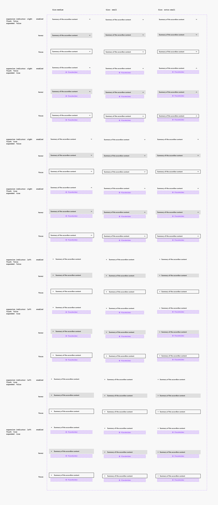

_Figure: Matrix of the single accordion with three columns for Size: medium, Size: small and Size: extra-small and rows for the states enabled, hover (gray background) and focus (dark outline). The rows are grouped by expansion indicator, flush and expanded: right with flush false, right with flush true, left with flush false and left with flush true, each collapsed (expanded: false) and expanded (expanded: true). Every accordion shows the summary "Summary of the accordion content" with a chevron on the right or a caret on the left, and the expanded ones show a purple dashed "Placeholder" content area below the header._

> **Figma Slots in this component** This component supports Figma slots, which allow specific areas to be flexibly populated with your own content. You can find more information on how to use and customize slots in the official Figma documentation. [**Go to the Figma guide**](https://help.figma.com/hc/en-us/articles/38231200344599-Create-and-use-slots-to-build-flexible-components-in-Figma-Design)

### Further guidelines

[Storybook documentation](https://main--63440bbb95889041542a5ba3.chromatic.com/?path=/docs/components-accordion--documentation)

### Related elements

[Drawer](https://www.figma.com/design/qXldpLO6gxHJNLdcXIPxYt/Pattern-Library-%F0%9F%96%A5-Web-1.0?node-id=16282-9317)

[Fieldset](https://www.figma.com/design/Ie2r0R9QwjEc7O3nrFbXhV/Web-Pattern-Library?node-id=8-154)

[Typography](https://www.figma.com/design/d9wrOp4aCplDsV9AVC87Xn/Typography-%F0%9F%85%B0%EF%B8%8F?m=auto&t=ENDkSmRI4RwAfDs4-6)

[Iconography](https://www.figma.com/design/U218NNP4OsipaHOtv5flns/Iconography-%E2%9E%A1%EF%B8%8F?m=auto)

### Contribute

Contribute to improving this component by sharing your feedback, asking questions, or suggesting features [here](https://www.figma.com/design/lLmw7PfIdKjFG4uT3B2Hyj/Onboarding-%F0%9F%93%96?node-id=446-868&t=zKmRu4kAkxMeRDmK-4).

## Accordion Group

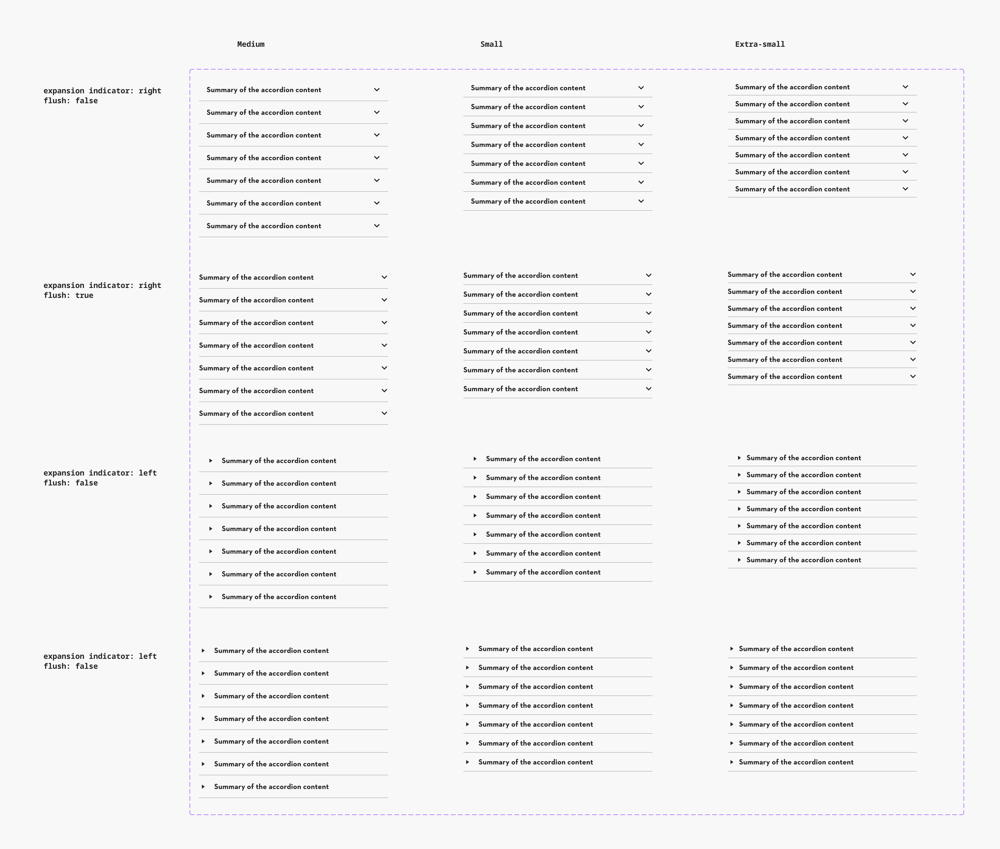

_Figure: Accordion groups shown in three columns, Medium, Small and Extra-small, with rows for expansion indicator: right with flush: false, expansion indicator: right with flush: true, expansion indicator: left with flush: false and a fourth row labelled expansion indicator: left with flush: false whose items sit slightly further left like the flush variant. Each group stacks seven collapsed items with the summary "Summary of the accordion content", separated by thin divider lines, with a chevron at the right or a caret at the left; the spacing grows from extra-small to medium._

## Formatting and Construction

### Anatomy

#### Accordion item

1. **Header**
   1. **Summary**
   1. **Hint**
   1. **Expansion Indicator** depending on the use-case chevron or caret
   1. **Number Indicator** minimized or used to displaying a number
1. **Content**

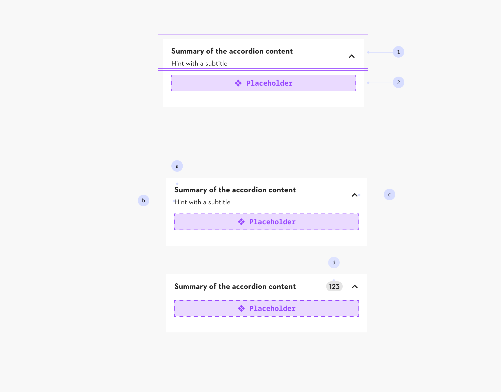

_Figure: Top: an expanded accordion item with the summary "Summary of the accordion content", the hint "Hint with a subtitle", an up-pointing chevron at the right and a purple dashed "Placeholder" content area; callout 1 marks the header (summary, hint and chevron) and callout 2 marks the content. Middle: the same item with callout a on the summary, b on the hint and c on the expansion indicator, a chevron or caret depending on the use case. Bottom: an expanded item without hint but with the number indicator "123" in a gray pill left of the chevron, marked d._

#### Custom hint area

If you want to display a unique element, use the hint as a custom element. **(1)**

It is meant for icons, badges and flags. **(2)**

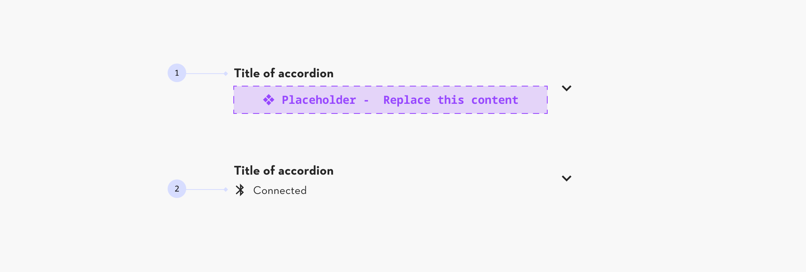

_Figure: Two accordion headers with the title "Title of accordion" and a chevron at the right. In the first, callout 1 points at a purple dashed "Placeholder - Replace this content" element in the hint area, which is the slot for custom elements such as icons, badges and flags. In the second, callout 2 points at the hint "Connected" with a Bluetooth icon._

#### Accordion group

1. **Accordion item**
1. **Divider (border)**

**Note:** This is a Figma only component.

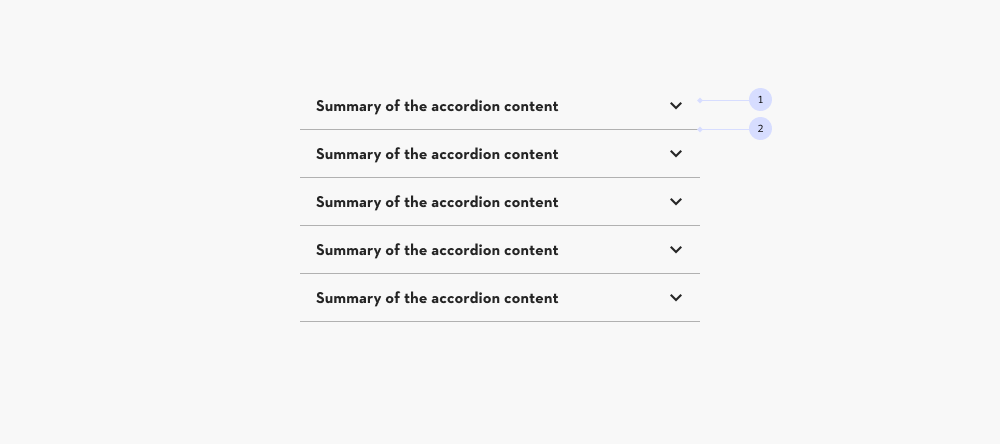

_Figure: An accordion group of five collapsed items, each with the summary "Summary of the accordion content" and a chevron on the right, separated by thin divider lines. Callout 1 points at the first accordion item and callout 2 points at the divider border below it._

#### Chevron vs. Caret Usage

Use indicators consistently to signal expand/collapse behavior. The position and purpose of the element determine whether a chevron or caret should be used.

1. **Chevron** Use a chevron icon when the indicator is placed on the right side of the element. Best suited for progressive disclosure in content-heavy layouts. Use when:
   - You’re revealing additional content inside a grouped accordion
   - Accordion items are part of a content group
   - You want to minimize visual overload and guide users step-by-step
1. **Caret** Use a caret icon when the indicator is placed on the left side of the element. Ideal for navigational structures and single expandable sections. Use when:
   - You’re expanding navigation levels (e.g., sidebar menus)
   - It’s an expandable section (standalone accordion item)

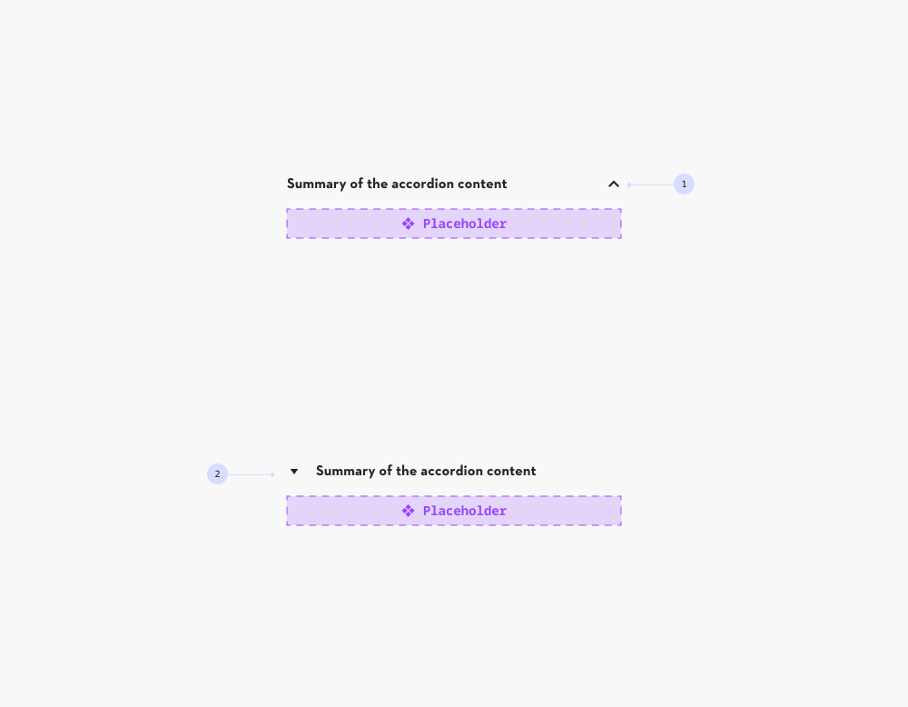

_Figure: Two expanded accordions with the summary "Summary of the accordion content" and a purple dashed "Placeholder" content area. Callout 1 points at an up-pointing chevron on the right of the first header, used when the indicator sits on the right, and callout 2 points at a small down-pointing filled caret on the left of the second header, used when the indicator sits on the left._

#### Size Variants

Three sizes are available, to fit any lay-out and use case.

All variants can be used mobile and desktop.

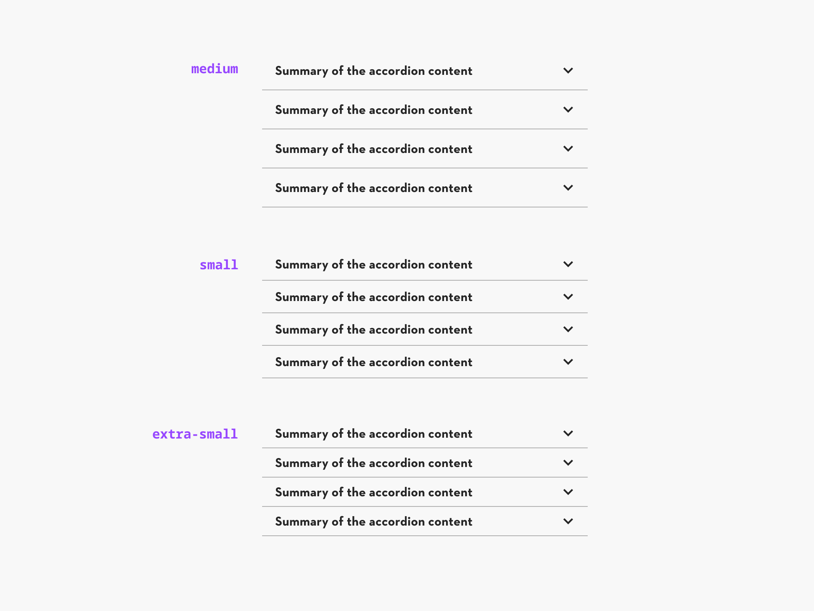

_Figure: Three accordion groups with the size labels medium, small and extra-small, each made of four collapsed items with the summary "Summary of the accordion content", a chevron on the right and divider lines between them. The items get progressively shorter in height from medium over small to extra-small._

### Sizing

#### Maximum width

The maximum width follows the size of [content grid narrow](https://www.figma.com/design/JyyYtoCYbtJrzqHs38OXSQ/Grid-%26-Spacing-%F0%9F%A7%AE?node-id=1-132) , for both smaller and bigger viewports.

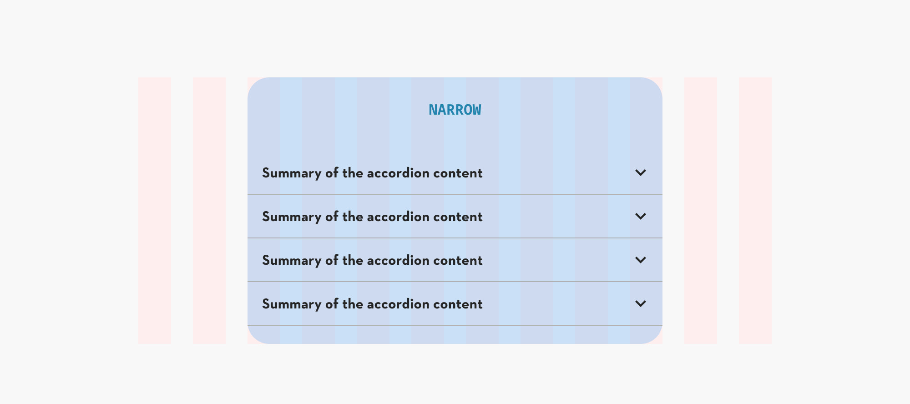

_Figure: Accordion group (size medium, flush false, expansion indicator on the right) with four collapsed items, each labeled "Summary of the accordion content" with a downward chevron, placed inside a blue area labeled "NARROW" that marks the content grid narrow. The accordion fills the full width of that narrow grid area, which is its maximum width, for both smaller and bigger viewports._

#### Minimum width

The minimum size, based on the [documented breakpoints and content placement](https://www.figma.com/design/JyyYtoCYbtJrzqHs38OXSQ/Grid-%26-Spacing-%F0%9F%A7%AE?node-id=1-132):

- **on viewports greater than or equal to 1024px (1)**
   - “first quarter”
   - use case: filter on a product overview page on a desktop or big tablet.
- **on viewports smaller than 1024px (2)**
   - “first third”
   - use case: content list on a mobile phone, tablet or in a split screen.

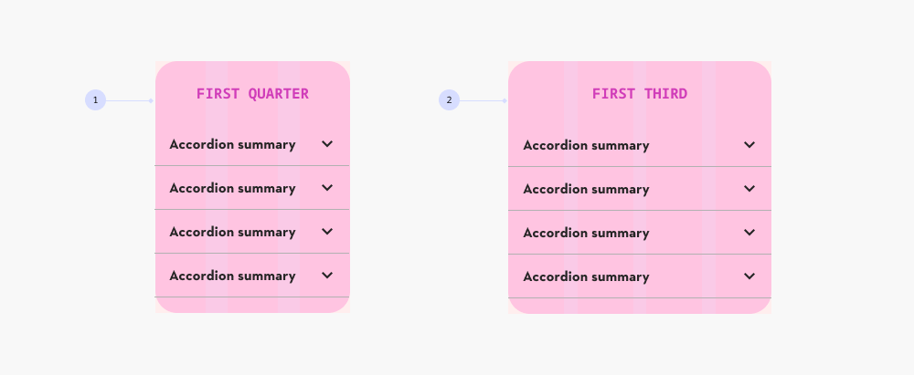

_Figure: Two accordions with four "Accordion summary" items each and a chevron on the right, laid over pink grid columns. Callout 1 points to the narrower one labeled "FIRST QUARTER" (viewports of 1024px and larger, e.g. a filter on a desktop or big tablet), callout 2 points to the wider one labeled "FIRST THIRD" (viewports smaller than 1024px, e.g. a content list on a phone, tablet or split screen)._

### Alignment

#### Flush alignment

When designing for smaller spaces on a page, such as side drawers, panels or sidebars, use flush alignment to ensure better text alignment with other content elements.

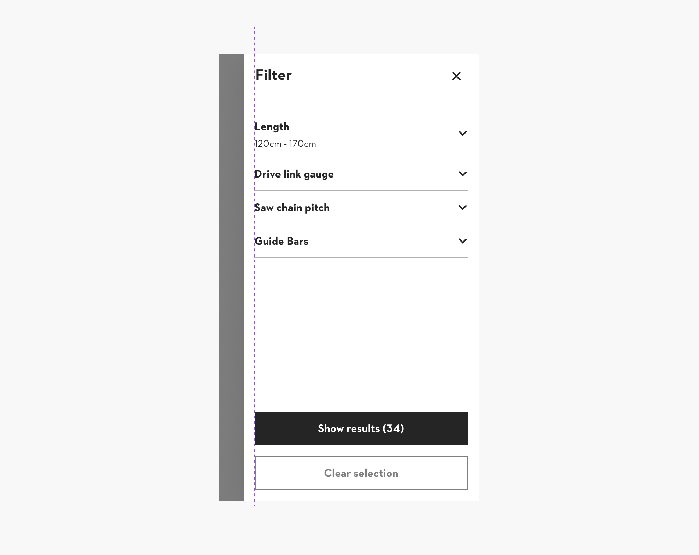

_Figure: Filter side drawer with the title "Filter" and a close icon, containing flush-aligned accordion items "Length" with the subtitle "120cm - 170cm", "Drive link gauge", "Saw chain pitch" and "Guide Bars", each with a chevron on the right. A dashed vertical line shows that the accordion text starts on the same left edge as the "Filter" title and the buttons below, a filled "Show results (34)" button and an outlined, greyed "Clear selection" button._

### Status

#### Default is closed

By default the accordion is closed.

More than one accordion can be open at the same time.

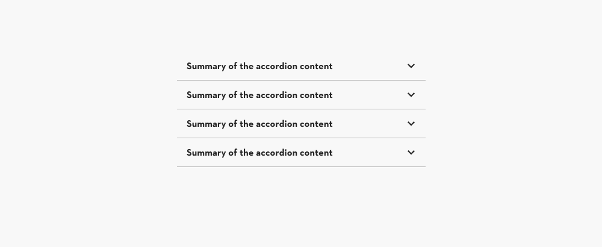

_Figure: Accordion group in the default state with four items, all closed, each showing the text "Summary of the accordion content" and a downward chevron on the right, separated by thin divider lines. More than one item can be open at the same time._

### Motion

[→ Motion Styles](https://www.figma.com/design/UYHZEckQObDvLuuRoMP8ps/Styles-%F0%9F%AA%AD?node-id=1-148)

#### Hover animation

**Animation type:** fade: background color opacity (0-100%) (color: transparent-hover) **Duration:** 100ms **Easing:** linear

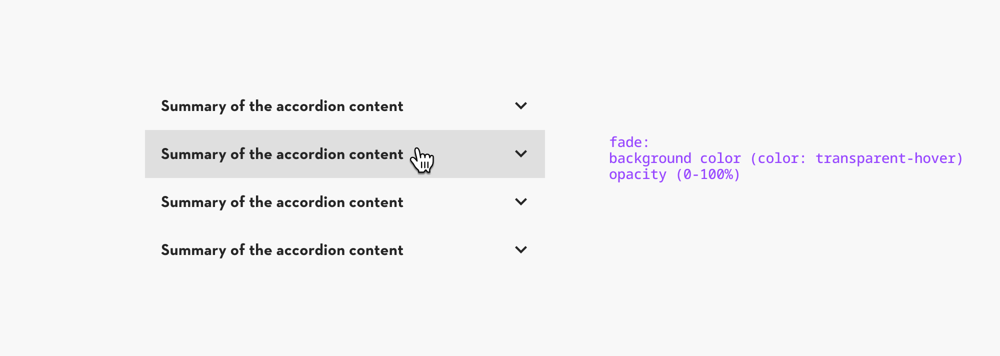

_Figure: Four closed accordion items labeled "Summary of the accordion content" with chevrons on the right. The second item is in the hover state: the mouse pointer is over it and it has a grey background, while the others are enabled. The annotation reads "fade: background color (color: transparent-hover) opacity (0-100%)"._

#### Opening animation

**Animation type:** expand: height (0-100%) fade: opacity content in content area (0-100%) rotation: chevron 0°-180° (counter-clockwise) **Duration:** 250ms **Easing:** motion-functional-ease-out **Note:** easing and duration also applies to the icon rotation

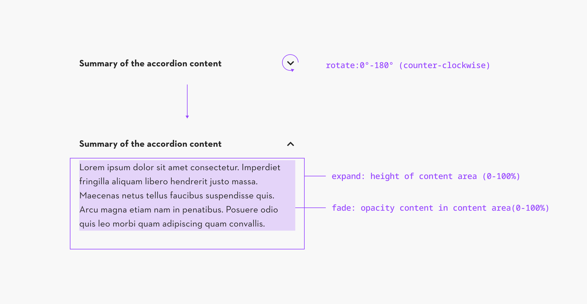

_Figure: Opening animation shown as a closed accordion item "Summary of the accordion content" with a chevron pointing down, an arrow leading to the same item opened with a chevron pointing up and a Lorem ipsum text block in a highlighted content area below. Annotations: the chevron rotates 0°-180° (counter-clockwise), the height of the content area expands (0-100%), and the opacity of the content in the content area fades (0-100%)._

#### Closing animation

**Animation type:** expand: height (100-0%) fade: opacity content in content area (100-0%) rotation: chevron 180°-0° (clockwise) **Duration:** 250ms **Easing:** motion-functional-ease-in

**Note:** easing and duration also applies to the icon rotation

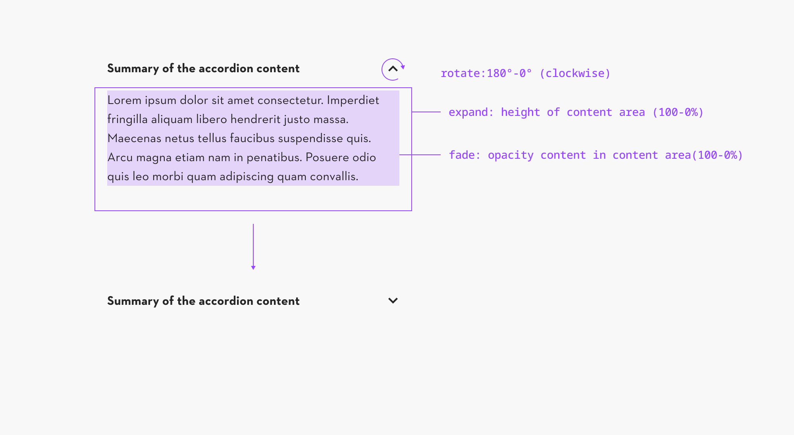

_Figure: Closing animation shown as an open accordion item "Summary of the accordion content" with a chevron pointing up and a Lorem ipsum text block in a highlighted content area, with an arrow leading down to the same item closed with a chevron pointing down. Annotations: the chevron rotates 180°-0° (clockwise), the height of the content area shrinks (100-0%), and the opacity of the content in the content area fades (100-0%)._

## Content and Assets

### Accessible copy

- Keep summaries and hint short and simple.
- It is recommended to avoid abbreviations.
- Test the understandability of the copy in the header area at all times.

_Figure: A single closed accordion header with the short, plain summary text "Summary of features and fixes" and a downward chevron on the right, as an example of accessible copy without abbreviations._

### Accordion title

#### Header recommendations

You can customize the title using various text heading styles, with or without a subtitle.

**Formatting examples:**

1. Text M with subtitle in regular, do guarantee a clear hierarchy.
1. Text M bold, use with maximum 2 lines.
1. Heading L, keep the title as short as possible

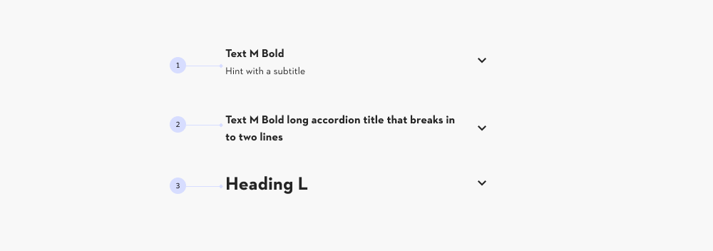

_Figure: Three accordion headers with chevrons on the right showing recommended formatting. Callout 1: "Text M Bold" title with the regular-weight subtitle "Hint with a subtitle", which gives a clear hierarchy. Callout 2: "Text M Bold long accordion title that breaks in to two lines", bold text limited to a maximum of 2 lines. Callout 3: "Heading L", a short title._

#### Header warnings

You can customize the header using various text heading styles, with or without a subtitle

**Formatting examples:**

1. Text M with subtitle/hint in bold, does not guarantee a clear hierarchy.
1. Uppercase isn’t as legible for all users.
1. Heading L can’t be long and covering two lines.

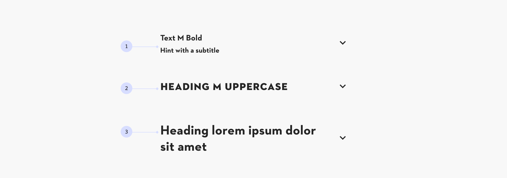

_Figure: Three accordion headers with chevrons on the right showing formatting to avoid. Callout 1: "Text M Bold" title with the subtitle "Hint with a subtitle" also in bold, which does not guarantee a clear hierarchy. Callout 2: "HEADING M UPPERCASE", uppercase text that is less legible for some users. Callout 3: "Heading lorem ipsum dolor sit amet" in Heading L breaking over two lines, which is too long for that style._

#### Maximum Text width

Please make sure the Header summary and text elements inside the accordion do not exeed **the maximum text width to 34em**, based on the font sized used

[Typography →](https://www.figma.com/design/pQUiJaNuWrGzPaeMrEHf6N/DS-1117-Design-%7C-34em?node-id=2645-515)

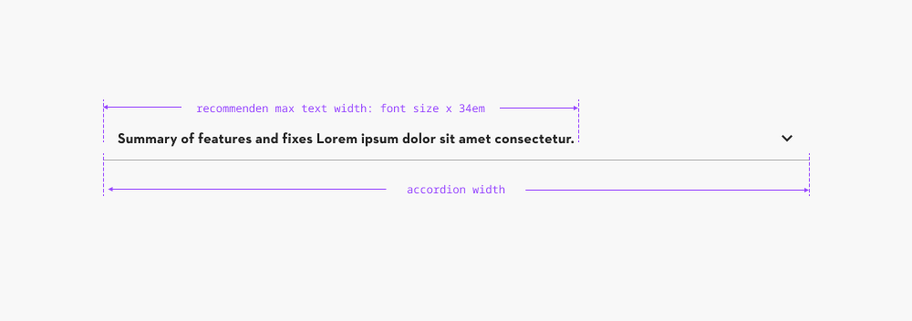

_Figure: A single accordion header "Summary of features and fixes Lorem ipsum dolor sit amet consectetur." with a chevron on the right. A top measurement labeled "recommenden max text width: font size x 34em" spans from the left edge to the end of the header text, while a bottom measurement labeled "accordion width" spans the full width of the accordion, so the text is much narrower than the accordion._

### Custom hint area

#### Hint

Populate the hint area with content or functions, referencing the content in the accordion or as the subtitle.

Additionally, it can function as a status display, for example, reflecting the filter set or sorting rules.

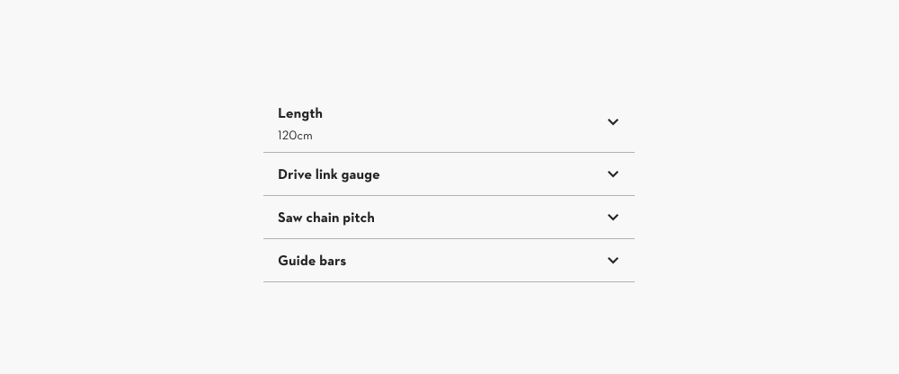

_Figure: Accordion group with four closed items "Length", "Drive link gauge", "Saw chain pitch" and "Guide bars", each with a chevron on the right. Only "Length" uses the hint area, showing the value "120cm" as a subtitle below its title, for example to reflect a set filter._

#### Icons, status and more

Use the custom hint area for additional information.

Maximum 2 icons in the header area, keep it simple to reduce visual clutter.

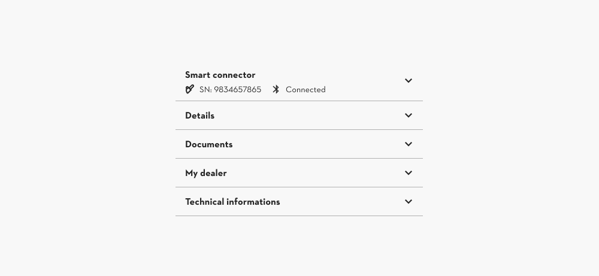

_Figure: Accordion group with closed items "Smart connector", "Details", "Documents", "My dealer" and "Technical informations". The "Smart connector" header uses the custom hint area with two small icons and text: a device icon followed by "SN: 9834657865" and a Bluetooth icon followed by "Connected", showing at most 2 icons._

#### Do not use images

Photos and content icons in the custom hint area are not allowed.

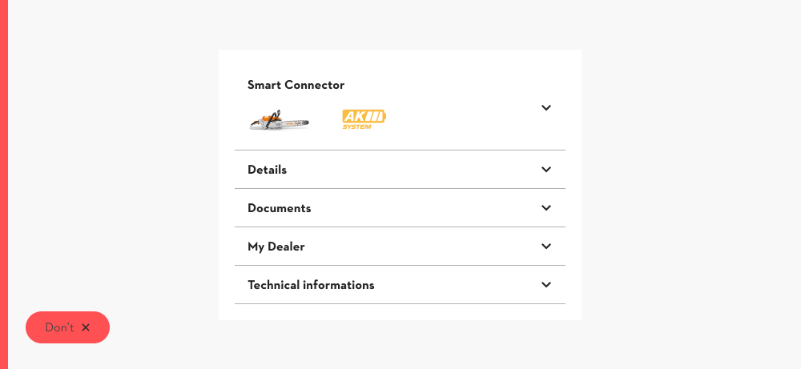

_Figure: Don't example: accordion with closed items "Smart Connector", "Details", "Documents", "My Dealer" and "Technical informations" where the custom hint area of "Smart Connector" contains a product photo of a chainsaw and an AK System battery logo. Photos and content images in the hint area are not allowed._

#### Number Indicator

Use case: Filter lists. The number indicator shows how many filter items are selected.

The number indicator is placed on the left to the chevron icon.

A number indicator signals dynamic or countable content.

Only use the number indicator when necessary to keep the visual load low. Avoid using it for content elements.

[→ Number Indicator](https://www.figma.com/design/qXldpLO6gxHJNLdcXIPxYt/Core-Components-%F0%9F%92%A0?m=auto&node-id=24240-47126&t=kmFbhfUplK9oMbc8-1)

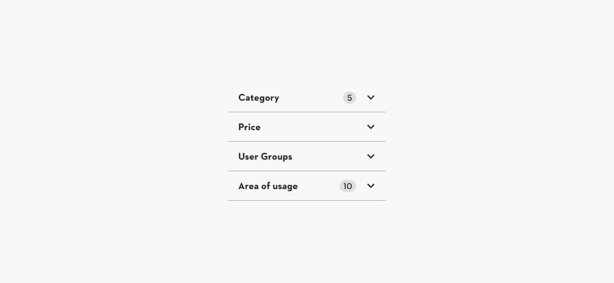

_Figure: Filter accordion with four closed items "Category", "Price", "User Groups" and "Area of usage". "Category" shows a grey number indicator "5" and "Area of usage" shows "10", each placed left of the chevron, giving the count of selected filter items; "Price" and "User Groups" show none._

#### Minimized number Indicator

Although the minimal selection indicator is **technically supported** in the component, its use is **not recommended**. The indicator uses an **orange highlight**, which is primarily reserved for important notifications or alerts. Using it in this context can reduce its visual impact and make the layout feel overly busy. **Do not combine** it with a **number indicator** in the same section.

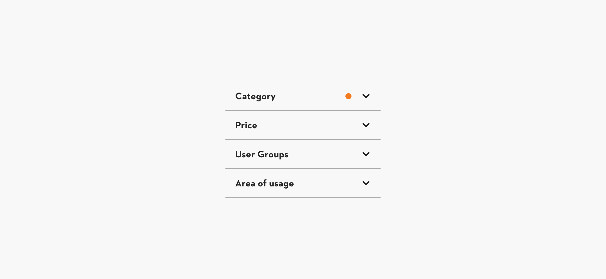

_Figure: Filter accordion with four closed items "Category", "Price", "User Groups" and "Area of usage". Only "Category" shows a small orange dot, the minimized selection indicator, placed left of the chevron. This orange highlight is not recommended and must not be combined with a number indicator in the same section._

#### Don't combine the number indicator and hint.

Avoid overcrowding the component and keep the visual load low.

Decide to use either a hint or a number indicator.

When applying a filter as an accordion, only use the number indicator since it provides information about the count of filters the user sets.

**Avoid displaying all active filter statuses in the hint area.**

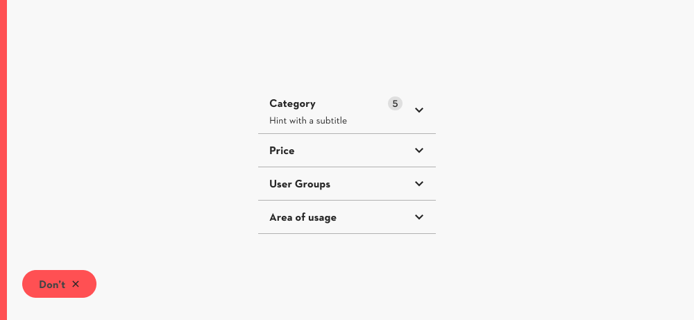

_Figure: Don't example: filter accordion with items "Category", "Price", "User Groups" and "Area of usage" where "Category" combines the number indicator "5" next to the chevron with the subtitle "Hint with a subtitle". A hint and a number indicator must not be combined, because it overcrowds the component; use only the number indicator for filters._

#### Don't use number indicator for content accordions.

Avoid using a number indicator if the accordion content is static or cannot be quantified. It becomes irrelevant if users cannot change actionable content.

**Static Content:** When accordion content remains the same and does not involve quantities or states (e.g., text-only information).

**Unquantifiable Content:** The content within the accordion cannot logically be represented as a countable or dynamic value (e.g., descriptive text or general information).

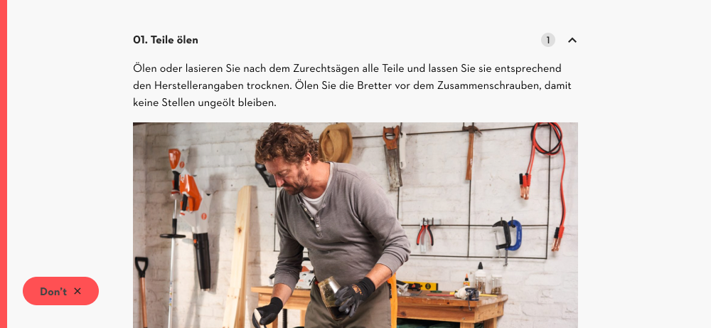

_Figure: Don't example: an opened accordion item titled "01. Teile ölen" with a number indicator "1" next to an upward chevron, followed by German instruction text about oiling the parts and a photo of a man oiling a board at a workbench. The number indicator is wrong here because the content is static, descriptive text that cannot be quantified._

### Custom content area

#### Layout and elements

You can display any layout within the content area.

Insert data tables, images and forms inside an accordion if needed.

**Attention:** Ensure the content is easily findable and usable.

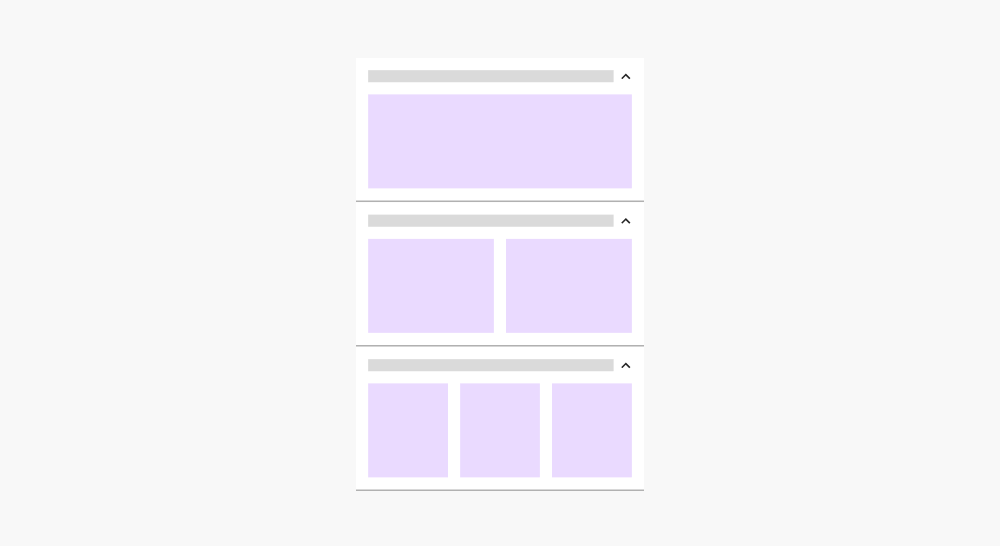

_Figure: Wireframe of three open accordion items, each with a grey header bar and an upward chevron, showing the content area layouts possible inside: the first has one wide purple block, the second two equal blocks side by side, the third three smaller blocks in a row._

### Accordion group

#### Tip: open first accordion

On content pages, it is common to have the first accordion of a group open and the rest closed.

It immediately gives users a sense of what information is available in the accordion group. It improves clarity, encourages interaction, and aligns with user expectations.

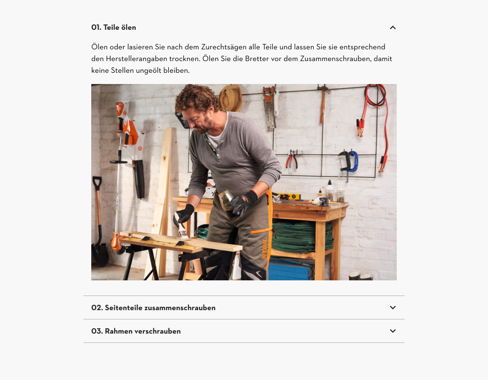

_Figure: Accordion group of three items where only the first, "01. Teile ölen", is open with an upward chevron, showing German instruction text and a photo of a man oiling a board at a workbench. The other two items, "02. Seitenteile zusammenschrauben" and "03. Rahmen verschrauben", are closed with downward chevrons._

#### Amount of accordion elements

Make sure the overview of the list is given, especially on mobile. Avoid long lists that exceed a viewport (in closed status).

Users must easily navigate through open and closed accordions as content switches.

_Figure: Wireframe of a mobile page with a header bar, a headline placeholder, an image placeholder and a list of accordion elements, each with a chevron on the right. Five accordions are closed, the sixth is open with its content area visible, and two more closed accordions follow, so the list is cut off at the bottom of the viewport._

#### Don’t combine sizes.

Don't combine small and medium accordions in the same group.

Ideally, it is not even within the same viewport or page.

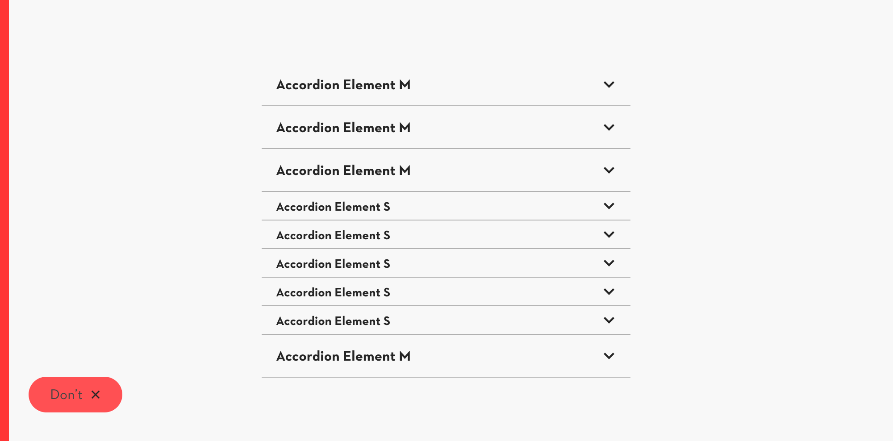

_Figure: Don't: a single accordion group stacks three "Accordion Element M" rows, then five smaller "Accordion Element S" rows, then another "Accordion Element M" row, each with a chevron on the right. Mixing medium and small accordions in the same group is wrong._

#### Don’t nest accordions

Nesting accordions within other accordions is not allowed.

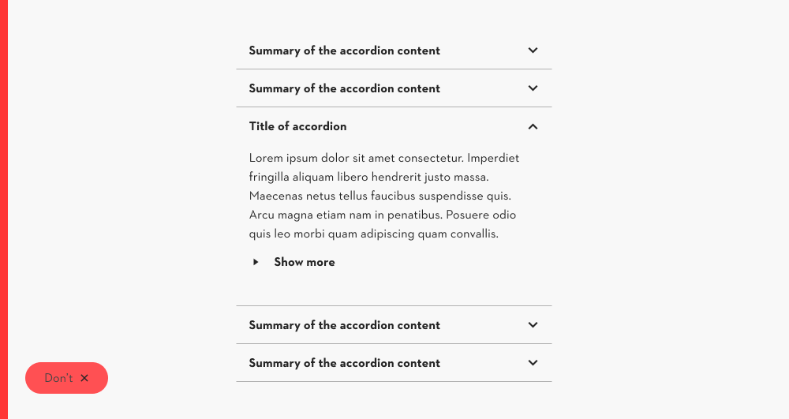

_Figure: Don't: an accordion list with two closed "Summary of the accordion content" rows, then an open accordion "Title of accordion" containing lorem ipsum text and a "Show more" expandable section, followed by two more closed rows. Placing an accordion inside another accordion's content is not allowed._

#### Layout type: content-heavy

Incorporating at least three accordions.

Add a compelling headline above to convey the purpose of the accordion group.

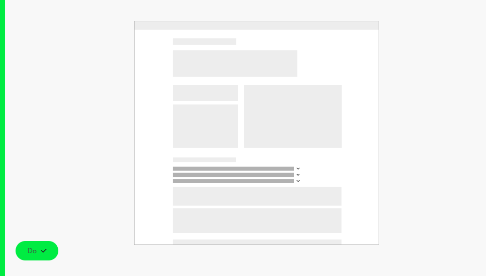

_Figure: Do: a wireframe of a content-heavy page with image and text placeholders and, further down, a small headline above a group of three closed accordions with chevrons on the right, followed by more content blocks. A content-heavy layout should use at least three accordions with a headline above that conveys the group's purpose._

### Accordion single

#### Expandable section

A variation of the single accordion is called an 'expandable section'; place the icon on the left of the title.

Mainly, use it when you have an extended content area but the title is very short.

_Figure: Do: an expandable section in its closed state, with a small triangle icon on the left of the short title "Technical details". This variant of the single accordion puts the icon left of the title and suits an extended content area with a very short title._

#### Layout type: content-heavy

Avoid using a single accordion in a text-heavy layout. It is crucial to ensure that this design choice is not overlooked.

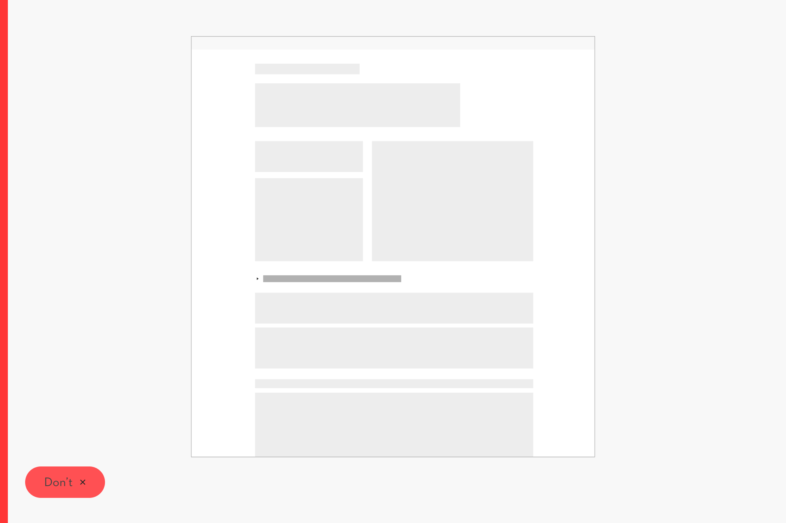

_Figure: Don't: a wireframe of a text-heavy page with image and text placeholders and only one single accordion row, shown with a small triangle icon and a short bar, between large content blocks. A single accordion in a content-heavy layout is easily overlooked and should be avoided._

#### Edge case: notification

Use with care.

Especially with warnings or errors, as information can be crucial.

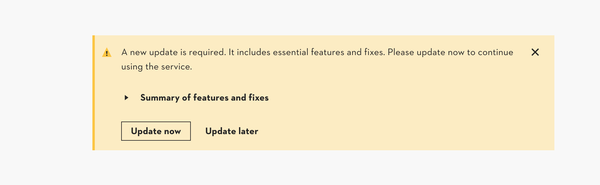

_Figure: Edge case: a yellow warning notification with a warning icon and a close button (ghost, small, icon-only) on the right. The text reads "A new update is required. It includes essential features and fixes. Please update now to continue using the service." Below it is a closed accordion with the left-placed triangle titled "Summary of features and fixes", then the buttons "Update now" (outline, small) and "Update later" (ghost, small). Use accordions in notifications with care, especially for warnings or errors, because the information can be crucial._

### Navigation

#### Sidebar Navigation

A single accordion can be used in the sidebar to expand and reveal the next level of navigation.

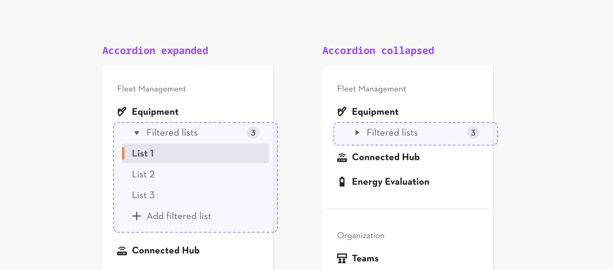

_Figure: Two sidebar navigations side by side, with a dashed purple outline marking the accordion in each. Under "Accordion expanded" the "Filtered lists" accordion with a count badge of 3 is open and shows "List 1" (selected), "List 2", "List 3" and "Add filtered list" below "Equipment" and above "Connected Hub". Under "Accordion collapsed" only the "Filtered lists" row with badge 3 is shown, followed by "Connected Hub", "Energy Evaluation" and an "Organization" section with "Teams"; both sidebars start with the "Fleet Management" heading._

## Behavior

### Avoid system feedback

Avoid system feedback above or inside the accordion element that corresponds to elements in the content area.

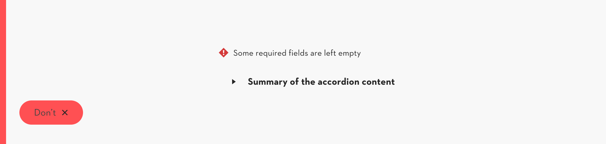

_Figure: Don't: a red error icon with the message "Some required fields are left empty" is placed directly above a closed accordion titled "Summary of the accordion content". System feedback that relates to content inside the accordion should not be shown above or inside the accordion element._

### Focus management

Elements within the header are not focusable. The whole header has one focus.

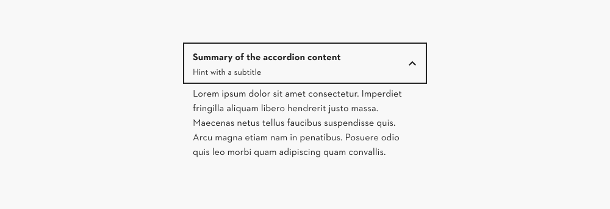

_Figure: An open medium accordion with a chevron pointing up on the right, a title "Summary of the accordion content" and a hint "Hint with a subtitle". One dark focus outline surrounds the whole header, showing that the header has a single focus and its inner elements are not focusable; a lorem ipsum paragraph is shown below as the content._

### The user is in control

The user must click/tap proactively to change the state. The system or system settings can’t trigger the status.

_Figure: A closed medium accordion in hover state with a grey background, the title "Summary of the accordion content" and a chevron pointing down on the right. A hand cursor sits over the title, showing that the user has to click or tap actively to change the state._

## Examples/Variants

### SaaS (Software as a Service)

Accordions in portals and platforms are great to reduce the visual clutter. The user controls what part of the interface is visible.

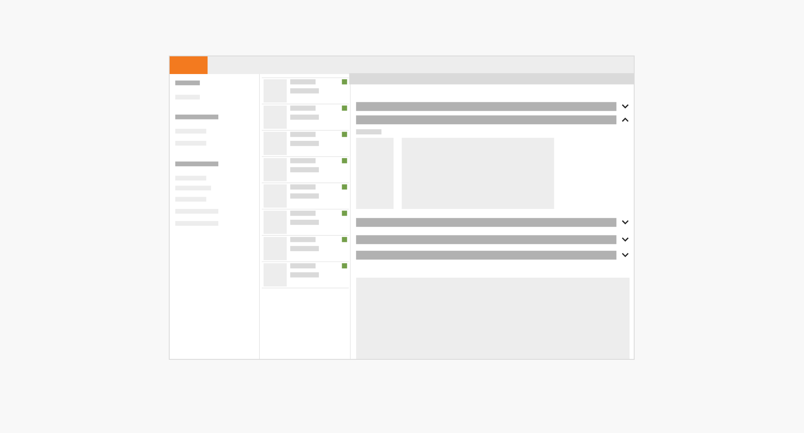

_Figure: Wireframe of a SaaS portal with an orange logo area in the top bar, a left navigation, a list of items with small green status squares, and a detail pane. In the detail pane a stack of accordions with chevrons on the right has one open accordion showing a small image and text placeholders, while the others are closed, which keeps the interface uncluttered._

### Content articles

Use accordions for step-by-step guides and other lists with additional details.

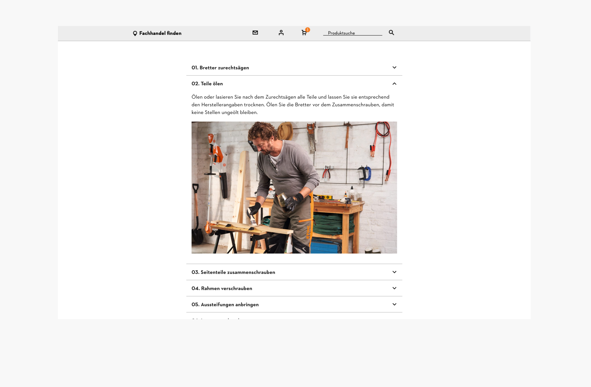

_Figure: A STIHL web page with a top bar ("Fachhandel finden", icons, "Produktsuche") above a step-by-step guide built from accordions with chevrons on the right. The steps are "01. Bretter zurechtsägen", "02. Teile ölen" (open, with an instruction text and a photo of a man oiling boards on a workbench), "03. Seitenteile zusammenschrauben", "04. Rahmen verschrauben" and "05. Aussteifungen anbringen", with further steps cut off below._

### Filter

A common use case for accordions is group filters in a [drawer component](https://www.figma.com/design/qXldpLO6gxHJNLdcXIPxYt/Pattern-Library-%F0%9F%96%A5-Web-1.0?node-id=16282-9317).

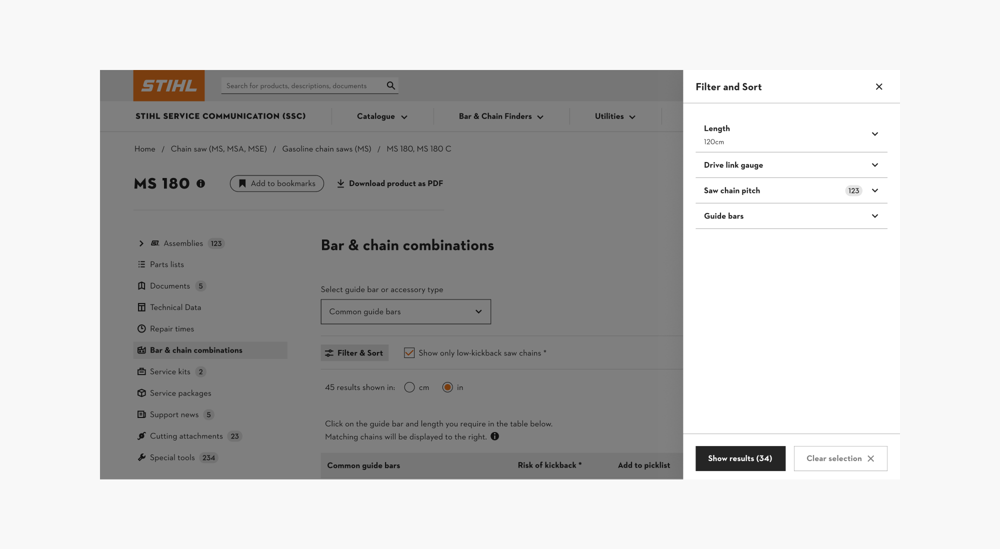

_Figure: A STIHL service page for the MS 180 chain saw dimmed behind a "Filter and Sort" drawer on the right with a close button. The drawer holds closed accordions "Length" (with the hint "120cm"), "Drive link gauge", "Saw chain pitch" (with a number indicator "123") and "Guide bars", and at the bottom a filled button "Show results (34)" and an outline button "Clear selection" with an x icon._

### Extra spacing for drawers

Ensure enough room for the click area. The user can skim and read the titles faster.

Use extra spacing on the top and bottom. In this example, use the medium accordion.

[→ Spacing Styles](https://www.figma.com/design/JyyYtoCYbtJrzqHs38OXSQ/Grid-%26-Spacing-%F0%9F%A7%AE?node-id=1-1253)

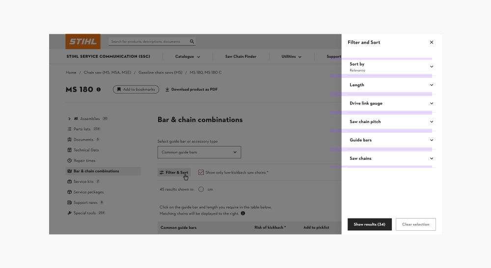

_Figure: A STIHL service page for the MS 180 chain saw dimmed behind a "Filter and Sort" drawer on the right, with closed medium accordions "Sort by" (hint "Relevance"), "Length", "Drive link gauge", "Saw chain pitch", "Guide bars" and "Saw chains", and the buttons "Show results (34)" and "Clear selection" at the bottom. Light purple bands above and below each accordion mark the extra spacing at the top and bottom that gives the click area enough room._
