# Breadcrumb

## Breadcrumb

Overview:

- A breadcrumb provides orientation to users within the structure of a website or application.
- First link (home) is always visible, as well as the last two links. The last link is the current page.
- The truncated links are hidden behind a button, the truncated links appear on click.
- The breadcrumb is superior to the page title and page content and therefore always left aligned.
- In shallow navigation structures a breadcrumb might be obsolete and therefore optional.

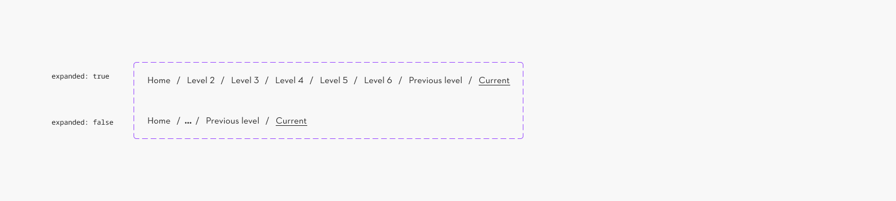

_Figure: Two breadcrumbs inside a dashed purple outline. With "expanded: true" all levels are shown: "Home / Level 2 / Level 3 / Level 4 / Level 5 / Level 6 / Previous level / Current". With "expanded: false" the middle levels are replaced by a truncation button "...", giving "Home / ... / Previous level / Current"; in both, "Current" is underlined as the active page._

### Further guidelines

[Storybook documentation](https://main--63440bbb95889041542a5ba3.chromatic.com/?path=/docs/components-breadcrumb--documentation&globals=backgrounds.name:!undefined;backgrounds.value:!undefined)

### Related elements

[Standalone Link](https://www.figma.com/design/qXldpLO6gxHJNLdcXIPxYt?node-id=26711-8034)

[Iconography](https://www.figma.com/file/U218NNP4OsipaHOtv5flns/Iconography-%F0%9F%9B%91?type=design)

### Contribute

Contribute to improving this component by sharing your feedback, asking questions, or suggesting features [here](https://www.figma.com/design/lLmw7PfIdKjFG4uT3B2Hyj/Onboarding-%F0%9F%93%96?node-id=446-868&t=zKmRu4kAkxMeRDmK-4).

## Formatting and Construction

### Anatomy

1. **Standalone links** List of all levels prior
1. **Truncation button** Shows all levels after click
1. **Divider symbol**
1. **Active standalone link** Current page

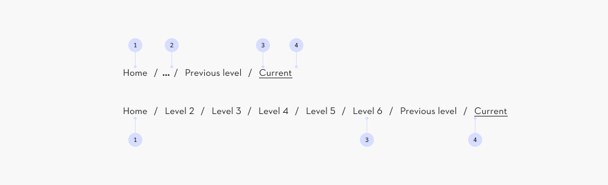

_Figure: Two breadcrumbs with numbered callouts. The upper one is truncated, "Home / ... / Previous level / Current", with 1 at "Home" (standalone link), 2 at the truncation button "...", 3 at the divider symbol "/" before "Current" and 4 at the active standalone link "Current". The lower one is fully expanded, "Home / Level 2 / Level 3 / Level 4 / Level 5 / Level 6 / Previous level / Current", with 1 at "Home", 3 at a divider symbol and 4 at "Current"._

#### Exception: truncation button

**Attention:** The Truncation Button is a **small ghost button** Paddings have been adjusted in this instance to match the links and avoid layout shifts. The button retains all the states and properties of a button, e.g. **hover (1)** and **focus (2).**

[Button guidelines](https://www.figma.com/design/qXldpLO6gxHJNLdcXIPxYt/Pattern-Library-%F0%9F%96%A5-Web-1.0?node-id=162-126)

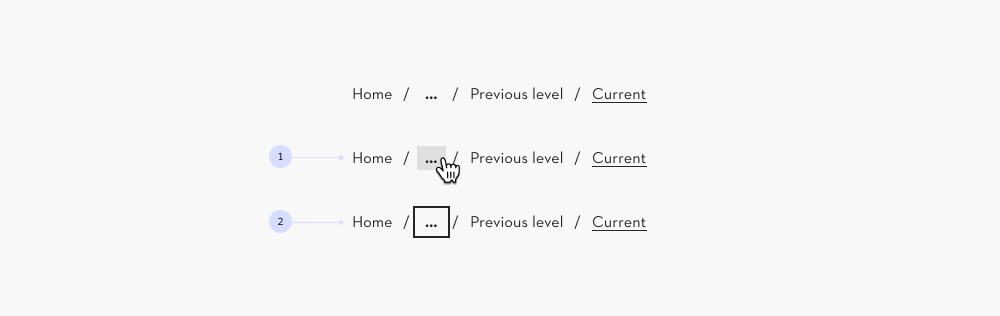

_Figure: Three truncated breadcrumbs, each "Home / ... / Previous level / Current", stacked vertically. The first shows the truncation button in its default state, callout 1 marks the second where the "..." button has a grey background and a hand cursor (hover), and callout 2 marks the third where the button has a dark rectangular outline (focus)._

#### Show all links

1. The truncated links are hidden behind a button with a label containing three dots: “...”.
1. The truncated links appear on click.
1. It is not possible for the user to hide the levels that appeared.

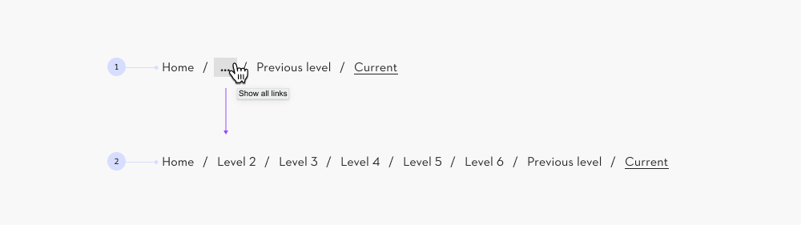

_Figure: A truncated breadcrumb "Home / ... / Previous level / Current" marked with callout 1, where the "..." button is hovered with a hand cursor and a tooltip "Show all links". A purple arrow points down to the same breadcrumb marked with callout 2, now expanded to "Home / Level 2 / Level 3 / Level 4 / Level 5 / Level 6 / Previous level / Current"._

#### Amount of links shown

**Level 1** No breadcrumb needed.

**Level 2-4** All 4 levels are shown.

**Level 5 and above** The first and last two levels are shown.

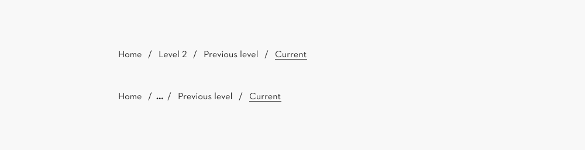

_Figure: Two breadcrumbs. The upper one for levels 2 to 4 shows all four levels, "Home / Level 2 / Previous level / Current". The lower one for level 5 and above shows only the first and last two levels, "Home / ... / Previous level / Current", with a truncation button "..." in place of the hidden levels._

### Alignment

#### Left alignment

The breadcrumb is superior to the page title and page content and therefore left aligned.

The breadcrumb is always placed in the top left corner, below the main navigation. Follow this mental model to reduce cognitive load.

Note: This guidelines assumes a left-to-right reading direction.

_Figure: Do: a browser window mockup with a breadcrumb of three placeholder links separated by slashes, aligned to the left edge in the top left corner below the browser bar and above the grey content block. A dashed vertical guide runs along the left edge shared by the breadcrumb and the content, showing that the breadcrumb is left aligned._

#### Center alignment

A breadcrumb cannot be centered, as it is uncommon and goes against the mental model of a breadcrumb.

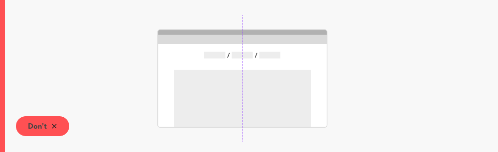

_Figure: Don't: a browser window mockup with a breadcrumb of three placeholder links separated by slashes, centred horizontally above the grey content block. A dashed vertical guide through the middle of the window shows the breadcrumb is centred, which is wrong because it is uncommon and goes against the mental model of a breadcrumb._

## Content and Assets

### First and last link in the list

- First is always home
- Last link is the current page (active state)

_Figure: Breadcrumb with four items separated by slashes: "Home", "About STIHL", "International production and distribution" and "STIHL in Brazil". The first link is "Home" and the last item, "STIHL in Brazil", is underlined as the current page. The long label "International production and distribution" is a full page title, which makes the breadcrumb hard to comprehend._

### Ideal length

- Keep each link label to 1 or 2 words.
- Maximum 2-3 words.

_Figure: Breadcrumb with three items separated by slashes: "Home", "Sustainability" and "Environmental protection", the last one underlined as the current page. Each label is short, one to two words, up to two to three words at most._

### Length warning

Full page titles as a link label might lead to breadcrumbs that are hard to comprehend.

_Figure: Breadcrumb with four items separated by slashes: "Home", "About STIHL", "International production and distribution" and "STIHL in Brazil". The first link is "Home" and the last item, "STIHL in Brazil", is underlined as the current page. The long label "International production and distribution" is a full page title, which makes the breadcrumb hard to comprehend._

### Always call home ‘Home’

Do not use marketing language in the breadcrumb. E.g. “The STIHL World” instead of “Home”.

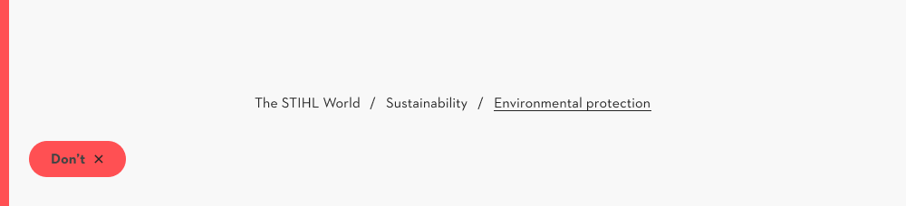

_Figure: Don't: a breadcrumb reading "The STIHL World", "Sustainability" and "Environmental protection" separated by slashes, the last one underlined as the current page. The first item uses marketing language; it should be called "Home"._

### Use of icons

- Icons are allowed, when used with a label.
- Icon must be leading (in front of the label).
- Use of icons takes space, therefore use in simple hierarchal structures only.

_Figure: Breadcrumb with three items separated by slashes: "Home" with a small house icon in front of the label, then "Level 2", then "Current" underlined as the current page. The icon is leading and sits together with a label._

### Longer link lists

#### 1 line on bigger screens

Ideally, the initial state of the breadcrumb navigation does not exceed 1 line.

In some middle sized screens, it may be two lines.

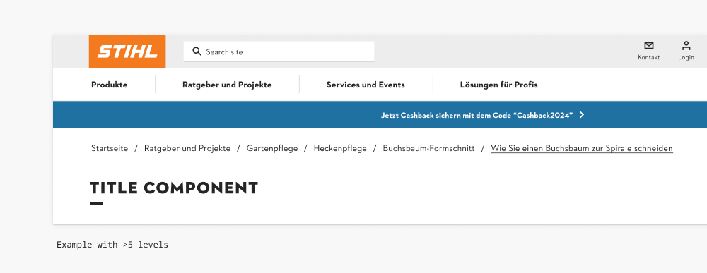

_Figure: STIHL website header on a wide screen with the logo, a search field "Search site", Kontakt and Login, a main navigation (Produkte, Ratgeber und Projekte, Services und Events, Lösungen für Profis) and a blue banner "Jetzt Cashback sichern mit dem Code "Cashback2024"". Below it the breadcrumb "Startseite / Ratgeber und Projekte / Gartenpflege / Heckenpflege / Buchsbaum-Formschnitt / Wie Sie einen Buchsbaum zur Spirale schneiden" fits on one line above the heading "TITLE COMPONENT". Caption: "Example with \>5 levels"._

#### 2-3 lines on small devices

Ideally, the initial state of the breadcrumb navigation does not exceed two lines.

- Three lines is allowed.
- Four lines must be avoided.

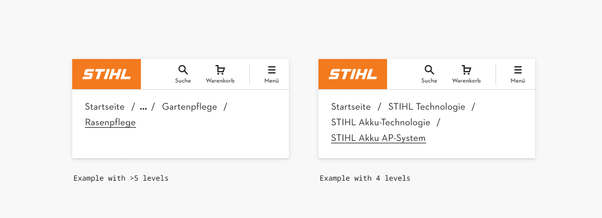

_Figure: Two mobile STIHL page headers with logo, Suche, Warenkorb and Menü, each showing a breadcrumb wrapped over multiple lines. Left, "Example with \>5 levels": "Startseite / ... / Gartenpflege /" on the first line and "Rasenpflege" underlined on the second. Right, "Example with 4 levels": "Startseite / STIHL Technologie /" then "STIHL Akku-Technologie /" then "STIHL Akku AP-System" underlined on a third line._

## Behavior

### Browser default tooltip

The browser tooltip explains the action to the user. This explanation is also provided by the screenreader.

_Figure: Collapsed breadcrumb "Home / ... / Chainsaws / MS 211" with the last item underlined as the current page. The mouse cursor, shown as a pointing hand, hovers over the ellipsis and a small browser default tooltip below it reads "Show all links"._

## Examples/Variants

### Complex navigation

A breadcrumb link list serves as a secondary navigation, helping users access nearby content within the complex hierarchical structure.

Example: The longest expanded breadcrumb in the stihl.de advisory has six levels.

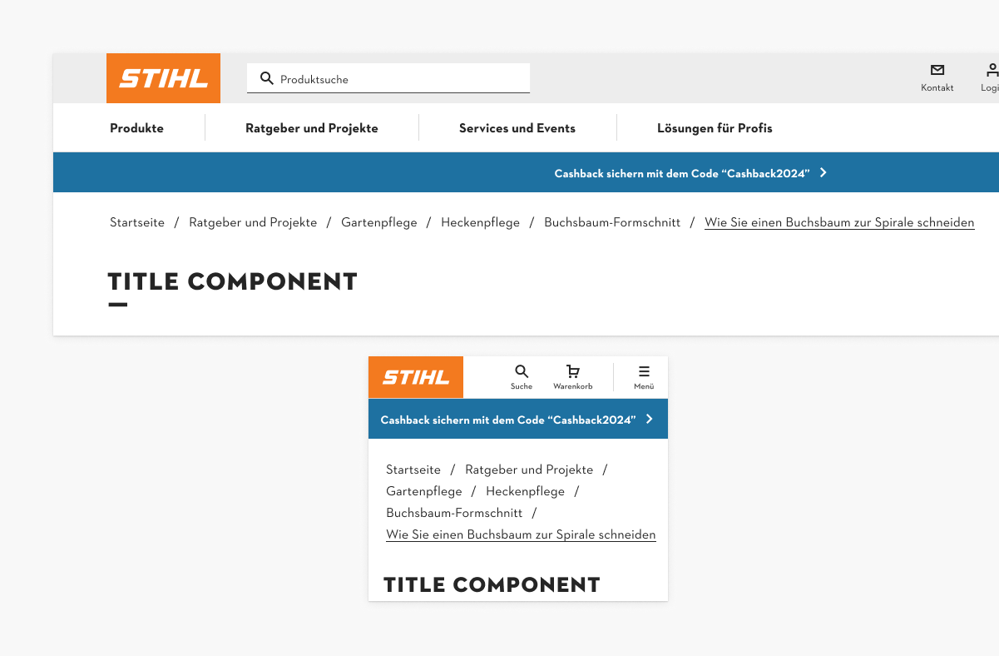

_Figure: Breadcrumb on a stihl.de advisory page in a desktop view (top) and a mobile view (bottom), below the orange STIHL logo header and a blue "Cashback sichern mit dem Code “Cashback2024”" banner. The desktop navigation shows "Produkte", "Ratgeber und Projekte", "Services und Events" and "Lösungen für Profis". The expanded six-level breadcrumb "Startseite / Ratgeber und Projekte / Gartenpflege / Heckenpflege / Buchsbaum-Formschnitt / Wie Sie einen Buchsbaum zur Spirale schneiden" runs on one line on desktop, with the last level underlined as the current page, and wraps over four lines on mobile, above a "TITLE COMPONENT" heading of size xl._

### Simple navigation

In shallow navigation structures a breadcrumb might be obsolete and therefore optional.

In some cases it can still enhance navigation efficiency and offer context.

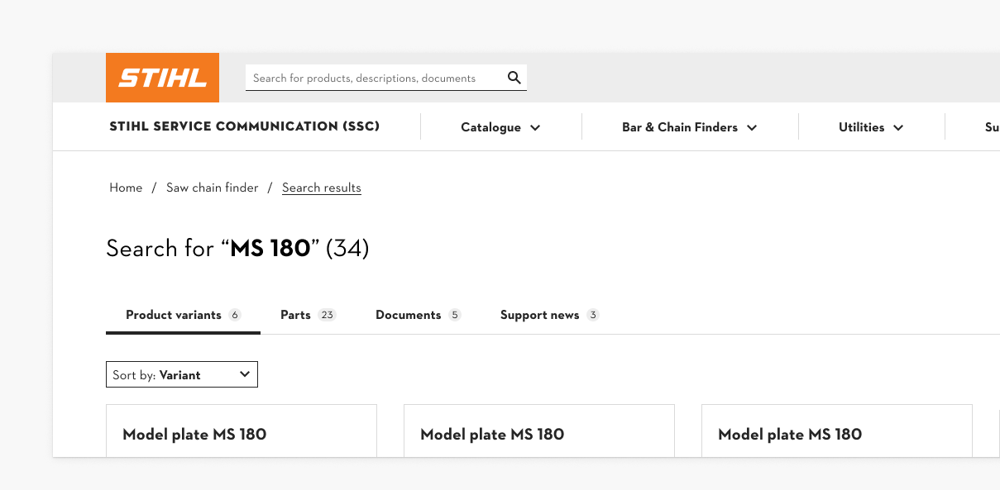

_Figure: Breadcrumb in a shallow navigation structure on a STIHL Service Communication page with a search field and the menu items "Catalogue", "Bar & Chain Finders" and "Utilities". The breadcrumb reads "Home / Saw chain finder / Search results", with "Search results" underlined as the current page, and sits above the heading "Search for “MS 180” (34)", tabs for "Product variants", "Parts", "Documents" and "Support news", a "Sort by: Variant" dropdown and cards titled "Model plate MS 180"._
