# Breadcrumb

## Breadcrumb

Overview:

- A breadcrumb provides orientation to users within the structure of a website or application.
- First link (home) is always visible, as well as the last two links. The last link is the current page.
- The truncated links are hidden behind a button, the truncated links appear on click.
- The breadcrumb is superior to the page title and page content and therefore always left aligned.
- In shallow navigation structures a breadcrumb might be obsolete and therefore optional.

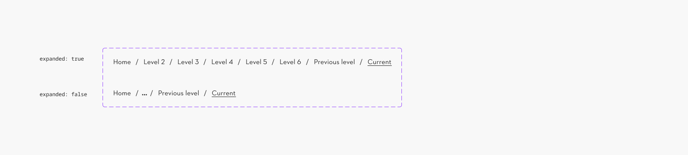

### Further guidelines

[Storybook documentation](https://main--63440bbb95889041542a5ba3.chromatic.com/?path=/docs/components-breadcrumb--documentation&globals=backgrounds.name:!undefined;backgrounds.value:!undefined)

### Related elements

[Standalone Link](https://www.figma.com/design/qXldpLO6gxHJNLdcXIPxYt?node-id=26711-8034)

[Iconography](https://www.figma.com/file/U218NNP4OsipaHOtv5flns/Iconography-%F0%9F%9B%91?type=design)

### Contribute

Contribute to improving this component by sharing your feedback, asking questions, or suggesting features [here](https://www.figma.com/design/lLmw7PfIdKjFG4uT3B2Hyj/Onboarding-%F0%9F%93%96?node-id=446-868&t=zKmRu4kAkxMeRDmK-4).

## Formatting and Construction

### Anatomy

1. **Standalone links** List of all levels prior
1. **Truncation button** Shows all levels after click
1. **Divider symbol**
1. **Active standalone link** Current page

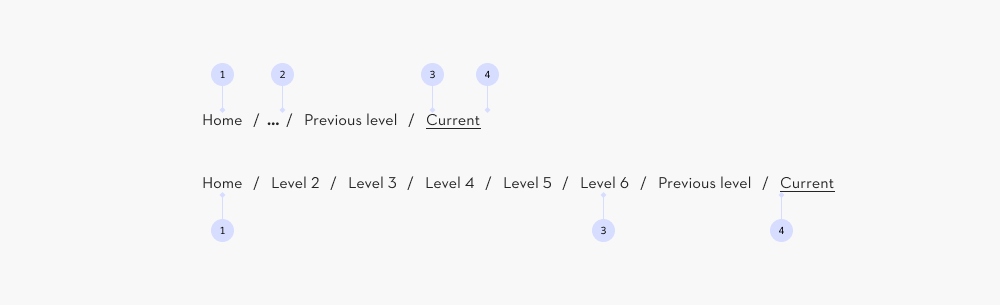

#### Exception: truncation button

**Attention:** The Truncation Button is a **small ghost button** Paddings have been adjusted in this instance to match the links and avoid layout shifts. The button retains all the states and properties of a button, e.g. **hover (1)** and **focus (2).**

[Button guidelines](https://www.figma.com/design/qXldpLO6gxHJNLdcXIPxYt/Pattern-Library-%F0%9F%96%A5-Web-1.0?node-id=162-126)

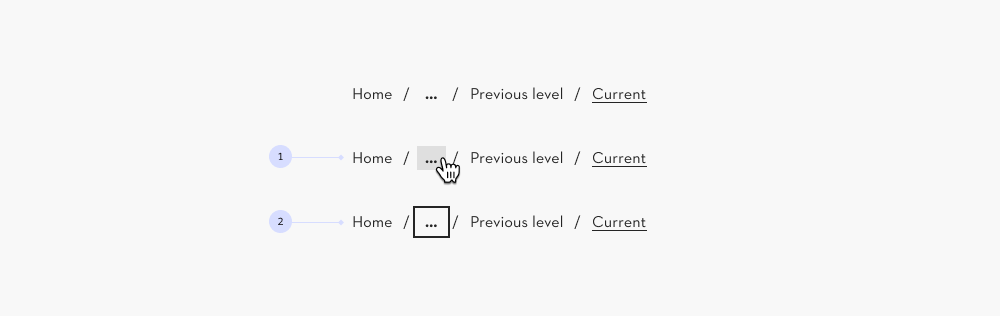

#### Show all links

1. The truncated links are hidden behind a button with a label containing three dots: “...”.
1. The truncated links appear on click.
1. It is not possible for the user to hide the levels that appeared.

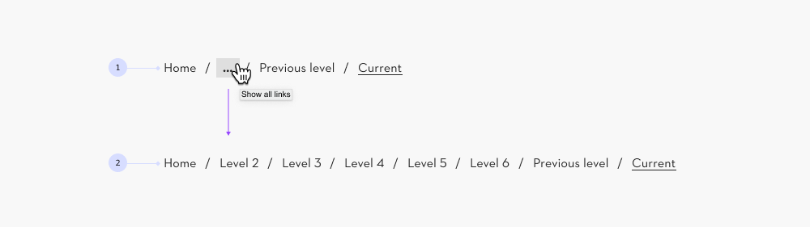

#### Amount of links shown

**Level 1** No breadcrumb needed.

**Level 2-4** All 4 levels are shown.

**Level 5 and above** The first and last two levels are shown.

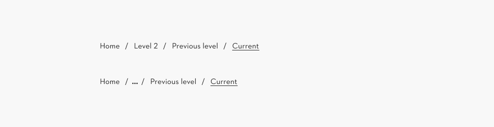

### Alignment

#### Left alignment

The breadcrumb is superior to the page title and page content and therefore left aligned.

The breadcrumb is always placed in the top left corner, below the main navigation. Follow this mental model to reduce cognitive load.

Note: This guidelines assumes a left-to-right reading direction.

#### Center alignment

A breadcrumb cannot be centered, as it is uncommon and goes against the mental model of a breadcrumb.

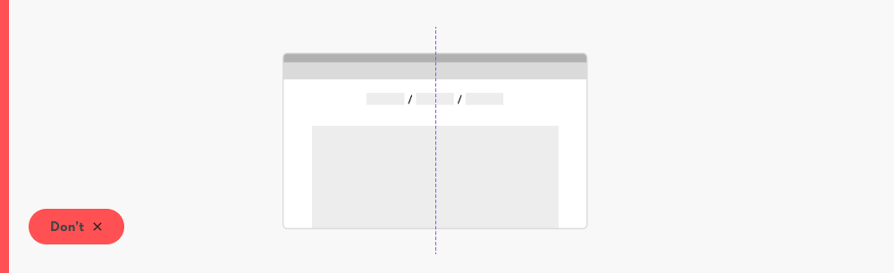

## Content and Assets

### First and last link in the list

- First is always home
- Last link is the current page (active state)

### Ideal length

- Keep each link label to 1 or 2 words.
- Maximum 2-3 words.

### Length warning

Full page titles as a link label might lead to breadcrumbs that are hard to comprehend.

### Always call home ‘Home’

Do not use marketing language in the breadcrumb. E.g. “The STIHL World” instead of “Home”.

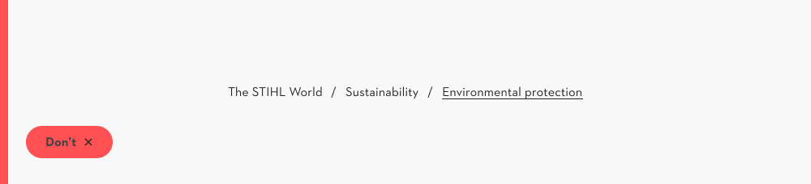

### Use of icons

- Icons are allowed, when used with a label.
- Icon must be leading (in front of the label).
- Use of icons takes space, therefore use in simple hierarchal structures only.

### Longer link lists

#### 1 line on bigger screens

Ideally, the initial state of the breadcrumb navigation does not exceed 1 line.

In some middle sized screens, it may be two lines.

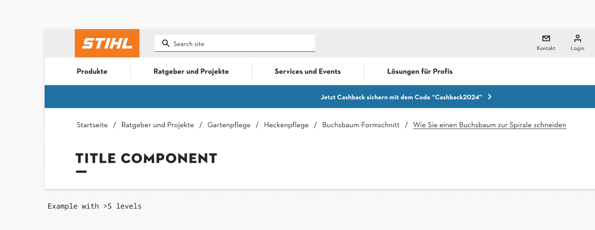

#### 2-3 lines on small devices

Ideally, the initial state of the breadcrumb navigation does not exceed two lines.

- Three lines is allowed.
- Four lines must be avoided.

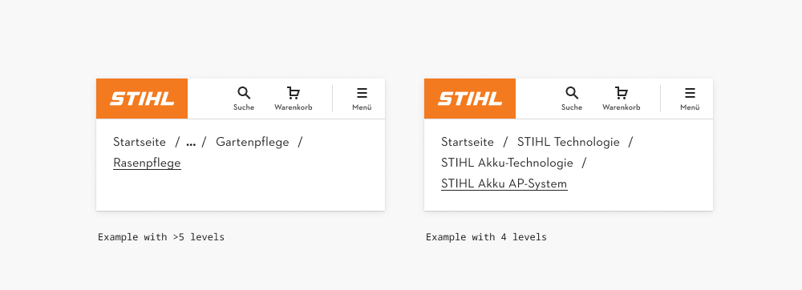

## Behavior

### Browser default tooltip

The browser tooltip explains the action to the user. This explanation is also provided by the screenreader.

## Examples/Variants

### Complex navigation

A breadcrumb link list serves as a secondary navigation, helping users access nearby content within the complex hierarchical structure.

Example: The longest expanded breadcrumb in the stihl.de advisory has six levels.

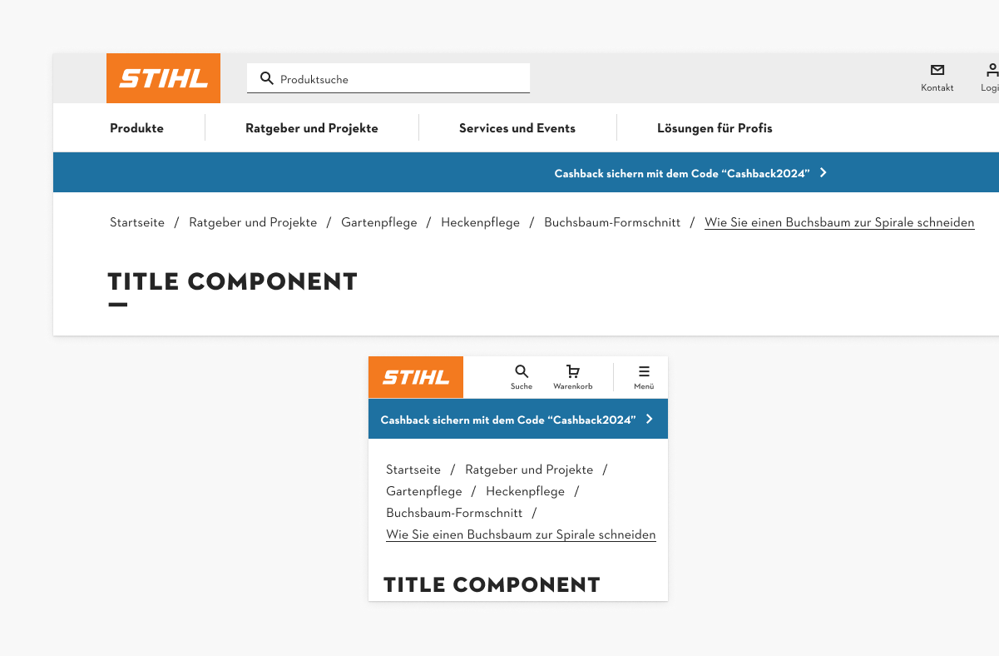

### Simple navigation

In shallow navigation structures a breadcrumb might be obsolete and therefore optional.

In some cases it can still enhance navigation efficiency and offer context.

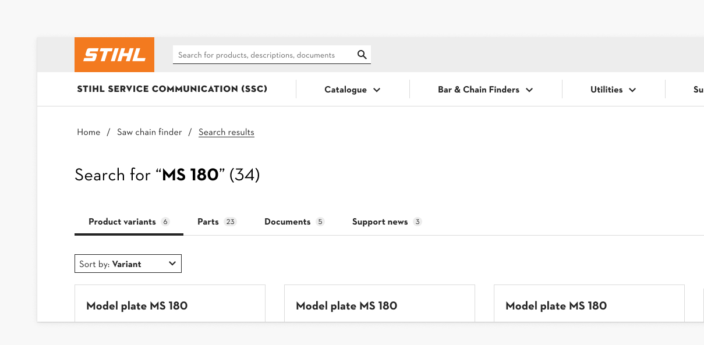
