# Button

## Button

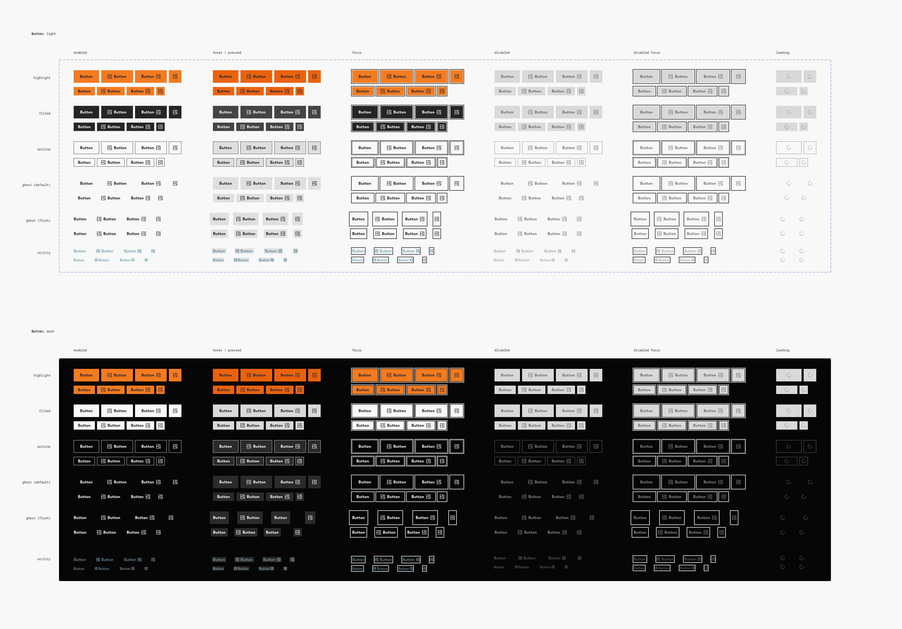

_Figure: Overview matrix of the Button component in a light theme (top) and a dark theme on a black background (bottom). Rows are the variants highlight, filled, outline, ghost (default), ghost (flush) and utility; columns are the states enabled, hover / pressed, focus, disabled, disabled focus and loading. Each cell shows medium and small buttons with no icon, an icon on the left, an icon on the right and an icon-only button, all labelled "Button", with spinner icons in the loading column._

## Overview

### Definition

A button is a clickable element to initialize an action or to highlight the user journey.

### When to use

Use buttons to perform an action, i.e.:

- submit a form
- trigger an element to appear or disappear
- edit an element
- etc.

### When not to use

Do not use buttons for hierarchical navigation, or when you want to link to other pages or external resources.

In this case you should use Standalone links, Inline links or links that look like buttons.

**Links that look like a button**

There are instances when a link needs to be styled as a button because of its emphasis on the page.

In this case keep in mind that there is no disabled and loading state, since they are links.

### Further guidelines

[Storybook documentation](https://main--63440bbb95889041542a5ba3.chromatic.com/?path=/docs/components-button--documentation)

## Formatting

### Anatomy

1. **Container**
1. **Button label**
1. **Icon Left / Right** (Optional)

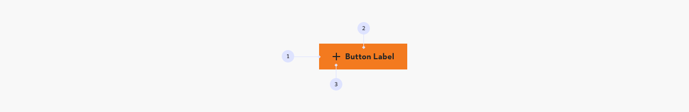

_Figure: Anatomy of a highlight (orange) Button with a plus icon to the left of the label "Button Label". Callout 1 points at the left edge of the orange Container, callout 2 at the top edge of the Container above the label, and callout 3 at the plus icon, which is the optional Icon Left / Right._

### Variants

Use button variants to define visual emphasis, action hierarchy, and context.

1. **Highlight** Use for the most important action on a page or within a user flow. This variant should be used sparingly and only when an action needs to stand out above all others. Example: Add to Cart
1. **Filled:** Use as the default button style when no other variant is specified. Filled buttons provide clear emphasis and are suitable for standard primary actions. Example: Submit, continue, save.
1. **Outline:** Use for secondary actions that need to remain visible without competing with the primary action. Outline buttons are often used next to Filled or Highlight buttons to establish hierarchy. Example: Cancel (next to Save), Back (next to Continue).
1. **Ghost:** Use for low-emphasis actions or secondary actions in layouts where the button has enough visual breathing room. Ghost buttons work well in standalone UI areas such as teaser or banner where the action can remain visually subtle. Example: View all.
1. **Utility:** Use for supporting actions in dense UI layouts, such as checkout flows or data tables. It provides more visual emphasis than a Ghost Button, but remains less prominent than a Highlight Button. Examples: Edit, Change.

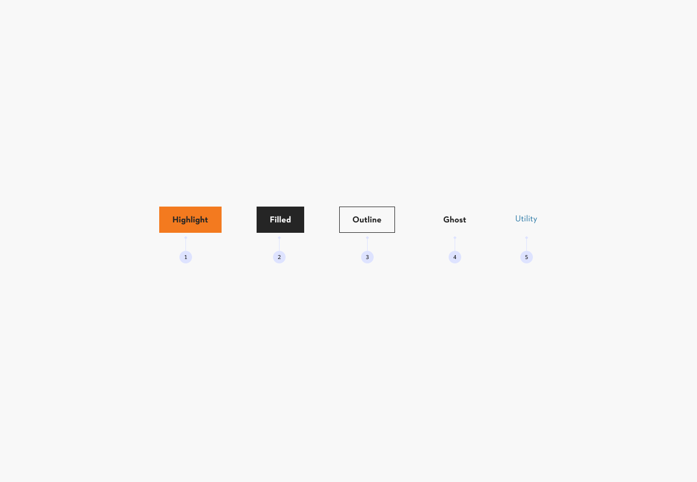

_Figure: The five button variants side by side from left to right, each with a numbered callout below it: 1 is Highlight (orange filled), 2 is Filled (dark filled), 3 is Outline (dark border, no fill), 4 is Ghost (text only, no container) and 5 is Utility (small blue text)._

### Size

Two sizes have been defined for buttons:

1. **Medium:** That’s the size that should be used by default.
1. **Small:** This size can be used when
   - there is not enough vertical space to use the default button
   - there are too many small elementes and the default button would feel too massive
   - a Ghost button is paired vertically with another button variant

For **Ghost Buttons** with **flush functionality** the height stays the same, but the right and left padding changes to negative for both **default (3)** and **small (4)**.

For **Ghost Accent Buttons** the height is smaller, the button is flush and has no padding. Gaps and icon sizes are also different for both **default (5)** and **small (6)**.

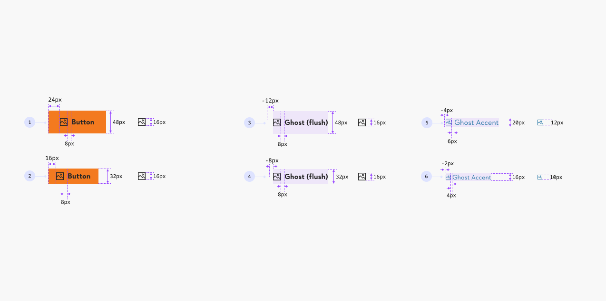

_Figure: Size specifications with redlines in six numbered rows, each button with a 16px icon. Callout 1 is the medium highlight Button, 48px high, with 24px padding at the left edge and 8px between icon and label; callout 2 is the small Button, 32px high, with 16px left padding and 8px between icon and label. Callout 3 is the medium "Ghost (flush)" button, 48px high, with -12px left offset and 8px gap; callout 4 is the small "Ghost (flush)", 32px high, with -8px offset and 8px gap. Callout 5 is the medium "Ghost Accent", 20px high, with -4px offset, 6px gap and a 12px icon; callout 6 is the small "Ghost Accent", 16px high, with -2px offset, 4px gap and a 10px icon._

### Icon

Buttons can be feature an icon to clarify an action and to highlight a button. They are always placed left or right of the text label.

The text label can be hidden. Icon only buttons should only be used for functions where text labels are not needed to define the function e.g. modal close or paginations buttons.

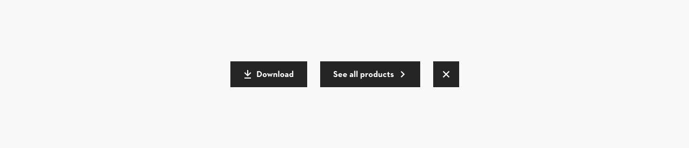

_Figure: Three dark filled buttons in a row: "Download" with a download icon on the left, "See all products" with a chevron icon on the right, and an icon-only button with a close (X) icon and no label._

### Icon Placement

Icons can freely be placed in front of or after the label .

1. In most cases **a left position** is preferred, due to reading direction.
1. Exceptions can be made if a specific use case needs a **right position** (e.g ghost buttons in teasers often have a right icon).

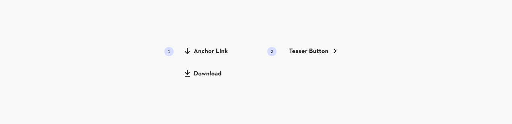

_Figure: Ghost buttons with icon placement. Callout 1 points at the left-placed icons, the preferred position: "Anchor Link" with a down arrow and "Download" with a download icon, both before the label. Callout 2 points at "Teaser Button" with a chevron icon placed to the right of the label, the exception for specific use cases._

## Pairings and alignment

### Pairings

#### Hierarchies

**Always follow hierarchy semantics** when pairing buttons:

1. Highlight + Filled / Outline / Ghost
1. Filled + Outline / Ghost
1. Outline + Ghost

In case a hierarchy is not relevant, use a Outline oder Ghost button.

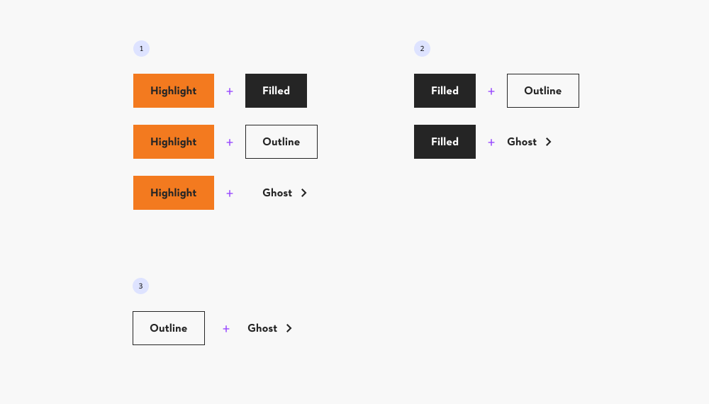

_Figure: Allowed button pairings by hierarchy. Callout 1: Highlight (orange) combined with Filled, with Outline and with Ghost. Callout 2: Filled (dark) combined with Outline and with Ghost. Callout 3: Outline combined with Ghost. The Ghost buttons have a chevron icon on the right._

#### Horizontal pairing

When pairing buttons horizontally keep the following in mind:

1. All buttons should have the same height.
1. The buttons widths should grow with its content. Different rules can apply for mobile.
1. In case 3 actions occur, limit them to two button types or use a segmented button.
1. Make sure all icons are either left or right, not a combination of both.

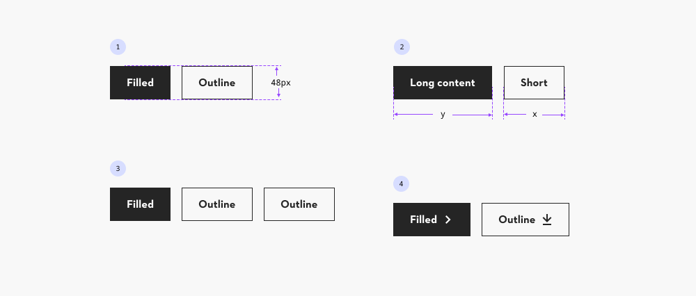

_Figure: Four examples of horizontal button pairing. Callout 1: "Filled" and "Outline" buttons side by side, both with the same height of 48px. Callout 2: "Long content" and "Short" buttons whose widths follow the content, with the widths marked y and x. Callout 3: three buttons in a row, "Filled", "Outline" and "Outline", limited to two button types. Callout 4: "Filled" with a chevron and "Outline" with a download icon, both icons placed on the right._

#### Vertical pairing

When pairing buttons **vertically** keep the following in mind:

1. A mix of small and default size buttons is allowed.
1. Buttons should generally have the same widths. They adapt to the button with the longest content. Different rules can apply for mobile. An exception applies to Ghost buttons with **flush alignment** - they don’t adapt (see more information below).
1. In case 3 actions occur, limit them to two button types or use a segmented button.
1. Make sure all icons are either left or right, not a combination of both.

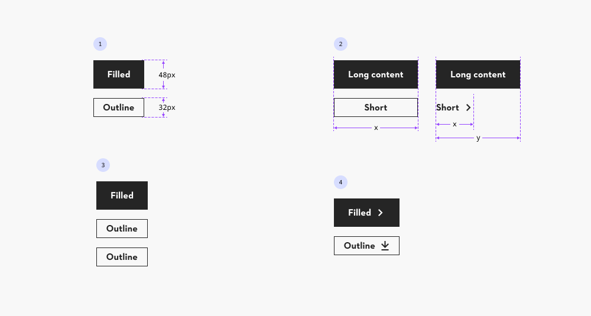

_Figure: Four examples of vertical button pairing. Callout 1: a "Filled" button 48px high above a smaller "Outline" button 32px high, both of equal width. Callout 2: "Long content" above "Short", where the Short button stretches to the same width x as the long one, and next to it a ghost "Short" button with a chevron that keeps its own narrower width x instead of the width y of the long button (flush ghost exception). Callout 3: "Filled", "Outline" and "Outline" stacked with equal widths, limited to two button types. Callout 4: "Filled" with a chevron and "Outline" with a download icon stacked, both icons on the right._

#### Spacing

**Spacing:** between or to the next element should be minimal 16px, in order to optimize for mobile usability.

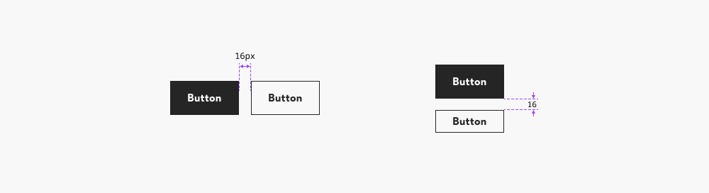

_Figure: Minimum spacing between buttons. On the left a dark "Button" and an outline "Button" sit side by side with a 16px horizontal gap; on the right a dark "Button" is stacked above an outline "Button" with a vertical gap of 16._

### Alignment

#### Flush alignment for ghost buttons

When aligning ghost buttons with other elements to the left or right, it’s advised to apply the **flush alignment (1).** That way the elements are visually aligned. The flush functionality doesn’t exist for the other buttons, it’s exclusive for the ghost button.

For center alignment the default ghost button setting can be used **(2)**.

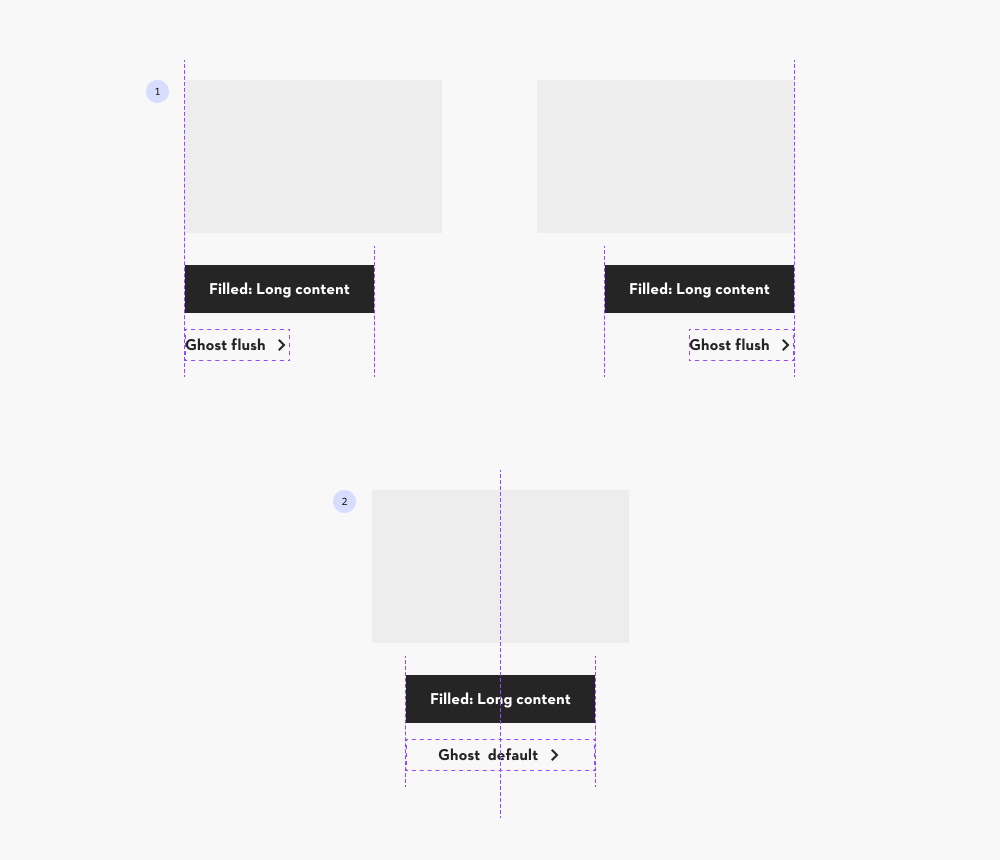

_Figure: Alignment of ghost buttons below a grey content placeholder and a "Filled: Long content" button. Callout 1: on the left, "Ghost flush" with a chevron sits flush with the left edge of the content and the filled button; on the right, "Ghost flush" sits flush with the right edge, with purple guide lines marking the aligned edges. Callout 2: for centre alignment, "Ghost default" with a chevron is centred below the centred filled button and content, with a vertical centre guide line._

#### Align buttons with the content

As a general rule make sure that the buttons are aligned with the content within a layout: left, center or right.

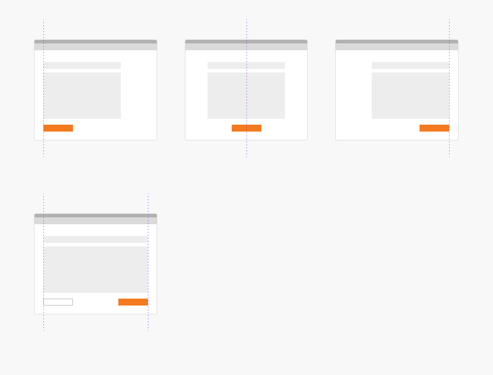

_Figure: Four wireframe cards, each with a heading bar, a content block and orange button(s). In the first the orange button is aligned to the left edge of the content, in the second centred under the content, in the third aligned to the right edge of the content, with purple guide lines marking the alignment. In the fourth the content spans the full card width, an outline button sits at the left edge and an orange button at the right edge, both aligned to the content._

#### Dialog or forms: align the primary button on the left

In case the button is located in a dialog or underneath a form, place the primary button on the left, aligned with the input fields.

A secondary buttons would appear on the right or, if there is not enough space, underneath.

[Text Input Guidelines→](https://www.figma.com/design/qXldpLO6gxHJNLdcXIPxYt?node-id=1591-2)

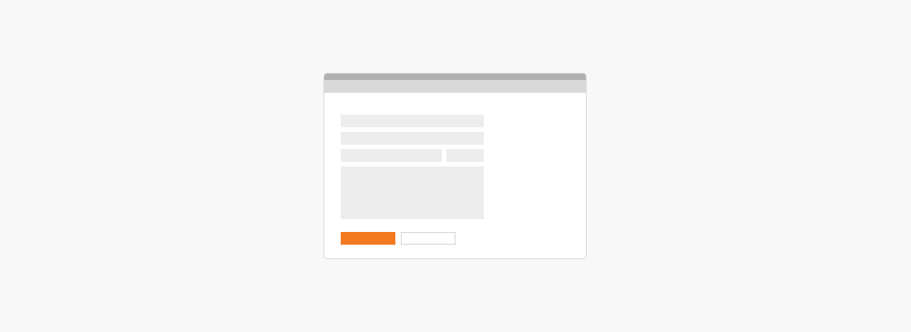

_Figure: Wireframe of a dialog or form with several input field placeholders and a text area. Below the fields the orange primary button sits on the left, aligned with the left edge of the inputs, and a secondary outline button follows to its right._

#### Flow or process: align the primary button on the right

For flows of multiple screens, place the primary button on the right, to imply the user about the next step.

A secondary buttons appears on the left.

**Sidenote:** for mobile purposes this guideline might not apply. Make sure to test the usability for your product.

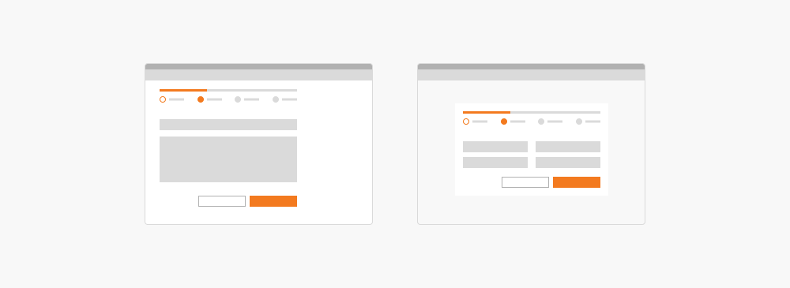

_Figure: Two wireframe screens of a multi-step flow, each with a four-step stepper at the top (first step outlined, second step active, the rest inactive). In both, the secondary outline button is on the left and the orange primary button is on the right at the bottom, next to the content. The left screen is full width; the right one shows the same flow inside a smaller centred white panel with two columns of fields._

**In case an iFrame is build into the webpage:** the buttons are aligned to the content elements and their grid. A good example therefore are the digital advisors.

[Grid Styles→](https://www.figma.com/design/JyyYtoCYbtJrzqHs38OXSQ/Grid-%26-Spacing-%F0%9F%A7%AE?node-id=1-132)

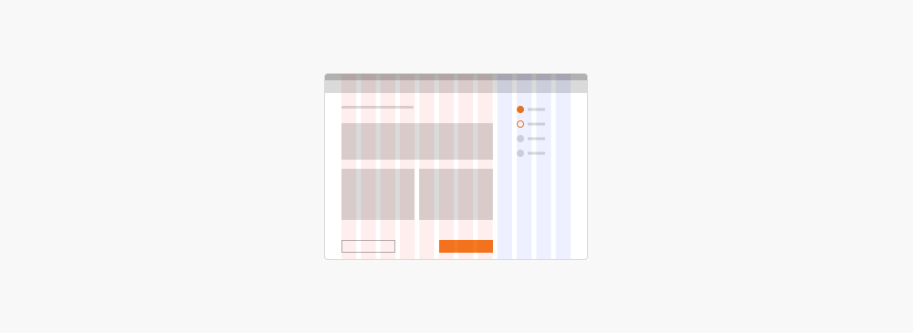

_Figure: Wireframe of a page with a column grid overlay (red-tinted content columns on the left, blue-tinted columns on the right holding a vertical step list with four steps). Under the content blocks, a secondary outline button is aligned to the left edge of the content columns and an orange primary button to the right edge of the content columns, following the grid._

#### Mobile: primary action at the top

It is recommended to lead with the primary button first on mobile devices, even if the semantic order in the code is different on desktop.

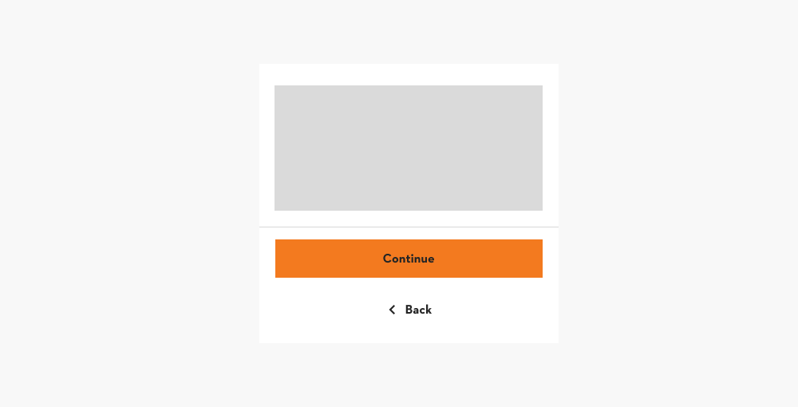

_Figure: Mobile layout with a grey content placeholder, a divider line, then a full-width orange highlight button "Continue" at the top, and below it a ghost button "Back" with a left-pointing chevron icon on its left._

## Foreground and background combinations

### Plain colours

Buttons should only be used on plain backgrounds as following:

#### Light mode

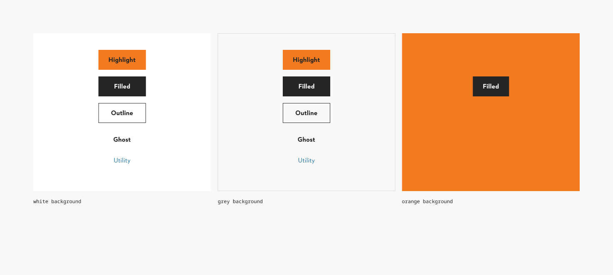

_Figure: Buttons in light mode on three backgrounds. On the "white background" and the "grey background" the variants Highlight, Filled, Outline, Ghost and Utility are stacked vertically. On the "orange background" only the dark "Filled" button is shown._

#### Dark mode

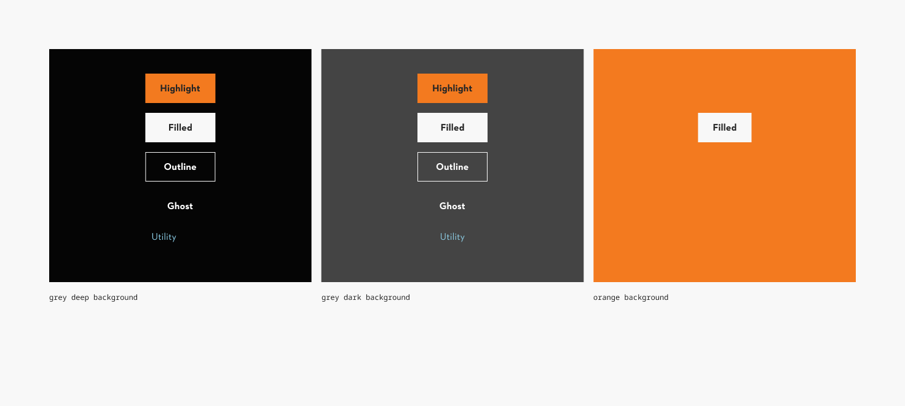

_Figure: Buttons in dark mode on three backgrounds. On the "grey deep background" (black) and the "grey dark background" the variants Highlight, Filled (light), Outline (light border), Ghost (white text) and Utility (light blue text) are stacked vertically. On the "orange background" only the light "Filled" button is shown._

### Images and other backgrounds

Button placement on images and not plain coloured backgrounds should be avoided. In exception, use buttons as following:

#### Light mode

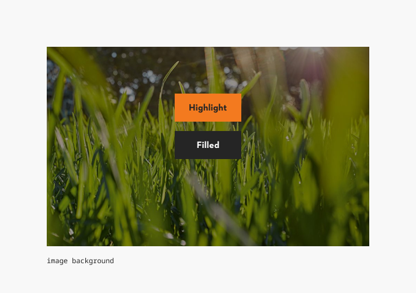

_Figure: Light mode: two enabled, medium-size buttons without icons, stacked vertically on a photo of sunlit grass labeled "image background". The upper button is the orange highlight variant with the text "Highlight" in dark type, the lower one is the dark filled variant with the text "Filled" in white type._

#### Dark mode

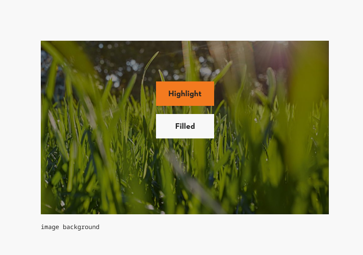

_Figure: Dark mode: two enabled, medium-size buttons without icons, stacked vertically on a photo of grass labeled "image background". The upper button is the orange highlight variant with the text "Highlight" in dark type, the lower one is the filled variant in white with the text "Filled" in dark type._

## Usage

### Ghost vs. Utility Button

Both variants are low-emphasis button styles. The difference is the surrounding context and the amount of visual emphasis needed.

#### Ghost

Use the **Ghost Button** for standalone elements or spacious layouts where the button has enough visual breathing room to be noticed. It is often used together with other button variants to create hierarchy without adding too much visual weight.

**Common use cases:**

- Banners
- Teasers
- Popovers
- Cards

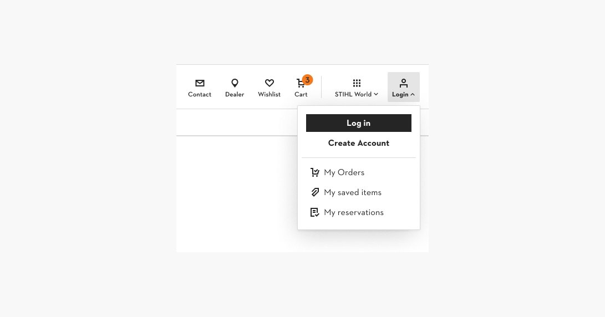

_Figure: Ghost Button used in a login popover of a web header. The header shows the enabled items "Contact", "Dealer", "Wishlist", "Cart" (with an orange badge showing 3), a vertical divider, "STIHL World" with a chevron and the active "Login" item with an up chevron. The opened popover below contains a dark filled button "Log in" and, beneath it, the ghost button "Create Account" as text only, followed by a divider and the list entries "My Orders", "My saved items" and "My reservations" with icons._

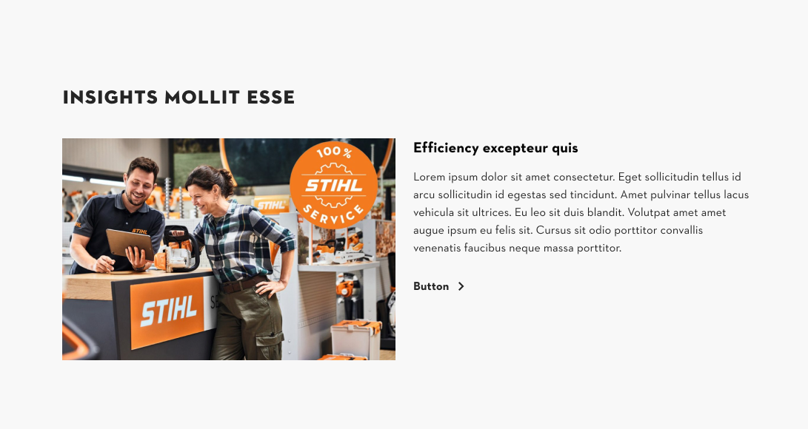

_Figure: Content teaser with the heading "INSIGHTS MOLLIT ESSE", a photo of a STIHL dealer counter on the left (two people looking at a tablet, orange "100% STIHL Service" badge) and on the right the subheading "Efficiency excepteur quis", a paragraph of placeholder text and a text-only ghost button labeled "Button" with a chevron icon on its right. Measurements in the figure: 40px, 24px, 16px._

#### Utility Button

Use the **Utility Button** inside dense or information-heavy UI layouts, where supporting actions need more visual emphasis than a Ghost Button, but should remain less prominent than a Highlight Button.

The accent color improves visibility and discoverability without turning the action into the main call to action.

**Common use cases:**

- Forms
- Checkout flows
- Data tables
- Inline editing

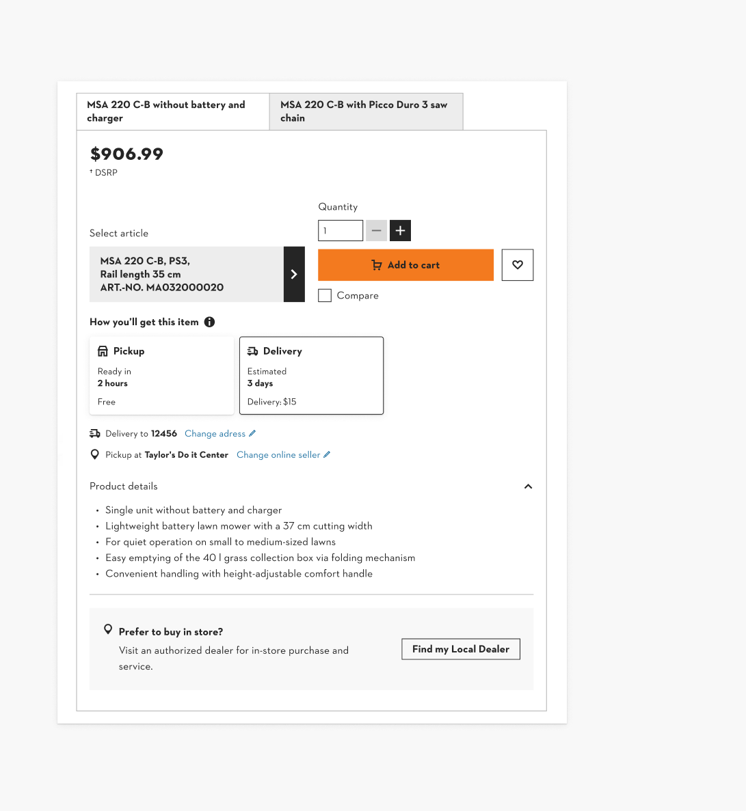

_Figure: Product detail page for "MSA 220 C-B" with tabs, the price $906.99, an article selector, quantity stepper, orange "Add to cart" button, wishlist button, "Compare" checkbox and Pickup and Delivery options. Two Utility Buttons appear as small, enabled, blue text links with a pencil icon on the right, aligned flush: "Change adress" next to "Delivery to 12456" and "Change online seller" next to "Pickup at Taylor's Do it Center"._

## Content

### Labels

**Do:**

- Clear and concise: use labels like "Save Changes" or "Discard Changes".
- Action-Oriented: Use verbs to describe the action, making it clear what will happen when the button is clicked.

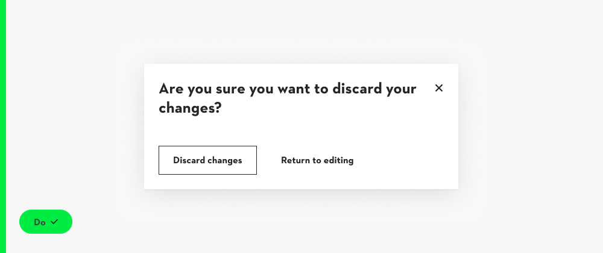

_Figure: Do: a dialog titled "Are you sure you want to discard your changes?" with a close icon. Its two buttons, an outlined "Discard changes" on the left and a text-only "Return to editing" on the right, are correct because the labels are clear, concise and action-oriented, describing what will happen on click._

**Don’t**

Avoid generic terms like "Yes" or "No".

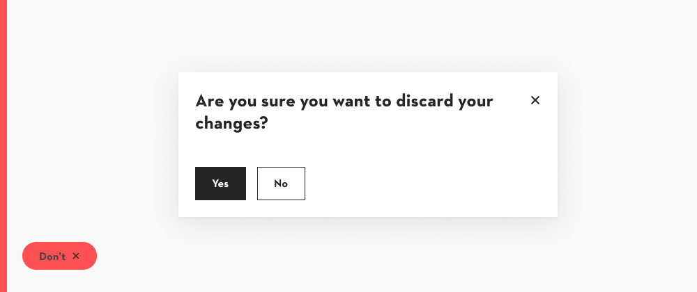

_Figure: Don't: a dialog titled "Are you sure you want to discard your changes?" with a close icon and two buttons, a filled "Yes" on the left and an outlined "No" on the right. This is wrong because generic labels like "Yes" or "No" do not say what action the button performs._

#### Sentence case

In some cases the label is a sentence - capitalize the first letter and use lower case for the rest.

**Exception**: words that have to be written with a capitalized letter, like names **(1)** or nouns in German **(2)**.

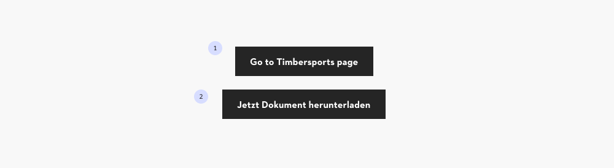

_Figure: Two enabled, medium-size filled buttons without icons, stacked vertically. Callout 1 marks "Go to Timbersports page", where only the first letter and the proper name Timbersports are capitalized. Callout 2 marks the German "Jetzt Dokument herunterladen", where the noun Dokument is capitalized as required in German._

#### Maximum character

The button should not break into two lines. To achieve this the we recommend:

1. A maximum of **18 characters** for button without icon
1. A maximum of **16 characters** for button with icon

For longer application the use of Ghost Buttons is recommended.

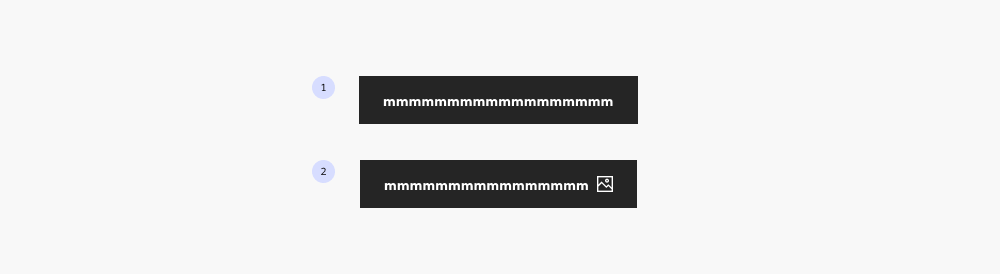

_Figure: Two enabled, medium-size filled buttons stacked vertically, each filled with the letter "m" to show the maximum label length. Callout 1 marks a button without icon holding 18 characters (the maximum), callout 2 marks a button with an icon on the right holding 16 characters (the maximum), so neither label breaks into two lines._

#### Overflow

Although its not recommended, overflow can occur. [In this case use ghost buttons if possible.](https://www.figma.com/design/qXldpLO6gxHJNLdcXIPxYt?node-id=168-3943) The icon is aligned centered to the text. The text should not overflow in more than two lines.

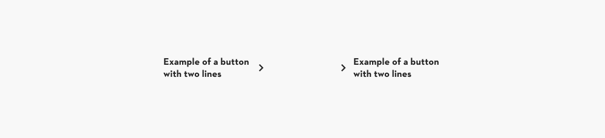

_Figure: Two enabled, medium-size ghost buttons with the text "Example of a button with two lines" wrapped onto two lines. In the left button the chevron icon sits to the right of the text, in the right button the chevron sits to the left of the text; in both the icon is vertically centered to the two-line text._

## Behavior

### System feedback

After interacting with a button: offer system feedback close to the button.

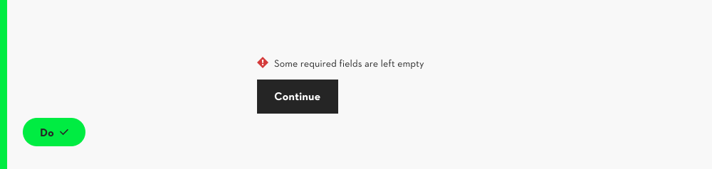

_Figure: Do: an enabled, medium-size filled button with the text "Continue" and no icon. Directly above it, close to the button, a red warning icon and the system feedback text "Some required fields are left empty" are shown, which is correct because feedback after interacting with a button should appear near the button._

### Toast notification

After interacting with a button: in some cases, consider system feedback to the user through a toast notification.

[Toast notification →](https://www.figma.com/design/qXldpLO6gxHJNLdcXIPxYt?node-id=8844-4923)

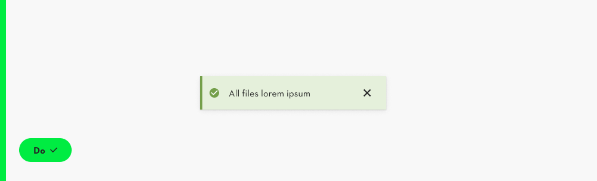

_Figure: Do: a green success toast notification with a green checkmark icon on the left, the text "All files lorem ipsum" in the center and a close icon on the right. It shows system feedback through a toast notification after a button interaction._

## Button Round

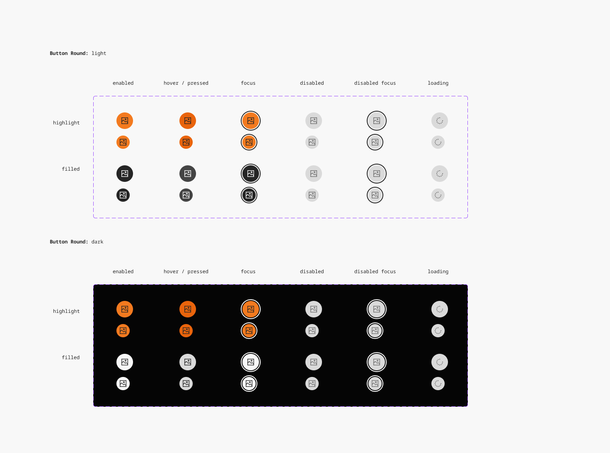

_Figure: Overview of the round button in two grids, "Button Round: light" on a light background and "Button Round: dark" on a black background. In each grid the columns are the states enabled, hover / pressed, focus, disabled, disabled focus and loading, and the rows are the styles highlight (orange) and filled (dark in light mode, white in dark mode). Every style is shown in a larger and a smaller size with an image icon; focus adds a ring around the circle, disabled and loading appear grey, and loading shows a spinner instead of the icon._

## Overview

A round button is a clickable element to initialize an action or to highlight the user journey.

### When to use

Round buttons should be used sparingly.

The **Highlight** **Round Button** is currently only used for the Product Card in the STIHL web shop.

The **Filled Round Button** is currently only used for the for the refresh action in the iMOW support portal and the old version of the load more button in on STIHL.de.

**If possible don’t use the buttons in any other cases.**

### Further guidelines

[Storybook documentation](https://main--63440bbb95889041542a5ba3.chromatic.com/?path=/docs/components-button-round--documentation)

## Formatting

### Anatomy

1. **Container**
1. **Icon**

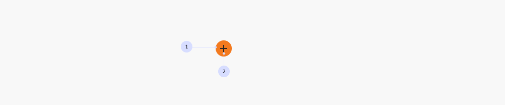

_Figure: Anatomy of a small, enabled, orange highlight round button with a plus icon. Callout 1 points at the circular container, callout 2 points at the icon in its center._

### Variants

Use different variants for different emphasis on the buttons.

1. **Highlight**
1. **Filled**

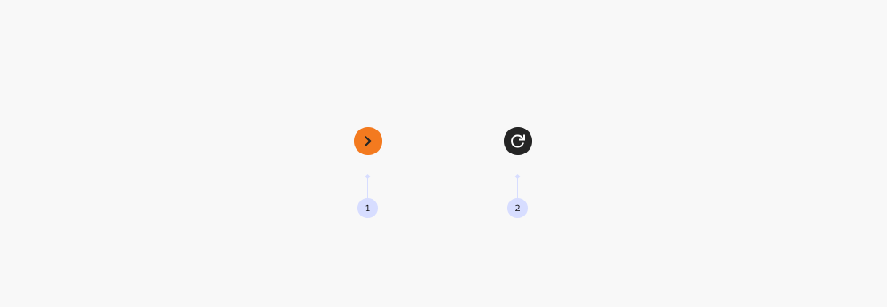

_Figure: Two enabled round buttons side by side. Callout 1 points at the orange highlight variant with a chevron icon, callout 2 points at the dark filled variant with a refresh icon; the variants give the buttons different emphasis._

### Size

Two sizes have been defined for round buttons:

1. **Medium:** That’s the size that should be used by default.
1. **Small:** This size can be used when
   - there is not enough vertical space to use the default button
   - there are too many small elementes and the default button would feel too massive

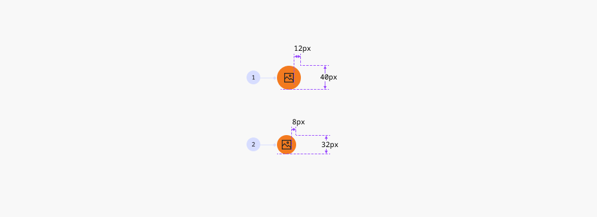

_Figure: Two orange highlight round buttons with an image icon, enabled. Callout 1 marks the medium button, 40px high, with a 12px measurement between the container edge and the icon. Callout 2 marks the small button, 32px high, with an 8px measurement between the container edge and the icon._

## Foreground and background combinations

### Plain colours

Round buttons should only be used on plain backgrounds as following:

#### Light mode

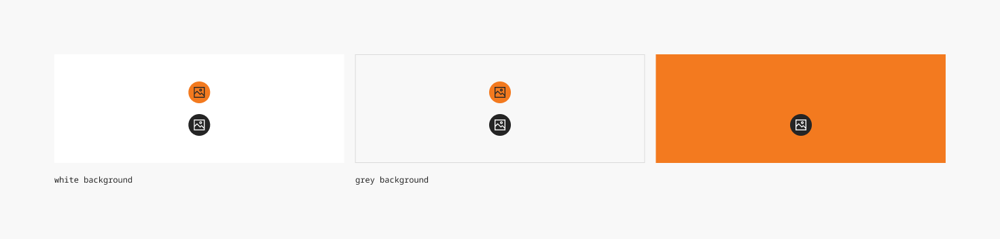

_Figure: Light mode round buttons, small and enabled, on three backgrounds. On the "white background" and the "grey background" panels both an orange highlight button and a dark filled button are shown, stacked vertically. The third panel is solid orange and only shows the dark filled button, since an orange highlight button would not be visible there._

#### Dark mode

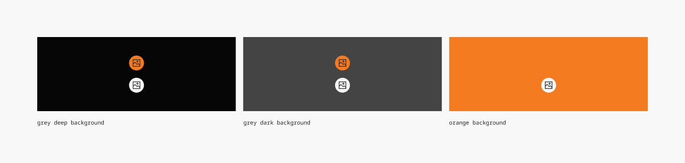

_Figure: Dark mode round buttons, small and enabled, on three backgrounds. On the "grey deep background" (black) and the "grey dark background" panels both an orange highlight button and a white filled button are shown, stacked vertically. The third panel, "orange background", only shows the white filled button._

### Images and other backgrounds

Round button placement on images and not plain coloured backgrounds should be avoided. In exception, use buttons as following:

#### Light mode

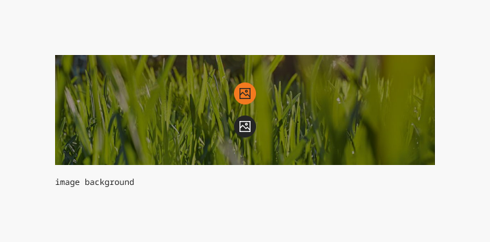

_Figure: Light mode round buttons, small and enabled, on a photo of grass labeled "image background". An orange highlight button sits above a dark filled button, both with an image icon._

#### Dark mode

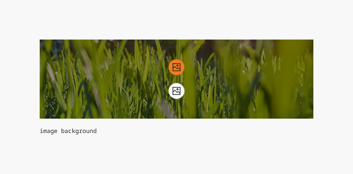

_Figure: Dark mode round buttons, small and enabled, on a photo of grass labeled "image background". An orange highlight button sits above a white filled button, both with an image icon._

## Floating Action Button

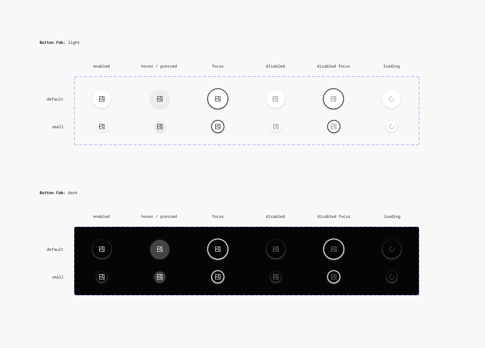

_Figure: Matrix of the Floating Action Button in two blocks, Button Fab: light on a light background and Button Fab: dark on a black background. Each block has columns enabled, hover / pressed, focus, disabled, disabled focus and loading, and rows default and small. All buttons are round with a centered image icon; hover / pressed is shaded grey, focus and disabled focus have a thick outline ring, disabled is faded, and loading replaces the icon with a dotted spinner._

## Overview

An FAB (Floating Action Buttons) is a clickable element to initialize an action, which is laying over other content.

### When to use

A FAB is used when a certain action needs to be available at all time. It sticks to the screen and is placed on top of other content and therefore always accessible.

### Further guidelines

[Storybook documentation](https://main--63440bbb95889041542a5ba3.chromatic.com/?path=/docs/components-floating-action-button--documentation)

## Formatting

### Anatomy

1. **Container**
1. **Icon**

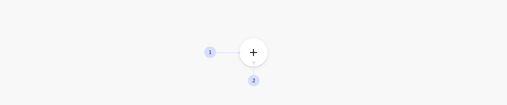

_Figure: Anatomy of the fab-light button in the enabled state and medium size: a round white button with a plus icon. Callout 1 points at the Container, the white circle, and callout 2 points at the Icon, the plus sign centered inside it._

### Size

Two sizes have been defined for FABs:

1. **Medium:** That size is the default option and mainly used when the FAB is hovering all content.
1. **Small:** This size is mainly used when the FAB belongs to a certain module (i.e. the menu drawer of the sidebar navigation).

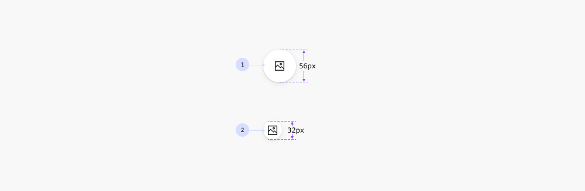

_Figure: The two sizes of the fab-light button in the enabled state, each a round white button with an image icon. Callout 1 marks the medium size with a height of 56px, the default, mainly used when the FAB hovers over all content. Callout 2 marks the small size with a height of 32px, mainly used when the FAB belongs to a certain module such as the menu drawer of the sidebar navigation._

## Colour combinations

### Background colours

FABs can be on **all** **backgrounds** as shown below:

#### Light mode

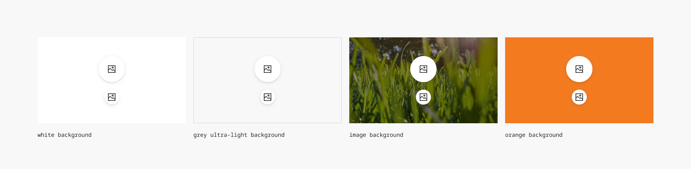

_Figure: The fab-light button in the enabled state on four backgrounds, labeled white background, grey ultra-light background, image background (green grass photo) and orange background. Each background shows a medium white round button above a small white round button, both with an image icon._

#### Dark mode

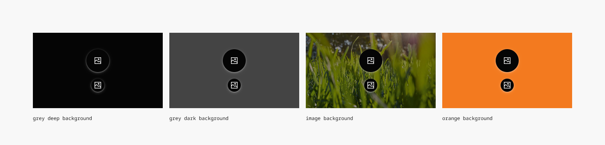

_Figure: The fab-dark button in the enabled state on four backgrounds, labeled grey deep background (near black), grey dark background, image background (green grass photo) and orange background. Each background shows a medium black round button above a small black round button, both with a white image icon and a subtle light edge glow._

## Button Nav

Overview:

- ButtonNav is a navigation-specific variant of the standard Button component. It is designed to deliver a consistent and adaptive user experience within primary navigation areas.
- Common use cases:
   - Nav Bar
   - Mobile Menu
- Key Features:
   - Inherits core behavior and styling from the base Button component
   - Intended exclusively for use in navigation layouts
   - Responsive typography: Font size automatically adjusts based on viewport size
   - Can function as either a link or a button
      - When used as a button, it displays a chevron icon to indicate that it triggers a Dropdown Menu or Mega Menu

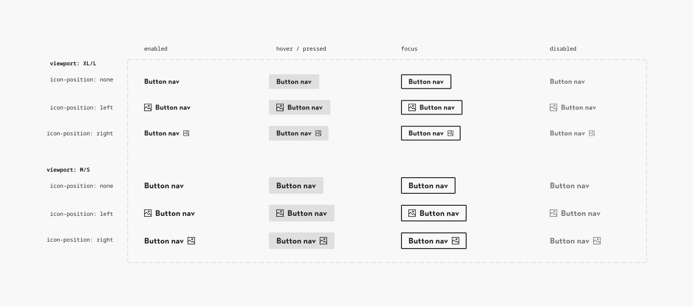

_Figure: Matrix of the Button nav with columns enabled, hover / pressed, focus and disabled. Rows are grouped by viewport XL/L and viewport M/S, each with icon-position none, left and right, using the label Button nav with an image icon where applicable. Enabled is plain bold text, hover / pressed has a grey background, focus has a dark outline box, disabled is greyed out, and the M/S text is larger than the XL/L text._

### Further guidelines

[Storybook documentation](https://main--63440bbb95889041542a5ba3.chromatic.com/?path=/docs/components-buttons-button--documentation#navigation)

### Related elements

[Header](https://www.figma.com/design/DNB69TwlN0FaaVg7yVsYu4?node-id=6338-35399)

[Nav Bar](https://www.figma.com/design/DNB69TwlN0FaaVg7yVsYu4?node-id=6338-35848)

[Mobile Menu](https://www.figma.com/design/DNB69TwlN0FaaVg7yVsYu4?node-id=6338-36288)

### Contribute

Contribute to improving this component by sharing your feedback, asking questions, or suggesting features [here](https://www.figma.com/design/lLmw7PfIdKjFG4uT3B2Hyj/Onboarding-%F0%9F%93%96?node-id=446-868&t=zKmRu4kAkxMeRDmK-4).

## Formatting and Construction

### Anatomy

#### Elements

1. **Button Label**
1. **Icon Right** (Conditional) An icon may be placed on the right side of the label, depending on the navigation action. For example, a chevron icon may indicate a dropdown. See the Icon Usage section for more details.
1. **Icon Left** (Optional) A left-aligned icon can be used to visually support the label, depending on the context and use case.

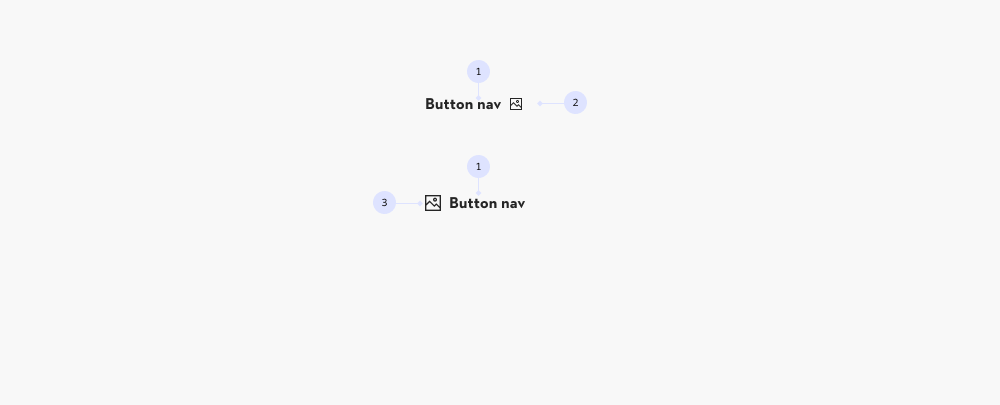

_Figure: Two enabled Button nav examples for the l and xl breakpoints. The top one shows the label with an icon on its right, the bottom one shows an icon on the left of the label. Callout 1 points at the Button Label in both, callout 2 points at the Icon Right (conditional) in the top button, and callout 3 points at the Icon Left (optional) in the bottom button._

#### Viewport Varaiant

Two sizes are defined for the navigation variant of the Button, based on breakpoints:

1. **Breakpoints l & xl:** Size is optimized to create visual hierarchy in relation to other navigation elements.
1. **Breakpoints s & m:** Used when navigation items move into the Mobile Menu. Size is adjusted to maintain hierarchy and improve tap targets for touch interaction.

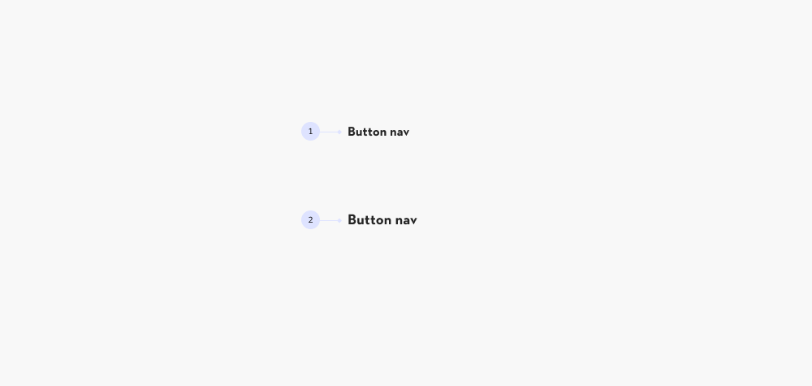

_Figure: Two enabled Button nav labels without icons, one above the other. Callout 1 points at the smaller text for breakpoints l and xl, sized to create visual hierarchy within the navigation. Callout 2 points at the larger text for breakpoints s and m, used in the Mobile Menu with improved tap targets._

### States

Since this button is intended exclusively for navigation elements, it does not include all the states of the default button component. Supported states include:

1. **Enabled**
1. **Hover/Pressed**
1. **Focus**
1. **Disabled**

Navigation items should never be shown in a **disabled state**. If loading is required (e.g. for page transitions), use a **loading indicator on the page**, not within the button itself.

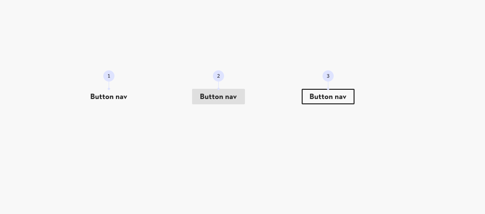

_Figure: Three Button nav examples labeled Button nav, without an icon, for the l + xl breakpoints, in a row. Callout 1 points at the enabled state, plain bold text. Callout 2 points at the hover / pressed state, text on a grey background. Callout 3 points at the focus state, text inside a dark outline box._

## Content and Assets

### Icon Usage

#### Icon Right

Right-aligned icons are used to clarify the action triggered by the nav item. The following icons may be applied:

1. **Chevron Up / Down** Used when the button triggers a Dropdown Menu:
   - Default state: Chevron Down
   - When expanded: switches to Chevron Up
1. **Chevron Right** Used when the button is displayed inside a Mobile Menu to indicate a drilldown navigation.
1. **External Link Icon** Used when the Button Nav functions as a link and links to an external page.

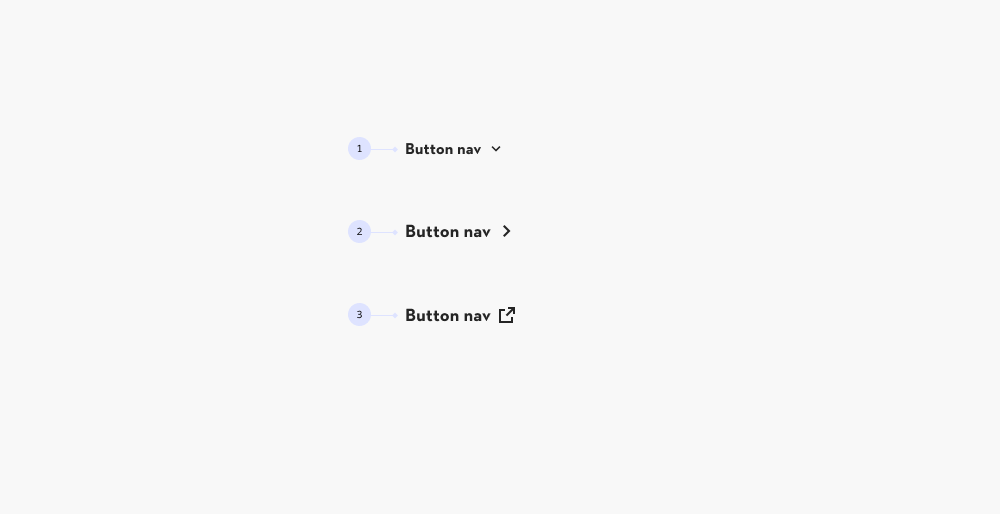

_Figure: Three Button nav examples with a right-aligned icon, stacked vertically. Callout 1 points at a chevron down icon (l + xl), the default for a Dropdown Menu that switches to chevron up when expanded. Callout 2 points at a larger chevron right icon (s + m), for drilldown navigation in a Mobile Menu. Callout 3 points at an external link icon, for a link to an external page._

#### Icon Left

A left-aligned icon can be added before the label to support visual scanning and clarify the item's purpose.

- Use only when it adds meaningful context.
- Use sparingly, and don’t combining it with a right icon to reduce visual clutter.

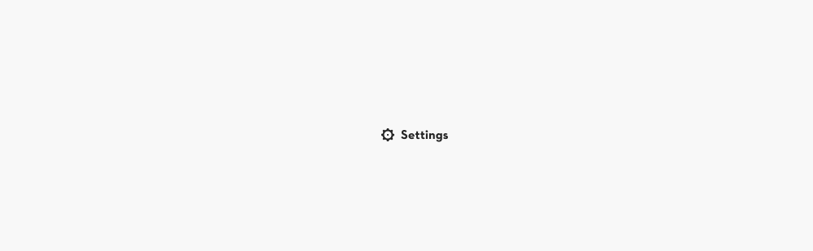

_Figure: A single enabled Button nav for the l + xl breakpoints with the label Settings and a gear icon placed to the left of the label. The icon supports visual scanning and clarifies the item's purpose; it should be used sparingly and not combined with a right icon._

## Usage

### Nav Bar

The primary use of the Button Nav variant is within the Nav Bar, as part of the overall navigation pattern.

[Go to Nav Bar →](https://www.figma.com/design/dDZiDou9UpPtHIF2bXkLKL?node-id=6583-59828)

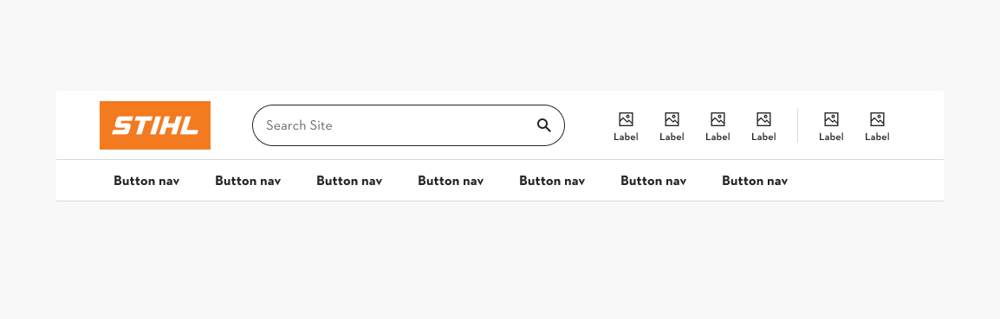

_Figure: Nav Bar for a large viewport on a white background. The top bar contains the orange STIHL logo at the left, a rounded search field with the placeholder Search Site and a magnifier icon, and six small image icons with the caption Label, four grouped and two more after a thin vertical divider. Below a separator line, seven bold Button nav items sit in a horizontal row with no icons._
