# Button

## Button

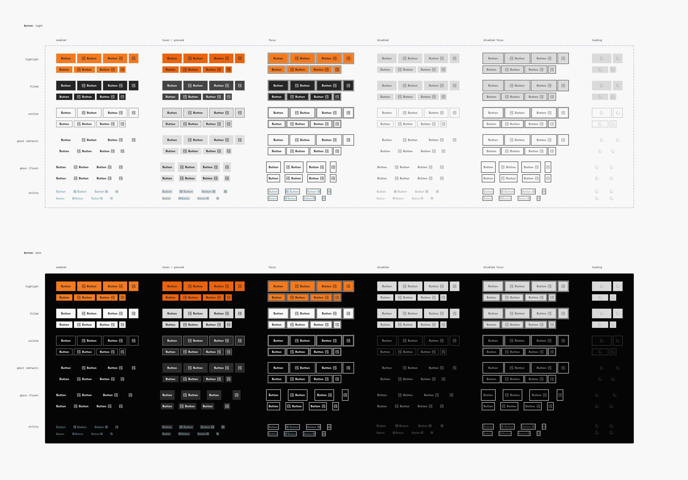

## Overview

### Definition

A button is a clickable element to initialize an action or to highlight the user journey.

### When to use

Use buttons to perform an action, i.e.:

- submit a form
- trigger an element to appear or disappear
- edit an element
- etc.

### When not to use

Do not use buttons for hierarchical navigation, or when you want to link to other pages or external resources.

In this case you should use Standalone links, Inline links or links that look like buttons.

**Links that look like a button**

There are instances when a link needs to be styled as a button because of its emphasis on the page.

In this case keep in mind that there is no disabled and loading state, since they are links.

### Further guidelines

[Storybook documentation](https://main--63440bbb95889041542a5ba3.chromatic.com/?path=/docs/components-button--documentation)

## Formatting

### Anatomy

1. **Container**
1. **Button label**
1. **Icon Left / Right** (Optional)

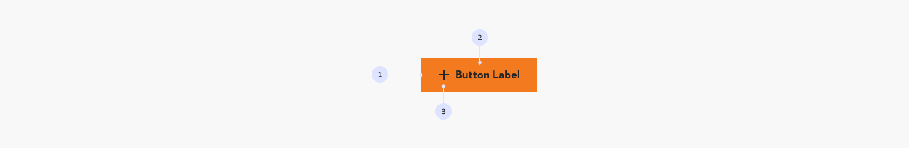

### Variants

Use button variants to define visual emphasis, action hierarchy, and context.

1. **Highlight** Use for the most important action on a page or within a user flow. This variant should be used sparingly and only when an action needs to stand out above all others. Example: Add to Cart
1. **Filled:** Use as the default button style when no other variant is specified. Filled buttons provide clear emphasis and are suitable for standard primary actions. Example: Submit, continue, save.
1. **Outline:** Use for secondary actions that need to remain visible without competing with the primary action. Outline buttons are often used next to Filled or Highlight buttons to establish hierarchy. Example: Cancel (next to Save), Back (next to Continue).
1. **Ghost:** Use for low-emphasis actions or secondary actions in layouts where the button has enough visual breathing room. Ghost buttons work well in standalone UI areas such as teaser or banner where the action can remain visually subtle. Example: View all.
1. **Utility:** Use for supporting actions in dense UI layouts, such as checkout flows or data tables. It provides more visual emphasis than a Ghost Button, but remains less prominent than a Highlight Button. Examples: Edit, Change.

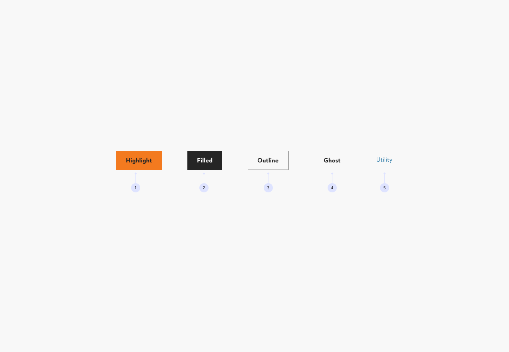

### Size

Two sizes have been defined for buttons:

1. **Medium:** That’s the size that should be used by default.
1. **Small:** This size can be used when
   - there is not enough vertical space to use the default button
   - there are too many small elementes and the default button would feel too massive
   - a Ghost button is paired vertically with another button variant

For **Ghost Buttons** with **flush functionality** the height stays the same, but the right and left padding changes to negative for both **default (3)** and **small (4)**.

For **Ghost Accent Buttons** the height is smaller, the button is flush and has no padding. Gaps and icon sizes are also different for both **default (5)** and **small (6)**.

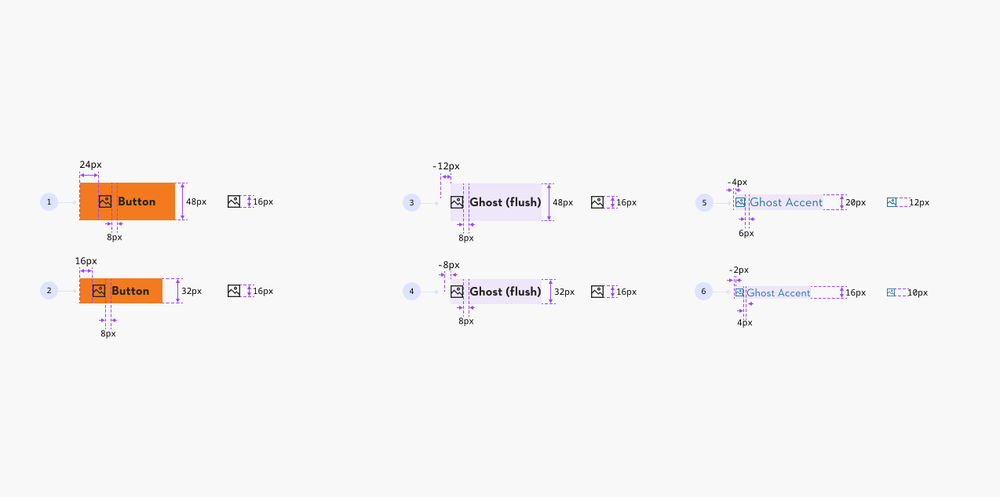

### Icon

Buttons can be feature an icon to clarify an action and to highlight a button. They are always placed left or right of the text label.

The text label can be hidden. Icon only buttons should only be used for functions where text labels are not needed to define the function e.g. modal close or paginations buttons.

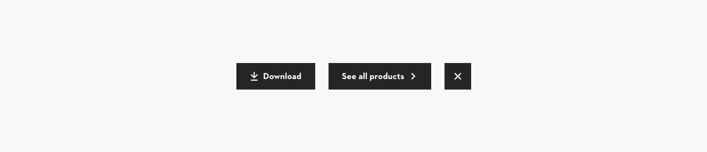

### Icon Placement

Icons can freely be placed in front of or after the label .

1. In most cases **a left position** is preferred, due to reading direction.
1. Exceptions can be made if a specific use case needs a **right position** (e.g ghost buttons in teasers often have a right icon).

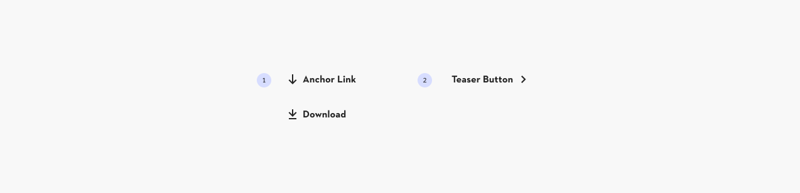

## Pairings and alignment

### Pairings

#### Hierarchies

**Always follow hierarchy semantics** when pairing buttons:

1. Highlight + Filled / Outline / Ghost
1. Filled + Outline / Ghost
1. Outline + Ghost

In case a hierarchy is not relevant, use a Outline oder Ghost button.

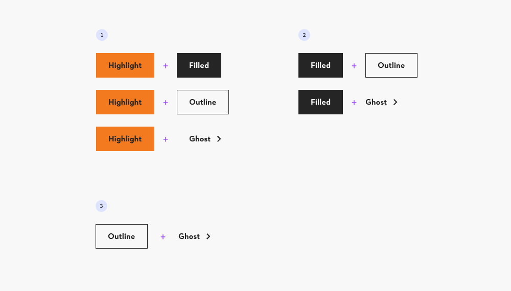

#### Horizontal pairing

When pairing buttons horizontally keep the following in mind:

1. All buttons should have the same height.
1. The buttons widths should grow with its content. Different rules can apply for mobile.
1. In case 3 actions occur, limit them to two button types or use a segmented button.
1. Make sure all icons are either left or right, not a combination of both.

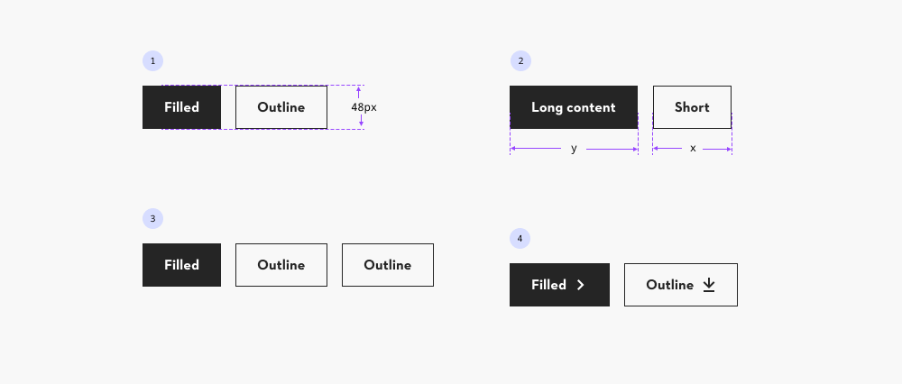

#### Vertical pairing

When pairing buttons **vertically** keep the following in mind:

1. A mix of small and default size buttons is allowed.
1. Buttons should generally have the same widths. They adapt to the button with the longest content. Different rules can apply for mobile. An exception applies to Ghost buttons with **flush alignment** - they don’t adapt (see more information below).
1. In case 3 actions occur, limit them to two button types or use a segmented button.
1. Make sure all icons are either left or right, not a combination of both.

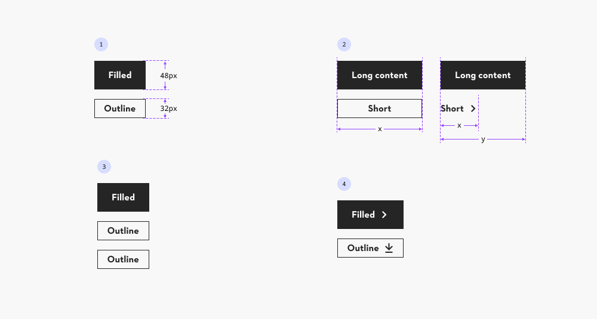

#### Spacing

**Spacing:** between or to the next element should be minimal 16px, in order to optimize for mobile usability.

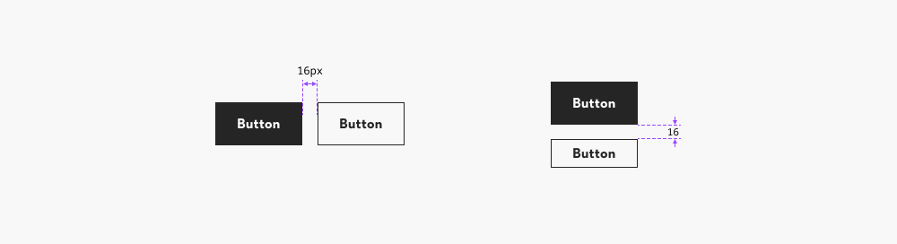

### Alignment

#### Flush alignment for ghost buttons

When aligning ghost buttons with other elements to the left or right, it’s advised to apply the **flush alignment (1).** That way the elements are visually aligned. The flush functionality doesn’t exist for the other buttons, it’s exclusive for the ghost button.

For center alignment the default ghost button setting can be used **(2)**.

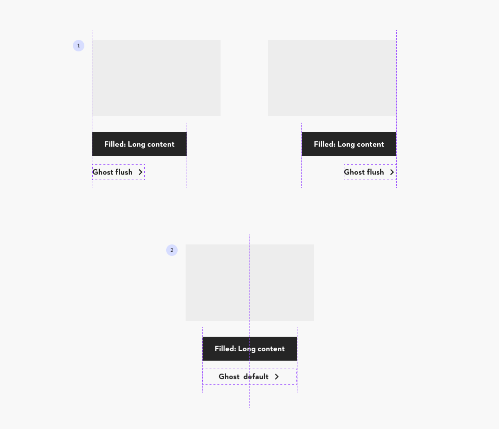

#### Align buttons with the content

As a general rule make sure that the buttons are aligned with the content within a layout: left, center or right.

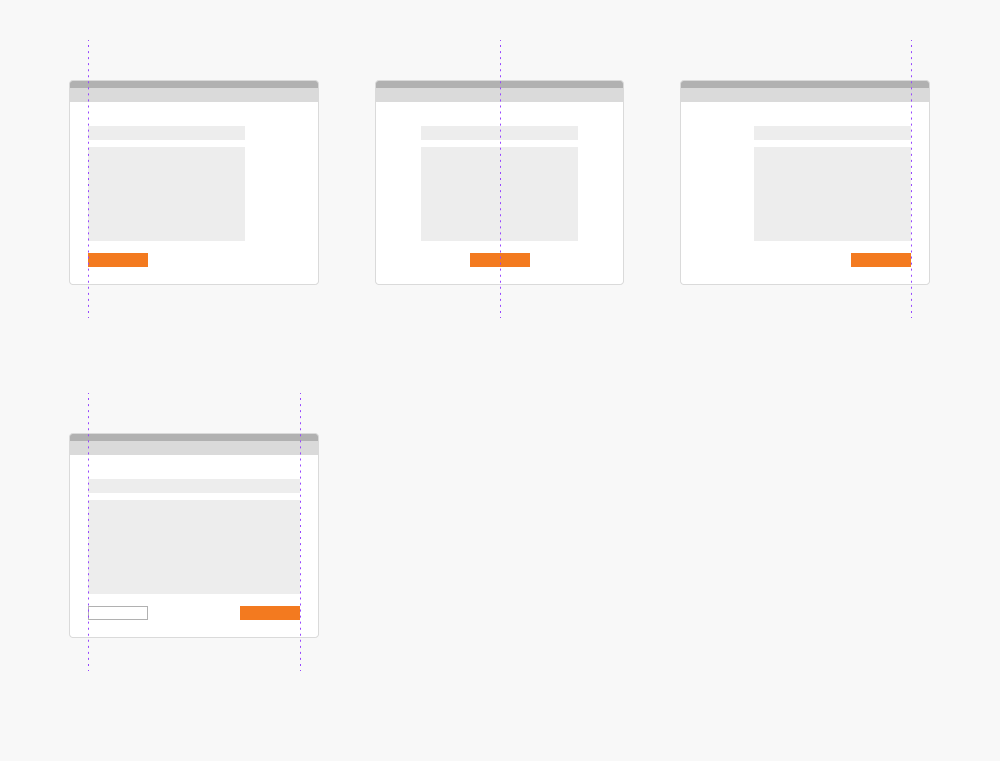

#### Dialog or forms: align the primary button on the left

In case the button is located in a dialog or underneath a form, place the primary button on the left, aligned with the input fields.

A secondary buttons would appear on the right or, if there is not enough space, underneath.

[Text Input Guidelines→](https://www.figma.com/design/qXldpLO6gxHJNLdcXIPxYt?node-id=1591-2)

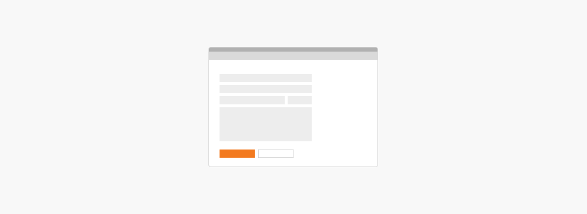

#### Flow or process: align the primary button on the right

For flows of multiple screens, place the primary button on the right, to imply the user about the next step.

A secondary buttons appears on the left.

**Sidenote:** for mobile purposes this guideline might not apply. Make sure to test the usability for your product.

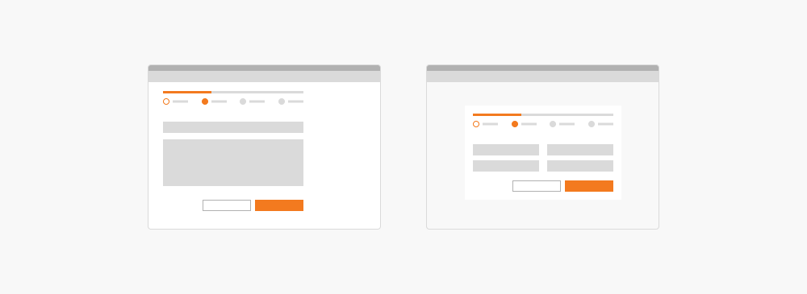

**In case an iFrame is build into the webpage:** the buttons are aligned to the content elements and their grid. A good example therefore are the digital advisors.

[Grid Styles→](https://www.figma.com/design/JyyYtoCYbtJrzqHs38OXSQ/Grid-%26-Spacing-%F0%9F%A7%AE?node-id=1-132)

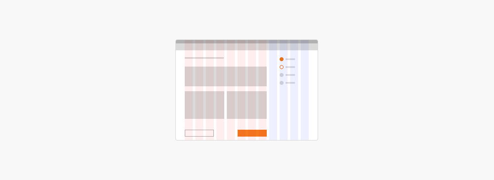

#### Mobile: primary action at the top

It is recommended to lead with the primary button first on mobile devices, even if the semantic order in the code is different on desktop.

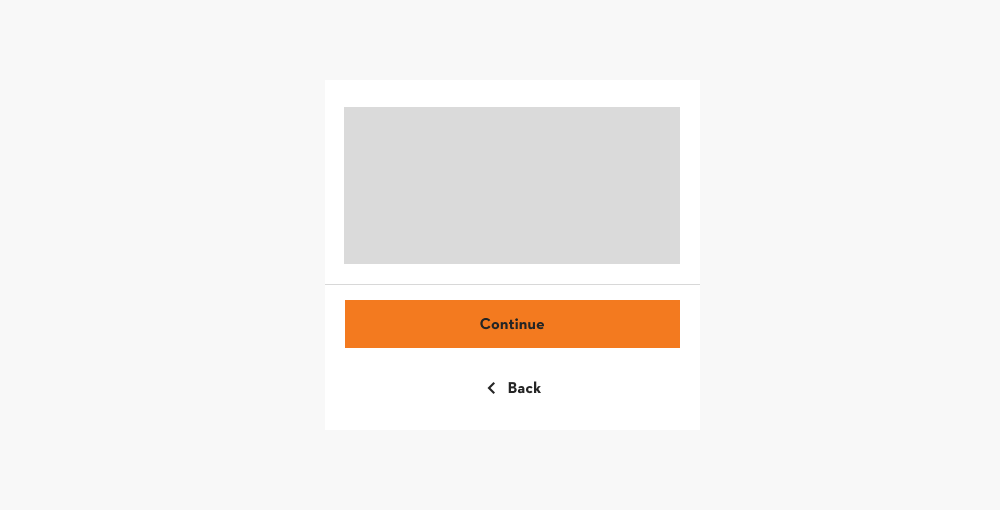

## Foreground and background combinations

### Plain colours

Buttons should only be used on plain backgrounds as following:

#### Light mode

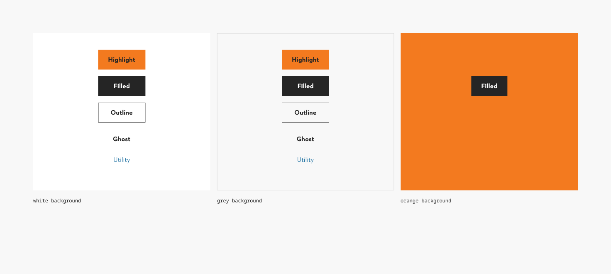

#### Dark mode

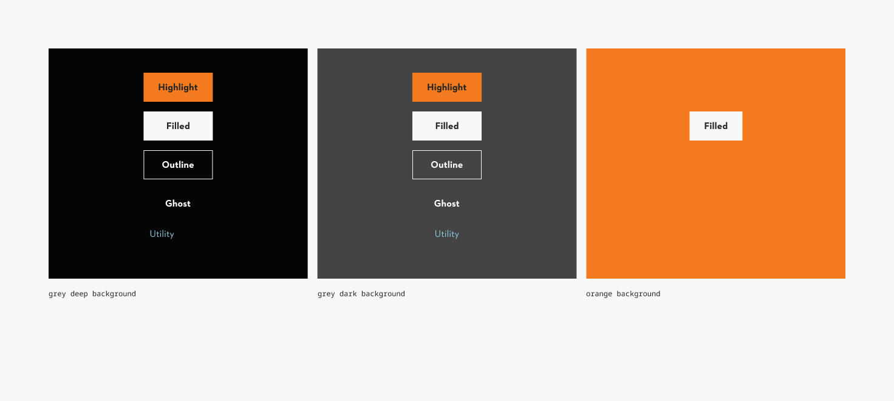

### Images and other backgrounds

Button placement on images and not plain coloured backgrounds should be avoided. In exception, use buttons as following:

#### Light mode

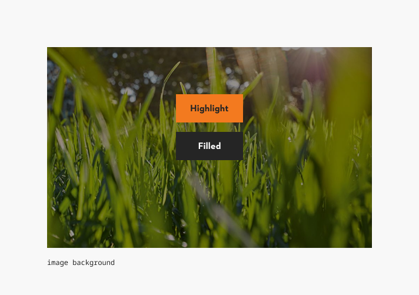

#### Dark mode

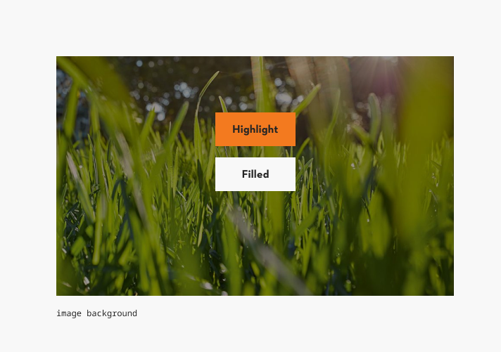

## Usage

### Ghost vs. Utility Button

Both variants are low-emphasis button styles. The difference is the surrounding context and the amount of visual emphasis needed.

#### Ghost

Use the **Ghost Button** for standalone elements or spacious layouts where the button has enough visual breathing room to be noticed. It is often used together with other button variants to create hierarchy without adding too much visual weight.

**Common use cases:**

- Banners
- Teasers
- Popovers
- Cards

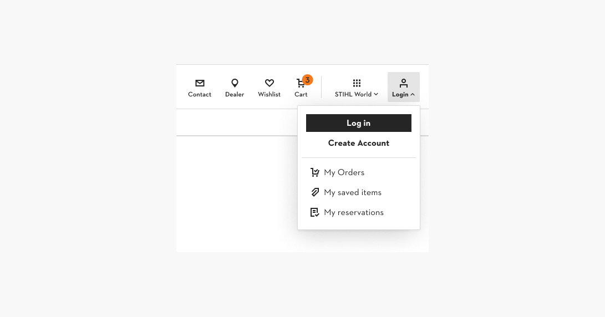

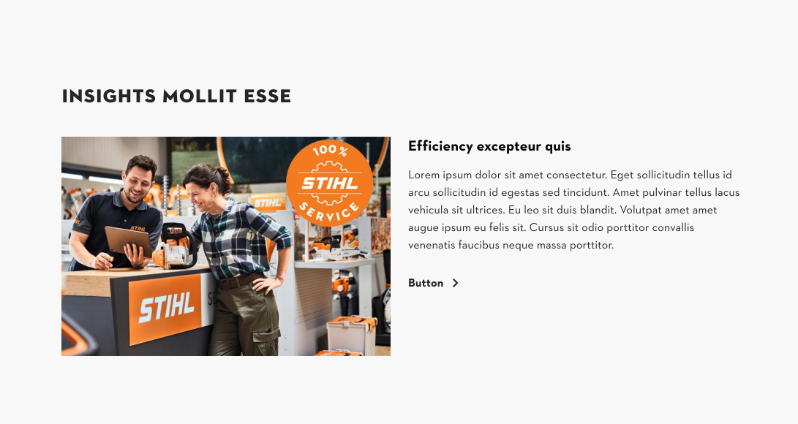

#### Utility Button

Use the **Utility Button** inside dense or information-heavy UI layouts, where supporting actions need more visual emphasis than a Ghost Button, but should remain less prominent than a Highlight Button.

The accent color improves visibility and discoverability without turning the action into the main call to action.

**Common use cases:**

- Forms
- Checkout flows
- Data tables
- Inline editing

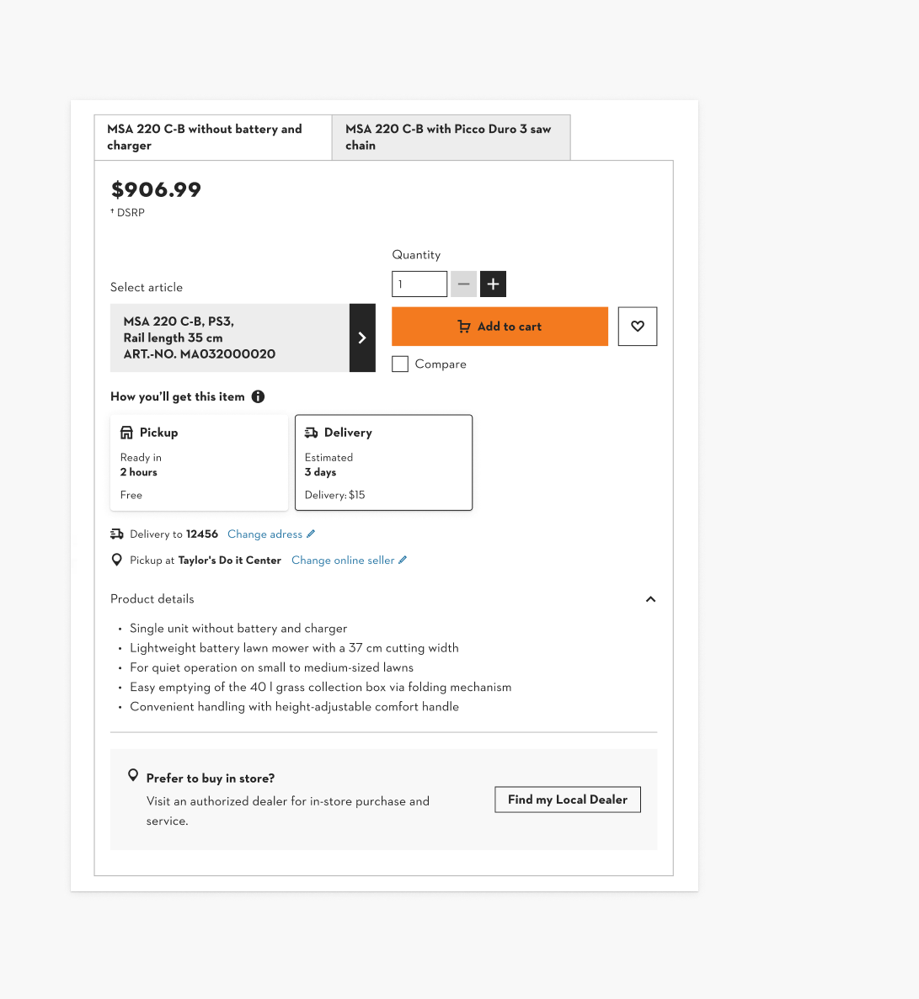

## Content

### Labels

**Do:**

- Clear and concise: use labels like "Save Changes" or "Discard Changes".
- Action-Oriented: Use verbs to describe the action, making it clear what will happen when the button is clicked.

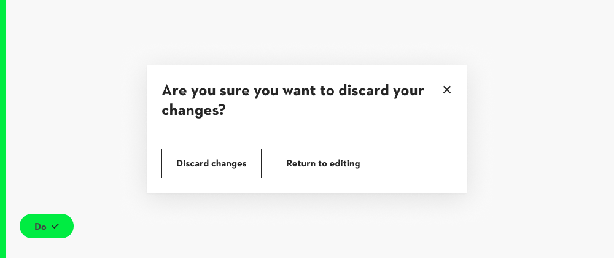

**Don’t**

Avoid generic terms like "Yes" or "No".

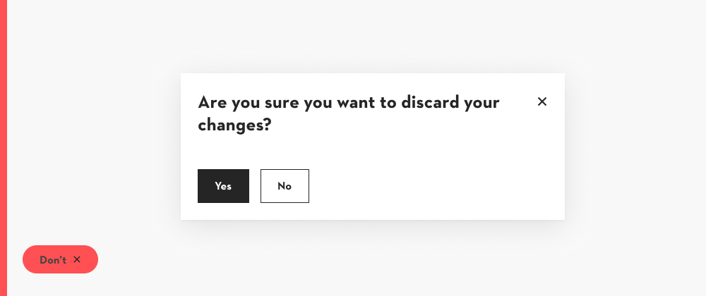

#### Sentence case

In some cases the label is a sentence - capitalize the first letter and use lower case for the rest.

**Exception**: words that have to be written with a capitalized letter, like names **(1)** or nouns in German **(2)**.

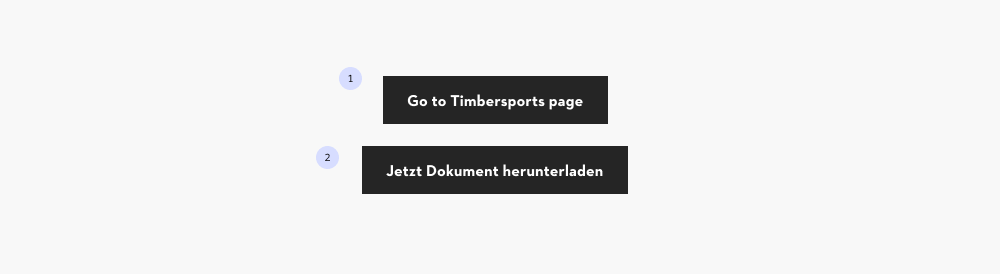

#### Maximum character

The button should not break into two lines. To achieve this the we recommend:

1. A maximum of **18 characters** for button without icon
1. A maximum of **16 characters** for button with icon

For longer application the use of Ghost Buttons is recommended.

#### Overflow

Although its not recommended, overflow can occur. [In this case use ghost buttons if possible.](https://www.figma.com/design/qXldpLO6gxHJNLdcXIPxYt?node-id=168-3943) The icon is aligned centered to the text. The text should not overflow in more than two lines.

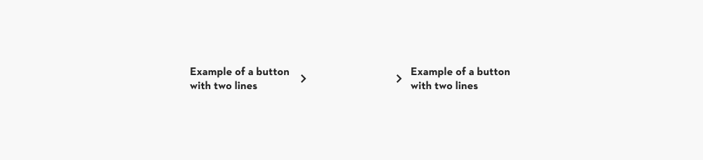

## Behavior

### System feedback

After interacting with a button: offer system feedback close to the button.

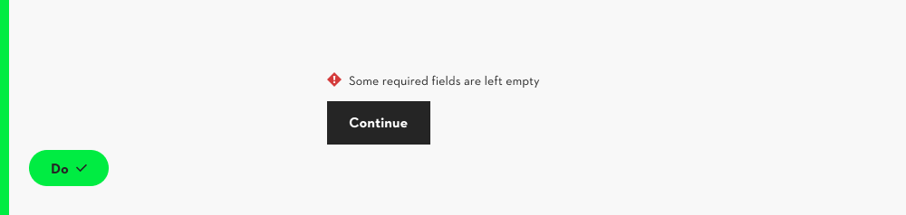

### Toast notification

After interacting with a button: in some cases, consider system feedback to the user through a toast notification.

[Toast notification →](https://www.figma.com/design/qXldpLO6gxHJNLdcXIPxYt?node-id=8844-4923)

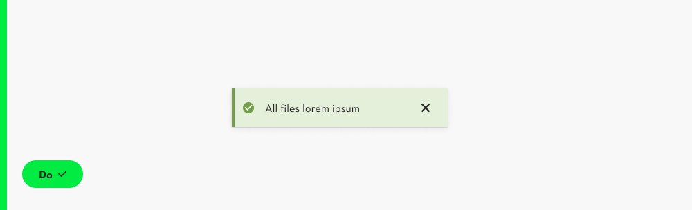

## Button Round

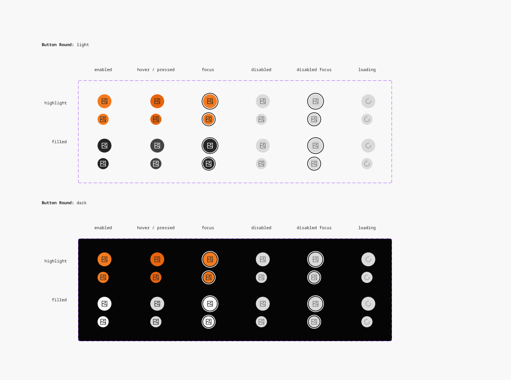

## Overview

A round button is a clickable element to initialize an action or to highlight the user journey.

### When to use

Round buttons should be used sparingly.

The **Highlight** **Round Button** is currently only used for the Product Card in the STIHL web shop.

The **Filled Round Button** is currently only used for the for the refresh action in the iMOW support portal and the old version of the load more button in on STIHL.de.

**If possible don’t use the buttons in any other cases.**

### Further guidelines

[Storybook documentation](https://main--63440bbb95889041542a5ba3.chromatic.com/?path=/docs/components-button-round--documentation)

## Formatting

### Anatomy

1. **Container**
1. **Icon**

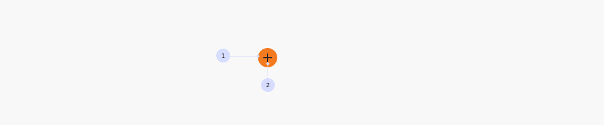

### Variants

Use different variants for different emphasis on the buttons.

1. **Highlight**
1. **Filled**

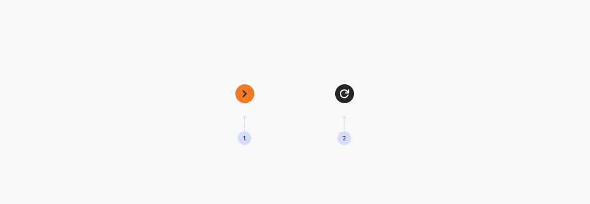

### Size

Two sizes have been defined for round buttons:

1. **Medium:** That’s the size that should be used by default.
1. **Small:** This size can be used when
   - there is not enough vertical space to use the default button
   - there are too many small elementes and the default button would feel too massive

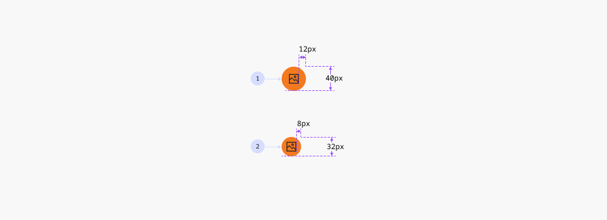

## Foreground and background combinations

### Plain colours

Round buttons should only be used on plain backgrounds as following:

#### Light mode

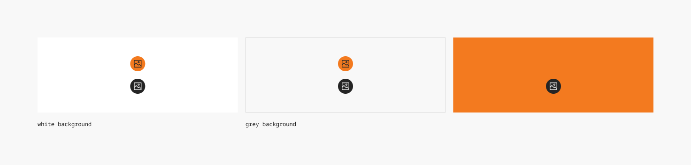

#### Dark mode

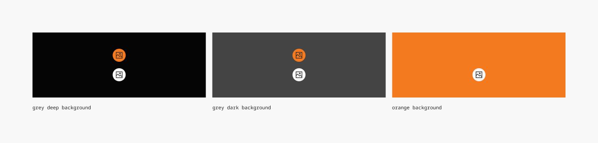

### Images and other backgrounds

Round button placement on images and not plain coloured backgrounds should be avoided. In exception, use buttons as following:

#### Light mode

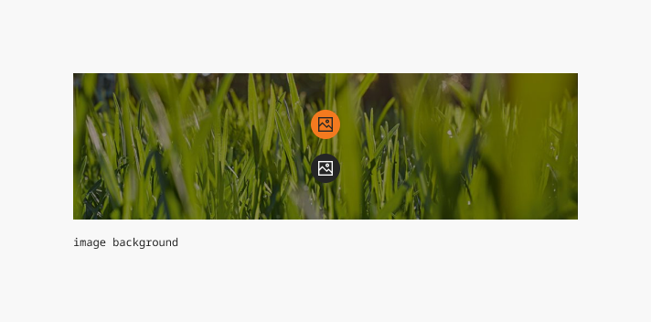

#### Dark mode

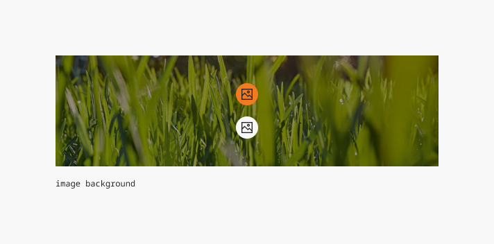

## Floating Action Button

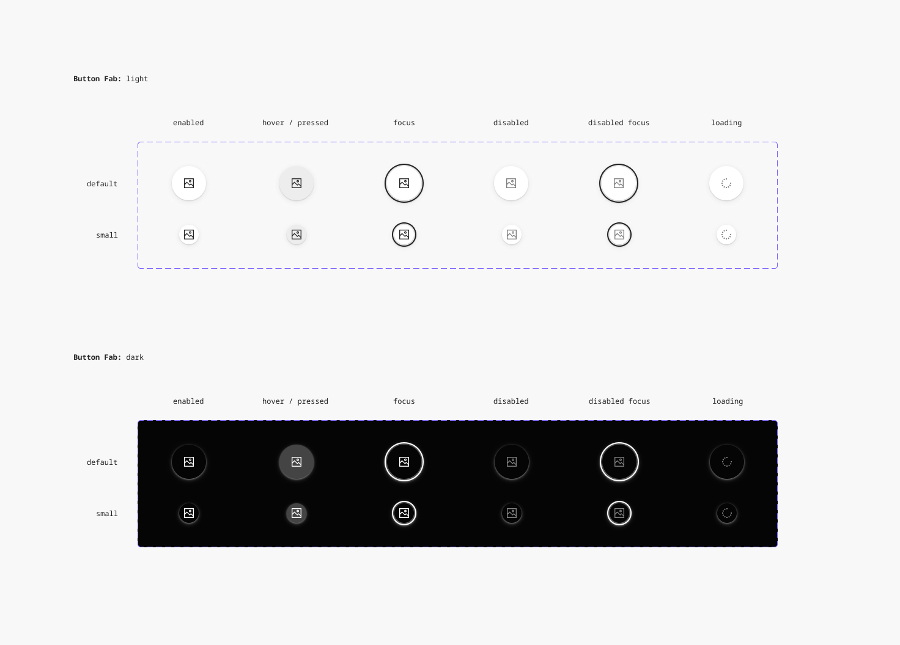

## Overview

An FAB (Floating Action Buttons) is a clickable element to initialize an action, which is laying over other content.

### When to use

A FAB is used when a certain action needs to be available at all time. It sticks to the screen and is placed on top of other content and therefore always accessible.

### Further guidelines

[Storybook documentation](https://main--63440bbb95889041542a5ba3.chromatic.com/?path=/docs/components-floating-action-button--documentation)

## Formatting

### Anatomy

1. **Container**
1. **Icon**

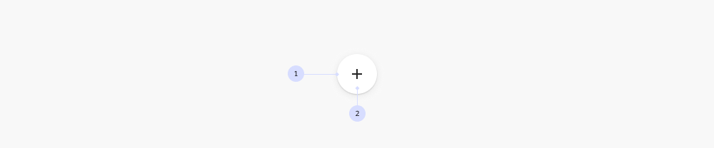

### Size

Two sizes have been defined for FABs:

1. **Medium:** That size is the default option and mainly used when the FAB is hovering all content.
1. **Small:** This size is mainly used when the FAB belongs to a certain module (i.e. the menu drawer of the sidebar navigation).

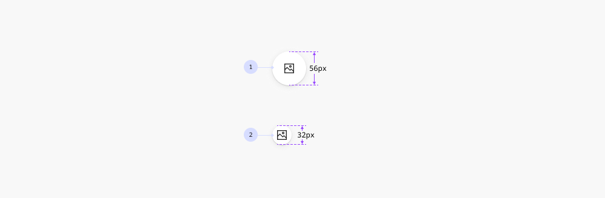

## Colour combinations

### Background colours

FABs can be on **all** **backgrounds** as shown below:

#### Light mode

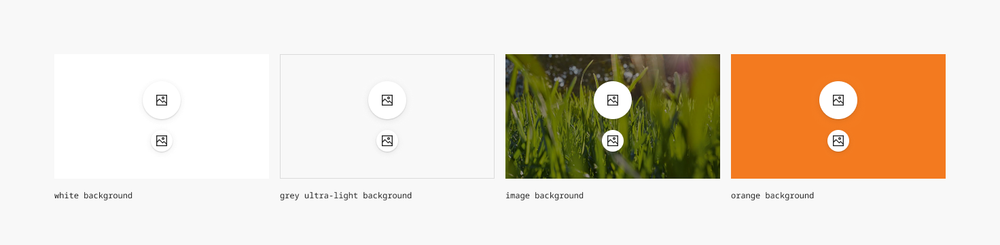

#### Dark mode

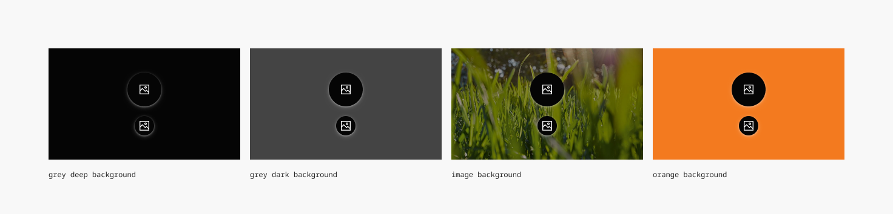

## Button Nav

Overview:

- ButtonNav is a navigation-specific variant of the standard Button component. It is designed to deliver a consistent and adaptive user experience within primary navigation areas.
- Common use cases:
   - Nav Bar
   - Mobile Menu
- Key Features:
   - Inherits core behavior and styling from the base Button component
   - Intended exclusively for use in navigation layouts
   - Responsive typography: Font size automatically adjusts based on viewport size
   - Can function as either a link or a button
      - When used as a button, it displays a chevron icon to indicate that it triggers a Dropdown Menu or Mega Menu

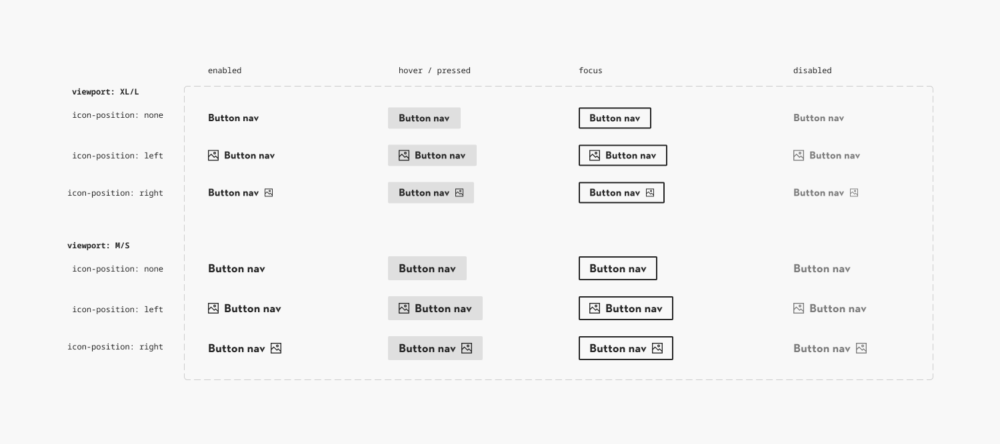

### Further guidelines

[Storybook documentation](https://main--63440bbb95889041542a5ba3.chromatic.com/?path=/docs/components-buttons-button--documentation#navigation)

### Related elements

[Header](https://www.figma.com/design/DNB69TwlN0FaaVg7yVsYu4?node-id=6338-35399)

[Nav Bar](https://www.figma.com/design/DNB69TwlN0FaaVg7yVsYu4?node-id=6338-35848)

[Mobile Menu](https://www.figma.com/design/DNB69TwlN0FaaVg7yVsYu4?node-id=6338-36288)

### Contribute

Contribute to improving this component by sharing your feedback, asking questions, or suggesting features [here](https://www.figma.com/design/lLmw7PfIdKjFG4uT3B2Hyj/Onboarding-%F0%9F%93%96?node-id=446-868&t=zKmRu4kAkxMeRDmK-4).

## Formatting and Construction

### Anatomy

#### Elements

1. **Button Label**
1. **Icon Right** (Conditional) An icon may be placed on the right side of the label, depending on the navigation action. For example, a chevron icon may indicate a dropdown. See the Icon Usage section for more details.
1. **Icon Left** (Optional) A left-aligned icon can be used to visually support the label, depending on the context and use case.

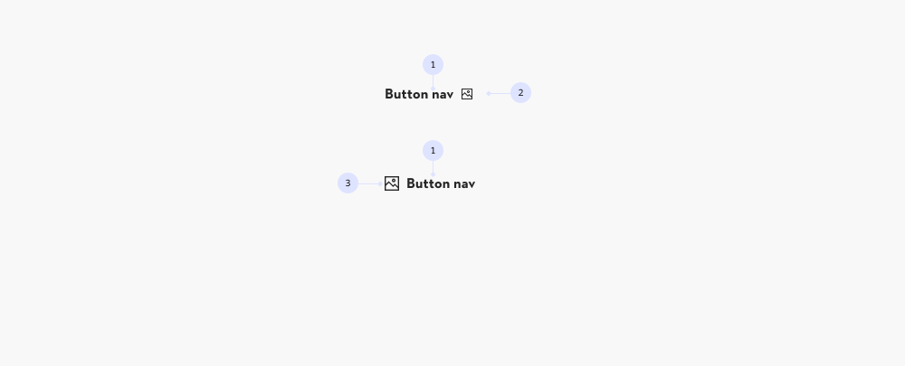

#### Viewport Varaiant

Two sizes are defined for the navigation variant of the Button, based on breakpoints:

1. **Breakpoints l & xl:** Size is optimized to create visual hierarchy in relation to other navigation elements.
1. **Breakpoints s & m:** Used when navigation items move into the Mobile Menu. Size is adjusted to maintain hierarchy and improve tap targets for touch interaction.

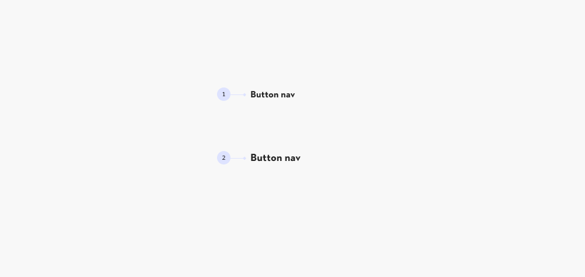

### States

Since this button is intended exclusively for navigation elements, it does not include all the states of the default button component. Supported states include:

1. **Enabled**
1. **Hover/Pressed**
1. **Focus**
1. **Disabled**

Navigation items should never be shown in a **disabled state**. If loading is required (e.g. for page transitions), use a **loading indicator on the page**, not within the button itself.

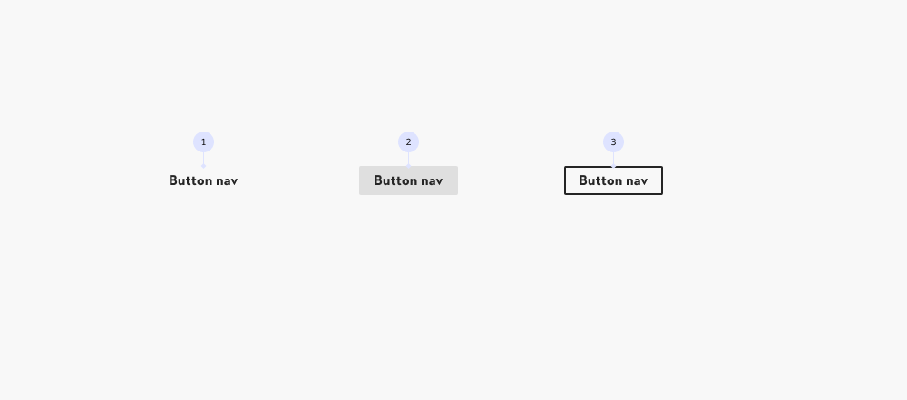

## Content and Assets

### Icon Usage

#### Icon Right

Right-aligned icons are used to clarify the action triggered by the nav item. The following icons may be applied:

1. **Chevron Up / Down** Used when the button triggers a Dropdown Menu:
   - Default state: Chevron Down
   - When expanded: switches to Chevron Up
1. **Chevron Right** Used when the button is displayed inside a Mobile Menu to indicate a drilldown navigation.
1. **External Link Icon** Used when the Button Nav functions as a link and links to an external page.

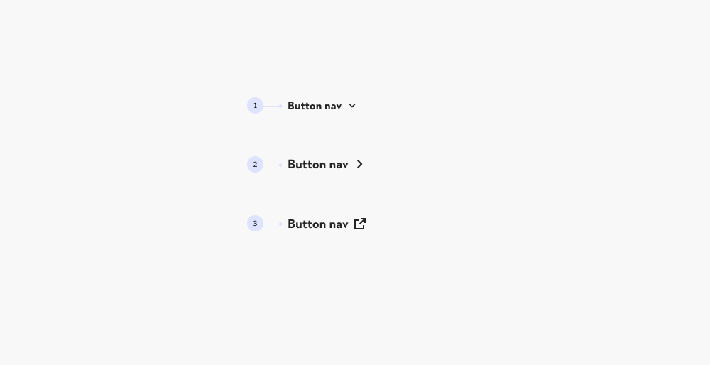

#### Icon Left

A left-aligned icon can be added before the label to support visual scanning and clarify the item's purpose.

- Use only when it adds meaningful context.
- Use sparingly, and don’t combining it with a right icon to reduce visual clutter.

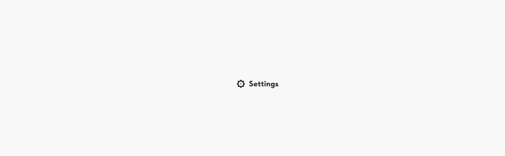

## Usage

### Nav Bar

The primary use of the Button Nav variant is within the Nav Bar, as part of the overall navigation pattern.

[Go to Nav Bar →](https://www.figma.com/design/dDZiDou9UpPtHIF2bXkLKL?node-id=6583-59828)

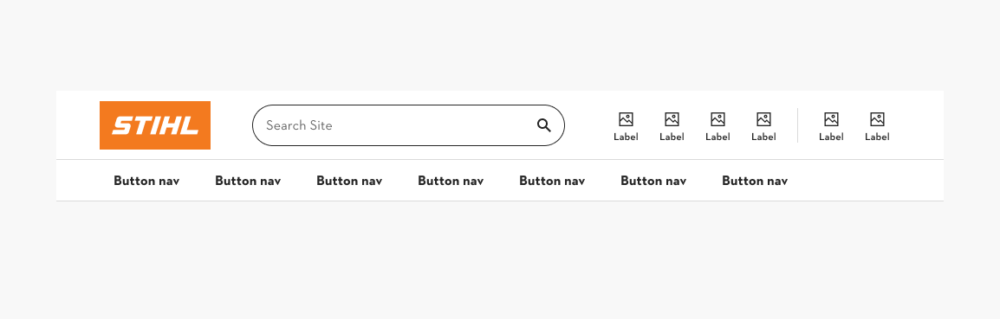
