# Card

## Card Types by Primary Interaction

Cards are flexible containers used to group related content, media, and actions within a structured and visually distinct layout. They help users scan, browse, compare, and interact with content across different experiences.

The STIHL Design System provides four Card types based on their primary interaction. Choose the Card type according to what users primarily need to do.

Each Card type has a defined interaction model. Interactive elements must support this model and must not create conflicting or nested interactions.

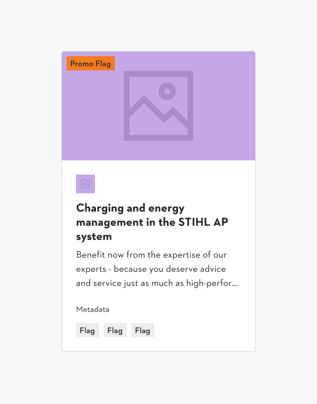

**Link Card: Navigation**

**“I go somewhere.”**

**Usage:** Use when interacting with the Card should lead to another page or destination.

**Interaction:** The entire Card is a single navigation target. Additional independent interactive elements are not supported.

[Go to Link Card →](https://www.figma.com/design/qXldpLO6gxHJNLdcXIPxYt?node-id=57309-25977)

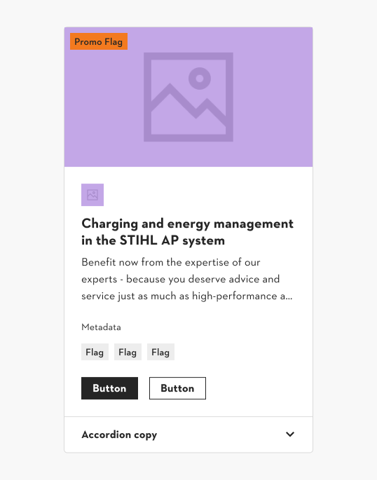

**Action Card: Explicit actions**

**“I do something.”**

**Usage:** Use when users perform one or more explicit actions within the Card. **Interaction:** Actions are primarily provided through interactive elements within the Card, such as Buttons or Accordions. The Card may additionally provide navigation when required.

[Go to Action Card →](https://www.figma.com/design/qXldpLO6gxHJNLdcXIPxYt?node-id=57309-25978)

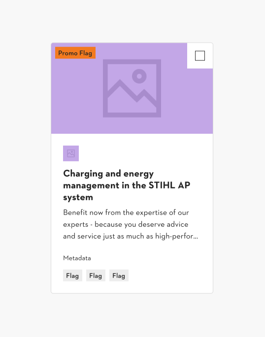

**Selectable Card — Selection**

**“I choose an option.”**

**Usage:** Use when users need more context than a standard Radio Button or Checkbox provides to make a selection. **Interaction:** The entire Card is a single selection target. The Control represents the Card itself. Additional independent interactive elements are not supported.

[Go to Selectable Card →](https://www.figma.com/design/qXldpLO6gxHJNLdcXIPxYt?node-id=63836-30133)

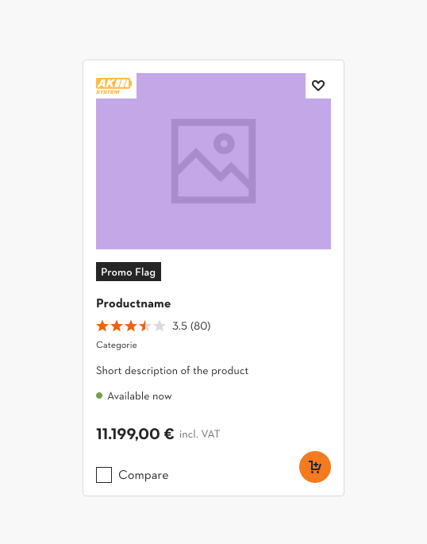

**Product Card — Product exploration**

**“I explore and act on a product.”**

**Usage:** Use when users need to access product details and perform product-specific actions directly from the Card. **Interaction:** The Card provides navigation to the Product Detail Page and supports independent product-specific actions such as Add to Cart, Add to Favorites, or Compare.

[Go to Product Card →](https://www.figma.com/design/qXldpLO6gxHJNLdcXIPxYt?node-id=57309-25979)

**Controls as Independent Interactions**

A Checkbox may be used as an independent interaction within Card types that support it. In this case, the Checkbox performs its own action and does not make the Card selectable.

Radio Buttons are not supported as independent interactions within other Card types.

**General Usage**

**Use Cards when:**

- Grouping related information or actions.
- Previewing content or products in collections, lists, or dashboards.
- Users need quick access to key information or actions.
- Supporting responsive and adaptable layouts.

**Do not use Cards:**

- For long-form content or full-page experiences.
- When Lists or Tables communicate the information more efficiently.
- For complex forms, modal dialogs, or multi-step workflows.

**Best Practices**

- Keep content concise and focused
- Choose the card type based on the primary interaction
- Prioritize readability and scannability
- Avoid overcrowding cards with too many actions or visual elements
- Maintain consistent spacing, surfaces, and interaction patterns across card collections

## Touchscreen Device Considerations

Cards should remain easy to use across touch-enabled devices.

### No Hover States

Hover interactions are not available on touch devices.

Ensure that all essential information and actions remain accessible without hover.

### Larger Touch Targets

Interactive elements should provide sufficiently large touch targets to support accurate and comfortable interaction.

Follow platform-specific accessibility guidelines where applicable.

### Reduced Interaction Complexity

Prioritize primary actions and essential information.

Avoid interaction patterns that require precise pointer control or multiple interaction steps.

### Simplified Secondary Actions

Consider reducing, consolidating, or hiding secondary actions when screen space is limited.

Prioritize the most relevant action for the current user task.

### Avoid Swipe Conflicts

Swipe interactions within card content must not conflict with parent container gestures.

This is particularly important when Link Cards are placed inside carousels.

See [Carousel](https://www.figma.com/design/qXldpLO6gxHJNLdcXIPxYt?node-id=26075-11524).

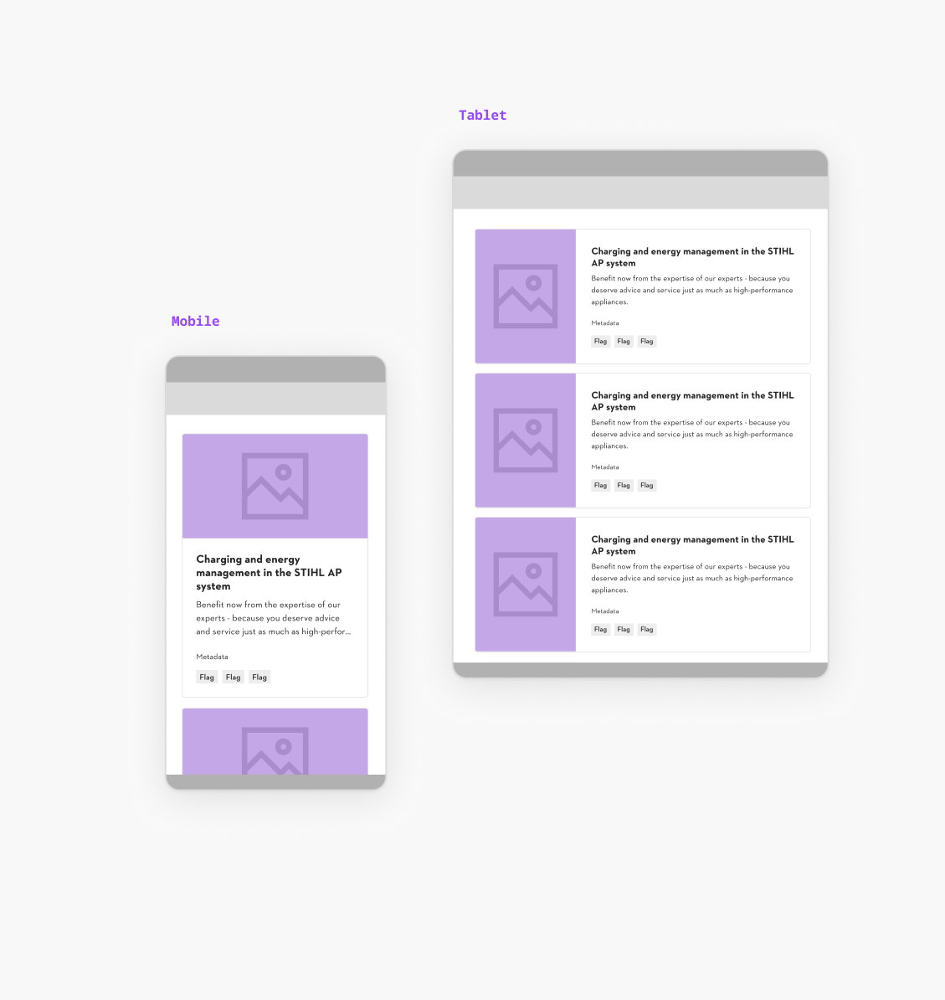

This section provides general touchscreen principles only.

Additional guidance related to layouts, sizing, responsiveness, interactions, and card-specific behavior is documented throughout the following Card Foundations and component pages.

## Layout 1/3

### Layout Contexts

Cards can be used across different layout contexts depending on content type, user intent, and available space.

The appropriate layout should be selected based on the user’s primary goal, such as browsing, comparing, managing, or acting on content.

Some card variants may support only a subset of the available layout contexts or define additional context-specific behavior. Refer to the respective component documentation for supported layouts and component-specific guidance.

#### Standalone

Used when a single card requires focused attention.

**Best suited for:**

- featured content
- high-priority information
- isolated tasks or actions

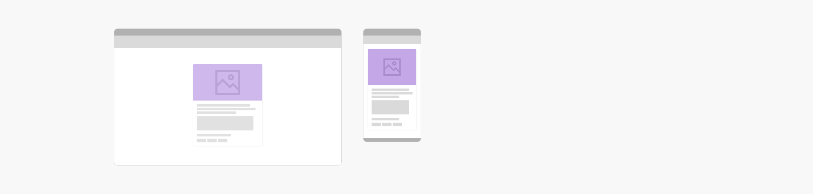

#### Grid

The primary layout for displaying multiple cards in a structured collection.

**Grid layouts support:**

- scanning
- comparison
- efficient use of available space

**Best suited for:**

- content collections
- dashboards
- product listings
- overview pages

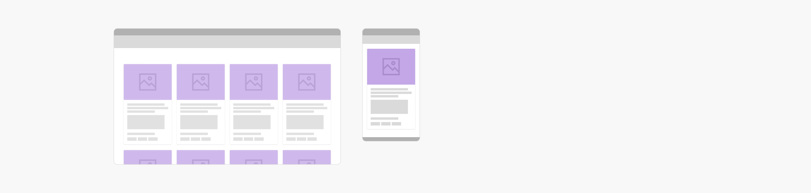

#### Carousel

Suitable for exploratory, inspirational, or promotional experiences.

Carousels support horizontal browsing and allow users to discover content without displaying all items simultaneously.

**Best suited for:**

- recommendations
- featured content
- promotional collections

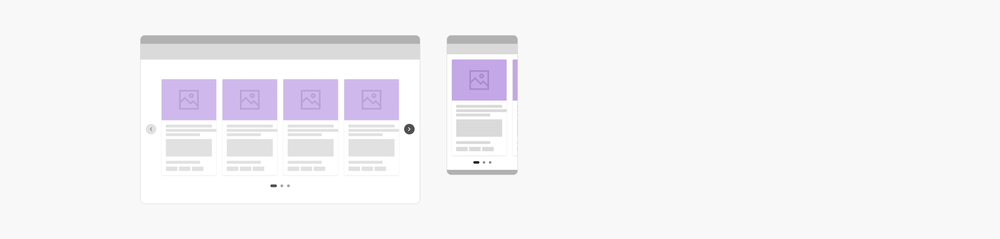

#### List

Suitable when additional horizontal space is available and higher information density is required.

**List layouts prioritize:**

- readability
- comparison
- structured information

**Best suited for:**

- search results
- comparison-oriented experiences
- information-rich collections

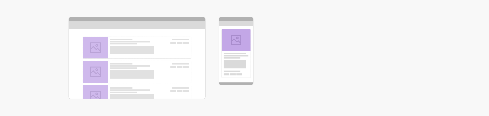

## Sizing 1/3

### Resizing Behaviour

This section describes how cards adapt to different layouts and container sizes.

Orientation switching is defined separately in [Responsive Behavior](https://www.figma.com/design/qXldpLO6gxHJNLdcXIPxYt?node-id=57026-35041).

Some card variants may define additional resizing rules for specific content areas, media elements, or view types. Refer to the respective component documentation for component-specific resizing behavior.

#### Card Width Behavior

Applies to all card variants unless stated otherwise.

- Cards fill the width of their container by default.
- Width can be user-defined when cards are used outside a grid.
- When placed in a grid, cards fill the space evenly.

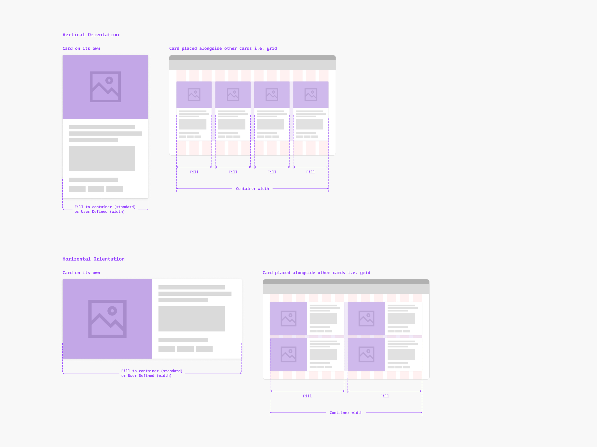

#### Card Height Behavior

Applies to all card variants unless stated otherwise.

- Card height hugs content by default.
- Height can be user-defined if required by the layout.
- If user-defined, the internal content fills the available vertical space.
- Here you can find more informatiom about [Figma Content Sizing](https://www.figma.com/design/qXldpLO6gxHJNLdcXIPxYt?node-id=57309-23351).

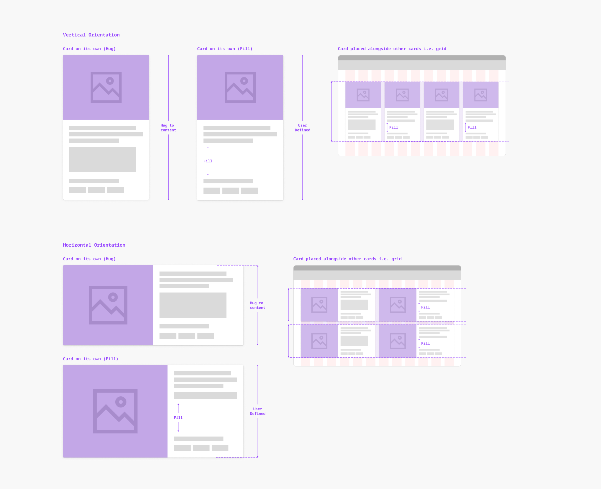

## Responsive Behavior

Most Card variants support a predefined responsive model that determines when the card switches between Vertical and Horizontal orientations.

This responsive model serves as a recommended default and may be adapted to specific implementation requirements.

Some card variants may define their own responsive behavior and therefore do not use the shared orientation-switching model. Refer to the respective component documentation for component-specific responsive rules.

In code, this behavior is achieved by using [container queries](https://main--63440bbb95889041542a5ba3.chromatic.com/?path=/docs/templates-cards-link-card-responsive--documentation).

### Orientation Changes

Orientation changes are determined by the available Card width and the defined sizing constraints.

- The card switches orientation when it reaches its defined minimum or maximum width constraints.
- Orientation changes are **independent** of viewport breakpoints.
- Orientation changes are **independent** of content length.

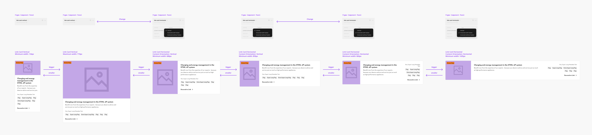

## Content & Assets

**Heading Styles**

The default heading style is Headline M. Other heading styles may be used when appropriate.

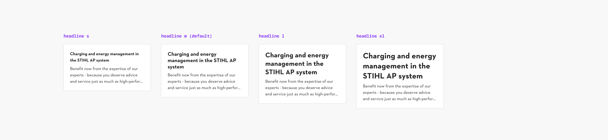

**Don’t use uppercase, as it reduces readability and scannability.**

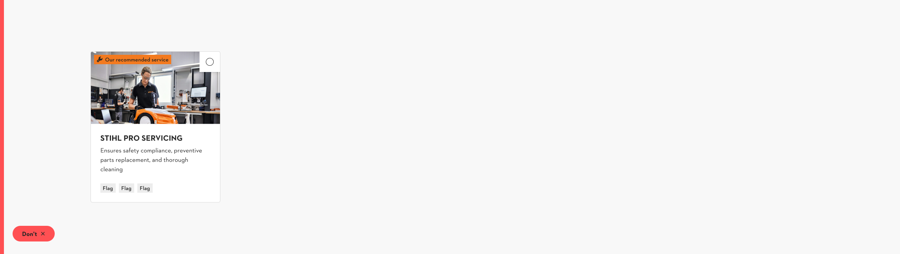

**Graphic Area Sizes**

A Graphic Area is provided as a placeholder for logos, icons, or illustrations (i.e. png, svg, jpeg).

The Graphic Area always uses a 1:1 aspect ratio.

Two size options are currently available:

- **32px × 32px**
- **48px × 48px**

Additional sizes may be introduced if required by specific use cases.

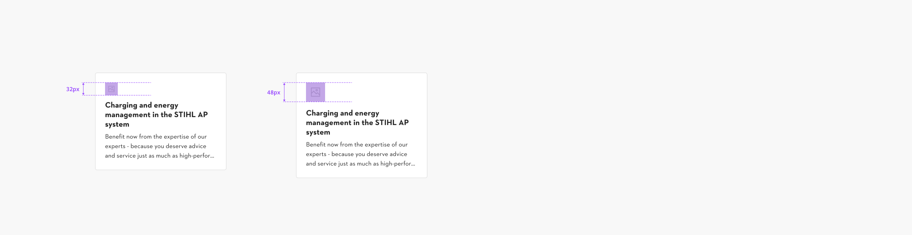

**Flag Elements**

The predefined slot configurations include the following Flag areas:

1. **Promo Flag**
1. **Top Flags**
1. **Bottom Flags**.

For usage guidelines, limitations, and behavior, see the [Flag component documentation](https://www.figma.com/design/qXldpLO6gxHJNLdcXIPxYt?node-id=19511-2443).

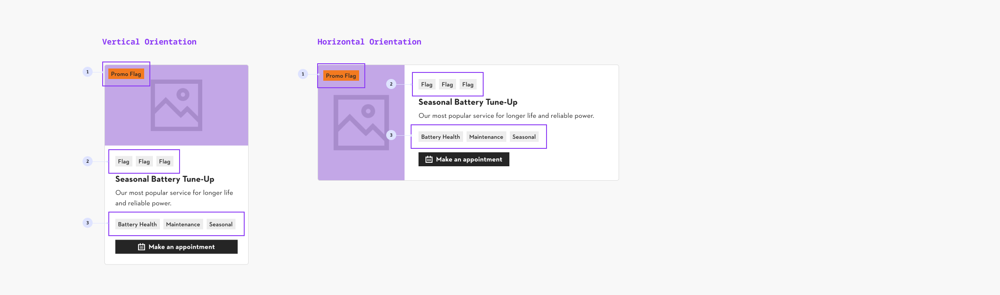

**Image Aspect Ratio**

Cards with a Media Slot use defined image proportions to ensure consistent presentation across Card types.

These ratios are optimized for common layout scenarios and visual balance. Custom ratios are supported but should be used with care.

**Vertical Orientation**

- **16:9** Lower visual emphasis: Emphasizes card content over visuals.
- **4:3** Balanced visual emphasis and content proportions. Visual and content have equal emphasis.
- **3:4** Higher visual emphasis: Strong visual emphasis with reduced content space.

**Horizontal Orientation**

- **3:4** Lower visual emphasis: Suitable when content is the primary focus and the card needs to grow vertically.
- **1:1** Balanced visual emphasis and content proportions: Visual and content have equal emphasis.
- **4:3** Higher visual emphasis: Strong visual emphasis with reduced content space.

**Custom Ratios** Custom image aspect ratios can be used when needed. Be aware that non-standard ratios may scale differently across breakpoints and card sizes and can impact visual consistency.

[Product Cards](https://www.figma.com/design/qXldpLO6gxHJNLdcXIPxYt?node-id=57309-25979) use component-specific image proportions.

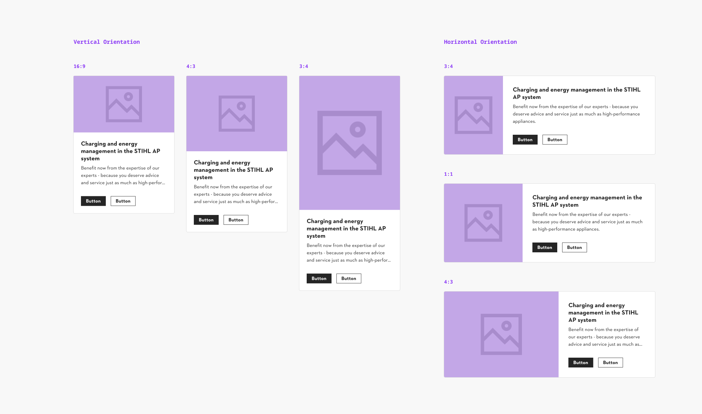

**Text Overflow**

As a general guideline:

- Headings and descriptions should not exceed three lines
- Metadata should not exceed two lines

Figma components are configured accordingly and truncate content that exceeds these limits.

**Exceptions**

Specific card variants or layouts may define different limits based on their content requirements. When necessary, line limits may be adjusted through the component’s Type settings.

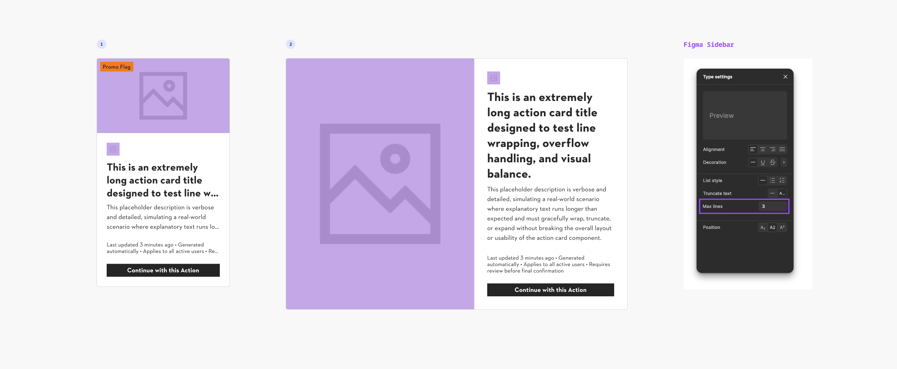

**Don’t mix different content structures within a group of related Cards.** Keep the same types of content in a consistent order and position to support scanning and comparison.

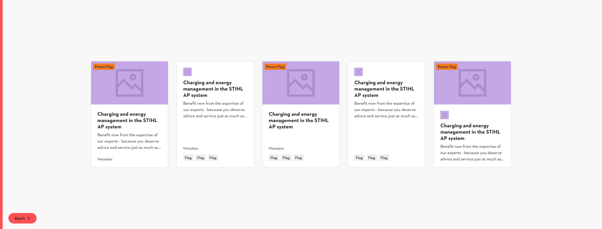

## Surfaces 1/2

### Surface Variants

Surface Variants only affect the visual appearance of the Card and do not change its structure, behavior, or interaction model. All Cards support two surface variants:

#### Outlined (default)

The card container displays an outline. Recommended for most layouts, as it integrates well in grids and avoids visual overload in dense environments.

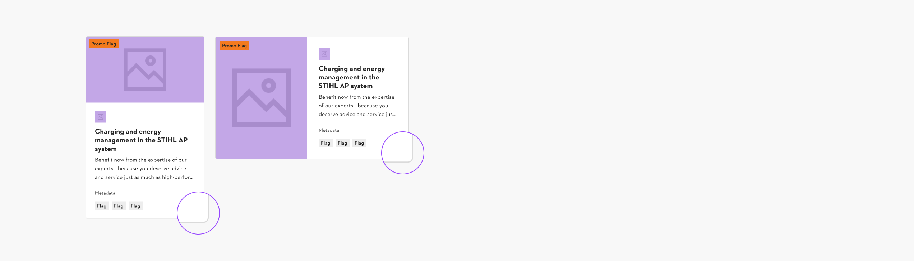

#### Elevated

The card container displays a shadow. May be used to visually highlight specific cards or increase separation from the background.

Elevation **is not** an indicator of interactivity.

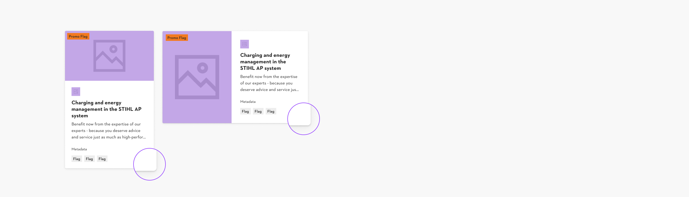

## Surfaces 2/2

### Page Backgrounds

Cards can be placed on different page background colors depending on the desired level of visual separation.

**Guideline:** When displaying large card collections or content-dense cards, a secondary background can improve contrast and scannability. Alternatively, reduce the number of cards per row to improve readability.

#### Primary Background

By default, cards should be placed on background-color / primary.

#### Secondary Background

background-color / secondary may be used to increase visual separation between cards and surrounding content.

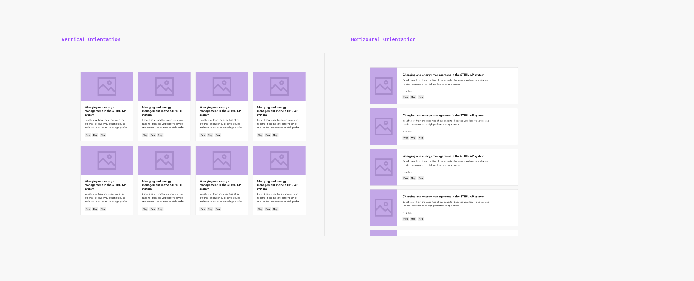

## Layout 2/3

### Orientation

**Orientation variants**

Cards support two orientations: **Vertical** and **Horizontal**.

1. **Vertical Orientation (Default)** Slots are stacked vertically. Recommended for:
   - grids and collections
   - browsing-focused layouts
   - limited horizontal space
1. **Horizontal Orientation**
- Slots are arranged horizontally. Recommended for:
   - list layouts
   - content-heavy cards
   - layouts with extended text content or multiple actions

Cards provide a predefined responsive behavior that determines when it switches between vertical and horizontal orientations based on available space.

See [Responsive behavior](https://www.figma.com/design/qXldpLO6gxHJNLdcXIPxYt?node-id=57026-35041) for responsive layout rules.

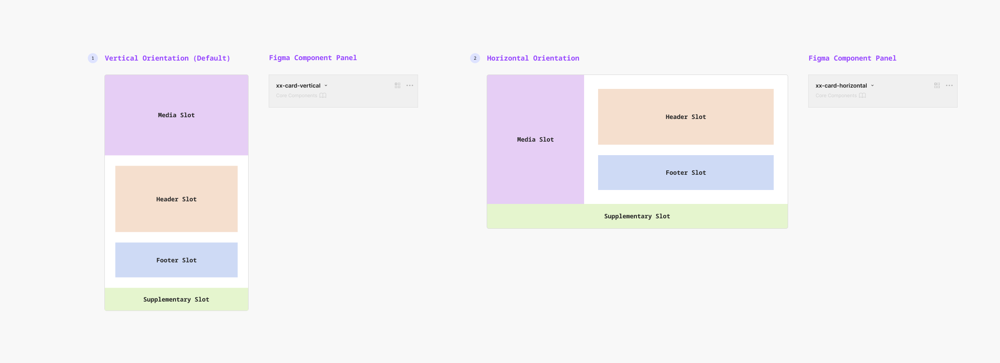

**Horizontal Orientation Variants**

The horizontal orientation supports two layout variants.

1. **Vertical Content**
   - Media Slot placed on the left.
   - Header Slot and Footer Slot stacked vertically on the right.
   - Supplementary Slot placed below.
1. **Horizontal Content**
   - Media Slot, Header Slot, and Footer Slot placed side by side
      - Header Slot and Footer Slot are aligned to a container grid.
      - Default distribution: Header Slot 2/3, Footer Slot 1/3.
      - Slot width distribution can be customized by the user.

> Further customization in Figma requires **detaching** the component.

- Supplementary Slot placed below

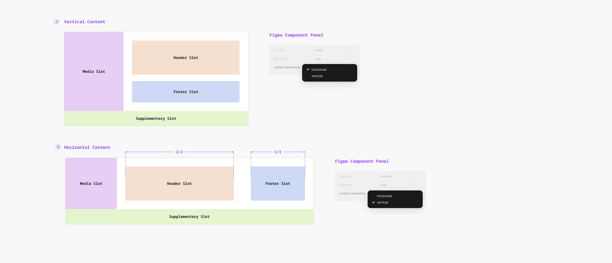

## Sizing 2/3

### Figma: Content Sizing

In Figma, the Content Sizing property defines how a Card adapts its height to its content and layout context. Choose Hug or Fill depending on how the Card is used.

In code, this behavior is handled automatically when Cards are placed in a Grid. Cards adapt to the available height, and the Footer remains aligned to the bottom when the Card is taller than its content.

**Hug**

The card height is determined by its content.

- Content defines the overall height
- No elements stretch to fill available space
- Card height varies depending on content length

**Use when:**

- Cards appear in feeds or flowing layouts
- Visual alignment between cards is not required
- Cards are displayed individually

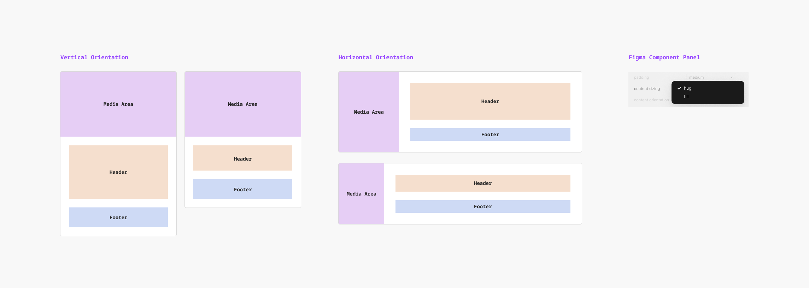

**Fill**

The card stretches to fill the available vertical space defined by its container.

- Content expands to occupy remaining space
- Header is anchored to the top, footer to the bottom
- Card height is consistent across items

**Use when:**

- Cards are displayed in grids or structured collections
- Visual alignment across cards is important
- Equal heights improve readability and comparison

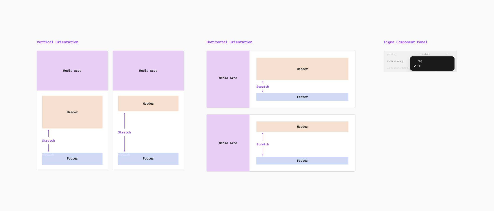

## Layout 3/3

### Padding

Cards support two defined padding options to adapt to different content densities and layout contexts. Use the same padding consistently across related Cards:

1. **Medium (default)** For content-rich or editorial layouts
1. **Small** For compact layouts such as dashboards or dense grids.

Individual Card types may restrict the available padding options when a consistent layout is required for their specific use case. For example, the Product Card uses a fixed padding configuration to maintain consistent product presentation and comparability across Cards.

Component-specific restrictions are documented on the respective Card page.

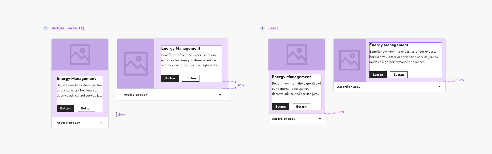

## Sizing 3/3

### Size Constraints

Cards use recommended **minimum** and **maximum width**s per orientation to ensure readability, usability, and visual consistency. These values define shared design boundaries rather than fixed component dimensions.

Individual Card types may apply more restrictive size constraints based on their specific use case. Component-specific exceptions are documented on the respective component page.

Size constraints can inform responsive behavior, while the rules for orientation changes, wrapping, and other responsive adaptations are defined separately. See [Responsive Behavior](https://www.figma.com/design/qXldpLO6gxHJNLdcXIPxYt?node-id=57026-35041) for details.

#### Vertical Orientation

- **Minimum width:** 134px
- **Maximum width:** 719px

> **Important:** The minimum width should only be used for minimal card variants with up to two content elements. Content-dependent recommendations (supported elements and minimum combinations) are defined in [Amount of Elements](https://www.figma.com/design/qXldpLO6gxHJNLdcXIPxYt?node-id=47366-8357).

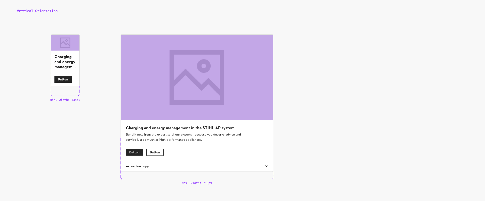

#### Horizontal Orientation — Content Vertical

(Media left, content stacked)

- **Minimum width:** 292px
- **Maximum width:** 1435px

> **Important:** The minimum width should only be used for minimal card variants with up to two content elements. Content-dependent rules (supported elements and minimum combinations) are defined in [Amount of Elements](https://www.figma.com/design/qXldpLO6gxHJNLdcXIPxYt?node-id=47366-8357).

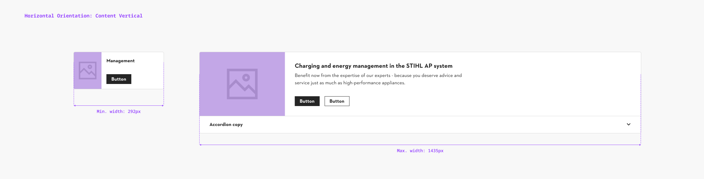

#### Horizontal Orientation — Content Horizontal

(Media, Header, and Footer aligned horizontally)

- **Minimum width:** 450px
- **Maximum width:** 1435px

> **Important:** The minimum width should only be used for minimal card variants with up to three content elements. Content-dependent rules (supported elements and minimum combinations) are defined in [Amount of Elements](https://www.figma.com/design/qXldpLO6gxHJNLdcXIPxYt?node-id=47366-8357).

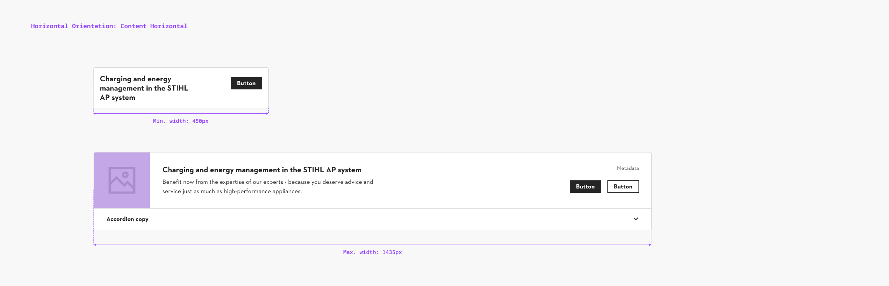

## Link Card

A **Link Card** is a fully clickable card that navigates users to a single destination. It serves as a clear entry point to related content or pages and does not support internal interactive controls.

**Key Characteristics**

- Single interactive target: the entire card is clickable and focusable
- Optional visual link indicator: decorative affordance only, non-interactive (default is without indicator)
- Flexible layout: supports vertical and horizontal orientations
- Flexible media: supports multiple image aspect ratios
- Structured layout: predefined content areas (e.g. image, headline, text, metadata) can be included or omitted as needed

**Use a Link Card when**

- the entire card should navigate to a single destination
- previewing related content, articles, categories, or landing pages
- users need a clear and simple navigation pattern
- browsing collections, grids, or teaser layouts

**Do not use a Link Card when**

- multiple actions are required → use an **Action Card**
- the link destination is a poduct detail page → use a **Product Card**
- content is informational only and not meant for navigation
- users need to compare many attributes → use **Tables** or **Lists**

**Link Card Vertical**

**content sizing: hug**

**content sizing: fill**

**padding: medium**

**padding: small**

**Link Card Horizontal**

**padding: medium**

**content sizing: hug**

**content sizing: fill**

**content orientation:**

**vertical**

**content orientation: horizontal (with footer)**

**content orientation: horizontal (without footer)**

**padding: small**

**content orientation:**

**vertical**

**content orientation: horizontal (with footer)**

**content orientation: horizontal (without footer)**

**Building Blocks**

**focus**

### Decorative Link

### Media Area: Vertical

### Media Area: Horizontal

### Graphic Area

**aspect ratio: 16:9**

**aspect ratio: 4:3**

**filled**

**aspect ratio: 4:3**

**ghost**

**aspect ratio: 1:1**

**aspect ratio: 3:4**

**aspect ratio: 3:4**

### Card Surface (Variant)

**outlined**

**elevated**

### Further guidelines

[Storybook documentation](https://main--63440bbb95889041542a5ba3.chromatic.com/?path=/docs/components-cards-link-card--documentation)

### Related elements

[Action Card](https://www.figma.com/design/qXldpLO6gxHJNLdcXIPxYt?node-id=47366-6210)

[Product Card](https://www.figma.com/design/qXldpLO6gxHJNLdcXIPxYt?node-id=50728-9936)

[Skeleton](https://www.figma.com/design/qXldpLO6gxHJNLdcXIPxYt?node-id=49465-7294)

[Table → 🗓️ Coming soon](https://www.figma.com/design/qXldpLO6gxHJNLdcXIPxYt?node-id=26075-11792)

[List → 🗓️ Coming soon](https://www.figma.com/design/qXldpLO6gxHJNLdcXIPxYt?node-id=51015-14934)

[Carousel](https://www.figma.com/design/qXldpLO6gxHJNLdcXIPxYt?node-id=26075-11524)

### Contribute

Contribute to improving this component by sharing your feedback, asking questions, or suggesting features [here](https://www.figma.com/design/lLmw7PfIdKjFG4uT3B2Hyj/Onboarding-%F0%9F%93%96?node-id=446-868&t=zKmRu4kAkxMeRDmK-4).

## Formatting and Construction

### Anatomy

1. **Card (Container)** The outer wrapper that defines layout, visual styling (elevation, radius), and interactive states.
1. **Media Area** Optional top section for visual content.
   1. **Flag: Promo highlight** For marketing or promotional messages (e.g. New, Promo, Sale). See [Foundation: Flag elements ](https://www.figma.com/design/qXldpLO6gxHJNLdcXIPxYt?node-id=66560-37466)for further information.
   1. **Media Content** Images, video, or other media.
1. **Header** Content area below the media.
   1. **Graphic Area** Placeholder for logos, icons or illsutrations.
   1. **Heading** Primary heading (required accessible label).
   1. **Description** Optional supporting text.
   1. **Heading Icon** Optional chevron icon indicating navigation. Use only in reduced card variants.
1. **Footer** Bottom section.
   1. **Metadata** Author, date, reading time, etc.
   1. **Flags** Categories, attributes, or status indicators. See [Foundation: Flag elements](https://www.figma.com/design/qXldpLO6gxHJNLdcXIPxYt?node-id=66560-37466) for further information.
   1. **Decorative Link** Optional visual link indicator; use sparingly.

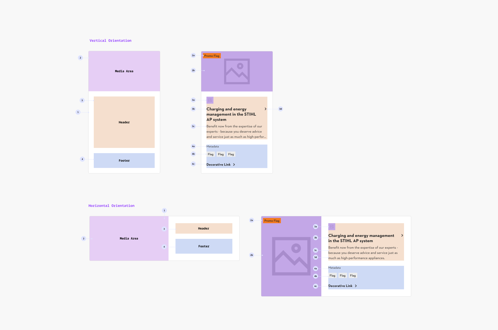

### Layout

**Orientation**

Link Cards follow the shared Card orientation and layout principles. See [Foundations: Layout](https://www.figma.com/design/qXldpLO6gxHJNLdcXIPxYt?node-id=66560-34684).

**Vertical Orientation**

Vertical is the default orientation for Link Cards. The fixed content areas are stacked vertically.

The Footer can be toggled off when it is not required.

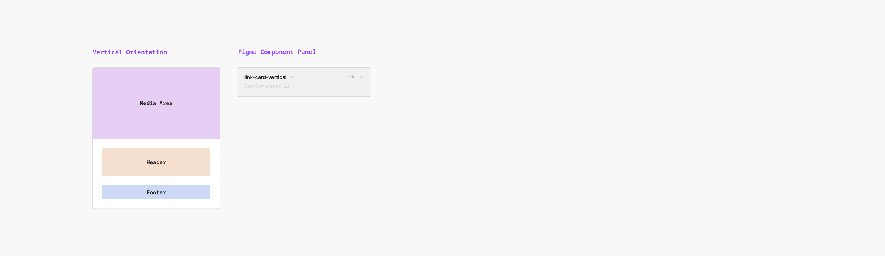

**Horizontal Orientation Variants**

Link Cards use fixed content areas and support the following configurations:

1. **Vertical Content** The Media Area is placed on the left, with Header and Footer stacked vertically on the right.
1. **Horizontal Content (with Footer)** Media Area, Header, and Footer are placed side by side. The Header occupies 2/3 and the Footer 1/3 of the content area.
1. **Horizontal Content (without Footer)** The Footer is removed and the Header uses the available content area.

> **Info:** In code the behavior can be achieved by using [container queries](https://main--63440bbb95889041542a5ba3.chromatic.com/?path=/docs/templates-cards-link-card-responsive--documentation).

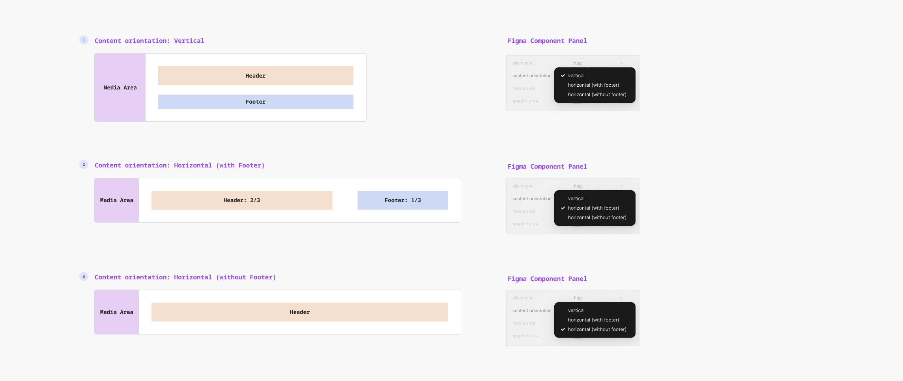

### Size Constraints

Link Cards follow the shared Card size constraints.

See [Foundation: Size Constraints](https://www.figma.com/design/qXldpLO6gxHJNLdcXIPxYt?node-id=66680-42433) for guidance.

### Resizing Behavior

Link Cards use the shared Card Resizing Behavior model.

See [Foundations: Resizing Behaviour](https://www.figma.com/design/qXldpLO6gxHJNLdcXIPxYt?node-id=57629-18329) for guidance.

## Content and Assets

### Amount of Elements

#### Maximum Number of Elements

A Link Card should not exceed the following elements:

- Promo Flag (Highlight variant, one flag permitted)
- Media Area (i.e. images or video)
- Graphic Area (svg, png, jpeg)
- Heading (required)
- Description
- Metadata (up to two lines)
- Flags (up to six)
- Decorative Link

> **Accessibility note:** The Heading is mandatory, as it serves as the accessible label for screen readers. All other elements are optional.

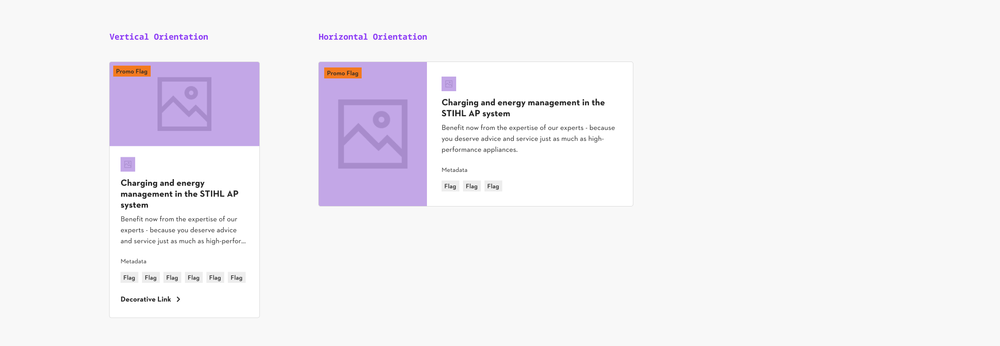

#### Minimum 2 Elements required

A Link Card must contain at least two elements:

- Heading (required)
- One additional element of choice

> **Accessibility note:** The Heading is mandatory, as it serves as the accessible label for screen readers. All other elements are optional.

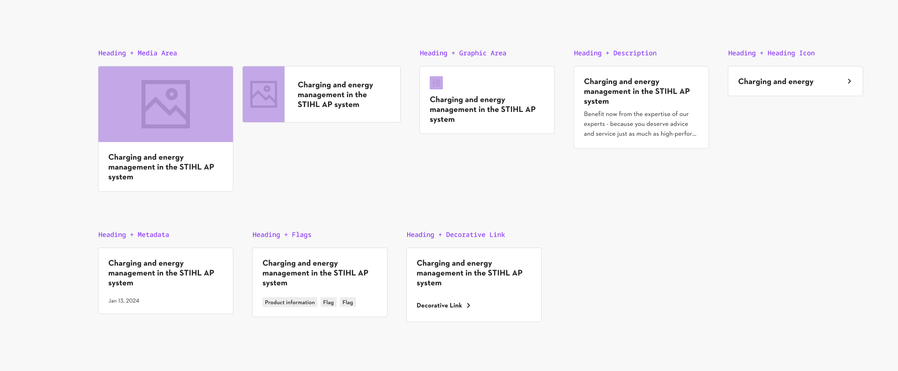

### Elements

**Shared elements**

The Link Card follows the shared Card guidelines for the following elements and content behavior:

- Heading Styles
- Graphic Area Sizes
- Image Aspect Ratio
- Text Overflow

See [Foundations: Content & Assets](https://www.figma.com/design/qXldpLO6gxHJNLdcXIPxYt?node-id=66560-36566) for details.

**Flag Elements**

The Link Card component provides two Flag areas:

1. **Promo Flag**
1. **Bottom Flags**

A Top Flag area is not supported, as Link Card use cases do not require the additional flag flexibility provided by the Action Card.

For shared usage guidelines, limitations, and behavior, see [Foundations: Flag Elements](https://www.figma.com/design/qXldpLO6gxHJNLdcXIPxYt?node-id=66560-37466).

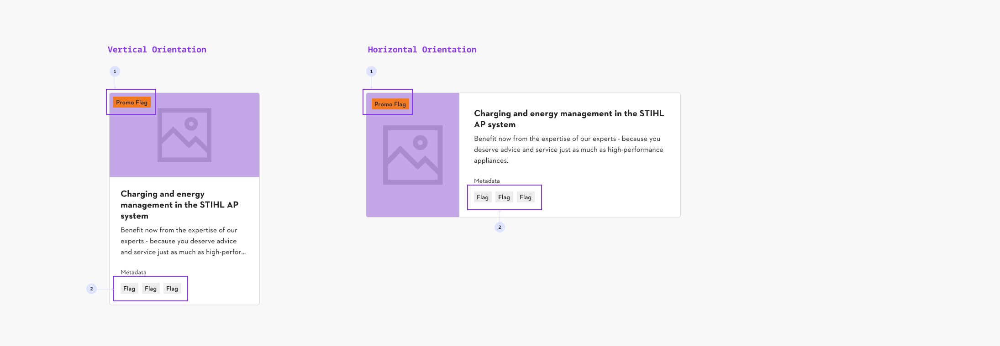

**Heading Icon**

A Heading Icon (chevron) may be displayed to indicate navigation.

Use only in cards with:

1. **Heading only**
1. **Heading + Image**

Intended for short headings in cards leading to i.e. categories or overview pages.

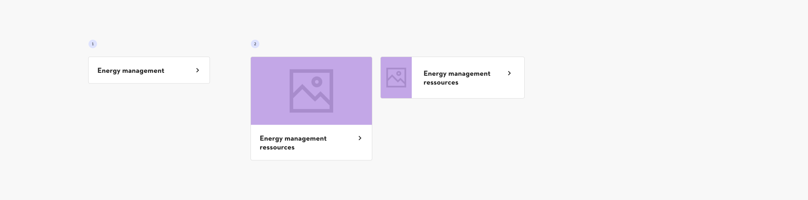

**Decorative Link**

The Decorative Link is an optional visual indicator used to emphasize that a card is clickable. By **default**, cards **do not include** a Decorative Link.

**Use a Decorative Link when:**

- The card’s clickability is not immediately obvious
- The card contains varied content and the Link needs stronger emphasis
- You want increased visual prominence (e.g. marketing or promotional content)
- The link leads to a deeper page or indicates navigation “away” from the current context

The Decorative Link is available in two style variants: **Ghost** and **Filled**.

- **Ghost (default):** Use in most cases. Always pair with an icon to reinforce clickability.
- **Filled:** Use sparingly, reserved for high-priority or especially important links.

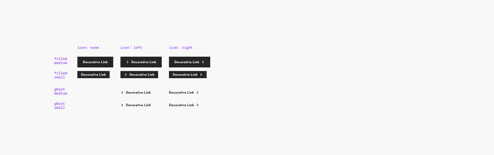

## Behavior & Usage

### Interactivity

Link Cards are interactive by default, as their primary purpose is navigation. They behave like a Link and therefore inherit the following states:

- **Enabled** Default interactive state.
- **Hover / Pressed** Visual feedback when a user hovers over or clicks the card.
- **Focus** Indicates the card is currently focused.

Link Cards do not support a disabled state. If navigation is unavailable, do not render the card.

Link Cards support both **Outlined** and **Elevated** surface variants. Surface variants only affect the visual appearance of the card and do not change its interaction behavior or available states.

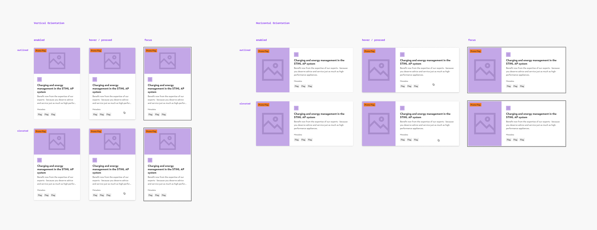

### Usage in Context

Link Cards support all shared Card Layout Contexts.

**Supported layouts:** - Standalone - Grid - Carousel - List

Link Cards are most commonly used in Grid layouts for content discovery and navigation. See [Foundations: Layout Context](https://www.figma.com/design/qXldpLO6gxHJNLdcXIPxYt?node-id=56949-32316) for guidance.

### Responsive Behavior

Link Cards use the shared Card Responsive Behavior model.

Orientation changes are based on available width and follow the rules defined in [Foundations: Responsive Behaviour](https://www.figma.com/design/qXldpLO6gxHJNLdcXIPxYt?node-id=57026-35041).

## Accessiblity

### Heading = Accessible Label

The Heading is **mandatory** for every Link Card. It provides the accessible name used by screen readers and must clearly describe the card’s destination.

**Guidelines:**

- Headings must be descriptive and meaningful out of context.
- Avoid generic Headings such as “Learn more” or “Read more” without additional context.
- Do not rely on descriptions, metadata, or icons to communicate the primary meaning of the card.

**If a card does not have a clear Heading, it is not accessible.**

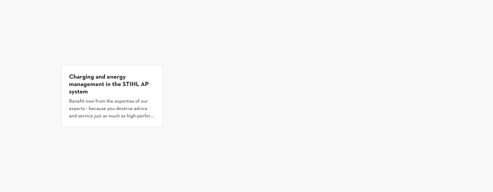

### Interaction Principle

A Link Card represents a single, primary navigation action. The entire card links to one destination.

The Decorative Link is a visual affordance that reinforces the card’s navigational behavior. It helps users recognize that the card is clickable and leads to another destination.

**Use the Decorative Link when:**

- The card’s clickability may not be immediately obvious.
- Cards appear in dense layouts with many surrounding UI elements.
- Additional visual guidance helps users identify navigation opportunities.

**Do not use the Decorative Link when:**

- The card’s interactive nature is already clear through context, layout, or visual treatment.
- It competes with other visual elements or creates unnecessary visual noise.

The Decorative Link is purely visual and is not an interactive element. The entire card remains the single interactive target.

**Guidelines**

- Do not place additional Links or Buttons inside a Link Card.
- One Link Card should communicate one intent and lead to one destination.
- Use the Decorative Link consistently within a collection or layout.

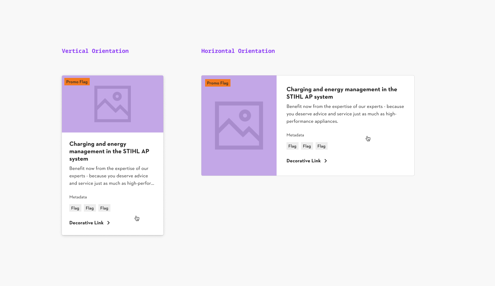

### Keyboard Navigation

Link Cards must be fully operable using a keyboard.

- The card must be reachable via keyboard navigation
- The entire card represents a single focusable element
- Pressing Enter activates the card and navigates to its destination

**Best Practice** Do not place additional focusable elements inside a Link Card. All content within the card belongs to a single navigation target.

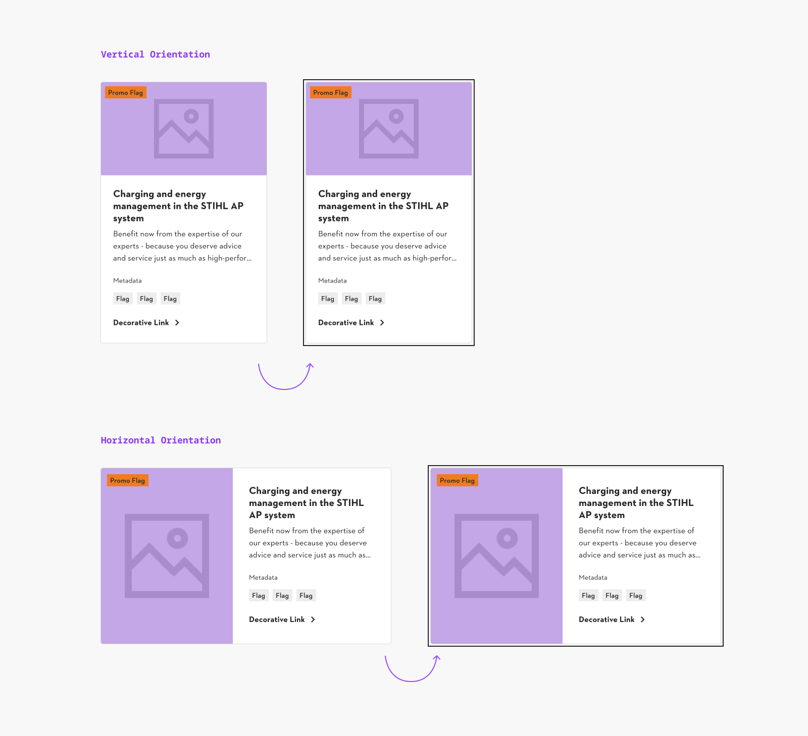

## Examples

> The use case examples shown feature the new Link Card concept and do not reflect the current state of the product.

### Corporate STIHL Journal

A grid of Link Cards used to surface editorial articles and navigate to individual journal entries.

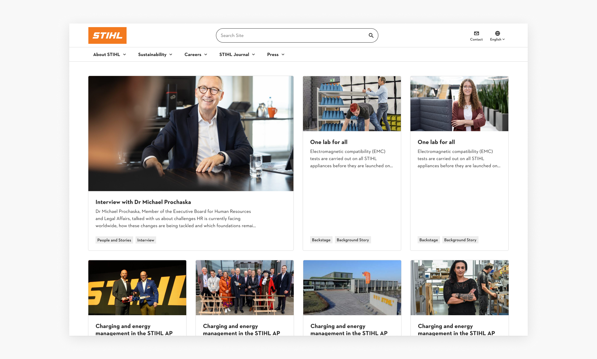

### STIHL Career — Job Listings

A list of Link Cards presenting job openings where each card links to the respective job detail page.

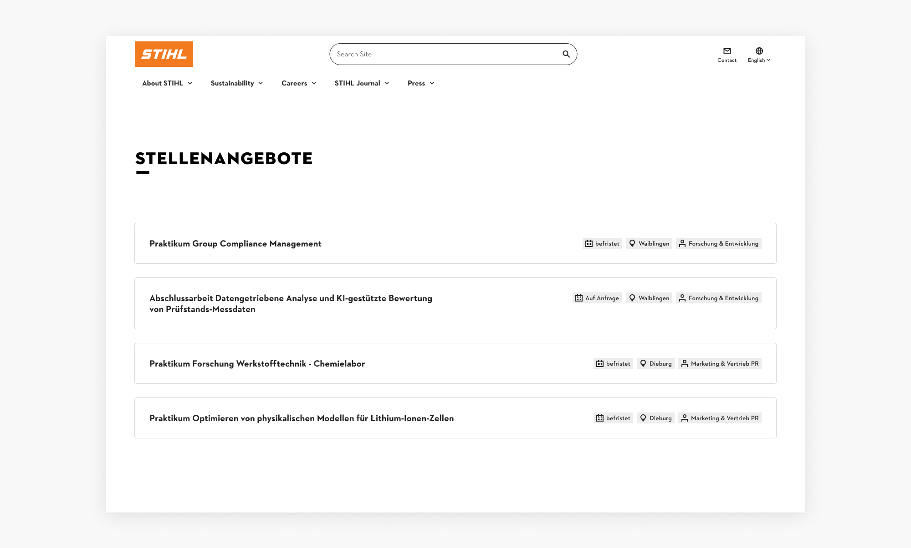

## Action Card

An **Action Card** is a slot-based container that combines content and one or more explicit user actions within a structured layout. By default, the card itself is not interactive and does not act as a navigation element. It enables focused interactions through clearly defined internal controls.

**Key Characteristics**

- No card-level interaction by default: interaction primarily occurs through internal controls; Card-level navigation may be added for specific patterns.
- Internal interactions only: interactive elements inside the card (e.g. buttons, accordions) are focusable and actionable
- At least one action required: the card must contain a minimum of one interactive element
- Flexible layout: supports vertical and horizontal orientations
- Flexible media: supports multiple image aspect ratios
- Slot-based structure: supports up to four configurable slots (Media, Header, Footer, Supplementary)

**Use an Action Card when:**

- Users need to perform one or more actions directly within the card.
- The primary interaction is completing a task rather than navigation.
- Multiple interactive elements are required.
- Contextual information and related actions should be grouped within the same container.

**Do not use an Action Card when:**

- The card serves navigation only and links to a single destination → use a **Link Card**
- The primary interaction is selecting one card among others → use a **Selectable Card**
- Users need to compare many attributes → use **Tables** or **Lists**

**Action Card Vertical**

**content sizing: hug**

**content sizing: fill**

**padding: medium**

**padding: small**

**Action Card Horizontal**

**padding: medium**

**content sizing: hug**

**content sizing: fill**

**content orientation:**

**vertical**

**content orientation: horizontal (with footer)**

**padding: small**

**content orientation:**

**vertical**

**content orientation: horizontal (with footer)**

**Building Blocks**

**focus**

### Media Slot

### Header Slot

### Footer Slot

### Supplementary Slot

**Vertical**

**Horizontal**

**aspect ratio: 16:9**

**aspect ratio: 3:4**

**aspect ratio: 4:3**

**aspect ratio: 1:1**

**aspect ratio: 3:4**

### Footer Slot - Actions

### Graphic Area

**aspect ratio: 4:3**

### Card Surface (Variant)

**outlined**

**elevated**

### Further guidelines

[Storybook documentation](https://main--63440bbb95889041542a5ba3.chromatic.com/?path=/docs/components-cards-action-card--documentation)

### Related elements

[Link Card](https://www.figma.com/design/qXldpLO6gxHJNLdcXIPxYt?node-id=43951-17695)

[Product Card](https://www.figma.com/design/qXldpLO6gxHJNLdcXIPxYt?node-id=50728-9936)

[Skeleton](https://www.figma.com/design/qXldpLO6gxHJNLdcXIPxYt?node-id=49465-7294)

[Table → 🗓️ Coming soon](https://www.figma.com/design/qXldpLO6gxHJNLdcXIPxYt?node-id=26075-11792)

[List → 🗓️ Coming soon](https://www.figma.com/design/qXldpLO6gxHJNLdcXIPxYt?node-id=51015-14934)

[Carousel](https://www.figma.com/design/qXldpLO6gxHJNLdcXIPxYt?node-id=26075-11524)

### Contribute

Contribute to improving this component by sharing your feedback, asking questions, or suggesting features [here](https://www.figma.com/design/lLmw7PfIdKjFG4uT3B2Hyj/Onboarding-%F0%9F%93%96?node-id=446-868&t=zKmRu4kAkxMeRDmK-4).

## Formatting and Construction

### Anatomy

**Card Structure**

The **Action Card** is built on a slot-based structure, which defines fixed areas of the card that establish layout, accessibility, and interaction rules.

In Figma, each card variant is delivered pre-filled with recommended content structure representing the most common and validated use cases. Designers can adapt or replace these as needed, while the underlying slot structure remains consistent.

1. **Card (Container)** The outer wrapper that contains all slots and defines layout properties such as padding, border, elevation, and corner radius.
1. **Media Slot (Optional)** Reserved area for visual or decorative content.
   1. **Promo Flag** Highlights marketing or promotional messages (e.g. New, Promo, Sale).
   1. **Media Content** Images, video, or other visual media.
1. **Header Slot** Primary content area of the card. This slot cannot be hidden because it contains the card Heading, which is required for accessibility.
   1. **Top Flags** Categories, attributes, or status indicators.
   1. **Graphic Area** Placeholder for logos, icons or illsutrations
   1. **Heading** Primary heading and required accessible label.
   1. **Description** Optional supporting text.
1. **Footer Slot** Area for interactive elements. This slot cannot be hidden because it contains the card’s actions.
   1. **Metadata** Author, date, reading time, etc.
   1. **Bottom Flags** Categories, attributes, or status indicators.
   1. **Buttons** Primary actions (i.e. Save, Delete).
1. **Supplementary Slot** Additional area for secondary or expandable content.
   1. **Accordion** Reveals additional or advanced information on demand.

> **Note:** The Figma slot feature will be integrated once the functionality is out of [beta](https://help.figma.com/hc/en-us/articles/38231200344599-Use-slots-to-build-flexible-components-in-Figma).

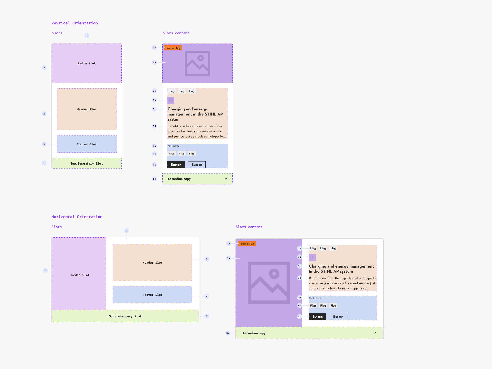

### Layout

Action Cards follow the shared Layout guidelines.

See [Foundations: Layout](https://www.figma.com/design/qXldpLO6gxHJNLdcXIPxYt?node-id=56949-32316) for guidance.

### Size Constraints

Action Cards follow the shared Card size constraints.

See [Foundations: Size Constraints](https://www.figma.com/design/qXldpLO6gxHJNLdcXIPxYt?node-id=66680-42433) for guidance.

### Resizing Behavior

Action Cards use the shared Card Resizing Behavior model.

See [Foundations: Resizing Behaviour](https://www.figma.com/design/qXldpLO6gxHJNLdcXIPxYt?node-id=57629-18329) for guidance.

## Content and Assets

### Amount of Elements

#### Maximum Number of Elements

There is **no defined maximum** number of elements for Action Cards.

However, avoid overcrowding the card to ensure it remains scannable, easy to understand, and adaptable to smaller screens and constrained layouts.

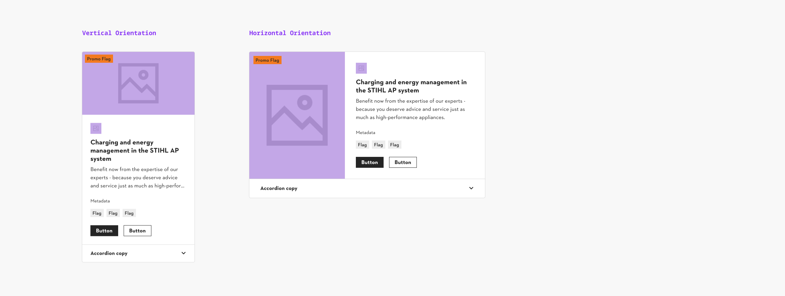

#### Minimum Number of Elements

An Action Card must contain at least two elements:

- Heading (required)
- At least one action element (e.g. a Button)

> **Accessibility note:** The Heading is mandatory, as it serves as the accessible label for screen readers. All other elements are optional.

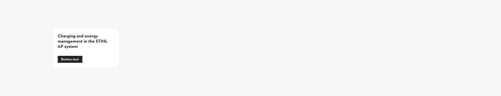

### Slot Elements

**Shared elements**

The Action Card follows the shared Card guidelines for the following elements and content behavior:

- Heading Styles
- Flag Elements
- Graphic Area Sizes
- Image Aspect Ratio
- Text Overflow

See [Foundations: Content & Assets](https://www.figma.com/design/qXldpLO6gxHJNLdcXIPxYt?node-id=66560-36566) for details.

**Button Group**

The **Footer Slot** fill pattern includes a Button Group consisting of two buttons: one primary and one secondary.

**Layout options:**

- **Non-stretch (default)**
   - Buttons keep their intrinsic width
   - Buttons wrap when horizontal space is insufficient
   - If buttons do not fit side by side, they stack vertically
- **Stretch**
   - Buttons fill the available width
   - Supports horizontal and vertical orientation
   - In both orientations, both buttons expand to the full available width

This configuration allows flexible layouts while giving designers control over balance and emphasis.

> This section will be updated once the main Button Group component is finalized.

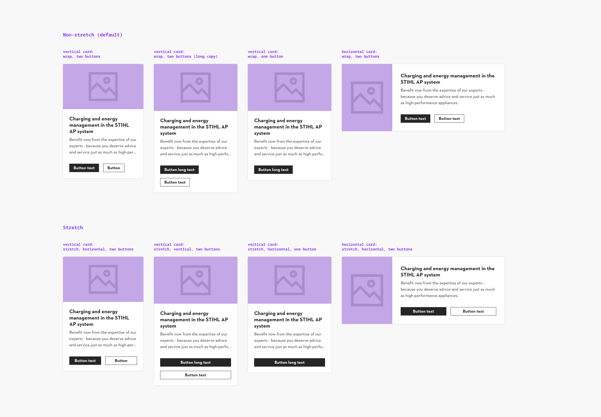

**Accordion**

The **Supplementary Slot** fill pattern includes the Accordion component.

When expanded, the Action Card container grows vertically to accommodate the Accordion content.

If the main focus is expanding/collapsing information → use an **Expandable Card (out of scope)**

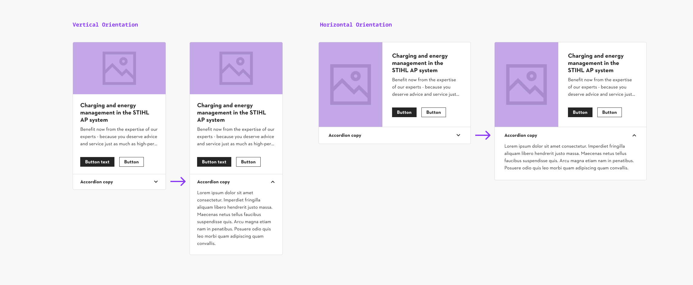

### Custom Slot Content

Action Card slots are pre-filled with component instances. These instances can be swapped with any other component (including user-created components) without detaching the card.

This allows designers to incorporate custom designs for use cases not covered by the predefined content structure. When doing so, ensure that cards remain scannable, not overloaded, and aligned with STIHL design guidelines.

**Allowed Interactive Elements** The Action Card supports interactive elements such as:

- Button
- Link
- Switch
- Checkbox
- Accordion
- Popover

> Note: The slot feature will be integrated once Figma’s Slots functionality is out of beta.

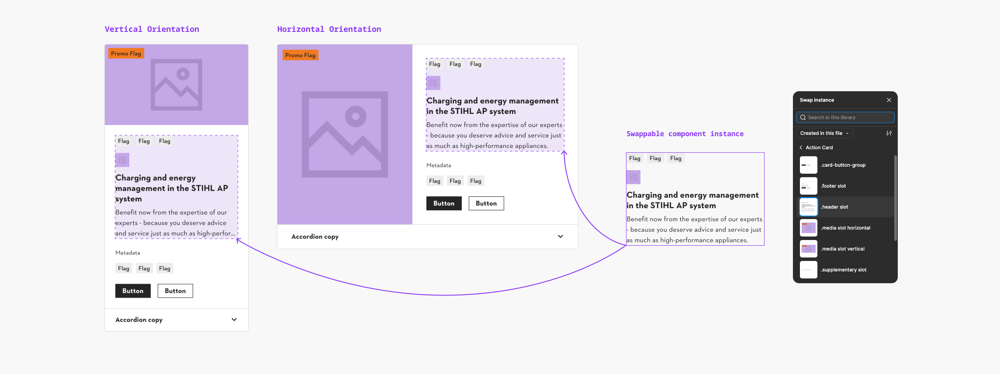

## Behavior & Usage

### Interactivity

**Default behavior: non-interactive** By default, Action Cards are not interactive. Interaction occurs only through internal elements (e.g. buttons or accordions). The card container itself does not respond to hover, press, or focus states. For certain pattern a full card link can be added (i.e. for Product Cards).

### Usage in Context

Action Cards support all shared Card Layout Contexts.

**Supported layouts:** - Standalone - Grid - Carousel - List

Action Cards are most commonly used in Grid layouts for action-driven collections and task-oriented experiences. See [Foundations: Layout Contexts](https://www.figma.com/design/qXldpLO6gxHJNLdcXIPxYt?node-id=56949-32316) for guidance.

### Responsive Behavior

Action Cards use the shared Card Responsive Behavior model.

Orientation changes are based on available width and follow the rules defined in [Foundations: Responsive Behaviour](https://www.figma.com/design/qXldpLO6gxHJNLdcXIPxYt?node-id=57026-35041).

## Accessiblity

### Heading = Accessible Label

The Heading is **mandatory** for every Action Card. It identifies the Card and provides the context for its actions.

**Guidelines:**

- Headings must be descriptive and meaningful out of context.
- Avoid generic headings such as “Learn more” or “Read more” without additional context.
- Do not rely on descriptions, metadata, or icons to communicate the primary meaning of the card.

**If a card does not have a clear Heading, it is not accessible.**

### Keyboard Navigation

Action Cards must be fully operable using a keyboard.

- Interactive elements must remain independently focusable.
- Focus order should follow the visual reading order.
- Users must be able to access all actions using keyboard navigation.
- The Action Card container itself must not receive focus (as long as the full card doesn’t feature a link).

## Examples

> The use case examples shown feature the new Action Card concept and do not reflect the current state of the product.

### My STIHL Website Product Details Page

## Selectable Card

A **Selectable Card** is an input component based on the structure of the **Action Card** that represents a selectable option within a group.

Unlike the Action Card:

- The entire Card is the interaction target and acts as a selectable option.
- No additional interactive elements such as Buttons or Accordions are supported.

The control property determines whether the Card uses Radio or Checkbox semantics. Selectable Cards are always used within a **Selectable Card Group**.

**Key characteristics**

- Two control types:
   - **Radio** for single-select
   - **Checkbox** for multi-select.
- Context-rich options: Supporting content such as descriptions, images, icons, or metadata can help users evaluate and distinguish options.
- Group-based usage: Selectable Cards always belong to a Selectable Card Group, which defines how the available options work together.

**When to use**

- options require more context or visual support than standard Radio Buttons or Checkboxes provide
- users need to evaluate or compare information before making a selection
- supporting content helps users distinguish between available options

Selectable Card – Control type: Radio

- plan or pricing selection
- product variant selection
- shipping method selection
- configuration or mode selection
- quizzes or single-choice questions

Selectable Card – Control type: Checkbox

- feature or add-on selection
- preference or interest selection
- product selection

**When not to use**

- options only require short labels → use Radio Buttons or Checkboxes
- choosing from a large number of options → consider a Select / Dropdown / Combobox
- switching between views or modes → use Tabs (navigate between related content views) / Segmented Control (switch between mutually exclusive modes/states)
- navigating to a destination → use a Link Card
- a control represents a separate or secondary interaction within an otherwise interactive Card → use the appropriate Card type with a separate Checkbox
- controlling a single on/off setting → use a Switch

### Further guidelines

[Storybook documentation](https://main--63440bbb95889041542a5ba3.chromatic.com/?path=/docs/components-cards-action-card--documentation#selectable-card)

### Related elements

Selectable Card Group

[Checkbox](https://www.figma.com/design/qXldpLO6gxHJNLdcXIPxYt?node-id=1017-2316)

[Radio Group](https://www.figma.com/design/qXldpLO6gxHJNLdcXIPxYt?node-id=860-2728)

[Link Card](https://www.figma.com/design/qXldpLO6gxHJNLdcXIPxYt?node-id=57309-25977)

[Action Card](https://www.figma.com/design/qXldpLO6gxHJNLdcXIPxYt?node-id=57309-25978)

### Out of scope

- Embedded Actions other than the select functionality
- Expandable / accordion behavior
- Navigation behavior
- Mixed interaction patterns

### Contribute

Contribute to improving this component by sharing your feedback, asking questions, or suggesting features [here](https://www.figma.com/design/lLmw7PfIdKjFG4uT3B2Hyj/Onboarding-%F0%9F%93%96?node-id=446-868&t=zKmRu4kAkxMeRDmK-4).

## Formatting and Construction

### Anatomy

**Card Structure**

The Selectable Card combines a Control with supporting content within a single interactive Card.

Available content may vary depending on the use case, while the Control and Heading are always required.

1. **Card Container (Required)** The outer wrapper that defines the layout, visual styling, and interactive states. The entire Card acts as the selection target.
1. **Control Indicator (Required)** Radio Button or Checkbox that communicates the control type.
   1. **Radio Button** Used when only one option can be selected within a group.
   1. **Checkbox** Used when multiple options can be selected independently.
1. **Media Slot (Optional)** Reserved area for visual or decorative content.
   1. **Promo Flag** Highlights marketing or promotional messages (e.g. New, Promo, Sale).
   1. **Media Content** Images.
1. **Header Slot (Required)** Primary content area of the Card. This slot cannot be hidden because it contains the Card Heading, which is required for accessibility.
   1. **Top Flags (Optional)** Categories, attributes, or status indicators.
   1. **Graphic Area (Optional)** Placeholder for an icon, logo, or illustration that supports identification or understanding of the option.
   1. **Heading (Required)** Primary text that identifies the selectable option.
   1. **Description (Optional)** Supporting text that provides additional context about the option.
1. **Footer Slot (Optional)** Area for supporting information that helps users evaluate or distinguish the option.
   1. **Metadata** Author, date, reading time, etc.
   1. **Bottom Flags** Categories, attributes, or status indicators.

#### Don’t modify Figma properties labeled “⛔️ Internal (do not modify)

These properties are exposed by nested instances and are required for the component to work correctly.

Use the corresponding configurable properties provided on the main component instead.

### Layout

Selectable Cards follow the shared Layout guidelines.

See [Foundations: Layout](https://www.figma.com/design/qXldpLO6gxHJNLdcXIPxYt?node-id=56949-32316) for guidance.

### Sizing & Constraints

Selectable Cards follow the shared sizing and resizing principles defined in [Foundations: Sizing](https://www.figma.com/design/qXldpLO6gxHJNLdcXIPxYt?node-id=57629-18329).

**Minimum Width — Vertical Orientation**

The default minimum width for Vertical Selectable Cards is **186 px**. This width is used by the Selectable Card Group for its standard responsive behavior.

The shared minimum width defined in [Foundations: Size Constraints](https://www.figma.com/design/qXldpLO6gxHJNLdcXIPxYt?node-id=66680-42433) can be applied explicitly for more compact layouts. Use the reduced minimum width only for Cards without images, as the Control would cover too much of the image at smaller widths. Card content must also remain concise and readable.

See [Selectable Card Group: Responsive Behavior](https://www.figma.com/design/qXldpLO6gxHJNLdcXIPxYt?node-id=66439-54745) for group-specific responsive behavior.

### Resizing Behavior

Selectable Cards use the shared Card Resizing Behavior model.

See [Foundations: Resizing Behaviour](https://www.figma.com/design/qXldpLO6gxHJNLdcXIPxYt?node-id=57629-18329) for guidance.

See Selectable [Card Group: Responsive Behavior](https://www.figma.com/design/85WZPFzg47eXkktIfwvDiq?node-id=64125-22452) for group-specific wrapping and orientation changes.

## Content and Assets

### Amount of Elements

#### Minimum Number of Elements

A Selectable Card must contain at least three elements:

1. **Control** (required)
1. **Heading** (required)
1. **At least one additional element** (required, such as an Image, Description, Graphic Area, or Metadata)

The Control and Heading are always present. The additional element provides the context that helps users understand, distinguish, or evaluate the available options.

**Don’t use a Selectable Card when options only require a Heading. Use standard Radio Buttons or Checkboxes instead.**

#### Additional Content

Include additional content only when it helps users understand, distinguish, or evaluate the available options.

Additional content may include:

1. **Description**
1. **Media Content**
1. **Promo Flags**
1. **Graphic Area**
1. **Metadata or supporting information**

There is no defined maximum number of elements. Avoid adding content that does not contribute to the selection decision. If an option requires extensive information to understand, consider whether a Selectable Card is still the appropriate pattern.

**Do use a consistent content structure across Selectable Cards within the same group where possible.**

Similar types of information should be presented in the same position and order to support scanning and comparison.

### Heading

The Heading identifies the selectable option and is required for every Selectable Card. It should clearly distinguish the option from others within the same Selectable Card Group.

Keep Headings concise, specific, and easy to scan. Avoid relying on supporting content such as descriptions, images, or metadata to communicate the primary meaning of the option.

See [Foundations: Heading](https://www.figma.com/design/qXldpLO6gxHJNLdcXIPxYt?node-id=66560-37167) for further guidance.

### Description

The Description provides optional supporting information that helps users understand, distinguish, or evaluate the selectable option.

Keep descriptions concise and focused on information that is relevant to the selection decision. Avoid repeating information already communicated by the Heading or adding details that are not necessary to evaluate the option.

### Media & Graphic Content

Media and graphic content are optional and should only be used when they help users identify, distinguish, or evaluate the selectable option.

#### Image

Images can provide additional visual context when appearance is relevant to the selection decision.

Use images consistently within the same Selectable Card Group. Avoid mixing Cards with and without images within the same group, as this can reduce visual consistency and comparability.

In Vertical Orientation, using an image changes the Card layout and the position of the Control.

Images follow the shared Card image proportions and resizing behavior. See [Foundations: Image Aspect Ratio](https://www.figma.com/design/qXldpLO6gxHJNLdcXIPxYt?node-id=66560-37606).

### Interactive Content

Selection must remain the sole interaction within a Selectable Card. The Control represents the Card itself and can be a Radio Button or Checkbox, depending on the Group’s control type.

For interaction models and supported interactive content across Card types, see [Foundations: Card Types by primary Interaction](https://www.figma.com/design/qXldpLO6gxHJNLdcXIPxYt?node-id=47366-8389).

**Don’t use a Switch in place of a Control.** A Switch represents an on/off state and is a different interaction pattern; it does not represent selecting an option.

When the Card itself is the option and no other interactions are needed, use a Selectable Card with Radio or Checkbox behavior.

When a Card contains additional actions and users need to independently select an item, for example to add it to a comparison or list, use an Action Card with a Checkbox. The Checkbox is a separate action and does not make the Card a Selectable Card. Radio Buttons are not supported in this pattern, as they represent selection between mutually exclusive options within a group.

## Behavior & Usage

### Interactivity

The entire Selectable Card acts as a single selection target. Clicking or tapping anywhere on the Card changes its selection state.

The Card’s selection behavior is determined by the control type and configuration of its Selectable Card Group.

For Radio and Checkbox selection rules, see [Selectable Card Group: Control Type](https://www.figma.com/design/qXldpLO6gxHJNLdcXIPxYt?node-id=66439-54684).

### States

Selectable Cards communicate both their current interaction state and selection state. The same state model applies to Radio and Checkbox variants.

**Enabled** The Card is available for selection and is not currently selected.

**Hover / Pressed** Provides visual feedback when the Card is hovered with a pointer or pressed.

**Focus** Indicates that the Card has keyboard focus. Focus must remain visually distinguishable from the selected state.

**Disabled** The Card is unavailable for selection and cannot be interacted with.

**Enabled + Invalid** Indicates that the option is available for selection and is part of a Group with a validation error.

**Hover/Pressed + Invalid** Provides interaction feedback while communicating the Group’s invalid state.

**Focus + Invalid** Indicates that the Card has keyboard focus while communicating the Group’s invalid state. Both focus and invalid states must remain perceivable.

**Selected + Enabled** Indicates that the option represented by the Card is currently selected.

**Selected + Hover / Pressed** Provides interaction feedback while maintaining the selected state.

**Selected + Focus** Indicates that a selected Card currently has keyboard focus. Both selection and focus must remain perceivable.

**Selected + Disabled** Indicates a selected option that is currently disabled.

**Selected + Enabled + Invalid** Maintains the selected state while communicating the group’s invalid state.

**Selected + Hover / Pressed + Invalid** Provides interaction feedback while maintaining the selected state and communicating the Group’s invalid state.

**Selected + Focus + Invalid** Indicates that a selected Card has keyboard focus while communicating the Group’s invalid state. Selection, focus, and invalid states must remain perceivable.

> Validation is managed at group level. See [here](https://www.figma.com/design/qXldpLO6gxHJNLdcXIPxYt?node-id=66439-54715) for validation behavior and requirements.

### Usage in Context

Selectable Cards are used as part of a Selectable Card Group and should not be used as standalone elements.

See [Selectable Card Group](https://www.figma.com/design/qXldpLO6gxHJNLdcXIPxYt?node-id=64762-38158) for further guidance.

### Responsive Behavior

The responsive behavior of individual Selectable Cards follows the shared Card responsive principles and is based on the available container space rather than viewport breakpoints.

See [Selectable Card Group: Responsive Behavior](https://www.figma.com/design/qXldpLO6gxHJNLdcXIPxYt?node-id=66439-54745) for group-specific behavior.

## Accessibility

### Semantics

Selectable Cards preserve the semantics and state of their underlying Control Type:

- **Radio:** Uses native Radio Button semantics.
- **Checkbox:** Uses native Checkbox semantics.

The Card presentation and Card-level interaction target must not change or replace the expected semantics of the underlying control.

### Accessible Name

Each Selectable Card must have an accessible name that clearly identifies the selectable option.

The Heading provides the accessible name for the underlying Radio Button or Checkbox and must therefore always be present.

Supporting content such as the Description, Media Content, Graphic Area, or Metadata should not replace the Heading as the accessible name.

The accessible name should remain concise and distinguish the option from other Selectable Cards within the same group.

Group-level labeling is defined separately. See [Selectable Card Group: Legend](https://www.figma.com/design/qXldpLO6gxHJNLdcXIPxYt?node-id=66439-55017).

### Focus

Selectable Cards must provide a clearly visible focus indicator when they receive keyboard focus.

#### Visible Focus

The focus indicator applies to the Card as a whole, making it clear which selectable option currently has keyboard focus.

Focus must remain visible across all Card states, including when the Card is selected or invalid.

#### Focus vs. Selected

Focus and selection communicate different states and must remain visually distinguishable. A selected Card may also receive focus, but the selected styling must not replace or obscure the focus indicator.

Keyboard navigation and focus movement between Selectable Cards are defined at group level. See [Selectable Card Group: Keyboard Navigation](https://www.figma.com/design/qXldpLO6gxHJNLdcXIPxYt?node-id=66439-55086).

### Touch Target

The entire Selectable Card acts as the touch target, not only the visible Control.

For general touchscreen guidance, see [Foundations: Touchscreen Device Considerations](https://www.figma.com/design/qXldpLO6gxHJNLdcXIPxYt?node-id=56949-28389).

## Selectable Card Group

A **Selectable Card Group** organizes related Selectable Cards into a single selection field. It defines how the Cards work together, including their selection model, layout, keyboard interaction, and validation.

The control property determines whether the group uses [**Radio**](https://www.figma.com/design/qXldpLO6gxHJNLdcXIPxYt?node-id=860-2728) or [**Checkbox**](https://www.figma.com/design/qXldpLO6gxHJNLdcXIPxYt?node-id=1017-2316) behavior, while the orientation property determines whether Cards are arranged horizontally or vertically.

**Key characteristics**

- Radio or Checkbox: Supports single-select Radio groups and multi-select Checkbox groups. All Cards within a group use the same control type.
- Manageable option sets: Best suited to a limited number of options that users can easily scan and compare.
- Flexible layout: Cards can be arranged horizontally or vertically and adapt to the available container space.
- Group-level behavior: Selection rules, keyboard interaction, and validation are managed at group level.
- Group-level accessibility: The group establishes the relationship between its options, including group semantics, labeling, and error association.

**Relationship to Selectable Cards**

- **Selectable Cards** represent an individual option and define its content, structure, interaction, and visual states.
- **Selectable Card Group** defines how multiple Selectable Cards are arranged and behave together.
- A **Selectable Card** is always used within a Selectable Card Group.

### Further guidelines

[Storybook documentation](https://main--63440bbb95889041542a5ba3.chromatic.com/?path=/docs/components-cards-action-card-group--documentation)

### Related elements

Selectable Card

[Checkbox Group](https://www.figma.com/design/qXldpLO6gxHJNLdcXIPxYt?node-id=1017-2316)

[Radio Group](https://www.figma.com/design/qXldpLO6gxHJNLdcXIPxYt?node-id=860-2728)

[Fieldset](https://www.figma.com/design/Ie2r0R9QwjEc7O3nrFbXhV/Web-Pattern-Library?node-id=8-154)

### Contribute

Contribute to improving this component by sharing your feedback, asking questions, or suggesting features [here](https://www.figma.com/design/lLmw7PfIdKjFG4uT3B2Hyj/Onboarding-%F0%9F%93%96?node-id=446-868&t=zKmRu4kAkxMeRDmK-4).

## Formatting and Construction

### Anatomy

**Group Structure**

The Selectable Card Group combines related Selectable Cards into a single selection field. It provides the structure required to identify the group, present supporting guidance, and communicate validation feedback.

1. **Legend (Required)** Identifies the purpose of the Selectable Card Group and provides shared context for its options. The Legend may be visually hidden when the context is already clear, but must always remain accessible to screen readers.
1. **Info Button (Optional)** Opens a popover with additional information.
1. **Hint (Optional)** Supporting text that provides additional instructions or information relevant to making a selection.
1. **System Feedback (Optional)** Validation feedback displayed when the current selection does not meet the group’s requirements.
1. **Selectable Cards (Required)** Set of two or more related Selectable Cards that represent the available options. All Cards within the group use the same control type. The structure, content, and states of individual Cards are defined by the Selectable Card component.

### Layout

**Orientation**

The Selectable Card Group supports two orientations: Horizontal and Vertical. The selected orientation determines how Selectable Cards are arranged within the group and which Card orientation is used.

1. **Horizontal** Selectable Cards are arranged side by side. The Horizontal Group orientation uses Vertical Selectable Cards to support comparison across options. The Horizontal orientation is structurally comparable to the [Radio Group with Image](https://www.figma.com/design/qXldpLO6gxHJNLdcXIPxYt?node-id=41031-16492).
1. **Vertical** Selectable Cards are arranged one below another. The Vertical Group orientation uses Horizontal Selectable Cards to make efficient use of the available horizontal space.

Responsive changes to the arrangement and Card orientation are defined under [Responsive Behavior](https://www.figma.com/design/85WZPFzg47eXkktIfwvDiq?node-id=64125-22452).

### Sizing & Constraints

**Group Width**

The Selectable Card Group adapts to the available width of its parent container **(1)**. Selectable Cards distribute evenly within a row and fill the available space while respecting their defined minimum **(2)** and maximum **(3)** widths.

When Cards reach their maximum width, they stop growing and remain left-aligned within the Group.

See [Selectable Card: Sizing & Constraints](https://www.figma.com/design/85WZPFzg47eXkktIfwvDiq?node-id=63836-30335) for Card-specific minimum and maximum widths.

## Behavior & Usage

### Control Types

The Selectable Card Group defines how selection works across its Cards. The control type determines the selection behavior, and all Cards within a Group use the same control type.

A Group contains at least two Cards and has no defined maximum. For larger sets of options, vertical orientation is recommended for easier scanning.

**Radio (single selection)**

- Only one Card can be selected at a time.
- Selecting another Card replaces the current selection.
- A selected Card can't be deselected by clicking it again. To change the selection, select a different Card.
- A Group can start with one Card preselected or with no selection.

**Checkbox (multiple selection)**

- Each Card can be selected and deselected independently.
- Selecting one Card doesn't affect the other Cards.
- Any number of Cards can be selected, including none.
- The Group can define a minimum or maximum number of selections.

Selection requirements and related error handling are defined under [Validation](https://www.figma.com/design/qXldpLO6gxHJNLdcXIPxYt?node-id=66439-54715).

### Validation

Validation is handled at the Selectable Card Group level. When the selection does not meet the defined requirements, the Group and its Selectable Cards enter an invalid state and a single Error Message is displayed below the Cards.

**Radio** A Radio Group can be required. It becomes invalid when no option is selected.

**Checkbox** A Checkbox Group can define minimum or maximum selection requirements. It becomes invalid when these requirements are not met.

The Error Message should clearly communicate how to resolve the error, for example:

- “Select an option.”
- “Select at least 2 options.”
- “Select no more than 3 options.”

Individual Selectable Cards do not display separate validation messages.

Validation timing follows the behavior of the surrounding form. Once the selection meets the defined requirements, the invalid state and Error Message are removed.

### Responsive Behavior

#### Orientation

The Selectable Card Group adapts to the available container space rather than viewport breakpoints.

**Horizontal Orientation** Selectable Cards are arranged side by side and distribute evenly across the available container width.

When there is not enough space to maintain the default minimum Card width, Cards wrap onto additional rows one by one as needed.

**Vertical Orientation** Selectable Cards are stacked vertically and use the Horizontal Card. When the available container width becomes too narrow for the Horizontal Card, all Cards within the Group switch to the Vertical Card.

In Figma, this change from Horizontal to Vertical Card does not happen automatically and must be applied manually when designing for narrower container sizes.

Responsive changes apply consistently across the Group.

See [Selectable Card: Sizing & Constraints](https://www.figma.com/design/85WZPFzg47eXkktIfwvDiq?node-id=63836-30335) for Card-specific minimum and maximum widths.

#### Figma: Maintaining Card Size When Wrapping

> For Horizontal Orientation, the component includes two **📐 Layout Helper**s in Figma by default. They ensure that Cards maintain the correct size when wrapping. The Layout Helpers are located within the Slot and can be accessed through the Layers panel. They are not available in the component’s Properties panel. Use **📐 Layout Helper** 1 **+ 📐 Layout Helpe**r 2 when two Card positions remain empty. U**se 📐 Layout Help**er 1 when one Card position remains empty. When using more than four Cards, add additional Layout Helpers as needed.

#### Spacing

The gaps between Cards in Horizontal Group orientation use dynamic spacing tokens. Unlike the Group’s responsive layout behavior, which responds to the available container width, spacing values are determined by the active Variable Mode.

Ensure that the appropriate Variable Mode is applied to your design.

[See all Spacing Guidelines →](https://www.figma.com/design/JyyYtoCYbtJrzqHs38OXSQ/Grid---Spacing-%F0%9F%A7%AE?node-id=2-1934&t=ZxWmeoCh3JbSEpcm-4)

### Placement

The Selectable Card Group is ideally placed within the appropriate Grid Content Areas:

1. **Main** Used for spacious layouts that take advantage of the full grid width.
1. **Narrow Left and Narrow Center** Typically used to keep layouts more compact and visually restrained.
1. **Two Thirds** Commonly used when a [Stepper](https://www.figma.com/design/85WZPFzg47eXkktIfwvDiq?node-id=26075-10497) is positioned to the left or right of the main content.

[See all Grid Guidelines →](https://www.figma.com/design/JyyYtoCYbtJrzqHs38OXSQ/Grid---Spacing-%F0%9F%A7%AE?node-id=1-857&t=ZxWmeoCh3JbSEpcm-4)

## Accessibility

### Legend

The Selectable Card Group must always have an accessible Legend that identifies the purpose of the selection field and provides shared context for its options.

**All Selectable Cards within the Group must be programmatically associated with this Legend.**

The Legend should be visible by default. It may be visually hidden when displaying it would be redundant or unnecessary in the given context, but it must remain programmatically available to screen readers.

Each Selectable Card retains its own accessible name through its Heading.

**Do provide a Legend that clearly describes what users are selecting.**

**Don’t remove the Legend from the accessibility tree when hiding it visually.**

### Keyboard Navigation

Keyboard interaction follows the expected behavior of the underlying Radio Buttons and Checkboxes. Navigation differs depending on the control type.

**Radio**

Tab moves focus into and out of the Radio Group rather than between individual Radio Selectable Cards.

- Arrow keys move focus between Radio Selectable Cards and automatically select the focused option.
- Moving to another option replaces the previous selection.

**Checkbox**

Each Checkbox Selectable Card is an individual Tab stop.

- Tab moves focus between Checkbox Selectable Cards.
- Space toggles the selection state of the focused Card.
- Arrow keys do not navigate between Checkbox Selectable Cards.

## Examples

> The use case examples shown feature the new Selectable Card concept and do not reflect the current state of the product.

### STIHL Website

Delivery selection during the checkout process (Radio).

### STIHL App

Service package selection for STIHL tools (Radio).

### STIHL.de

Tool selection during battery advisor steps (Checkbox).

## Product Card

The **Product Card** is a predefined pattern built on top of the **Action Card**. It reuses the same slot-based structure but provides pre-filled content and layout conventions optimized for product-related use cases.

**Unlike the default Action Card, the Product Card is interactive by default** and acts as a navigation element while still supporting additional internal actions.

This pattern is designed for scenarios where users explore product information and perform related actions, such as adding a product to favorites or adding it to the cart.

The Product Card supports both **Grid** and **List View** layouts, adapting to different user needs:

- **Grid View** = browsing
- **List View** = comparing

**Key Characteristics**

- Card-level interaction: the card container is clickable and focusable and typically navigates to a product detail page
- Additional internal actions: secondary actions (e.g. Add to favorites, Add to cart) remain interactive within the card
- Defined media behavior: supports a predefined image aspect ratio optimized for product imagery
- Slot-based structure: based on the Action Card with three slots (Media, Header, Footer)

**Use the Product Card when** Use this pattern when users need to explore product information and perform related actions, such as browsing or comparing products.

**When not to use a Product Card** Use another card type if the primary interaction is not to explore product information.

**Product Card: Grid View**

**content sizing: hug**

**content sizing: fill**

**Product Card: List View**

**media query: 1435 - 766px**

**content sizing: fill**

**content sizing: hug**

**media query: 765 - 540px**

**content sizing: hug**

**content sizing: fill**

**media query: 539 - 420px**

**content sizing: hug**

**content sizing: fill**

**media query: 539 - 420px**

**content sizing: hug**

**content sizing: fill**

**Building Blocks**

**focus**

### Product Card: Grid View

**Media Slot**

**Header Slot**

**Footer Slot**

**Top Button**

### Product Card: List View

**Media Slot**

**Header Slot**

**Footer Slot**

**Buttom Button**

### General

**Battery Logos**

**Rating**

**Status**

**Card Surface (Variant)**

**outlined**

**elevated**

### Further guidelines

[Storybook documentation](https://main--63440bbb95889041542a5ba3.chromatic.com/?path=/docs/templates-cards-product-card-in-grid--documentation)

### Related elements

[Link Card](https://www.figma.com/design/qXldpLO6gxHJNLdcXIPxYt?node-id=43951-17695)

[Action Card](https://www.figma.com/design/qXldpLO6gxHJNLdcXIPxYt?node-id=47366-6210)

[Skeleton](https://www.figma.com/design/qXldpLO6gxHJNLdcXIPxYt?node-id=49465-7294)

[Carousel](https://www.figma.com/design/qXldpLO6gxHJNLdcXIPxYt?node-id=26075-11524)

### Contribute

Contribute to improving this component by sharing your feedback, asking questions, or suggesting features [here](https://www.figma.com/design/lLmw7PfIdKjFG4uT3B2Hyj/Onboarding-%F0%9F%93%96?node-id=446-868&t=zKmRu4kAkxMeRDmK-4).

## Formatting and Construction

### Anatomy

Available elements and their positioning vary between Grid View and List View.

**Grid View**

1. **Media Slot**
   1. **Media Type: Image (i) or Carousel (ii)**
   1. **Battery Logo**
   1. **Add-to-Favorite Button**
1. **Header Slot**
   1. **Promo Flag**
   1. **Product Name**
   1. **Rating**
   1. **Product Category**
   1. **Description**
   1. **Status**
1. **Footer Slot**
   1. **Price Information**
   1. **Add-to-Cart Button**
   1. **Compare Checkbox**

**List view**

1. **Media Slot**
   1. **Image**
   1. **Battery Logo**
1. **Header Slot**
   1. **Promo Flag**
   1. **Product Name**
   1. **Rating**
   1. **Product Category**
   1. **Description**
1. **Footer Slot**
   1. **Price Information**
   1. **Status**
   1. **Add-to-Cart Button**
   1. **Add-to-Favorite Button**
   1. **Compare Checkbox**

### View types

The Product Card supports multiple view types depending on the browsing and decision-making context.

**Grid View**

Optimized for browsing and exploratory experiences.

- Strong emphasis on product imagery
- Reduced information density
- Supports quick scanning across multiple products
- Best suited for inspiration-driven browsing

**Common use cases:**

- Category pages (PLP)
- Related products
- Campaign and landing pages

**Selection Guidance:** Prefer Grid View when visual browsing and product discovery are the primary goals.

**List view**

Optimized for comparison and decision-making.

- Increased information density
- Provides structured product information (e.g. specifications and attributes)
- Uses smaller product imagery to prioritize content density
- Supports side-by-side evaluation of products
- Best suited for products that require more consideration before selection

**Common use cases:**

- Search results pages
- Comparison-oriented product listings
- Specification-heavy product categories

**Selection Guidance:** Prefer List View when users need to evaluate specifications, compare products, or make informed purchase decisions.

### Sizing & Constraints

The Product Card defines recommended **minimum** and **maximum** widths per View Type to ensure readability and visual consistency. These values define sizing boundaries rather than fixed component dimensions.

Size constraints can inform responsive behavior, while view-specific responsive adaptations are defined separately under [Responsive Behavior](https://www.figma.com/design/qXldpLO6gxHJNLdcXIPxYt?node-id=54990-22424).

#### Grid View

- **Minimum width:** 148px
- **Maximum width:** 719px

#### List View

- **Minimum width:** 227px
- **Maximum width:** 1435px

#### Height Guidance

Product Cards should maintain a consistent visual rhythm while supporting their intended use case.

1. **Grid View**
   - Supports larger card heights to emphasize product imagery and visual exploration
   - Height may vary based on content and image proportions
   - Consistent heights are recommended within a collection
1. **List View**
   - Prefers compact heights to maximize information density
   - Supports efficient comparison and evaluation
   - Consistent heights are recommended within a collection

### Resizing Behavior

Product Cards follow the shared Card resizing principles where applicable, but define view-specific resizing behavior for product imagery and layout.

See [Foundations: Resizing Behavior](https://www.figma.com/design/qXldpLO6gxHJNLdcXIPxYt?node-id=57629-18329) for the shared Card behavior.

#### Card Width Behavior

Applies to all card variants unless stated otherwise.

- Cards fill the width of their container by default.
- Width can be user-defined when cards are used outside a grid or list.
- When placed in a grid or list, cards fill the space evenly.

#### Card Height Behavior

Applies to all card variants unless stated otherwise.

- Card height hugs content by default.
- Height can be user-defined if required by the layout.
- If user-defined, the internal content fills the available vertical space.

**Image Sizes and Behavior**

Image behavior differs depending on whether the Product Card is displayed in Grid View or List View:

1. **Grid View**
   - Images maintain their defined aspect ratio and scale proportionally to fill the available Card width. A consistent image size is used across responsive ranges. This approach emphasizes visual consistency and supports inspiration-driven browsing.
1. **List View**
   - Images use defined dimensions that adapt to the available layout width to support information density and comparison.
   - Supported image sizes: Large → 765px – 540px Medium → 539px – 420px Small → 419px – 272px This approach prioritizes structured comparison and efficient use of horizontal space.

## Content and Assets

### Amount of Elements

#### Maximum Number of Elements

There is no defined maximum number of elements for Product Cards.

However, cards should remain:

- scannable
- easy to understand
- adaptable to smaller screens and constrained layouts

The example shown on the right illustrates a recommended content density for Product Cards and can be used as a reference when composing card content.

#### Minimum Number of Elements

There is no defined minimum number of elements for Product Cards.

**Required**: - Product Name (Heading) - Price Information - Description (List View only) **Strongly Recommended:** - Rating - Status

### Elements

**Media Type: Image vs. Carousel**

The Grid View supports two media types within the Media Slot:

1. **Image** (default)
1. **Carousel** (Configuration: Single-Item — Navigation Controls Hidden, Scrollmarker Overlay)

See [Carousel](https://www.figma.com/design/qXldpLO6gxHJNLdcXIPxYt?node-id=26075-11524) for detailed component documentation, interaction behavior, and accessibility requirements.

**When to use an Image**

Use an image when a single product image is sufficient to distinguish the product from others in the same collection or when only one product image is available.

**When to use a Carousel**

Use a Carousel when multiple images provide additional value and help users better understand the product before navigating to the Product Detail Page.

**Typical use cases for Carousels include:**

- showing the product from different angles
- highlighting important product features or details
- providing additional context through in-use or lifestyle imagery
- supporting closer inspection of the product (interacting with the Carousel must not trigger the card-level interaction.)

**List View**

The List View supports images only.

This view is optimized for product comparison and decision-making, where structured specifications and textual information take priority over visual exploration.

**Do use the same media type within the same set of cards.**

**Don’t mix different media types within the same set of cards.**

**Media Content: Sizes**

1. The Product Card image container uses a fixed 4:3 aspect ratio and is optimized for the current STIHL product image assets. It supports horizontal, vertical, and square image formats within a consistent layout structure.
1. Due to varying product proportions and source image formats, the perceived visual size of products may differ between cards.
1. To maintain a balanced and visually consistent presentation across collections and grids, product imagery should be aligned and art-directed so products appear proportionally similar when displayed next to each other.

**Battery Logos**

Battery logos indicate the battery system associated with a product.

Up to two battery logos may be displayed within the Media Slot and are always positioned in the top-left corner of the card.

**Add-to-Favorites Button**

The Add-to-Favorites button is optional and allows users to save products to a favorites or wishlist collection for later consideration.

This feature can support product discovery and increase conversion potential by enabling users to revisit products at a later point in time.

**Max. Content**

**Default Rule**

- Don't use text-based content (e.g. Product Names or Descriptions) that exceeds three lines.
- Content exceeding this limit should be truncated
- This helps maintain:
   - scannability
   - consistent card heights
   - visual balance

**Exception: List View Description**

- List View descriptions may contain up six bullet points
- This variant is optimized for:
   - detailed product information
   - structured comparison
   - decision-making support

**Naming and category**

Product Name and Category information can be structured in different ways within the Product Card:

**Option 1**

- Use the Product Name slot for the product name only
- Use the Category slot for the product category

**Option 2**

- Combine product name and category within the Product Name slot
- Omit the dedicated Category slot

The chosen approach should be defined by the respective product team based on content and business requirements.

Regardless of the approach, naming and category structures must remain:

- consistent across the product range
- predictable for users
- aligned within the same view or collection

**Rating**

Ratings can support user trust and positively influence conversion by helping users evaluate products more quickly.

If the rating element is being used, it must always be displayed, even when no ratings are available yet.

**Description: List View**

The List View description adapts its content structure based on the defined media query ranges to balance information density and readability.

Media query changes are independent of the Product Card's responsive breakpoints and are applied based on the available layout width.

1. **Media Query: 1192px – 766px Key specs as bullet list**
   - Description is displayed as a structured list of key specifications
   - Supports detailed comparison and product evaluation
1. **Media Query: 765px – 272px Key specs condensed**
   - Description becomes condensed to reduce vertical space usage

**Best Practice**

- Prioritize the most relevant product attributes first
- Keep descriptions concise and easy to scan
- Avoid long paragraphs or excessive technical detail within the card layout

**Status**

Product Cards support different types of product availability and status information, including:

- Available
- Out of stock
- Coming soon
- In-store only

**Naming** The status labels listed above are proposals and should be defined and aligned by the respective product teams.

**Best Practice** When a product is marked as ”Out of stock” or “In stock soon”, it is recommended to provide an specified button (e.g. “Notify me”) that allows users to receive updates once the product becomes available again. The Notify Me action should replace the Add-to-Cart action, as the product is not currently available for purchase.

**Button Text: List View**

In List View, the Add-to-Cart button uses both an icon and a text label due to the increased available space. Unlike Grid View, the button is not displayed as an icon-only button.

To prevent buttons from becoming visually compressed on smaller screen sizes, the button label shortens depending on media queries.

**Example:**

- “Add to cart” → “Add”

**Content Guidelines**

- Button labels should remain short, clear, and easy to understand
- Maximum character count:
   - Long label: **18 characters**
   - Short label: **10 characters**

**Price variations**

Different price-related elements are available to support flexible pricing scenarios and regional requirements.

To ensure a consistent user experience across STIHL platforms, the positioning and styling of price elements should remain consistent throughout all Product Card implementations.

Price Information should be displayed whenever pricing is available.

Supported Price Elements:

1. **Set List Indicator**
   - Only used when displaying a set or bundle of products
1. **Price**
   1. **Default**
      - Standard product price
   1. **Discounted Price**
      - Reduced or promotional price
1. **VAT Information (optional)**
   - Displayed depending on regional regulations and market requirements
1. **Strike-through Price**
   - Displays the original price before discount
   - Must always be used in combination with a discounted price
1. **Savings Information (optional)**
   - Indicates the amount or percentage saved compared to the original price

**Compare Checkbox**

The compare checkbox allows users to select Product Cards for product comparison.

> The Design System only provides the selection mechanism within the Product Card itself. Comparison flows, layouts, and visualization patterns shown after selection are out of scope and are not covered by the Design System.

**Best Practice**

Don\`t implement the comparison functionality on mobile devices, if avoidable.

Due to limited screen space, comparing multiple products on smaller viewports can become difficult and reduce usability.

## Behavior & Usage

### Interactivity

Product Cards provide Card-level navigation to the Product Detail Page (PDP) by default. In addition, they may contain independent product-specific actions, such as:

1. **Add to Cart**
1. **Add to Favorites**
1. **Compare**

These actions must remain independent from the Card-level navigation. Interacting with them must perform their respective action without navigating to the PDP.

Product Cards do not support a disabled state. If the Product Detail Page is unavailable, the Product Card should not be rendered.

See Foundations: Interaction & Interactive Content for the interaction models across Card types.

### Usage in Context

Product Cards support different View Types depending on the selected Layout Context and user goal.

Product Cards can be used across different layout contexts depending on the browsing and decision-making experience.

1. **Standalone**
   - Used to highlight individual products in isolated contexts, such as landing pages, promotional sections, or recommendation areas.
   - Supported View Types
      - Grid View
      - List View
1. **Grid**
   - The primary layout for product discovery and browsing.
   - Common Use Cases
      - Product listings
      - Category pages (PLP)
      - Recommendation sections
   - Supported View Type
      - Grid View
1. **Carousel**
   - Suitable for promotional or recommendation-based product collections that support horizontal exploration.
   - Common Use Cases
      - Featured products
      - Recommendations
   - Supported View Type
      - Grid View

1. **List**
   - Used when users need to compare products and evaluate additional product information.
   - Common Use Cases
      - Search results
      - Comparison-oriented product listings
      - Specification-heavy product categories
   - Supported View Type
      - List View

**Layout Considerations**

- Grid and Carousel layouts prioritize browsing and discovery
- List layouts prioritize comparison and evaluation
- On smaller viewports, List View adapts its content structure to maintain readability and information density

### Responsive behavior

Product Cards use a Product Card–specific responsive model that differs from the shared Card Responsive Behavior.

**Grid View:** visual consistency across breakpoints. **List View:** information density and comparison efficiency.

**Grid View**

- Scales responsively within the available grid layout
- Maintains the defined minimum and maximum widths
- Product imagery and content scale proportionally within the available space

**List View**

The List View adapts its layout based on the available width.

Media queries control the positioning and alignment of elements:

- **1435px – 766px**
   - Image and content are displayed side by side
   - Supports structured comparison and information density
- **765px – 272px**
   - Content is condensed and repositioned to optimize the available space
   - Supports readability on smaller viewports

**Image Sizes and spacings** Image sizes and spacings adjust based on media queries to optimize layout density and readability.

- 765px – 540px
- 539px – 420px
- 419px – 272px

## Accessiblity

### Product Name = Accessible Label

The Product Name is **mandatory** for every Product Card. It provides the accessible name used by screen readers and must clearly describe the card’s destination.

**If a Product Card does not have a clear Product Name, it is not accessible.**

### Keyboard Navigation

- Product Cards must be fully keyboard accessible.
- Secondary actions must remain independently focusable.
- Activating a secondary action must not trigger the card-level navigation.
- Focus order should follow the visual reading order.

The embedded Carousel follows the accessibility requirements defined by the [Carousel component](https://www.figma.com/design/cO9fSvIKm0Xg1rAbopGBnL/DS-1468-%7C-Docu-%7C-Global-%7C-Carousel?node-id=62524-14305&t=dJ2EU1hufjWjcsSQ-4).

## Examples

> The use case examples shown feature the new Action Card concept and do not reflect the current state of the product.

### STIHL Website

Product Cards in a grid on a Product Overview Page.

### STIHL Website

iMow Product Cards in a list with detailed specs.

