# Carousel

## Carousel

**Definition:**

- A carousel is an interactive UI pattern that sequentially displays multiple pieces of content

**Characteristics**

- Displays content sequentially within a limited viewport
- Supports user-controlled navigation
- One or multiple items visible depending on the variant
- Provides multiple navigation methods depending on device and configuration
- Supports touch and keyboard interaction

The Carousel is available in two variants:

**Single-Item Carousel – Variant**

- One item visible per page
- Storytelling & media focused

**Multi-Item Carousel – Variant**

- Multiple items visible per page
- Browsing & discovery focused

**When to use**

**Single-Item Carousel – Variant → Storytelling / Promotion** When content is to be presented sequentially.

- Stage / Hero content
- Banners
- Image / media carousel
- Marketing messages
   - Campaigns
   - Promotions

**Multi-Item Carousel – Variant → Content Browsing** When users are supposed to browse through several similar pieces of content.

- Content teasers
   - Article lists
- Product lists
- Recommendations
- Related content
- Feature overviews / Tools

- Limited Space: When the layout area is limited, but multiple pieces of content exist. (Mobile interfaces, cards within a container)

**When not to use**

- Critical information
- Primary conversion elements
- Comparable content (use Grid/List)
- Image galleries (see Related patterns)

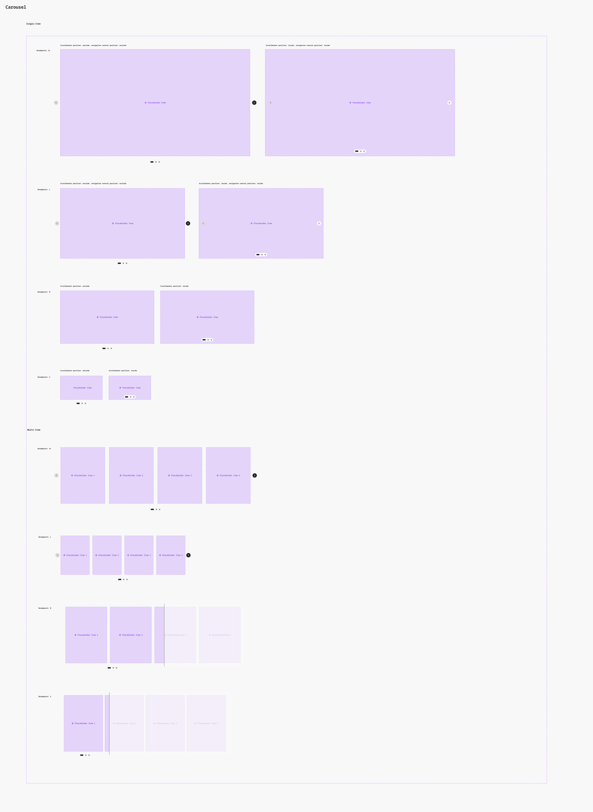

_Figure: The Carousel component with its Single-Item and Multi-Item variants. It displays different layouts and configurations, including various positions for scrollmarkers and navigation controls, such as "Scrollmarker position: outside" and "navigation control position: outside." The figure also shows breakpoints labeled as XL, L, M, and S, indicating responsive design adjustments for different screen sizes. The carousel items are represented by "❖ Placeholder Item" labels, and navigation controls are depicted with left and right chevrons, showing states like "disabled" and "enabled._

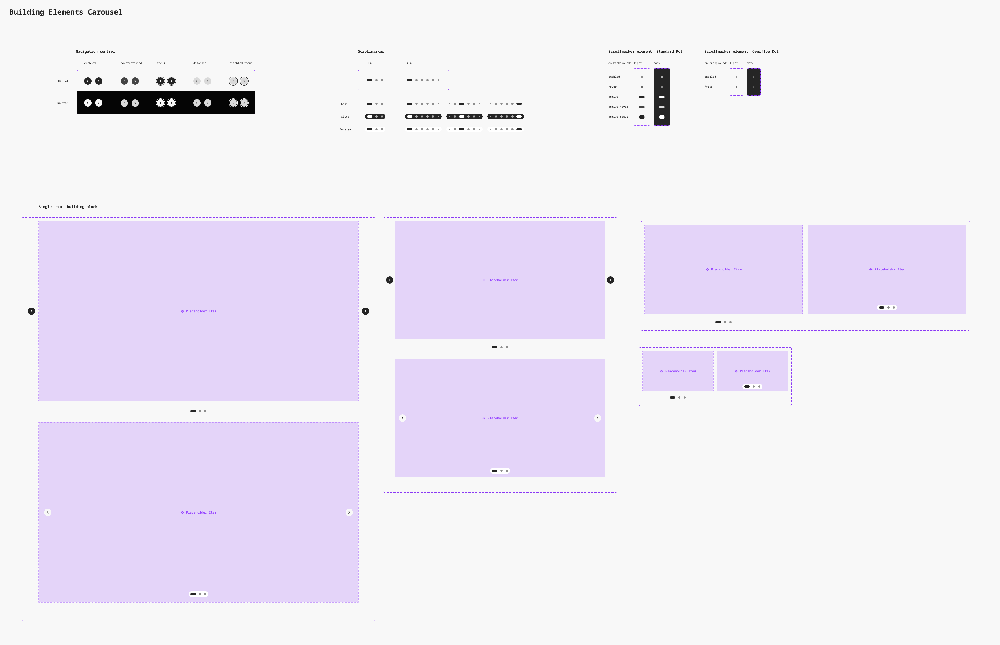

_Figure: The design of a Carousel component, including various states and variants of navigation controls and scrollmarkers. It shows round navigation controls in small size with states such as enabled, hover/pressed, focus, disabled, and disabled focus. The scrollmarker building elements are depicted with standard and overflow dots, and the layout includes examples of single item building blocks with placeholder items. The numbered callouts point to different states of the carousel items, indicating active and enabled states. The figure also illustrates the scrollmarker behavior for both light and dark backgrounds, and different variants like filled, inverse, and ghost._

### Further guidelines

[Storybook documentation](https://release-1-0-0-rc-52--63440bbb95889041542a5ba3.chromatic.com/?path=/docs/components-carousel--documentation)

### Related components and patterns

**Gallery** A gallery is a layout pattern for the structured presentation of multiple visual elements (e.g., images or videos) where all content is visible and directly accessible at the same time – in contrast to a carousel, which displays content sequentially.

### Related elements

[Product Card](https://www.figma.com/design/qXldpLO6gxHJNLdcXIPxYt?node-id=57309-25979)

[Round Button](https://www.figma.com/design/qXldpLO6gxHJNLdcXIPxYt?node-id=168-4016)

### Out of scope

- Autoplay
- Infinite carousel
- Vertical carousel
- Gallery pattern

### Contribute

Contribute to improving this component by sharing your feedback, asking questions, or suggesting features [here](https://www.figma.com/design/lLmw7PfIdKjFG4uT3B2Hyj/Onboarding-%F0%9F%93%96?node-id=446-868&t=zKmRu4kAkxMeRDmK-4).

## Touchscreen Device Considerations

Carousels should remain easy to use across touch-enabled devices and support intuitive, gesture-based navigation. Touch interactions should feel natural, responsive, and never interfere with the user’s ability to browse content.

### Primary Interaction

**Swipe gestures** are the primary navigation method on touch devices and should provide a smooth, direct, and predictable browsing experience.

Users should be able to interrupt, reverse, or continue swipe gestures at any time without unexpected behavior.

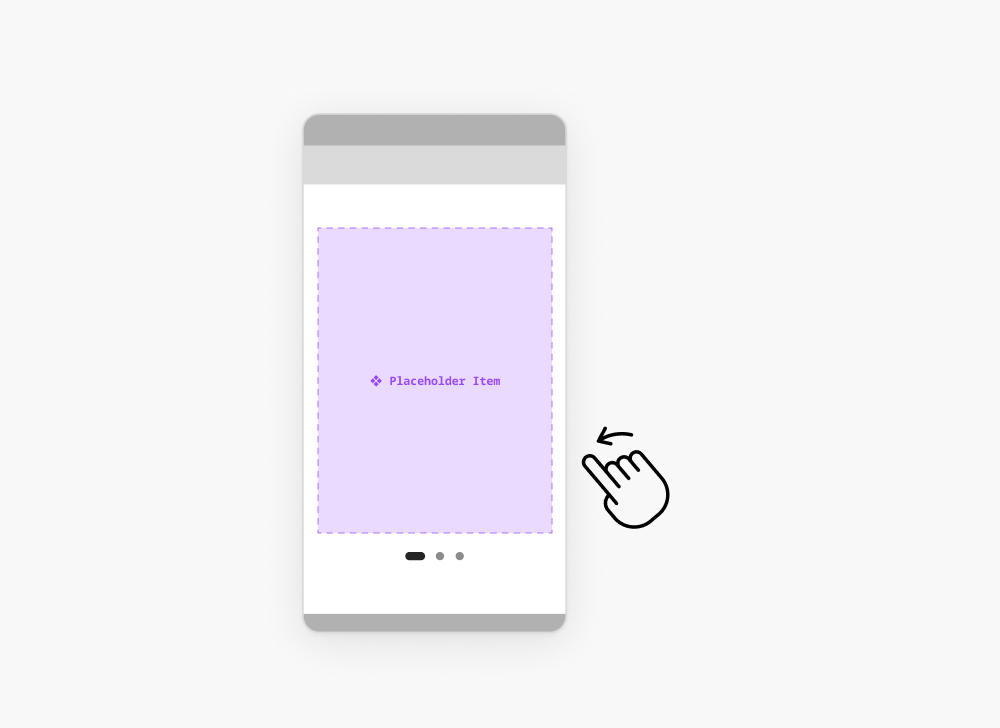

_Figure: A carousel component in its single item variant. It shows a placeholder item within the visible items slot, with a peek slot indicated by dashed lines. A hand icon demonstrates the primary interaction method, which is swipe gestures for navigation on touch devices._

### Secondary Navigation

Secondary navigation methods improve discoverability and provide alternative ways to navigate through the Carousel.

**Tap Zones**

- Provide an alternative navigation method for touch interaction.
- Navigate to the previous or next page depending on the activated zone.
- Complement swipe gestures rather than replace them.

**Scrollmarker**

- Indicate the user’s current position within the Carousel.
- Allow direct navigation to a specific page.
- Improve discoverability by making additional content visible.

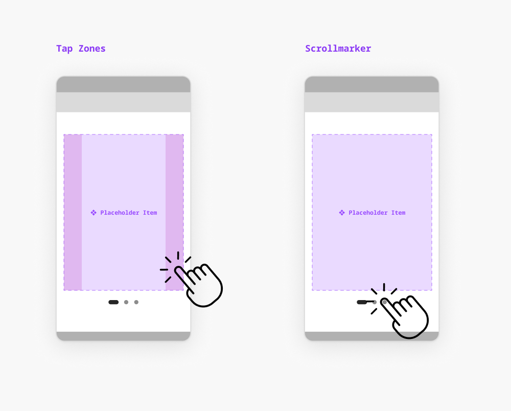

_Figure: A Carousel component with two secondary navigation methods: Tap Zones and Scrollmarker. The Tap Zones are vertical areas on the left and right sides of the carousel, allowing touch interaction to navigate to the previous or next page. The Scrollmarker is a horizontal indicator at the bottom of the carousel, showing the user's current position and enabling direct navigation to specific pages. The carousel is in a single item variant and includes a placeholder item labeled "❖ Placeholder Item"._

### Touch Experience

#### Large Touch Targets

Interactive elements such as tap zones and Scrollmarkers should provide sufficiently large touch targets to support comfortable and accurate interaction. The visible size of an element may be smaller than its interactive touch target.

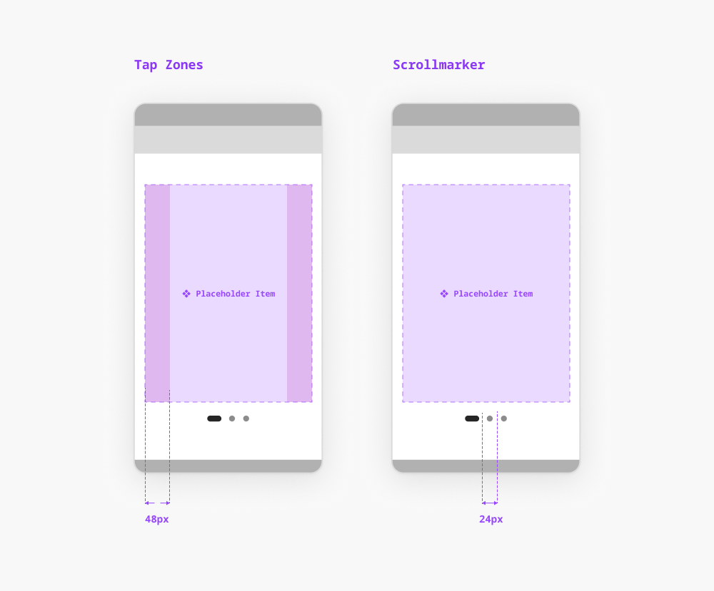

_Figure: A carousel component in a single item variant, illustrating large touch targets for interactive elements. The measurement of 48px refers to the width of the Tap Zones on either side of the visible item, while 24px refers to the width of the Scrollmarker at the bottom. The figure emphasizes that interactive elements should have sufficiently large touch targets to support comfortable and accurate interaction, even if the visible size of an element is smaller._

#### Clear Navigation Feedback

Users should always be able to understand:

- Their current position
- Wether additional content is available
- How to navigate

This can be achieved through Scrollmarkers and Peek.

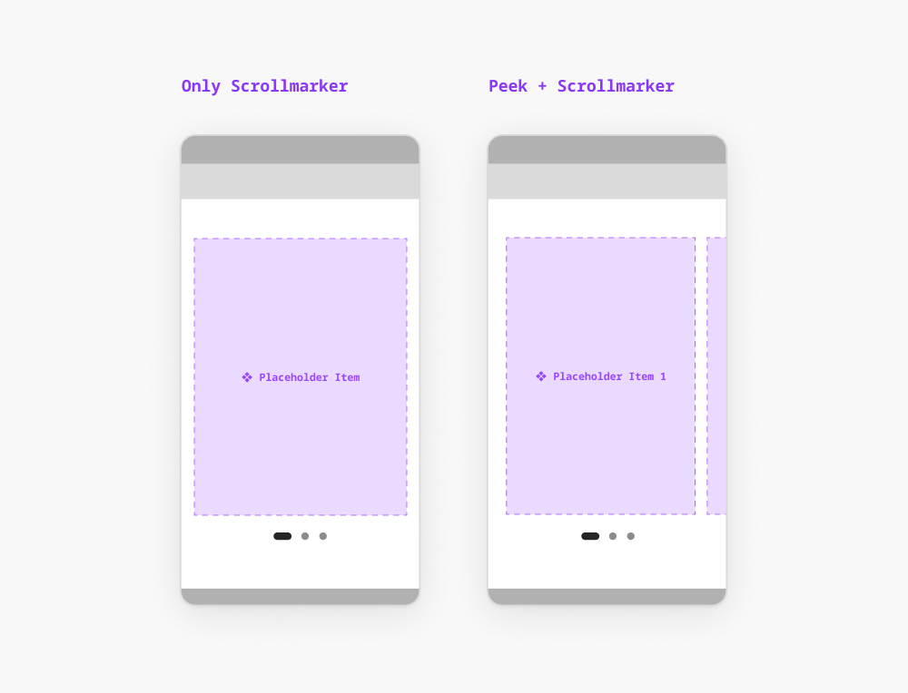

_Figure: Two carousel components with clear navigation feedback. The left carousel uses only the Scrollmarker variant, showing a single item with the label "Placeholder Item." The right carousel combines Peek and Scrollmarker, displaying multiple items labeled "Placeholder Item 1" through "Placeholder Item 4," indicating additional content is available. Both carousels illustrate how users can understand their current position and navigate through the content._

#### Avoid gesture conflicts

Horizontal swipe interactions should not interfere with vertical page scrolling. Users should always be able to continue scrolling the page naturally.

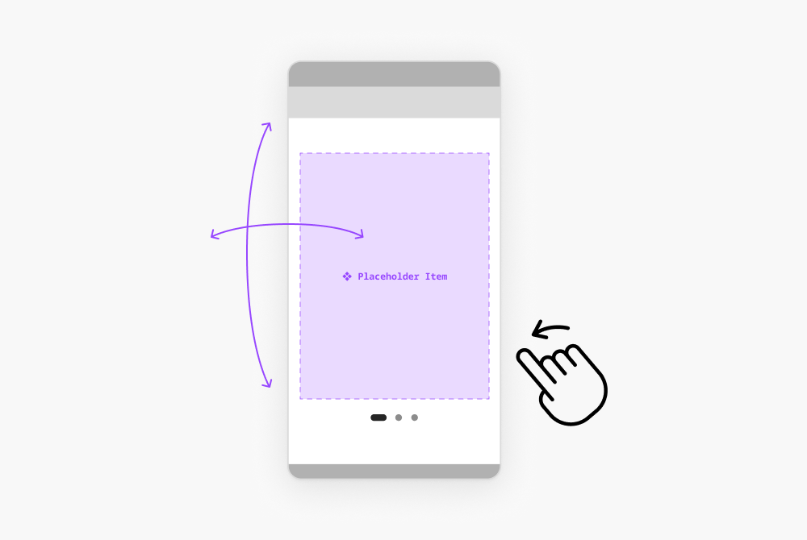

_Figure: A carousel component in a single item variant, with a placeholder item visible. It illustrates the need to avoid gesture conflicts by ensuring that horizontal swipe interactions within the carousel do not interfere with vertical page scrolling. The figure shows a hand gesture indicating a horizontal swipe on the carousel, with arrows demonstrating the potential conflict with vertical scrolling._

#### No Hover States

Hover interactions are not available on touch devices.

Ensure that all essential information and actions remain accessible without hover.

> This section describes general touchscreen design principles. Detailed guidance on layouts, responsive behavior, component behavior, motion, and accessibility is documented in the corresponding sections throughout this documentation.

## Formatting and Construction 1/4

### Anatomy

The Carousel consists of two variants: Single-Item and Multi-Item. Both share the same foundational elements but differ in layout, content, and interaction patterns.

#### Single-Item Variant

**Usage:** one item at the center

**Desktop**

1. **Container**
1. **Viewport**
1. **Track**
   1. **one item visible**
   1. **n items hidden** (1-4 items recommended)
1. **Navigation Controls**
   1. **Previous**
   1. **Next**
1. **Scrollmarker**

See [Element Details – Shared Elements](https://www.figma.com/design/qXldpLO6gxHJNLdcXIPxYt?node-id=61435-1965) for a detailed description of each element.

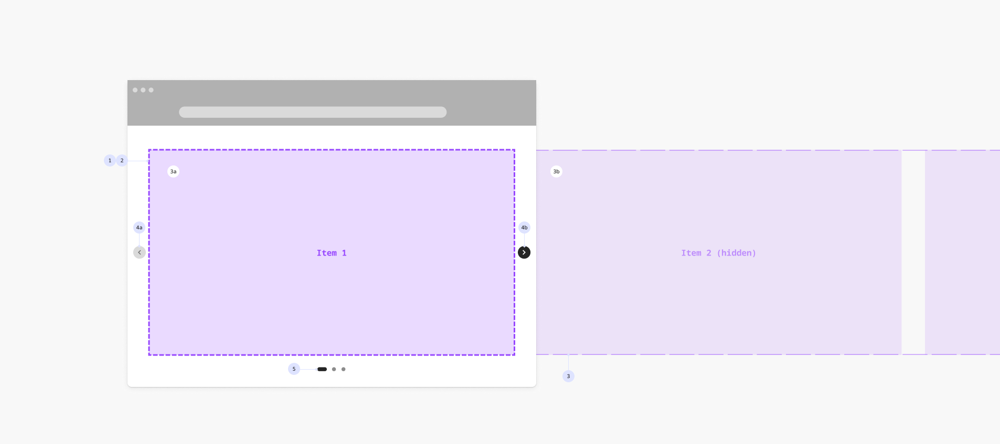

_Figure: A Single-Item Variant of a carousel component for desktop use, showing one visible item and hidden items. Callout 1 points to the Container, 2 points to the Viewport, 3 points to the Track, 4a points to the Previous Navigation Control, 4b points to the Next Navigation Control, and 5 points to the Scrollmarker. The visible item is labeled "Item 1," while a hidden item is labeled "Item 2 (hidden)." The annotations 3a and 3b indicate the positions of the visible and hidden items within the Track._

**Mobile**

1. **Container**
1. **Viewport**
1. **Track**
   1. **one item visible**
   1. **n items hidden** (1-4 items recommended)
1. **Scrollmarker**
1. **Tap zones** (for touch devices)
   1. **Previous**
   1. **Next**

See [Element Details – Shared Elements](https://www.figma.com/design/qXldpLO6gxHJNLdcXIPxYt?node-id=61435-1965) for a detailed description of each element.

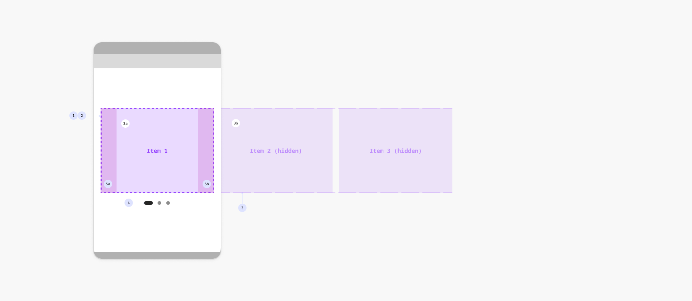

_Figure: The Single-Item Variant of a Carousel component designed for mobile devices. The layout includes a Container holding a Viewport with a Track that displays one visible item and has additional hidden items. Callout 1 points to the Container, callout 2 points to the visible item labeled "Item 1," callout 3 points to the hidden items labeled "Item 2 (hidden)" and "Item 3 (hidden)," and callout 4 points to the Scrollmarker. The Tap zones for touch devices are labeled "5a" and "5b," with "5a" indicating the Previous navigation and "5b" indicating the Next navigation. The annotations "3a" and "3b" highlight specific parts of the hidden items._

#### Multi-Item Variant

**Usage:** multiple items can be viewed simultaneously

**Desktop**

1. **Container**
1. **Viewport**
1. **Track**
   1. **n items visible** (2-4 items recommended)
   1. **n items hidden** (depending on amount of items in the viewport. Users should not need more than 1–2 rotations to see all items.)
1. **Navigation Controls** (touch devices optional, desktop recommended)
   1. **Previous**
   1. **Next**
1. **Scrollmarker**

See [Element Details – Shared Elements](https://www.figma.com/design/qXldpLO6gxHJNLdcXIPxYt?node-id=61435-1965) for a detailed description of each element.

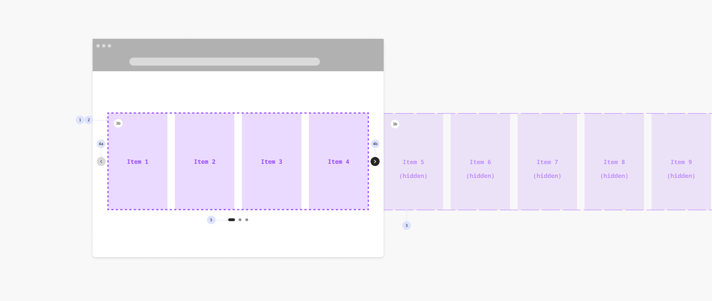

_Figure: The Multi-Item Variant of a Carousel component, showing both visible and hidden items. Callout 1 points to the left edge of the Container, callout 2 points to the center of the Container, callout 3 points to the bottom edge of the hidden items, and callout 5 points to the Previous Navigation Control. The layout includes a Container holding a Viewport with a Track that displays 2-4 visible items and additional hidden items. The Navigation Controls include Previous and Next buttons, with a Scrollmarker indicating progress. The figure recommends that users should not need more than 1–2 rotations to view all items._

**Mobile**

1. **Container**
1. **Viewport**
1. **Track**
   1. **n items visible** (2-4 items recommended)
   1. **n items hidden** (depending on amount of items in the viewport. Users should not need more than 1–2 rotations to see all items.)
   1. **Peek** (optional, touch devices recommended)
1. **Tap zones** (touch devices recommended)
   1. **Previous**
   1. **Next**
1. **Scrollmarker**

See [Element Details – Shared Elements](https://www.figma.com/design/qXldpLO6gxHJNLdcXIPxYt?node-id=61435-1965) for a detailed description of each element.

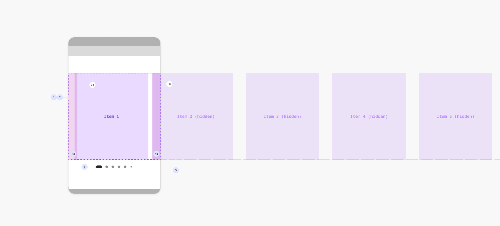

_Figure: A carousel component in its multi-item variant for mobile devices, displaying the layout and key elements. The numbered callouts point to specific parts: 1 and 2 indicate the Previous and Next navigation controls, 3 points to the Scrollmarker, and 5 points to the Tap zones. The figure shows one visible item labeled "Item 1" and several hidden items labeled "Item 2 (hidden)" through "Item 5 (hidden)." The annotations "3a" and "3b" mark the boundaries of the viewport, while "4a" and "4b" indicate the boundaries of the track. The peek area is optional and recommended for touch devices, allowing users to see part of the next item. Users should be able to view all items with 1–2 rotations._

## Content and Assets 1/2

### Single-Item Variant

The Single-Item Carousel is designed to present one primary piece of content per page. It supports rich, visually engaging content while keeping the user’s attention focused on a single message.

#### Item content

The Item supports rich and flexible content. It may contain:

- Images
- Media
- Content blocks
- Complex layouts

_Figure: A carousel component in the single item variant, showcasing an item content layout. The layout includes an image on the right side, a content block on the left with text that reads "Win a Trip to Canada, Range Rover, and More!", "As a thank you for registering your products, we’re giving you the chance to...", and a button labeled "Participate now". The carousel supports rich and flexible content, including images, media, content blocks, and complex layouts. The visible items are displayed one at a time, with navigation arrows on either side and a breakpoint labeled "l"._

**Do use one clear primary message per Item.**

Each Item should communicate a single idea or call to action to help users quickly understand the content.

_Figure: A carousel component in the single item variant, displaying one item at a time. The item content includes a clear primary message: "Win a Trip to Canada, Range Rover, and More!" with a secondary message and a call-to-action button labeled "Participate now." This example is marked as a "Do" because it effectively communicates a single idea or call to action, helping users quickly understand the content._

**Don’t combine multiple competing messages within a single Item.**

Avoid competing call to action as they reduce clarity and make the content more difficult to scan.

_Figure: A carousel component in the single item variant with a visible item and a peek item. The carousel contains an item with two competing calls to action: "Participate now" and "Find out more". This is marked as a "Don't" example because combining multiple competing messages within a single item reduces clarity and makes the content more difficult to scan._

#### Recommended amount of pages

A Single-Item Carousel should:

- Display 1–5 pages.
- Keep the total number of pages low to reduce navigation effort.
- Ensure users can reach all content without excessive navigation.

If additional pages are required, the Scrollmarker provides an optimized overflow variant for Carousels with more than 6 pages.

_Figure: A Single-Item Carousel component with two states: "Default (for less than 6 pages)" and "Overflow (for more than 6 pages)." The Default state shows a carousel with three visible dots representing pages, while the Overflow state shows six dots, indicating more than six pages. The carousel is designed to keep the total number of pages low to reduce navigation effort, ensuring users can reach all content without excessive navigation. The Overflow variant is optimized for Carousels with more than six pages using a Scrollmarker._

#### Content consistency

Keep the overall visual structure consistent across all Items.

Consistent layouts help users focus on the changing content rather than adapting to changing compositions.

_Figure: A carousel component in the single item variant, with a visible item and a peek item on either side. The layout includes a navigation control and scrollmarker positioned outside the visible items. The first callout points to a carousel item promoting a contest with text "Win a Trip to Canada, Range Rover, and More!" and a button labeled "Participate now". The second callout points to a carousel item with placeholder text "Lorem ipsum dolor". The example demonstrates content consistency by maintaining a similar structure across different carousel items, helping users focus on the changing content._

## Supported configurations

> **Implementation Note** The Carousel component exposes additional configuration options through its API. While many combinations are technically possible, the Design System defines and supports only the configurations documented on this page. Configurations outside these recommendations have no defined spacing, alignment, or positioning and are not reviewed for design consistency or accessibility. If your product requires a configuration that is not documented here, contact the Design System team. New configurations can be added when validated by a product use case. Go [here](https://www.figma.com/design/lLmw7PfIdKjFG4uT3B2Hyj/Onboarding-%F0%9F%93%96?node-id=446-868&t=zKmRu4kAkxMeRDmK-4) for contact options.

The Carousel supports a wide range of navigation and Scrollmarker configurations. These configurations are based on validated product use cases and should be preferred over custom combinations.

Configurations in Code can be viewed [here](https://release-1-0-0-rc-52--63440bbb95889041542a5ba3.chromatic.com/iframe.html?args=&viewMode=story&id=templates-carousel--vrt).

### Configuration: Single-Item – Navigation Controls Outside, Scrollmarker Outside

Optimized for presenting one primary piece of content with persistent navigation.

#### Specifications

**Variant**

Single-Item

**Navigation Control Variant**

Filled

**Navigation Control Position**

Outside (XL-L) Hidden (M-S)

**Scrollmarker Variant**

Ghost

**Scrollmarker Position**

Outside

**Tap Zones**

False (Pointer) True (Touch)

**Drag**

True (Pointer) False (Touch)

**Swipe**

False (Pointer) True (Touch)

**Peek**

No

**Items per View**

1

**Items per Navigation Step**

1

**Placement**

Main Content Area

**Layout**

Grid

**Responsive:** Navigation Controls are visible from breakpoint L and hidden below L.

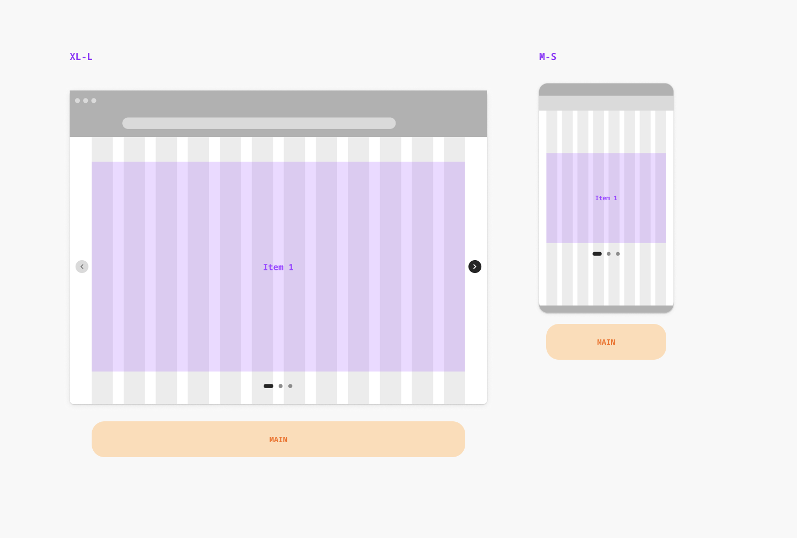

_Figure: A Carousel component in the Single-Item variant with Filled Navigation Controls. The navigation controls are positioned outside the carousel for the XL-L breakpoint and are hidden for the M-S breakpoint. The layout is grid-based and responsive, with navigation controls visible from breakpoint L and hidden below L. The main content area contains a single item labeled "Item 1" and the text "main" indicates the main content area._

#### Example

My STIHL

**Recommended for**

- Hero stages
- Campaigns
- Promotions
- Marketing messages

_Figure: Two examples of a carousel component used for Hero stages, Campaigns, Promotions, and Marketing messages. The first carousel is labeled "XL-L" and shows a single item variant with a larger layout, while the second carousel is labeled "M-S" and shows a single item variant with a smaller layout. Both carousels include text that reads "Win a Trip to Canada, Range Rover, and More!", "As a thank you for registering your products, we’re giving you the chance to...", and a button labeled "Participate now"._

### Configuration: Single-Item – Navigation Controls Inside, Scrollmarker Inside

Optimized for presenting one primary piece of content with persistent navigation.

#### Specifications

**Variant**

Single-Item

**Navigation Control Variant**

Inverse

**Navigation Control Position**

Inside (XL-L) Hidden (M-S)

**Scrollmarker Variant**

Inverse

**Scrollmarker Position**

Inside

**Tap Zones**

False (Pointer) True (Touch)

**Drag**

True (Pointer) False (Touch)

**Swipe**

False (Pointer) True (Touch)

**Peek**

No

**Items per View**

1

**Items per Navigation Step**

1

**Placement**

Main Content Area

**Layout**

Grid

**Responsive:** Navigation Controls are visible from breakpoint L and hidden below L.

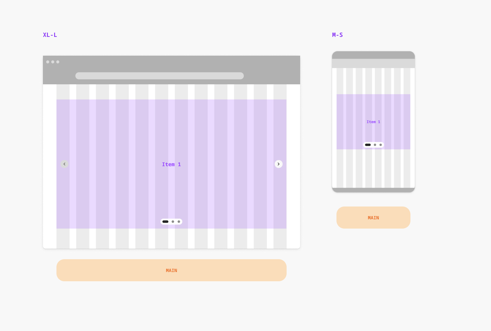

_Figure: A Carousel component with the Single-Item Navigation Control Variant. It shows two states: one for the XL-L breakpoint where navigation controls are visible inside the carousel, and another for the M-S breakpoint where the navigation controls are hidden. The layout is grid-based and responsive, with navigation controls visible from breakpoint L and hidden below L. The carousel includes a single item per view and per navigation step, placed in the main content area. The specifications indicate different behaviors for pointer and touch interactions, such as tap zones, drag, swipe, and peek functionalities._

#### Example

Image Carousel

**Recommended for**

- Image based Carousels with reduced elements

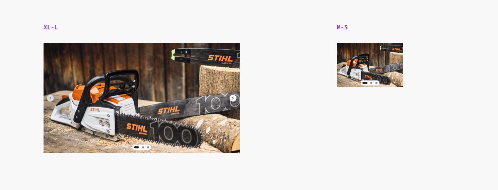

_Figure: Two examples of an image carousel component from the STIHL Design System. The first carousel is labeled "XL-L" and shows a single visible item with a peek slot, designed for larger breakpoints. The second carousel is labeled "M-S" and also shows a single visible item with a peek slot, designed for smaller breakpoints. Both carousels are variants of the single item type and illustrate the component's adaptability to different screen sizes._

### Configuration: Multi-Item – Navigation Controls Outside, Scrollmarker Outside

Optimized for presenting multiple related Items that users can browse, compare, and discover.

#### Specifications

**Variant**

Multi-Item

**Navigation Control Variant**

Filled

**Navigation Control Position**

Outside (XL-L) Hidden (M-S)

**Scrollmarker Variant**

Ghost

**Scrollmarker Position**

Outside

**Drag**

True (Pointer) False (Touch)

**Swipe**

False (Pointer) True (Touch)

**Peek**

Responsive

**Items per View**

Configurable per breakpoint

**Items per Navigation Step**

Configurable

**Placement**

Main Content Area (XL-L) Extended Content Area (M-S)

**Layout**

Grid Main (XL-L) Grid Extended (M-S)

**Responsive:** Navigation Controls are visible from breakpoint L and hidden below L. Peek is enabled for the supported smaller-breakpoint configuration.

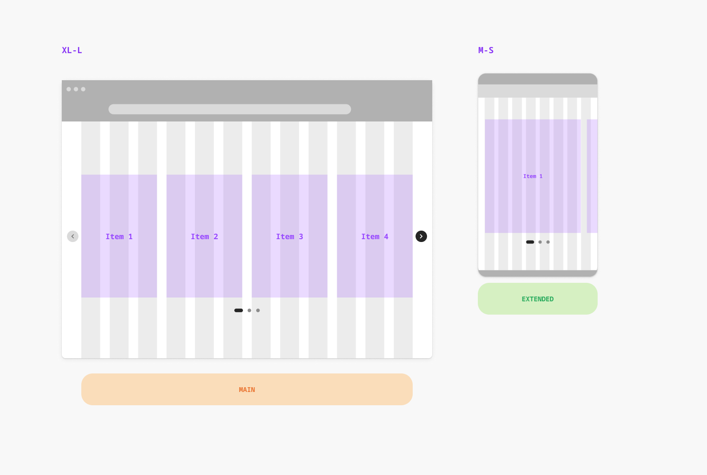

_Figure: The Carousel component in the Multi-Item Navigation Control Variant. It shows two states: one for the XL-L breakpoint where the Navigation Controls are visible and positioned outside the main content area, and another for the M-S breakpoint where the Navigation Controls are hidden and placed in the extended content area. The carousel displays items labeled "Item 1", "Item 2", "Item 3", and "Item 4", with different layouts and configurations based on the breakpoint._

#### Example

My STIHL

**Recommended for**

- Product categories
- Product recommendations
- Related products
- Inspirational content collections

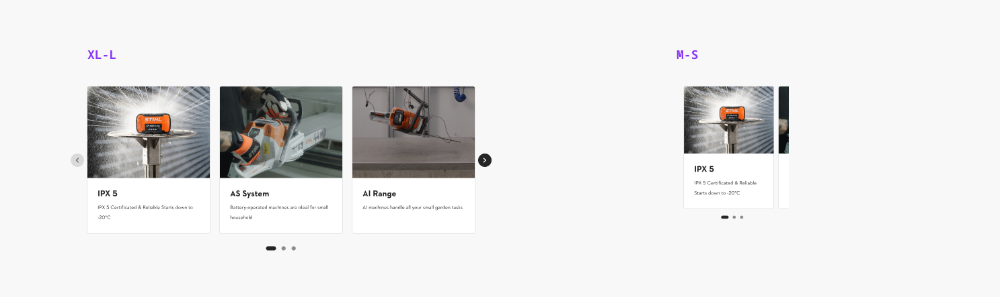

_Figure: Two examples of a carousel component in a UI design system. The first carousel, labeled "XL-L", shows three visible items with a peek at additional items, suitable for larger screens. The second carousel, labeled "M-S", shows one visible item with a peek at additional items, suitable for smaller screens. Each carousel includes product categories and recommendations, such as "IPX 5", "AS System", and "AI Range", with brief descriptions like "IPX 5 Certified & Reliable Starts down to -20°C" and "Battery-operated machines are ideal for small household"._

### Configuration: Single-Item Embedded – Navigation Controls Hidden, Scrollmarker Inside

Optimized for presenting a single piece of media within another component or layout while minimizing visual distraction.

#### Specifications

**Variant**

Single-Item

**Navigation Control Position**

Hidden

**Scrollmarker Variant**

Filled Inverse

**Scrollmarker Position**

Inside

**Drag**

True (Pointer) False (Touch)

**Swipe**

False (Pointer) True (Touch)

**Peek**

No

**Items per View**

1

**Items per Navigation Step**

1

**Placement**

Defined by parent component / layout (e.g. Product Card; visit the [Figma component](https://www.figma.com/design/qXldpLO6gxHJNLdcXIPxYt?node-id=57309-25979) or [Storybook](https://release-1-0-0-rc-52--63440bbb95889041542a5ba3.chromatic.com/?path=/docs/templates-cards-product-card-in-grid--documentation) for more details)

**Layout**

Flex

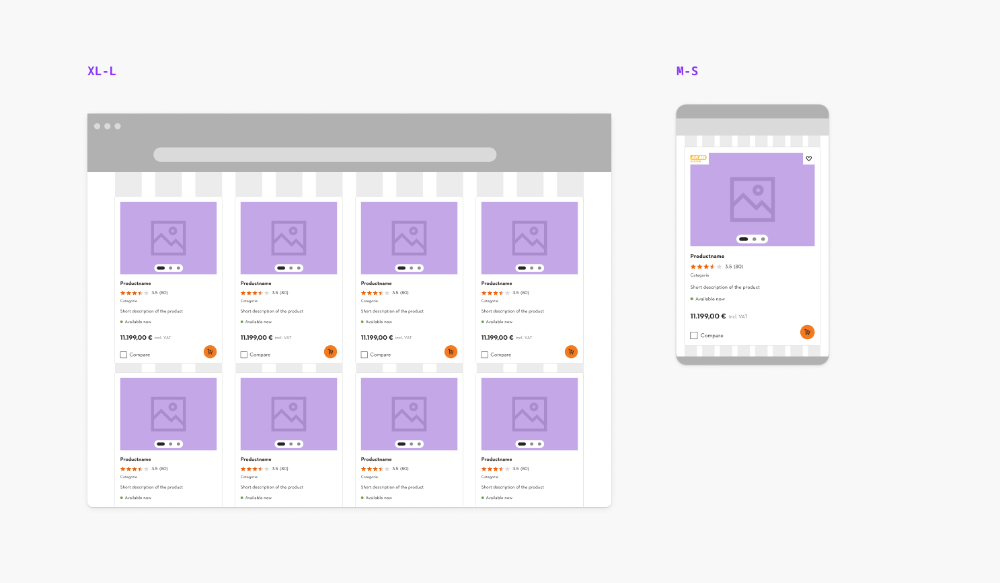

_Figure: The Carousel component in the Single-Item Navigation variant, showing both hidden and visible states of the scrollmarker. The layout is a grid view for product cards, with each card containing elements such as Productname, rating, Categorie, Short description of the product, availability, price, and a Compare option. The specifications indicate that the scrollmarker is filled and positioned inside, with drag and swipe functionalities enabled for touch interactions, and no peek functionality. The items per view and per navigation step are set to 1, and the placement is defined by the parent component or layout. The labels "XL-L" and "M-S" refer to different screen size variants..._

#### Example

STIHL.de: Product Grid

**Recommended for**

- Product image galleries
- Media within Product Cards

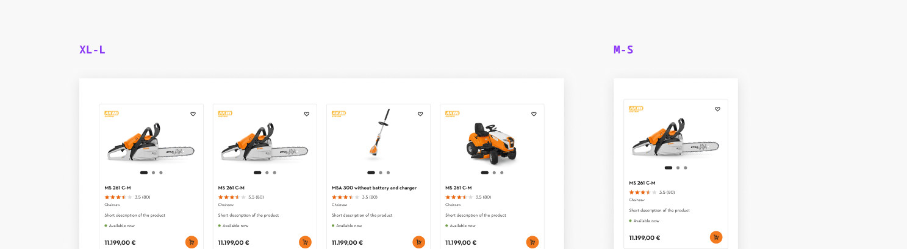

_Figure: A carousel component example from the STIHL Design System, showing a product grid layout with two different content sizing variants: "hug" and "fill". The text "XL-L" and "M-S" indicate different size categories for the product cards. Each product card includes an image, product name such as "MS 261 C-M", a rating of "3.5" out of 5 with "(80)" reviews, product type like "Chainsaw", a short description, availability status "Available now", and price "11.199,00 €". The figure also includes examples of different product types such as "Lawn mower", "Brush cutter", and "Socks STRIPES 3-pack Black / White / Grey"._

## Responsive Layout

### Responsive Behaviour

The following tables summarize how each supported Carousel configuration adapts across breakpoints. Interaction methods may additionally vary depending on the user's input method.

#### Configuration: Single-Item — Navigation Controls Outside, Scrollmarker Outside

**XL - L**

**M - S**

**Navigation Controls**

Visible, position outside

Hidden

**Scrollmarker**

Outside

**Items per view**

1

**Peek**

No

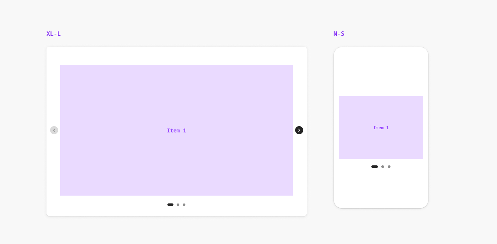

_Figure: The Carousel component in the Single-Item variant with Navigation Controls Outside and Scrollmarker Outside. The layout is shown for two breakpoints: XL-L and M-S, where XL-L refers to extra-large to large screens and M-S refers to medium to small screens. Each example shows a single item per view with no peek, and the navigation controls and scrollmarker are positioned outside the carousel._

#### Configuration: Single-Item — Navigation Controls Inside, Scrollmarker Inside

**XL - L**

**M - S**

**Navigation Controls**

Visible, position inside

Hidden

**Scrollmarker**

Inside

**Items per view**

1

**Peek**

No

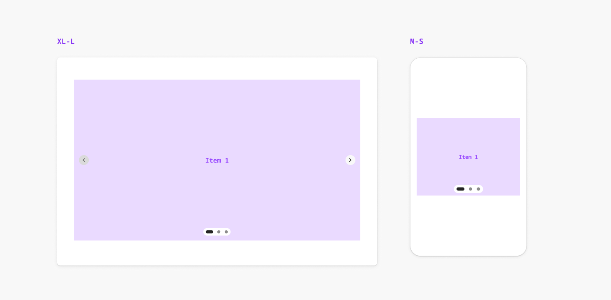

_Figure: A Carousel component in the Single-Item variant with Navigation Controls Inside and Scrollmarker Inside. The layout is shown for two breakpoints: XL-L and M-S, referring to different screen sizes. Each example shows a single item per view with no peek, and the navigation controls and scrollmarker are positioned inside the carousel._

#### Configuration: Multi-Item — Navigation Controls Outside, Scrollmarker Outside

**XL - L**

**M - S**

**Navigation Control**

Visible, position outside

Hidden

**Scrollmarker Position**

Outside

**Items per View**

Breakpoint-dependent

**Peek**

No

Yes

> The number of Items per View can be configured independently for each breakpoint. The number of Hidden Items adapts automatically based on the total number of Items.

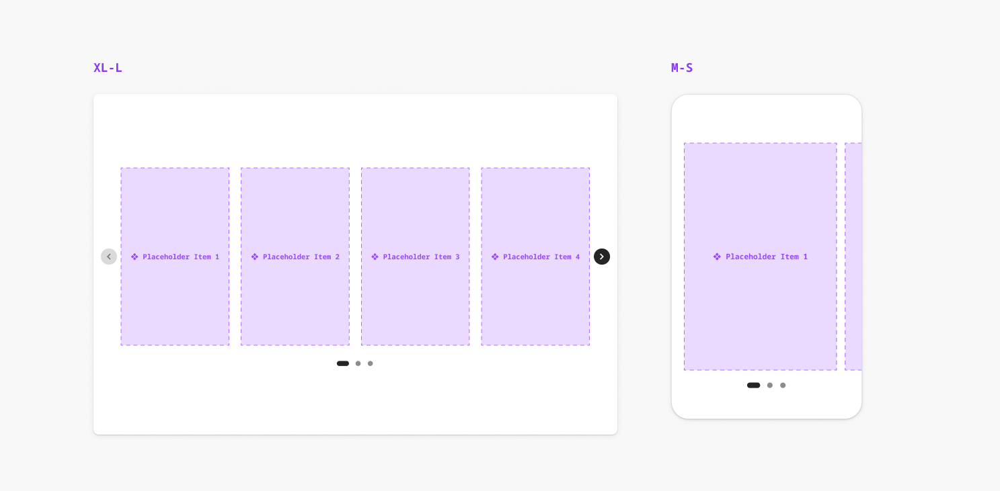

_Figure: A carousel component in a multi-item variant with navigation controls positioned outside and a scrollmarker outside. The layout is shown for two breakpoints: XL-L, where four items are visible, and M-S, where one item is visible with a peek at the next item. The number of visible items and hidden items adapts based on the breakpoint and total number of items._

#### Configuration: Single-Item Embedded — Navigation Controls Hidden, Scrollmarker Inside

**X - L**

**M - S**

**Navigation Controls**

Hidden

**Scrollmarker**

Inside

**Items per view**

1

**Peek**

No

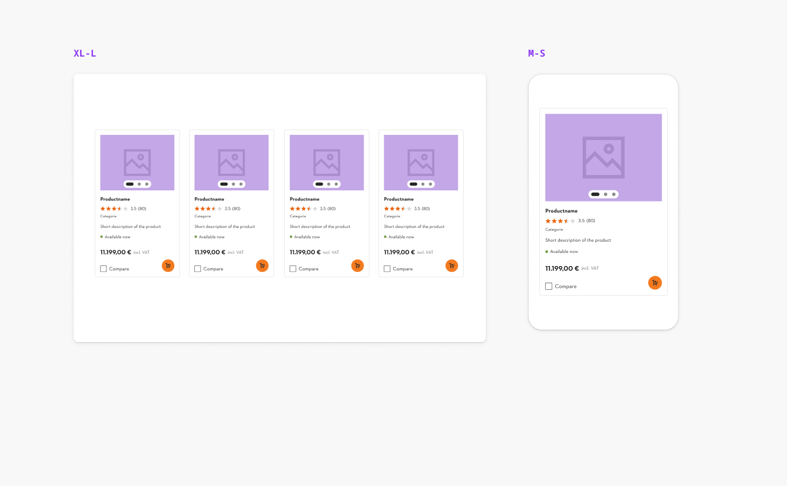

_Figure: A carousel component in a single-item embedded configuration with navigation controls hidden and a scrollmarker inside. The layout is shown for two different screen sizes, "XL-L" and "M-S". Each view features a product-card in grid view with the content sizing set to "hug", showing details such as "Productname", rating "3.5 (80)", "Categorie", "Short description of the product", "Available now", price "11.199,00 € incl. VAT", and a "Compare" option._

### Sizing

The Carousel adapts to the available layout while maintaining consistent proportions and usability across breakpoints. The following recommendations define the supported sizing behavior for each variant.

#### Multi-Item

**Width**

- The number of visible Items can adapt per breakpoint.
- Item width is calculated automatically based on the number of visible Items.
- Items evenly divide the available Viewport width.
- Spacing between Items follows the breakpoint-specific spacing tokens.

**Item sizing**

- Item dimensions are defined by the embedded component (e.g. Card or Media Tile).
- All visible Items should use consistent dimensions within the same Carousel.

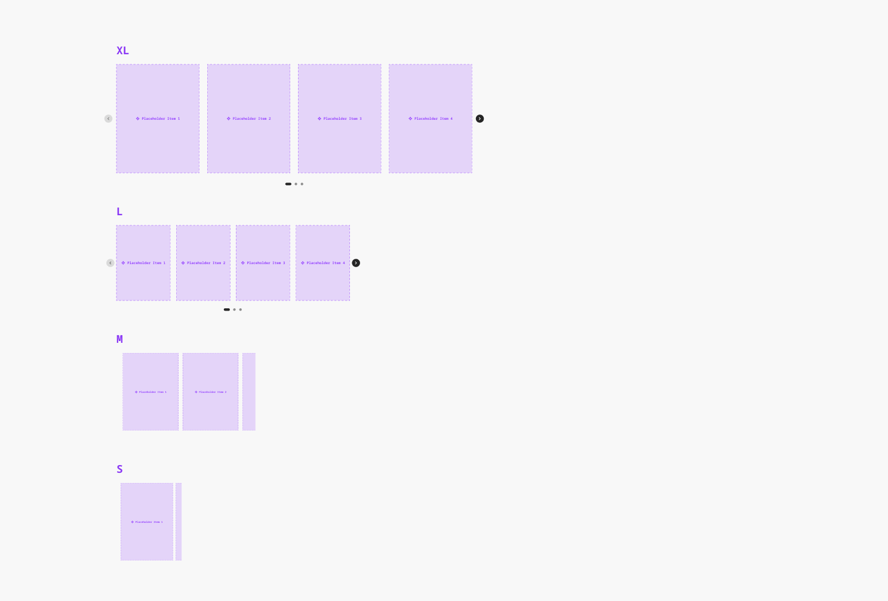

_Figure: A carousel component in the multi-item variant, demonstrating its layout across different breakpoints: xl, l, m, and s. Each breakpoint shows how the number of visible items adapts, with item width calculated automatically to evenly divide the available viewport width, and spacing between items following breakpoint-specific spacing tokens. The items within each carousel maintain consistent dimensions, as defined by the embedded component, such as a Card or Media Tile._

#### Minimum Width

The minimum supported Carousel width is 176px. Carousels are not supported below this width, as the available space is insufficient to provide a usable browsing experience.

_Figure: A Carousel component with a single item visible, in a layout where the minimum width is specified. The measurement label of 176px refers to the minimum supported width for the Carousel, indicating that it is not usable below this width due to insufficient space for a proper browsing experience. The component is shown in a state where it adheres to this minimum width requirement._

## Behavior

The Carousel supports multiple navigation methods to provide a consistent browsing experience across pointer and touch input. Available navigation methods depend on the selected configuration and input method.

### Navigation Methods

#### Page-based navigation

1. **Single-Item:**
- Displays one Item per page.
- Each navigation step moves exactly one page.

1. **Multi-Item:**
- Displays multiple Items per page.
- Each navigation step moves one complete page.

Page-based navigation is the default. Item-based is configurable but not the standard approach.

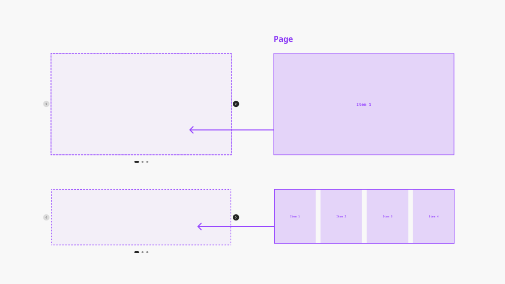

_Figure: Two variants of a carousel component used for page-based navigation. The first variant, labeled "single item," displays one item per page, while the second variant, labeled "multi item," displays multiple items per page. Each navigation step in both variants moves exactly one complete page. The first callout points to the single-item carousel, and the second callout points to the multi-item carousel. The text "Page" indicates the current page being viewed, and "Item 1," "Item 2," "Item 3," and "Item 4" label the individual items within the carousel._

#### Navigation Controls

- Navigate sequentially to the previous or next page.
- Become disabled at the beginning and end of the Carousel (they are still focusable).

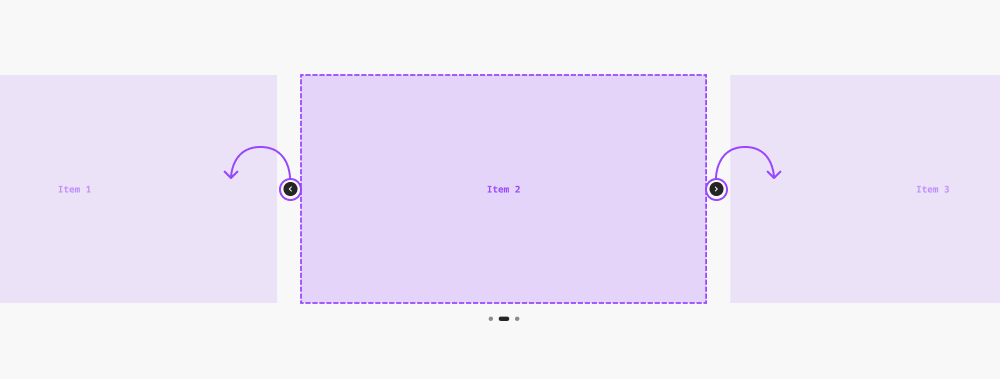

_Figure: A carousel component in the single item variant with three items labeled "Item 1", "Item 2", and "Item 3". Navigation controls are shown on either side of the visible item, allowing sequential navigation to the previous or next page. These controls become disabled at the beginning and end of the carousel but remain focusable. The layout includes a peek at adjacent items on either side of the visible item._

#### Scrollmarker

- Indicate the current page.
- Allow direct navigation to a specific page.

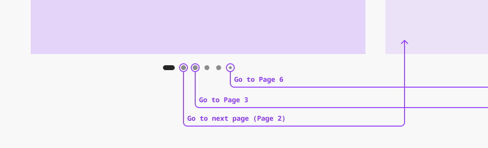

_Figure: A carousel component in the single item variant with a scrollmarker. The scrollmarker indicates the current page and allows direct navigation to specific pages, such as Page 6, Page 3, and the next page, which is Page 2. The carousel has six items, with the current page marked and options to navigate directly to other pages._

#### Drag

- Allows users to navigate by dragging the Carousel horizontally with pointer input.
- Moves to the previous or next page based on the drag direction.

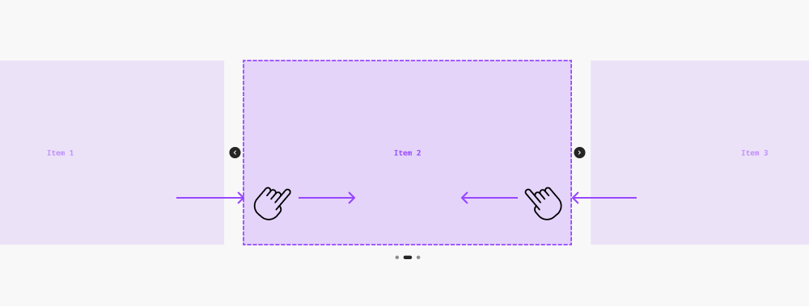

_Figure: A carousel component in the drag variant, showing three items labeled "Item 1," "Item 2," and "Item 3." The carousel allows users to navigate by dragging horizontally with pointer input, moving to the previous or next item based on the drag direction. The visible items are centered, with navigation controls and scroll markers positioned outside the carousel. The hand icons indicate the direction of dragging to navigate between items._

Please find the navigation behavior with touch input [here](https://www.figma.com/design/qXldpLO6gxHJNLdcXIPxYt?node-id=61435-1831).

### End Behaviour

- Carousels do not loop infinitely.
- Navigation stops at the first and last page.
- Navigation Controls become disabled when no further content is available (they are still focusable).

_Figure: A carousel component in the single item variant at the l breakpoint. It shows the end behaviour where navigation stops at the last page, and the navigation controls are disabled but still focusable. The visible items slot contains one item, and the peek slot shows part of the next item._

### Consistency

**Do use one navigation style consistently throughout a Carousel.**

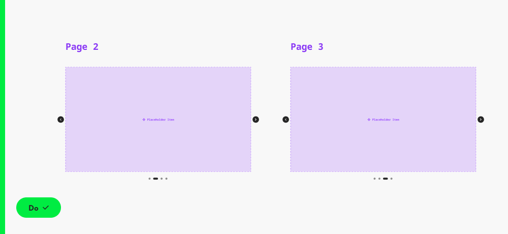

_Figure: A Carousel component in the single item variant, displaying two pages labeled "Page 2" and "Page 3". Each page contains a "Placeholder Item" and has consistent navigation styles, indicated by the same dots at the bottom for page selection. This example is marked as a "Do" because it demonstrates the consistent use of one navigation style throughout the Carousel._

**Don’t switch Navigation Control and Scrollmarker placement within the same Carousel.**

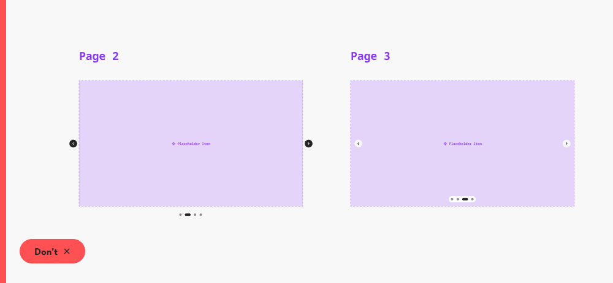

_Figure: A Carousel component in the single item variant, displaying Page 2 and Page 3 with Placeholder Items. The layout includes Navigation Controls on the left and right sides of each page and a Scrollmarker at the bottom of Page 3. The example is marked as a "Don't" because it switches the placement of the Navigation Control and Scrollmarker within the same Carousel, which is inconsistent._

### Nested swipe behaviour

**Don’t use nested Carousels or place Carousels inside horizontally swipeable containers.**

Nested swipe behavior is discouraged because it's technically unstable and can cause issues, particularly on mobile devices. As a result, it's not supported by the Design System.

_Figure: A "Don't" example of a Carousel component with the variant "multi item" and breakpoint "s". It displays multiple items including "Productname", "Categorie", "Short description of the product", "Available now", "11.199,00 € incl. VAT", and "Compare". Nested swipe behavior is discouraged because it is technically unstable and can cause issues, particularly on mobile devices, so Carousels should not be placed inside horizontally swipeable containers._

## Motion

The Carousel uses motion to communicate navigation while maintaining orientation and visual continuity. Transitions should feel smooth, predictable, and never distract from the content.

### Motion Specifications

- **Transition:** Slide
- **Duration:** 700ms
- **Easing:** Ease Out – cubic-bezier (0, 0, 0.5, 1)

### Motion Principles

- Motion should not cause layout shifts.
- The visible layout remains stable throughout the transition.
- Only the Track moves; surrounding UI elements remain fixed.
- By default, the Track transitions one page at a time.

### Drag Motion

- During dragging, the Track follows the pointer movement directly.
- When the drag is released, the Track settles on the appropriate page.
- The settling transition uses the defined Carousel easing.
- Surrounding UI elements remain fixed during the interaction.

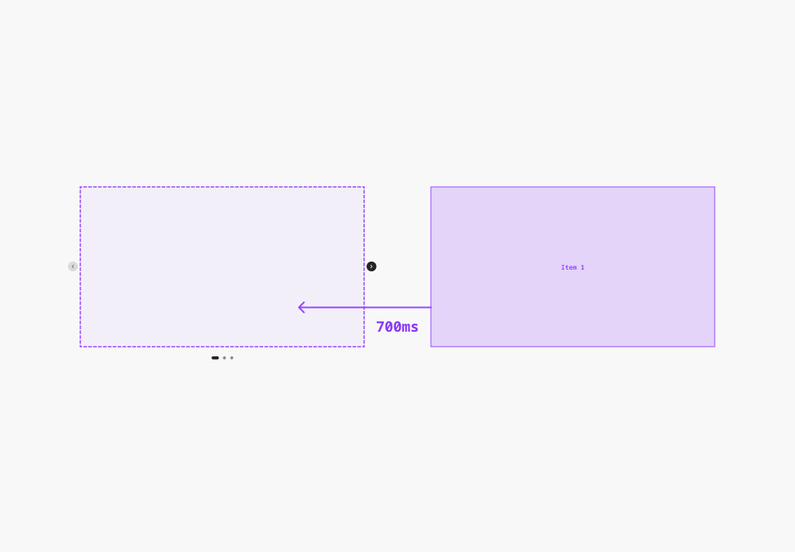

_Figure: A carousel component in the single item variant, showing the drag motion interaction. It illustrates the state where the track follows the pointer movement directly during dragging, with a settling transition of 700ms after the drag is released. Surrounding UI elements remain fixed, and the track settles on the appropriate page, "Item 1", using the defined Carousel easing._

## Accessibility

### Keyboard Interaction

The Carousel must be fully operable using a keyboard. Users must be able to navigate, operate, and exit the Carousel without requiring a pointing device.

#### Keyboard requirements

- All visible interactive elements within the Carousel are keyboard accessible, including Navigation Controls, Scrollmarkers, and interactive elements within visible Items.
- All keyboard-accessible elements provide a visible focus indicator.
- Interactive elements expose an appropriate accessible name, role, and value.
- Keyboard focus never moves to hidden Items.
- Navigating between pages must not move keyboard focus automatically.

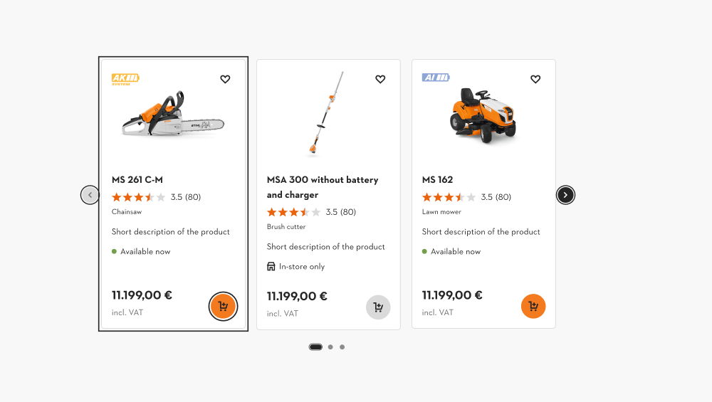

_Figure: A Carousel component in the multi-item variant, with a layout showing three visible items and a peek at additional items. Each item includes details such as product names "MS 261 C-M", "MSA 300 without battery and charger", and "MS 162", along with their descriptions, availability, and prices. The keyboard requirements ensure that all interactive elements within the Carousel are accessible via keyboard, providing visible focus indicators and appropriate accessible names, roles, and values, while preventing keyboard focus from moving to hidden items or automatically navigating between pages._

### Screen Reader Support

The Carousel must fully support Screen Readers using a keyboard. Users must be able to navigate, operate, and exit the Carousel with the Screen Readers support.

#### Carousel Semantics

The Carousel must be exposed as a landmark region using appropriate ARIA semantics.

#### Accessible Name

The Carousel must announce the accessible name of the currently focused Item or interactive element.

#### Position Information

The Carousel must announce the current page and position (for example, “Item 2 of 5” or “Items 1 – 4 of 12”).

#### Accessible Interactive Content

The Carousel must allow the user to access the interactive content within the Items (i.e. buttons).

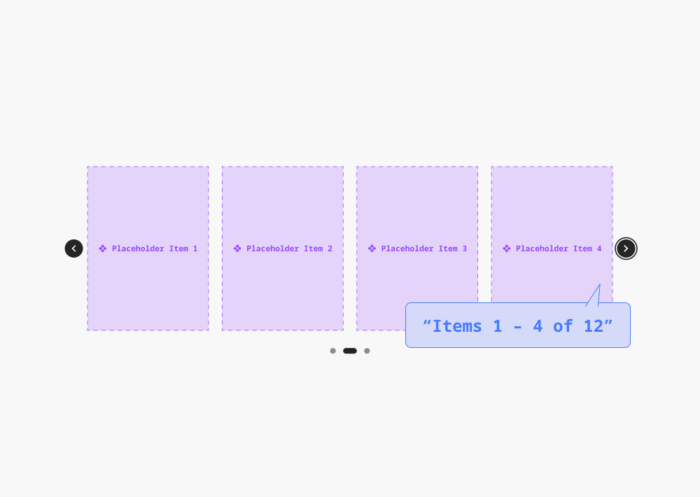

_Figure: A Carousel component in the multi-item variant, showing four visible items out of twelve total items. Each item is labeled as "❖ Placeholder Item" followed by its number, and the text "Items 1 – 4 of 12" indicates the current range of items displayed. The carousel includes navigation controls on either side and a set of dots below for additional navigation._

### Focus Order

#### General principles

- Maintain a logical and predictable keyboard focus order.
- Do not move keyboard focus automatically when the Carousel changes pages.
- Only interactive elements within visible Carousel items may receive keyboard focus.
- Hidden Carousel items must not be keyboard accessible or exposed to assistive technologies.
- After activating a Carousel control, keep focus on the activated control until the user moves it.

#### Configuration with Navigation Controls

1. **Visible Item(s)**
   1. Tab moves to the next Items / interactive elements inside the visible Items, in reading order
   1. Tab moves to Previous Navigation Control from the last visible interactive element.

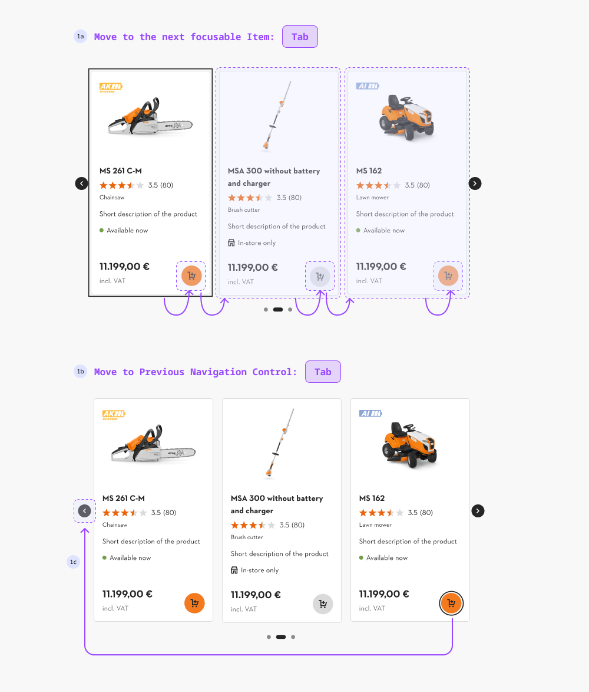

_Figure: A carousel component in the multi-item variant with navigation controls, displaying three visible items in a layout suitable for a large breakpoint. The numbered callouts indicate the tab navigation order: 1a points to the instruction for moving to the next focusable item using the Tab key, 1b points to the instruction for moving to the previous navigation control, and 1c indicates the starting point for tab navigation within the carousel items. The carousel includes items such as "MS 261 C-M" chainsaw, "MSA 300 without battery and charger" brush cutter, and "MS 162" lawn mower, each with details like ratings, descriptions, availability, and prices including VAT._

1. **Previous Navigation Control**
   1. Enter moves to the previous page while retaining focus on the control.
   1. Arrow Left / Right moves to the previous / next pages
   1. Tab moves to the Next Navigation Control

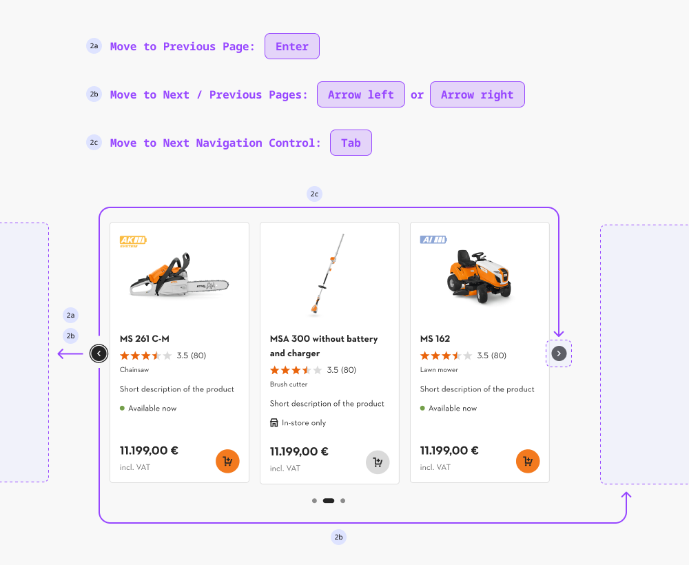

_Figure: A carousel component from the STIHL Design System, specifically the multi-item variant with navigation controls. It shows three visible items and a peek at items on either side, with a layout designed for a large breakpoint. Callout 2a points to the previous navigation control, indicating that pressing "Enter" moves to the previous page while retaining focus on the control. Callout 2b highlights the navigation arrows, showing that "Arrow left" and "Arrow right" move to the previous and next pages, respectively. Callout 2c points to the tab navigation, indicating that pressing "Tab" moves to the next navigation control. The carousel includes items such as "MS 261 C-M" chainsaw..._

1. **Next Navigation Control**
   1. Enter moves to the next page while retaining focus on the control.
   1. Arrow Left / Right moves to the previous / next pages
   1. Tab moves to the Scrollmarker

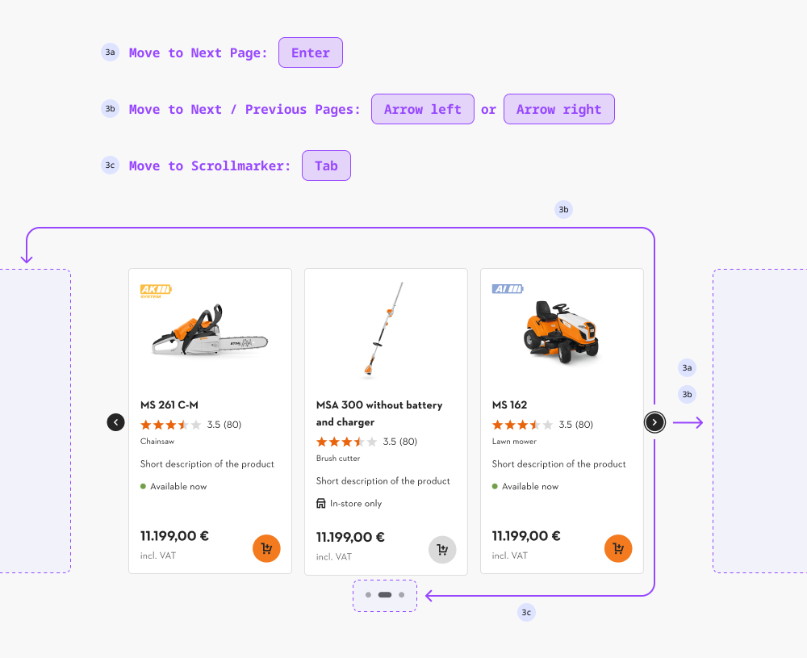

_Figure: A carousel component in a multi-item variant with three visible items and a peek at adjacent items. The carousel includes navigation controls and three numbered callouts: 3a points to the "Next Navigation Control" indicating that pressing Enter moves to the next page while retaining focus, 3b points to arrows indicating that Arrow Left or Arrow Right moves to the previous or next pages, and 3c points to a scrollmarker indicating that pressing Tab moves focus to it. The carousel shows three products: a chainsaw labeled "MS 261 C-M," a brush cutter labeled "MSA 300 without battery and charger," and a lawn mower labeled "MS 162," each with a rating, description, availability status..._

1. **Scrollmarker**
   1. Arrow Left / Right moves to Next / Previous Pages and move focus to the new active marker.
   1. Tab after using the arrow keys moves focus into the first visible Item / interactive element of the first visible Item
   1. Tab without having used the arrow keys leaves the Carousel.

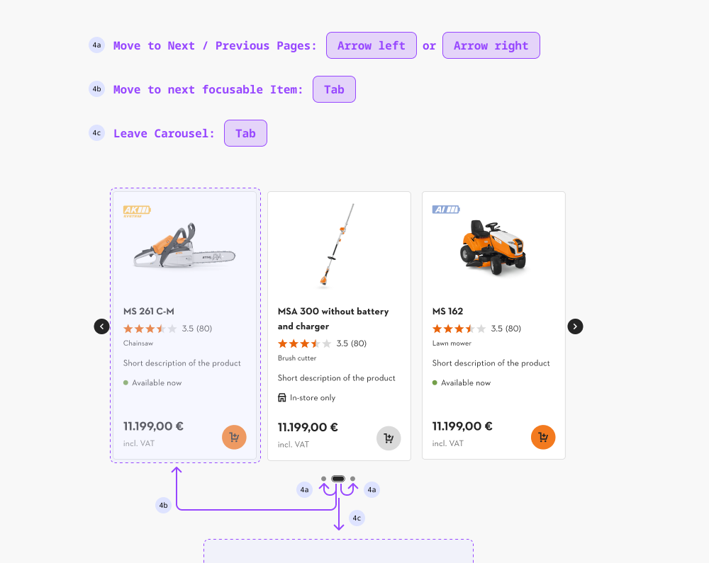

_Figure: A carousel component in a multi-item variant with three visible items and a peek at additional items. The carousel includes navigation controls with enabled states for the first and third items. The numbered callouts indicate the following: 4a points to the arrow keys, which move to the next or previous pages and focus on the new active marker, 4b points to the tab key, which moves focus to the first visible item or interactive element after using the arrow keys, and 4c points to the tab key, which leaves the carousel when used without prior arrow key navigation._

#### Configuration without Navigation Controls

1. **Visible Item(s)**
   1. Tab moves to the next Items / interactive elements inside the visible Items, in reading order
   1. Tab moves to the Scrollmarker from the last visible interactive element.

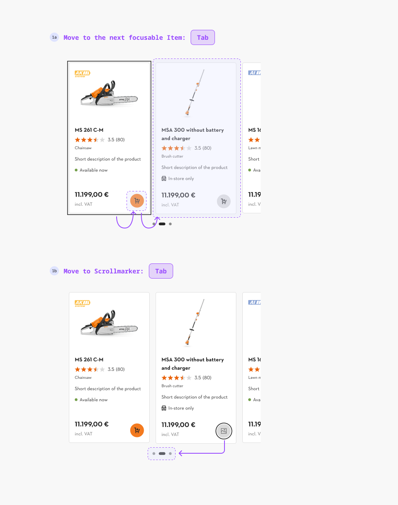

_Figure: A carousel component in a multi-item variant without navigation controls. The carousel shows three visible items, with the first two items being fully visible and the third item partially visible. The first callout, labeled "1a", points to the tab navigation moving to the next focusable item within the visible items in reading order. The second callout, labeled "1b", points to the tab navigation moving to the scrollmarker from the last visible interactive element. The carousel includes items such as a chainsaw, a brush cutter, and a lawn mower, each with details like product name, rating, description, availability, and price._

1. **Scrollmarker**
   1. Arrow Left / Right moves to Next / Previous Pages and move focus to the new active marker.
   1. Tab after using the arrow keys moves focus into the first interactive element of the active item
   1. Tab without having used the arrow keys leaves the Carousel.

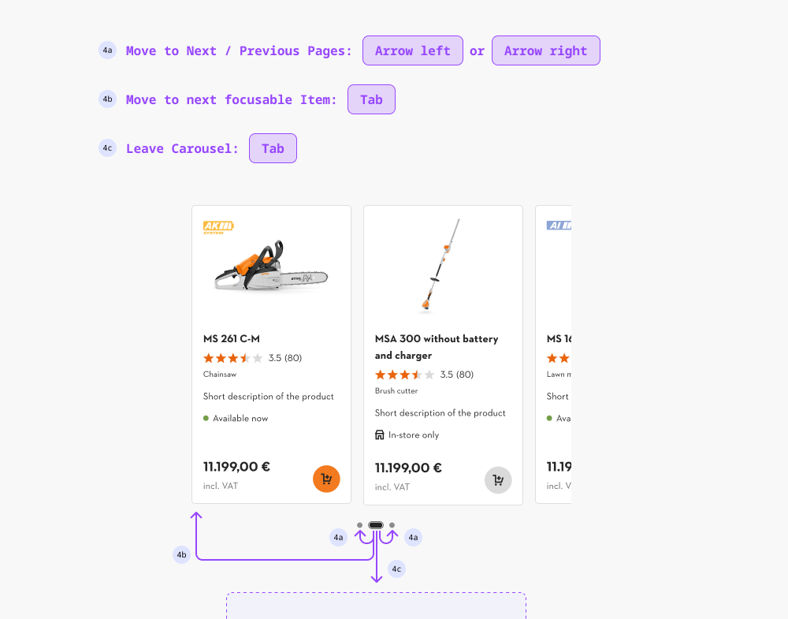

_Figure: A carousel component in a multi-item variant with three enabled items. The carousel shows products including a chainsaw, a brush cutter, and a lawn mower. Callout 4a indicates that the arrow left or arrow right keys move to the next or previous pages and focus on the new active marker. Callout 4b shows that pressing the tab key after using the arrow keys moves focus to the first interactive element of the active item. Callout 4c indicates that pressing the tab key without using the arrow keys leaves the carousel._

**Don’t make hidden Items reachable using keyboard navigation or expose them to assistive technologies.**

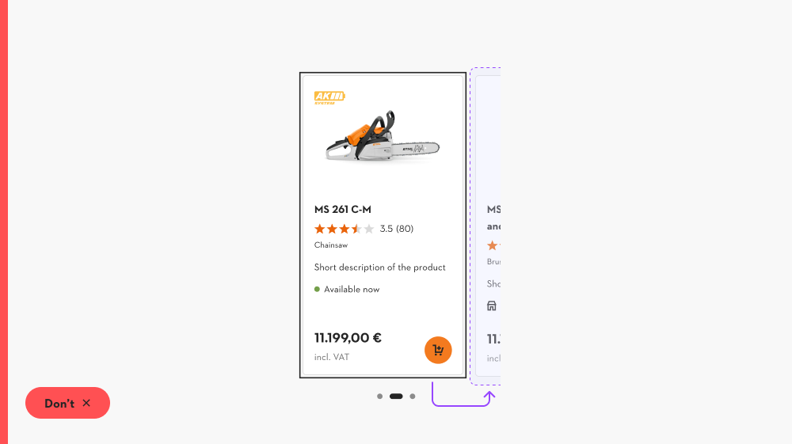

_Figure: A carousel component in a multi-item variant with navigation controls hidden. It displays three items: a chainsaw labeled "MS 261 C-M" with a price of "11.199,00 € incl. VAT", a brush cutter labeled "MSA 300 without battery and charger", and a lawn mower labeled "MS 162". The example is marked as a "Don't" because it makes hidden items unreachable using keyboard navigation and does not expose them to assistive technologies, which is incorrect as it limits accessibility._

### Motion

#### Reduce motion

Respect the user’s operating system Reduce Motion preference by minimizing or disabling animated transitions.

## Content and Assets 2/2

### Multi-Item Variant

The Multi-Item Carousel is designed to present a collection of related content. It supports repeatable Item structures that enable efficient browsing and comparison.

#### Item content

The Item supports compact, repeatable content. It may contain:

- Cards
- Media tiles
- Compact content blocks

_Figure: A carousel component in the multi-item variant with three visible items, designed for a layout breakpoint labeled "l". Each item in the carousel supports compact, repeatable content and includes elements such as cards and media tiles. The items contain titles, descriptions, and categorized tags like "People and Stories", "Backstage", and "Corporate Development", along with specific labels such as "Interview" and "Background Story"._

#### Recommended amount of Items

A Multi-Item Carousel should:

- Display 2–4 visible Items per page.
- Keep the total number of pages low to reduce navigation effort.

If additional pages are required, the Scrollmarker provides an optimized overflow variant for Carousels with more than 6 pages.

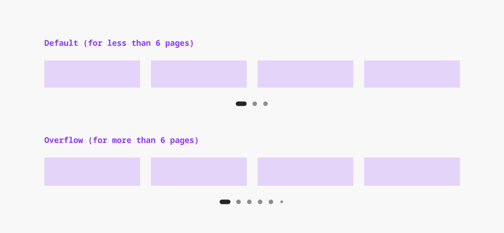

_Figure: A Multi-Item Carousel component with two states: "Default (for less than 6 pages)" and "Overflow (for more than 6 pages)." In both states, the carousel displays 2–4 visible Items per page. The Default state shows four visible items with a scrollmarker indicating additional pages, while the Overflow state also shows four visible items but includes an optimized scrollmarker for navigating more than six pages. The layout ensures that the total number of pages is kept low to reduce navigation effort._

#### Content consistency

Keep the overall visual structure consistent across all Items.

Consistent layouts help users focus on the changing content rather than adapting to changing compositions.

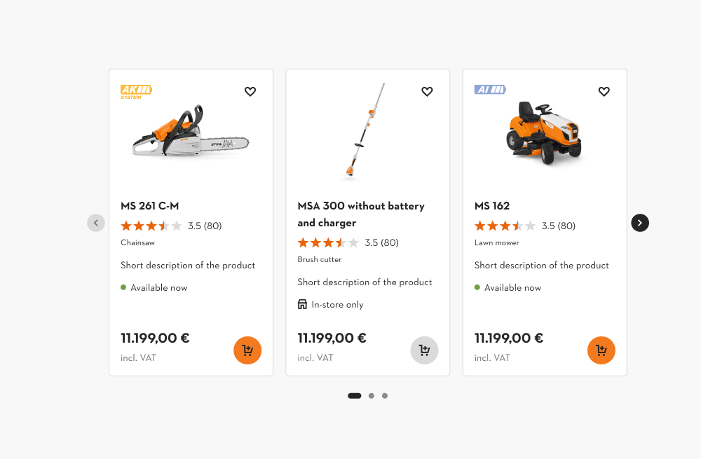

_Figure: A carousel component in a multi-item variant, showing three visible items with a peek at the next item. Each item in the carousel has a consistent layout, including product names such as "MS 261 C-M", "MSA 300 without battery and charger", and "MS 162". Each product listing contains a rating, product type, short description, availability status, and price including VAT. The layout ensures that users can focus on the changing content of each product without adapting to different compositions._

## Formatting and Construction 2/4

### Element details – Shared elements

The following elements form the shared foundation of both the Single-Item and Multi-Item Carousel variants. Their structure and behavior remain consistent across all recommended configurations.

#### Container

The container is the outermost wrapper of the Carousel. The container:

- defines the Carousel’s overall layout and boundaries.
- determines its placement within the surrounding page or grid.
- positions navigation elements either outside the viewport or inside as overlays.
- manages responsive behavior across different screen sizes.

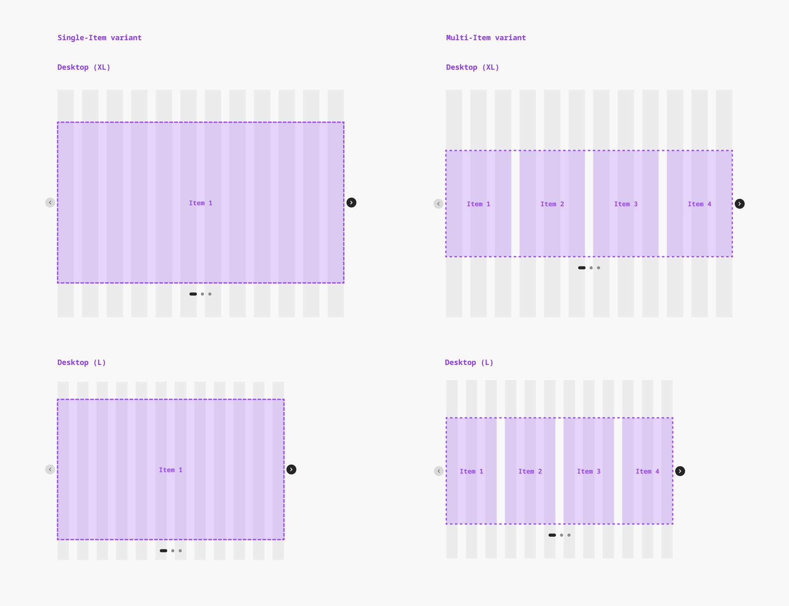

_Figure: Two variants of a Carousel component: the Single-Item variant and the Multi-Item variant. Each variant is shown at two different breakpoints labeled Desktop (XL) and Desktop (L), illustrating responsive behavior. The Single-Item variant shows one item at a time, while the Multi-Item variant shows four items. The left nav control is disabled, indicated by the state=disabled, and the right nav control is enabled, indicated by the state=enabled. The scrollmarker is set to 6=false. The containers define the overall layout and boundaries of the Carousel, positioning navigation elements either outside the viewport or inside as overlays._

#### Viewport

The viewport defines the visible area of the Carousel. The viewport:

- clips content outside the visible area (overflow: hidden).
- determines how many items are visible at a time.
- serves as the reference area for content movement.

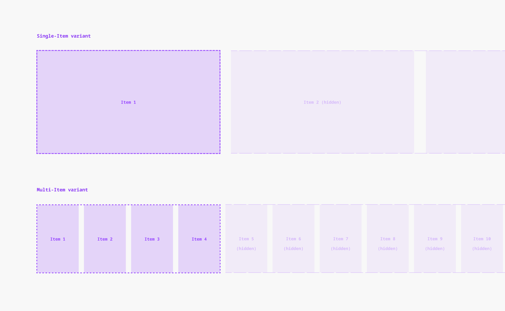

_Figure: Two variants of a carousel component: the Single-Item variant and the Multi-Item variant. In the Single-Item variant, only one item, labeled "Item 1," is visible, while "Item 2" is hidden. In the Multi-Item variant, four items, labeled "Item 1" through "Item 4," are visible, and items labeled "Item 5" through "Item 10" are hidden. The viewport defines the visible area of the carousel, clipping content outside this area and determining the number of items visible at a time._

#### Track

The track contains all items and moves within the viewport. The track:

- contains all items.
- manages their horizontal arrangement.
- controls the current position of the visible content.
- moves in response to user navigation, either through the Navigation Controls or via drag. Find more information under [Navigation Methods](https://www.figma.com/design/qXldpLO6gxHJNLdcXIPxYt?node-id=62753-23447)

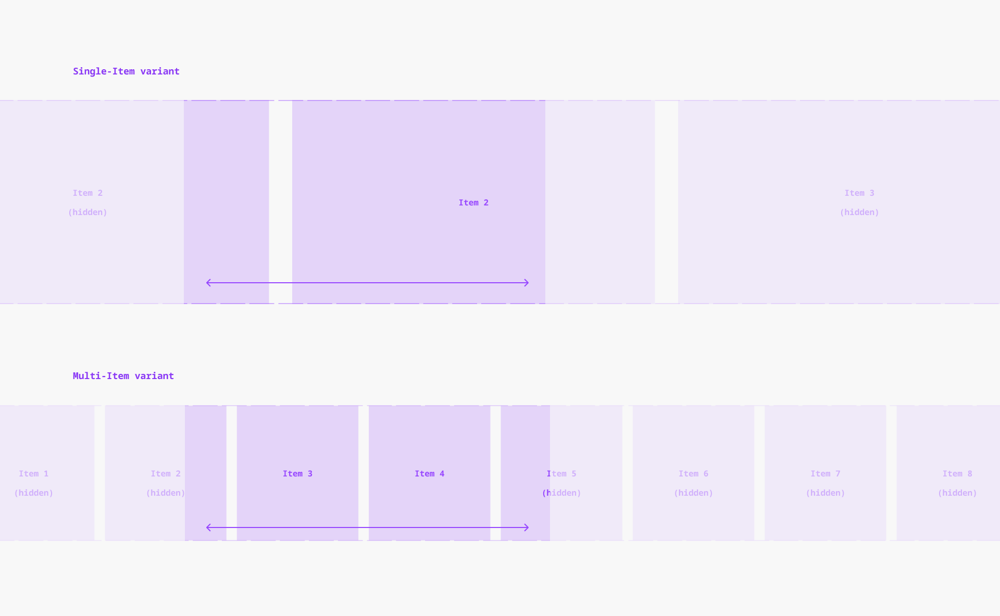

_Figure: Two variants of a carousel track component: Single-Item variant and Multi-Item variant. In the Single-Item variant, only one item is visible at a time, with adjacent items being hidden. In the Multi-Item variant, multiple items are visible within the viewport, while others are hidden. The track manages the horizontal arrangement of items and moves in response to user navigation._

#### Navigation Controls

The Navigation Controls provide sequential navigation through the Carousel. The Navigation Controls:

- are based on the Round Button component and inherit its appearance, states, behavior, and accessibility.
- use chevron icons to indicate the navigation direction.

**Variants**

1. **Filled** (Default for navigation controls positioned outside the Viewport) Used when Navigation Controls are positioned outside the viewport.
1. **Inverse** (Default for inside placement) Used when Navigation Controls are overlaid on media, imagery or dark canvas.

> Filled Inverse is currently based on the dark theme and subject to change as part of the future dark mode concept.

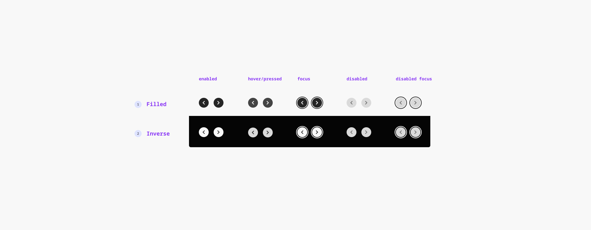

_Figure: The Navigation Controls component for a Carousel, showing two variants: Filled and Inverse. Each variant is depicted in five states: enabled, hover/pressed, focus, disabled, and disabled focus. The layout includes left and right chevron icons for each state and variant. Callout 1 points to the Filled variant, which is the default for navigation controls positioned outside the viewport. Callout 2 points to the Inverse variant, used when controls are overlaid on media, imagery, or a dark canvas._

#### Don’t mix Navigation Control variants within the same Carousel.

Use either Filled or Filled Inverse consistently. Navigation Control variants should remain the same throughout the Carousel and must not change during navigation.

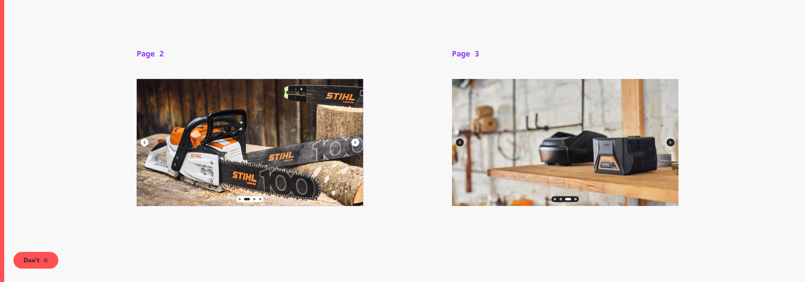

_Figure: A Carousel component with two visible items, labeled "Page 2" and "Page 3." The example is marked as a "Don't" because it mixes different Navigation Control variants within the same Carousel, which is inconsistent and should be avoided. The Carousel uses the single item variant and is in a layout for the large breakpoint._

#### Scrollmarker

The Scrollmarker indicates the current page within the Carousel and provides direct navigation. The Scrollmarker:

- indicates the user’s current page within the Carousel.
- allows users to navigate directly to a specific page.
- is clickable and keyboard focusable.
- supports Enabled, Hover, Focus, and Active states.
- not more than 5 rotations are recommended, but if needed an Overflow indicator can be used to indicate that more than than five pages are available.

**Variants**

1. **Ghost** (Default for placement below the Viewport) Used when the Scrollmarker is positioned outside the Viewport.
1. **Filled Inverse** (Default for inside placement and on dark canvas) Used when the Scrollmarker is positioned inside.
1. **Filled** (Special cases) Recommended on brighter images and light canvas that require additional contrast. Can also be used when the Carousel is placed on a colored background to improve visibility.

> **Temporary Color Token Definition** As an interim solution, the Scrollmarker colors are defined using Core Tokens. These will be migrated to Semantic Tokens as part of the future Dark Mode concept.

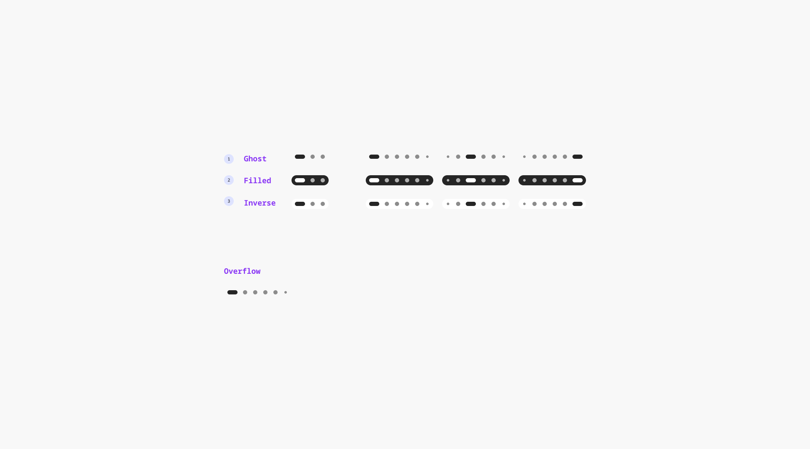

_Figure: The Scrollmarker component with three variants: Ghost, Filled, and Inverse. Each variant shows different states, including the active slide being the first, middle, or last. The numbered callouts point to the Ghost variant (1), the Filled variant (2), and the Inverse variant (3). The figure also includes an example of an Overflow indicator, showing that more than five pages are available._

#### Tap Zones

The Tap Zones provide additional touch interaction areas for sequential navigation. They:

- are invisible touch targets positioned on the left and right sides of the Carousel.
- allow users to navigate to the previous or next page by tapping either side of the Carousel.
- are intended for touch devices only.
- complement swipe gestures as an alternative navigation method.
- are not keyboard focusable and are not announced by assistive technologies.

_Figure: A Carousel component in the single item variant, displaying a placeholder item. The Carousel has invisible touch targets on the left and right sides, referred to as Tap Zones, which allow users on touch devices to navigate to the previous or next page by tapping either side. These Tap Zones are not keyboard focusable and are not announced by assistive technologies._

## Figma Implementation Notes

> The Figma component represents the recommended Carousel configurations. Some responsive behaviors cannot be automated in Figma and require manual adjustment when configuring the component. These adjustments represent the Figma components and should not be interpreted as limitations of the code component. The following notes describe these implementation-specific limitations.

### Peek requires manual adjustment

Peek is part of the supported Multi-Item configuration on smaller breakpoints. In Figma, its placement must currently be adjusted manually to represent the intended responsive layout.

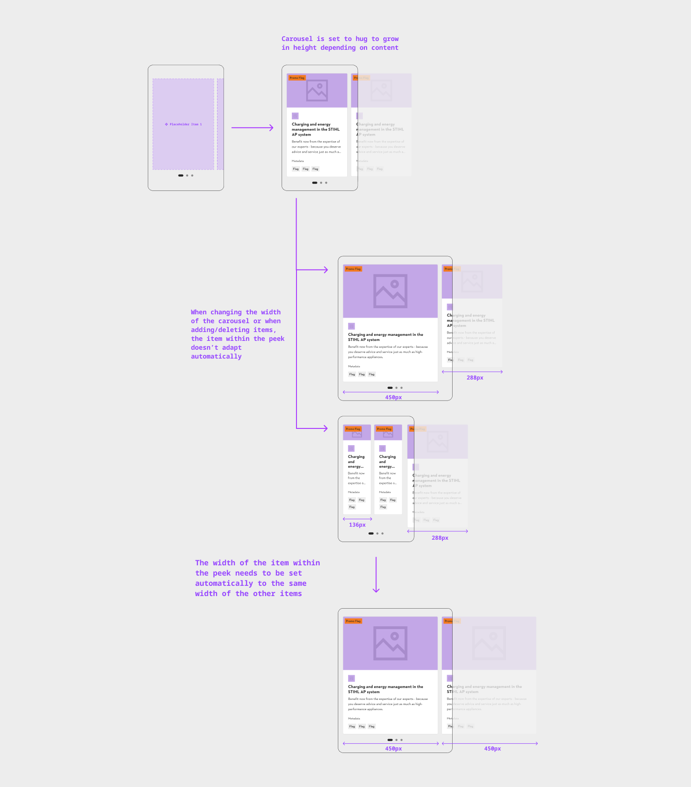

_Figure: A carousel component in a UI design system, specifically the "multi-item" variant on smaller breakpoints. The measurements 450px, 288px, and 136px refer to the widths of the visible items and the peek item within the carousel. The text explains that the width of the item within the peek needs to be manually adjusted to match the width of the other items, as it does not adapt automatically when the carousel width changes or items are added/deleted. The figure demonstrates the need for manual adjustment to ensure a consistent responsive layout._

### In Figma, Peek is represented using an overlay rather than clipping the Track.

This is a Figma-specific implementation technique and does not define the implementation behavior of the code component.

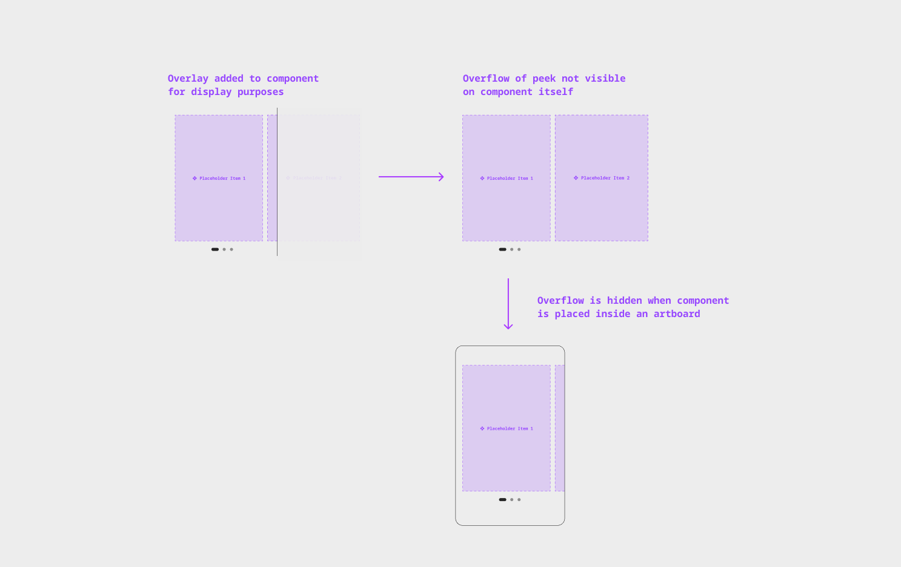

_Figure: A carousel component in the multi-item variant and small breakpoint, demonstrating how peek items are represented in Figma using an overlay. The first part shows an overlay added to the component for display purposes, indicating that the overflow of peek items is not visible on the component itself. The second part shows the component inside an artboard, where the overflow is hidden. The text labels "Placeholder Item 1," "Placeholder Item 2," "Placeholder Item 3," and "Placeholder Item 4" indicate different items within the carousel._

## Formatting and Construction 3/4

### Element details – Single-Item Variant

The following element details are specific to the Single-Item Carousel variant.

#### Item

The Item represents the primary content of the Single-Item Carousel. The Item:

- is displayed as one item per page.
- occupies the full width of the Viewport.
- supports complex content such as images, media, content blocks, or promotional layouts.

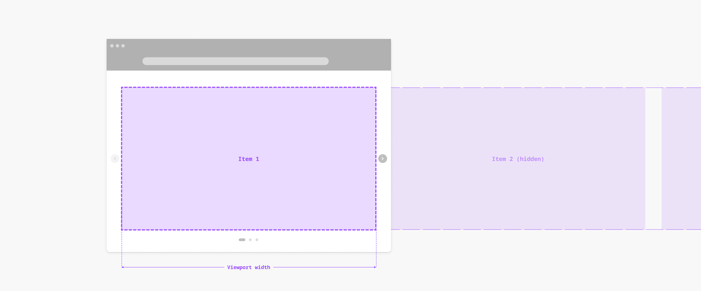

_Figure: A Single-Item Carousel component in its single item variant. It shows one visible item labeled "Item 1" occupying the full width of the viewport, while "Item 2" is hidden. The viewport width measurement indicates the full width available for displaying the carousel item._

**Do keep all Items the same height.**

Using a consistent Item height prevents layout shifts during navigation and creates a stable, predictable browsing experience.

_Figure: A Carousel component in the single item variant with two visible items and a peek of the next item. Both Item 1 and Item 2 are the same height, which is correct because keeping all items the same height prevents layout shifts during navigation. This creates a stable, predictable browsing experience._

**Don’t mix Items with different heights.**

Items with varying heights cause layout shifts, reduce visual consistency, and disrupt the browsing experience.

_Figure: A carousel component in the single item variant with two items, Item 1 and Item 2, of different heights. The layout includes a peek slot and visible items slot, and it is marked as a "Don't" example. Items with varying heights cause layout shifts, reduce visual consistency, and disrupt the browsing experience._

#### Item Aspect Ratio

Aspect ratios can be used flexibly.

**Recommended aspect ratios**

- Desktop: 16:9
- Tablet: 4:3, 3:2, 16:9
- Mobile: 3:4, 1:1, 16:9

_Figure: The Carousel component with various aspect ratios for different device breakpoints. For Desktop, the recommended aspect ratio is 16:9. For Tablet, the recommended aspect ratios are 4:3, 3:2, and 16:9. For Mobile, the recommended aspect ratios are 3:4, 1:1, and 16:9. Each aspect ratio is shown within a single item variant of the carousel, demonstrating how the items appear on different screen sizes._

**Don’t use aspect ratios that push the Carousel content or Scrollmarkers below the fold.**

_Figure: A Carousel component in the single item variant with a layout that pushes the content and Scrollmarkers below the fold. The aspect ratio of the Carousel item is too tall, causing the content to extend beyond the visible area of the screen. This is marked as a "Don't" example because it violates the guideline of not pushing the Carousel content or Scrollmarkers below the fold._

## Formatting and Construction 4/4

### Element details – Multi-Item Variant

The following element details are specific to the Multi-Item Carousel variant.

#### Item

The Item represents the primary content of the Multi-Item Carousel. The Item:

- is displayed together with other Items within the Viewport.
- supports repeatable content such as cards, media tiles, or similar compact content blocks.
- is displayed in configurable numbers across breakpoints.
- is arranged to evenly fill the available Viewport width.

_Figure: A Multi-Item Carousel component with the variant "multi item" at the "l" breakpoint. It shows four visible items labeled "Item 1" through "Item 4" within the viewport, each occupying "1/x Viewport width." The remaining items labeled "Item 5 (hidden)" through "Item 9 (hidden)" are outside the viewport and not visible. The items are arranged to evenly fill the available viewport width._

**Do keep all Items the same height.**

Using a consistent Item height prevents layout shifts during navigation and creates a stable, predictable browsing experience.

_Figure: A carousel component in the multi-item variant with a consistent height for all items. Items 1 through 4 are visible, while Items 5 through 9 are hidden. The text next to the figure indicates that keeping all items the same height is a recommended practice to prevent layout shifts during navigation and to create a stable, predictable browsing experience. The board is marked as a "Do" example, signifying that this layout is correct._

**Don’t mix Items with different heights.**

Items with varying heights cause layout shifts, reduce visual consistency, and disrupt the browsing experience.

_Figure: A carousel component in the multi-item variant with a breakpoint labeled as "l". It displays five visible items labeled "Item 1" through "Item 4" and "Item 5 (hidden)" through "Item 9 (hidden)", indicating that some items are not fully visible. The example is marked as a "Don't" because it mixes items with different heights, which causes layout shifts, reduces visual consistency, and disrupts the browsing experience. The callouts point to the items within the carousel, highlighting the inconsistency in their heights._

#### Peek

The Peek provides an affordance that indicates additional content is available and encourages horizontal browsing. The Peek:

- partially reveals the next Item at the right edge of the Viewport and encourages users to continue browsing.
- is primarily used on touch devices.
- adapts to the configured Item width and layout.
- should occupy approximately 10% of the Container width.

_Figure: A carousel component in a multi-item variant, showing a peek feature on a touch device. The peek partially reveals the next item at the right edge of the viewport, occupying approximately 10% of the container width. The measurement label "10%" indicates the width of the peek area, which is the portion of the next item visible at the right edge. The text "❖ Placeholder Item 1" represents the currently visible item, while "❖ Placeholder Item 2", "❖ Placeholder Item 3", and "❖ Placeholder Item 4" are subsequent items in the carousel._
