# Carousel

## Carousel

**Definition:**

- A carousel is an interactive UI pattern that sequentially displays multiple pieces of content

**Characteristics**

- Displays content sequentially within a limited viewport
- Supports user-controlled navigation
- One or multiple items visible depending on the variant
- Provides multiple navigation methods depending on device and configuration
- Supports touch and keyboard interaction

The Carousel is available in two variants:

**Single-Item Carousel – Variant**

- One item visible per page
- Storytelling & media focused

**Multi-Item Carousel – Variant**

- Multiple items visible per page
- Browsing & discovery focused

**When to use**

**Single-Item Carousel – Variant → Storytelling / Promotion** When content is to be presented sequentially.

- Stage / Hero content
- Banners
- Image / media carousel
- Marketing messages
   - Campaigns
   - Promotions

**Multi-Item Carousel – Variant → Content Browsing** When users are supposed to browse through several similar pieces of content.

- Content teasers
   - Article lists
- Product lists
- Recommendations
- Related content
- Feature overviews / Tools

- Limited Space: When the layout area is limited, but multiple pieces of content exist. (Mobile interfaces, cards within a container)

**When not to use**

- Critical information
- Primary conversion elements
- Comparable content (use Grid/List)
- Image galleries (see Related patterns)

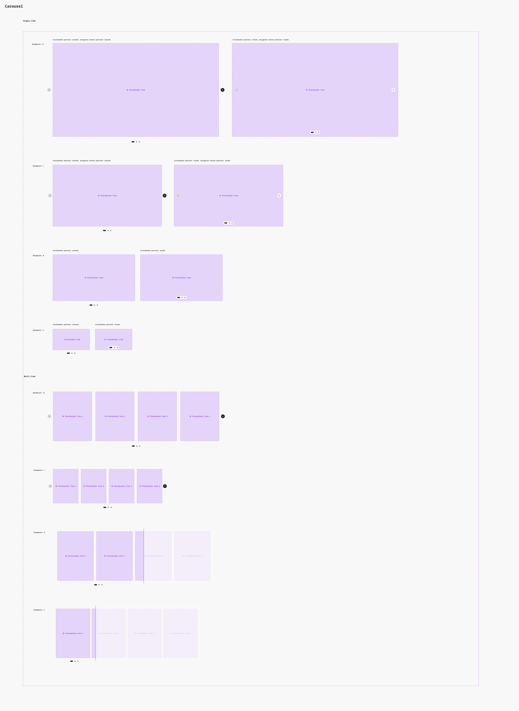

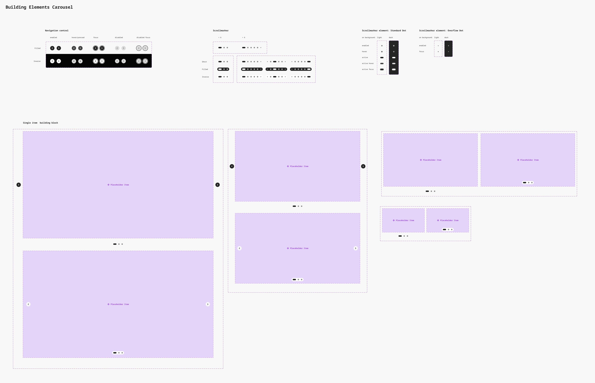

### Further guidelines

[Storybook documentation](https://release-1-0-0-rc-52--63440bbb95889041542a5ba3.chromatic.com/?path=/docs/components-carousel--documentation)

### Related components and patterns

**Gallery** A gallery is a layout pattern for the structured presentation of multiple visual elements (e.g., images or videos) where all content is visible and directly accessible at the same time – in contrast to a carousel, which displays content sequentially.

### Related elements

[Product Card](https://www.figma.com/design/qXldpLO6gxHJNLdcXIPxYt?node-id=57309-25979)

[Round Button](https://www.figma.com/design/qXldpLO6gxHJNLdcXIPxYt?node-id=168-4016)

### Out of scope

- Autoplay
- Infinite carousel
- Vertical carousel
- Gallery pattern

### Contribute

Contribute to improving this component by sharing your feedback, asking questions, or suggesting features [here](https://www.figma.com/design/lLmw7PfIdKjFG4uT3B2Hyj/Onboarding-%F0%9F%93%96?node-id=446-868&t=zKmRu4kAkxMeRDmK-4).

## Touchscreen Device Considerations

Carousels should remain easy to use across touch-enabled devices and support intuitive, gesture-based navigation. Touch interactions should feel natural, responsive, and never interfere with the user’s ability to browse content.

### Primary Interaction

**Swipe gestures** are the primary navigation method on touch devices and should provide a smooth, direct, and predictable browsing experience.

Users should be able to interrupt, reverse, or continue swipe gestures at any time without unexpected behavior.

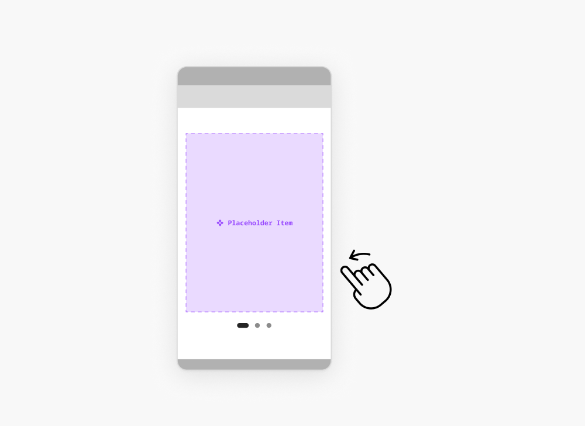

### Secondary Navigation

Secondary navigation methods improve discoverability and provide alternative ways to navigate through the Carousel.

**Tap Zones**

- Provide an alternative navigation method for touch interaction.
- Navigate to the previous or next page depending on the activated zone.
- Complement swipe gestures rather than replace them.

**Scrollmarker**

- Indicate the user’s current position within the Carousel.
- Allow direct navigation to a specific page.
- Improve discoverability by making additional content visible.

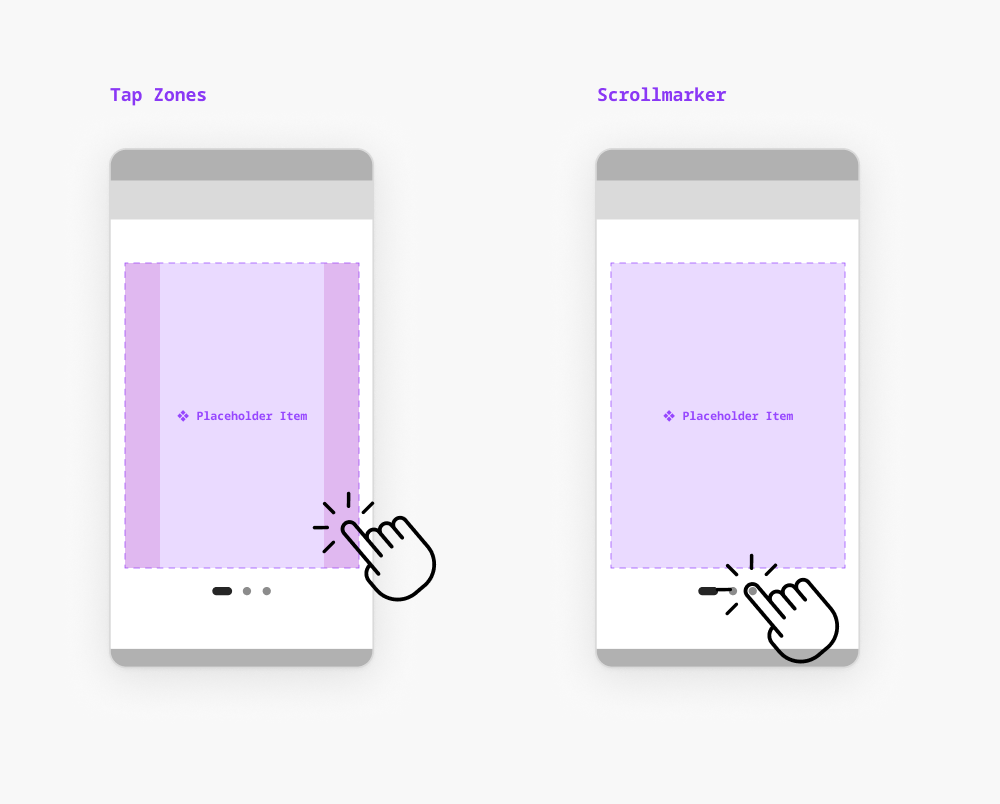

### Touch Experience

#### Large Touch Targets

Interactive elements such as tap zones and Scrollmarkers should provide sufficiently large touch targets to support comfortable and accurate interaction. The visible size of an element may be smaller than its interactive touch target.

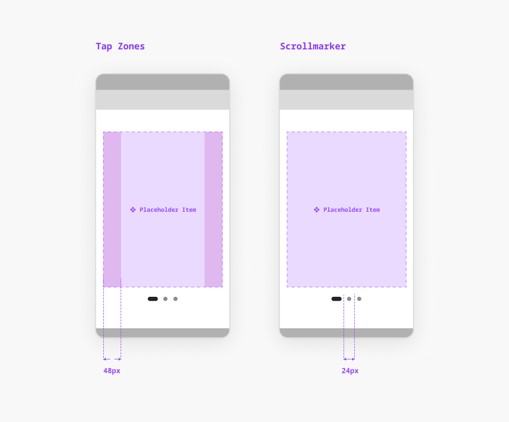

#### Clear Navigation Feedback

Users should always be able to understand:

- Their current position
- Wether additional content is available
- How to navigate

This can be achieved through Scrollmarkers and Peek.

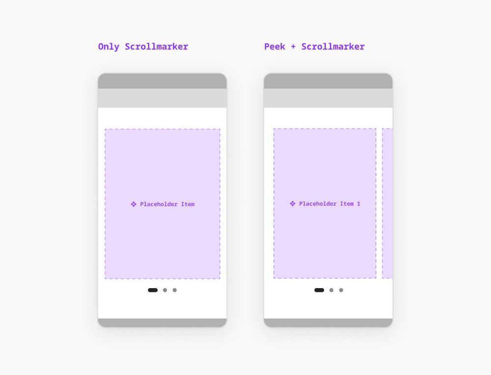

#### Avoid gesture conflicts

Horizontal swipe interactions should not interfere with vertical page scrolling. Users should always be able to continue scrolling the page naturally.

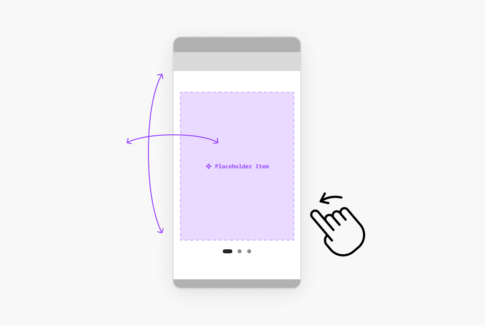

#### No Hover States

Hover interactions are not available on touch devices.

Ensure that all essential information and actions remain accessible without hover.

> This section describes general touchscreen design principles. Detailed guidance on layouts, responsive behavior, component behavior, motion, and accessibility is documented in the corresponding sections throughout this documentation.

## Formatting and Construction 1/4

### Anatomy

The Carousel consists of two variants: Single-Item and Multi-Item. Both share the same foundational elements but differ in layout, content, and interaction patterns.

#### Single-Item Variant

**Usage:** one item at the center

**Desktop**

1. **Container**
1. **Viewport**
1. **Track**
   1. **one item visible**
   1. **n items hidden** (1-4 items recommended)
1. **Navigation Controls**
   1. **Previous**
   1. **Next**
1. **Scrollmarker**

See [Element Details – Shared Elements](https://www.figma.com/design/qXldpLO6gxHJNLdcXIPxYt?node-id=61435-1965) for a detailed description of each element.

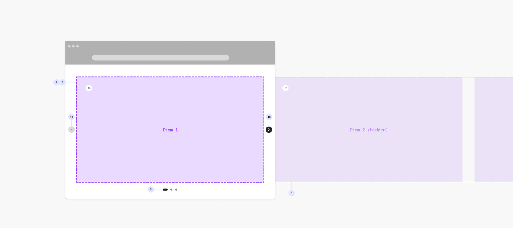

**Mobile**

1. **Container**
1. **Viewport**
1. **Track**
   1. **one item visible**
   1. **n items hidden** (1-4 items recommended)
1. **Scrollmarker**
1. **Tap zones** (for touch devices)
   1. **Previous**
   1. **Next**

See [Element Details – Shared Elements](https://www.figma.com/design/qXldpLO6gxHJNLdcXIPxYt?node-id=61435-1965) for a detailed description of each element.

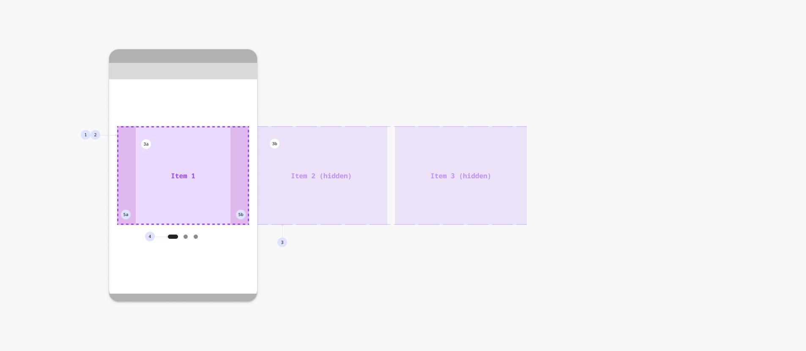

#### Multi-Item Variant

**Usage:** multiple items can be viewed simultaneously

**Desktop**

1. **Container**
1. **Viewport**
1. **Track**
   1. **n items visible** (2-4 items recommended)
   1. **n items hidden** (depending on amount of items in the viewport. Users should not need more than 1–2 rotations to see all items.)
1. **Navigation Controls** (touch devices optional, desktop recommended)
   1. **Previous**
   1. **Next**
1. **Scrollmarker**

See [Element Details – Shared Elements](https://www.figma.com/design/qXldpLO6gxHJNLdcXIPxYt?node-id=61435-1965) for a detailed description of each element.

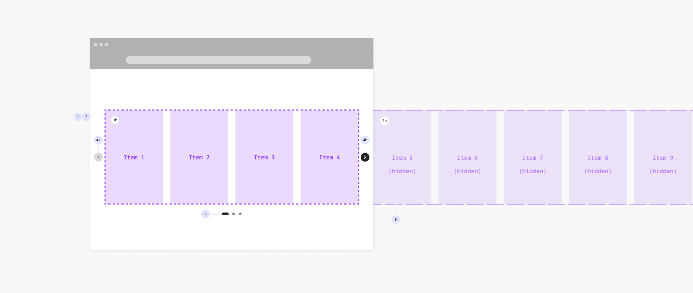

**Mobile**

1. **Container**
1. **Viewport**
1. **Track**
   1. **n items visible** (2-4 items recommended)
   1. **n items hidden** (depending on amount of items in the viewport. Users should not need more than 1–2 rotations to see all items.)
   1. **Peek** (optional, touch devices recommended)
1. **Tap zones** (touch devices recommended)
   1. **Previous**
   1. **Next**
1. **Scrollmarker**

See [Element Details – Shared Elements](https://www.figma.com/design/qXldpLO6gxHJNLdcXIPxYt?node-id=61435-1965) for a detailed description of each element.

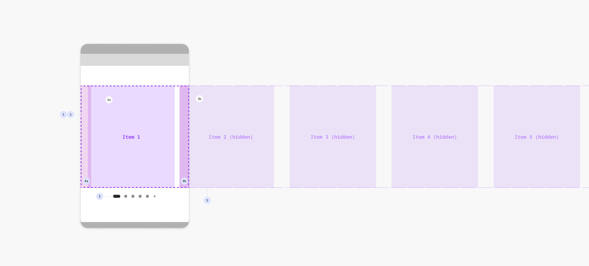

## Content and Assets 1/2

### Single-Item Variant

The Single-Item Carousel is designed to present one primary piece of content per page. It supports rich, visually engaging content while keeping the user’s attention focused on a single message.

#### Item content

The Item supports rich and flexible content. It may contain:

- Images
- Media
- Content blocks
- Complex layouts

**Do use one clear primary message per Item.**

Each Item should communicate a single idea or call to action to help users quickly understand the content.

**Don’t combine multiple competing messages within a single Item.**

Avoid competing call to action as they reduce clarity and make the content more difficult to scan.

#### Recommended amount of pages

A Single-Item Carousel should:

- Display 1–5 pages.
- Keep the total number of pages low to reduce navigation effort.
- Ensure users can reach all content without excessive navigation.

If additional pages are required, the Scrollmarker provides an optimized overflow variant for Carousels with more than 6 pages.

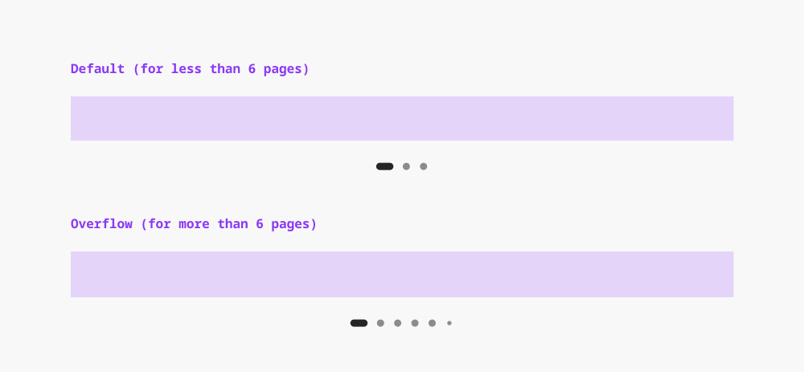

#### Content consistency

Keep the overall visual structure consistent across all Items.

Consistent layouts help users focus on the changing content rather than adapting to changing compositions.

## Supported configurations

> **Implementation Note** The Carousel component exposes additional configuration options through its API. While many combinations are technically possible, the Design System defines and supports only the configurations documented on this page. Configurations outside these recommendations have no defined spacing, alignment, or positioning and are not reviewed for design consistency or accessibility. If your product requires a configuration that is not documented here, contact the Design System team. New configurations can be added when validated by a product use case. Go [here](https://www.figma.com/design/lLmw7PfIdKjFG4uT3B2Hyj/Onboarding-%F0%9F%93%96?node-id=446-868&t=zKmRu4kAkxMeRDmK-4) for contact options.

The Carousel supports a wide range of navigation and Scrollmarker configurations. These configurations are based on validated product use cases and should be preferred over custom combinations.

Configurations in Code can be viewed [here](https://release-1-0-0-rc-52--63440bbb95889041542a5ba3.chromatic.com/iframe.html?args=&viewMode=story&id=templates-carousel--vrt).

### Configuration: Single-Item – Navigation Controls Outside, Scrollmarker Outside

Optimized for presenting one primary piece of content with persistent navigation.

#### Specifications

**Variant**

Single-Item

**Navigation Control Variant**

Filled

**Navigation Control Position**

Outside (XL-L) Hidden (M-S)

**Scrollmarker Variant**

Ghost

**Scrollmarker Position**

Outside

**Tap Zones**

False (Pointer) True (Touch)

**Drag**

True (Pointer) False (Touch)

**Swipe**

False (Pointer) True (Touch)

**Peek**

No

**Items per View**

1

**Items per Navigation Step**

1

**Placement**

Main Content Area

**Layout**

Grid

**Responsive:** Navigation Controls are visible from breakpoint L and hidden below L.

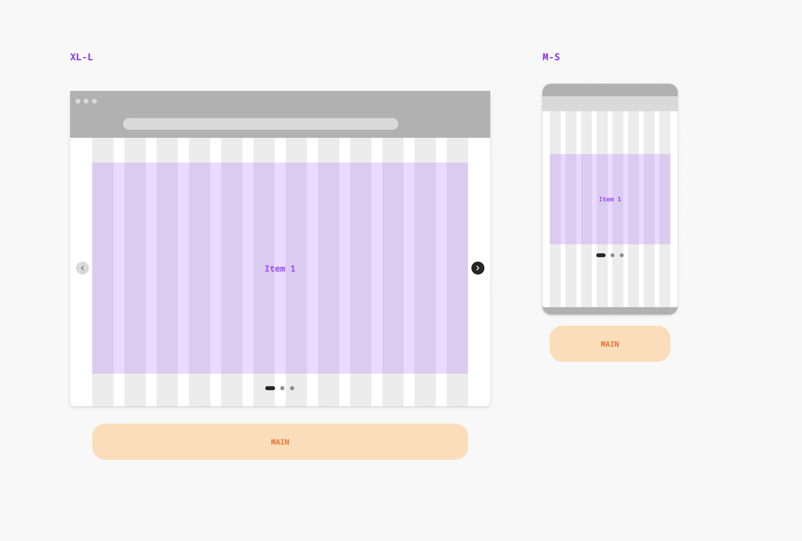

#### Example

My STIHL

**Recommended for**

- Hero stages
- Campaigns
- Promotions
- Marketing messages

### Configuration: Single-Item – Navigation Controls Inside, Scrollmarker Inside

Optimized for presenting one primary piece of content with persistent navigation.

#### Specifications

**Variant**

Single-Item

**Navigation Control Variant**

Inverse

**Navigation Control Position**

Inside (XL-L) Hidden (M-S)

**Scrollmarker Variant**

Inverse

**Scrollmarker Position**

Inside

**Tap Zones**

False (Pointer) True (Touch)

**Drag**

True (Pointer) False (Touch)

**Swipe**

False (Pointer) True (Touch)

**Peek**

No

**Items per View**

1

**Items per Navigation Step**

1

**Placement**

Main Content Area

**Layout**

Grid

**Responsive:** Navigation Controls are visible from breakpoint L and hidden below L.

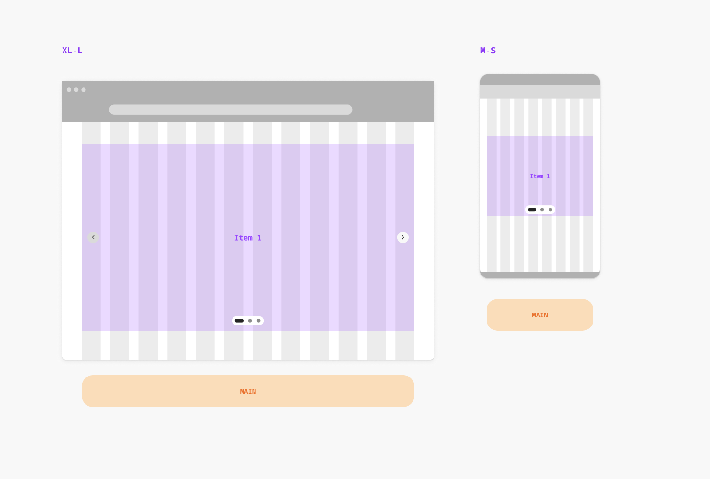

#### Example

Image Carousel

**Recommended for**

- Image based Carousels with reduced elements

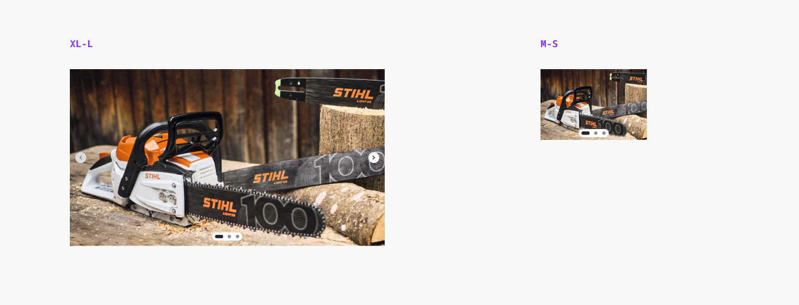

### Configuration: Multi-Item – Navigation Controls Outside, Scrollmarker Outside

Optimized for presenting multiple related Items that users can browse, compare, and discover.

#### Specifications

**Variant**

Multi-Item

**Navigation Control Variant**

Filled

**Navigation Control Position**

Outside (XL-L) Hidden (M-S)

**Scrollmarker Variant**

Ghost

**Scrollmarker Position**

Outside

**Drag**

True (Pointer) False (Touch)

**Swipe**

False (Pointer) True (Touch)

**Peek**

Responsive

**Items per View**

Configurable per breakpoint

**Items per Navigation Step**

Configurable

**Placement**

Main Content Area (XL-L) Extended Content Area (M-S)

**Layout**

Grid Main (XL-L) Grid Extended (M-S)

**Responsive:** Navigation Controls are visible from breakpoint L and hidden below L. Peek is enabled for the supported smaller-breakpoint configuration.

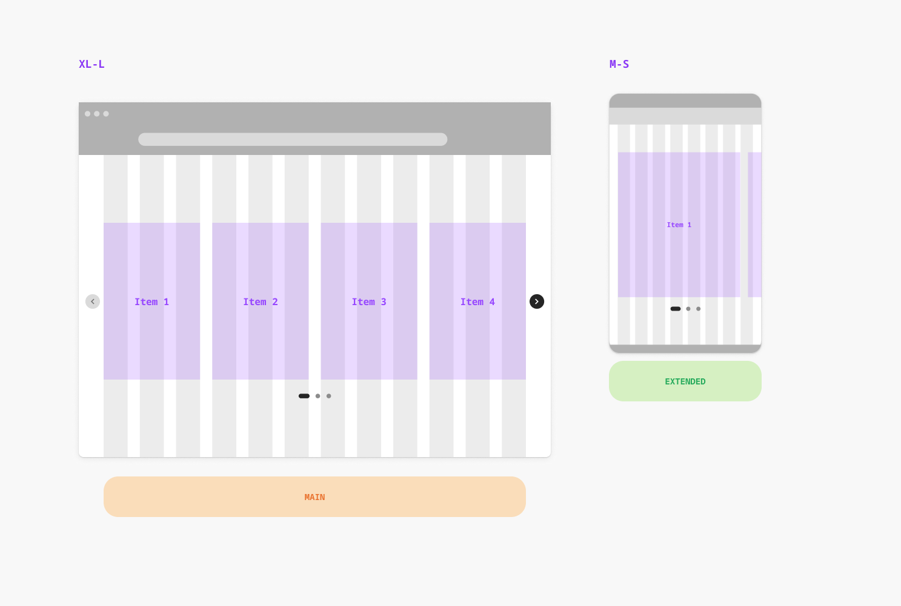

#### Example

My STIHL

**Recommended for**

- Product categories
- Product recommendations
- Related products
- Inspirational content collections

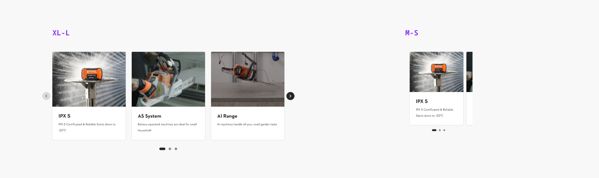

### Configuration: Single-Item Embedded – Navigation Controls Hidden, Scrollmarker Inside

Optimized for presenting a single piece of media within another component or layout while minimizing visual distraction.

#### Specifications

**Variant**

Single-Item

**Navigation Control Position**

Hidden

**Scrollmarker Variant**

Filled Inverse

**Scrollmarker Position**

Inside

**Drag**

True (Pointer) False (Touch)

**Swipe**

False (Pointer) True (Touch)

**Peek**

No

**Items per View**

1

**Items per Navigation Step**

1

**Placement**

Defined by parent component / layout (e.g. Product Card; visit the [Figma component](https://www.figma.com/design/qXldpLO6gxHJNLdcXIPxYt?node-id=57309-25979) or [Storybook](https://release-1-0-0-rc-52--63440bbb95889041542a5ba3.chromatic.com/?path=/docs/templates-cards-product-card-in-grid--documentation) for more details)

**Layout**

Flex

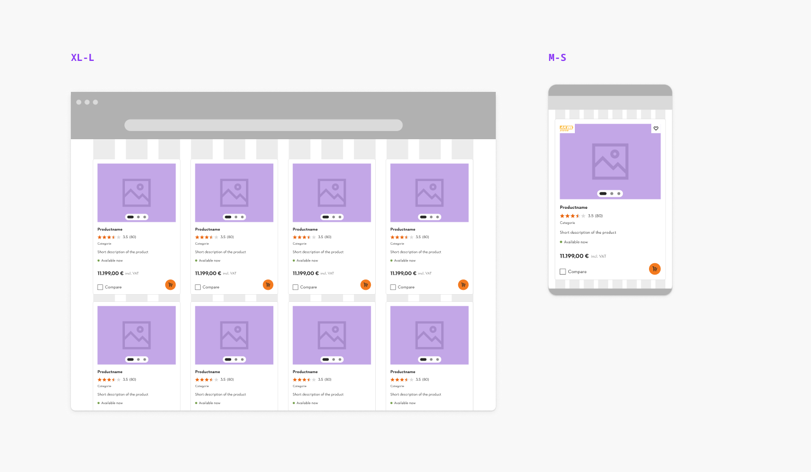

#### Example

STIHL.de: Product Grid

**Recommended for**

- Product image galleries
- Media within Product Cards

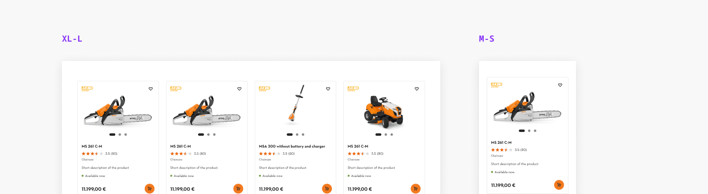

## Responsive Layout

### Responsive Behaviour

The following tables summarize how each supported Carousel configuration adapts across breakpoints. Interaction methods may additionally vary depending on the user's input method.

#### Configuration: Single-Item — Navigation Controls Outside, Scrollmarker Outside

**XL - L**

**M - S**

**Navigation Controls**

Visible, position outside

Hidden

**Scrollmarker**

Outside

**Items per view**

1

**Peek**

No

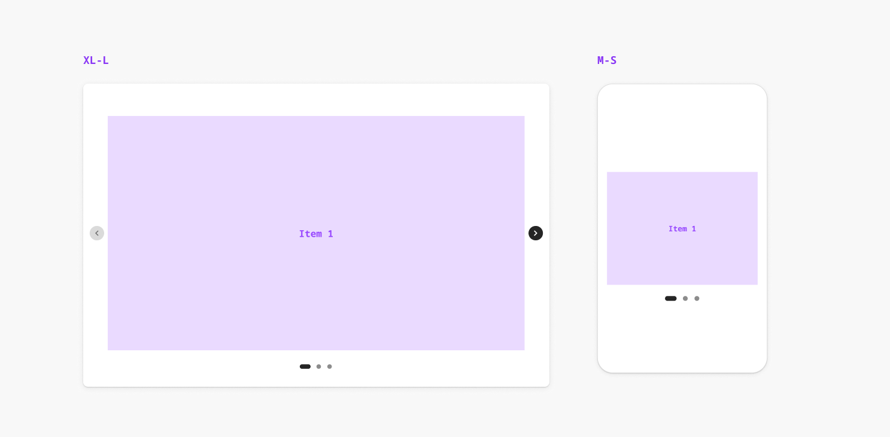

#### Configuration: Single-Item — Navigation Controls Inside, Scrollmarker Inside

**XL - L**

**M - S**

**Navigation Controls**

Visible, position inside

Hidden

**Scrollmarker**

Inside

**Items per view**

1

**Peek**

No

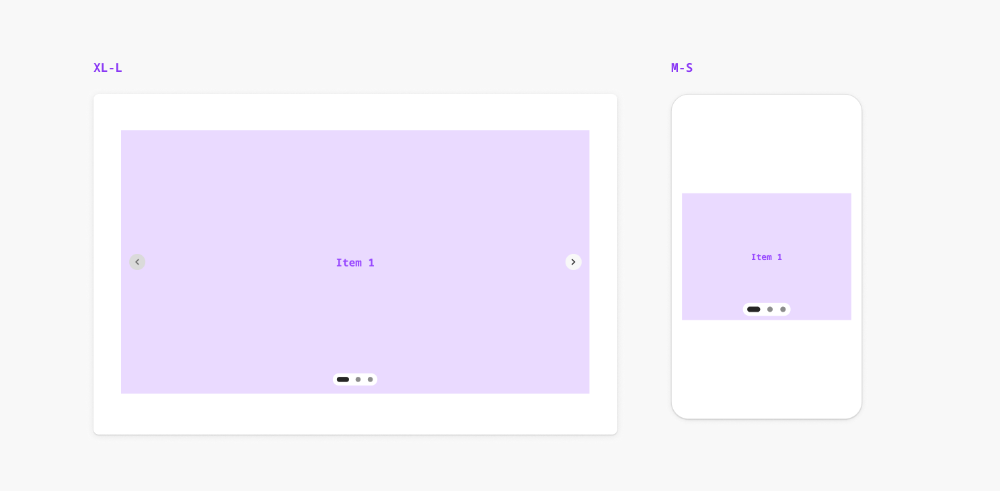

#### Configuration: Multi-Item — Navigation Controls Outside, Scrollmarker Outside

**XL - L**

**M - S**

**Navigation Control**

Visible, position outside

Hidden

**Scrollmarker Position**

Outside

**Items per View**

Breakpoint-dependent

**Peek**

No

Yes

> The number of Items per View can be configured independently for each breakpoint. The number of Hidden Items adapts automatically based on the total number of Items.

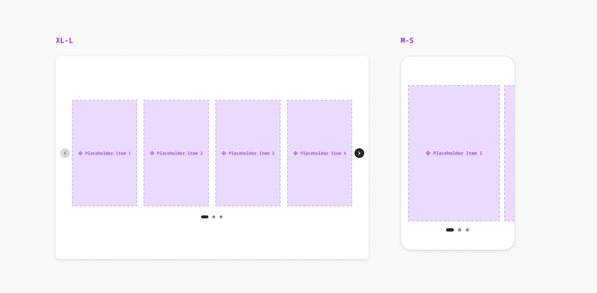

#### Configuration: Single-Item Embedded — Navigation Controls Hidden, Scrollmarker Inside

**X - L**

**M - S**

**Navigation Controls**

Hidden

**Scrollmarker**

Inside

**Items per view**

1

**Peek**

No

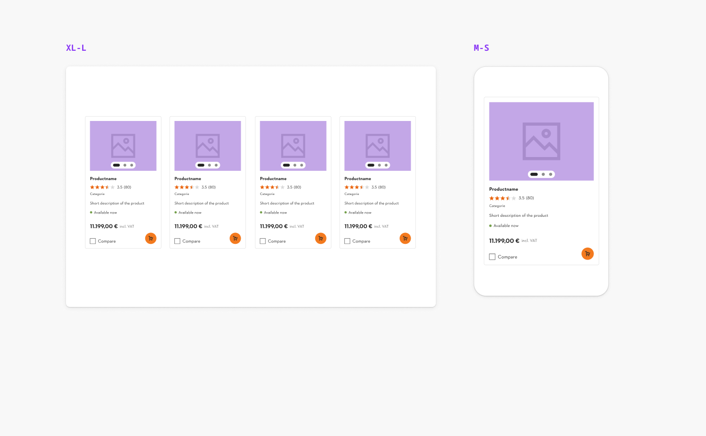

### Sizing

The Carousel adapts to the available layout while maintaining consistent proportions and usability across breakpoints. The following recommendations define the supported sizing behavior for each variant.

#### Multi-Item

**Width**

- The number of visible Items can adapt per breakpoint.
- Item width is calculated automatically based on the number of visible Items.
- Items evenly divide the available Viewport width.
- Spacing between Items follows the breakpoint-specific spacing tokens.

**Item sizing**

- Item dimensions are defined by the embedded component (e.g. Card or Media Tile).
- All visible Items should use consistent dimensions within the same Carousel.

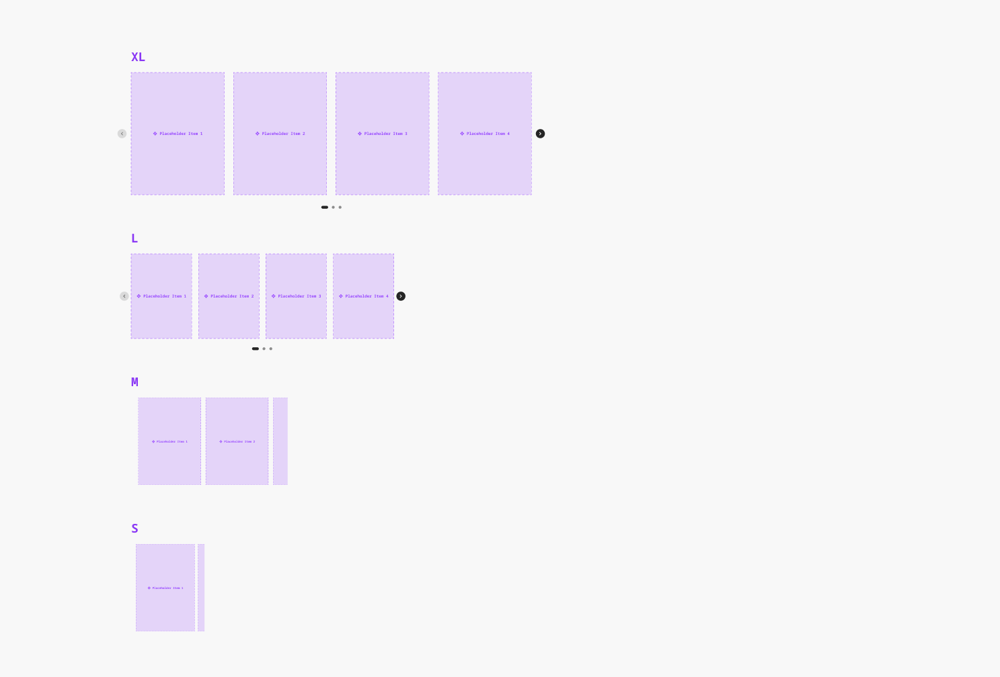

#### Minimum Width

The minimum supported Carousel width is 176px. Carousels are not supported below this width, as the available space is insufficient to provide a usable browsing experience.

## Behavior

The Carousel supports multiple navigation methods to provide a consistent browsing experience across pointer and touch input. Available navigation methods depend on the selected configuration and input method.

### Navigation Methods

#### Page-based navigation

1. **Single-Item:**
- Displays one Item per page.
- Each navigation step moves exactly one page.

1. **Multi-Item:**
- Displays multiple Items per page.
- Each navigation step moves one complete page.

Page-based navigation is the default. Item-based is configurable but not the standard approach.

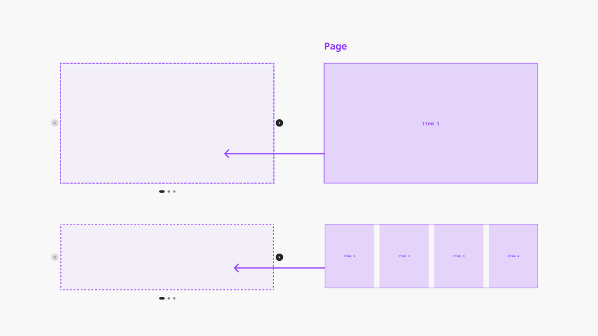

#### Navigation Controls

- Navigate sequentially to the previous or next page.
- Become disabled at the beginning and end of the Carousel (they are still focusable).

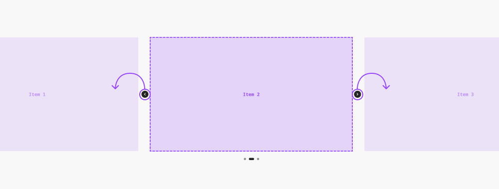

#### Scrollmarker

- Indicate the current page.
- Allow direct navigation to a specific page.

#### Drag

- Allows users to navigate by dragging the Carousel horizontally with pointer input.
- Moves to the previous or next page based on the drag direction.

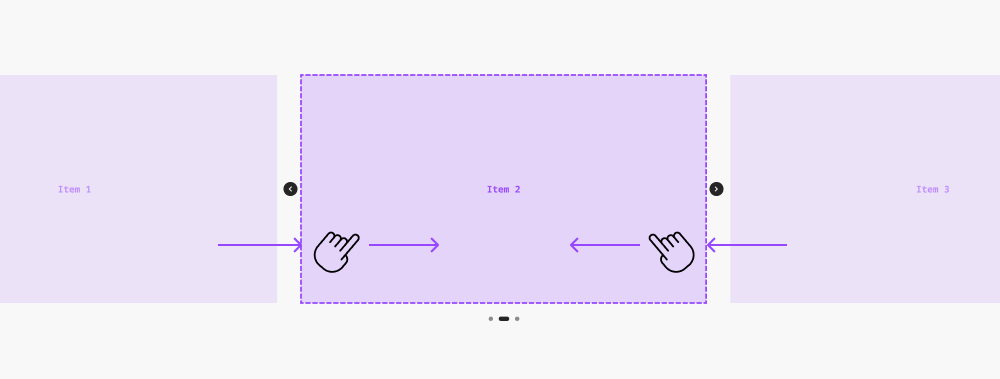

Please find the navigation behavior with touch input [here](https://www.figma.com/design/qXldpLO6gxHJNLdcXIPxYt?node-id=61435-1831).

### End Behaviour

- Carousels do not loop infinitely.
- Navigation stops at the first and last page.
- Navigation Controls become disabled when no further content is available (they are still focusable).

### Consistency

**Do use one navigation style consistently throughout a Carousel.**

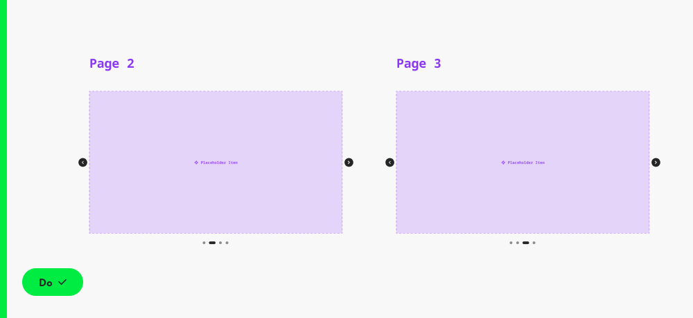

**Don’t switch Navigation Control and Scrollmarker placement within the same Carousel.**

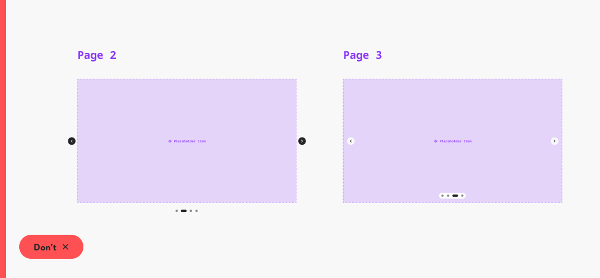

### Nested swipe behaviour

**Don’t use nested Carousels or place Carousels inside horizontally swipeable containers.**

Nested swipe behavior is discouraged because it's technically unstable and can cause issues, particularly on mobile devices. As a result, it's not supported by the Design System.

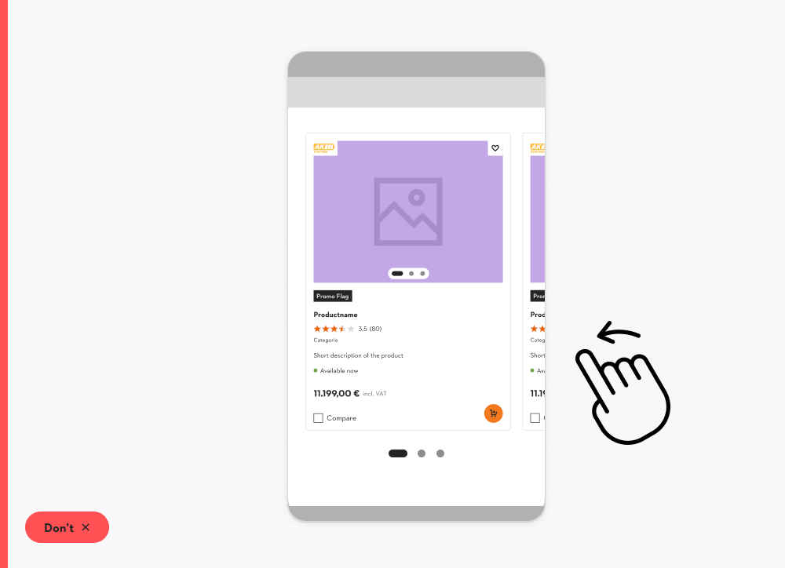

## Motion

The Carousel uses motion to communicate navigation while maintaining orientation and visual continuity. Transitions should feel smooth, predictable, and never distract from the content.

### Motion Specifications

- **Transition:** Slide
- **Duration:** 700ms
- **Easing:** Ease Out – cubic-bezier (0, 0, 0.5, 1)

### Motion Principles

- Motion should not cause layout shifts.
- The visible layout remains stable throughout the transition.
- Only the Track moves; surrounding UI elements remain fixed.
- By default, the Track transitions one page at a time.

### Drag Motion

- During dragging, the Track follows the pointer movement directly.
- When the drag is released, the Track settles on the appropriate page.
- The settling transition uses the defined Carousel easing.
- Surrounding UI elements remain fixed during the interaction.

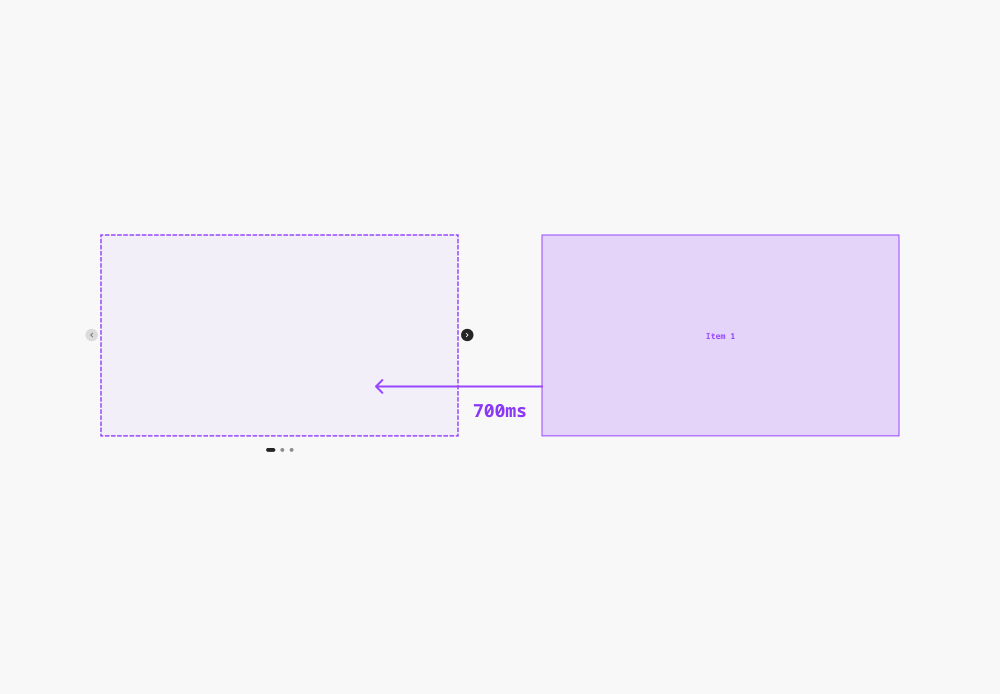

## Accessibility

### Keyboard Interaction

The Carousel must be fully operable using a keyboard. Users must be able to navigate, operate, and exit the Carousel without requiring a pointing device.

#### Keyboard requirements

- All visible interactive elements within the Carousel are keyboard accessible, including Navigation Controls, Scrollmarkers, and interactive elements within visible Items.
- All keyboard-accessible elements provide a visible focus indicator.
- Interactive elements expose an appropriate accessible name, role, and value.
- Keyboard focus never moves to hidden Items.
- Navigating between pages must not move keyboard focus automatically.

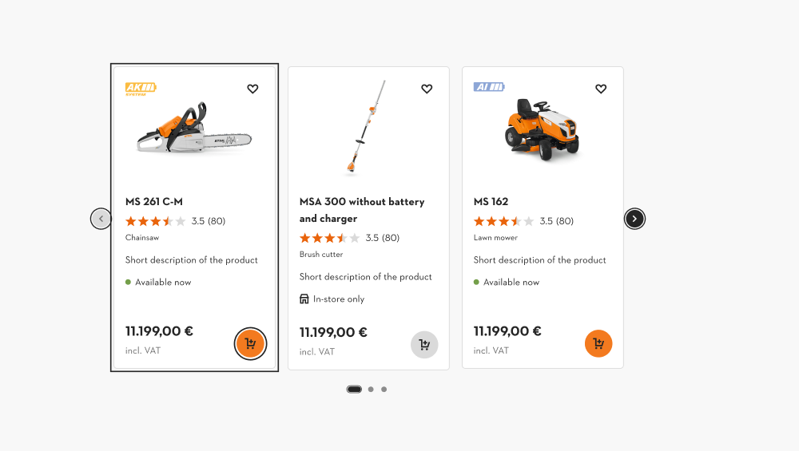

### Screen Reader Support

The Carousel must fully support Screen Readers using a keyboard. Users must be able to navigate, operate, and exit the Carousel with the Screen Readers support.

#### Carousel Semantics

The Carousel must be exposed as a landmark region using appropriate ARIA semantics.

#### Accessible Name

The Carousel must announce the accessible name of the currently focused Item or interactive element.

#### Position Information

The Carousel must announce the current page and position (for example, “Item 2 of 5” or “Items 1 – 4 of 12”).

#### Accessible Interactive Content

The Carousel must allow the user to access the interactive content within the Items (i.e. buttons).

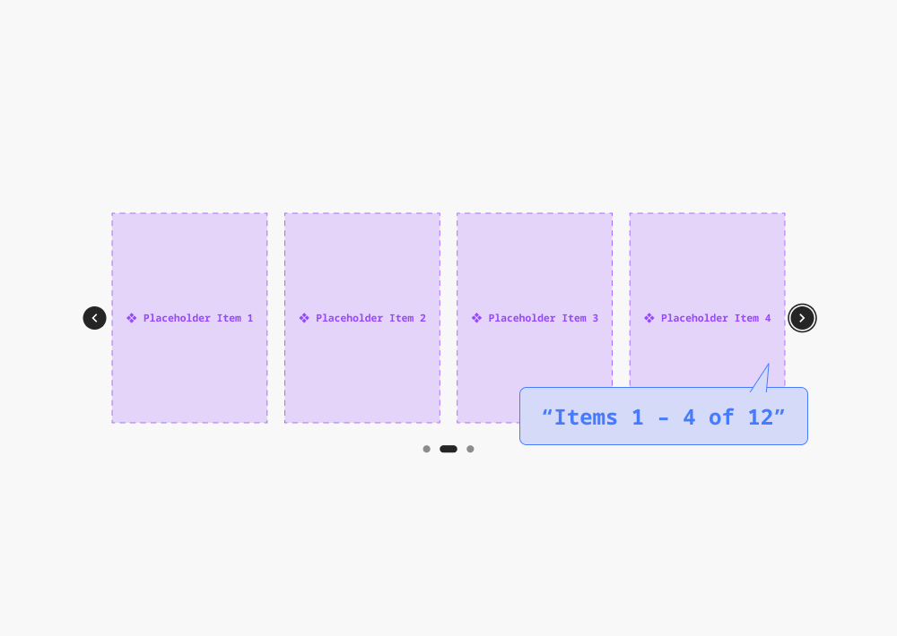

### Focus Order

#### General principles

- Maintain a logical and predictable keyboard focus order.
- Do not move keyboard focus automatically when the Carousel changes pages.
- Only interactive elements within visible Carousel items may receive keyboard focus.
- Hidden Carousel items must not be keyboard accessible or exposed to assistive technologies.
- After activating a Carousel control, keep focus on the activated control until the user moves it.

#### Configuration with Navigation Controls

1. **Visible Item(s)**
   1. Tab moves to the next Items / interactive elements inside the visible Items, in reading order
   1. Tab moves to Previous Navigation Control from the last visible interactive element.

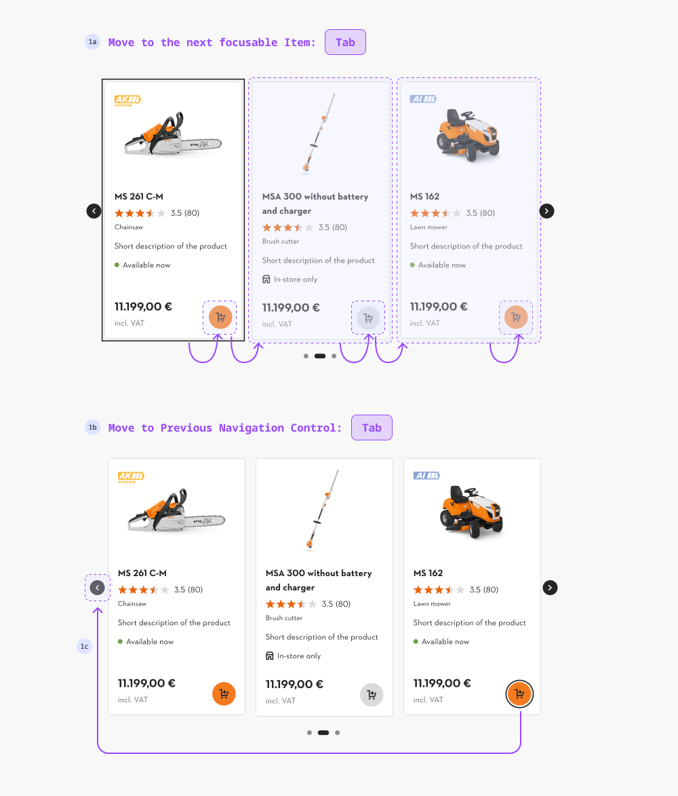

1. **Previous Navigation Control**
   1. Enter moves to the previous page while retaining focus on the control.
   1. Arrow Left / Right moves to the previous / next pages
   1. Tab moves to the Next Navigation Control

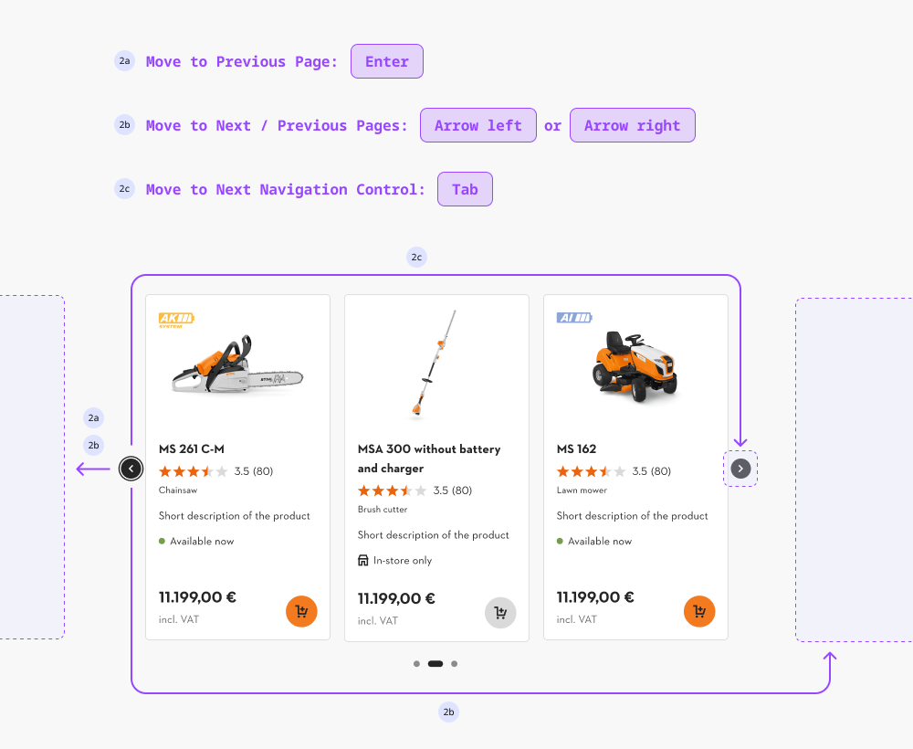

1. **Next Navigation Control**
   1. Enter moves to the next page while retaining focus on the control.
   1. Arrow Left / Right moves to the previous / next pages
   1. Tab moves to the Scrollmarker

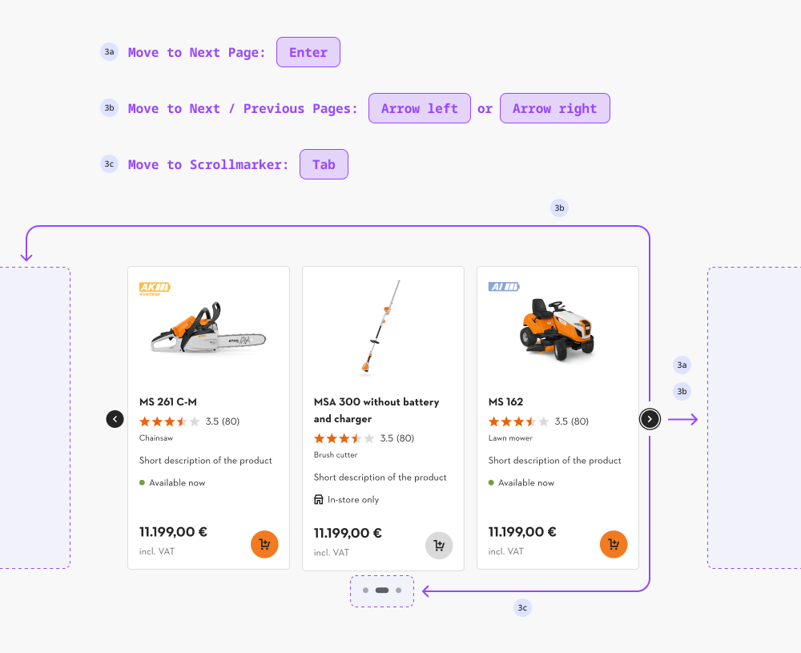

1. **Scrollmarker**
   1. Arrow Left / Right moves to Next / Previous Pages and move focus to the new active marker.
   1. Tab after using the arrow keys moves focus into the first visible Item / interactive element of the first visible Item
   1. Tab without having used the arrow keys leaves the Carousel.

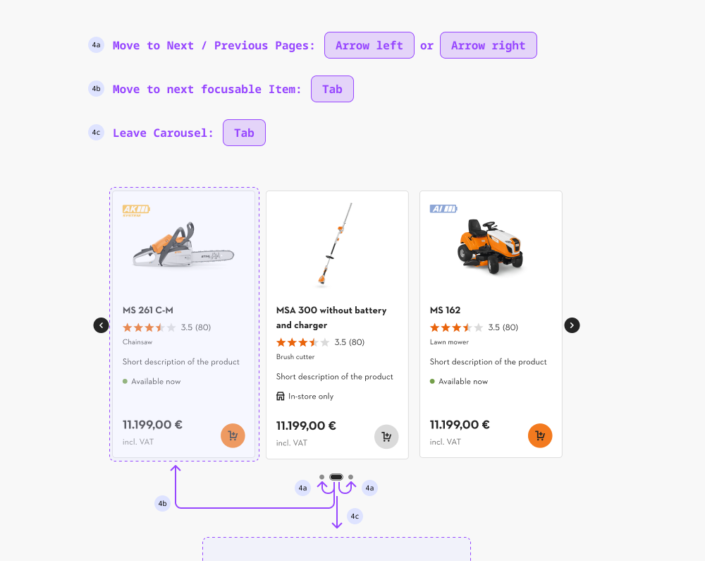

#### Configuration without Navigation Controls

1. **Visible Item(s)**
   1. Tab moves to the next Items / interactive elements inside the visible Items, in reading order
   1. Tab moves to the Scrollmarker from the last visible interactive element.

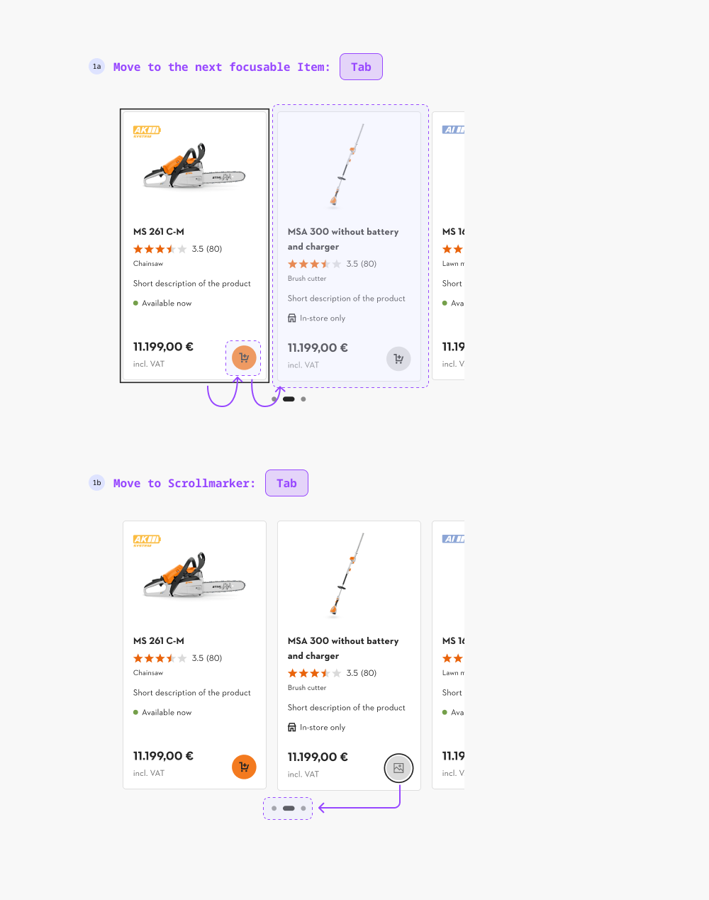

1. **Scrollmarker**
   1. Arrow Left / Right moves to Next / Previous Pages and move focus to the new active marker.
   1. Tab after using the arrow keys moves focus into the first interactive element of the active item
   1. Tab without having used the arrow keys leaves the Carousel.

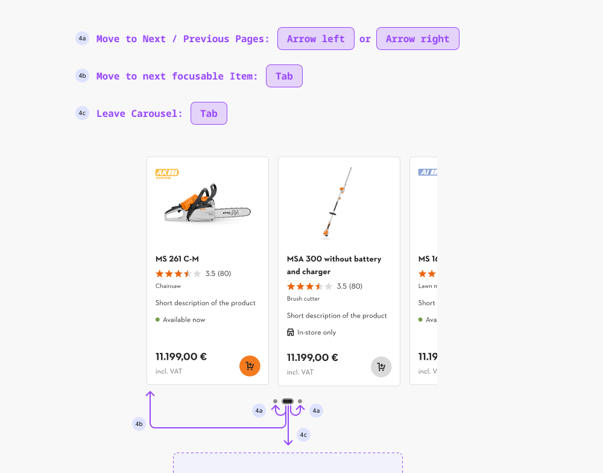

**Don’t make hidden Items reachable using keyboard navigation or expose them to assistive technologies.**

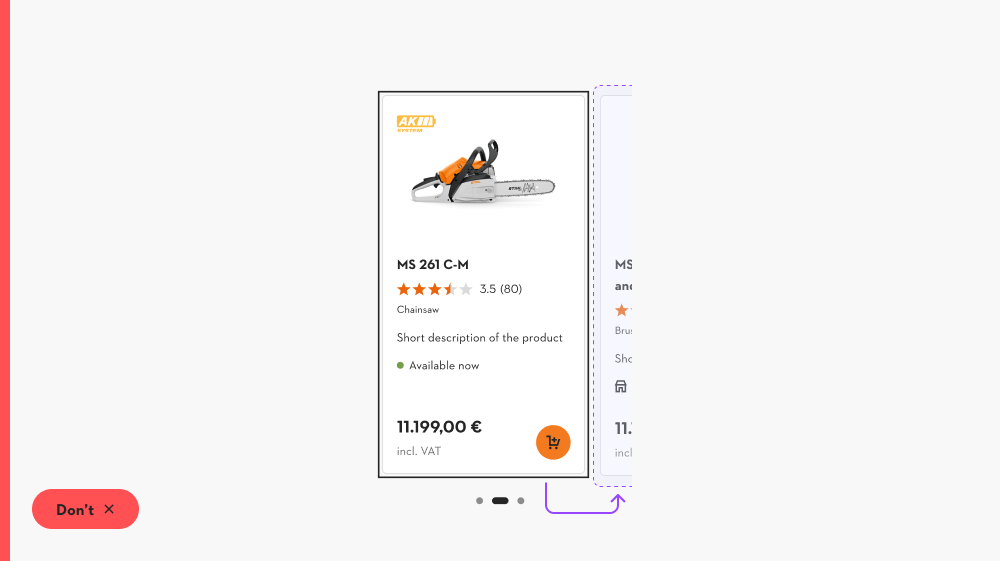

### Motion

#### Reduce motion

Respect the user’s operating system Reduce Motion preference by minimizing or disabling animated transitions.

## Content and Assets 2/2

### Multi-Item Variant

The Multi-Item Carousel is designed to present a collection of related content. It supports repeatable Item structures that enable efficient browsing and comparison.

#### Item content

The Item supports compact, repeatable content. It may contain:

- Cards
- Media tiles
- Compact content blocks

#### Recommended amount of Items

A Multi-Item Carousel should:

- Display 2–4 visible Items per page.
- Keep the total number of pages low to reduce navigation effort.

If additional pages are required, the Scrollmarker provides an optimized overflow variant for Carousels with more than 6 pages.

#### Content consistency

Keep the overall visual structure consistent across all Items.

Consistent layouts help users focus on the changing content rather than adapting to changing compositions.

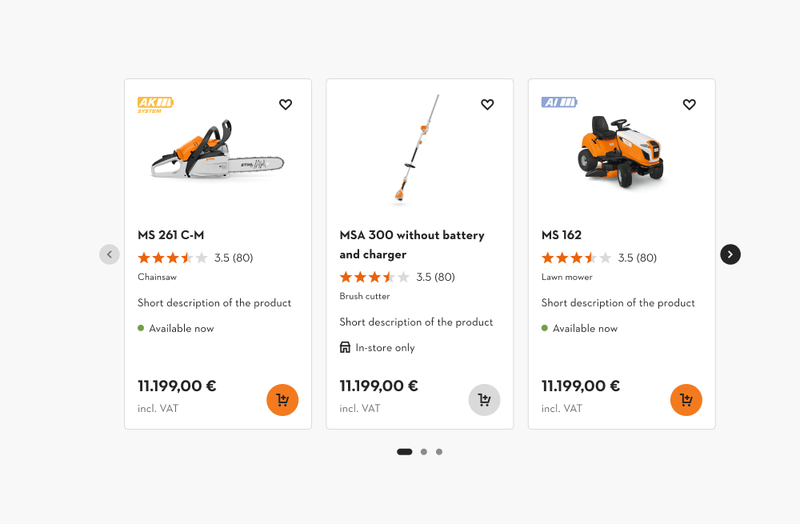

## Formatting and Construction 2/4

### Element details – Shared elements

The following elements form the shared foundation of both the Single-Item and Multi-Item Carousel variants. Their structure and behavior remain consistent across all recommended configurations.

#### Container

The container is the outermost wrapper of the Carousel. The container:

- defines the Carousel’s overall layout and boundaries.
- determines its placement within the surrounding page or grid.
- positions navigation elements either outside the viewport or inside as overlays.
- manages responsive behavior across different screen sizes.

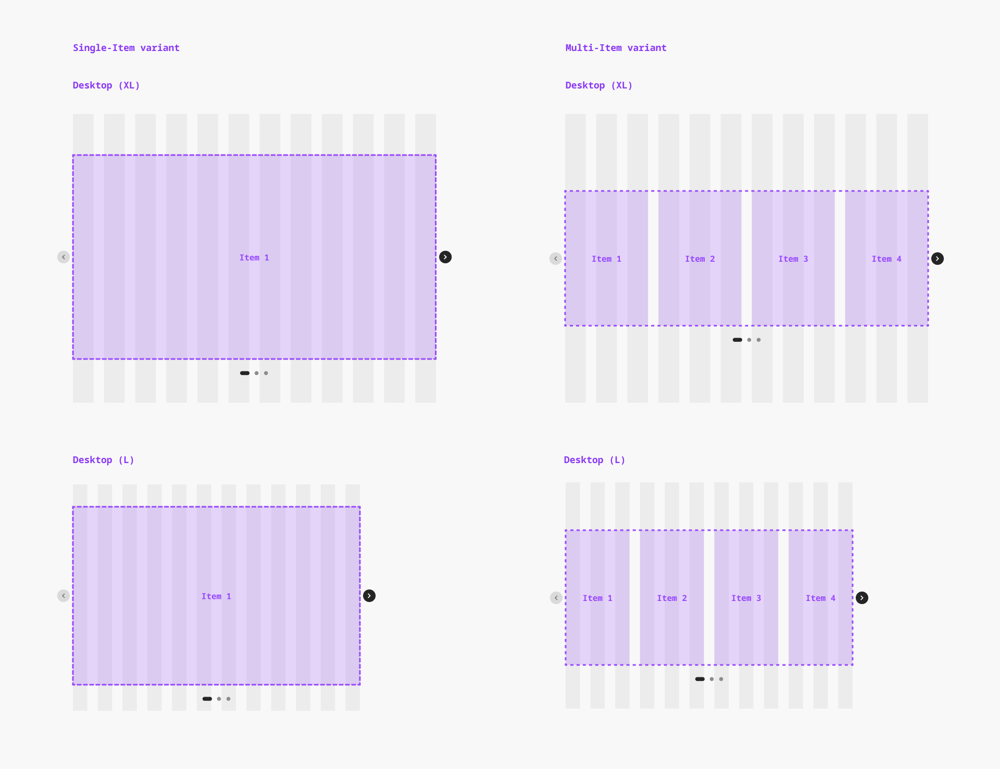

#### Viewport

The viewport defines the visible area of the Carousel. The viewport:

- clips content outside the visible area (overflow: hidden).
- determines how many items are visible at a time.
- serves as the reference area for content movement.

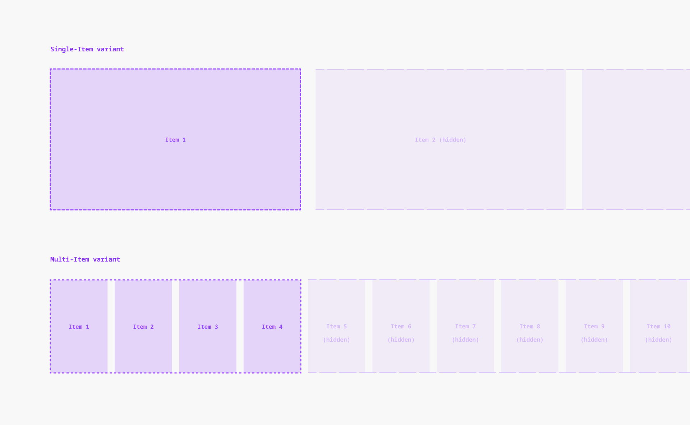

#### Track

The track contains all items and moves within the viewport. The track:

- contains all items.
- manages their horizontal arrangement.
- controls the current position of the visible content.
- moves in response to user navigation, either through the Navigation Controls or via drag. Find more information under [Navigation Methods](https://www.figma.com/design/qXldpLO6gxHJNLdcXIPxYt?node-id=62753-23447)

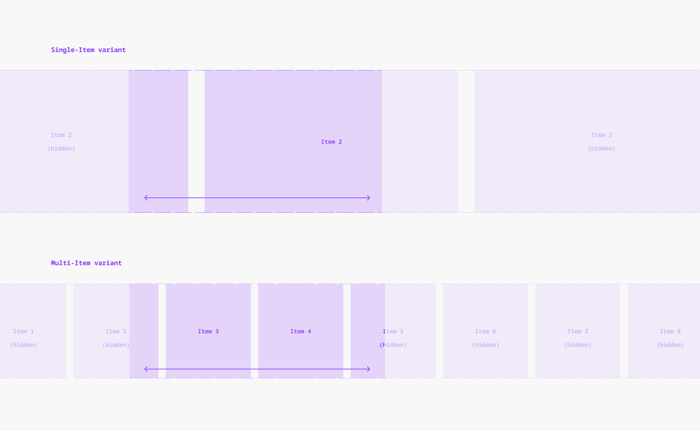

#### Navigation Controls

The Navigation Controls provide sequential navigation through the Carousel. The Navigation Controls:

- are based on the Round Button component and inherit its appearance, states, behavior, and accessibility.
- use chevron icons to indicate the navigation direction.

**Variants**

1. **Filled** (Default for navigation controls positioned outside the Viewport) Used when Navigation Controls are positioned outside the viewport.
1. **Inverse** (Default for inside placement) Used when Navigation Controls are overlaid on media, imagery or dark canvas.

> Filled Inverse is currently based on the dark theme and subject to change as part of the future dark mode concept.

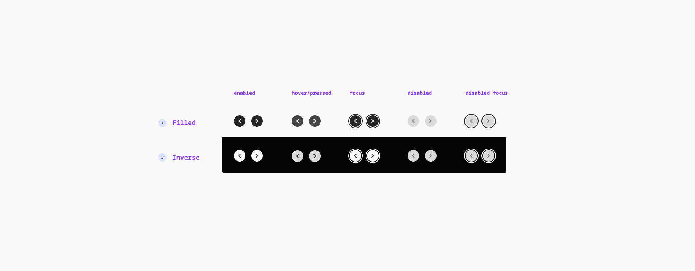

#### Don’t mix Navigation Control variants within the same Carousel.

Use either Filled or Filled Inverse consistently. Navigation Control variants should remain the same throughout the Carousel and must not change during navigation.

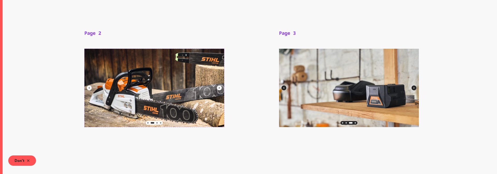

#### Scrollmarker

The Scrollmarker indicates the current page within the Carousel and provides direct navigation. The Scrollmarker:

- indicates the user’s current page within the Carousel.
- allows users to navigate directly to a specific page.
- is clickable and keyboard focusable.
- supports Enabled, Hover, Focus, and Active states.
- not more than 5 rotations are recommended, but if needed an Overflow indicator can be used to indicate that more than than five pages are available.

**Variants**

1. **Ghost** (Default for placement below the Viewport) Used when the Scrollmarker is positioned outside the Viewport.
1. **Filled Inverse** (Default for inside placement and on dark canvas) Used when the Scrollmarker is positioned inside.
1. **Filled** (Special cases) Recommended on brighter images and light canvas that require additional contrast. Can also be used when the Carousel is placed on a colored background to improve visibility.

> **Temporary Color Token Definition** As an interim solution, the Scrollmarker colors are defined using Core Tokens. These will be migrated to Semantic Tokens as part of the future Dark Mode concept.

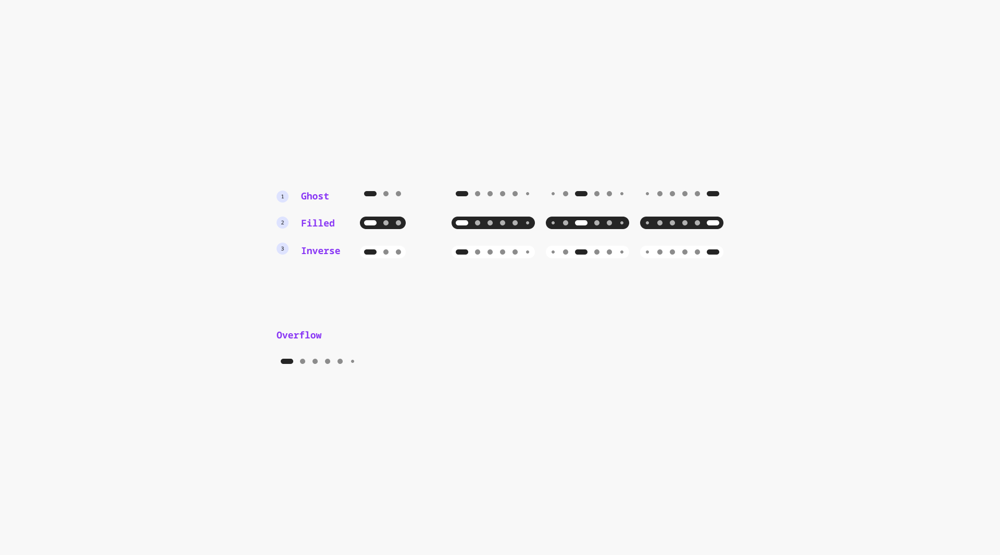

#### Tap Zones

The Tap Zones provide additional touch interaction areas for sequential navigation. They:

- are invisible touch targets positioned on the left and right sides of the Carousel.
- allow users to navigate to the previous or next page by tapping either side of the Carousel.
- are intended for touch devices only.
- complement swipe gestures as an alternative navigation method.
- are not keyboard focusable and are not announced by assistive technologies.

## Figma Implementation Notes

> The Figma component represents the recommended Carousel configurations. Some responsive behaviors cannot be automated in Figma and require manual adjustment when configuring the component. These adjustments represent the Figma components and should not be interpreted as limitations of the code component. The following notes describe these implementation-specific limitations.

### Peek requires manual adjustment

Peek is part of the supported Multi-Item configuration on smaller breakpoints. In Figma, its placement must currently be adjusted manually to represent the intended responsive layout.

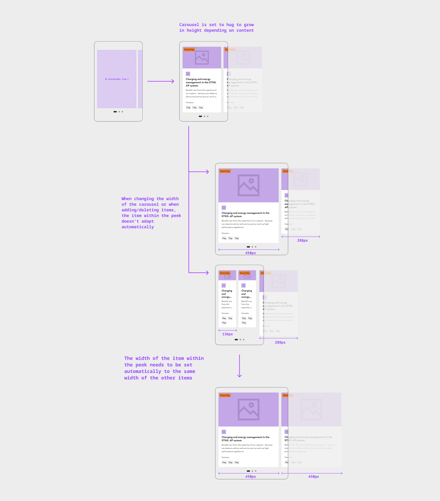

### In Figma, Peek is represented using an overlay rather than clipping the Track.

This is a Figma-specific implementation technique and does not define the implementation behavior of the code component.

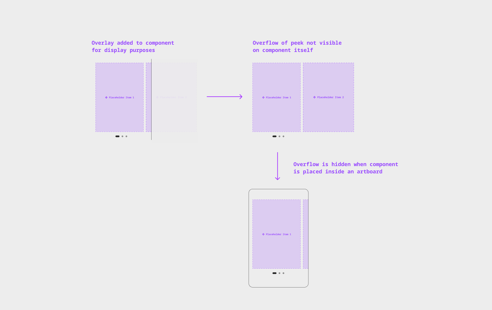

## Formatting and Construction 3/4

### Element details – Single-Item Variant

The following element details are specific to the Single-Item Carousel variant.

#### Item

The Item represents the primary content of the Single-Item Carousel. The Item:

- is displayed as one item per page.
- occupies the full width of the Viewport.
- supports complex content such as images, media, content blocks, or promotional layouts.

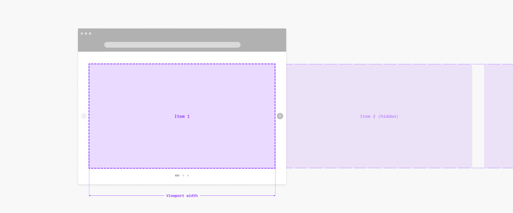

**Do keep all Items the same height.**

Using a consistent Item height prevents layout shifts during navigation and creates a stable, predictable browsing experience.

**Don’t mix Items with different heights.**

Items with varying heights cause layout shifts, reduce visual consistency, and disrupt the browsing experience.

#### Item Aspect Ratio

Aspect ratios can be used flexibly.

**Recommended aspect ratios**

- Desktop: 16:9
- Tablet: 4:3, 3:2, 16:9
- Mobile: 3:4, 1:1, 16:9

**Don’t use aspect ratios that push the Carousel content or Scrollmarkers below the fold.**

## Formatting and Construction 4/4

### Element details – Multi-Item Variant

The following element details are specific to the Multi-Item Carousel variant.

#### Item

The Item represents the primary content of the Multi-Item Carousel. The Item:

- is displayed together with other Items within the Viewport.
- supports repeatable content such as cards, media tiles, or similar compact content blocks.
- is displayed in configurable numbers across breakpoints.
- is arranged to evenly fill the available Viewport width.

**Do keep all Items the same height.**

Using a consistent Item height prevents layout shifts during navigation and creates a stable, predictable browsing experience.

**Don’t mix Items with different heights.**

Items with varying heights cause layout shifts, reduce visual consistency, and disrupt the browsing experience.

#### Peek

The Peek provides an affordance that indicates additional content is available and encourages horizontal browsing. The Peek:

- partially reveals the next Item at the right edge of the Viewport and encourages users to continue browsing.
- is primarily used on touch devices.
- adapts to the configured Item width and layout.
- should occupy approximately 10% of the Container width.

