# Checkbox

## Checkbox

[Overview:](https://main--63440bbb95889041542a5ba3.chromatic.com/?path=/docs/components-checkbox--documentation)

- [a checkbox can be placed by itself (singular) or in a ](https://main--63440bbb95889041542a5ba3.chromatic.com/?path=/docs/components-checkbox--documentation)[checkbox group](https://www.figma.com/design/qXldpLO6gxHJNLdcXIPxYt?node-id=5626-11362)[, see below](https://main--63440bbb95889041542a5ba3.chromatic.com/?path=/docs/components-checkbox--documentation)
- [use single checkbox component for binary choices or toggles in forms or settings interfaces](https://main--63440bbb95889041542a5ba3.chromatic.com/?path=/docs/components-checkbox--documentation)
- [click area: the label must be clickable and trigger the activation](https://main--63440bbb95889041542a5ba3.chromatic.com/?path=/docs/components-checkbox--documentation)

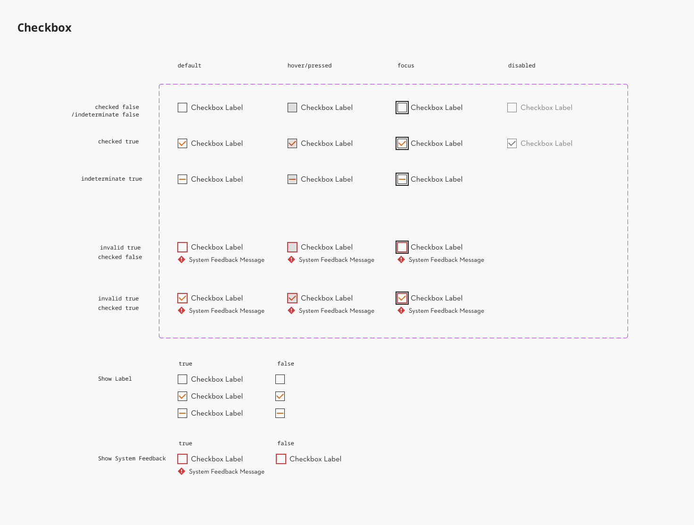

### Further guidelines

[Storybook documentation](https://main--63440bbb95889041542a5ba3.chromatic.com/?path=/docs/components-checkbox--documentation)

Decision tree

### Related elements

[Input](https://www.figma.com/design/qXldpLO6gxHJNLdcXIPxYt?node-id=1591-2)

[Radio Group](https://www.figma.com/design/qXldpLO6gxHJNLdcXIPxYt?node-id=860-2728)

[Switch](https://www.figma.com/design/qXldpLO6gxHJNLdcXIPxYt?node-id=513-2)

### Contribute

Contribute to improving this component by sharing your feedback, asking questions, or suggesting features [here](https://www.figma.com/design/lLmw7PfIdKjFG4uT3B2Hyj/Onboarding-%F0%9F%93%96?node-id=446-868&t=zKmRu4kAkxMeRDmK-4).

## Formatting and Construction

### Anatomy

#### Construction

1. **Checkbox**
1. **Checkbox label** Copy that describes the item you want to select.

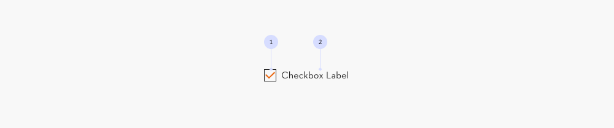

#### States

1. **Checkbox unchecked** A checkbox input indicating the appropriate state.
1. **Checkbox checked** Multiple checkboxes can be activated at the same time
1. **Checkbox indeterminate** In case the underlying checkbox group are a mixed checked and unchecked

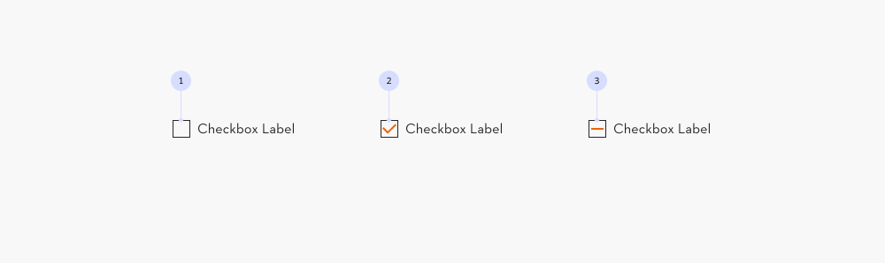

### Alignment

Align the checkbox and text to the top.

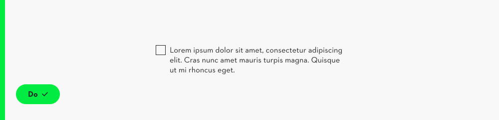

Do not align the text to the center.

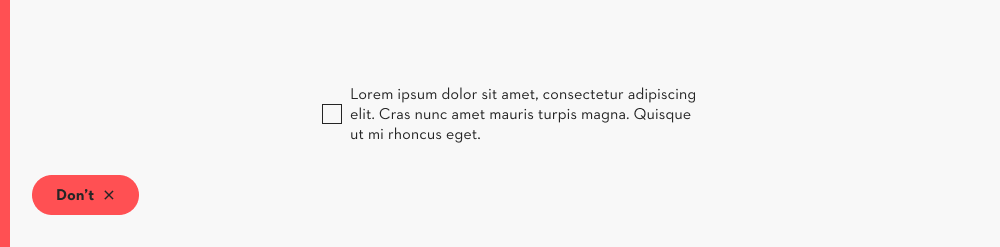

### Sizing

#### Maximum width of text container

To ensure good readability the maximum width should not exceed 544px (based on font size: 16px\*34em = 544px).

[Typography →](https://www.figma.com/design/pQUiJaNuWrGzPaeMrEHf6N/DS-1117-Design-%7C-34em?node-id=2645-515)

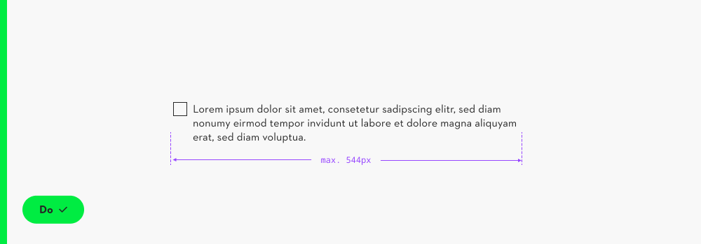

Do not exceed 544px, even when the module or grid is wider.

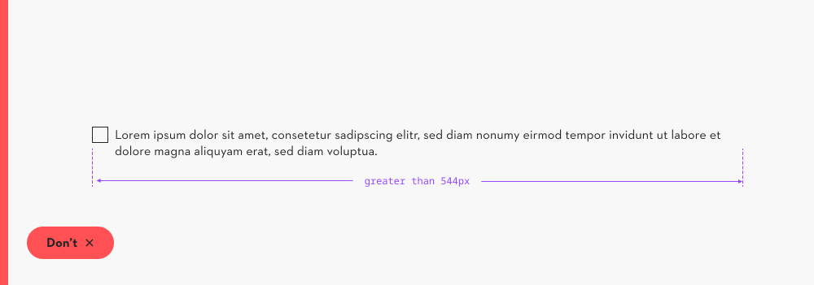

## Content and Assets

### Single checkbox

A single checkbox can be used for e.g.

- accepting a privacy policy
- newsletter subscription
- remembering login credentials

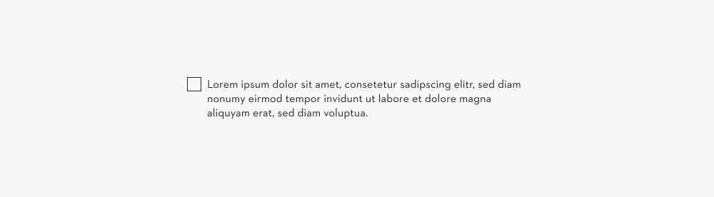

### Overflow behaviour

Keep labels concise to minimize text overflow. If overflow does occur, align the chexkbox with the first line of the label text.

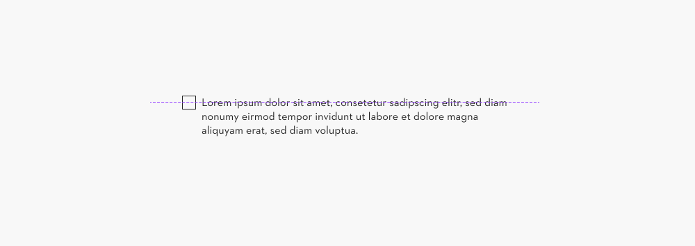

## Behavior

### System feedback

In case of an error message being displayed, the error messages is styled the same as for the input field error message.

The error message should be **aligned with the checkbox.**

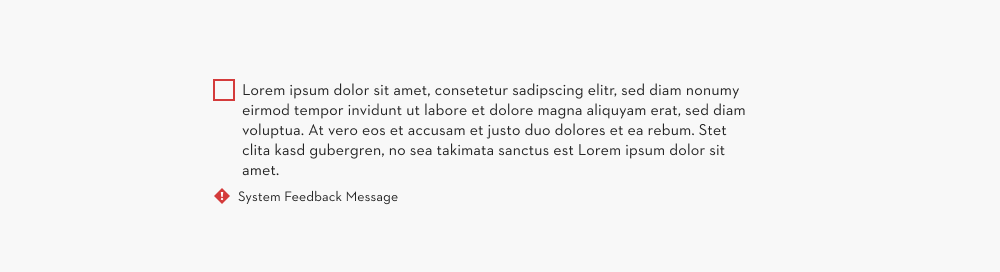

### Click behavior

Click area: the label must be clickable and trigger the activation.

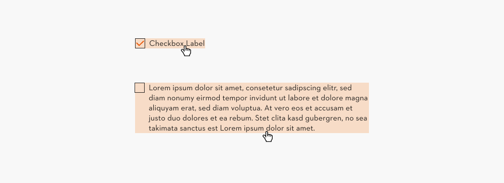

## Currently used variations ⚠️ The following examples are not part of the code component

### Product tiles in a list view

The checkbox is always left-aligned in a list view. Due to the images the checkboxes are centered vertically.

### Filter

To filter a results list, the user can select different values. Depending on the use case, selecting a value is activated instantly or is set through an extra button to confirm. E.g. “apply filter” or “show results”.

This examples show a dropdown for desktop and the mobile version in a modal.

[Dialog →](https://www.figma.com/design/qXldpLO6gxHJNLdcXIPxYt?node-id=14115-4051)

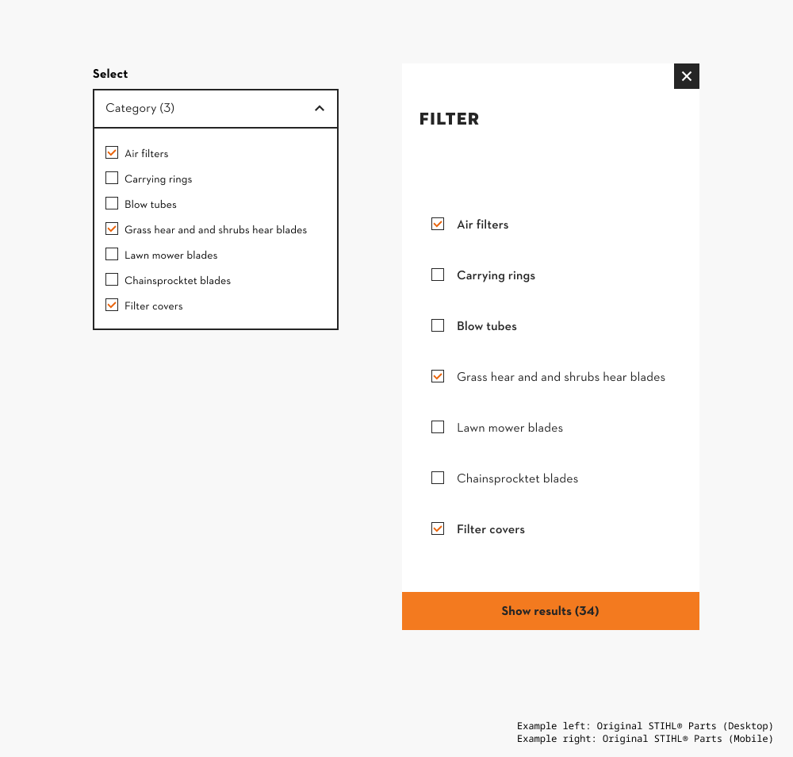

## Checkbox Group

Overview:

- Use checkboxes when multiple items can be selected. Use a[ Radio Group](https://www.figma.com/design/qXldpLO6gxHJNLdcXIPxYt?node-id=860-2728), when only one item can be selected.
- A checkbox group can be aligned horizontally if there are 3 or less checkboxes, otherwise align vertically.

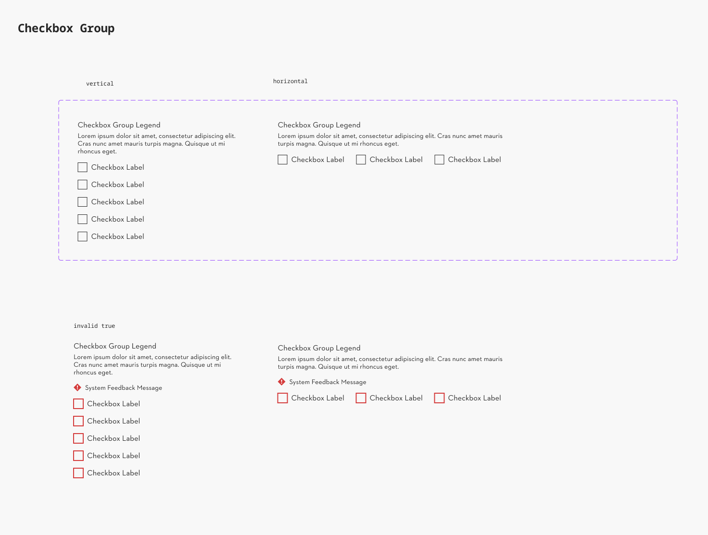

### Further guidelines

[Storybook documentation](https://main--63440bbb95889041542a5ba3.chromatic.com/?path=/docs/components-checkbox-group--documentation)

Decision tree

### Related elements

[Input](https://www.figma.com/design/qXldpLO6gxHJNLdcXIPxYt?node-id=1591-2)

[Radio Group](https://www.figma.com/design/qXldpLO6gxHJNLdcXIPxYt?node-id=860-2728)

[Switch](https://www.figma.com/design/qXldpLO6gxHJNLdcXIPxYt?node-id=513-2)

### Contribute

Contribute to improving this component by sharing your feedback, asking questions, or suggesting features [here](https://www.figma.com/design/lLmw7PfIdKjFG4uT3B2Hyj/Onboarding-%F0%9F%93%96?node-id=446-868&t=zKmRu4kAkxMeRDmK-4).

## Formatting and Construction

### Anatomy

#### Checkbox group

1. **Checkbox group legend:** groups a set of checkboxes in form of a sentence or a question
1. **Checkbox group hint (optional):** provides guidance or further context or clarity for making a selection.
1. **Info Button (optional):** Can be used to trigger a popover with additional information
1. **System feedback:** error or success message to help the user understand
1. **Checkbox:** recognizable click element

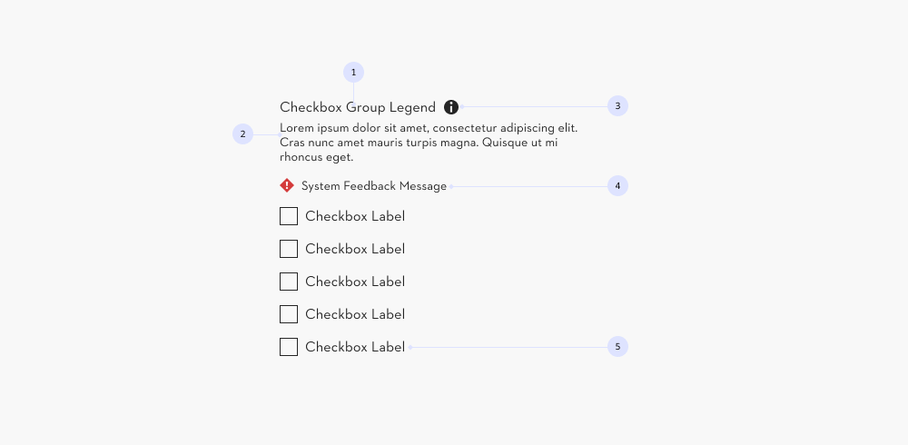

### Direction

#### Horizontal

In case the amount of checkbox is (below) 3 and the copy is short, consider a horizontal direction.

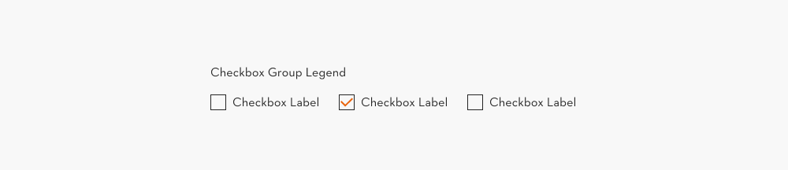

#### Vertical

In case of longer copy, use vertical direction.

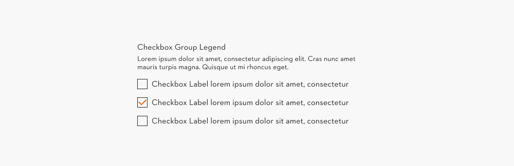

## Content and Assets

The use of checkbox groups is very versatile, examples are:

- add custom choices
- set interests for news updates
- available time slots

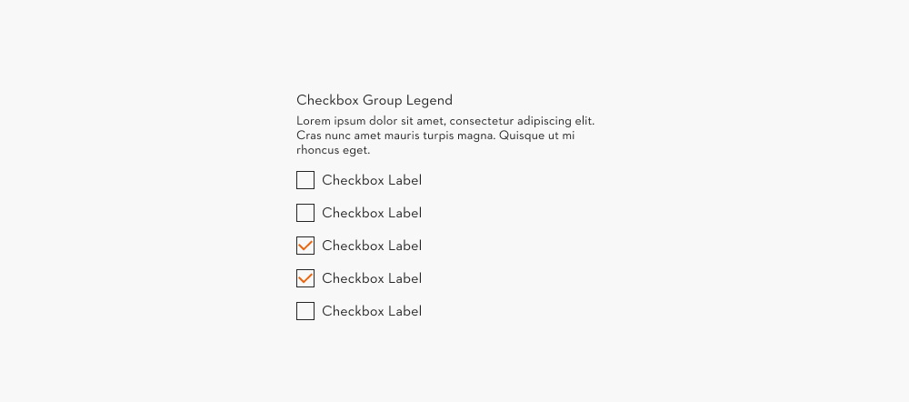

### Content design

Use uniform styling and formatting for all labels, in order for the user to scan easily through a long list.

E.g. format the first words bold, following by an ‘:’.

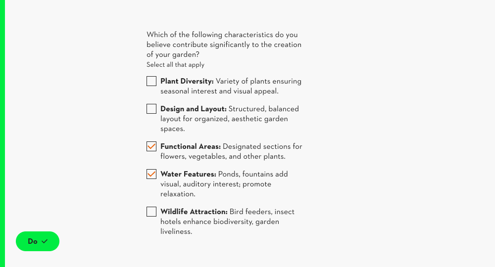

### Mixed label lengths

Don’t mix long and short checkbox labels.

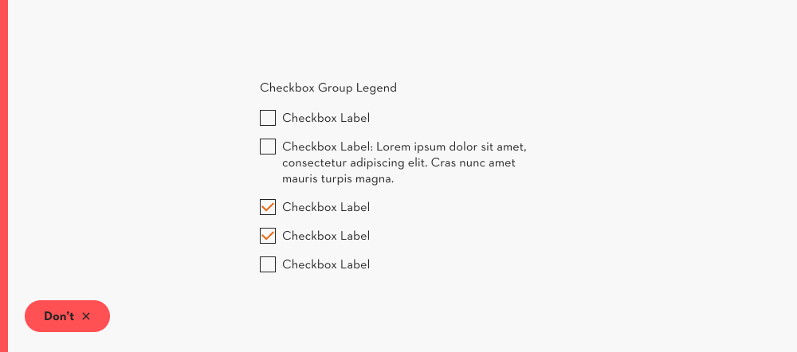

### Info Button

A button to trigger a popover can be placed next to input or select labels to provide **additional contextual information.**

Popover content should be **limited to supplementary, non-critical information** — for example, brief explanations, examples, or guidance that supports user understanding without being essential for task completion.

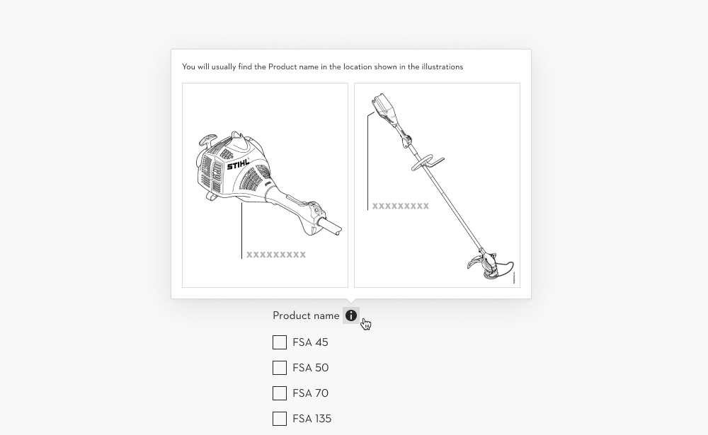

**Don’t use the popover for critical or required information**, use the hint instead as critical information should net be hidden

For mor Guidance on this topic see the [Popover documentation](https://www.figma.com/design/qXldpLO6gxHJNLdcXIPxYt?node-id=35223-10505)

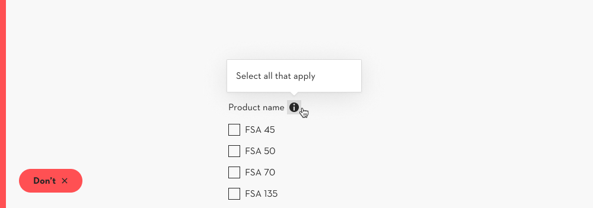

## Behavior

### System feedback

In case of an error message being displayed, the error messages is styled the same as for the input-filed error message.

Feedback often applies to the full list, instead to one single check box.

The error message should be **aligned with the checkbox.**

[Text Input→](https://www.figma.com/design/qXldpLO6gxHJNLdcXIPxYt?node-id=1591-2)

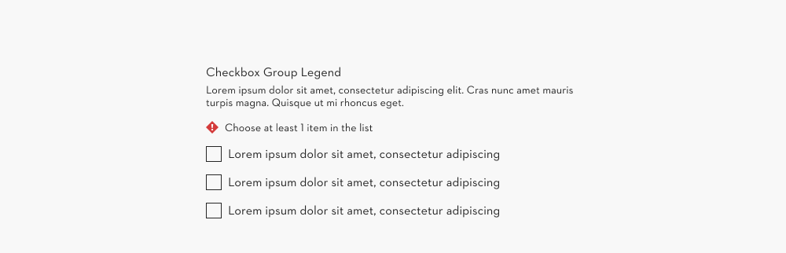

### Radio Button vs. Checkbox

If a user can only select only one option from a list, radio buttons should be used instead of checkboxes.

Checkboxes allow the user to select multiple items in a set, whereas radio buttons allow the user to select only one option. **DO** Use radio buttons when **only one** item can be selected. **DO** Use checkboxes when **multiple** items can be selected

[Radio Buttons→](https://www.figma.com/design/qXldpLO6gxHJNLdcXIPxYt?node-id=860-2728)

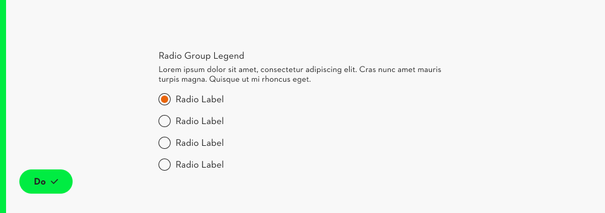

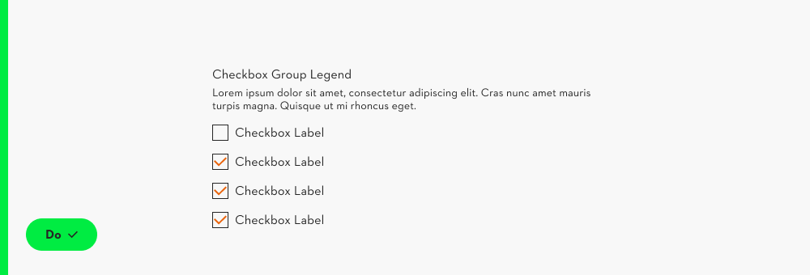

### Click area

The label must be clickable and trigger the activation.

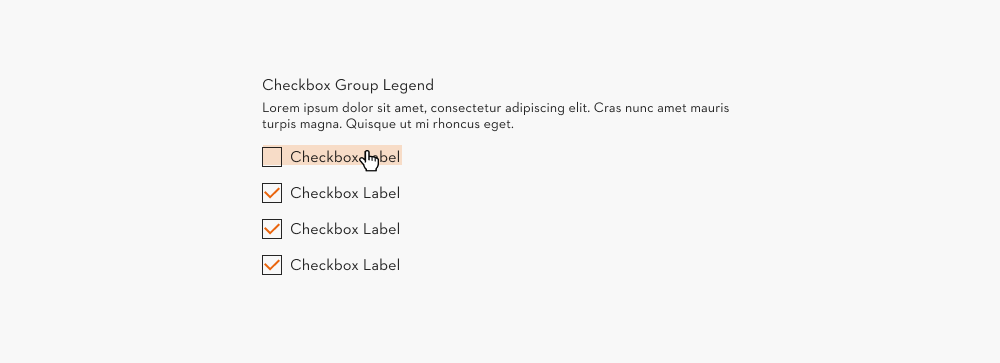

## Currently used variations ⚠️ The following example is not part of the code component

### Horizontal + vertical

In case the amount of checkboxes is high and the copy is short, consider a horizontal direction for columns.

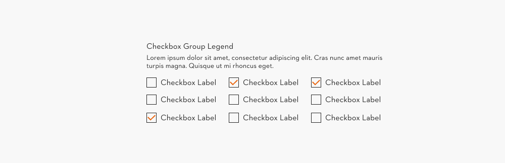
