# Checkbox

## Checkbox

[Overview:](https://main--63440bbb95889041542a5ba3.chromatic.com/?path=/docs/components-checkbox--documentation)

- [a checkbox can be placed by itself (singular) or in a ](https://main--63440bbb95889041542a5ba3.chromatic.com/?path=/docs/components-checkbox--documentation)[checkbox group](https://www.figma.com/design/qXldpLO6gxHJNLdcXIPxYt?node-id=5626-11362)[, see below](https://main--63440bbb95889041542a5ba3.chromatic.com/?path=/docs/components-checkbox--documentation)
- [use single checkbox component for binary choices or toggles in forms or settings interfaces](https://main--63440bbb95889041542a5ba3.chromatic.com/?path=/docs/components-checkbox--documentation)
- [click area: the label must be clickable and trigger the activation](https://main--63440bbb95889041542a5ba3.chromatic.com/?path=/docs/components-checkbox--documentation)

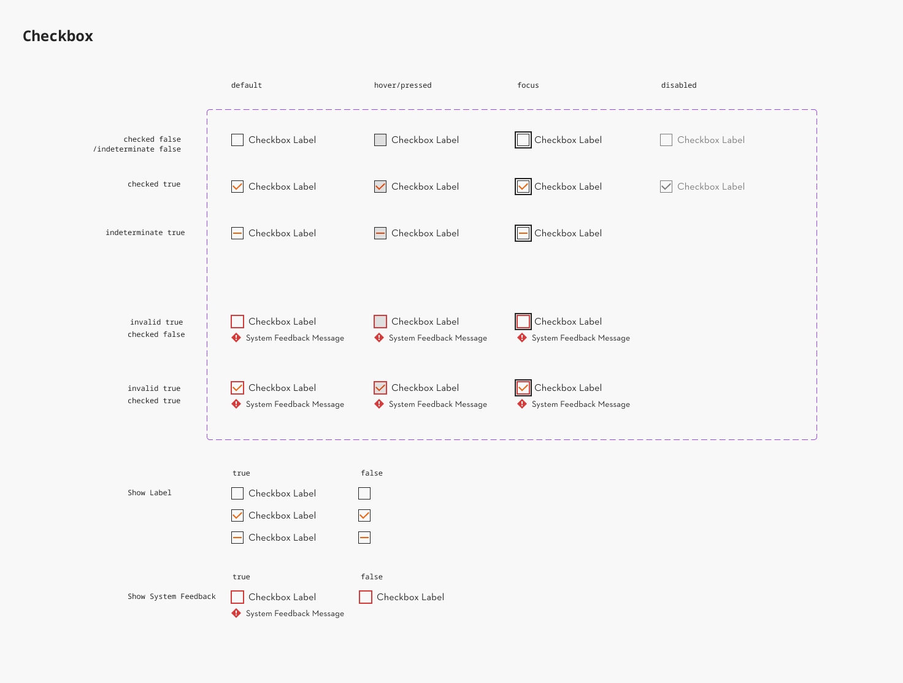

_Figure: Overview matrix of the Checkbox with the label "Checkbox Label". Columns are the states "default", "hover/pressed" (grey filled box), "focus" (thick dark outline) and "disabled" (greyed out); rows are "checked false /indeterminate false" (empty box), "checked true" (orange check mark) and "indeterminate true" (orange dash), plus "invalid true" with "checked false" and "checked true", which have a red border and the red error message "System Feedback Message" with an alert icon below the label. Disabled exists only for unchecked and checked, and the rows are enclosed by a purple dashed frame. Below, the property "Show Label" is "true" (box with label) or "false" (box only) for unchecked, checked and indeterminate, and "Show System Feedback" is "true" (invalid box with message) or "false" (invalid box with label only)._

### Further guidelines

[Storybook documentation](https://main--63440bbb95889041542a5ba3.chromatic.com/?path=/docs/components-checkbox--documentation)

Decision tree

### Related elements

[Input](https://www.figma.com/design/qXldpLO6gxHJNLdcXIPxYt?node-id=1591-2)

[Radio Group](https://www.figma.com/design/qXldpLO6gxHJNLdcXIPxYt?node-id=860-2728)

[Switch](https://www.figma.com/design/qXldpLO6gxHJNLdcXIPxYt?node-id=513-2)

### Contribute

Contribute to improving this component by sharing your feedback, asking questions, or suggesting features [here](https://www.figma.com/design/lLmw7PfIdKjFG4uT3B2Hyj/Onboarding-%F0%9F%93%96?node-id=446-868&t=zKmRu4kAkxMeRDmK-4).

## Formatting and Construction

### Anatomy

#### Construction

1. **Checkbox**
1. **Checkbox label** Copy that describes the item you want to select.

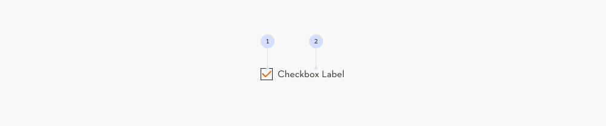

_Figure: Anatomy of the checkbox with two numbered callouts. Callout 1 points at the checkbox itself, shown checked with an orange check mark in a dark square box. Callout 2 points at the checkbox label "Checkbox Label" to the right of the box, the copy that describes the item you want to select._

#### States

1. **Checkbox unchecked** A checkbox input indicating the appropriate state.
1. **Checkbox checked** Multiple checkboxes can be activated at the same time
1. **Checkbox indeterminate** In case the underlying checkbox group are a mixed checked and unchecked

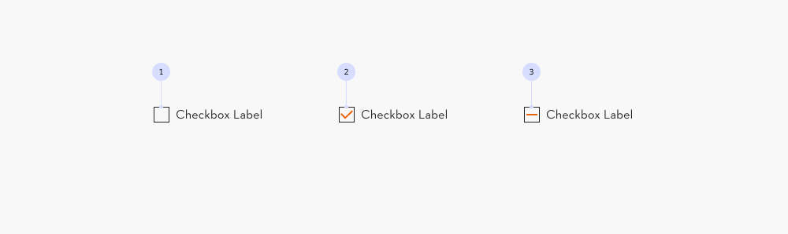

_Figure: Three checkbox states side by side, each with the label "Checkbox Label" and a numbered callout. Callout 1 points at the unchecked checkbox, an empty square box. Callout 2 points at the checked checkbox with an orange check mark; multiple checkboxes can be activated at the same time. Callout 3 points at the indeterminate checkbox with an orange dash, used when the underlying checkbox group has a mix of checked and unchecked boxes._

### Alignment

Align the checkbox and text to the top.

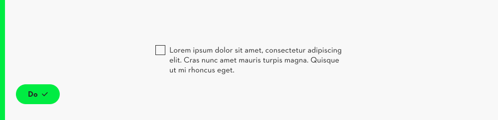

_Figure: Do example: an unchecked checkbox next to a three-line lorem ipsum label, with the checkbox aligned to the top, level with the first line of the text. Align the checkbox and text to the top._

Do not align the text to the center.

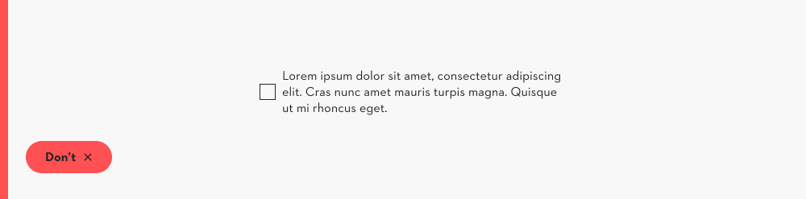

_Figure: Don't example: an unchecked checkbox next to a three-line lorem ipsum label, with the checkbox vertically centred against the text block instead of aligned to the top. Do not align the text to the center._

### Sizing

#### Maximum width of text container

To ensure good readability the maximum width should not exceed 544px (based on font size: 16px\*34em = 544px).

[Typography →](https://www.figma.com/design/pQUiJaNuWrGzPaeMrEHf6N/DS-1117-Design-%7C-34em?node-id=2645-515)

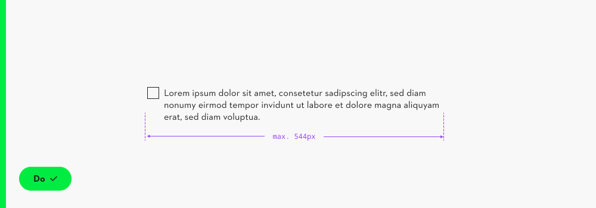

_Figure: Do example: an unchecked checkbox with a three-line lorem ipsum label. A purple dashed arrow dimension below spans from the checkbox to the right end of the text and is labelled "max. 544px", the maximum width of the text container (16px\*34em = 544px) for good readability._

Do not exceed 544px, even when the module or grid is wider.

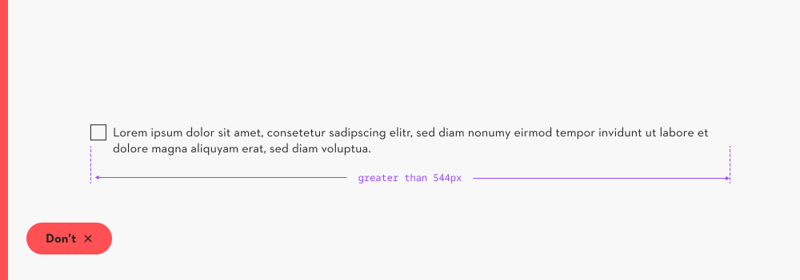

_Figure: Don't example: an unchecked checkbox with a two-line lorem ipsum label stretched across a wide container. A purple dashed arrow dimension below spans the whole width and is labelled "greater than 544px". Do not exceed 544px, even when the module or grid is wider._

## Content and Assets

### Single checkbox

A single checkbox can be used for e.g.

- accepting a privacy policy
- newsletter subscription
- remembering login credentials

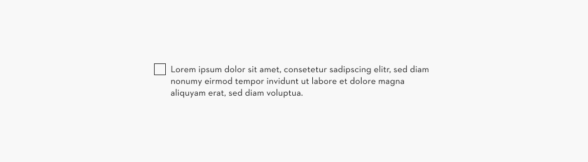

_Figure: Single checkbox: one unchecked checkbox in default state with a three-line lorem ipsum label, the box aligned with the first line of text. Typical uses are accepting a privacy policy, newsletter subscription and remembering login credentials._

### Overflow behaviour

Keep labels concise to minimize text overflow. If overflow does occur, align the chexkbox with the first line of the label text.

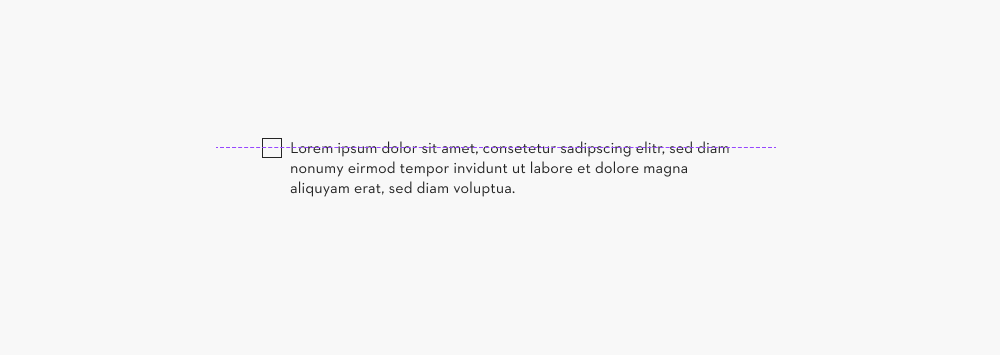

_Figure: Overflow behaviour of a checkbox with a long lorem ipsum label wrapping onto three lines. A thin dashed horizontal guide runs through the first line of text and the checkbox, showing that the unchecked box is aligned with the first line of the label; the wrapped lines are indented to the text start._

## Behavior

### System feedback

In case of an error message being displayed, the error messages is styled the same as for the input field error message.

The error message should be **aligned with the checkbox.**

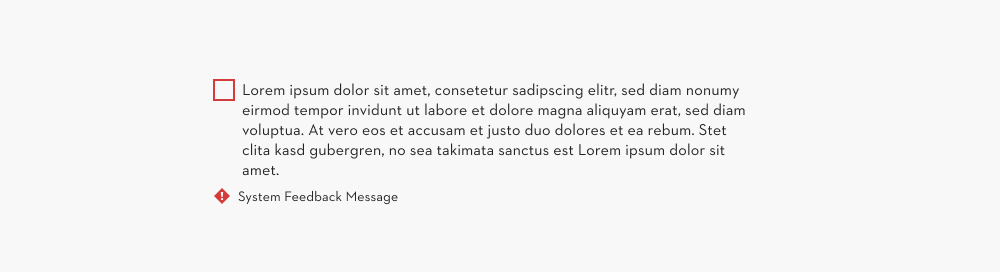

_Figure: Invalid, unchecked checkbox with a long multi-line lorem ipsum label and a red border around the box. Below it, aligned with the left edge of the checkbox, a red warning icon with the system feedback error message "System Feedback Message", styled like the input field error message._

### Click behavior

Click area: the label must be clickable and trigger the activation.

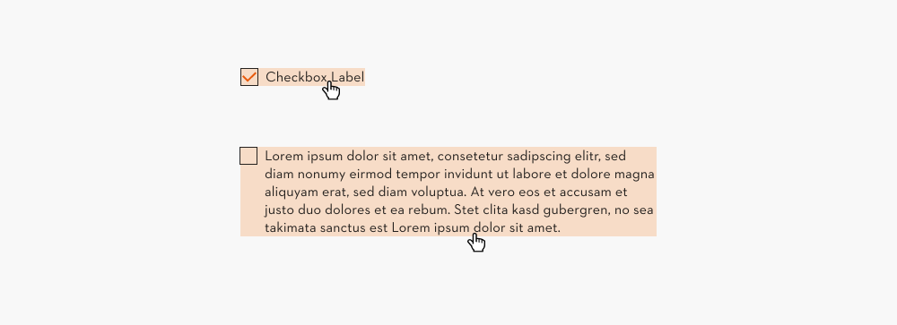

_Figure: Click area of the checkbox shown with two examples. Top: a checked checkbox with the label "Checkbox Label", where the whole label is highlighted in light orange and a hand cursor hovers over the label text. Bottom: an unchecked checkbox with a long multi-line lorem ipsum label, whose full label text is highlighted in light orange with a hand cursor over it. The highlight shows that the label is clickable and triggers the activation._

## Currently used variations ⚠️ The following examples are not part of the code component

### Product tiles in a list view

The checkbox is always left-aligned in a list view. Due to the images the checkboxes are centered vertically.

### Filter

To filter a results list, the user can select different values. Depending on the use case, selecting a value is activated instantly or is set through an extra button to confirm. E.g. “apply filter” or “show results”.

This examples show a dropdown for desktop and the mobile version in a modal.

[Dialog →](https://www.figma.com/design/qXldpLO6gxHJNLdcXIPxYt?node-id=14115-4051)

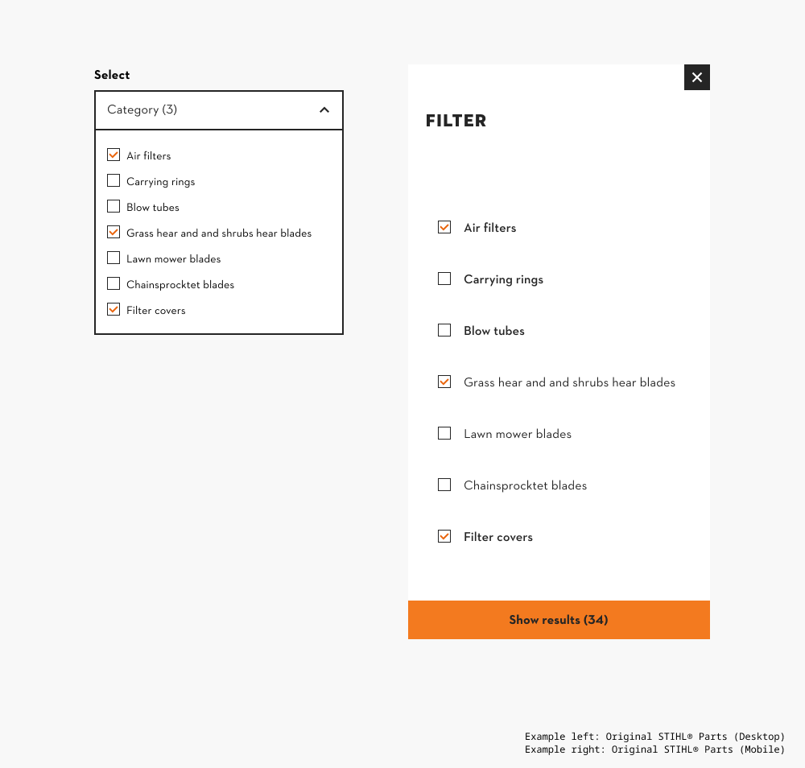

_Figure: Two filter examples using checkboxes. Left, desktop ("Example left: Original STIHL® Parts (Desktop)"): a field labelled "Select" with the opened dropdown "Category (3)" and a chevron up, listing seven checkboxes: "Air filters" (checked), "Carrying rings", "Blow tubes", "Grass hear and and shrubs hear blades" (checked), "Lawn mower blades", "Chainsprocktet blades" and "Filter covers" (checked). Right, mobile ("Example right: Original STIHL® Parts (Mobile)"): a modal titled "FILTER" with a close button at the top right and the same seven options with the same three checked, above a full-width orange button "Show results (34)" that confirms the filter._

## Checkbox Group

Overview:

- Use checkboxes when multiple items can be selected. Use a[ Radio Group](https://www.figma.com/design/qXldpLO6gxHJNLdcXIPxYt?node-id=860-2728), when only one item can be selected.
- A checkbox group can be aligned horizontally if there are 3 or less checkboxes, otherwise align vertically.

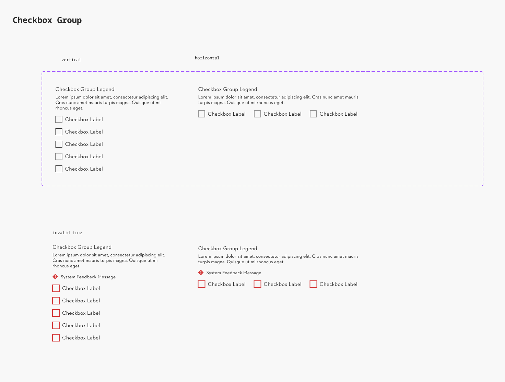

_Figure: Overview board "Checkbox Group" with two directions, vertical and horizontal, each in a default and an invalid state. Default: a purple dashed frame contains a vertical group with "Checkbox Group Legend", a lorem ipsum hint and five unchecked "Checkbox Label" checkboxes, and a horizontal group with the same legend and hint and three unchecked "Checkbox Label" checkboxes in one row. Below, labelled "invalid true", the same two groups show a red warning icon with "System Feedback Message" between hint and checkboxes, and all checkbox borders are red._

### Further guidelines

[Storybook documentation](https://main--63440bbb95889041542a5ba3.chromatic.com/?path=/docs/components-checkbox-group--documentation)

Decision tree

### Related elements

[Input](https://www.figma.com/design/qXldpLO6gxHJNLdcXIPxYt?node-id=1591-2)

[Radio Group](https://www.figma.com/design/qXldpLO6gxHJNLdcXIPxYt?node-id=860-2728)

[Switch](https://www.figma.com/design/qXldpLO6gxHJNLdcXIPxYt?node-id=513-2)

### Contribute

Contribute to improving this component by sharing your feedback, asking questions, or suggesting features [here](https://www.figma.com/design/lLmw7PfIdKjFG4uT3B2Hyj/Onboarding-%F0%9F%93%96?node-id=446-868&t=zKmRu4kAkxMeRDmK-4).

## Formatting and Construction

### Anatomy

#### Checkbox group

1. **Checkbox group legend:** groups a set of checkboxes in form of a sentence or a question
1. **Checkbox group hint (optional):** provides guidance or further context or clarity for making a selection.
1. **Info Button (optional):** Can be used to trigger a popover with additional information
1. **System feedback:** error or success message to help the user understand
1. **Checkbox:** recognizable click element

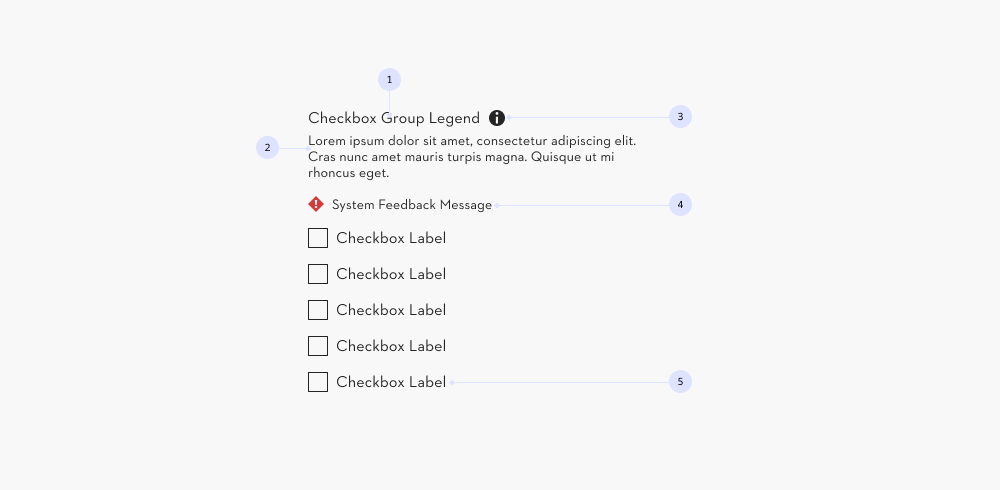

_Figure: Anatomy of the vertical checkbox group with five numbered callouts. Callout 1 points at the legend "Checkbox Group Legend". Callout 2 points at the hint, a lorem ipsum text below the legend. Callout 3 points at the optional info button, an info icon right of the legend. Callout 4 points at the system feedback, a red warning icon with "System Feedback Message". Callout 5 points at a checkbox with its "Checkbox Label"; five unchecked checkboxes are listed below._

### Direction

#### Horizontal

In case the amount of checkbox is (below) 3 and the copy is short, consider a horizontal direction.

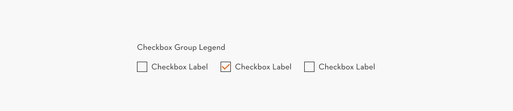

_Figure: Horizontal checkbox group with the legend "Checkbox Group Legend" and three "Checkbox Label" checkboxes in one row: unchecked, checked (orange check mark) and unchecked. Suited for up to 3 checkboxes with short copy._

#### Vertical

In case of longer copy, use vertical direction.

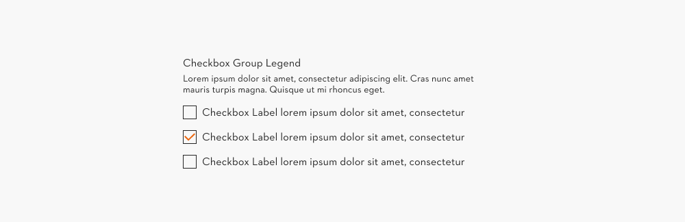

_Figure: Vertical checkbox group for longer copy, with the legend "Checkbox Group Legend", a lorem ipsum hint and three stacked checkboxes labelled "Checkbox Label lorem ipsum dolor sit amet, consectetur": unchecked, checked (orange check mark) and unchecked._

## Content and Assets

The use of checkbox groups is very versatile, examples are:

- add custom choices
- set interests for news updates
- available time slots

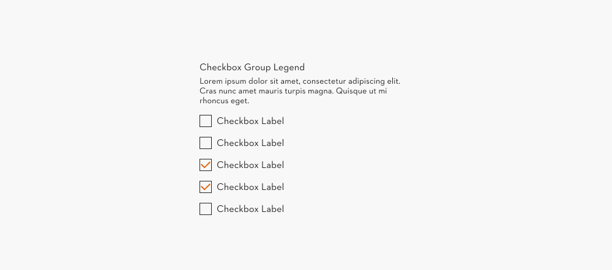

_Figure: Vertical checkbox group example for content and assets, with the legend "Checkbox Group Legend", a lorem ipsum hint and five "Checkbox Label" checkboxes in a column: the first two unchecked, the third and fourth checked (orange check marks) and the fifth unchecked._

### Content design

Use uniform styling and formatting for all labels, in order for the user to scan easily through a long list.

E.g. format the first words bold, following by an ‘:’.

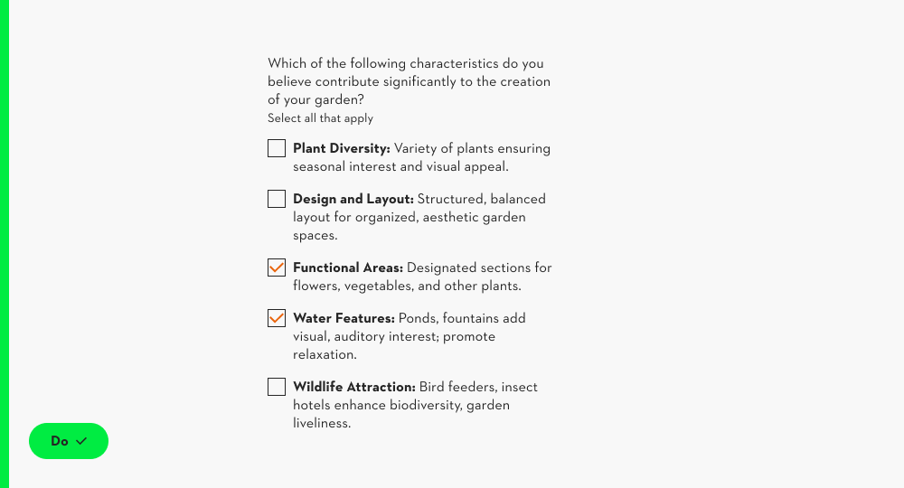

_Figure: Do example: a vertical checkbox group with the legend "Which of the following characteristics do you believe contribute significantly to the creation of your garden?" and the hint "Select all that apply". Five options use uniform formatting, each starting with a bold term followed by a colon and a description: "Plant Diversity:", "Design and Layout:", "Functional Areas:" (checked), "Water Features:" (checked) and "Wildlife Attraction:". Uniform labels let users scan a long list easily. A green "Do" badge marks it as correct._

### Mixed label lengths

Don’t mix long and short checkbox labels.

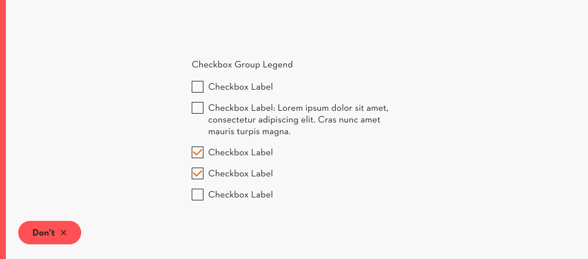

_Figure: Don't example: a vertical checkbox group with the legend "Checkbox Group Legend" and five checkboxes. Four have the short label "Checkbox Label" (the third and fourth are checked, the others unchecked), while the second has a long three-line label starting "Checkbox Label: Lorem ipsum dolor sit amet, consectetur adipiscing elit. Cras nunc amet mauris turpis magna." Wrong because long and short checkbox labels are mixed in one group._

### Info Button

A button to trigger a popover can be placed next to input or select labels to provide **additional contextual information.**

Popover content should be **limited to supplementary, non-critical information** — for example, brief explanations, examples, or guidance that supports user understanding without being essential for task completion.

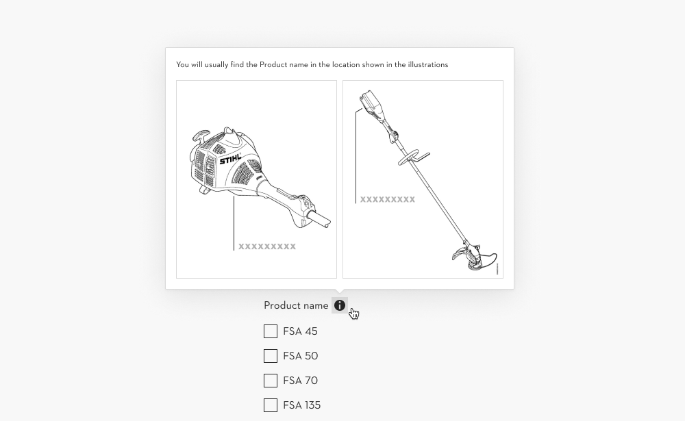

_Figure: Vertical checkbox group with the legend "Product name" and an info button (a filled circle with an "i", hovered by a pointer cursor) next to it. Below are four unchecked checkboxes: "FSA 45", "FSA 50", "FSA 70" and "FSA 135". A large white popover with a downward arrow above the info button reads "You will usually find the Product name in the location shown in the illustrations" and contains two line drawings of a STIHL engine unit and a battery trimmer with "XXXXXXXXX" placeholder callouts, as supplementary, non-critical help._

**Don’t use the popover for critical or required information**, use the hint instead as critical information should net be hidden

For mor Guidance on this topic see the [Popover documentation](https://www.figma.com/design/qXldpLO6gxHJNLdcXIPxYt?node-id=35223-10505)

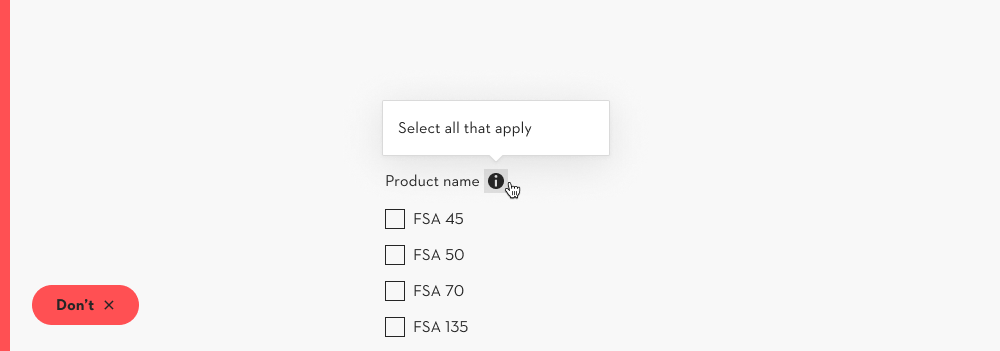

_Figure: Don't example: the vertical checkbox group "Product name" with unchecked checkboxes "FSA 45", "FSA 50", "FSA 70" and "FSA 135". A pointer cursor hovers the info button next to the legend, which opens a small white popover with an arrow pointing down at it and the text "Select all that apply". Wrong because critical or required information must not be hidden in a popover; it belongs in the hint._

## Behavior

### System feedback

In case of an error message being displayed, the error messages is styled the same as for the input-filed error message.

Feedback often applies to the full list, instead to one single check box.

The error message should be **aligned with the checkbox.**

[Text Input→](https://www.figma.com/design/qXldpLO6gxHJNLdcXIPxYt?node-id=1591-2)

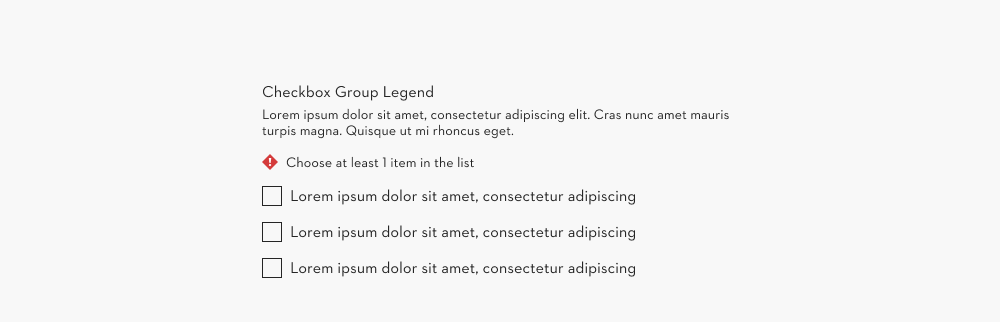

_Figure: Invalid vertical checkbox group with the legend "Checkbox Group Legend" and a hint of lorem ipsum text. Below the hint is the group error message "Choose at least 1 item in the list" with a red warning icon, aligned with the checkboxes. Under it are three unchecked checkboxes labelled "Lorem ipsum dolor sit amet, consectetur adipiscing"._

### Radio Button vs. Checkbox

If a user can only select only one option from a list, radio buttons should be used instead of checkboxes.

Checkboxes allow the user to select multiple items in a set, whereas radio buttons allow the user to select only one option. **DO** Use radio buttons when **only one** item can be selected. **DO** Use checkboxes when **multiple** items can be selected

[Radio Buttons→](https://www.figma.com/design/qXldpLO6gxHJNLdcXIPxYt?node-id=860-2728)

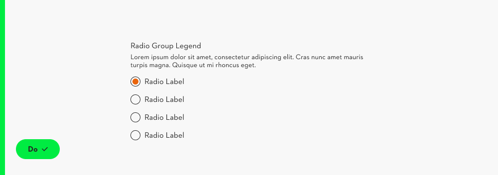

_Figure: Do example: use radio buttons when only one item can be selected. A vertical radio group with the legend "Radio Group Legend", a lorem ipsum hint and four options labelled "Radio Label"; the first is selected (orange filled dot) and the other three are unselected._

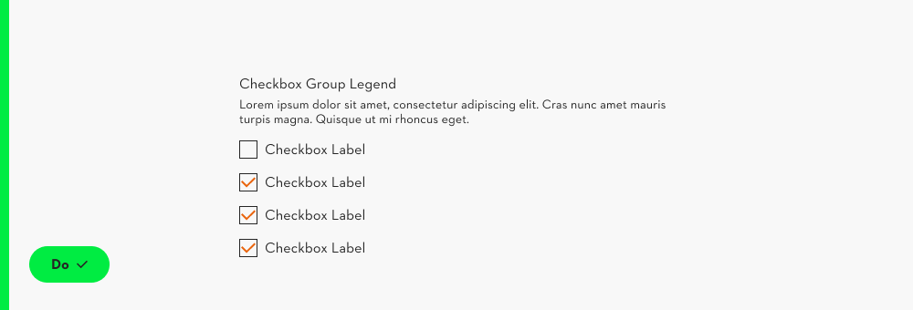

_Figure: Do example: use checkboxes when multiple items can be selected. A vertical checkbox group with the legend "Checkbox Group Legend", a lorem ipsum hint and four checkboxes labelled "Checkbox Label"; the first is unchecked and the other three are checked with orange check marks._

### Click area

The label must be clickable and trigger the activation.

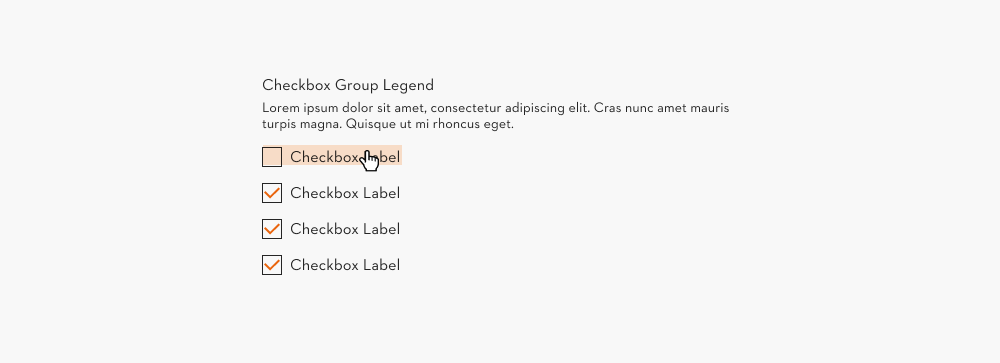

_Figure: Click area of a checkbox: in a vertical group with the legend "Checkbox Group Legend" and a lorem ipsum hint, the first unchecked "Checkbox Label" is hovered by a pointer cursor over its label text. The box and the label are highlighted together in light orange, showing that the label is clickable and triggers the activation. The three checkboxes below are checked._

## Currently used variations ⚠️ The following example is not part of the code component

### Horizontal + vertical

In case the amount of checkboxes is high and the copy is short, consider a horizontal direction for columns.

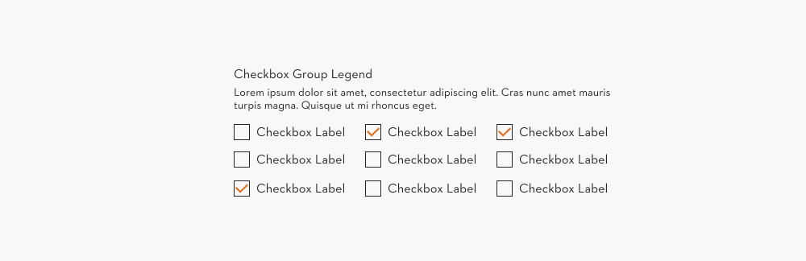

_Figure: Horizontal checkbox group with the legend "Checkbox Group Legend" and a lorem ipsum hint, arranged in three columns and three rows of nine checkboxes labelled "Checkbox Label". Three are checked (first row second and third column, third row first column), the other six unchecked. Horizontal direction suits many checkboxes with short copy._
