# Checkbox

## Checkbox

[Overview:](https://main--63440bbb95889041542a5ba3.chromatic.com/?path=/docs/components-checkbox--documentation)

- [a checkbox can be placed by itself (singular) or in a ](https://main--63440bbb95889041542a5ba3.chromatic.com/?path=/docs/components-checkbox--documentation)[checkbox group](https://www.figma.com/design/qXldpLO6gxHJNLdcXIPxYt?node-id=5626-11362)[, see below](https://main--63440bbb95889041542a5ba3.chromatic.com/?path=/docs/components-checkbox--documentation)
- [use single checkbox component for binary choices or toggles in forms or settings interfaces](https://main--63440bbb95889041542a5ba3.chromatic.com/?path=/docs/components-checkbox--documentation)
- [click area: the label must be clickable and trigger the activation](https://main--63440bbb95889041542a5ba3.chromatic.com/?path=/docs/components-checkbox--documentation)

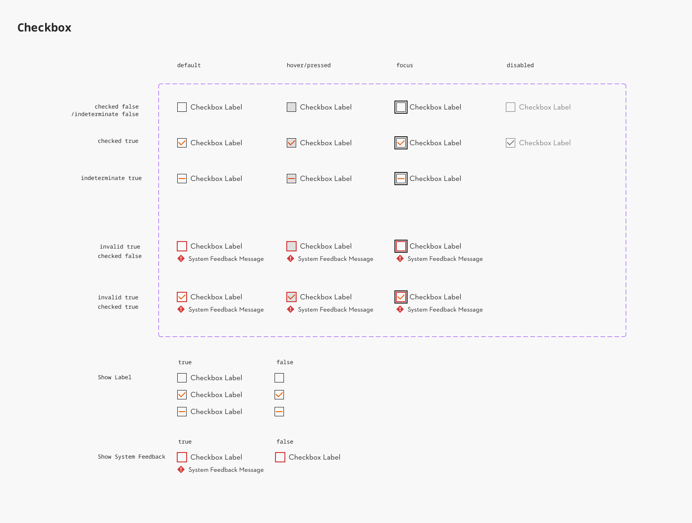

_Figure: Shows system-feedback (type=error); checkbox (system feedback, label, label=Checkbox Label, state=default, checked=false, indeterminate=false, invalid=false); checkbox (system feedback, label=Checkbox Label, state=default, checked=false, indeterminate=false, invalid=false); checkbox (label, system feedback, label=Checkbox Label, state=default, checked=true, indeterminate=false, invalid=false); checkbox (system feedback, label=Checkbox Label, state=default, checked=true, indeterminate=false, invalid=false); checkbox (label, system feedback, label=Checkbox Label, state=default, checked=false, indeterminate=true, invalid=false); checkbox (system feedback, label=Checkbox Label, state=default, checked=false, indeterminate=true, invalid=false); checkbox (label=Checkbox Label, label, system feedback, state=default, checked=false, indeterminate=false, invalid=true); checkbox (label=Checkbox Label, label, state=default, checked=false, indeterminate=false, invalid=true). Text in the figure: "Checkbox", "default", "hover/pressed", "focus", "disabled", "Checkbox Label", "System Feedback Message", "checked false /indeterminate false", "checked true", "indeterminate true", "invalid true", "checked false", "true", "false", "Show Label", "Show System Feedback"._

### Further guidelines

[Storybook documentation](https://main--63440bbb95889041542a5ba3.chromatic.com/?path=/docs/components-checkbox--documentation)

Decision tree

### Related elements

[Input](https://www.figma.com/design/qXldpLO6gxHJNLdcXIPxYt?node-id=1591-2)

[Radio Group](https://www.figma.com/design/qXldpLO6gxHJNLdcXIPxYt?node-id=860-2728)

[Switch](https://www.figma.com/design/qXldpLO6gxHJNLdcXIPxYt?node-id=513-2)

### Contribute

Contribute to improving this component by sharing your feedback, asking questions, or suggesting features [here](https://www.figma.com/design/lLmw7PfIdKjFG4uT3B2Hyj/Onboarding-%F0%9F%93%96?node-id=446-868&t=zKmRu4kAkxMeRDmK-4).

## Formatting and Construction

### Anatomy

#### Construction

1. **Checkbox**
1. **Checkbox label** Copy that describes the item you want to select.

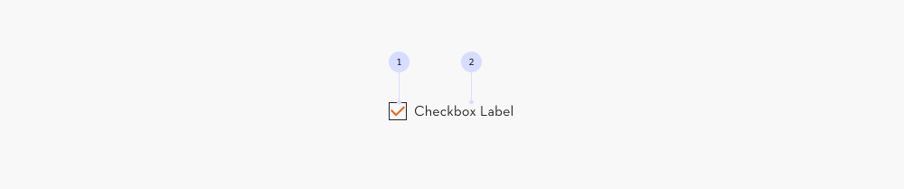

_Figure: Shows checkbox (label, system feedback, label=Checkbox Label, state=default, checked=true, indeterminate=false, invalid=false). Callouts 1, 2. Text in the figure: "Checkbox Label"._

#### States

1. **Checkbox unchecked** A checkbox input indicating the appropriate state.
1. **Checkbox checked** Multiple checkboxes can be activated at the same time
1. **Checkbox indeterminate** In case the underlying checkbox group are a mixed checked and unchecked

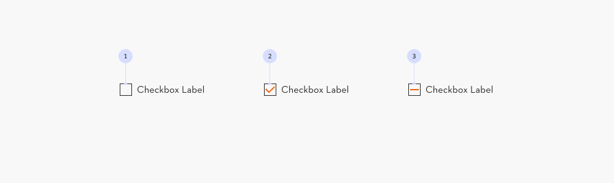

_Figure: Shows checkbox (system feedback, label, label=Checkbox Label, state=default, checked=false, indeterminate=false, invalid=false); checkbox (label, system feedback, label=Checkbox Label, state=default, checked=true, indeterminate=false, invalid=false); checkbox (label, system feedback, label=Checkbox Label, state=default, checked=false, indeterminate=true, invalid=false). Callouts 1, 2, 3. Text in the figure: "Checkbox Label"._

### Alignment

Align the checkbox and text to the top.

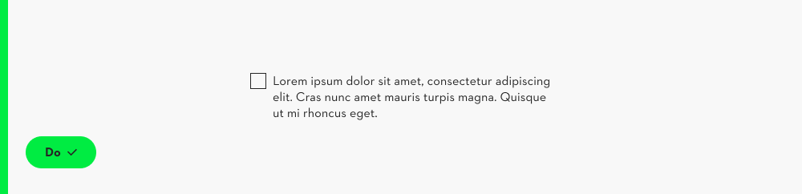

_Figure: Do example. Shows checkbox (system feedback, label, label=Lorem ipsum dolor sit amet, consectetur adipiscing elit. Cras nunc amet mauris turpis magna. Quisque ut mi rhoncus eget., state=default, checked=false, indeterminate=false, invalid=false). Text in the figure: "Lorem ipsum dolor sit amet, consectetur adipiscing elit. Cras nunc amet mauri..."._

Do not align the text to the center.

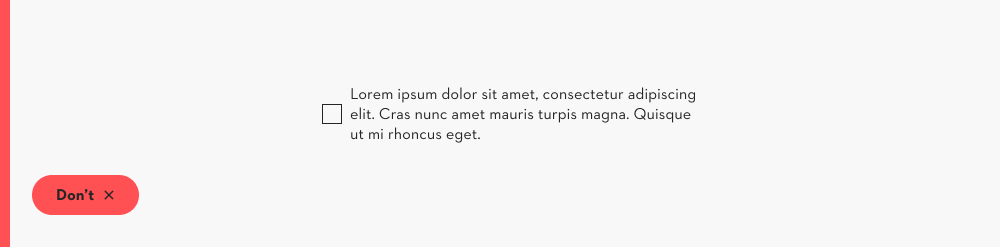

_Figure: Don't example. Shows checkbox (system feedback, label, label=Lorem ipsum dolor sit amet, consectetur adipiscing elit. Cras nunc amet mauris turpis magna. Quisque ut mi rhoncus eget., state=default, checked=false, indeterminate=false, invalid=false). Text in the figure: "Lorem ipsum dolor sit amet, consectetur adipiscing elit. Cras nunc amet mauri..."._

### Sizing

#### Maximum width of text container

To ensure good readability the maximum width should not exceed 544px (based on font size: 16px\*34em = 544px).

[Typography →](https://www.figma.com/design/pQUiJaNuWrGzPaeMrEHf6N/DS-1117-Design-%7C-34em?node-id=2645-515)

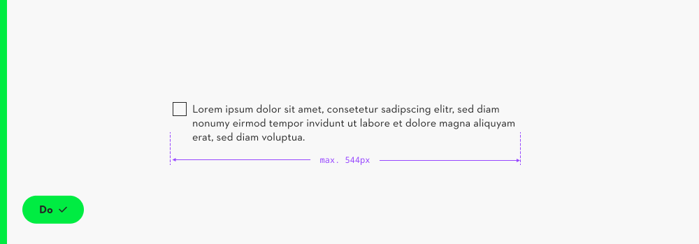

_Figure: Do example. Shows checkbox (system feedback, label, label=Lorem ipsum dolor sit amet, consetetur sadipscing elitr, sed diam nonumy eirmod tempor invidunt ut labore et dolore magna aliquyam erat, sed diam voluptua. , state=default, checked=false, indeterminate=false, invalid=false). Text in the figure: "Lorem ipsum dolor sit amet, consetetur sadipscing elitr, sed diam nonumy eirm...", "max. 544px"._

Do not exceed 544px, even when the module or grid is wider.

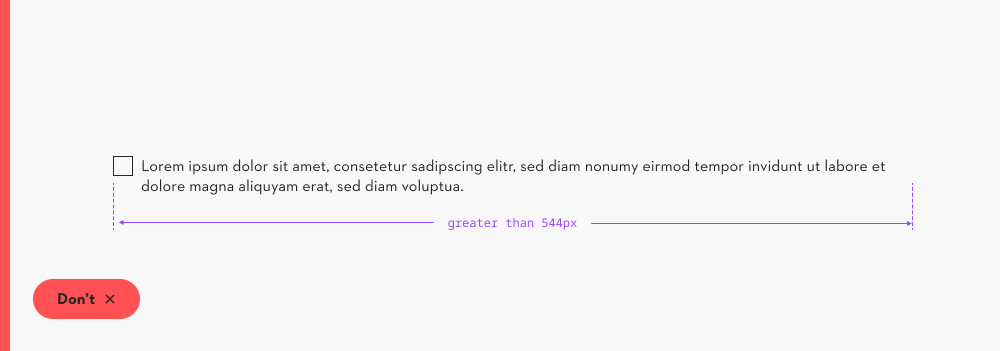

_Figure: Don't example. Text in the figure: "Lorem ipsum dolor sit amet, consetetur sadipscing elitr, sed diam nonumy eirm...", "greater than 544px"._

## Content and Assets

### Single checkbox

A single checkbox can be used for e.g.

- accepting a privacy policy
- newsletter subscription
- remembering login credentials

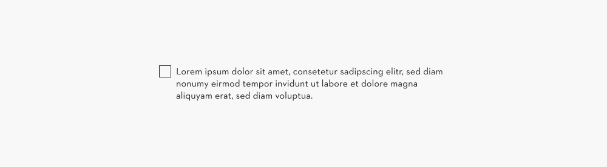

_Figure: Shows checkbox (system feedback, label, label=Lorem ipsum dolor sit amet, consetetur sadipscing elitr, sed diam nonumy eirmod tempor invidunt ut labore et dolore magna aliquyam erat, sed diam voluptua. , state=default, checked=false, indeterminate=false, invalid=false). Text in the figure: "Lorem ipsum dolor sit amet, consetetur sadipscing elitr, sed diam nonumy eirm..."._

### Overflow behaviour

Keep labels concise to minimize text overflow. If overflow does occur, align the chexkbox with the first line of the label text.

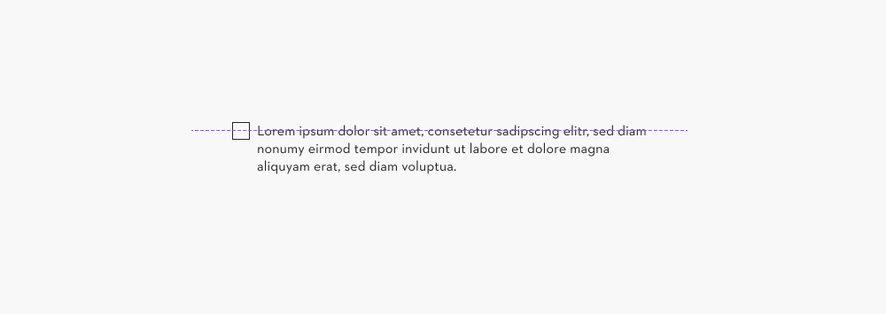

_Figure: Shows checkbox (system feedback, label, label=Lorem ipsum dolor sit amet, consetetur sadipscing elitr, sed diam nonumy eirmod tempor invidunt ut labore et dolore magna aliquyam erat, sed diam voluptua. , state=default, checked=false, indeterminate=false, invalid=false). Text in the figure: "Lorem ipsum dolor sit amet, consetetur sadipscing elitr, sed diam nonumy eirm..."._

## Behavior

### System feedback

In case of an error message being displayed, the error messages is styled the same as for the input field error message.

The error message should be **aligned with the checkbox.**

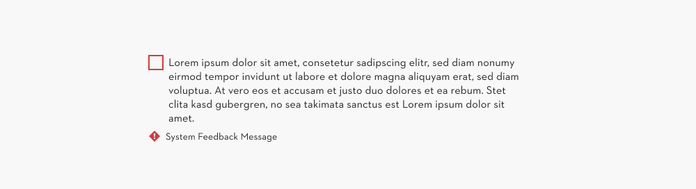

_Figure: Shows checkbox (label=Lorem ipsum dolor sit amet, consetetur sadipscing elitr, sed diam nonumy eirmod tempor invidunt ut labore et dolore magna aliquyam erat, sed diam voluptua. At vero eos et accusam et justo duo dolores et ea rebum. Stet clita kasd gubergren, no sea takimata sanctus est Lorem ipsum dolor sit amet., label, system feedback, state=default, checked=false, indeterminate=false, invalid=true). Text in the figure: "Lorem ipsum dolor sit amet, consetetur sadipscing elitr, sed diam nonumy eirm...", "System Feedback Message"._

### Click behavior

Click area: the label must be clickable and trigger the activation.

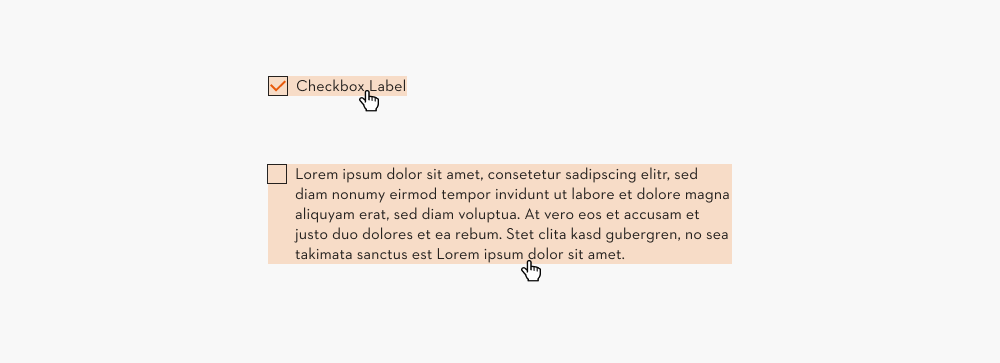

_Figure: Shows checkbox (label, system feedback, label=Checkbox Label, state=default, checked=true, indeterminate=false, invalid=false); checkbox (system feedback, label, label=Lorem ipsum dolor sit amet, consetetur sadipscing elitr, sed diam nonumy eirmod tempor invidunt ut labore et dolore magna aliquyam erat, sed diam voluptua. At vero eos et accusam et justo duo dolores et ea rebum. Stet clita kasd gubergren, no sea takimata sanctus est Lorem ipsum dolor sit amet., state=default, checked=false, indeterminate=false, invalid=false). Text in the figure: "Checkbox Label", "Lorem ipsum dolor sit amet, consetetur sadipscing elitr, sed diam nonumy eirm..."._

## Currently used variations ⚠️ The following examples are not part of the code component

### Product tiles in a list view

The checkbox is always left-aligned in a list view. Due to the images the checkboxes are centered vertically.

### Filter

To filter a results list, the user can select different values. Depending on the use case, selecting a value is activated instantly or is set through an extra button to confirm. E.g. “apply filter” or “show results”.

This examples show a dropdown for desktop and the mobile version in a modal.

[Dialog →](https://www.figma.com/design/qXldpLO6gxHJNLdcXIPxYt?node-id=14115-4051)

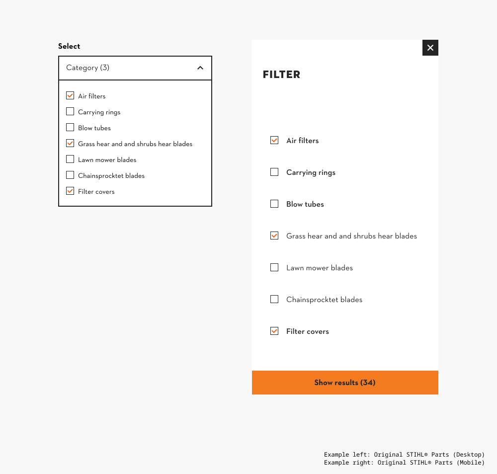

_Figure: Text in the figure: "Select", "Category (3)", "Air filters", "Carrying rings", "Blow tubes", "Grass hear and and shrubs hear blades", "Lawn mower blades", "Chainsprocktet blades", "Filter covers", "Example left: Original STIHL® Parts (Desktop) Example right: Original STIHL®..."._

## Checkbox Group

Overview:

- Use checkboxes when multiple items can be selected. Use a[ Radio Group](https://www.figma.com/design/qXldpLO6gxHJNLdcXIPxYt?node-id=860-2728), when only one item can be selected.
- A checkbox group can be aligned horizontally if there are 3 or less checkboxes, otherwise align vertically.

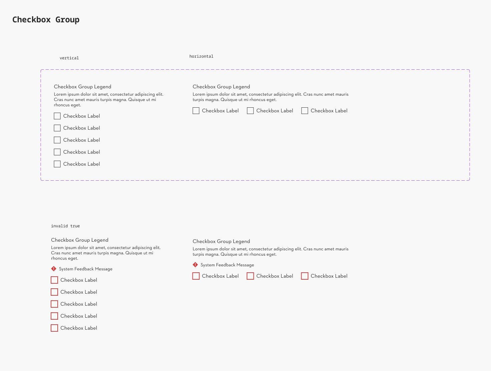

_Figure: Shows checkbox (system feedback, label, label=Checkbox Label, state=default, checked=false, indeterminate=false, invalid=false); checkbox-group (legend=Checkbox Group Legend, hint=Lorem ipsum dolor sit amet, consectetur adipiscing elit. Cras nunc amet mauris turpis magna. Quisque ut mi rhoncus eget., invalid, legend, hint, direction=vertical); checkbox-group (legend=Checkbox Group Legend, legend, hint=Lorem ipsum dolor sit amet, consectetur adipiscing elit. Cras nunc amet mauris turpis magna. Quisque ut mi rhoncus eget., invalid, hint, direction=horizontal). Text in the figure: "Checkbox Group", "vertical", "horizontal", "Checkbox Group Legend", "Lorem ipsum dolor sit amet, consectetur adipiscing elit. Cras nunc amet mauri...", "Checkbox Label", "invalid true", "System Feedback Message"._

### Further guidelines

[Storybook documentation](https://main--63440bbb95889041542a5ba3.chromatic.com/?path=/docs/components-checkbox-group--documentation)

Decision tree

### Related elements

[Input](https://www.figma.com/design/qXldpLO6gxHJNLdcXIPxYt?node-id=1591-2)

[Radio Group](https://www.figma.com/design/qXldpLO6gxHJNLdcXIPxYt?node-id=860-2728)

[Switch](https://www.figma.com/design/qXldpLO6gxHJNLdcXIPxYt?node-id=513-2)

### Contribute

Contribute to improving this component by sharing your feedback, asking questions, or suggesting features [here](https://www.figma.com/design/lLmw7PfIdKjFG4uT3B2Hyj/Onboarding-%F0%9F%93%96?node-id=446-868&t=zKmRu4kAkxMeRDmK-4).

## Formatting and Construction

### Anatomy

#### Checkbox group

1. **Checkbox group legend:** groups a set of checkboxes in form of a sentence or a question
1. **Checkbox group hint (optional):** provides guidance or further context or clarity for making a selection.
1. **Info Button (optional):** Can be used to trigger a popover with additional information
1. **System feedback:** error or success message to help the user understand
1. **Checkbox:** recognizable click element

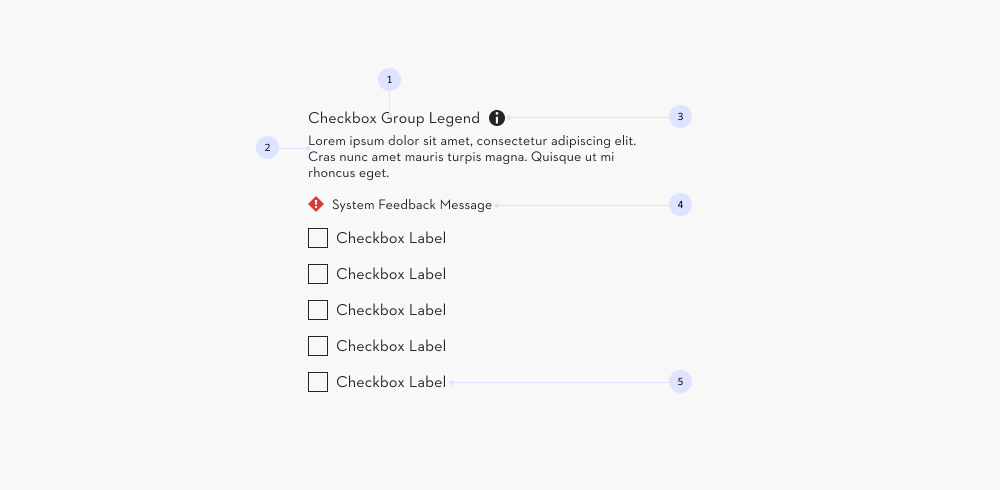

_Figure: Shows annotation-circle (number=1, type=top, color=blue); checkbox-group (legend=Checkbox Group Legend, hint=Lorem ipsum dolor sit amet, consectetur adipiscing elit. Cras nunc amet mauris turpis magna. Quisque ut mi rhoncus eget., ℹ️ info-button, invalid, legend, hint, direction=vertical); annotation-circle (number=3, type=right, color=blue); annotation-circle (number=2, type=left, color=blue); annotation-circle (number=4, type=right, color=blue); annotation-circle (number=5, type=right, color=blue). Callouts 1, 2, 3, 4, 5. Text in the figure: "Checkbox Group Legend", "Lorem ipsum dolor sit amet, consectetur adipiscing elit. Cras nunc amet mauri...", "System Feedback Message", "Checkbox Label"._

### Direction

#### Horizontal

In case the amount of checkbox is (below) 3 and the copy is short, consider a horizontal direction.

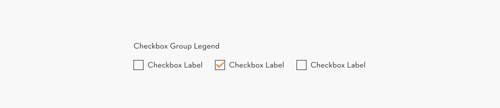

_Figure: Shows checkbox-group (legend=Checkbox Group Legend, legend, hint=Lorem ipsum dolor sit amet, consectetur adipiscing elit. Cras nunc amet mauris turpis magna. Quisque ut mi rhoncus eget., direction=horizontal). Text in the figure: "Checkbox Group Legend", "Checkbox Label"._

#### Vertical

In case of longer copy, use vertical direction.

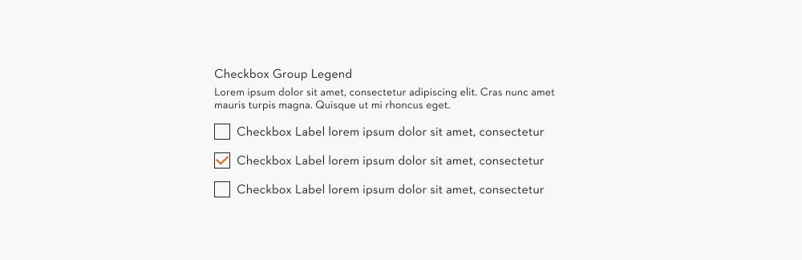

_Figure: Shows checkbox-group (legend=Checkbox Group Legend, hint=Lorem ipsum dolor sit amet, consectetur adipiscing elit. Cras nunc amet mauris turpis magna. Quisque ut mi rhoncus eget., legend, hint, direction=vertical). Text in the figure: "Checkbox Group Legend", "Lorem ipsum dolor sit amet, consectetur adipiscing elit. Cras nunc amet mauri...", "Checkbox Label lorem ipsum dolor sit amet, consectetur"._

## Content and Assets

The use of checkbox groups is very versatile, examples are:

- add custom choices
- set interests for news updates
- available time slots

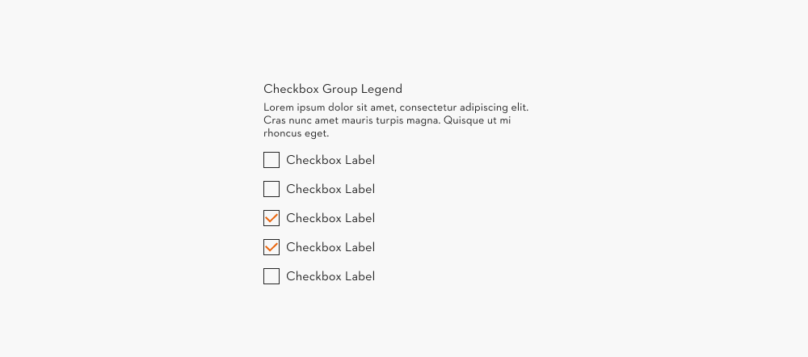

_Figure: Shows checkbox-group (legend=Checkbox Group Legend, hint=Lorem ipsum dolor sit amet, consectetur adipiscing elit. Cras nunc amet mauris turpis magna. Quisque ut mi rhoncus eget., legend, hint, direction=vertical). Text in the figure: "Checkbox Group Legend", "Lorem ipsum dolor sit amet, consectetur adipiscing elit. Cras nunc amet mauri...", "Checkbox Label"._

### Content design

Use uniform styling and formatting for all labels, in order for the user to scan easily through a long list.

E.g. format the first words bold, following by an ‘:’.

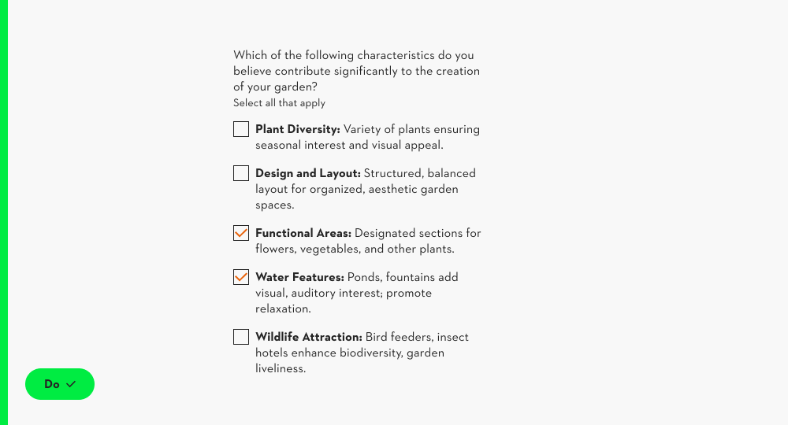

_Figure: Do example. Shows checkbox-group (legend=Which of the following characteristics do you believe contribute significantly to the creation of your garden?, hint=Select all that apply, legend, hint, direction=vertical). Text in the figure: "Which of the following characteristics do you believe contribute significantl...", "Select all that apply", "Plant Diversity: Variety of plants ensuring seasonal interest and visual appeal.", "Design and Layout: Structured, balanced layout for organized, aesthetic garde...", "Functional Areas: Designated sections for flowers, vegetables, and other plants.", "Water Features: Ponds, fountains add visual, auditory interest; promote relax...", "Wildlife Attraction: Bird feeders, insect hotels enhance biodiversity, garden..."._

### Mixed label lengths

Don’t mix long and short checkbox labels.

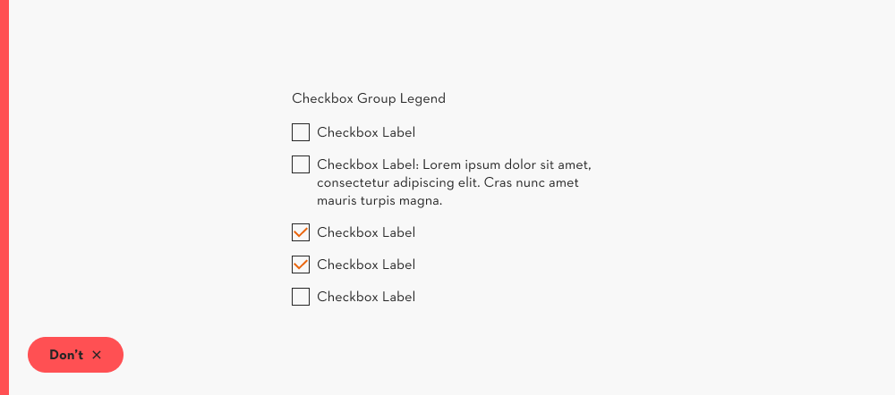

_Figure: Don't example. Shows checkbox-group (legend=Checkbox Group Legend, hint=Lorem ipsum dolor sit amet, consectetur adipiscing elit. Cras nunc amet mauris turpis magna. Quisque ut mi rhoncus eget., legend, direction=vertical). Text in the figure: "Checkbox Group Legend", "Checkbox Label", "Checkbox Label: Lorem ipsum dolor sit amet, consectetur adipiscing elit. Cras..."._

### Info Button

A button to trigger a popover can be placed next to input or select labels to provide **additional contextual information.**

Popover content should be **limited to supplementary, non-critical information** — for example, brief explanations, examples, or guidance that supports user understanding without being essential for task completion.

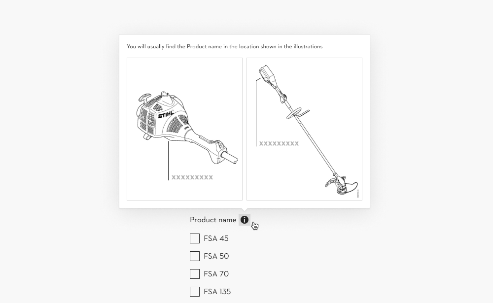

_Figure: Shows checkbox-group (legend=Product name, hint=Choose the Name , ℹ️ info-button, legend, direction=vertical); cursor (type=pointer). Text in the figure: "You will usually find the Product name in the location shown in the illustrat...", "Product name", "FSA 45", "FSA 50", "FSA 70", "FSA 135", "Checkbox Label"._

**Don’t use the popover for critical or required information**, use the hint instead as critical information should net be hidden

For mor Guidance on this topic see the [Popover documentation](https://www.figma.com/design/qXldpLO6gxHJNLdcXIPxYt?node-id=35223-10505)

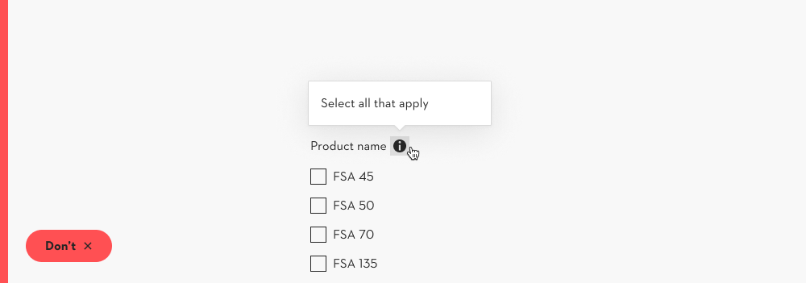

_Figure: Don't example. Shows popover (arrow=true, arrow placement=below, arrow alignment=center, color=white); checkbox-group (legend=Product name, hint=Choose the Name , ℹ️ info-button, legend, direction=vertical); cursor (type=pointer). Text in the figure: "Select all that apply", "Product name", "FSA 45", "FSA 50", "FSA 70", "FSA 135", "Checkbox Label"._

## Behavior

### System feedback

In case of an error message being displayed, the error messages is styled the same as for the input-filed error message.

Feedback often applies to the full list, instead to one single check box.

The error message should be **aligned with the checkbox.**

[Text Input→](https://www.figma.com/design/qXldpLO6gxHJNLdcXIPxYt?node-id=1591-2)

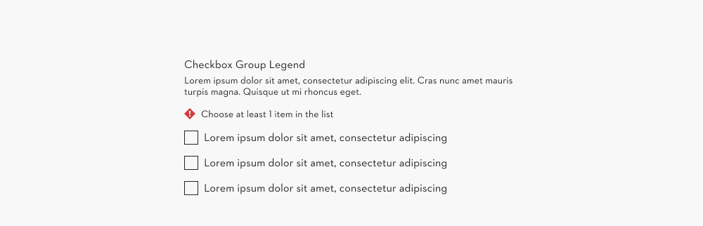

_Figure: Shows checkbox-group (legend=Checkbox Group Legend, hint=Lorem ipsum dolor sit amet, consectetur adipiscing elit. Cras nunc amet mauris turpis magna. Quisque ut mi rhoncus eget., invalid, legend, hint, direction=vertical). Text in the figure: "Checkbox Group Legend", "Lorem ipsum dolor sit amet, consectetur adipiscing elit. Cras nunc amet mauri...", "Choose at least 1 item in the list", "Lorem ipsum dolor sit amet, consectetur adipiscing"._

### Radio Button vs. Checkbox

If a user can only select only one option from a list, radio buttons should be used instead of checkboxes.

Checkboxes allow the user to select multiple items in a set, whereas radio buttons allow the user to select only one option. **DO** Use radio buttons when **only one** item can be selected. **DO** Use checkboxes when **multiple** items can be selected

[Radio Buttons→](https://www.figma.com/design/qXldpLO6gxHJNLdcXIPxYt?node-id=860-2728)

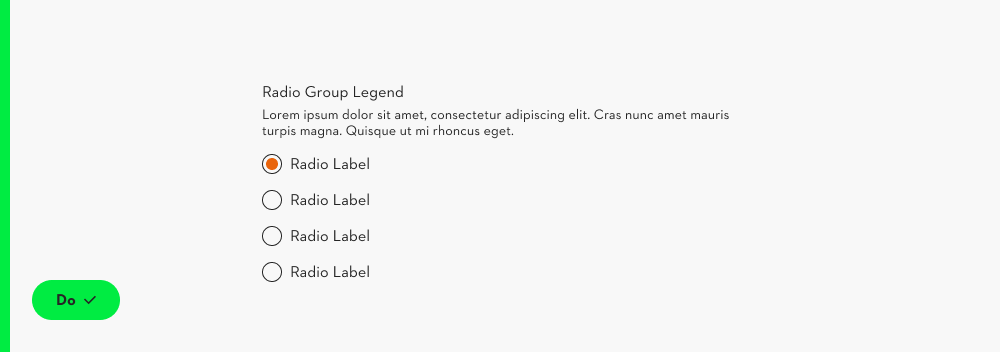

_Figure: Do example. Shows radio-group (item 5, legend, legend=Radio Group Legend, item 4, hint=Lorem ipsum dolor sit amet, consectetur adipiscing elit. Cras nunc amet mauris turpis magna. Quisque ut mi rhoncus eget., hint, orientation=vertical, show title=false). Text in the figure: "Radio Group Legend", "Lorem ipsum dolor sit amet, consectetur adipiscing elit. Cras nunc amet mauri...", "Radio Label"._

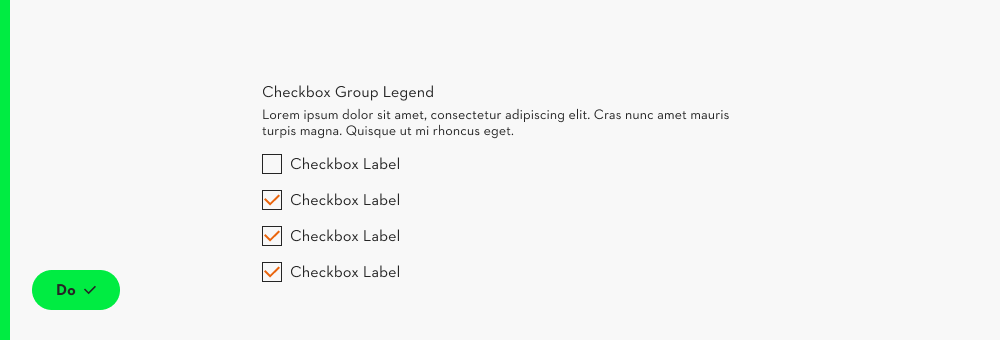

_Figure: Do example. Shows checkbox-group (legend=Checkbox Group Legend, hint=Lorem ipsum dolor sit amet, consectetur adipiscing elit. Cras nunc amet mauris turpis magna. Quisque ut mi rhoncus eget., legend, hint, direction=vertical). Text in the figure: "Checkbox Group Legend", "Lorem ipsum dolor sit amet, consectetur adipiscing elit. Cras nunc amet mauri...", "Checkbox Label"._

### Click area

The label must be clickable and trigger the activation.

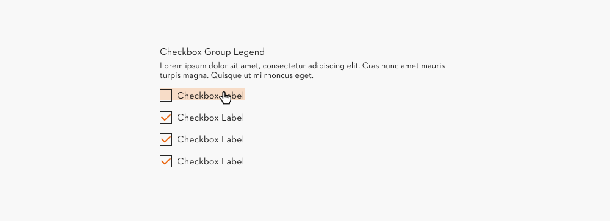

_Figure: Shows checkbox-group (legend=Checkbox Group Legend, hint=Lorem ipsum dolor sit amet, consectetur adipiscing elit. Cras nunc amet mauris turpis magna. Quisque ut mi rhoncus eget., legend, hint, direction=vertical). Text in the figure: "Checkbox Group Legend", "Lorem ipsum dolor sit amet, consectetur adipiscing elit. Cras nunc amet mauri...", "Checkbox Label"._

## Currently used variations ⚠️ The following example is not part of the code component

### Horizontal + vertical

In case the amount of checkboxes is high and the copy is short, consider a horizontal direction for columns.

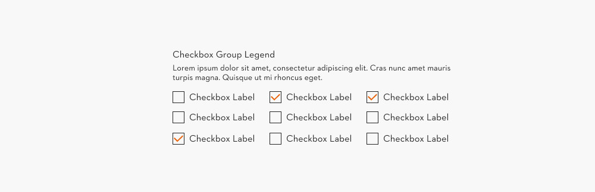

_Figure: Shows checkbox-group (legend=Checkbox Group Legend, legend, hint=Lorem ipsum dolor sit amet, consectetur adipiscing elit. Cras nunc amet mauris turpis magna. Quisque ut mi rhoncus eget., hint, direction=horizontal); checkbox (system feedback, label, label=Checkbox Label, state=default, checked=false, indeterminate=false, invalid=false); checkbox (label, system feedback, label=Checkbox Label, state=default, checked=true, indeterminate=false, invalid=false). Text in the figure: "Checkbox Group Legend", "Lorem ipsum dolor sit amet, consectetur adipiscing elit. Cras nunc amet mauri...", "Checkbox Label"._
