# Chip Group

## Chip Group

Overview:

- The chip group is an interactive element.
   - Check out the flag component, for the read-only component.
- There are three types of chip group implementations:
   - Single select: primarily for a single selection, similar to the radio group component.
   - Multi select: all chips can be selected, similar to the checkbox group component.
   - Removable: primarily for refining content by applying filters.
- The chip itself is binary: selected or unselected
- For different use cases and viewports, the chip comes in two sizes and densities. There are no limitations when to use which.
- Use icons sparingly, as too many icons in an interface might impose unnecessary cognitive load.
- Chips from different groups cannot be listed under the same group label.
- Place selectable chips close to the filtered list.
- A suggestion chip is technically a link and not a chip. Use a [small outline button](https://www.figma.com/design/qXldpLO6gxHJNLdcXIPxYt/Pattern-Library-%F0%9F%96%A5-Web-1.0?node-id=165-346&t=RKNZaDb3abSpUHQX-4) instead.

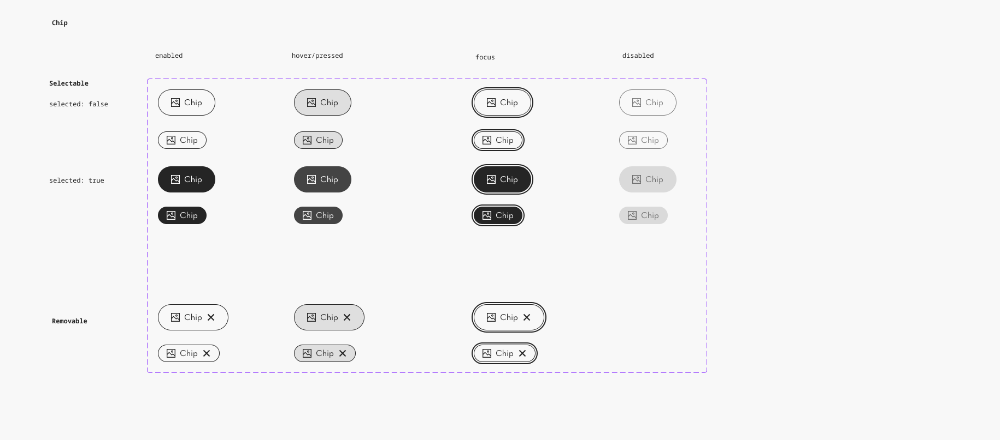

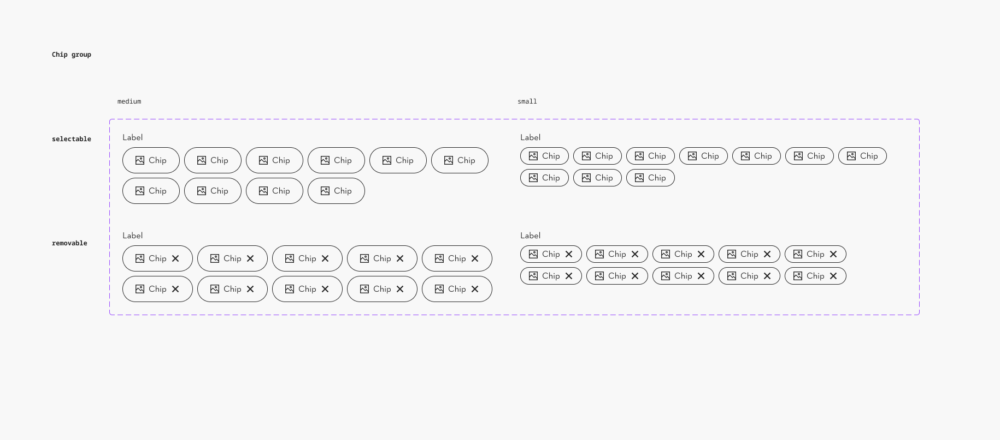

### Further guidelines

[Storybook documentation](https://main--63440bbb95889041542a5ba3.chromatic.com/?path=/docs/components-chip-group--documentation)

Decision tree

### Related elements

[Checkbox Group](https://www.figma.com/design/qXldpLO6gxHJNLdcXIPxYt/Pattern-Library-%F0%9F%96%A5-Web-1.0?node-id=1017-2316)

[Flag](https://www.figma.com/design/qXldpLO6gxHJNLdcXIPxYt?node-id=19511-2443)

[Radio Group](https://www.figma.com/design/qXldpLO6gxHJNLdcXIPxYt/Pattern-Library-%F0%9F%96%A5-Web-1.0?node-id=860-2728)

[Switch](https://www.figma.com/design/qXldpLO6gxHJNLdcXIPxYt/Pattern-Library-%F0%9F%96%A5-Web-1.0?node-id=513-2)

[Iconography](https://www.figma.com/design/U218NNP4OsipaHOtv5flns/Iconography-%E2%9E%A1%EF%B8%8F?m=auto)

[Combobox](https://www.figma.com/design/qXldpLO6gxHJNLdcXIPxYt/Pattern-Library-%F0%9F%96%A5-Web-1.0?node-id=2659-3954)

[Select](https://www.figma.com/design/qXldpLO6gxHJNLdcXIPxYt/Pattern-Library-%F0%9F%96%A5-Web-1.0?node-id=8139-4888)

[Button](https://www.figma.com/design/qXldpLO6gxHJNLdcXIPxYt/Pattern-Library-%F0%9F%96%A5-Web-1.0?node-id=162-126)

### Contribute

Contribute to improving this component by sharing your feedback, asking questions, or suggesting features [here](https://www.figma.com/design/lLmw7PfIdKjFG4uT3B2Hyj/Onboarding-%F0%9F%93%96?node-id=446-868&t=zKmRu4kAkxMeRDmK-4).

## Formatting and Construction

### Anatomy

#### Chip group

1. **Chip group label (optional)**
1. **Icon (optional)**
1. **Chip label**
1. **Close icon (optional)**

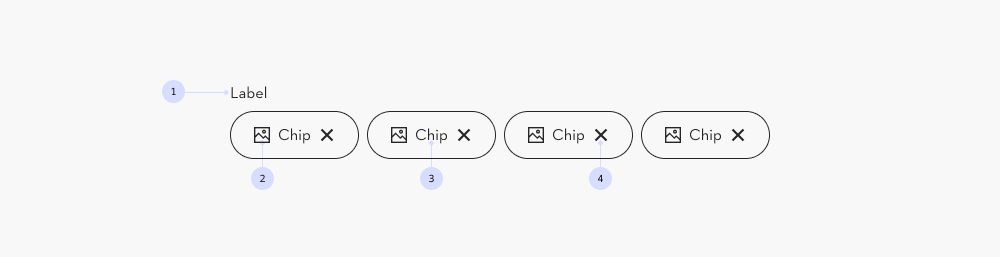

#### Selectable chip

Use primarily for a binary selection, similar to checkbox. The unselected chips are initially visible in the interface.

The chip has 2 states that are different in color: selected or unselected.

1. **Icon (optional)**
1. **Chip label**

#### Removable chip

Use primarily for refining lists by applying filters. The chips will appear in the interface, after the attribute is activated.

The chip has 2 states that are different in perceptivity: visible and not visible.

1. **Icon (optional)**
1. **Chip label**
1. **Close icon**

#### Size and density

For different use cases and viewports, the chip comes in two sizes. Only the padding is different:

1. **Medium size**
1. **Small size**

#### Do not combine medium and small

The different sized may not be combined in the same list.

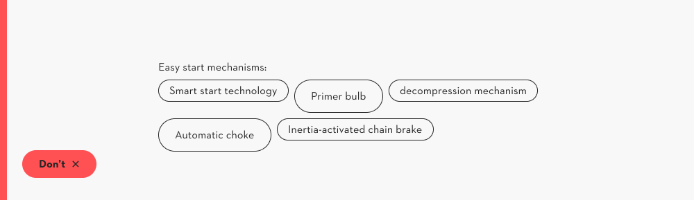

#### Overflow of the label

The chip label can not be two lines.

Tip: test the length of the label in all viewports.

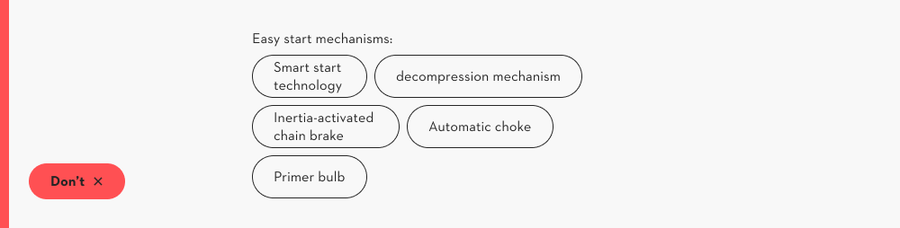

### Group

#### Single select or multi select

The selectable chips are always in a group. For different use cases, the chip group can be...

1. **Single select** (similar to a [radio group](https://www.figma.com/design/qXldpLO6gxHJNLdcXIPxYt?node-id=860-2728))
1. **Multi select** (similar to a [checkbox](https://www.figma.com/design/qXldpLO6gxHJNLdcXIPxYt?node-id=1017-2316) group)

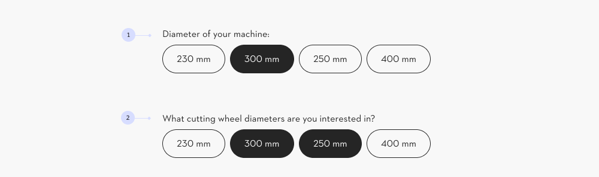

#### Stack all chips in the group

In a chip, the container width is automatically adjusted according to the content length.

This option is available when there are two or more items.

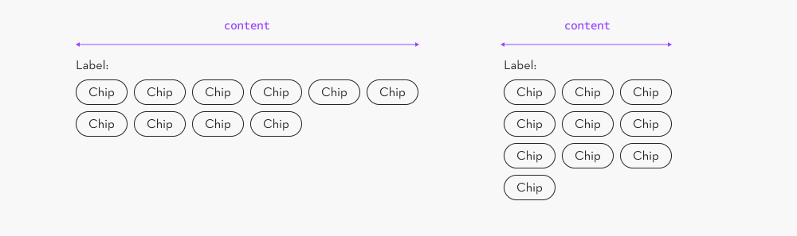

#### Group width

Follow the width of the [content grid “narrow”.](https://www.figma.com/design/JyyYtoCYbtJrzqHs38OXSQ/Grid-%26-Spacing-%F0%9F%A7%AE?node-id=1-132)

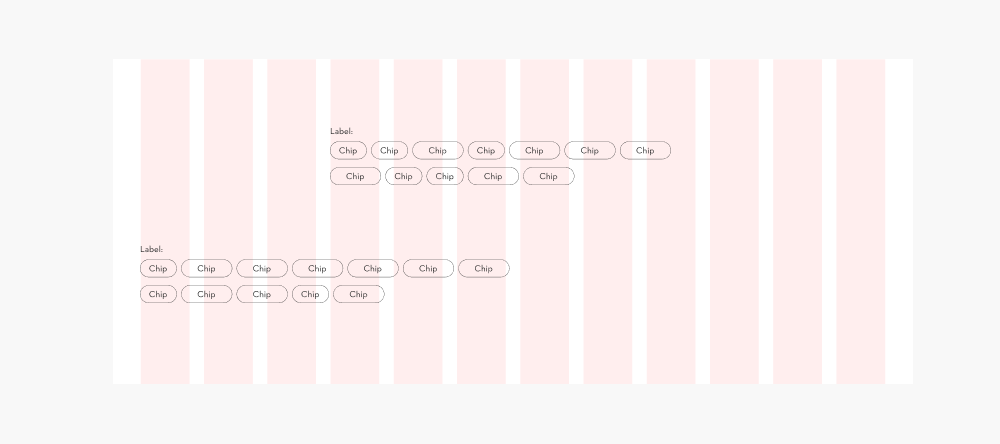

## Content and Assets

### Concise labels

Use short words in simple language. They must be easy to understand. Also, avoid abbreviations for accessibility reasons.

### Length

Around 3-40 characters, depending on the viewport, as the labels are not allowed to truncate.

The length of all labels chips in a group can be of diverse length.

### Icon usage

Use icons sparingly, as too many icons in an interface might impose unnecessary cognitive load.

**Preferred**: use icons from the library. **Custom icons** can also be used:

- Size & format: Square SVG, transparent background, rendered in a fixed 16×16px box. See [Iconography Guidelines](https://www.figma.com/design/U218NNP4OsipaHOtv5flns/Iconography-%E2%9E%A1%EF%B8%8F?node-id=9857-3242) for details.
- Theme & state: Custom icons do not adapt to theme, selected, or disabled state. Design them with sufficient contrast on light and inverse (dark) backgrounds, and on unselected and selected backgrounds.
- Accessibility: When using custom icons, keep color contrast (WCAG AA 3:1) in mind so the icon stays legible across all backgrounds and states.
- Disabled chips: Prefer library icons here; a custom icon keeps full contrast even when disabled, which can misleadingly look "active."

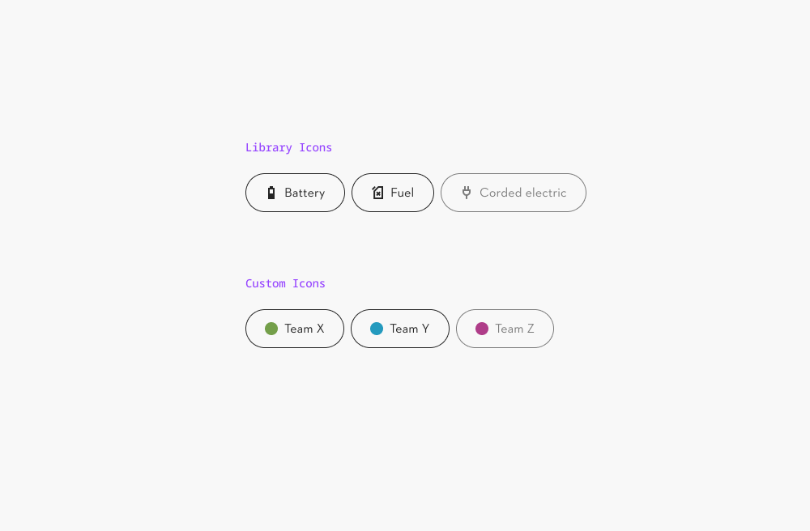

### Group label

#### Use “:”

In some cases the group has a label. For the chip group it is recommended to use an “:” after the label.

#### Activate the user

In some cases it is wise to use the verb “select” in the group label, to inform the user about the action needed.

In most cases a colon is recommended.

### Semantic structure

#### Do not combine selectable and removable in the same list

It is not allowed to combine both **(1)** removable chips and **(2)** input selectable in the same list.

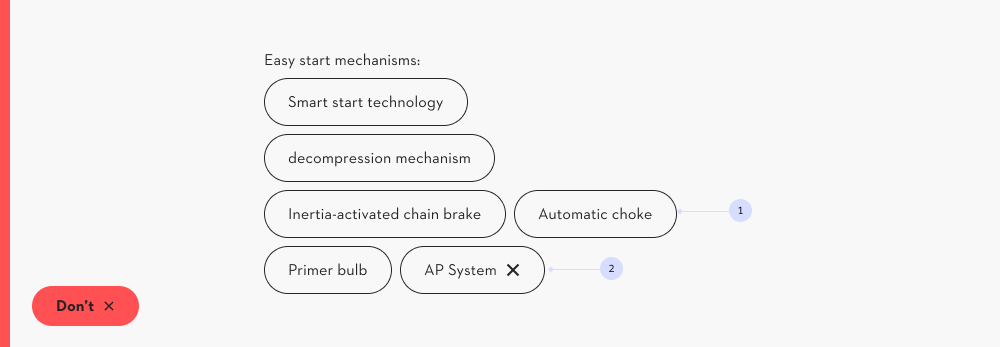

#### Don’t mix chips with a different purpose

Chips with a different function and therefore purpose cant be in one group.

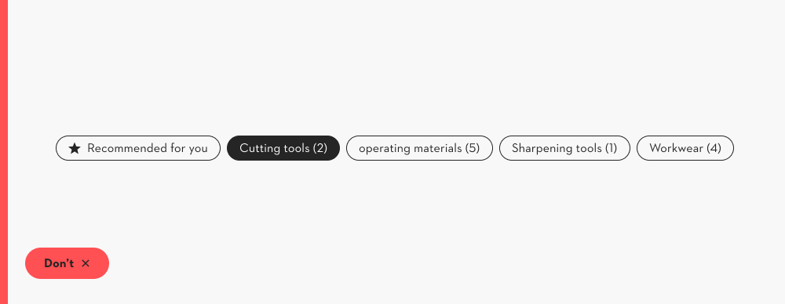

## Behavior

### Browser default tooltip

The screenreader explains the action, examples are:

- Selectable chip: Deactivate property **(1)**
   - e.g. machine status
- Removable chip: Remove filter **(2)**
   - e.g. product category

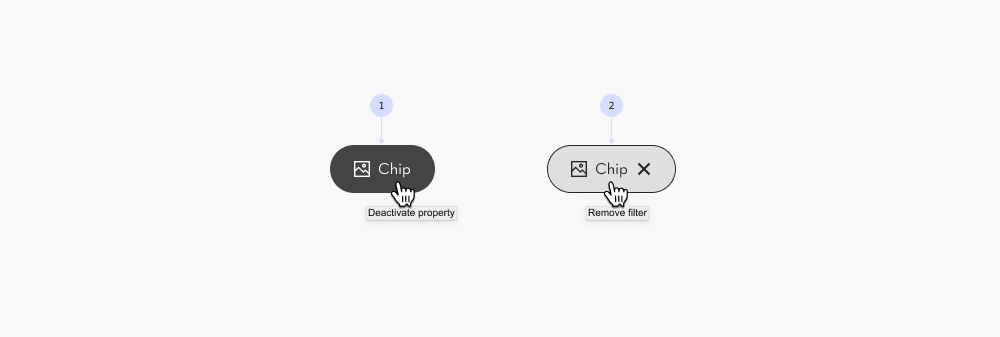

### Chips that appear by user interactions

Removable chips are initially not part of the interface. The user must use a (filter) function to select properties.

The chips will appear in the interface. Ideally, close to the filtered list.

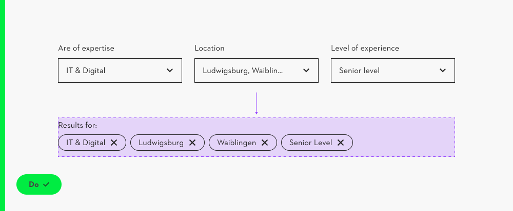

### Select chips to reveal the group label

The group label appears only together with a chip, e.g. after the the first chip is selected.

When all chips are deselected, the group label disappears again.

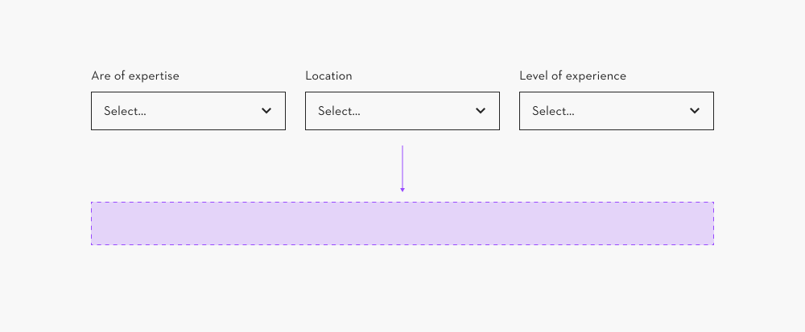

## Examples/Variants

### Filter horizontal

- Removable chips are ideal to display immediately below the horizontal filter.
- The label of the chip group is optional, as the context is clear, due to the proximity.

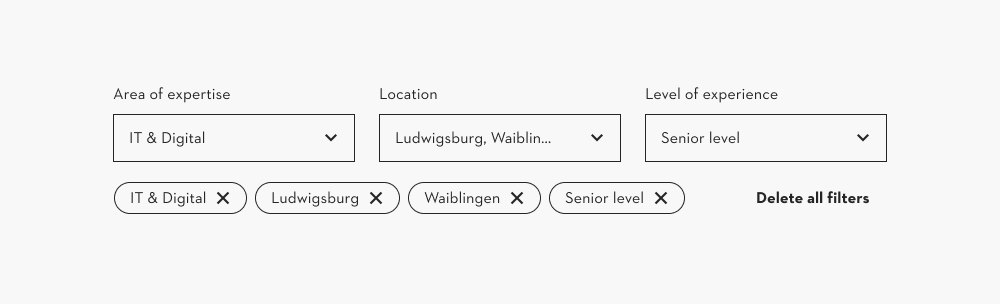

### Filter mobile

- The filter opens in a drawer.
- Removable chips are ideal to display immediately below the button.
- The label of the chip group is optional, as the context is clear, due to the proximity.

### Filter sidebar

- Use the removable chips.
- The chips may be placed further away from the filter.
- A group label helps to understand the grouped list.

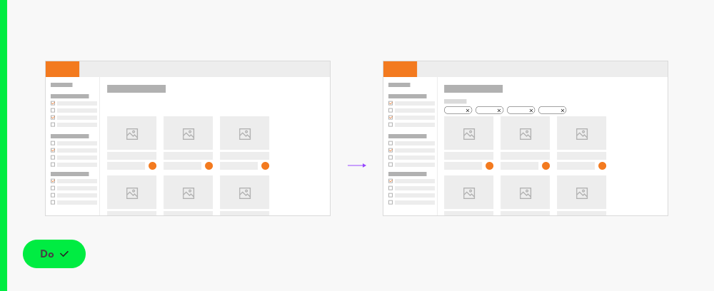

### Do not use selectable chips in complex filters

Do not use selectable chips inside a complex filter, e.g. located in a sidebar, as lists will increase visual clutter and therefore impose unnecessary cognitive load.

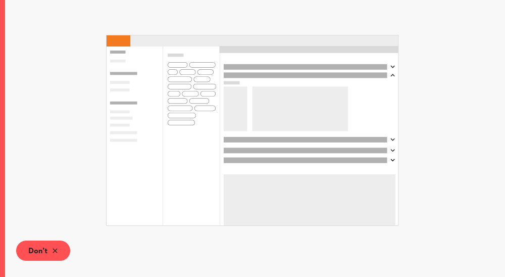

### Filter simple

- A simple filter has around 5 attributes.
- Use the selectable chips, if the interface is spacious enough

### Suggestion links

A common variation of the chip is the **suggestion chip**. These suggestions are technically links and not chips.

Use a [small outline button](https://www.figma.com/design/qXldpLO6gxHJNLdcXIPxYt/Pattern-Library-%F0%9F%96%A5-Web-1.0?node-id=165-346&t=RKNZaDb3abSpUHQX-4) instead.

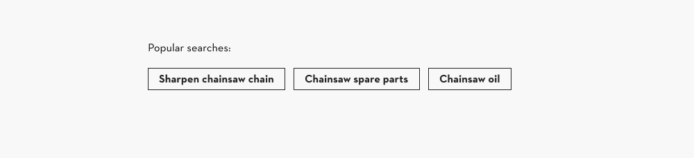

### Do not use selectable chips in a combobox component

In a combobox component, as scrolling must be avoided.

**Recommendation:** The [checkbox group](https://www.figma.com/design/qXldpLO6gxHJNLdcXIPxYt/Pattern-Library-%F0%9F%96%A5-Web-1.0?node-id=5626-11362&t=RKNZaDb3abSpUHQX-4) is compact and easy to read, as the checkboxes are all aligned.

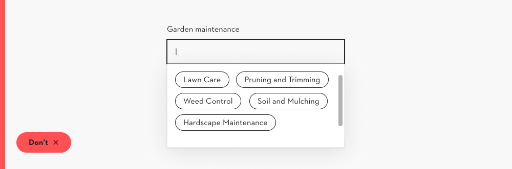

### Checkbox group, switch button or chip group?

**Warning:** The chip group takes up a lot of space and the list is harder to read.

**Warning:** The [switch component](https://www.figma.com/design/qXldpLO6gxHJNLdcXIPxYt/Pattern-Library-%F0%9F%96%A5-Web-1.0?node-id=513-121&t=RKNZaDb3abSpUHQX-4) is not an input element, don’t use it in filters.

**Recommendation:** The [checkbox group](https://www.figma.com/design/qXldpLO6gxHJNLdcXIPxYt/Pattern-Library-%F0%9F%96%A5-Web-1.0?node-id=5626-11362&t=RKNZaDb3abSpUHQX-4) is compact and easy to read, as the checkboxes are all aligned.

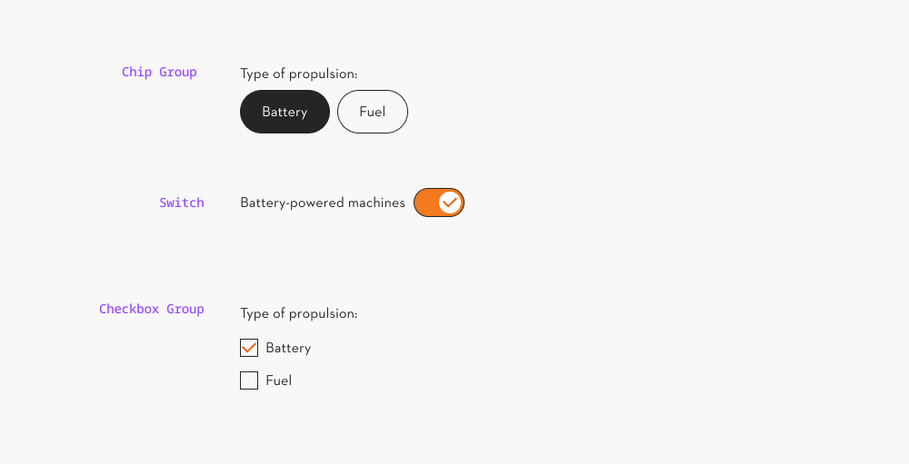

### Chip group or radio group?

**Warning:** The chip group takes up a lot of space and the list is harder to read.

**Recommendation:** The [radio group component](https://www.figma.com/design/qXldpLO6gxHJNLdcXIPxYt/Pattern-Library-%F0%9F%96%A5-Web-1.0?node-id=860-2729&t=oWORc7O39VJU5gMH-4) is compact and easy to read, as the radios are all aligned.

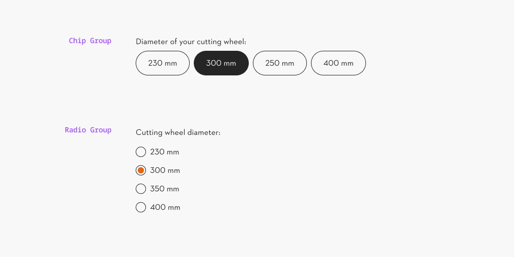
