# Chip Group

## Chip Group

Overview:

- The chip group is an interactive element.
   - Check out the flag component, for the read-only component.
- There are three types of chip group implementations:
   - Single select: primarily for a single selection, similar to the radio group component.
   - Multi select: all chips can be selected, similar to the checkbox group component.
   - Removable: primarily for refining content by applying filters.
- The chip itself is binary: selected or unselected
- For different use cases and viewports, the chip comes in two sizes and densities. There are no limitations when to use which.
- Use icons sparingly, as too many icons in an interface might impose unnecessary cognitive load.
- Chips from different groups cannot be listed under the same group label.
- Place selectable chips close to the filtered list.
- A suggestion chip is technically a link and not a chip. Use a [small outline button](https://www.figma.com/design/qXldpLO6gxHJNLdcXIPxYt/Pattern-Library-%F0%9F%96%A5-Web-1.0?node-id=165-346&t=RKNZaDb3abSpUHQX-4) instead.

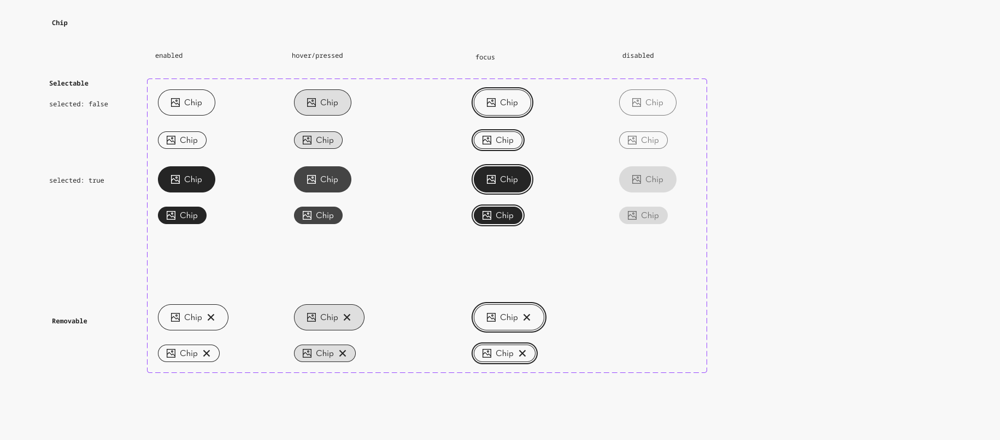

_Figure: Matrix of the chip in all states, titled "Chip". Columns are "enabled", "hover/pressed", "focus" and "disabled". The "Selectable" rows show a medium and a small chip with a leading image icon and the label "Chip", first for "selected: false" (white with a thin dark outline) and then for "selected: true" (filled dark with white text). Hover/pressed is a grey fill (a lighter grey when unselected, a lighter dark when selected), focus adds a double dark outline ring, and disabled is greyed out with grey text and icon. The "Removable" rows show a medium and a small chip with a close (X) icon after the label in enabled, hover/pressed (grey fill) and focus (double outline) states; there is no disabled removable chip._

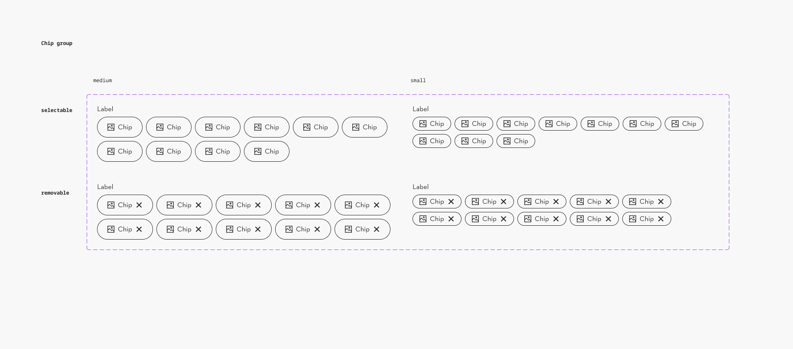

_Figure: Overview of the chip group in two sizes, titled "Chip group", with the columns "medium" and "small" and the rows "selectable" and "removable". Each cell has the group label "Label" above wrapping rows of unselected chips with a leading icon and the text "Chip". The selectable medium group shows ten chips (six in the first row, four in the second), the small group ten chips (seven and three). The removable groups show ten chips with a close (X) icon each, in two rows of five for both medium and small; the small chips are lower and tighter._

### Further guidelines

[Storybook documentation](https://main--63440bbb95889041542a5ba3.chromatic.com/?path=/docs/components-chip-group--documentation)

Decision tree

### Related elements

[Checkbox Group](https://www.figma.com/design/qXldpLO6gxHJNLdcXIPxYt/Pattern-Library-%F0%9F%96%A5-Web-1.0?node-id=1017-2316)

[Flag](https://www.figma.com/design/qXldpLO6gxHJNLdcXIPxYt?node-id=19511-2443)

[Radio Group](https://www.figma.com/design/qXldpLO6gxHJNLdcXIPxYt/Pattern-Library-%F0%9F%96%A5-Web-1.0?node-id=860-2728)

[Switch](https://www.figma.com/design/qXldpLO6gxHJNLdcXIPxYt/Pattern-Library-%F0%9F%96%A5-Web-1.0?node-id=513-2)

[Iconography](https://www.figma.com/design/U218NNP4OsipaHOtv5flns/Iconography-%E2%9E%A1%EF%B8%8F?m=auto)

[Combobox](https://www.figma.com/design/qXldpLO6gxHJNLdcXIPxYt/Pattern-Library-%F0%9F%96%A5-Web-1.0?node-id=2659-3954)

[Select](https://www.figma.com/design/qXldpLO6gxHJNLdcXIPxYt/Pattern-Library-%F0%9F%96%A5-Web-1.0?node-id=8139-4888)

[Button](https://www.figma.com/design/qXldpLO6gxHJNLdcXIPxYt/Pattern-Library-%F0%9F%96%A5-Web-1.0?node-id=162-126)

### Contribute

Contribute to improving this component by sharing your feedback, asking questions, or suggesting features [here](https://www.figma.com/design/lLmw7PfIdKjFG4uT3B2Hyj/Onboarding-%F0%9F%93%96?node-id=446-868&t=zKmRu4kAkxMeRDmK-4).

## Formatting and Construction

### Anatomy

#### Chip group

1. **Chip group label (optional)**
1. **Icon (optional)**
1. **Chip label**
1. **Close icon (optional)**

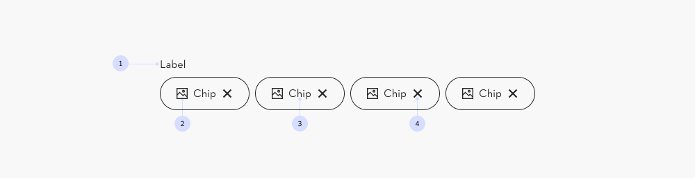

_Figure: Anatomy of a removable chip group with four numbered callouts. Callout 1 points at the group label "Label" above the chips (optional). Callout 2 points at the leading icon of the first chip (optional). Callout 3 points at the chip label "Chip". Callout 4 points at the close icon (X) at the end of a chip (optional). Four medium chips, each with an image icon, "Chip" and a close icon, are lined up in a row._

#### Selectable chip

Use primarily for a binary selection, similar to checkbox. The unselected chips are initially visible in the interface.

The chip has 2 states that are different in color: selected or unselected.

1. **Icon (optional)**
1. **Chip label**

_Figure: Anatomy of the selectable chip with two numbered callouts, shown in two states. The left chip, captioned "unselected", is white with a thin dark outline, the right chip, captioned "selected", has a dark fill with white text and icon. Both contain an image icon and the label "Chip". Callout 1 points at the icon (optional) and callout 2 points at the chip label._

#### Removable chip

Use primarily for refining lists by applying filters. The chips will appear in the interface, after the attribute is activated.

The chip has 2 states that are different in perceptivity: visible and not visible.

1. **Icon (optional)**
1. **Chip label**
1. **Close icon**

_Figure: Anatomy of the removable chip with three numbered callouts, captioned "selected". The chip has an outline, an image icon, the label "Chip" and a close (X) icon. Callout 1 points at the icon (optional), callout 2 points at the chip label and callout 3 points at the close icon._

#### Size and density

For different use cases and viewports, the chip comes in two sizes. Only the padding is different:

1. **Medium size**
1. **Small size**

_Figure: Two sizes of the selectable chip next to each other, both enabled and unselected with only the label "Chip" and no icon. Callout 1 points at the medium chip, which is taller with more padding. Callout 2 points at the small chip, which has less padding and is smaller. Only the padding differs between the sizes._

#### Do not combine medium and small

The different sized may not be combined in the same list.

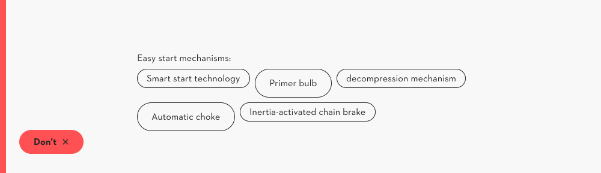

_Figure: Don't example: chip group with the label "Easy start mechanisms:" that mixes chip sizes in one list. Small chips "Smart start technology", "decompression mechanism" and "Inertia-activated chain brake" sit next to taller, medium-sized chips "Primer bulb" and "Automatic choke", all unselected outlined chips wrapped over two rows. Different sizes may not be combined in the same list._

#### Overflow of the label

The chip label can not be two lines.

Tip: test the length of the label in all viewports.

_Figure: Don't example: chip group with the label "Easy start mechanisms:" in which long chip labels break onto two lines. "Smart start technology" and "Inertia-activated chain brake" are each split over two lines inside taller chips, while "decompression mechanism", "Automatic choke" and "Primer bulb" stay on one line; all chips are unselected and wrap over three rows. A chip label cannot be two lines, so test the label length in all viewports._

### Group

#### Single select or multi select

The selectable chips are always in a group. For different use cases, the chip group can be...

1. **Single select** (similar to a [radio group](https://www.figma.com/design/qXldpLO6gxHJNLdcXIPxYt?node-id=860-2728))
1. **Multi select** (similar to a [checkbox](https://www.figma.com/design/qXldpLO6gxHJNLdcXIPxYt?node-id=1017-2316) group)

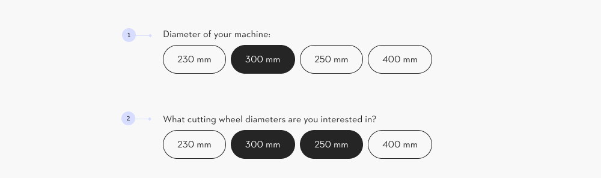

_Figure: Two selectable chip groups with four chips each: "230 mm", "300 mm", "250 mm" and "400 mm". Callout 1 points at the single select group "Diameter of your machine:", where only "300 mm" is selected (filled dark with white text). Callout 2 points at the multi select group "What cutting wheel diameters are you interested in?", where "300 mm" and "250 mm" are selected at the same time. Single select works like a radio group, multi select like a checkbox group._

#### Stack all chips in the group

In a chip, the container width is automatically adjusted according to the content length.

This option is available when there are two or more items.

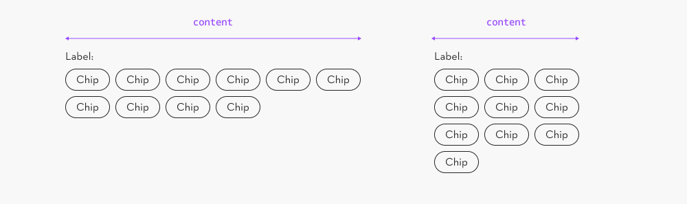

_Figure: Two layouts of a chip group with the label "Label:" and unselected outlined small chips "Chip". On the left, a wide purple arrow marked "content" spans the full width and ten chips wrap into rows of six and four. On the right, a narrower purple "content" arrow spans three chips per row, so the ten chips are stacked in rows of three, three, three and one. The container width adjusts to the content length; stacking is available when there are two or more items._

#### Group width

Follow the width of the [content grid “narrow”.](https://www.figma.com/design/JyyYtoCYbtJrzqHs38OXSQ/Grid-%26-Spacing-%F0%9F%A7%AE?node-id=1-132)

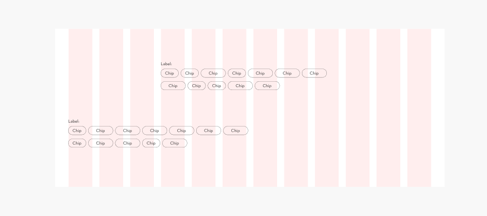

_Figure: Two chip groups, each with the label "Label:" and two rows of small unselected outlined chips "Chip", placed on a twelve-column content grid shown as pink columns. One group starts at the first column, the other at the fourth; each wraps its chips after about six columns instead of stretching across the whole grid. The group width follows the width of the content grid "narrow"._

## Content and Assets

### Concise labels

Use short words in simple language. They must be easy to understand. Also, avoid abbreviations for accessibility reasons.

_Figure: Chip group with the label "Safety classes:" and three unselected, medium-sized outlined chips with short, simple labels: "Class 0", "Class 1" and "Class 2". Labels should use short words in simple language that are easy to understand, and abbreviations should be avoided for accessibility reasons._

### Length

Around 3-40 characters, depending on the viewport, as the labels are not allowed to truncate.

The length of all labels chips in a group can be of diverse length.

_Figure: Chip group with the label "Type of propulsion:" and three unselected, medium-sized outlined chips of different lengths: "Battery", "Fuel" and "Corded electric". Labels in a group can be of diverse length, around 3 to 40 characters depending on the viewport, and must not be truncated._

### Icon usage

Use icons sparingly, as too many icons in an interface might impose unnecessary cognitive load.

**Preferred**: use icons from the library. **Custom icons** can also be used:

- Size & format: Square SVG, transparent background, rendered in a fixed 16×16px box. See [Iconography Guidelines](https://www.figma.com/design/U218NNP4OsipaHOtv5flns/Iconography-%E2%9E%A1%EF%B8%8F?node-id=9857-3242) for details.
- Theme & state: Custom icons do not adapt to theme, selected, or disabled state. Design them with sufficient contrast on light and inverse (dark) backgrounds, and on unselected and selected backgrounds.
- Accessibility: When using custom icons, keep color contrast (WCAG AA 3:1) in mind so the icon stays legible across all backgrounds and states.
- Disabled chips: Prefer library icons here; a custom icon keeps full contrast even when disabled, which can misleadingly look "active."

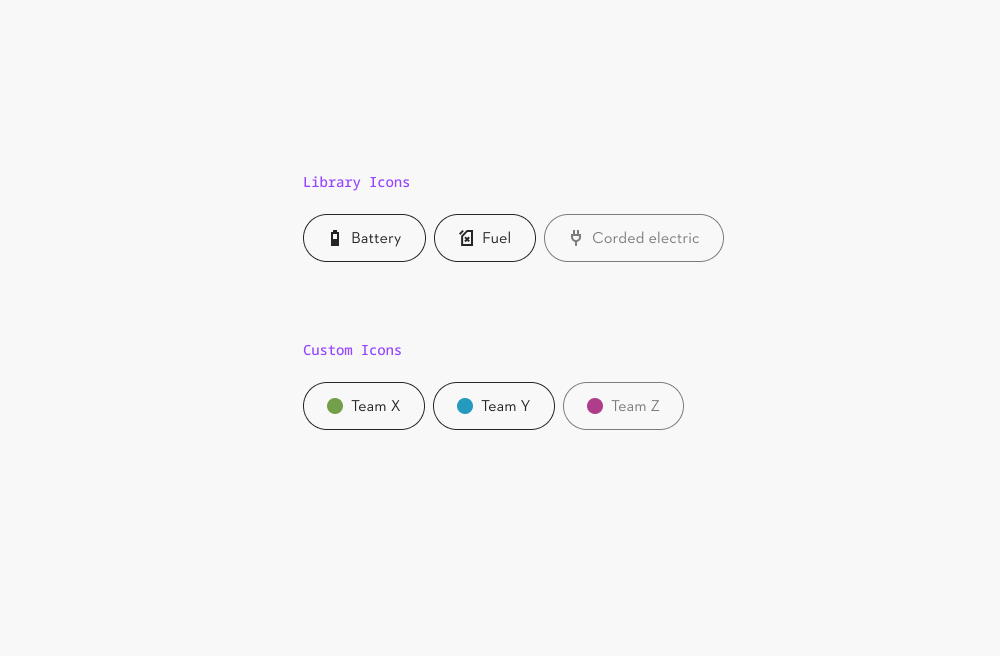

_Figure: Two medium-sized chip groups with icons. Under the purple heading "Library Icons": "Battery" with a battery icon, "Fuel" with a fuel canister icon, and "Corded electric" with a plug icon, greyed out (disabled). Under the purple heading "Custom Icons": "Team X" with a green dot, "Team Y" with a blue dot, and "Team Z" with a magenta dot, greyed out (disabled). None of the enabled chips is selected._

### Group label

#### Use “:”

In some cases the group has a label. For the chip group it is recommended to use an “:” after the label.

_Figure: Chip group with the label "Safety classes:" and three unselected, medium-sized outlined chips with short, simple labels: "Class 0", "Class 1" and "Class 2". Labels should use short words in simple language that are easy to understand, and abbreviations should be avoided for accessibility reasons._

#### Activate the user

In some cases it is wise to use the verb “select” in the group label, to inform the user about the action needed.

In most cases a colon is recommended.

_Figure: Selectable chip group with the group label "Select a safety class:", where the verb "select" and a trailing colon tell the user which action is needed. Below the label, three unselected outlined chips are laid out in one row: "Class 0", "Class 1" and "Class 2"._

### Semantic structure

#### Do not combine selectable and removable in the same list

It is not allowed to combine both **(1)** removable chips and **(2)** input selectable in the same list.

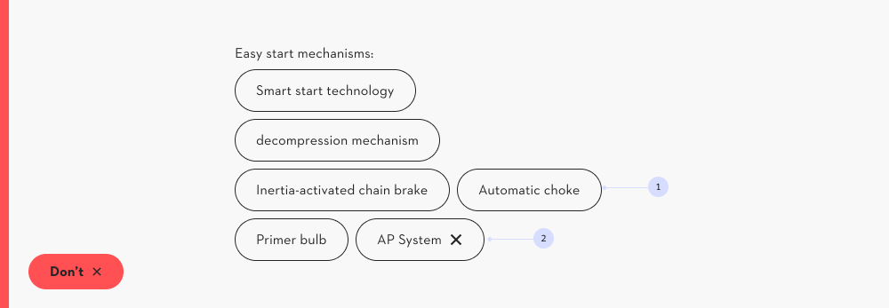

_Figure: Don't example: a chip group with the label "Easy start mechanisms:" that wraps over four rows and mixes chip types: "Smart start technology", "decompression mechanism", "Inertia-activated chain brake", "Automatic choke", "Primer bulb" and "AP System". Callout 1 points at "Automatic choke", a selectable chip without a close icon. Callout 2 points at "AP System", a removable chip with an X icon. Selectable and removable chips must not be combined in the same list._

#### Don’t mix chips with a different purpose

Chips with a different function and therefore purpose cant be in one group.

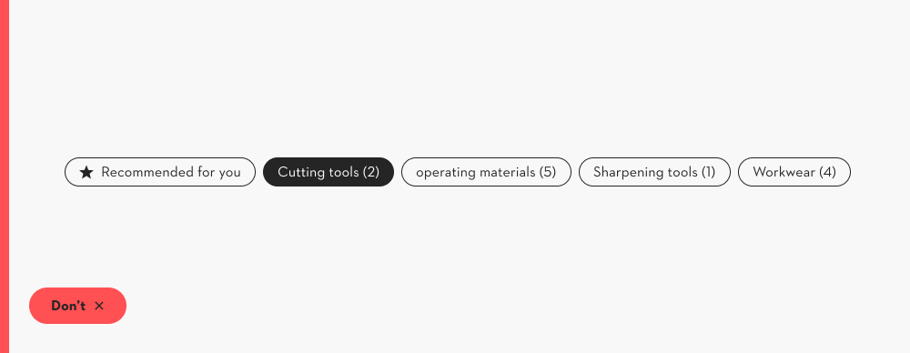

_Figure: Don't example: one row of five selectable chips with different purposes in the same group: "Recommended for you" (with a star icon), "Cutting tools (2)" (selected, dark filled), "operating materials (5)", "Sharpening tools (1)" and "Workwear (4)". The first chip is a recommendation while the others are category filters, so chips with a different function must not share one group._

## Behavior

### Browser default tooltip

The screenreader explains the action, examples are:

- Selectable chip: Deactivate property **(1)**
   - e.g. machine status
- Removable chip: Remove filter **(2)**
   - e.g. product category

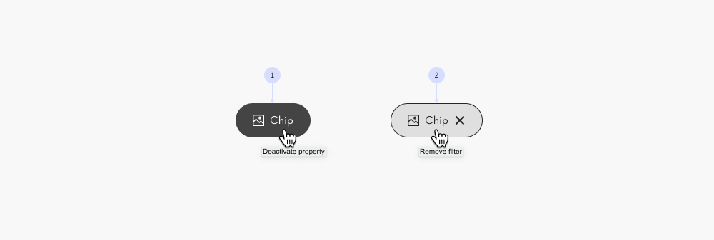

_Figure: Two medium chips with an image icon and the label "Chip", each hovered by a hand cursor with the browser default tooltip below. Callout 1 points at a selected selectable chip (dark filled, no close icon) whose tooltip reads "Deactivate property", for example a machine status. Callout 2 points at a removable chip (light grey with an X icon) whose tooltip reads "Remove filter", for example a product category._

### Chips that appear by user interactions

Removable chips are initially not part of the interface. The user must use a (filter) function to select properties.

The chips will appear in the interface. Ideally, close to the filtered list.

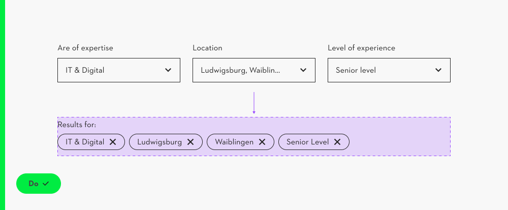

_Figure: Do example: three select fields in a row, "Are of expertise" with "IT & Digital", "Location" with "Ludwigsburg, Waiblin..." and "Level of experience" with "Senior level". A purple arrow points down to a purple dashed area directly below them, holding the label "Results for:" and four removable chips: "IT & Digital", "Ludwigsburg", "Waiblingen" and "Senior Level". The chips appear only after filtering, close to the filtered list._

### Select chips to reveal the group label

The group label appears only together with a chip, e.g. after the the first chip is selected.

When all chips are deselected, the group label disappears again.

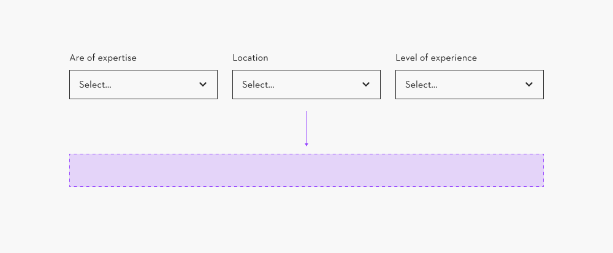

_Figure: Initial state with three empty select fields in a row, "Are of expertise", "Location" and "Level of experience", each showing the placeholder "Select..." and a chevron. A purple arrow points down to an empty purple dashed area below, where the chip group appears; no group label or chips are shown until a chip is selected._

## Examples/Variants

### Filter horizontal

- Removable chips are ideal to display immediately below the horizontal filter.
- The label of the chip group is optional, as the context is clear, due to the proximity.

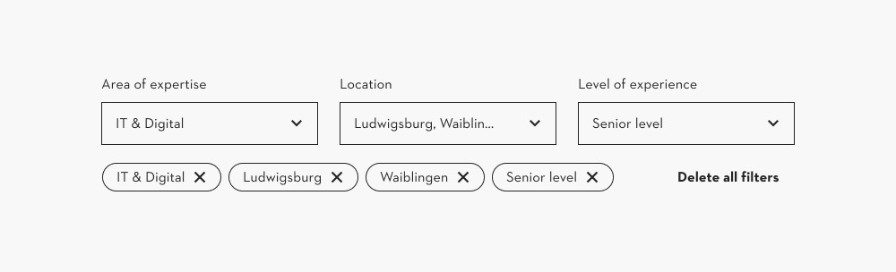

_Figure: Horizontal filter: three select fields in a row, "Area of expertise" with "IT & Digital", "Location" with "Ludwigsburg, Waiblin..." and "Level of experience" with "Senior level". Directly below is a row of four removable chips without a group label: "IT & Digital", "Ludwigsburg", "Waiblingen" and "Senior level", followed on the right by the ghost button "Delete all filters"._

### Filter mobile

- The filter opens in a drawer.
- Removable chips are ideal to display immediately below the button.
- The label of the chip group is optional, as the context is clear, due to the proximity.

_Figure: Mobile filter: a dark filled button "Filter" with a filter icon on the left. Directly below it are four removable chips without a group label in two rows, "IT & Digital" and "Ludwigsburg" in the first, "Waiblingen" and "Senior level" in the second, followed by a ghost button "Delete all filters" aligned flush left._

### Filter sidebar

- Use the removable chips.
- The chips may be placed further away from the filter.
- A group label helps to understand the grouped list.

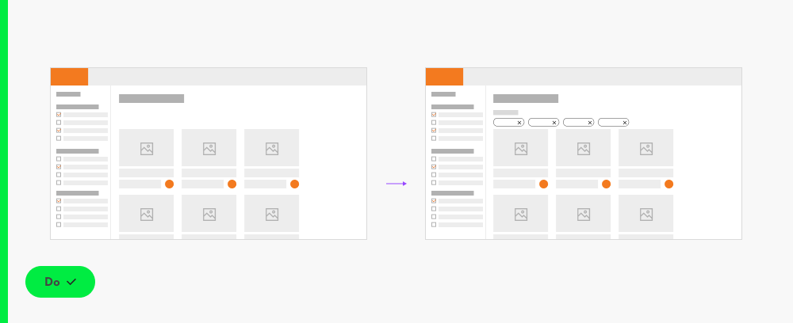

_Figure: Do example: two wireframes of a product list page with a filter sidebar of grouped checkboxes on the left and a grid of product cards, connected by an arrow. Both wireframes have ticked checkboxes in the sidebar. The first shows no chips above the grid; in the second, a row of four small removable chips with a close icon (x) appears above the product grid, placed away from the filter and below the page heading._

### Do not use selectable chips in complex filters

Do not use selectable chips inside a complex filter, e.g. located in a sidebar, as lists will increase visual clutter and therefore impose unnecessary cognitive load.

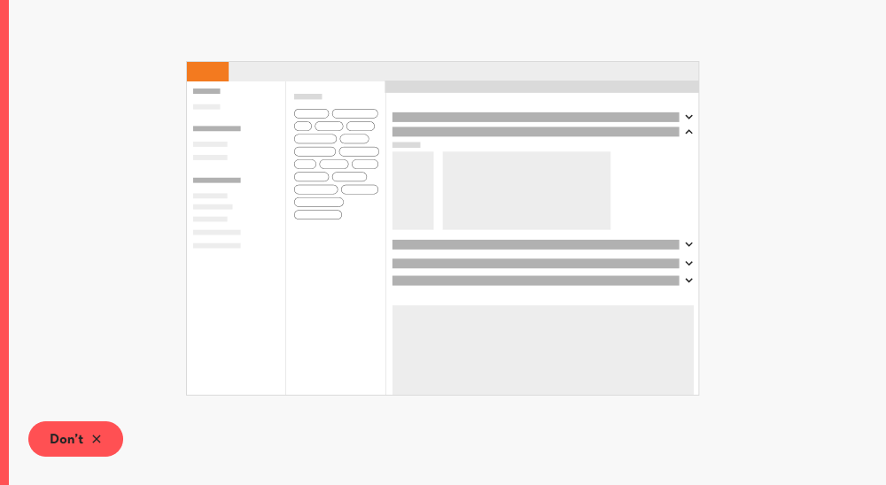

_Figure: Don't example: wireframe of a page with a navigation column, a complex filter sidebar next to it that contains a long, wrapping list of about 20 small selectable chips of varying width, and a content area with collapsible accordion sections. Selectable chips inside a complex filter such as a sidebar are wrong because the lists add visual clutter and unnecessary cognitive load._

### Filter simple

- A simple filter has around 5 attributes.
- Use the selectable chips, if the interface is spacious enough

_Figure: Simple filter built as a selectable chip group of medium size with the group label "Type of propulsion:" above three outlined pill-shaped chips in one row, each with a leading icon: "Battery", "Fuel" and "Corded electric". None of the chips is selected. Suitable for a simple filter with around 5 attributes when the interface is spacious enough._

### Suggestion links

A common variation of the chip is the **suggestion chip**. These suggestions are technically links and not chips.

Use a [small outline button](https://www.figma.com/design/qXldpLO6gxHJNLdcXIPxYt/Pattern-Library-%F0%9F%96%A5-Web-1.0?node-id=165-346&t=RKNZaDb3abSpUHQX-4) instead.

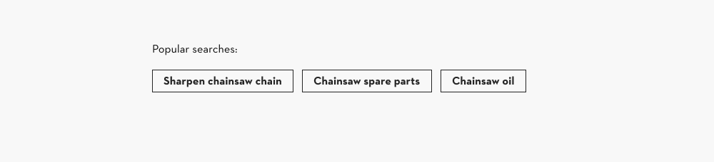

_Figure: Suggestion links under the label "Popular searches:", built as three small outline buttons with square corners in one row, in the enabled state and without icons: "Sharpen chainsaw chain", "Chainsaw spare parts" and "Chainsaw oil". Suggestions are technically links, not chips, so a small outline button is used instead of a chip._

### Do not use selectable chips in a combobox component

In a combobox component, as scrolling must be avoided.

**Recommendation:** The [checkbox group](https://www.figma.com/design/qXldpLO6gxHJNLdcXIPxYt/Pattern-Library-%F0%9F%96%A5-Web-1.0?node-id=5626-11362&t=RKNZaDb3abSpUHQX-4) is compact and easy to read, as the checkboxes are all aligned.

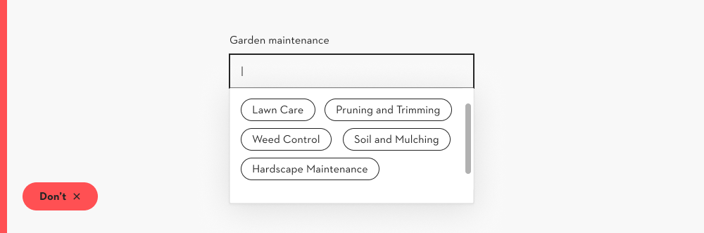

_Figure: Don't example: a combobox labelled "Garden maintenance" with a focused empty input (text cursor) and an open dropdown panel that contains five unselected small selectable chips instead of a list: "Lawn Care", "Pruning and Trimming", "Weed Control", "Soil and Mulching" and "Hardscape Maintenance", wrapped over three rows with a scrollbar at the right. Selectable chips must not be used in a combobox because scrolling must be avoided; a checkbox group is recommended instead._

### Checkbox group, switch button or chip group?

**Warning:** The chip group takes up a lot of space and the list is harder to read.

**Warning:** The [switch component](https://www.figma.com/design/qXldpLO6gxHJNLdcXIPxYt/Pattern-Library-%F0%9F%96%A5-Web-1.0?node-id=513-121&t=RKNZaDb3abSpUHQX-4) is not an input element, don’t use it in filters.

**Recommendation:** The [checkbox group](https://www.figma.com/design/qXldpLO6gxHJNLdcXIPxYt/Pattern-Library-%F0%9F%96%A5-Web-1.0?node-id=5626-11362&t=RKNZaDb3abSpUHQX-4) is compact and easy to read, as the checkboxes are all aligned.

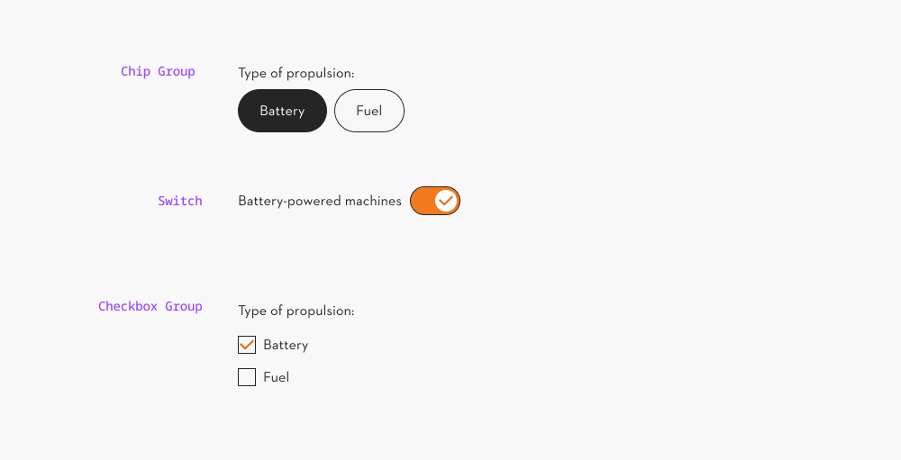

_Figure: Comparison of three components for the same choice, each labelled in purple at the left. "Chip Group" with the label "Type of propulsion:" shows the chip "Battery" selected (dark filled) and "Fuel" unselected (outlined); it takes up a lot of space and the list is harder to read. "Switch" shows "Battery-powered machines" with an orange switch turned on; the switch is not an input element and should not be used in filters. "Checkbox Group" with the legend "Type of propulsion:" shows "Battery" checked (orange check) and "Fuel" unchecked in a vertical list; it is recommended because it is compact and easy to read, as the checkboxes are all aligned._

### Chip group or radio group?

**Warning:** The chip group takes up a lot of space and the list is harder to read.

**Recommendation:** The [radio group component](https://www.figma.com/design/qXldpLO6gxHJNLdcXIPxYt/Pattern-Library-%F0%9F%96%A5-Web-1.0?node-id=860-2729&t=oWORc7O39VJU5gMH-4) is compact and easy to read, as the radios are all aligned.

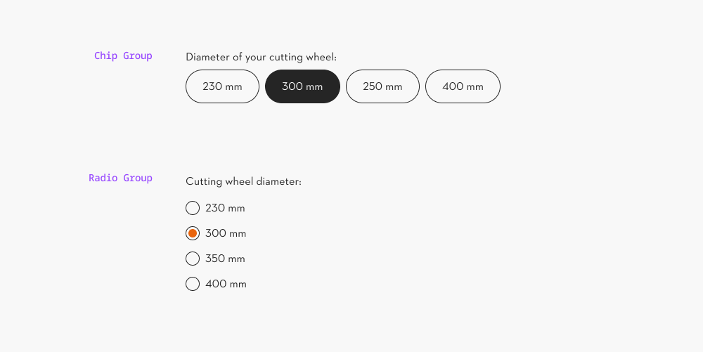

_Figure: Comparison of a chip group and a radio group for choosing one value, each labelled in purple at the left. "Chip Group" with the label "Diameter of your cutting wheel:" shows four chips in a row, "230 mm", "300 mm" (selected, dark filled), "250 mm" and "400 mm"; it takes up a lot of space and the list is harder to read. "Radio Group" with the legend "Cutting wheel diameter:" shows a vertical list "230 mm", "300 mm" (selected, orange dot), "350 mm" and "400 mm"; it is recommended because it is compact and easy to read, as the radios are all aligned._
