# Chip Group

## Chip Group

Overview:

- The chip group is an interactive element.
   - Check out the flag component, for the read-only component.
- There are three types of chip group implementations:
   - Single select: primarily for a single selection, similar to the radio group component.
   - Multi select: all chips can be selected, similar to the checkbox group component.
   - Removable: primarily for refining content by applying filters.
- The chip itself is binary: selected or unselected
- For different use cases and viewports, the chip comes in two sizes and densities. There are no limitations when to use which.
- Use icons sparingly, as too many icons in an interface might impose unnecessary cognitive load.
- Chips from different groups cannot be listed under the same group label.
- Place selectable chips close to the filtered list.
- A suggestion chip is technically a link and not a chip. Use a [small outline button](https://www.figma.com/design/qXldpLO6gxHJNLdcXIPxYt/Pattern-Library-%F0%9F%96%A5-Web-1.0?node-id=165-346&t=RKNZaDb3abSpUHQX-4) instead.

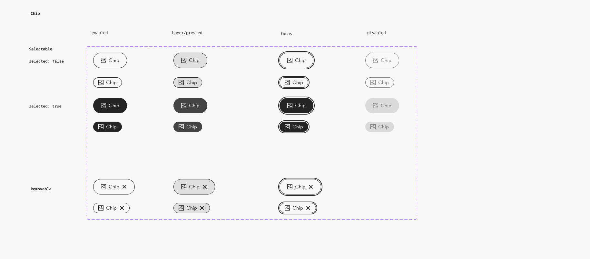

_Figure: Various states and types of a Chip component within a Chip Group. It shows the Chip in different states: enabled, hover/pressed, focus, and disabled, and in two types: Selectable and Removable. The Selectable type is further divided into selected: false and selected: true. The layout demonstrates how the Chip appears in these different states and types, illustrating the visual changes for each condition._

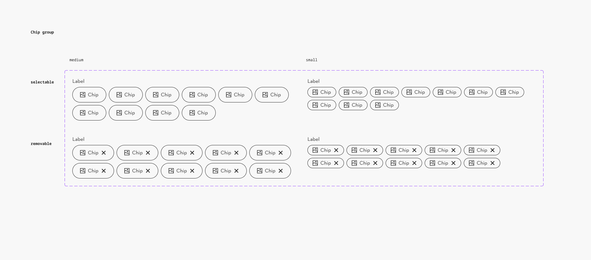

_Figure: The Chip Group component with two sizes, medium and small, and two types, selectable and removable. Each chip has a leading icon and the label "Chip". The selectable chips are shown in both medium and small sizes, while the removable chips, which include an "X" icon, are also shown in both sizes. The layout demonstrates how these chips are grouped under a label._

### Further guidelines

[Storybook documentation](https://main--63440bbb95889041542a5ba3.chromatic.com/?path=/docs/components-chip-group--documentation)

Decision tree

### Related elements

[Checkbox Group](https://www.figma.com/design/qXldpLO6gxHJNLdcXIPxYt/Pattern-Library-%F0%9F%96%A5-Web-1.0?node-id=1017-2316)

[Flag](https://www.figma.com/design/qXldpLO6gxHJNLdcXIPxYt?node-id=19511-2443)

[Radio Group](https://www.figma.com/design/qXldpLO6gxHJNLdcXIPxYt/Pattern-Library-%F0%9F%96%A5-Web-1.0?node-id=860-2728)

[Switch](https://www.figma.com/design/qXldpLO6gxHJNLdcXIPxYt/Pattern-Library-%F0%9F%96%A5-Web-1.0?node-id=513-2)

[Iconography](https://www.figma.com/design/U218NNP4OsipaHOtv5flns/Iconography-%E2%9E%A1%EF%B8%8F?m=auto)

[Combobox](https://www.figma.com/design/qXldpLO6gxHJNLdcXIPxYt/Pattern-Library-%F0%9F%96%A5-Web-1.0?node-id=2659-3954)

[Select](https://www.figma.com/design/qXldpLO6gxHJNLdcXIPxYt/Pattern-Library-%F0%9F%96%A5-Web-1.0?node-id=8139-4888)

[Button](https://www.figma.com/design/qXldpLO6gxHJNLdcXIPxYt/Pattern-Library-%F0%9F%96%A5-Web-1.0?node-id=162-126)

### Contribute

Contribute to improving this component by sharing your feedback, asking questions, or suggesting features [here](https://www.figma.com/design/lLmw7PfIdKjFG4uT3B2Hyj/Onboarding-%F0%9F%93%96?node-id=446-868&t=zKmRu4kAkxMeRDmK-4).

## Formatting and Construction

### Anatomy

#### Chip group

1. **Chip group label (optional)**
1. **Icon (optional)**
1. **Chip label**
1. **Close icon (optional)**

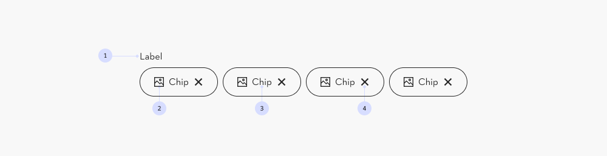

_Figure: A Chip group component with a removable, medium-sized variant. There are four chips in a horizontal layout, each with a Chip label and a Close icon. Callout 1 points to the optional Chip group label, callout 2 points to the first chip, callout 3 points to the second chip, and callout 4 points to the third chip. Each chip includes an optional icon and a close icon._

#### Selectable chip

Use primarily for a binary selection, similar to checkbox. The unselected chips are initially visible in the interface.

The chip has 2 states that are different in color: selected or unselected.

1. **Icon (optional)**
1. **Chip label**

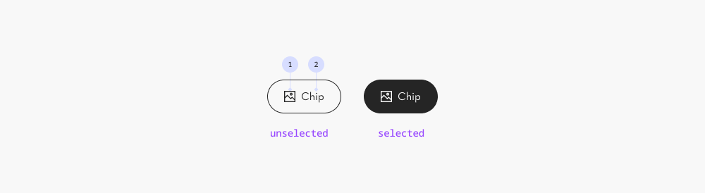

_Figure: Two selectable chips labeled "Chip," each with a leading icon. The first chip is in the unselected state, while the second chip is in the selected state. Callout 1 points to the unselected chip, and callout 2 points to the selected chip. The unselected chip has a lighter color, and the selected chip has a darker color._

#### Removable chip

Use primarily for refining lists by applying filters. The chips will appear in the interface, after the attribute is activated.

The chip has 2 states that are different in perceptivity: visible and not visible.

1. **Icon (optional)**
1. **Chip label**
1. **Close icon**

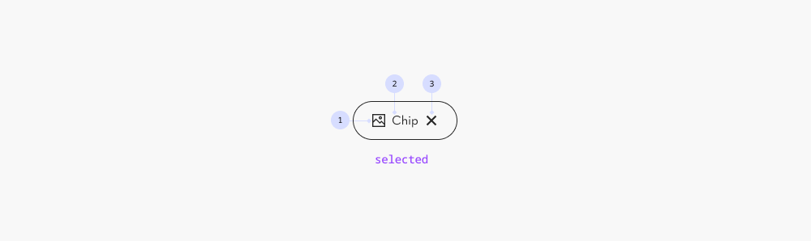

_Figure: A removable chip component used for refining lists by applying filters. The chip is labeled "Chip" and includes a close icon to remove it. Callout 1 points to the chip's leading icon area, callout 2 points to the close icon, and callout 3 points to the chip label. The chip is in a visible state and is not selected._

#### Size and density

For different use cases and viewports, the chip comes in two sizes. Only the padding is different:

1. **Medium size**
1. **Small size**

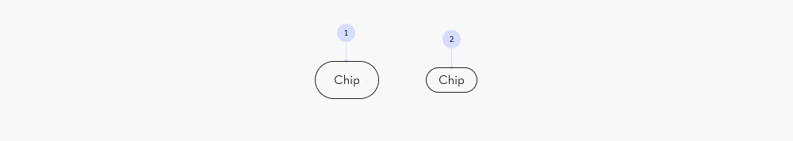

_Figure: Two variants of a chip component labeled "Chip," one in medium size and the other in small size. Callout 1 points to the medium size chip, and callout 2 points to the small size chip. The difference between the two sizes is only in the padding._

#### Do not combine medium and small

The different sized may not be combined in the same list.

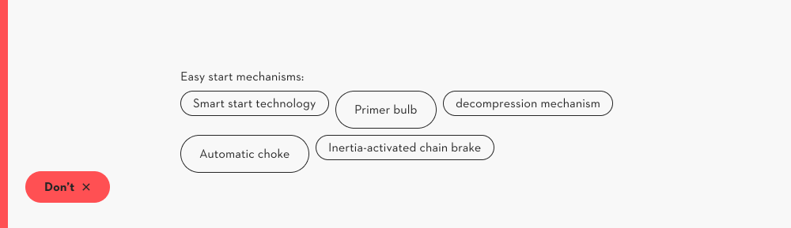

_Figure: A chip-group component with selectable items of different sizes labeled as "small." The text "Easy start mechanisms" is followed by a list of items: "Smart start technology," "Primer bulb," "decompression mechanism," "Automatic choke," and "Inertia-activated chain brake." The example is marked as a "Don't" because it combines medium and small sizes in the same list, which is not allowed according to the design guidelines._

#### Overflow of the label

The chip label can not be two lines.

Tip: test the length of the label in all viewports.

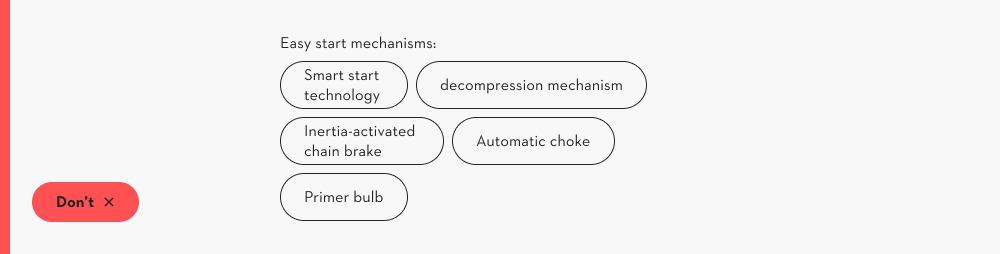

_Figure: A chip-group component with the label "Easy start mechanisms:" and several selectable items listed below it: "Smart start technology", "decompression mechanism", "Inertia-activated chain brake", "Automatic choke", and "Primer bulb". The example is marked as a "Don't" because the label text exceeds one line, which is not allowed according to the tip provided: "The chip label can not be two lines." The tip also advises testing the length of the label in all viewports._

### Group

#### Single select or multi select

The selectable chips are always in a group. For different use cases, the chip group can be...

1. **Single select** (similar to a [radio group](https://www.figma.com/design/qXldpLO6gxHJNLdcXIPxYt?node-id=860-2728))
1. **Multi select** (similar to a [checkbox](https://www.figma.com/design/qXldpLO6gxHJNLdcXIPxYt?node-id=1017-2316) group)

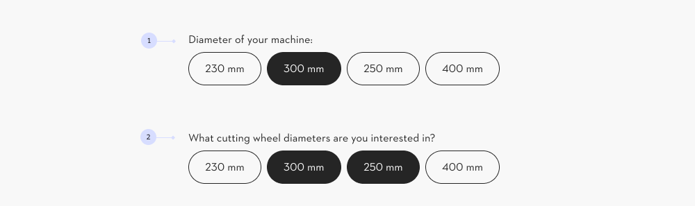

_Figure: Two examples of a chip-group component in a single select layout. The first callout points to a selected chip labeled "300 mm" under the text "Diameter of your machine," indicating a machine diameter measurement. The second callout points to two selected chips labeled "300 mm" and "250 mm" under the text "What cutting wheel diameters are you interested in?", indicating cutting wheel diameter measurements. Each chip represents a selectable option within the group._

#### Stack all chips in the group

In a chip, the container width is automatically adjusted according to the content length.

This option is available when there are two or more items.

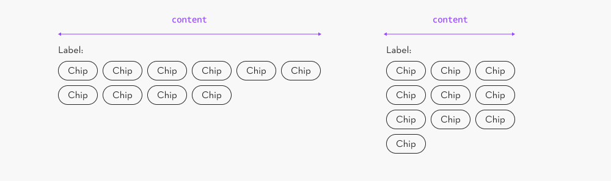

_Figure: Two layouts of a chip-group component with the label "Label:" and multiple chips. The purple arrows labeled "content" indicate the width of the container, which adjusts automatically based on the length of the content within the chips. The left example shows chips arranged in two rows, while the right example stacks all chips vertically._

#### Group width

Follow the width of the [content grid “narrow”.](https://www.figma.com/design/JyyYtoCYbtJrzqHs38OXSQ/Grid-%26-Spacing-%F0%9F%A7%AE?node-id=1-132)

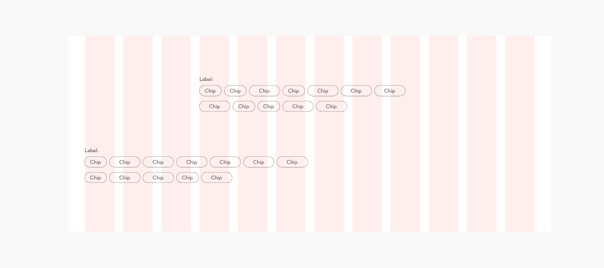

_Figure: Two Chip Group components, each labeled "Label:", with multiple "Chip" components of the small, enabled, and unselected type. The Chip Groups are laid out within a narrow content grid, demonstrating how the group width should follow this grid. The first Chip Group is aligned to the left, while the second Chip Group is aligned to the left but spans two rows._

## Content and Assets

### Concise labels

Use short words in simple language. They must be easy to understand. Also, avoid abbreviations for accessibility reasons.

_Figure: A chip group component with the label "Safety classes:" followed by a colon, and three selectable chips labeled "Class 0", "Class 1", and "Class 2". The chips are arranged horizontally in a medium size. The label is positioned above the chips, and the colon is used to indicate the label for the group of chips._

### Length

Around 3-40 characters, depending on the viewport, as the labels are not allowed to truncate.

The length of all labels chips in a group can be of diverse length.

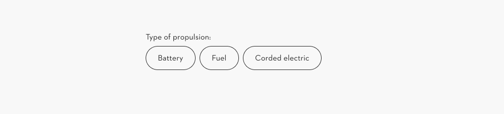

_Figure: A chip group component with the label "Type of propulsion:" and three selectable chips labeled "Battery," "Fuel," and "Corded electric." The length of the labels in the chip group can vary from around 3 to 40 characters depending on the viewport, ensuring that the labels do not truncate. The length of all label chips in a group can differ._

### Icon usage

Use icons sparingly, as too many icons in an interface might impose unnecessary cognitive load.

**Preferred**: use icons from the library. **Custom icons** can also be used:

- Size & format: Square SVG, transparent background, rendered in a fixed 16×16px box. See [Iconography Guidelines](https://www.figma.com/design/U218NNP4OsipaHOtv5flns/Iconography-%E2%9E%A1%EF%B8%8F?node-id=9857-3242) for details.
- Theme & state: Custom icons do not adapt to theme, selected, or disabled state. Design them with sufficient contrast on light and inverse (dark) backgrounds, and on unselected and selected backgrounds.
- Accessibility: When using custom icons, keep color contrast (WCAG AA 3:1) in mind so the icon stays legible across all backgrounds and states.
- Disabled chips: Prefer library icons here; a custom icon keeps full contrast even when disabled, which can misleadingly look "active."

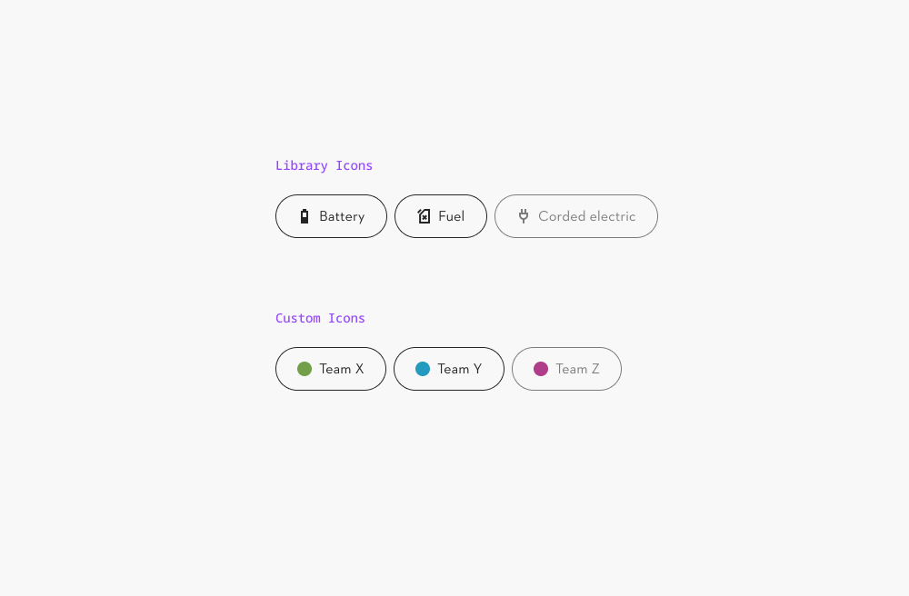

_Figure: Two sets of icons used within a chip-group component of the STIHL Design System. The first set is labeled "Library Icons" and includes icons for "Battery," "Fuel," and "Corded electric." The second set is labeled "Custom Icons" and includes icons for "Team X," "Team Y," and "Team Z." Each icon is rendered in a fixed 16x16 pixel box with a transparent background._

### Group label

#### Use “:”

In some cases the group has a label. For the chip group it is recommended to use an “:” after the label.

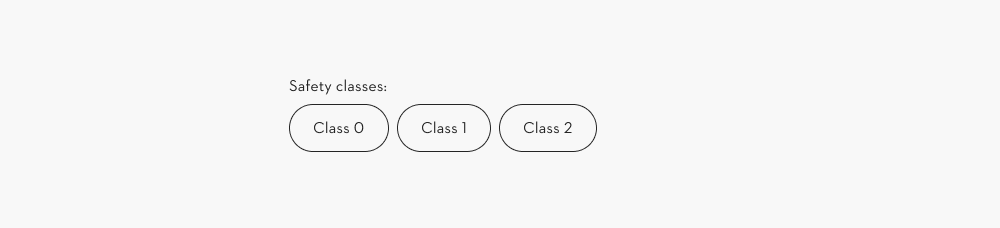

_Figure: A chip group component with the label "Safety classes:" followed by a colon, and three selectable chips labeled "Class 0", "Class 1", and "Class 2". The chips are arranged horizontally in a medium size. The label is positioned above the chips, and the colon is used to indicate the label for the group of chips._

#### Activate the user

In some cases it is wise to use the verb “select” in the group label, to inform the user about the action needed.

In most cases a colon is recommended.

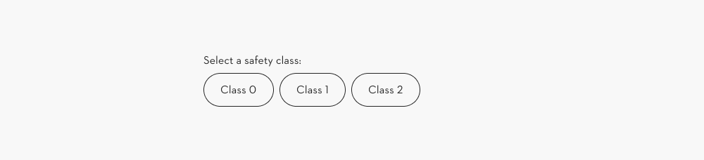

_Figure: A chip group component with the label "Select a safety class:" followed by three selectable chips labeled "Class 0," "Class 1," and "Class 2." The label uses the verb "select" to indicate the action required by the user, and it ends with a colon. The chips are arranged horizontally and have a medium size._

### Semantic structure

#### Do not combine selectable and removable in the same list

It is not allowed to combine both **(1)** removable chips and **(2)** input selectable in the same list.

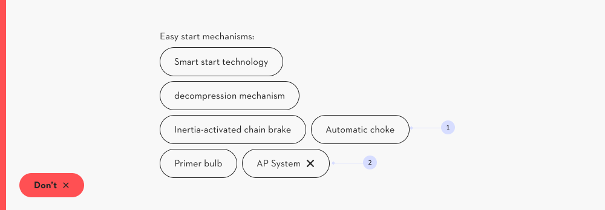

_Figure: A "chip-group" component with the label "Easy start mechanisms:" and several items listed below it. The component includes both selectable chips like "Smart start technology" and removable chips like "AP System". The numbered callouts point to "Automatic choke" labeled as 1, indicating a removable chip, and "AP System" labeled as 2, also indicating a removable chip. The example is marked as a "Don't" because it combines both selectable and removable chips in the same list, which is not allowed._

#### Don’t mix chips with a different purpose

Chips with a different function and therefore purpose cant be in one group.

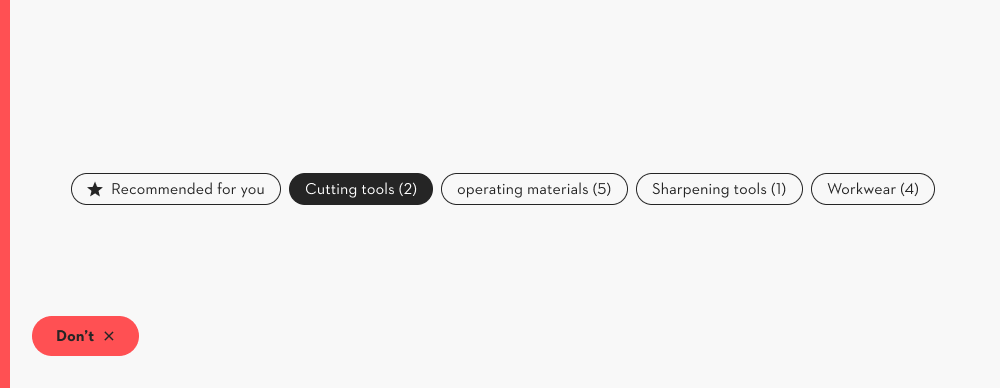

_Figure: A chip-group component of type selectable and size small, illustrating a "Don't" example. It shows five chips labeled "Recommended for you", "Cutting tools (2)", "operating materials (5)", "Sharpening tools (1)", and "Workwear (4)". The example is marked as incorrect because it mixes chips with different functions and purposes in one group._

## Behavior

### Browser default tooltip

The screenreader explains the action, examples are:

- Selectable chip: Deactivate property **(1)**
   - e.g. machine status
- Removable chip: Remove filter **(2)**
   - e.g. product category

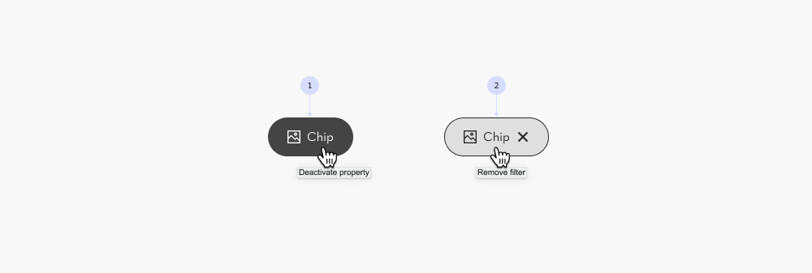

_Figure: Two types of chips from a UI design system: a selectable chip and a removable chip, both in a hover/pressed state and medium size. The first callout points at the selectable chip labeled "Chip" with the action "Deactivate property," used for actions like changing machine status. The second callout points at the removable chip labeled "Chip" with the action "Remove filter," used for actions like removing a product category filter._

### Chips that appear by user interactions

Removable chips are initially not part of the interface. The user must use a (filter) function to select properties.

The chips will appear in the interface. Ideally, close to the filtered list.

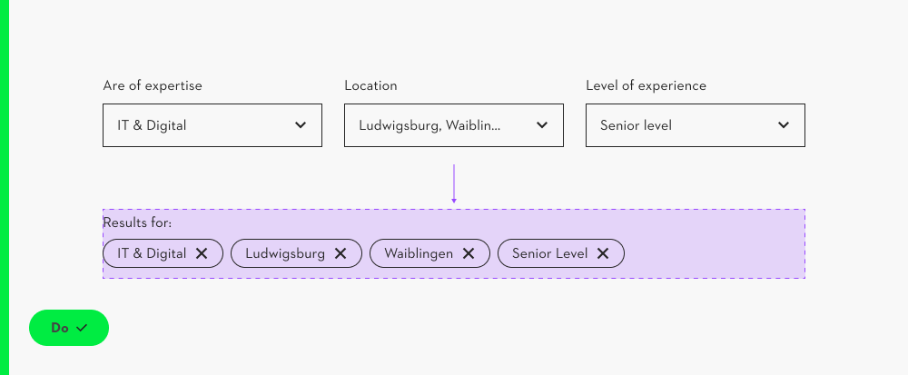

_Figure: A "Chip Group" component with removable chips that appear after user interactions, specifically after using a filter function. The layout includes a select input labeled "Are of expertise," "Location," and "Level of experience," each with enabled and valid states, and of medium size. Below these selects, there is a chip-group labeled "Results for:" containing removable chips labeled "IT & Digital," "Ludwigsburg," "Waiblingen," and "Senior Level," all of small size. This example is marked as a "Do" because it correctly shows removable chips appearing close to the filtered list after user selection._

### Select chips to reveal the group label

The group label appears only together with a chip, e.g. after the the first chip is selected.

When all chips are deselected, the group label disappears again.

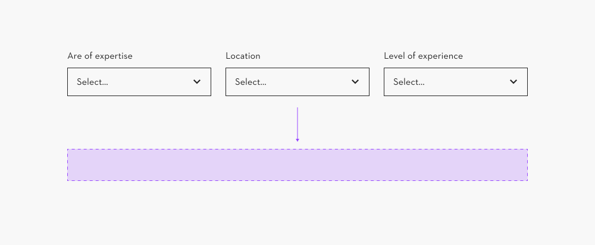

_Figure: A Chip Group component with three select inputs labeled "Are of expertise," "Location," and "Level of experience." Each select input is in an enabled state, showing "Select..." as the default option. The group label appears when at least one chip is selected and disappears when all chips are deselected._

## Examples/Variants

### Filter horizontal

- Removable chips are ideal to display immediately below the horizontal filter.
- The label of the chip group is optional, as the context is clear, due to the proximity.

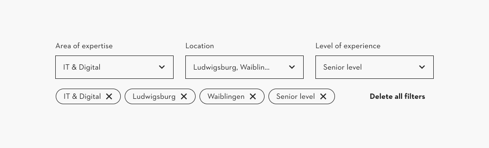

_Figure: A horizontal filter component with three select inputs labeled "Area of expertise," "Location," and "Level of experience." Each select input is in an enabled state and of medium size. Below these inputs, there is a chip group of removable chips labeled "IT & Digital," "Ludwigsburg," "Waiblingen," and "Senior level," each of small size. Additionally, there is a button labeled "Delete all filters" with a ghost variant, medium size, and no icon. The layout shows the chips immediately below the horizontal filter, and the label of the chip group is optional due to clear context._

### Filter mobile

- The filter opens in a drawer.
- Removable chips are ideal to display immediately below the button.
- The label of the chip group is optional, as the context is clear, due to the proximity.

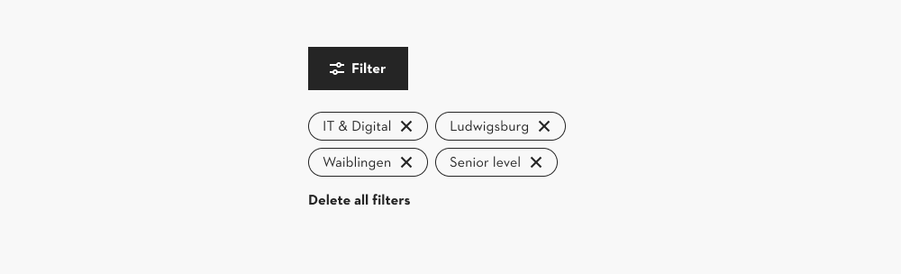

_Figure: A "Filter mobile" component with a button labeled "Filter" in a filled, enabled, medium size variant with an icon on the left. Below the button, there is a chip-group of removable chips labeled "IT & Digital," "Ludwigsburg," "Waiblingen," and "Senior level," all in a small size. At the bottom, there is a button labeled "Delete all filters" in a ghost, enabled, small size variant with flush alignment. The layout shows the filter opening in a drawer with removable chips displayed immediately below the button, and the label of the chip group is optional due to clear context._

### Filter sidebar

- Use the removable chips.
- The chips may be placed further away from the filter.
- A group label helps to understand the grouped list.

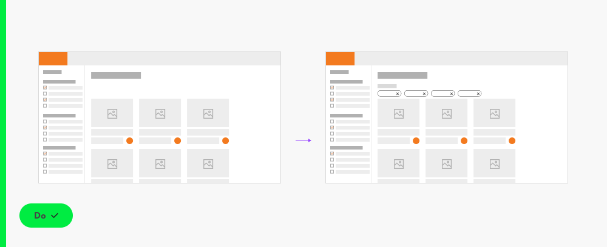

_Figure: A "Filter sidebar" component with two variants of a chip group layout. The left side, marked as a "Do" example, demonstrates the correct usage: removable chips are used, placed further away from the filter, and a group label is included to help understand the grouped list. The right side shows an incorrect usage with chips that have close buttons, which is not recommended according to the guidelines._

### Do not use selectable chips in complex filters

Do not use selectable chips inside a complex filter, e.g. located in a sidebar, as lists will increase visual clutter and therefore impose unnecessary cognitive load.

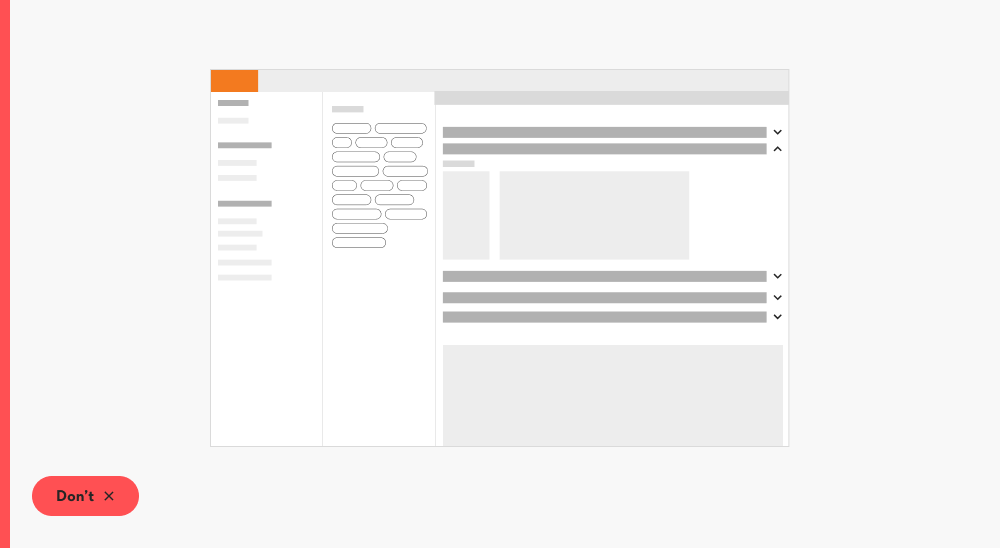

_Figure: A Chip Group component within a complex filter layout, specifically in a sidebar. It shows selectable chips arranged in a list format. The example is marked as a "Don't" because using selectable chips in complex filters increases visual clutter and imposes unnecessary cognitive load._

### Filter simple

- A simple filter has around 5 attributes.
- Use the selectable chips, if the interface is spacious enough

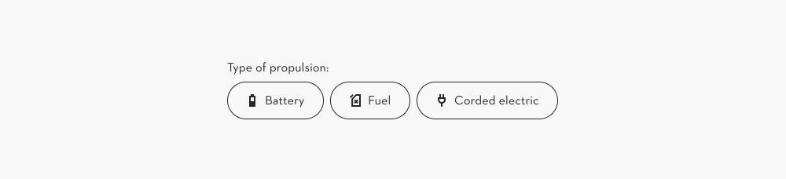

_Figure: A simple filter component with three selectable chips labeled "Battery," "Fuel," and "Corded electric" under the heading "Type of propulsion." Each chip is of medium size and is part of a chip-group. The layout shows a horizontal arrangement of the chips, which are designed to be selected by the user._

### Suggestion links

A common variation of the chip is the **suggestion chip**. These suggestions are technically links and not chips.

Use a [small outline button](https://www.figma.com/design/qXldpLO6gxHJNLdcXIPxYt/Pattern-Library-%F0%9F%96%A5-Web-1.0?node-id=165-346&t=RKNZaDb3abSpUHQX-4) instead.

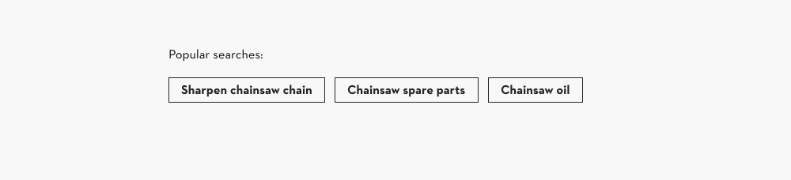

_Figure: Three small outline buttons labeled "Sharpen chainsaw chain," "Chainsaw spare parts," and "Chainsaw oil," all in an enabled state. These buttons are presented as suggestion links under the text "Popular searches:" and are aligned horizontally. Each button has no icon, the label is not hidden, and the alignment is not flush._

### Do not use selectable chips in a combobox component

In a combobox component, as scrolling must be avoided.

**Recommendation:** The [checkbox group](https://www.figma.com/design/qXldpLO6gxHJNLdcXIPxYt/Pattern-Library-%F0%9F%96%A5-Web-1.0?node-id=5626-11362&t=RKNZaDb3abSpUHQX-4) is compact and easy to read, as the checkboxes are all aligned.

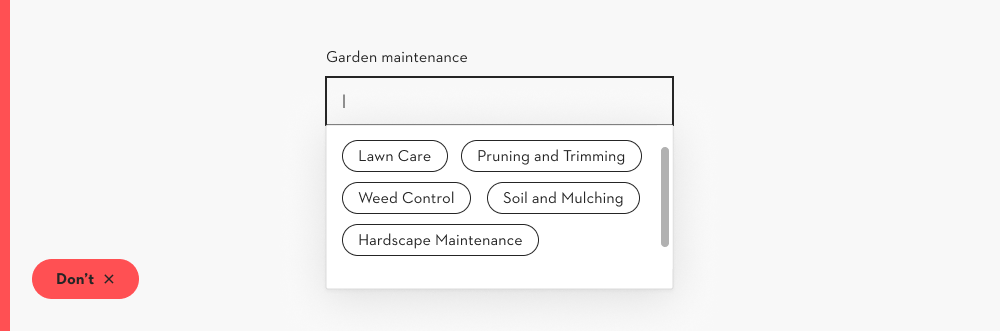

_Figure: A combobox component titled "Garden maintenance" with an active/focus state, containing five selectable chips labeled "Lawn Care," "Pruning and Trimming," "Weed Control," "Soil and Mulching," and "Hardscape Maintenance." All chips are enabled and unselected. The example is marked as a "Don't" because selectable chips should not be used in a combobox component to avoid scrolling. Instead, a checkbox group is recommended for being compact and easy to read._

### Checkbox group, switch button or chip group?

**Warning:** The chip group takes up a lot of space and the list is harder to read.

**Warning:** The [switch component](https://www.figma.com/design/qXldpLO6gxHJNLdcXIPxYt/Pattern-Library-%F0%9F%96%A5-Web-1.0?node-id=513-121&t=RKNZaDb3abSpUHQX-4) is not an input element, don’t use it in filters.

**Recommendation:** The [checkbox group](https://www.figma.com/design/qXldpLO6gxHJNLdcXIPxYt/Pattern-Library-%F0%9F%96%A5-Web-1.0?node-id=5626-11362&t=RKNZaDb3abSpUHQX-4) is compact and easy to read, as the checkboxes are all aligned.

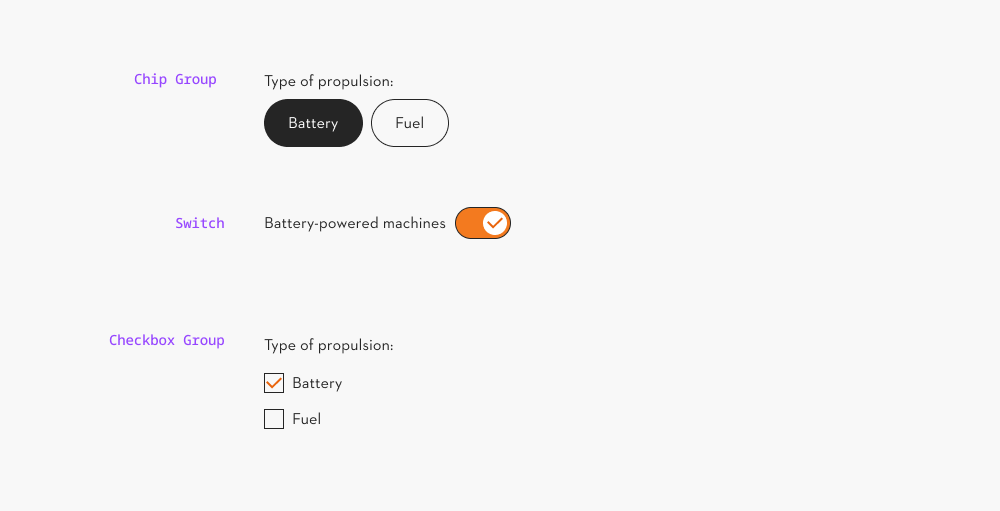

_Figure: The figure compares three components: a chip group, a switch, and a checkbox group, each labeled with "Type of propulsion:" and options "Battery" and "Fuel." The chip group displays "Battery" selected, the switch is labeled "Battery-powered machines" and is enabled and checked, while the checkbox group shows "Battery" checked. The chip group is noted to take up a lot of space and be harder to read, the switch is not recommended for use in filters as it is not an input element, and the checkbox group is recommended for being compact and easy to read._

### Chip group or radio group?

**Warning:** The chip group takes up a lot of space and the list is harder to read.

**Recommendation:** The [radio group component](https://www.figma.com/design/qXldpLO6gxHJNLdcXIPxYt/Pattern-Library-%F0%9F%96%A5-Web-1.0?node-id=860-2729&t=oWORc7O39VJU5gMH-4) is compact and easy to read, as the radios are all aligned.

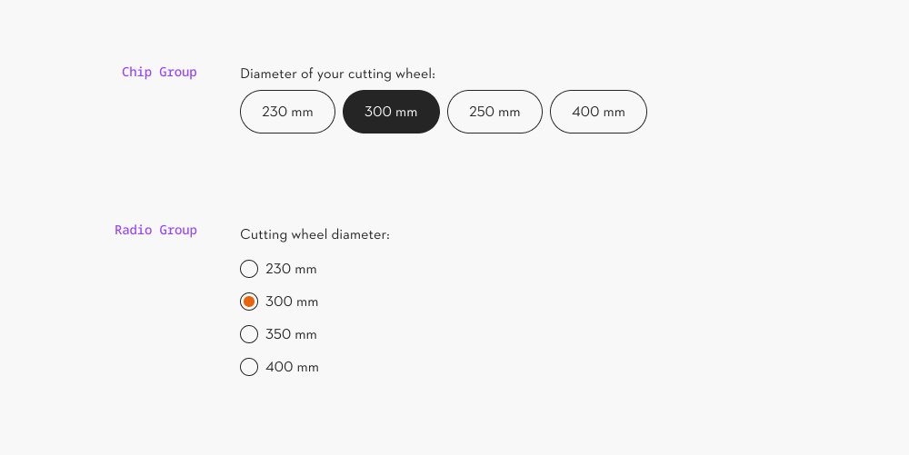

_Figure: The figure compares two components: a chip group and a radio group. The chip group displays selectable options for the "Diameter of your cutting wheel" with sizes 230 mm, 300 mm, 250 mm, and 400 mm. The radio group lists options for "Cutting wheel diameter" with sizes 230 mm, 300 mm, 350 mm, and 400 mm. The chip group is noted to take up more space and be harder to read, while the radio group is recommended for being compact and easy to read._
