# Combobox

## Combobox

Overview:

- A combobox contains of two elements: input field and a dropdown with a list
- The list contains items to choose from
   - the list can be short, medium or long
   - the list can be single select or multi select
- Change the placeholder text to be more specific. E.g. ‘Select a country’, instead of ‘select’
- The dropdown can open on click (2-20 items) or after the user started typing (\>20 items)

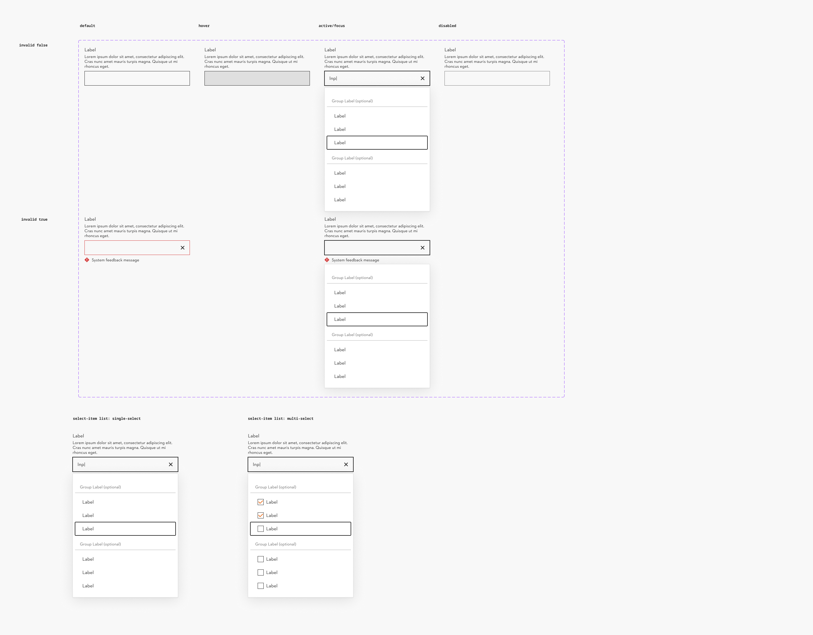

### Further guidelines

[Storybook documentation](https://main--63440bbb95889041542a5ba3.chromatic.com/?path=/docs/components-combobox--documentation)

Decision tree

### Related elements

[Select](https://www.figma.com/design/qXldpLO6gxHJNLdcXIPxYt?node-id=8139-4888)

[Iconography](https://www.figma.com/design/U218NNP4OsipaHOtv5flns/Iconography-%E2%9E%A1%EF%B8%8F?m=auto)

[Input](https://www.figma.com/design/qXldpLO6gxHJNLdcXIPxYt?node-id=1591-2)

[Radio Group](https://www.figma.com/design/qXldpLO6gxHJNLdcXIPxYt?node-id=860-2728)

[Fieldset](https://www.figma.com/design/Ie2r0R9QwjEc7O3nrFbXhV/Web-Pattern-Library?node-id=8-154)

### Contribute

Contribute to improving this component by sharing your feedback, asking questions, or suggesting features [here](https://www.figma.com/design/lLmw7PfIdKjFG4uT3B2Hyj/Onboarding-%F0%9F%93%96?node-id=446-868&t=zKmRu4kAkxMeRDmK-4).

## Formatting and Construction

### Anatomy

A combobox contains of two elements:

**Select field** A field, styled like the [input component](https://www.figma.com/design/qXldpLO6gxHJNLdcXIPxYt?node-id=1591-2) and functions as a [select component](https://www.figma.com/design/qXldpLO6gxHJNLdcXIPxYt?node-id=8139-4888). The dropdown opens, after the user interacts with the field.

**Select menu in a dropdown** The dropdown is styled, and looks the same in all browsers. The items in the list are set options for the user to choose from.

**Select field**

1. **Label** Describes the required input
1. **Hint** Short copy that provides guidance and context
1. **Field** The area where you can type or click, depending on the type of select
1. **Placeholder text (optional)** Instruction text inside of the field
1. **System feedback** Error or success message to help the user understand
1. **User input** Data, entered by the user
1. **Clear button** Indicator the user can remove the complete input at once.
1. **Chevron** Icon and indicator that the field contains a select menu.
1. **Info Button (optional):** Can be used to trigger a popover with additional information

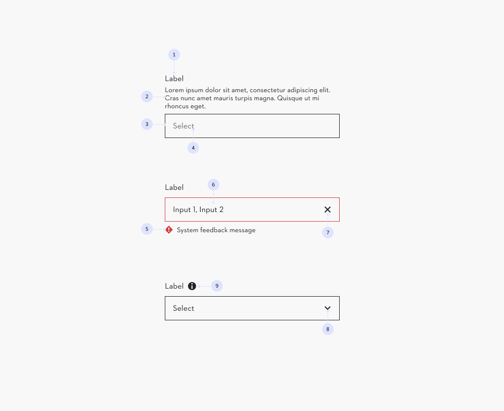

**Select menu in a dropdown**

1. **Group Label (optional)** Describes the category of the grouped items. A group label can not be clicked.
1. **List item** The items are presented to the user. The items are clickable.

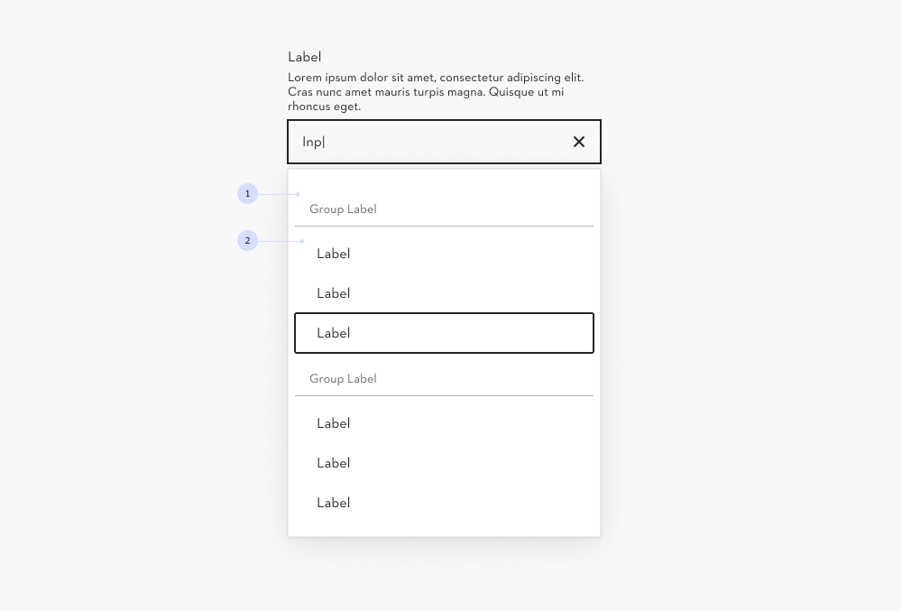

**Types of combobox**

1. **Single select** The single select shows the elements that can be selected
1. **Multi select** The multi select contains checkboxes with labels to indicate with options have been selected

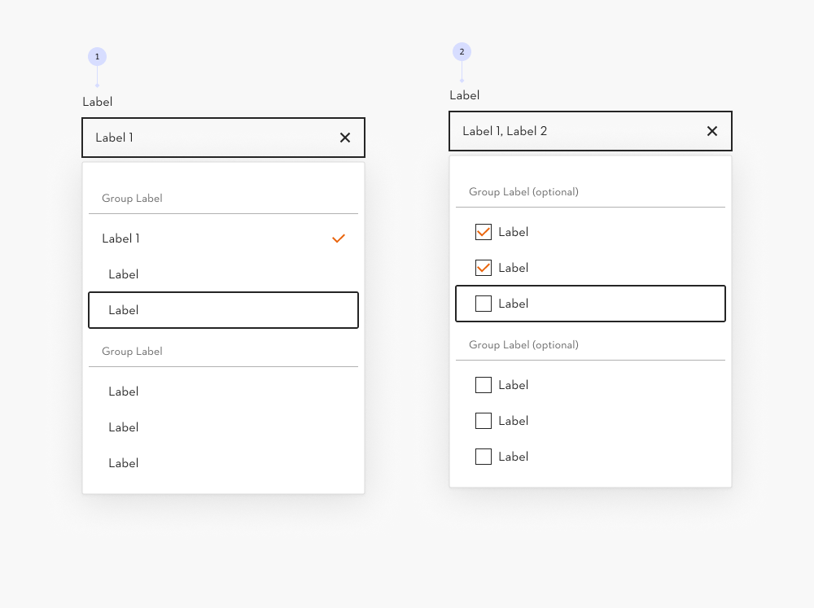

### Sizing

#### Medium and small input

By default it is recommended to use the medium variant **(1)** of the component. For Designs with little space or a very restricted viewport the small variant **(2)** can be used.

If the combobox is part of a field set, make sure the sizes are the same within the set.

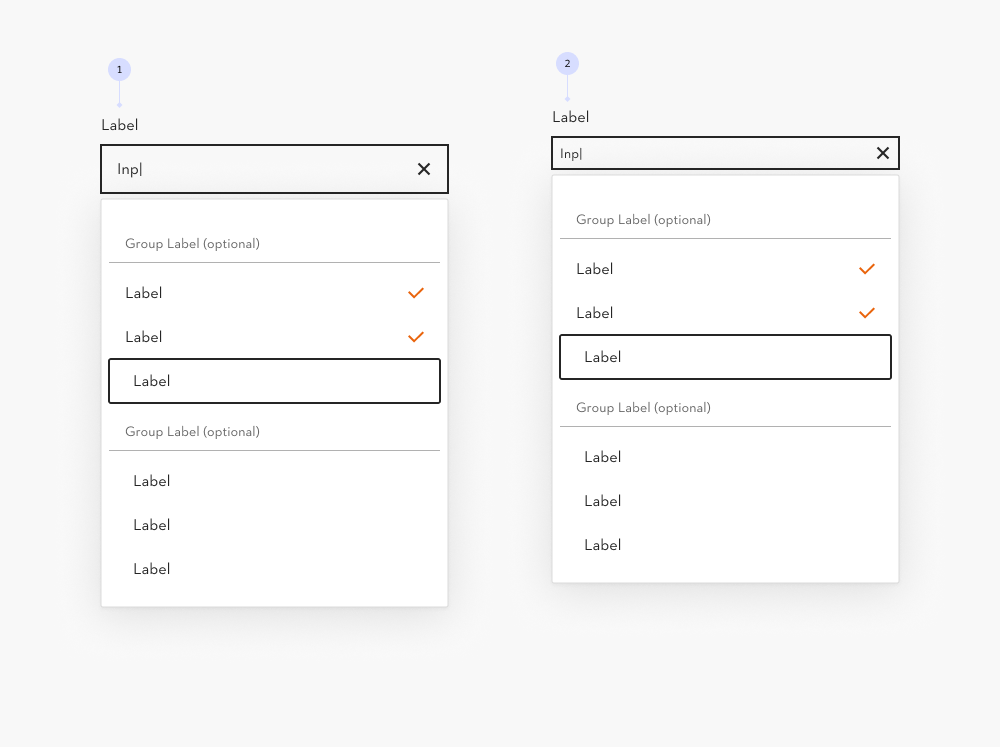

#### Maximum width

To ensure optimal legibility the maximum width of an input field is approximately 650px, depending on the grid (e.g. 8 of 12 columns on stihl.de). The maximum width should be 8 columns, and maximum of two fields in a row.

Less than 8 columns is also possible in different combinations.

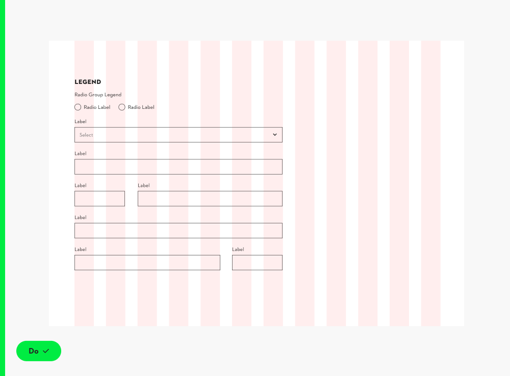

#### Maximum width

The width of a box is determined by the container it is placed in. This should ideally be the “[content area narrow](https://www.figma.com/design/HHM9B6UjMStGLxMf6loNLn/DS-945-Grid-Optimisations-%7C-Design?node-id=1-857&t=FFOFP94g90gl91Ko-4)” defined within the grid layout.

While the input can adjust to fit its container, we recommend not exceeding a maximum width of 544px, matching the [maximum text width](https://www.figma.com/design/JyyYtoCYbtJrzqHs38OXSQ/Grid-%26-Spacing-%F0%9F%A7%AE?node-id=1-132), for better scanability and readability. This max width calculated by multiplying the font size with 34. For our default copy styling Text M (16px) that defines a max. width of 544px (16px\*34= 544px).

In the Figma component, the maximum width is set to the recommended 544px. ([Link to calculation](https://www.figma.com/design/JyyYtoCYbtJrzqHs38OXSQ/Grid-%26-Spacing-%F0%9F%A7%AE?m=auto&node-id=1-857&t=p2GU3oXS9Ao4MbV0-1))

If multiple sliders are used within the same form or fieldset, they should all maintain the same size for consistency.

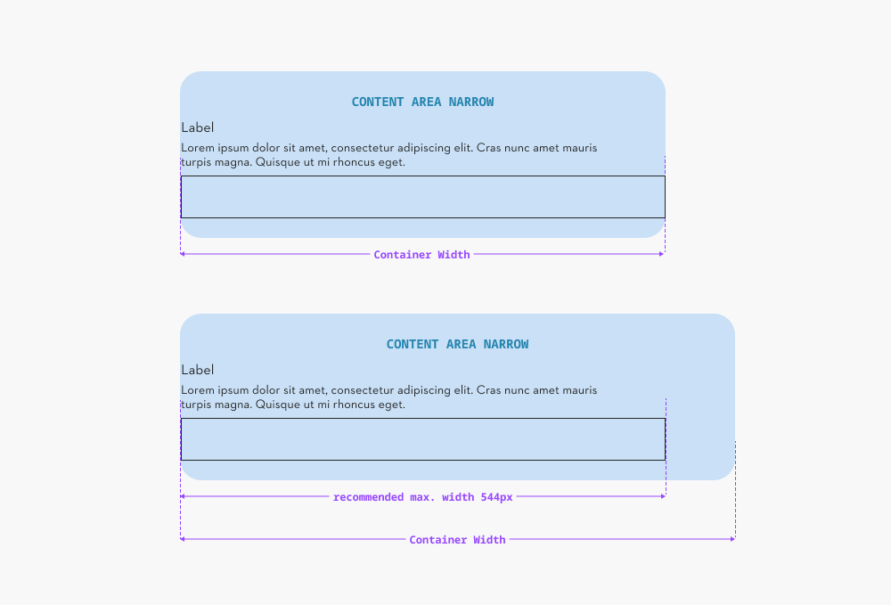

A maximum width is needed, as it keeps the **click path between the label and action short.**

The longer the distance to the target, the more time it will require for the mouse to reach it. (Fitt’s Law)

[Article about Fitt’s Law on the NN Group website →](https://www.nngroup.com/articles/fitts-law/)

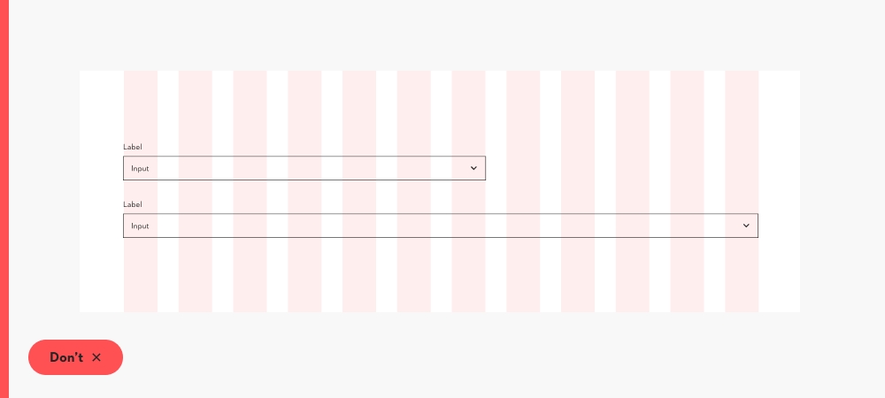

## Content and Assets

### Amount of items in the list

**Consider the following, in case of a single select combobox:**

**\< 5 items** Consider the radio group component in case the list is shorter than 5 elements. E.g. in a list of 3 items, consider a radio button component instead. **(1)**

**5 - 20 items** The dropdown opens on click. The default version has a chevron, that indicates the user can make a choice from a fixed list. **(2)**

**\> 20 items** The dropdown opens after typed input, after the user typed at least 1 character. The list is filtered and only matching items are shown. E.g. a list of countries. **(3)**

[Radio group →](https://www.figma.com/design/qXldpLO6gxHJNLdcXIPxYt?node-id=860-2728)

[Select→](https://www.figma.com/design/qXldpLO6gxHJNLdcXIPxYt?node-id=8139-4888)

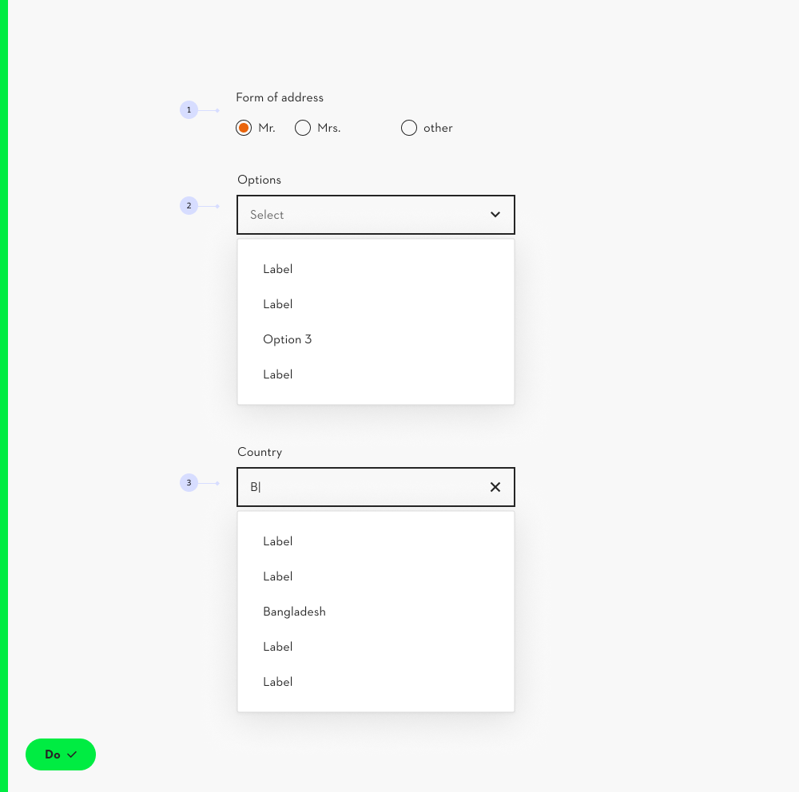

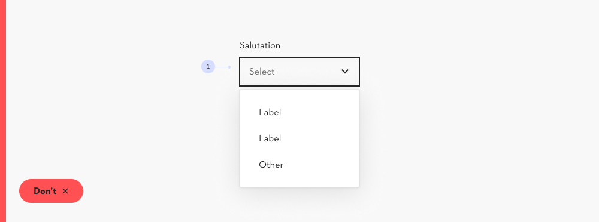

### Specific placeholder copy

The default placeholder is empty. **(1)**

Nevertheless, it is recommended to be as specific, as possible. E.g. ‘Search machine’ or ‘Type to filter’.

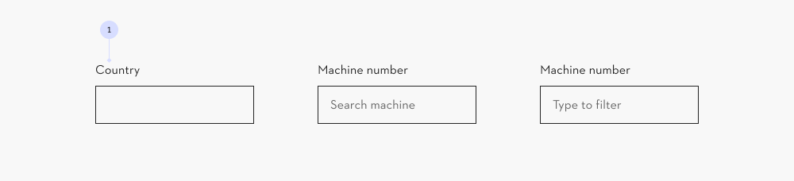

### Maximum length

Ideally all labels fit in one line, maximum two lines.

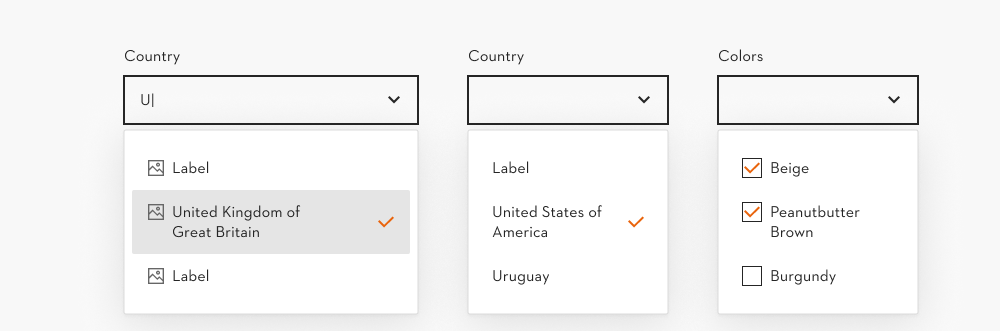

### Truncation

**Don’t use truncation.** This is not legible and therefore not accessible.

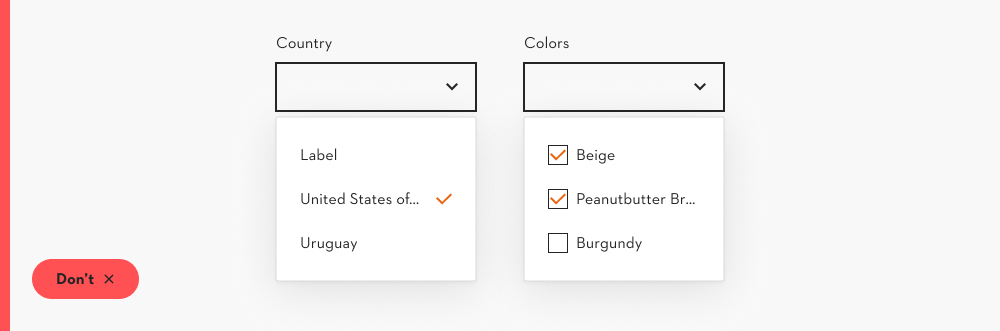

### Use of icons in the dropdown

- Use of icons is optional
- The icons only appear in the dropdown, if it is a single select type.

[Iconography →](https://www.figma.com/design/U218NNP4OsipaHOtv5flns/Iconography-%E2%9E%A1%EF%B8%8F?m=auto)

### Long lists are truncated

The chosen items in the dropdown list appear as an enumeration, divided by a comma.

In case the list is longer, the list is cut off and truncated.

### Grouped Items

Items in a Combobox can be organized under group labels. To maintain clarity and consistency, avoid mixing grouped and ungrouped items within the same list.

1. **Grouped items**
1. **Ungrouped items**

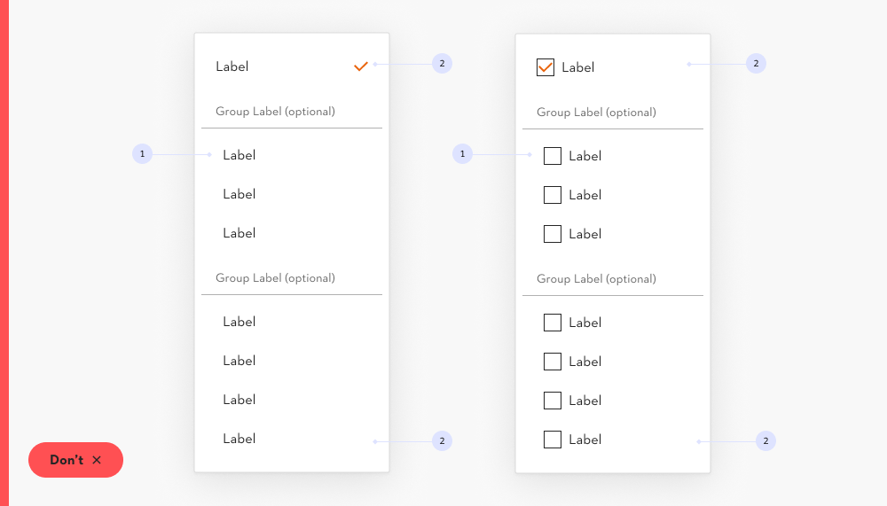

### Info Button

A button to trigger a popover can be placed next to input or select labels to provide **additional contextual information.**

Popover content should be **limited to supplementary, non-critical information** — for example, brief explanations, examples, or guidance that supports user understanding without being essential for task completion.

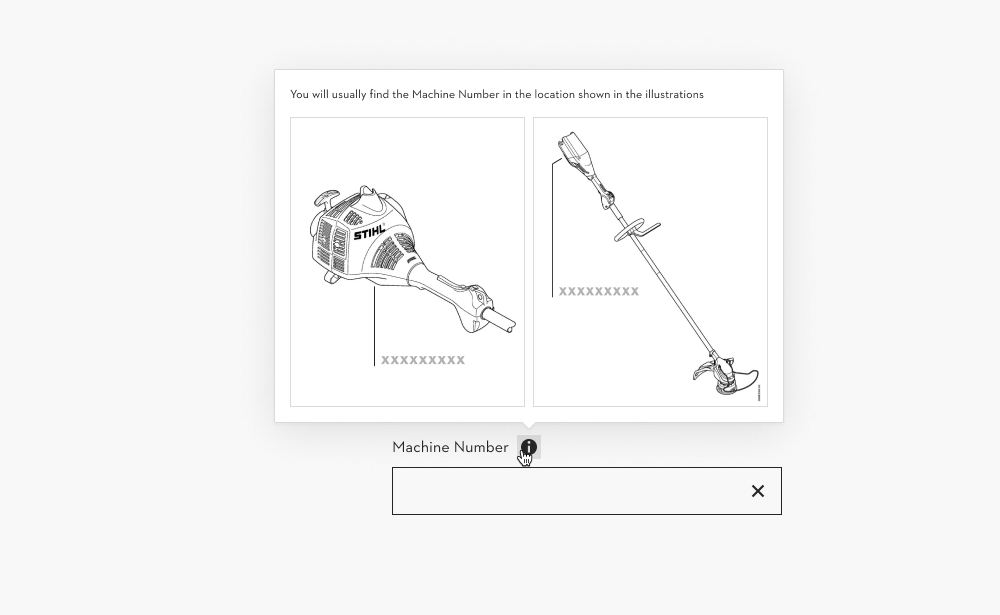

**Don’t use the popover for critical or required information**, use the hint instead as critical information should net be hidden

For mor Guidance on this topic see the [Popover documentation](https://www.figma.com/design/qXldpLO6gxHJNLdcXIPxYt?node-id=35223-10505)

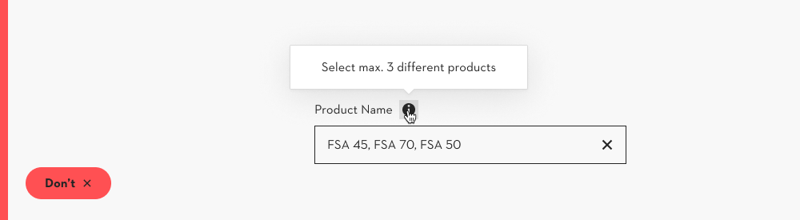

## Behavior

### Trigger to open the dropdown

**Type to filter** The dropdown opens after 1 character is typed. The list is filtered and only shows relevant items to the user. Long scrolling is avoided.

**On click** The dropdown opens on click and shows the full list. In Storybook this property is called ‘dropdownOnFocus’.

The user has to scroll a lot, in case the list exceeds the dropdown. In this case the native [select component](https://www.figma.com/design/qXldpLO6gxHJNLdcXIPxYt?node-id=8139-4888) is recommended, as usability is guaranteed in all browsers.

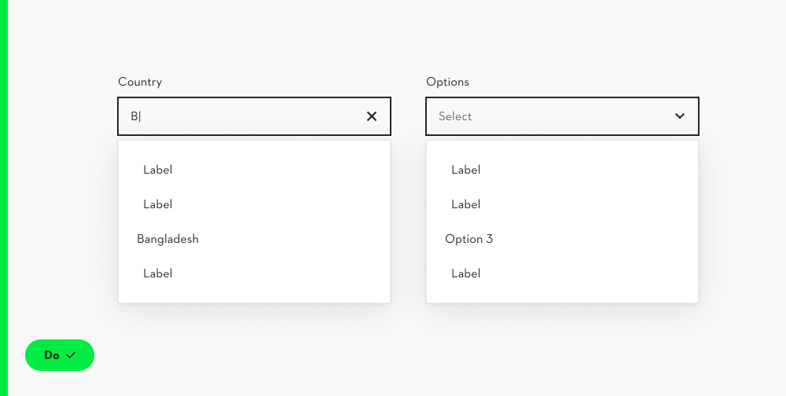

### No results

In case the user typed something without a match, the copy “No options found” is shown.

## Variations

The combobox is a versatile component, that offers properties to create the four following variations:

1. Single select, type to filter
1. Single select, opens on click
1. Multi select, type to filter
1. Multi select, opens on click

Dev note: the property ‘dropdownOnFocus’ set to ‘true’, opens the dropdown on click. The chevron is visible in the field.

### Single select

1. **Type to filter**:
   1. Recommended for \>20 items in the list.
   1. Set a custom placeholder text. E.g. ‘Type to filter’ or ‘Search’.
   1. This variation offers no visual hint to the user to communicate there is a set of options to choose from.
1. **Opens on click**:
   1. Recommended for approximately 5-20 items in the list.
   1. Set a custom placeholder text.
   1. The chevron helps the user understand the select function.

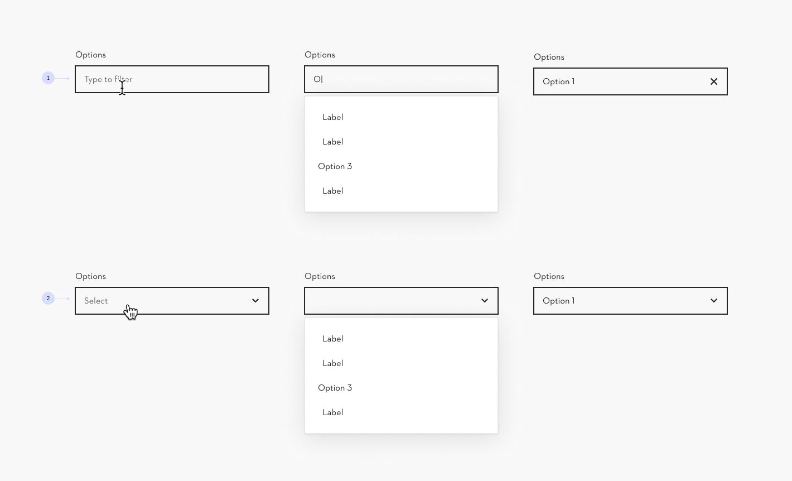

### Multi select

1. **Opens on click:**
   1. Recommended for approximately 5-20 items in the list.
   1. Set a custom placeholder text.
   1. The chevron helps the user understand the select function.
   1. The clear function deletes all input at once.
1. **Type to filter**:
   1. Recommended for \>20 items in the list.
   1. Set a custom placeholder text. E.g. ‘Type to filter’ or ‘Search’.
   1. The clear function deletes all input at once.

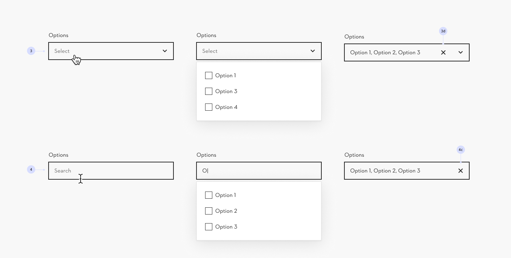

## Building elements

**Size: Medium**

**Size: Small**

**is invalid**

**is invalid**

**Default**

**Hover**

**Focus**

**Disabled**

**List item**

**size medium (padding left-right 24px)**

**size small (padding left-right 16px)**

**selected-false**

**selected-true**

**leading-icon-true**

**spacing between icon+ label 8px**

**default**

**hover**

**disabled**

**selected-false**

**selected-true**

**default**

**hover**

**disabled**

**group label**

**item list**

**Size: medium**

**Variant: single-select**

**Size: medium**

**Variant: multi-select**

**Size: small**

**Variant: single-select**

**Size: small**

**Variant: multi-select**
