# Combobox

## Combobox

Overview:

- A combobox contains of two elements: input field and a dropdown with a list
- The list contains items to choose from
   - the list can be short, medium or long
   - the list can be single select or multi select
- Change the placeholder text to be more specific. E.g. ‘Select a country’, instead of ‘select’
- The dropdown can open on click (2-20 items) or after the user started typing (\>20 items)

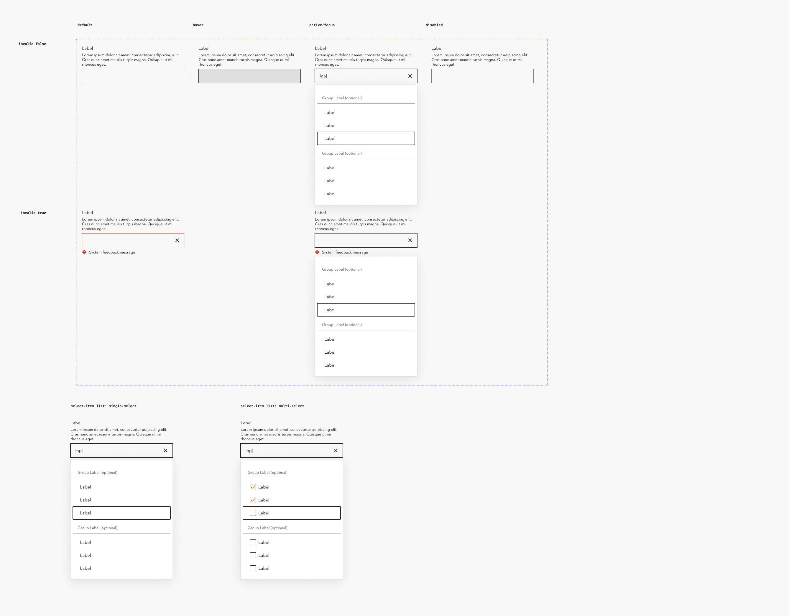

_Figure: Various states and layouts of a combobox component from the STIHL Design System. It shows the combobox in different states such as default, hover, active/focus, disabled, and invalid, with both single-select and multi-select item lists. The combobox consists of an input field and a dropdown list, which can be short, medium, or long, and can open on click or after typing. The text next to the figure provides guidelines for using the combobox, such as specifying placeholder text and handling different list lengths._

### Further guidelines

[Storybook documentation](https://main--63440bbb95889041542a5ba3.chromatic.com/?path=/docs/components-combobox--documentation)

Decision tree

### Related elements

[Select](https://www.figma.com/design/qXldpLO6gxHJNLdcXIPxYt?node-id=8139-4888)

[Iconography](https://www.figma.com/design/U218NNP4OsipaHOtv5flns/Iconography-%E2%9E%A1%EF%B8%8F?m=auto)

[Input](https://www.figma.com/design/qXldpLO6gxHJNLdcXIPxYt?node-id=1591-2)

[Radio Group](https://www.figma.com/design/qXldpLO6gxHJNLdcXIPxYt?node-id=860-2728)

[Fieldset](https://www.figma.com/design/Ie2r0R9QwjEc7O3nrFbXhV/Web-Pattern-Library?node-id=8-154)

### Contribute

Contribute to improving this component by sharing your feedback, asking questions, or suggesting features [here](https://www.figma.com/design/lLmw7PfIdKjFG4uT3B2Hyj/Onboarding-%F0%9F%93%96?node-id=446-868&t=zKmRu4kAkxMeRDmK-4).

## Formatting and Construction

### Anatomy

A combobox contains of two elements:

**Select field** A field, styled like the [input component](https://www.figma.com/design/qXldpLO6gxHJNLdcXIPxYt?node-id=1591-2) and functions as a [select component](https://www.figma.com/design/qXldpLO6gxHJNLdcXIPxYt?node-id=8139-4888). The dropdown opens, after the user interacts with the field.

**Select menu in a dropdown** The dropdown is styled, and looks the same in all browsers. The items in the list are set options for the user to choose from.

**Select field**

1. **Label** Describes the required input
1. **Hint** Short copy that provides guidance and context
1. **Field** The area where you can type or click, depending on the type of select
1. **Placeholder text (optional)** Instruction text inside of the field
1. **System feedback** Error or success message to help the user understand
1. **User input** Data, entered by the user
1. **Clear button** Indicator the user can remove the complete input at once.
1. **Chevron** Icon and indicator that the field contains a select menu.
1. **Info Button (optional):** Can be used to trigger a popover with additional information

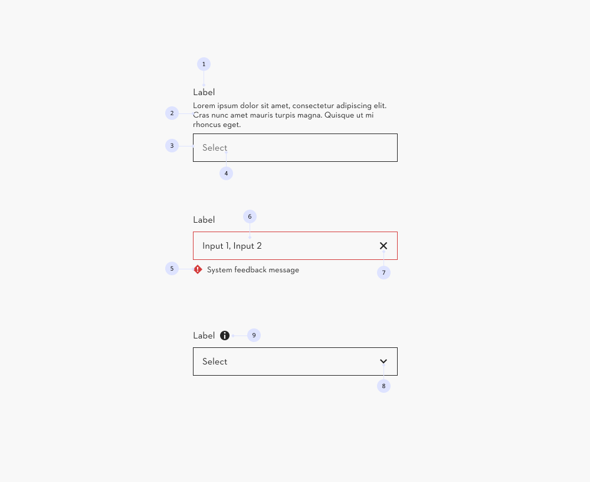

_Figure: The anatomy of a combobox component in a UI design system, showing both default and invalid states. The combobox consists of a select field and a dropdown menu. Callout 1 points to the Label, callout 2 points to the Hint, callout 3 points to the Field, callout 4 points to the area where the dropdown appears, callout 5 points to the System feedback message, callout 6 points to the Input area, callout 7 points to the clear icon, callout 8 points to the dropdown indicator, and callout 9 points to the Label with an info icon. The select field is styled like an input component and opens a dropdown upon user interaction..._

**Select menu in a dropdown**

1. **Group Label (optional)** Describes the category of the grouped items. A group label can not be clicked.
1. **List item** The items are presented to the user. The items are clickable.

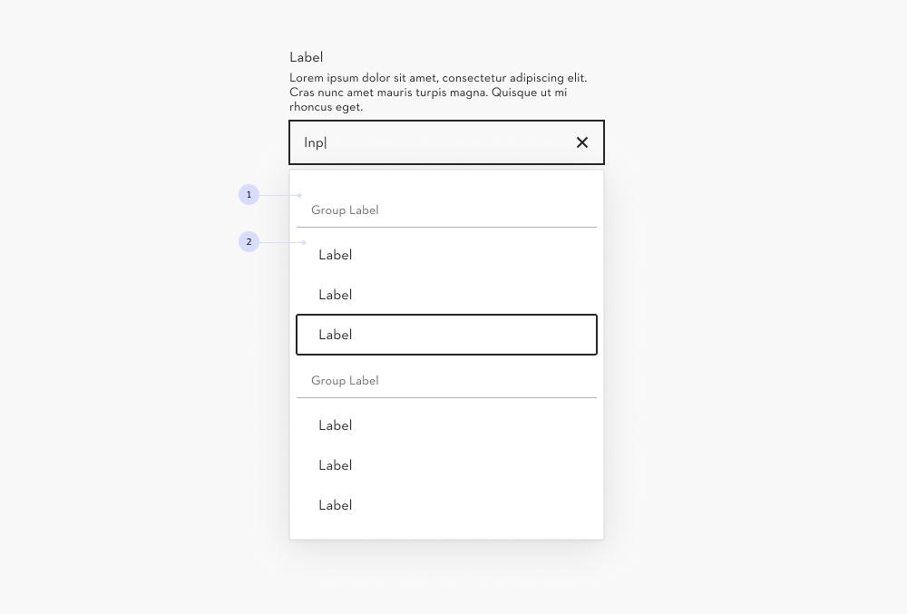

_Figure: The anatomy of a combobox component in an active/focus state, showing a dropdown menu with valid input. The first callout points to a Group Label, which is optional and describes the category of grouped items, and cannot be clicked. The second callout points to a List item, which represents clickable items presented to the user. The combobox includes a Label at the top, a text input field with placeholder text "Inp|", and an "X" icon for clearing the input._

**Types of combobox**

1. **Single select** The single select shows the elements that can be selected
1. **Multi select** The multi select contains checkboxes with labels to indicate with options have been selected

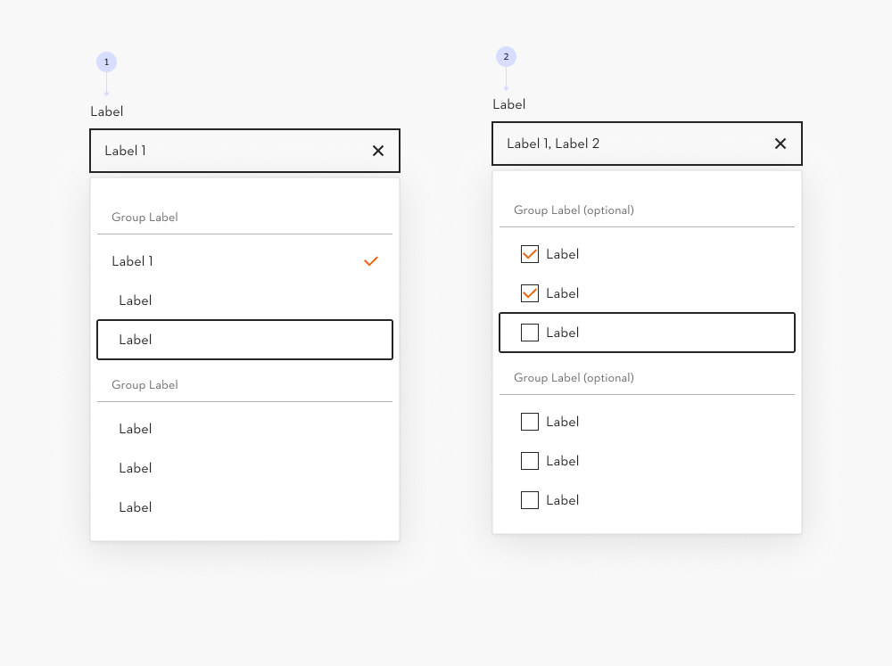

_Figure: Two types of combobox components: a single select and a multi select, both in an active/focus state. Callout 1 points to the single select combobox with a Label and a selected Label 1, while callout 2 points to the multi select combobox with a Label and multiple checkboxes under Group Label (optional). The single select combobox allows choosing one option, whereas the multi select combobox allows choosing multiple options using checkboxes._

### Sizing

#### Medium and small input

By default it is recommended to use the medium variant **(1)** of the component. For Designs with little space or a very restricted viewport the small variant **(2)** can be used.

If the combobox is part of a field set, make sure the sizes are the same within the set.

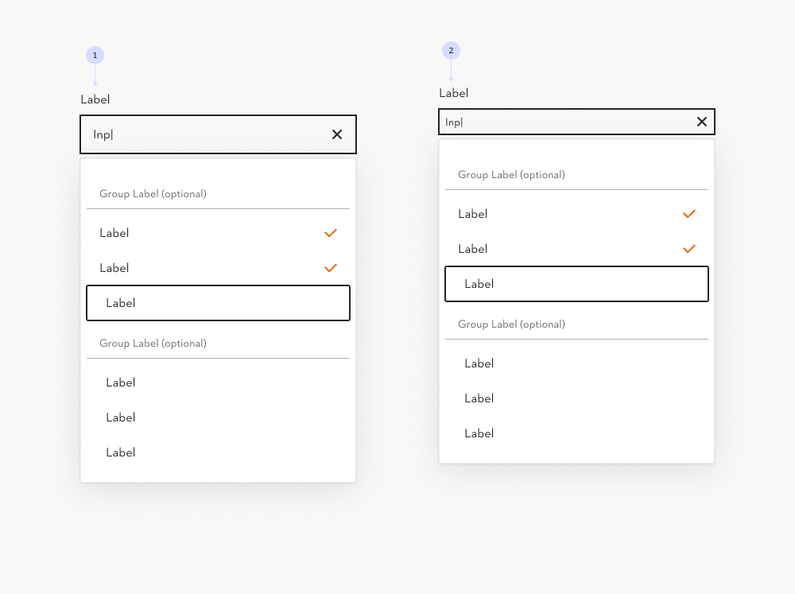

_Figure: Two variants of a combobox component in an active/focus state, labeled as medium and small input. Callout 1 points to the medium variant, and callout 2 points to the small variant. The medium variant is recommended by default, while the small variant is suggested for designs with limited space. Both variants include a Label, an input field labeled "Inp|", and an optional Group Label._

#### Maximum width

To ensure optimal legibility the maximum width of an input field is approximately 650px, depending on the grid (e.g. 8 of 12 columns on stihl.de). The maximum width should be 8 columns, and maximum of two fields in a row.

Less than 8 columns is also possible in different combinations.

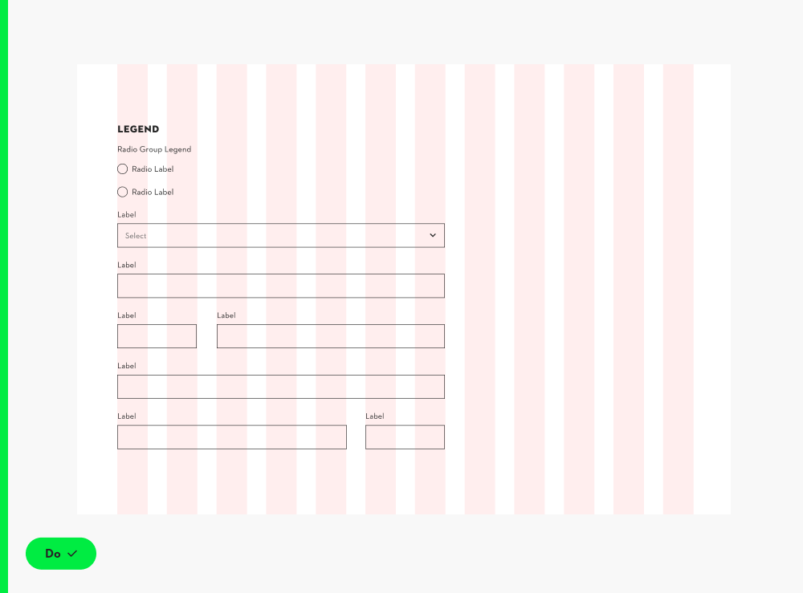

_Figure: A layout example marked as a "Do" example, illustrating the use of a radio-group component and a button component. The radio-group has a horizontal orientation, includes a legend labeled "Radio Group Legend," and contains two radio labels. The maximum width of input fields is demonstrated, with a recommendation of approximately 650px, which corresponds to 8 columns in a grid system. The layout shows a combination of input fields and labels, ensuring optimal legibility and adherence to the grid structure._

#### Maximum width

The width of a box is determined by the container it is placed in. This should ideally be the “[content area narrow](https://www.figma.com/design/HHM9B6UjMStGLxMf6loNLn/DS-945-Grid-Optimisations-%7C-Design?node-id=1-857&t=FFOFP94g90gl91Ko-4)” defined within the grid layout.

While the input can adjust to fit its container, we recommend not exceeding a maximum width of 544px, matching the [maximum text width](https://www.figma.com/design/JyyYtoCYbtJrzqHs38OXSQ/Grid-%26-Spacing-%F0%9F%A7%AE?node-id=1-132), for better scanability and readability. This max width calculated by multiplying the font size with 34. For our default copy styling Text M (16px) that defines a max. width of 544px (16px\*34= 544px).

In the Figma component, the maximum width is set to the recommended 544px. ([Link to calculation](https://www.figma.com/design/JyyYtoCYbtJrzqHs38OXSQ/Grid-%26-Spacing-%F0%9F%A7%AE?m=auto&node-id=1-857&t=p2GU3oXS9Ao4MbV0-1))

If multiple sliders are used within the same form or fieldset, they should all maintain the same size for consistency.

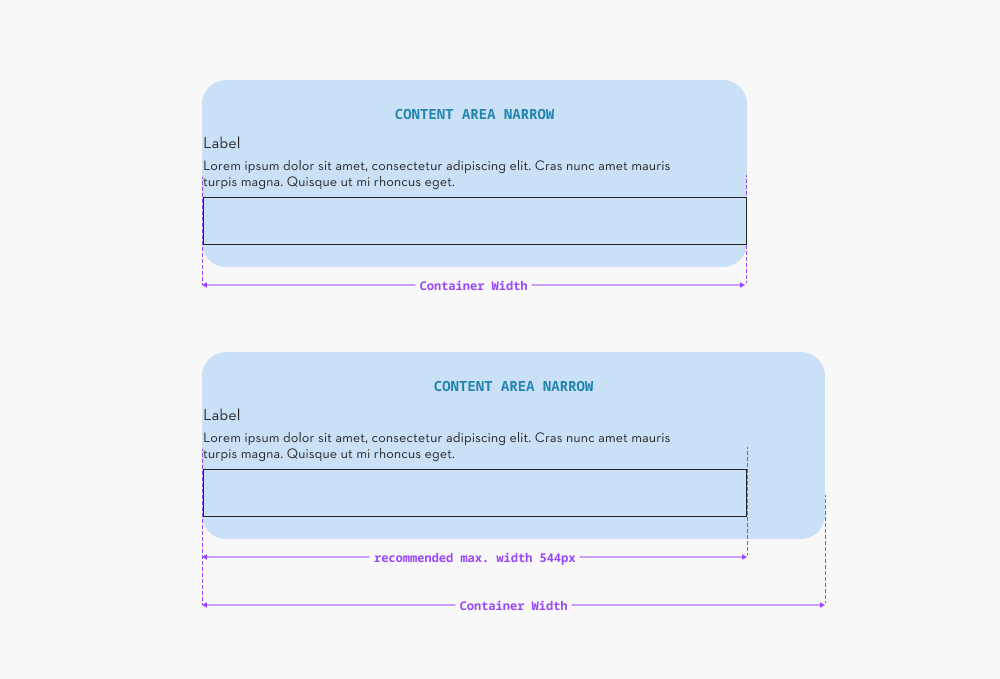

_Figure: A combobox component in its default state within a "Content area Narrow" layout. The measurements indicate the "Container Width" and the "recommended max. width 544px" for the combobox. The text explains that while the combobox can adjust to fit its container, it should not exceed 544px in width for better readability, which is calculated based on the font size._

A maximum width is needed, as it keeps the **click path between the label and action short.**

The longer the distance to the target, the more time it will require for the mouse to reach it. (Fitt’s Law)

[Article about Fitt’s Law on the NN Group website →](https://www.nngroup.com/articles/fitts-law/)

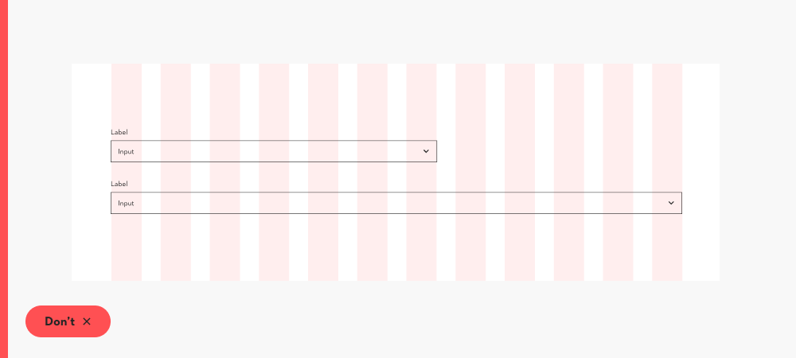

_Figure: A "Don't" example of a combobox component layout. It includes two comboboxes with "Label" and "Input" text, each having a maximum width. The example is marked as incorrect because it does not keep the click path between the label and action short, which is necessary to reduce the time it takes for the mouse to reach the target according to Fitt’s Law._

## Content and Assets

### Amount of items in the list

**Consider the following, in case of a single select combobox:**

**\< 5 items** Consider the radio group component in case the list is shorter than 5 elements. E.g. in a list of 3 items, consider a radio button component instead. **(1)**

**5 - 20 items** The dropdown opens on click. The default version has a chevron, that indicates the user can make a choice from a fixed list. **(2)**

**\> 20 items** The dropdown opens after typed input, after the user typed at least 1 character. The list is filtered and only matching items are shown. E.g. a list of countries. **(3)**

[Radio group →](https://www.figma.com/design/qXldpLO6gxHJNLdcXIPxYt?node-id=860-2728)

[Select→](https://www.figma.com/design/qXldpLO6gxHJNLdcXIPxYt?node-id=8139-4888)

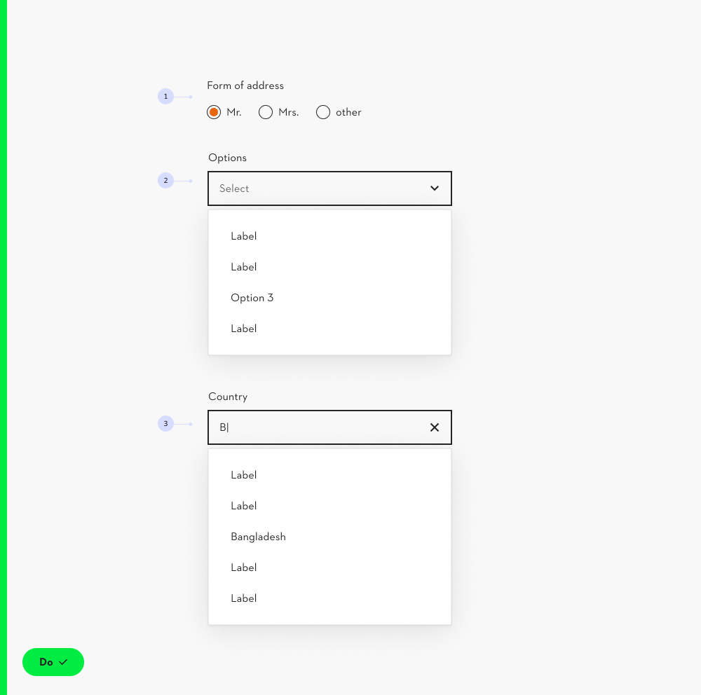

_Figure: A "Do" example of a combobox component with different item amounts in the list. The numbered callouts point to a radio-group component labeled "Form of address" with three options: "Mr.", "Mrs.", and "other" (1), a combobox labeled "Options" with a dropdown menu showing four items (2), and another combobox labeled "Country" with a dropdown menu showing four items and a partially typed input "B|" (3). The text describes guidelines for the number of items in a combobox list: using a radio group for fewer than 5 items, a standard dropdown for 5 to 20 items, and a filtered dropdown for more than 20 items after the user types at least one character._

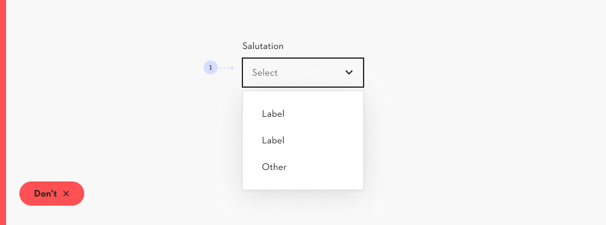

_Figure: A combobox component in an active/focus state with the label "Salutation". The combobox has three items in the list: "Label", "Label", and "Other". Callout 1 points to the selected item labeled "Select". This is marked as a "Don't" example, indicating that this layout or design choice is incorrect, although the specific reason is not provided in the image._

### Specific placeholder copy

The default placeholder is empty. **(1)**

Nevertheless, it is recommended to be as specific, as possible. E.g. ‘Search machine’ or ‘Type to filter’.

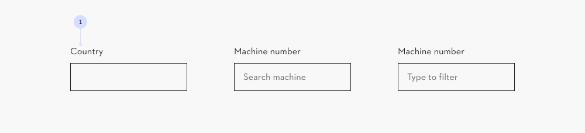

_Figure: Three combobox components in the default state, each with different placeholder text. The first combobox has no placeholder text and is labeled "Country," while the second and third comboboxes have placeholders labeled "Search machine" and "Type to filter," respectively. The numbered callout 1 points to the first combobox labeled "Country," indicating that while the default placeholder can be empty, it is recommended to use specific placeholder text like "Search machine" or "Type to filter._

### Maximum length

Ideally all labels fit in one line, maximum two lines.

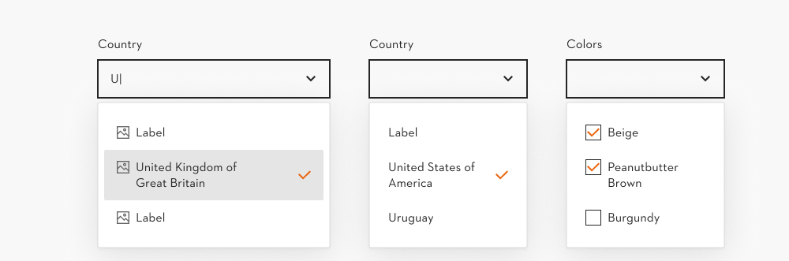

_Figure: A combobox component in an active/focus state with valid entries. It shows two comboboxes labeled "Country" with different selected items, "United Kingdom of Great Britain" and "United States of America," and one combobox labeled "Colors" with selected items "Beige" and "Peanutbutter Brown." The text specifies that ideally, all labels should fit within one line, with a maximum of two lines._

### Truncation

**Don’t use truncation.** This is not legible and therefore not accessible.

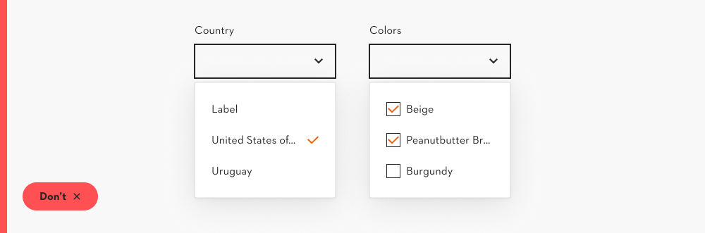

_Figure: A combobox component in an active state with two dropdown menus labeled "Country" and "Colors". The "Country" dropdown displays options including "Label", "United States of...", and "Uruguay", while the "Colors" dropdown lists "Beige", "Peanutbutter BronLabel", and "Burgundy". The example is marked as a "Don't" because it uses truncation, which is not legible and therefore not accessible._

### Use of icons in the dropdown

- Use of icons is optional
- The icons only appear in the dropdown, if it is a single select type.

[Iconography →](https://www.figma.com/design/U218NNP4OsipaHOtv5flns/Iconography-%E2%9E%A1%EF%B8%8F?m=auto)

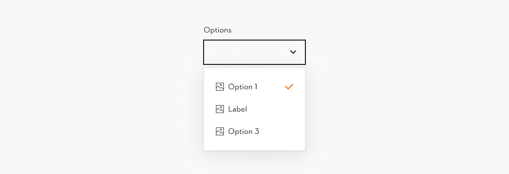

_Figure: A combobox component in an active or focus state, showing a dropdown menu with three items labeled "Options", "Option 1", "Label", and "Option 3". Icons are optionally used next to each item in the dropdown, appearing only if the combobox is of a single select type. The first item, "Option 1", is selected and marked with a checkmark._

### Long lists are truncated

The chosen items in the dropdown list appear as an enumeration, divided by a comma.

In case the list is longer, the list is cut off and truncated.

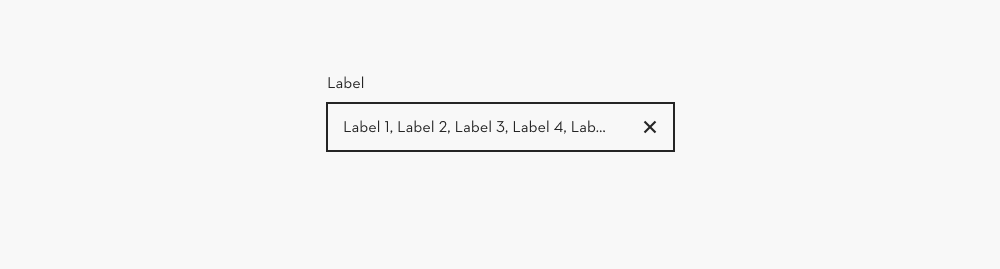

_Figure: A combobox component in an active/focus state with a valid input. The chosen items in the dropdown list are shown as an enumeration separated by commas, and the list is truncated with an ellipsis when it exceeds a certain length. The text "Label" appears above the combobox, and inside the combobox, the text reads "Label 1, Label 2, Label 3, Label 4, Lab..." indicating truncation._

### Grouped Items

Items in a Combobox can be organized under group labels. To maintain clarity and consistency, avoid mixing grouped and ungrouped items within the same list.

1. **Grouped items**
1. **Ungrouped items**

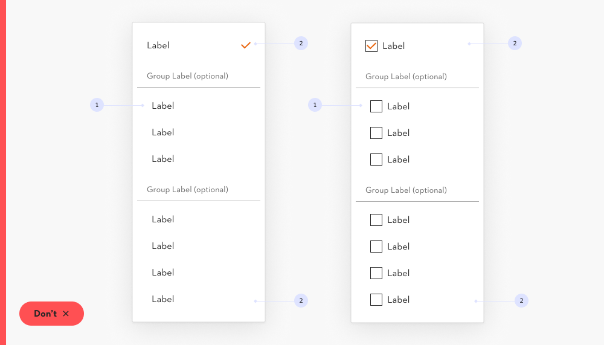

_Figure: A "Don't" example of a Combobox component with grouped and ungrouped items. Callout 1 points to individual list-items with the variant single-select, default state, medium size, and either selected or unselected status. Callout 2 points to list-items with the variant multi-select, default state, medium size, and either selected or unselected status. The example is marked as incorrect because it mixes grouped and ungrouped items within the same list, which should be avoided to maintain clarity and consistency. The grouped items are organized under optional group labels._

### Info Button

A button to trigger a popover can be placed next to input or select labels to provide **additional contextual information.**

Popover content should be **limited to supplementary, non-critical information** — for example, brief explanations, examples, or guidance that supports user understanding without being essential for task completion.

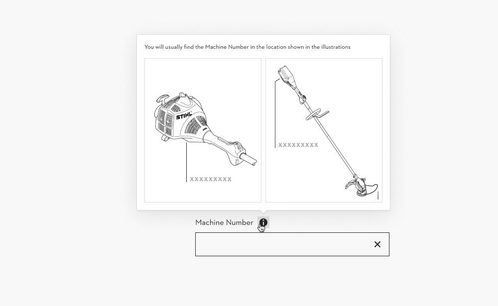

_Figure: A Combobox component with an Info Button next to the label "Machine Number." The Info Button triggers a popover that provides additional information about where to find the Machine Number. The input field includes a clear button and is shown in the default state and medium size, with no validation errors indicated. The cursor is shown as a pointer, indicating that the Info Button is interactive._

**Don’t use the popover for critical or required information**, use the hint instead as critical information should net be hidden

For mor Guidance on this topic see the [Popover documentation](https://www.figma.com/design/qXldpLO6gxHJNLdcXIPxYt?node-id=35223-10505)

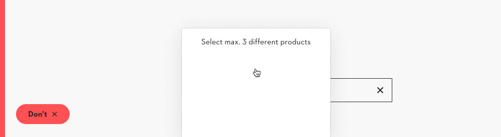

_Figure: A "Don't" example of a combobox component with a popover. The combobox has a label "Product Name," an info button, a clear button, and input text displaying "FSA 45, FSA 70, FSA 50." The popover, positioned below the combobox, contains the text "Select max. 3 different products." The example is marked as incorrect because it uses the popover for information that should not be hidden; instead, a hint should be used for critical information._

## Behavior

### Trigger to open the dropdown

**Type to filter** The dropdown opens after 1 character is typed. The list is filtered and only shows relevant items to the user. Long scrolling is avoided.

**On click** The dropdown opens on click and shows the full list. In Storybook this property is called ‘dropdownOnFocus’.

The user has to scroll a lot, in case the list exceeds the dropdown. In this case the native [select component](https://www.figma.com/design/qXldpLO6gxHJNLdcXIPxYt?node-id=8139-4888) is recommended, as usability is guaranteed in all browsers.

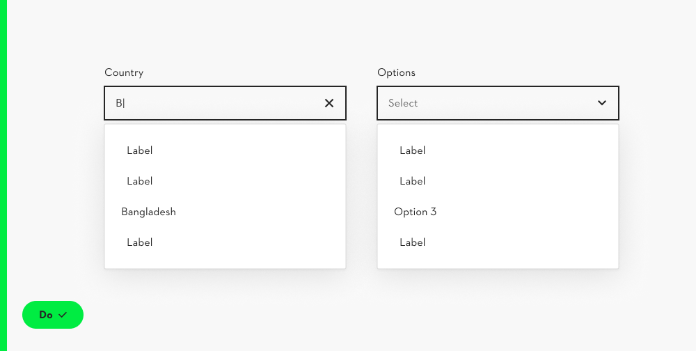

_Figure: A combobox component in an active/focus state, labeled "Country" and "Options." The "Country" combobox shows a filtered list after typing "B|," displaying "Label," "Bangladesh," and other labels. The "Options" combobox is open and ready for selection with items "Label," "Label," "Option 3," and "Label." This example is marked as a "Do" because it demonstrates effective filtering after typing one character, avoiding long scrolling, and providing a user-friendly dropdown experience._

### No results

In case the user typed something without a match, the copy “No options found” is shown.

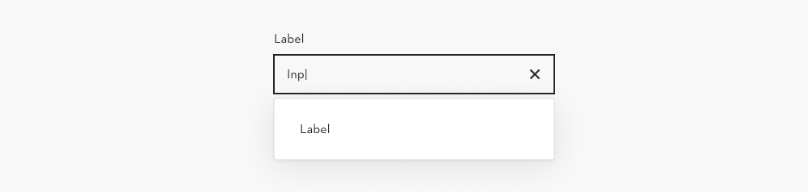

_Figure: A combobox component in an active or focused state, with no results found. The combobox includes a label at the top, an input field with the text "Inp|", and a close button represented by an "X". Below the input field, there is a message area with the label "Label" indicating where the "No options found" copy would be shown when there are no matching results._

## Variations

The combobox is a versatile component, that offers properties to create the four following variations:

1. Single select, type to filter
1. Single select, opens on click
1. Multi select, type to filter
1. Multi select, opens on click

Dev note: the property ‘dropdownOnFocus’ set to ‘true’, opens the dropdown on click. The chevron is visible in the field.

### Single select

1. **Type to filter**:
   1. Recommended for \>20 items in the list.
   1. Set a custom placeholder text. E.g. ‘Type to filter’ or ‘Search’.
   1. This variation offers no visual hint to the user to communicate there is a set of options to choose from.
1. **Opens on click**:
   1. Recommended for approximately 5-20 items in the list.
   1. Set a custom placeholder text.
   1. The chevron helps the user understand the select function.

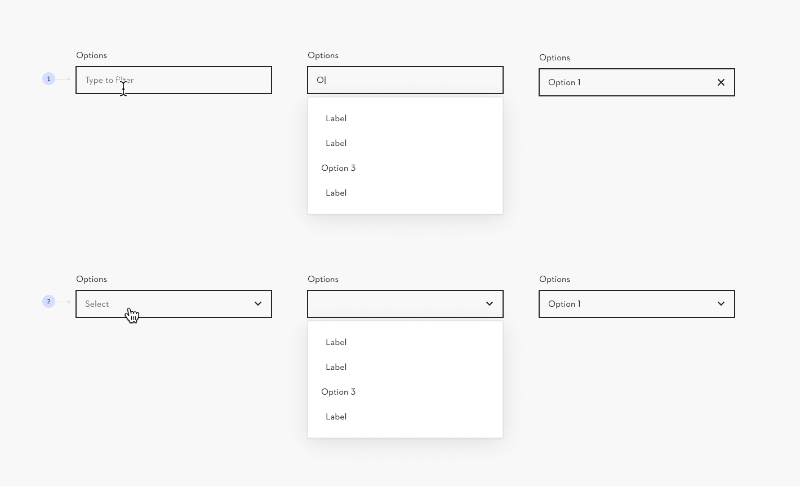

_Figure: A combobox component in single select mode, showcasing two variants: one for typing to filter options and another for opening a dropdown list. Callout 1 points to the combobox with a placeholder text "Type to filter", recommended for lists with more than 20 items, and callout 2 points to the combobox with a placeholder text "Select", recommended for lists with approximately 5-20 items. The dropdown state is shown with options labeled "Label", "Option 3", and "Option 1". The combobox in the first variant does not visually hint at the presence of selectable options, while the second variant includes a chevron to indicate the select function._

### Multi select

1. **Opens on click:**
   1. Recommended for approximately 5-20 items in the list.
   1. Set a custom placeholder text.
   1. The chevron helps the user understand the select function.
   1. The clear function deletes all input at once.
1. **Type to filter**:
   1. Recommended for \>20 items in the list.
   1. Set a custom placeholder text. E.g. ‘Type to filter’ or ‘Search’.
   1. The clear function deletes all input at once.

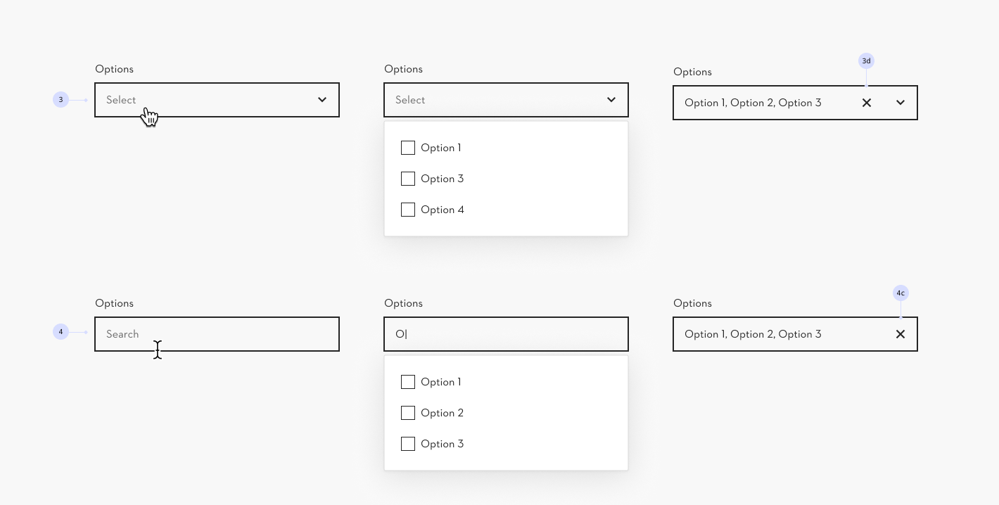

_Figure: A combobox component in a multi-select variant, showing two different interaction states: one that opens on click and another that allows filtering by typing. The combobox labeled with callout 3 is in an active/focus state with a dropdown menu displaying options, and the placeholder text is "Select". The combobox labeled with callout 4 shows a search functionality with the placeholder text "Search". Both comboboxes include a clear function to delete all input at once. Callout 3d points to the selected options displayed in the combobox, and callout 4c points to the filtered options in the dropdown menu._

## Building elements

**Size: Medium**

**Size: Small**

**is invalid**

**is invalid**

**Default**

**Hover**

**Focus**

**Disabled**

**List item**

**size medium (padding left-right 24px)**

**size small (padding left-right 16px)**

**selected-false**

**selected-true**

**leading-icon-true**

**spacing between icon+ label 8px**

**default**

**hover**

**disabled**

**selected-false**

**selected-true**

**default**

**hover**

**disabled**

**group label**

**item list**

**Size: medium**

**Variant: single-select**

**Size: medium**

**Variant: multi-select**

**Size: small**

**Variant: single-select**

**Size: small**

**Variant: multi-select**
