# Combobox

## Combobox

Overview:

- A combobox contains of two elements: input field and a dropdown with a list
- The list contains items to choose from
   - the list can be short, medium or long
   - the list can be single select or multi select
- Change the placeholder text to be more specific. E.g. ‘Select a country’, instead of ‘select’
- The dropdown can open on click (2-20 items) or after the user started typing (\>20 items)

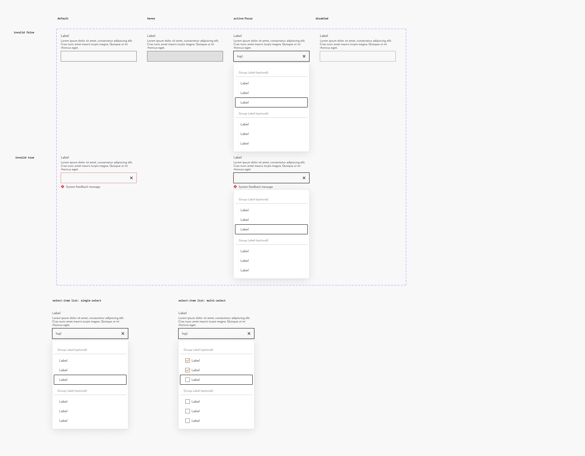

_Figure: The Combobox component in various states and configurations. It shows the input-combobox in default, hover, focus, and disabled states, with both valid and invalid entries. The combobox includes a label, hint text, and system feedback messages. The dropdown list can be single-select or multi-select, with optional group labels, and can vary in length. The figure also demonstrates the use of a clear button and specific placeholder text for better user guidance._

### Further guidelines

[Storybook documentation](https://main--63440bbb95889041542a5ba3.chromatic.com/?path=/docs/components-combobox--documentation)

Decision tree

### Related elements

[Select](https://www.figma.com/design/qXldpLO6gxHJNLdcXIPxYt?node-id=8139-4888)

[Iconography](https://www.figma.com/design/U218NNP4OsipaHOtv5flns/Iconography-%E2%9E%A1%EF%B8%8F?m=auto)

[Input](https://www.figma.com/design/qXldpLO6gxHJNLdcXIPxYt?node-id=1591-2)

[Radio Group](https://www.figma.com/design/qXldpLO6gxHJNLdcXIPxYt?node-id=860-2728)

[Fieldset](https://www.figma.com/design/Ie2r0R9QwjEc7O3nrFbXhV/Web-Pattern-Library?node-id=8-154)

### Contribute

Contribute to improving this component by sharing your feedback, asking questions, or suggesting features [here](https://www.figma.com/design/lLmw7PfIdKjFG4uT3B2Hyj/Onboarding-%F0%9F%93%96?node-id=446-868&t=zKmRu4kAkxMeRDmK-4).

## Formatting and Construction

### Anatomy

A combobox contains of two elements:

**Select field** A field, styled like the [input component](https://www.figma.com/design/qXldpLO6gxHJNLdcXIPxYt?node-id=1591-2) and functions as a [select component](https://www.figma.com/design/qXldpLO6gxHJNLdcXIPxYt?node-id=8139-4888). The dropdown opens, after the user interacts with the field.

**Select menu in a dropdown** The dropdown is styled, and looks the same in all browsers. The items in the list are set options for the user to choose from.

**Select field**

1. **Label** Describes the required input
1. **Hint** Short copy that provides guidance and context
1. **Field** The area where you can type or click, depending on the type of select
1. **Placeholder text (optional)** Instruction text inside of the field
1. **System feedback** Error or success message to help the user understand
1. **User input** Data, entered by the user
1. **Clear button** Indicator the user can remove the complete input at once.
1. **Chevron** Icon and indicator that the field contains a select menu.
1. **Info Button (optional):** Can be used to trigger a popover with additional information

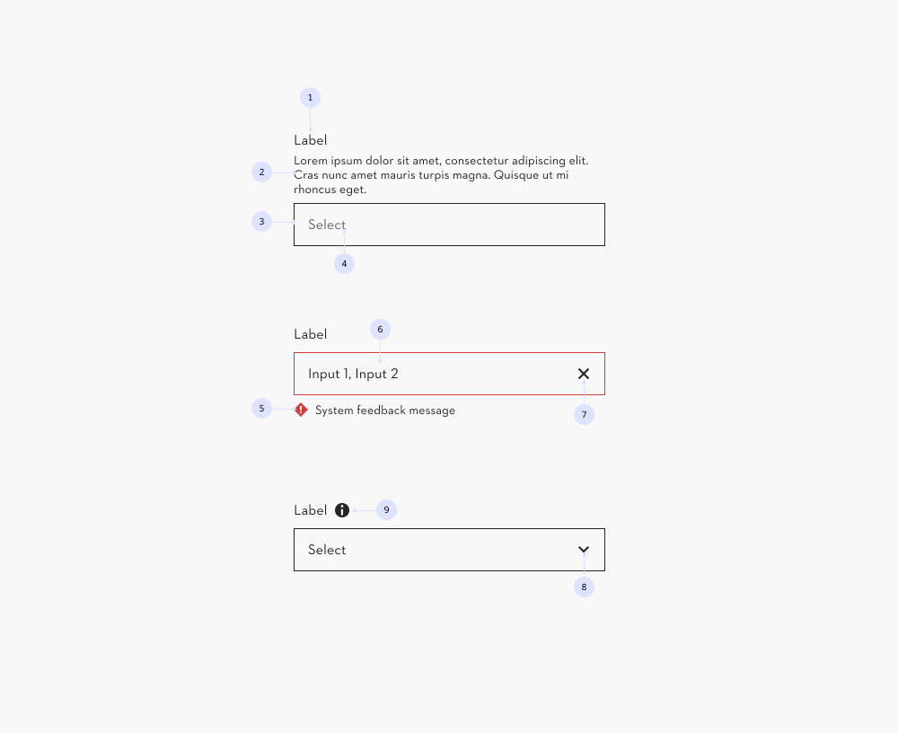

_Figure: Anatomy of the combobox select field with nine numbered callouts across three fields. First field (default, placeholder "Select"): callout 1 points at the "Label", callout 2 at the lorem ipsum hint text below it, callout 3 at the field itself and callout 4 at the placeholder text "Select". Second field (invalid, red border) with the selected value "Input 1, Input 2": callout 5 points at the red error icon next to "System feedback message", callout 6 at the entered value text and callout 7 at the clear (X) button. Third field with "Label" and the placeholder "Select": callout 9 points at the info icon next to the label and callout 8 at the chevron-down icon at the right end of the field._

**Select menu in a dropdown**

1. **Group Label (optional)** Describes the category of the grouped items. A group label can not be clicked.
1. **List item** The items are presented to the user. The items are clickable.

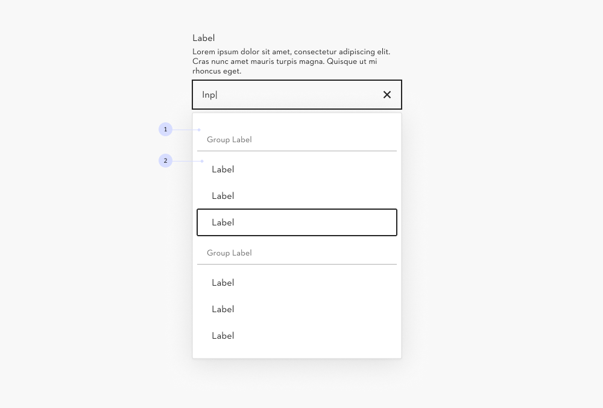

_Figure: Anatomy of the select menu in an open combobox dropdown, below a focused field with "Label", a lorem ipsum hint, typed text "Inp|" and a clear button. The list has two groups, each with a "Group Label" heading above a divider and three "Label" items, the third item of the first group outlined as focused. Callout 1 points at the first "Group Label" (the optional group label, which cannot be clicked) and callout 2 points at the list items below it (the clickable list items)._

**Types of combobox**

1. **Single select** The single select shows the elements that can be selected
1. **Multi select** The multi select contains checkboxes with labels to indicate with options have been selected

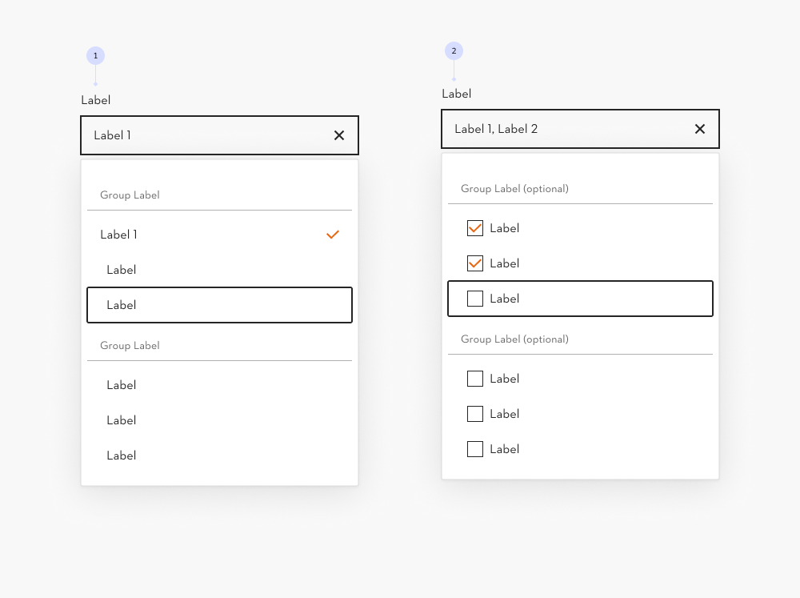

_Figure: Two types of combobox with open dropdowns side by side. Callout 1 marks the single select: field "Label" with the value "Label 1" and a clear button; the list has a "Group Label" with "Label 1" selected and marked by an orange checkmark on the right, then two more "Label" items, the last outlined as focused, followed by a second "Group Label" with three "Label" items. Callout 2 marks the multi select: field "Label" with the value "Label 1, Label 2" and a clear button; the list has two groups headed "Group Label (optional)", where each "Label" item has a checkbox, the first two checked in orange and the other four unchecked._

### Sizing

#### Medium and small input

By default it is recommended to use the medium variant **(1)** of the component. For Designs with little space or a very restricted viewport the small variant **(2)** can be used.

If the combobox is part of a field set, make sure the sizes are the same within the set.

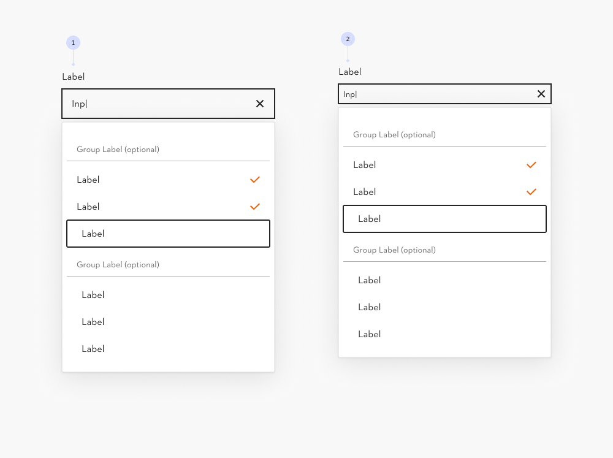

_Figure: Two combobox sizes side by side, both focused with typed text "Inp|", a clear button and an open dropdown. Callout 1 marks the medium variant (the recommended default) with a taller field and larger list rows. Callout 2 marks the small variant with a shorter field, smaller text and more compact rows, for designs with little space. Both dropdowns show two groups headed "Group Label (optional)" with three "Label" items each; the first two items of the first group have an orange checkmark and the third is outlined as focused._

#### Maximum width

To ensure optimal legibility the maximum width of an input field is approximately 650px, depending on the grid (e.g. 8 of 12 columns on stihl.de). The maximum width should be 8 columns, and maximum of two fields in a row.

Less than 8 columns is also possible in different combinations.

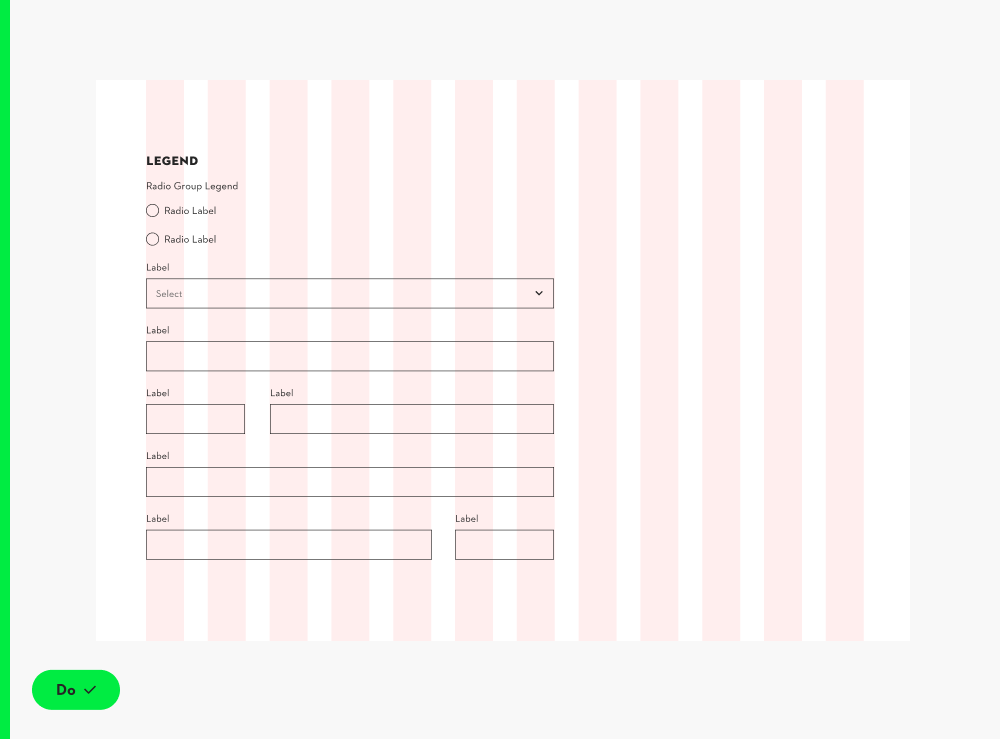

_Figure: Do example: a form with the heading "Legend", a radio group with the legend "Radio Group Legend" and two "Radio Label" options side by side in one row, followed by a "Select" field with a chevron and several "Label" text inputs, laid over a 12-column grid. All fields stay within the left 8 columns, at most two fields share a row (a short and a long field, or a long and a short one), and the right 4 columns remain empty._

#### Maximum width

The width of a box is determined by the container it is placed in. This should ideally be the “[content area narrow](https://www.figma.com/design/HHM9B6UjMStGLxMf6loNLn/DS-945-Grid-Optimisations-%7C-Design?node-id=1-857&t=FFOFP94g90gl91Ko-4)” defined within the grid layout.

While the input can adjust to fit its container, we recommend not exceeding a maximum width of 544px, matching the [maximum text width](https://www.figma.com/design/JyyYtoCYbtJrzqHs38OXSQ/Grid-%26-Spacing-%F0%9F%A7%AE?node-id=1-132), for better scanability and readability. This max width calculated by multiplying the font size with 34. For our default copy styling Text M (16px) that defines a max. width of 544px (16px\*34= 544px).

In the Figma component, the maximum width is set to the recommended 544px. ([Link to calculation](https://www.figma.com/design/JyyYtoCYbtJrzqHs38OXSQ/Grid-%26-Spacing-%F0%9F%A7%AE?m=auto&node-id=1-857&t=p2GU3oXS9Ao4MbV0-1))

If multiple sliders are used within the same form or fieldset, they should all maintain the same size for consistency.

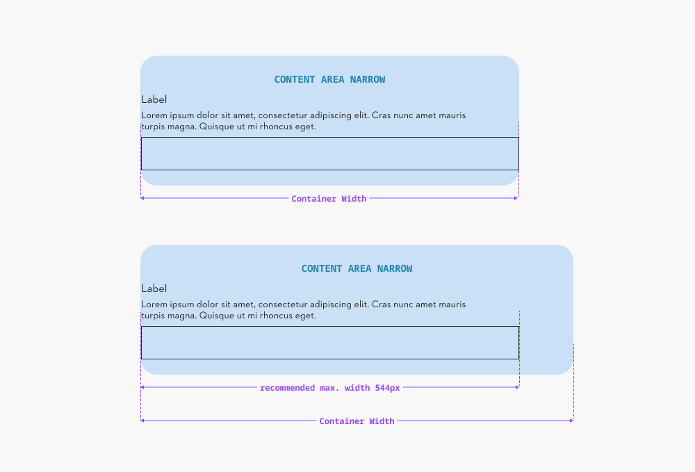

_Figure: Two layouts of a combobox with a "Label", a short lorem ipsum helper text and an empty input field inside a light blue container named "Content area Narrow". In the top layout the input fills the whole container, and a purple "Container Width" arrow spans the same width as the input. In the bottom layout the container is wider, but the input stays at the width marked "recommended max. width 544px", while a longer "Container Width" arrow marks the full container._

A maximum width is needed, as it keeps the **click path between the label and action short.**

The longer the distance to the target, the more time it will require for the mouse to reach it. (Fitt’s Law)

[Article about Fitt’s Law on the NN Group website →](https://www.nngroup.com/articles/fitts-law/)

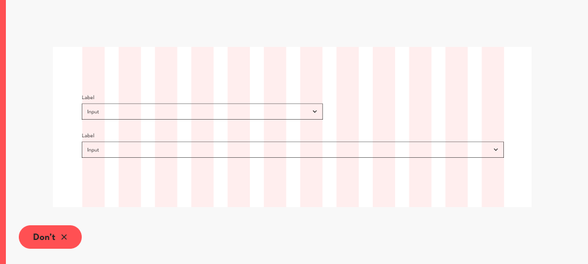

_Figure: Don't example: two comboboxes, each with the label "Label" and the text "Input" with a chevron, placed over a pink twelve-column grid. The first input spans roughly half of the grid, the second is stretched across the whole grid width, so the chevron sits far from its label. This is wrong because without a maximum width the click path between label and action becomes long and takes more time to reach (Fitts's Law)._

## Content and Assets

### Amount of items in the list

**Consider the following, in case of a single select combobox:**

**\< 5 items** Consider the radio group component in case the list is shorter than 5 elements. E.g. in a list of 3 items, consider a radio button component instead. **(1)**

**5 - 20 items** The dropdown opens on click. The default version has a chevron, that indicates the user can make a choice from a fixed list. **(2)**

**\> 20 items** The dropdown opens after typed input, after the user typed at least 1 character. The list is filtered and only matching items are shown. E.g. a list of countries. **(3)**

[Radio group →](https://www.figma.com/design/qXldpLO6gxHJNLdcXIPxYt?node-id=860-2728)

[Select→](https://www.figma.com/design/qXldpLO6gxHJNLdcXIPxYt?node-id=8139-4888)

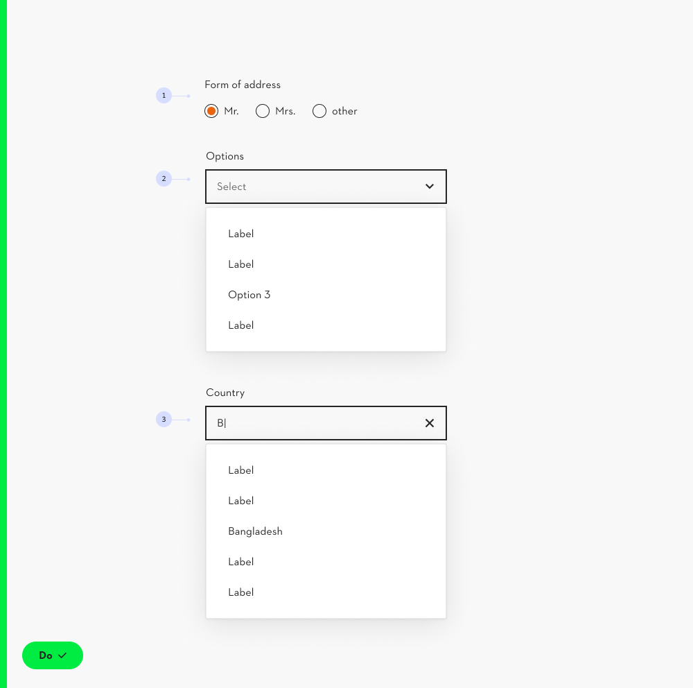

_Figure: Do example with three callouts. Callout 1 points at the horizontal radio group "Form of address" with the options "Mr." (selected), "Mrs." and "other", used for fewer than 5 items. Callout 2 points at the "Options" combobox with the placeholder "Select" and a chevron, opened to a list with "Label", "Label", "Option 3" and "Label" (5 to 20 items, opens on click). Callout 3 points at the "Country" combobox with typed input "B|" and a clear button, showing a filtered list of "Label", "Label", "Bangladesh", "Label" and "Label" (more than 20 items, opens after typing)._

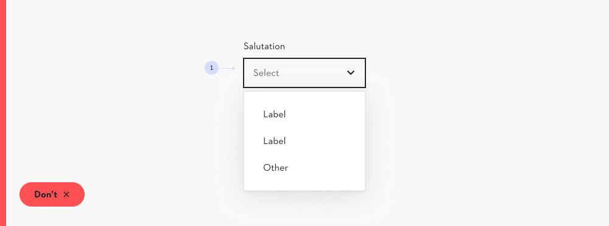

_Figure: Don't example with one callout. Callout 1 points at the focused combobox "Salutation" with the placeholder "Select" and a chevron, opened to a list with only three items: "Label", "Label" and "Other". This is wrong because a combobox should not be used for such a short list of items._

### Specific placeholder copy

The default placeholder is empty. **(1)**

Nevertheless, it is recommended to be as specific, as possible. E.g. ‘Search machine’ or ‘Type to filter’.

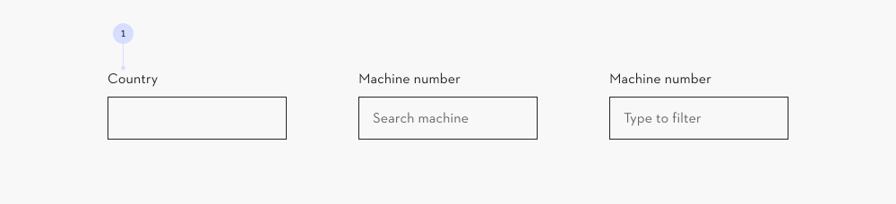

_Figure: Three empty-looking comboboxes in the default state. Callout 1 points at the label of the first, "Country", whose input has an empty placeholder (the default). The other two, both labelled "Machine number", show specific placeholder copy: "Search machine" and "Type to filter", which is the recommended way to word a placeholder._

### Maximum length

Ideally all labels fit in one line, maximum two lines.

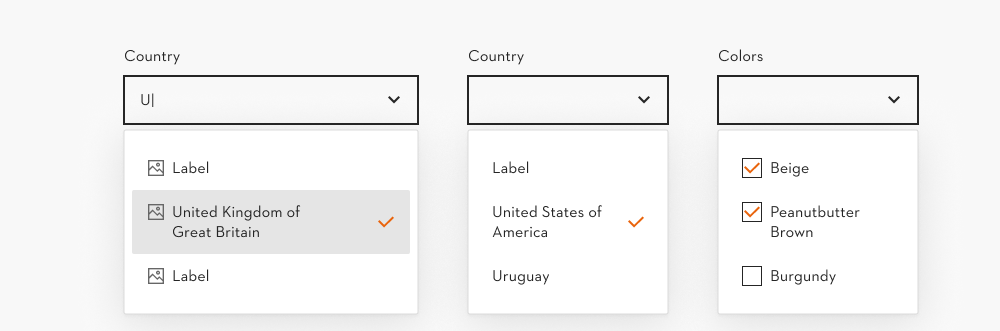

_Figure: Three opened comboboxes showing long labels wrapping onto a second line instead of being cut off. "Country" with typed input "U|" lists "Label", a highlighted "United Kingdom of Great Britain" (selected, two lines, orange checkmark) and "Label", each with an image icon. The second "Country" lists "Label", "United States of America" (selected, two lines) and "Uruguay". "Colors" is a multi-select with checkboxes: "Beige" and "Peanutbutter Brown" checked, "Burgundy" unchecked._

### Truncation

**Don’t use truncation.** This is not legible and therefore not accessible.

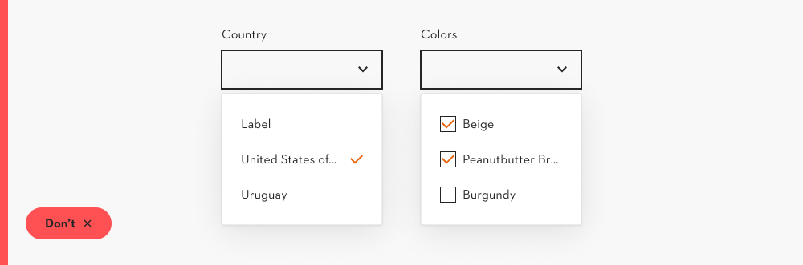

_Figure: Don't example: two opened comboboxes where long labels are truncated with an ellipsis. "Country" lists "Label", "United States of..." (selected, orange checkmark) and "Uruguay". "Colors" is a multi-select with checkboxes: "Beige" and a cut-off "Peanutbutter Br..." checked, "Burgundy" unchecked. This is wrong because truncated text is not legible and therefore not accessible._

### Use of icons in the dropdown

- Use of icons is optional
- The icons only appear in the dropdown, if it is a single select type.

[Iconography →](https://www.figma.com/design/U218NNP4OsipaHOtv5flns/Iconography-%E2%9E%A1%EF%B8%8F?m=auto)

_Figure: Combobox "Options" with an empty input and a chevron, opened to a dropdown list in which every item has an icon in front of its text: "Option 1" (selected, orange checkmark), "Label" and "Option 3". Icons are optional and only appear in the dropdown of a single-select combobox._

### Long lists are truncated

The chosen items in the dropdown list appear as an enumeration, divided by a comma.

In case the list is longer, the list is cut off and truncated.

_Figure: Focused multi select combobox with the label "Label" and a dark border, whose selected values are shown as a comma-separated enumeration that is cut off with an ellipsis when too long: "Label 1, Label 2, Label 3, Label 4, Lab...". A clear button (X) sits at the right end of the field._

### Grouped Items

Items in a Combobox can be organized under group labels. To maintain clarity and consistency, avoid mixing grouped and ungrouped items within the same list.

1. **Grouped items**
1. **Ungrouped items**

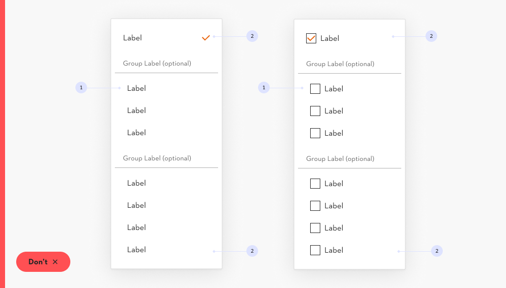

_Figure: Don't example: two dropdown lists side by side, a single select list (left, selected item marked with an orange check mark) and a multi select list (right, items with checkboxes, first one checked), each mixing ungrouped and grouped items. Each list starts with an ungrouped "Label" at the top, followed by two groups headed "Group Label (optional)" with a divider line, containing three and four "Label" items. Callout 1 points at an item inside a group; callout 2 marks the ungrouped items, the "Label" above the first group and the last "Label" at the bottom of each list. Grouped and ungrouped items must not be mixed in the same list._

### Info Button

A button to trigger a popover can be placed next to input or select labels to provide **additional contextual information.**

Popover content should be **limited to supplementary, non-critical information** — for example, brief explanations, examples, or guidance that supports user understanding without being essential for task completion.

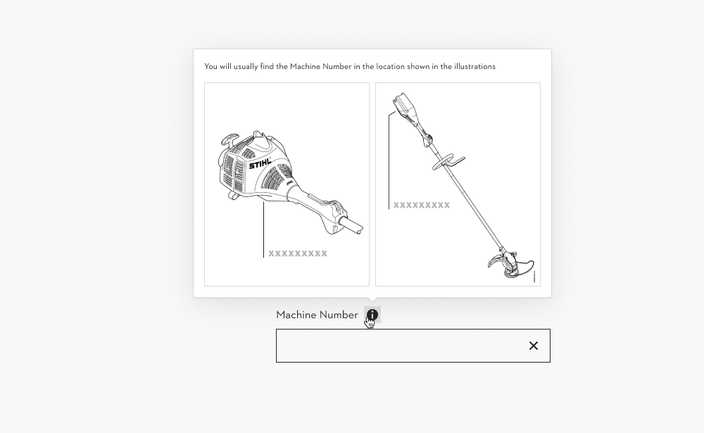

_Figure: Combobox with the label "Machine Number", an info button (circled i) right next to it and an empty input field with a clear button (X). A mouse pointer is on the info button, which has opened a popover above the field with the text "You will usually find the Machine Number in the location shown in the illustrations" and two line drawings of a STIHL machine, a petrol power head and a long-shaft trimmer, each with a leader line to the placeholder machine number "XXXXXXXXX"._

**Don’t use the popover for critical or required information**, use the hint instead as critical information should net be hidden

For mor Guidance on this topic see the [Popover documentation](https://www.figma.com/design/qXldpLO6gxHJNLdcXIPxYt?node-id=35223-10505)

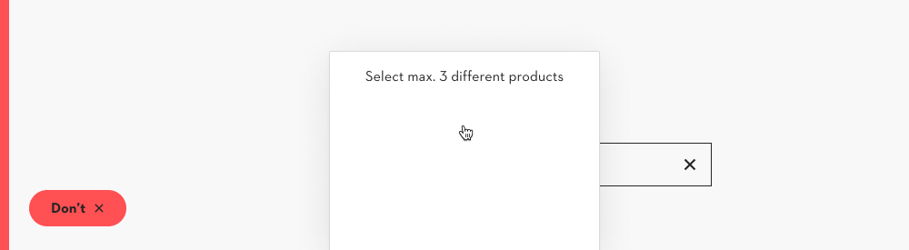

_Figure: Don't example: a white popover with the text "Select max. 3 different products" opened from the info button next to the label "Product Name" of a combobox. The popover sits above the label with its arrow pointing down at the info button, the pointer cursor is on the info button, and the input below shows "FSA 45, FSA 70, FSA 50" with a clear button. This is wrong because required information such as the selection limit is hidden behind the info button instead of being shown as a hint._

## Behavior

### Trigger to open the dropdown

**Type to filter** The dropdown opens after 1 character is typed. The list is filtered and only shows relevant items to the user. Long scrolling is avoided.

**On click** The dropdown opens on click and shows the full list. In Storybook this property is called ‘dropdownOnFocus’.

The user has to scroll a lot, in case the list exceeds the dropdown. In this case the native [select component](https://www.figma.com/design/qXldpLO6gxHJNLdcXIPxYt?node-id=8139-4888) is recommended, as usability is guaranteed in all browsers.

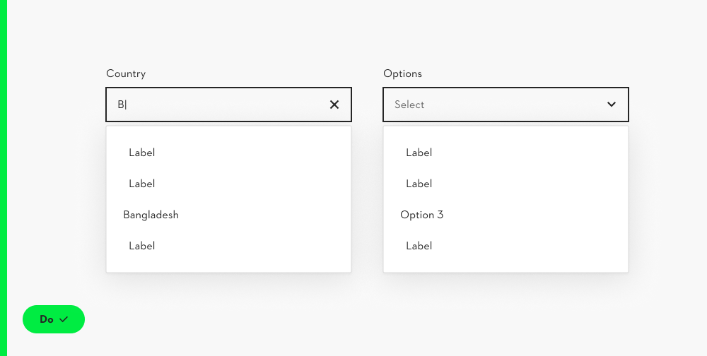

_Figure: Do example: two focused comboboxes with open dropdowns. The "Country" combobox contains the typed input "B|" with a clear button and shows a filtered list of "Label", "Label", "Bangladesh" and "Label" (type to filter, the dropdown opens after 1 character is typed). The "Options" combobox shows the placeholder "Select" with a chevron and an opened list of "Label", "Label", "Option 3" and "Label" (opens on click and shows the full list)._

### No results

In case the user typed something without a match, the copy “No options found” is shown.

_Figure: Focused combobox with the label "Label", the typed input "Inp|" and a clear button (X), with an open dropdown below that contains a single entry "Label"._

## Variations

The combobox is a versatile component, that offers properties to create the four following variations:

1. Single select, type to filter
1. Single select, opens on click
1. Multi select, type to filter
1. Multi select, opens on click

Dev note: the property ‘dropdownOnFocus’ set to ‘true’, opens the dropdown on click. The chevron is visible in the field.

### Single select

1. **Type to filter**:
   1. Recommended for \>20 items in the list.
   1. Set a custom placeholder text. E.g. ‘Type to filter’ or ‘Search’.
   1. This variation offers no visual hint to the user to communicate there is a set of options to choose from.
1. **Opens on click**:
   1. Recommended for approximately 5-20 items in the list.
   1. Set a custom placeholder text.
   1. The chevron helps the user understand the select function.

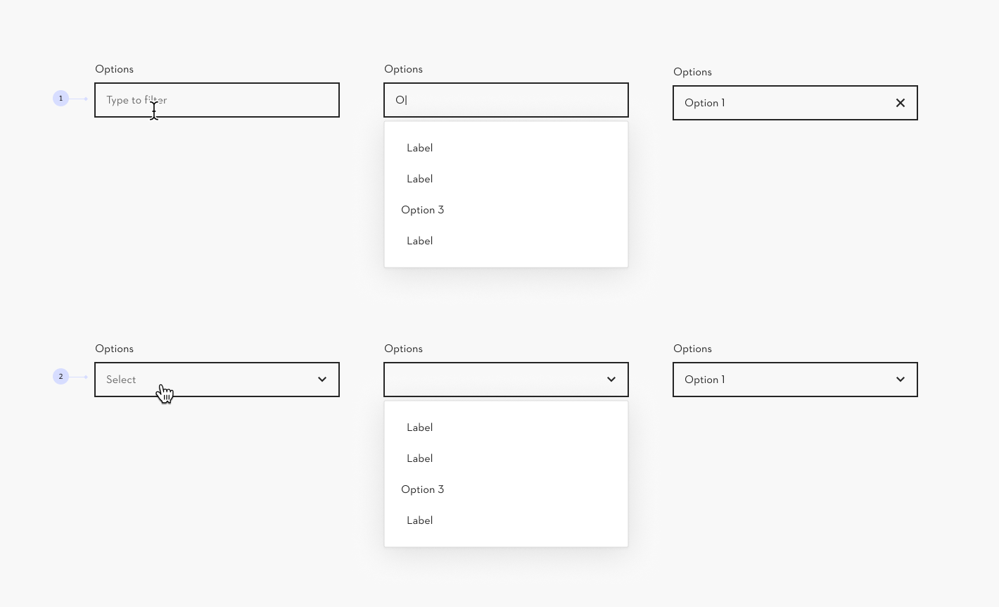

_Figure: Single select comboboxes labelled "Options" in two rows of three states each. Callout 1 points at the top row, type to filter: an empty field with the placeholder "Type to filter" and a text cursor and no chevron, then typed input "O|" with an open list of "Label", "Label", "Option 3" and "Label", then the chosen value "Option 1" with a clear button. Callout 2 points at the bottom row, opens on click: the placeholder "Select" with a chevron and a pointer hand, then an empty field with chevron and the open list "Label", "Label", "Option 3", "Label", then the chosen value "Option 1" with a chevron._

### Multi select

1. **Opens on click:**
   1. Recommended for approximately 5-20 items in the list.
   1. Set a custom placeholder text.
   1. The chevron helps the user understand the select function.
   1. The clear function deletes all input at once.
1. **Type to filter**:
   1. Recommended for \>20 items in the list.
   1. Set a custom placeholder text. E.g. ‘Type to filter’ or ‘Search’.
   1. The clear function deletes all input at once.

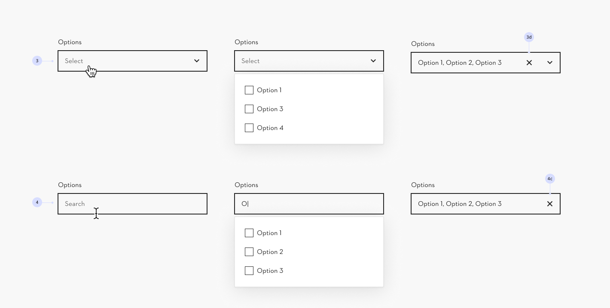

_Figure: Multi select comboboxes labelled "Options" in two rows of three states. Callout 3 points at the top row, opens on click: the placeholder "Select" with a chevron and a pointer hand, then an open list with unchecked checkboxes "Option 1", "Option 3" and "Option 4", then the chosen values "Option 1, Option 2, Option 3" with a clear button and a chevron; callout 3d points at that clear button. Callout 4 points at the bottom row, type to filter: the placeholder "Search" with a text cursor and no chevron, then typed input "O|" with an open list of unchecked checkboxes "Option 1", "Option 2" and "Option 3", then the chosen values "Option 1, Option 2, Option 3" with only a clear button; callout 4c points at that clear button._

## Building elements

**Size: Medium**

**Size: Small**

**is invalid**

**is invalid**

**Default**

**Hover**

**Focus**

**Disabled**

**List item**

**size medium (padding left-right 24px)**

**size small (padding left-right 16px)**

**selected-false**

**selected-true**

**leading-icon-true**

**spacing between icon+ label 8px**

**default**

**hover**

**disabled**

**selected-false**

**selected-true**

**default**

**hover**

**disabled**

**group label**

**item list**

**Size: medium**

**Variant: single-select**

**Size: medium**

**Variant: multi-select**

**Size: small**

**Variant: single-select**

**Size: small**

**Variant: multi-select**
