# Dialog

## Dialog

Overview:

- Common use cases are confirmation dialog, form dialog, informational dialog and selection dialog.
- The dialog component is suited for tasks (use cases) that are closely connected to the main flow.
- The dialog size adjusts to the inserted content.
- Content overflow: header area and footer area are sticky, while the content area is scrolls.
- Ensure a clear hierarchy between the headline and content, so that the user can navigate quickly and move on.
- When on mobile 3 or more buttons, use small buttons to leave more space for the content area.
- When the dialog opens, focus should be set to the first actionable element.

### Component

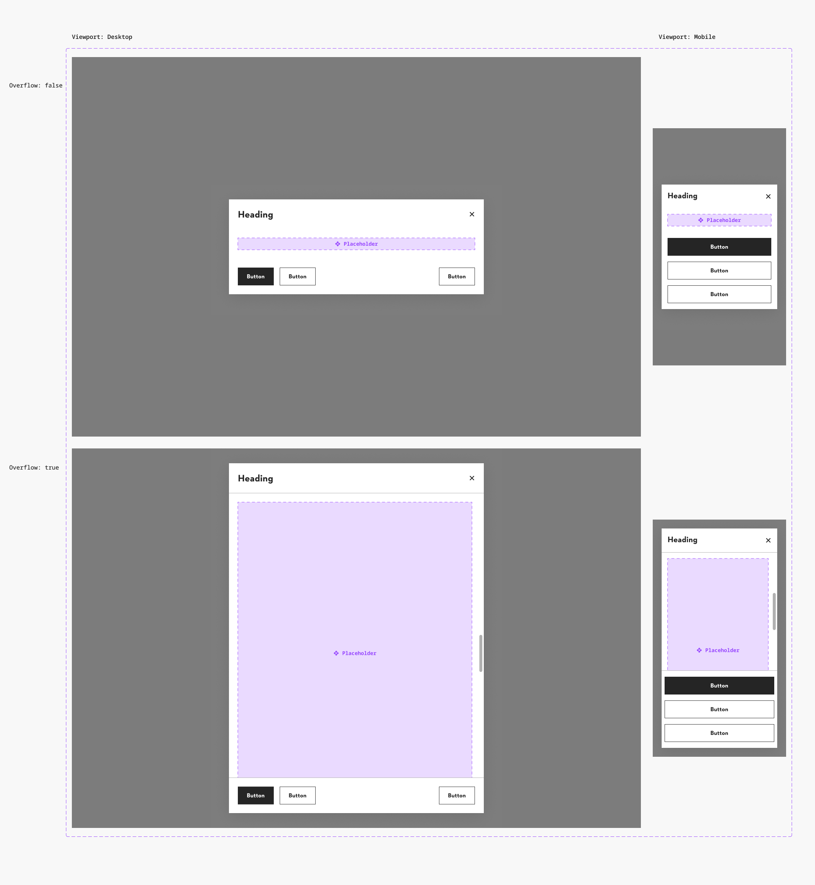

_Figure: Dialog component variants on a grey backdrop in a 2x2 grid: columns "Viewport: Desktop" and "Viewport: Mobile", rows "Overflow: false" and "Overflow: true". Every dialog is a white panel with the header "Heading" and a close button (X), a purple dashed "Placeholder" content area and a footer with three "Button" buttons, the first one filled dark (primary). On desktop the footer buttons are in one horizontal row: primary and second button on the left, third button on the right. On mobile the three buttons are stacked vertically and full width, primary on top. With "Overflow: false" the dialog is only as tall as its content and has no dividers. With "Overflow: true" the content area is tall and scrolls (scrollbar visible), with divider lines between header, content and footer, so header and footer stay fixed._

#### Further guidelines

[Storybook documentation](https://main--63440bbb95889041542a5ba3.chromatic.com/?path=/docs/components-dialog--documentation&globals=backgrounds.name:!undefined;backgrounds.value:!undefined)

Decision tree

#### Similar components

**Component**

**Trigger**

**Placement**

**Content**

**Intention**

**Tooltip**

Hover or focus of an interactive element

In proximity to the triggering element, non-modal

Text only

Provide short, contextual information or clarify unlabeled controls

**Popover**

Click or tap of an interactive element

In proximity to the triggering button, non-modal

Text, icon, image and interactive elements

Provide additional information or quick actions without leaving the current context

**Dialog**

Triggered by the system in response to user interaction

Center of the screen, with backdrop, modal

Text, icon, image and interactive elements

Confirm important actions, guide users through complex tasks, or temporarily block interaction to focus attention

**Toast**

Triggered by the system in response to user interaction

Bottom of the screen, non-modal

Text, icon, and optional dismiss button

Provide brief, lightweight feedback on user actions such as error or success.

**Notification**

Triggered by the system in response to events or interactions

Within the content area of the page, in relation to relevant elements

Text, icon, links and buttons

Deliver important updates or status messages that may require user attention or follow-up

#### Related elements

[Drawer](https://www.figma.com/design/qXldpLO6gxHJNLdcXIPxYt?node-id=16282-9317)

[Combobox](https://www.figma.com/design/qXldpLO6gxHJNLdcXIPxYt/Pattern-Library-%F0%9F%96%A5-Web-1.0?node-id=2659-3954)

[Fieldset](https://www.figma.com/design/Ie2r0R9QwjEc7O3nrFbXhV/Web-Pattern-Library?node-id=8-154)

[Toast](https://www.figma.com/design/qXldpLO6gxHJNLdcXIPxYt/Pattern-Library-%F0%9F%96%A5-Web-1.0?node-id=8844-4923)

[Notification](https://www.figma.com/design/qXldpLO6gxHJNLdcXIPxYt/Pattern-Library-%F0%9F%96%A5-Web-1.0?node-id=7251-8)

[Button](https://www.figma.com/design/qXldpLO6gxHJNLdcXIPxYt/Pattern-Library-%F0%9F%96%A5-Web-1.0?node-id=162-126)

[Tooltip](https://www.figma.com/design/HovZmjHiwxguawTWTO6ibS/DS-1085-Design-%7C-Web-%7C-Tootlip?node-id=36194-1244)

[Popover](https://www.figma.com/design/qXldpLO6gxHJNLdcXIPxYt?node-id=26075-11456)

#### Contribute

Contribute to improving this component by sharing your feedback, asking questions, or suggesting features [here](https://www.figma.com/design/lLmw7PfIdKjFG4uT3B2Hyj/Onboarding-%F0%9F%93%96?node-id=446-868&t=zKmRu4kAkxMeRDmK-4).

## Formatting and Construction

### Anatomy

1. **Custom header area**
1. **Custom content area (optional)**
1. **Custom footer area (optional)**
1. **Backdrop**

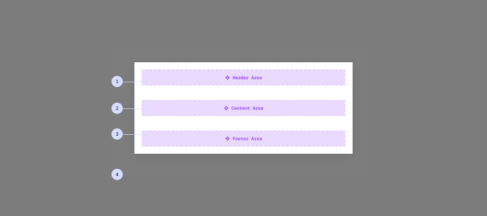

_Figure: Anatomy of the dialog with four numbered callouts: a white dialog panel on a grey backdrop contains three purple dashed slots stacked vertically. Callout 1 points at the custom header area, labelled "Header Area". Callout 2 points at the custom content area (optional), labelled "Content Area". Callout 3 points at the custom footer area (optional), labelled "Footer Area". Callout 4 sits on the grey backdrop below the panel and refers to the backdrop._

#### Figma component

Although technically a freely configurable slot, the figma components for **header area (1)** and **footer area (3)** provide a few options for common use case. The content area can be replaced with a **placeholder component (2)** that contain an additional text or image option.

Feel free to swap this with your own placeholder components or modules.

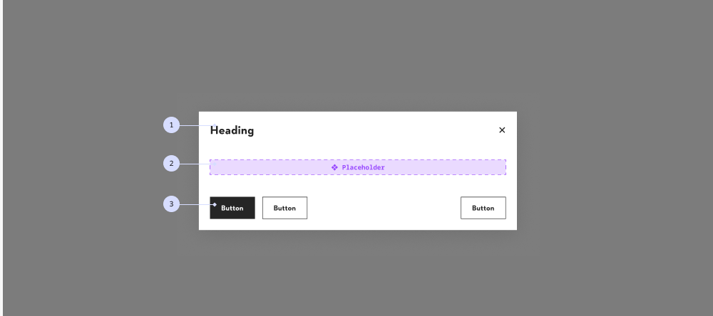

_Figure: Figma dialog component for desktop without overflow, a white panel on a grey backdrop, with three numbered callouts. Callout 1 points at the header area with the title "Heading" and a close button. Callout 2 points at the content area, a purple dashed "Placeholder" component that can be swapped for your own content. Callout 3 points at the footer area, whose first button is a filled dark primary "Button", followed by a second outlined "Button", with a third outlined "Button" at the right edge._

### Sizing

#### Minimum width

The dialog adjusts to the width of the inserted content. Minimum size ist based on the smallest viewport size: 272px

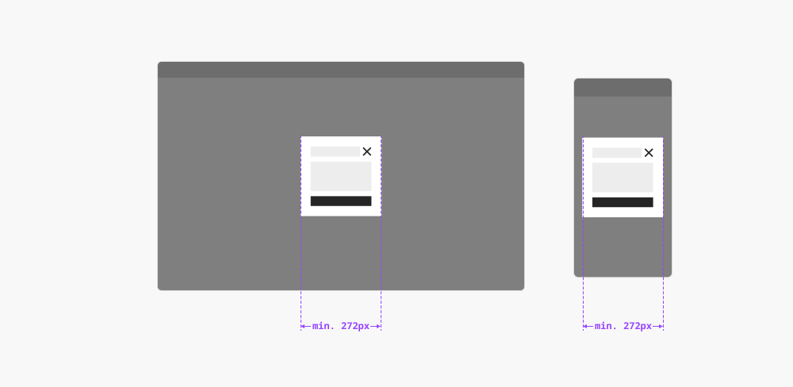

_Figure: Two schematic dialogs, one in a desktop browser window and one in a narrow mobile window, each shown as a small white panel with a header line, close button, content block and dark button. Dashed purple vertical lines at the left and right edges of each dialog and a horizontal arrow dimension below it, labelled "min. 272px" in both cases, show the minimum dialog width, based on the smallest viewport size._

#### Maximum width

The dialog adjusts to the width of the inserted content. It can’t exceed [content narrow area ](https://www.figma.com/design/JyyYtoCYbtJrzqHs38OXSQ/Grid-%26-Spacing-%F0%9F%A7%AE?node-id=1-132)width.

**Minimum space between browser edge and dialog, left and right:**

- On bigger screens the distance is 40px.
- On smaller screens it is 24px.

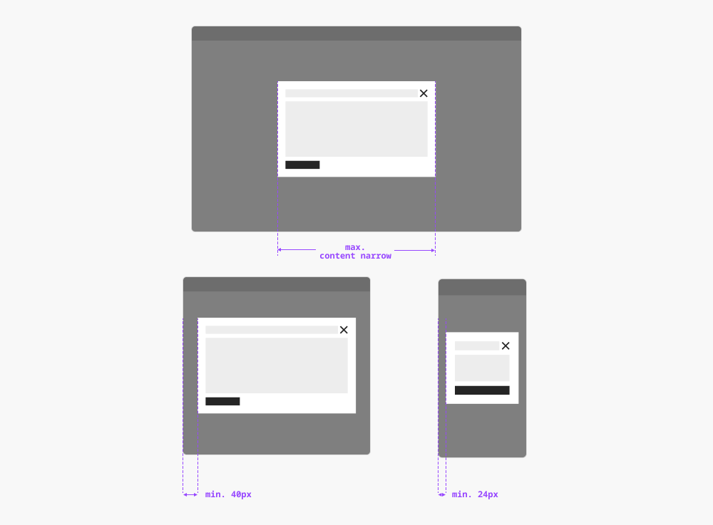

_Figure: Three schematic dialogs in browser windows showing the maximum width. At the top, on a large window, a dialog is centred and a horizontal arrow dimension below it, labelled "max. content narrow", marks that the dialog cannot be wider than the content narrow area. At the bottom left, on a medium window, a dialog fills most of the width and the arrow between the left window edge and the dialog is labelled "min. 40px", the minimum space on bigger screens. At the bottom right, on a narrow mobile window, the left gap is labelled "min. 24px", the minimum space on smaller screens._

#### Maximum height

The dialog adjusts to the length of the inserted content. Content overflow may occur.

**Minimum space between browser edge and dialog, top and bottom:**

- On bigger screens the distance is 40px.
- On smaller screens it is 24px.

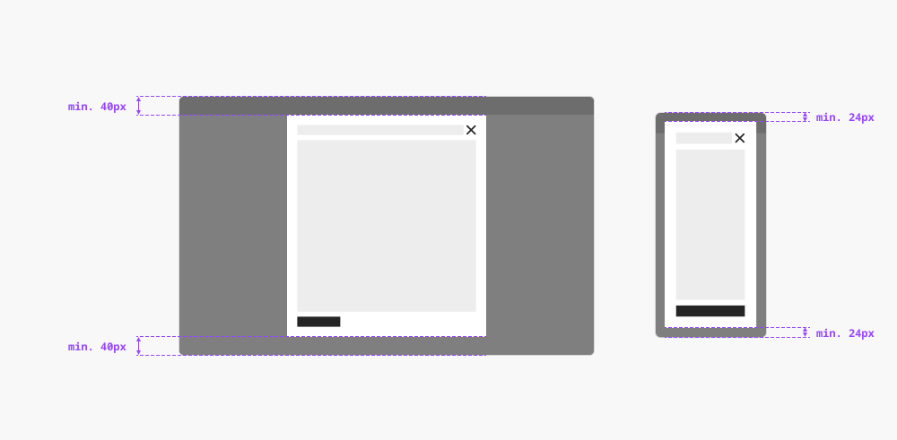

_Figure: Two schematic tall dialogs in browser windows showing the maximum height. On the left, a desktop window with the dialog centred: vertical arrow dimensions mark "min. 40px" between the top window edge and the dialog top and "min. 40px" between the dialog bottom and the bottom window edge. On the right, a narrow mobile window with the same gaps labelled "min. 24px" at top and bottom. Each dialog shows a header line, close button, large content block and a dark button._

#### Content overflow

- **The content area is scrollable.**
- Header area and footer area are sticky.
- Both header and footer get a border.

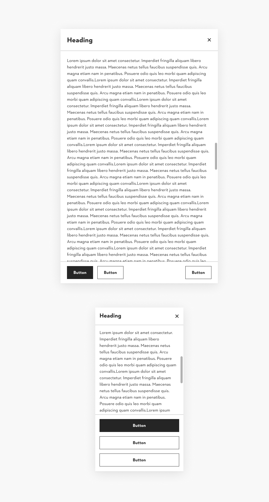

_Figure: Two dialogs with long scrolling content. The desktop dialog has the header "Heading" with a close button, a long lorem ipsum text area with a scrollbar thumb, and a footer with a primary "Button" and a second "Button" on the left and a third "Button" on the right. The mobile dialog has the same header and scrolling text, and a footer with three full-width "Button" buttons stacked vertically, the primary on top. Header and footer stay fixed (sticky) and each is separated from the scrolling content area by a thin border line._

#### Placement

The content area can be various lengths and widths.

The dialog moves in from the top and is placed in the center of the viewport.

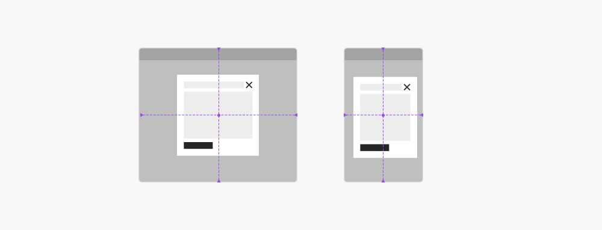

_Figure: Two schematic browser windows, a wide one and a narrow one, on a grey backdrop. In each, a white dialog wireframe with a heading bar, a close icon, a grey content block and a dark button sits in the middle. Purple dashed lines cross the viewport horizontally and vertically, showing that the dialog is centered in the viewport._

### Motion

[Motion guidelines →](https://www.figma.com/design/UYHZEckQObDvLuuRoMP8ps/Styles-%F0%9F%AA%AD?m=auto&t=4yiq5f9rjU14BQYJ-6)

#### Enter animation dialog

**Animation type:** move: in from top to center fade: opacity (0-100%) **Duration:** 400ms **Easing:** motion-functional-ease-out

#### Backdrop dimming

**Animation type:** move: in from top to center fade: opacity (0-100%) (color: black 50%) **Duration:** 400ms **Easing:** motion-functional-ease-out

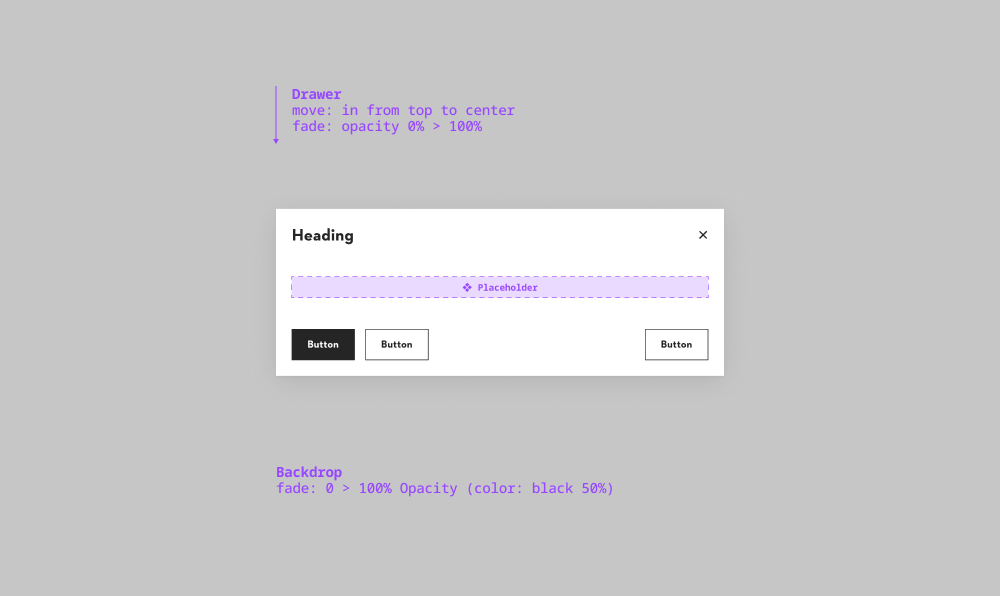

_Figure: Opening animation of the desktop dialog on a grey backdrop. The dialog shows "Heading", a close icon, a dashed purple "Placeholder" content area, and a primary "Button" and a second "Button" on the left and a third "Button" on the right. A purple arrow pointing down is labelled "Drawer": "move: in from top to center" and "fade: opacity 0% \> 100%". A second purple label reads "Backdrop": "fade: 0 \> 100% Opacity (color: black 50%)"._

#### Exit animation dialog

**Animation type:** move: out from center to top fade: opacity (100-0%) **Duration:** 400ms **Easing:** motion-functional-ease-in

#### Backdrop dimming

**Animation type:** fade: opacity (100-0%) (color black 50%) **Duration:** 400ms **Easing:** motion-functional-ease-in

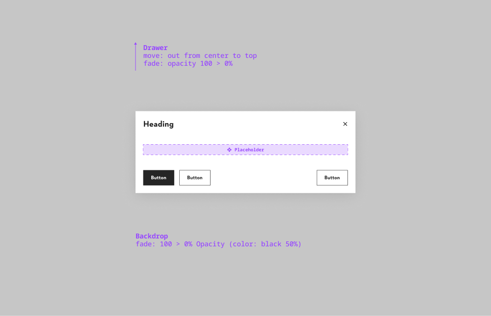

_Figure: Closing animation of the desktop dialog on a grey backdrop. The dialog shows "Heading", a close icon, a dashed purple "Placeholder" content area, and a primary "Button" and a second "Button" on the left and a third "Button" on the right. A purple arrow pointing up is labelled "Drawer": "move: out from center to top" and "fade: opacity 100 \> 0%". A second purple label reads "Backdrop": "fade: 100 \> 0% Opacity (color: black 50%)"._

## Content

### Hierachy

In most cases, the user’s task in the dialog disturbs the user-flow.

It is important to ensure a clear hierarchy, so that the user can navigate quickly and move on.

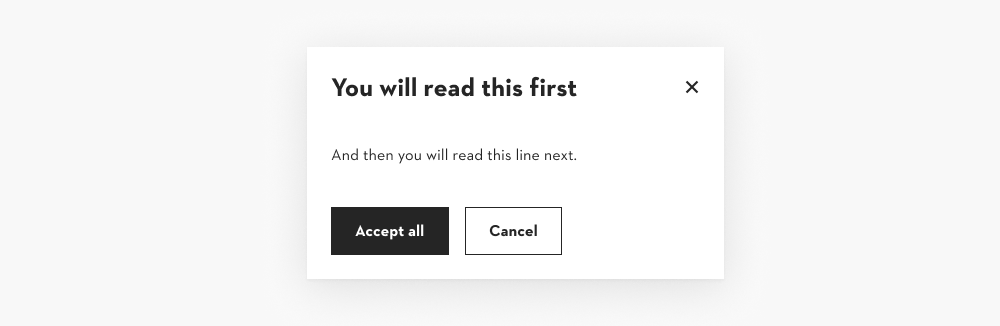

_Figure: Desktop dialog showing the reading hierarchy. The heading "You will read this first" with a close button is read first, followed by the body text "And then you will read this line next.", and a footer with the primary filled button "Accept all" on the left and the outlined button "Cancel" next to it._

### Custom header area

#### Formatting examples

1. Heading L with topline
1. Uppercase is better suitable for large dialogs.
1. [Title component](https://www.figma.com/design/Ie2r0R9QwjEc7O3nrFbXhV/Web-Pattern-Library?node-id=7-19) is better suitable for impactful and emotional headers.
1. Content icon placed left of the heading and subline.

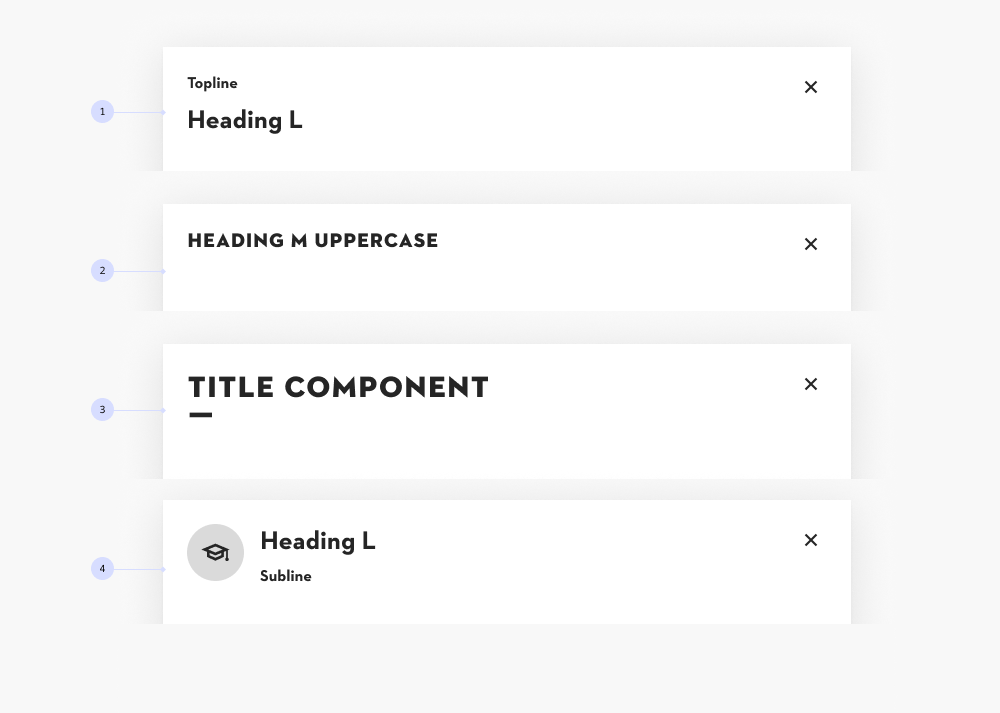

_Figure: Four dialog header formats, each with a close icon at the top right and a numbered callout on the left. Callout 1: small "Topline" above the heading "Heading L". Callout 2: the uppercase heading "HEADING M UPPERCASE", better suited to large dialogs. Callout 3: the "TITLE COMPONENT" with a short dash below it, better suited to impactful and emotional headers. Callout 4: a grey round icon with a graduation cap to the left of "Heading L" and the bold "Subline" below it._

#### Header as a message

Short messages can be placed completely in the header element. It adds visual clarity.

**When using the header as the main copy, the custom content area must remain empty.**

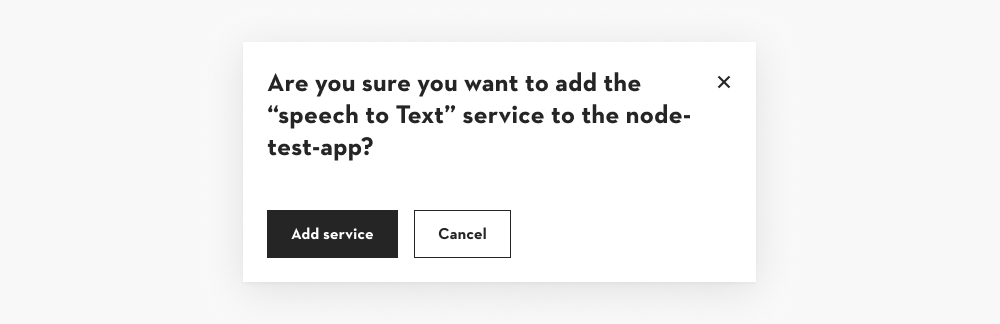

_Figure: Desktop dialog using the header as the message. The heading spans three lines, "Are you sure you want to add the “speech to Text” service to the node-test-app?", with a close button at the top right, no content area, and a footer with the primary filled button "Add service" and the outlined button "Cancel" on the left._

### Custom content area

#### Long copy, input fields

Keep copy short, when in combination with a input field component or fieldset container.

[Input guidelines →](https://www.figma.com/design/qXldpLO6gxHJNLdcXIPxYt/Pattern-Library-%F0%9F%96%A5-Web-1.0?node-id=1591-2)

[Fieldset guidelines →](https://www.figma.com/design/Ie2r0R9QwjEc7O3nrFbXhV/Web-Pattern-Library?node-id=8-154)

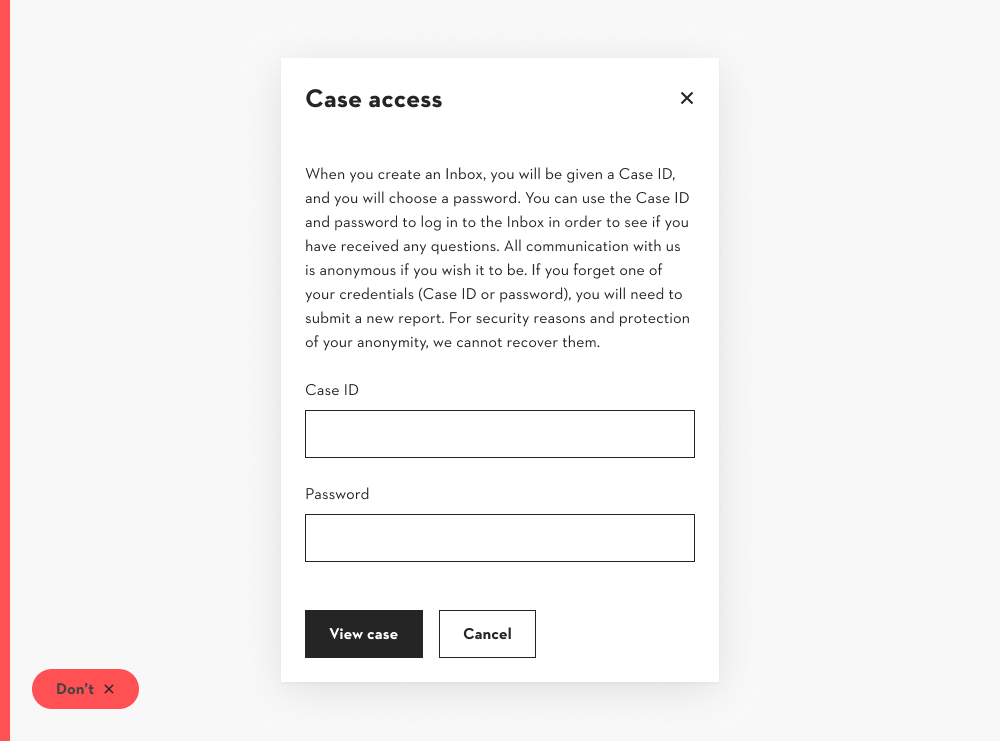

_Figure: Don't example, marked with a red bar on the left edge and a red "Don't" label: the dialog "Case access" with a close button contains a long paragraph of copy about the Case ID and password, followed by two empty input fields labelled "Case ID" and "Password", and the buttons "View case" (primary) and "Cancel". It is wrong because the copy is too long in combination with input fields; copy should be kept short._

#### Edge case: large content areas

The dialog follows the size of the content area.

Optimize the content and test edge cases like extra large and small screens.

Especially with images and iframe elements, like maps.

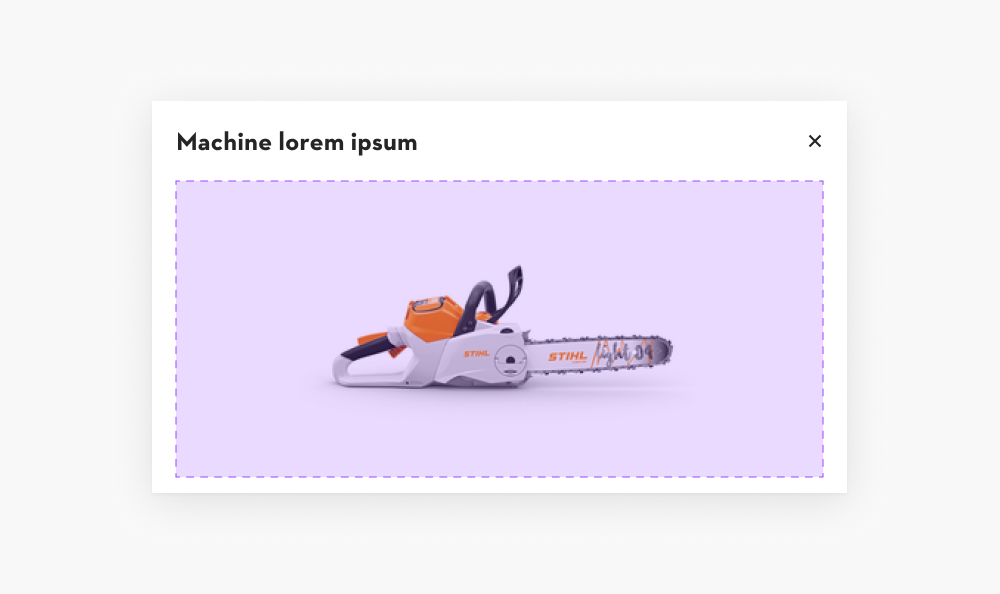

_Figure: Desktop dialog with the heading "Machine lorem ipsum" and a close button (x) at the top right. The custom content area, outlined with a purple dashed line and tinted light purple, is filled with a large product image of a STIHL cordless chainsaw, illustrating that the dialog follows the size of a large content area such as an image or map. No footer buttons are shown._

#### Edge case: columns

Add a column lay-out to the custom area if needed.

A few examples of possible layouts:

- 50/50
- 60/40
- 40/60
- 33/33/33

**Note:** In this use case contains a 50/50 column lay-out and the footer is left empty.

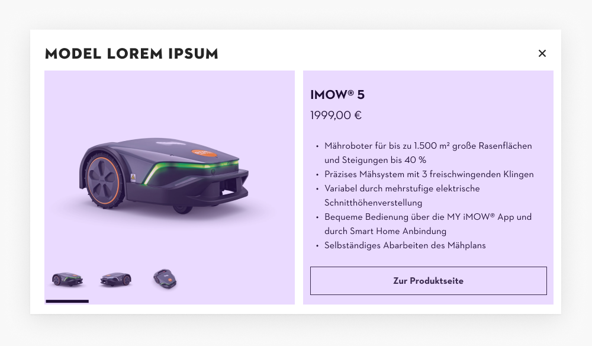

_Figure: Desktop dialog with the uppercase heading "Model lorem ipsum" and a close button at the top right, whose custom area uses a 50/50 two-column layout and an empty footer. The left column holds a large iMOW robotic mower image with three thumbnails below (the first is selected). The right column shows "IMOW® 5", the price "1999,00 €", a bullet list of five German product features starting with "Mähroboter für bis zu 1.500 m² große Rasenflächen und Steigungen bis 40 %", and a full-width outline medium button "Zur Produktseite". Both columns are tinted light purple._

### Custom footer area

#### Hierarchie: Button pairing

Consider the order and hierarchy, when pairing button styles. Read the extensive [alignment and pairing guidelines ](https://www.figma.com/design/qXldpLO6gxHJNLdcXIPxYt/Pattern-Library-%F0%9F%96%A5-Web-1.0?node-id=1883-9858&t=sVQWNMJR5xeiaak3-4)on buttons.

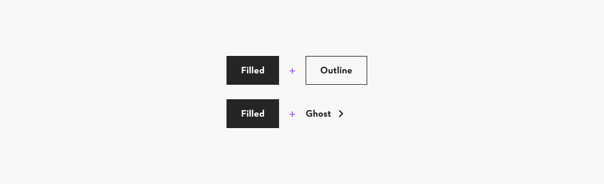

_Figure: Two button pairings, each with a purple plus sign between the buttons. Top row: a dark filled button "Filled" next to an outline button "Outline". Bottom row: the dark filled button "Filled" next to a ghost button "Ghost" with a chevron-right icon on the right and no border. In both pairings the filled button, as the primary action, comes first on the left._

#### Number of action buttons

1. If zero, the close icon is mandatory.
1. Ideally, use a close button, additionally to the buttons in the action area.
1. If needed, use more than 2 buttons in max 2 different styles.
1. In case of many buttons, combine inline links in the content area with the buttons in the action area.

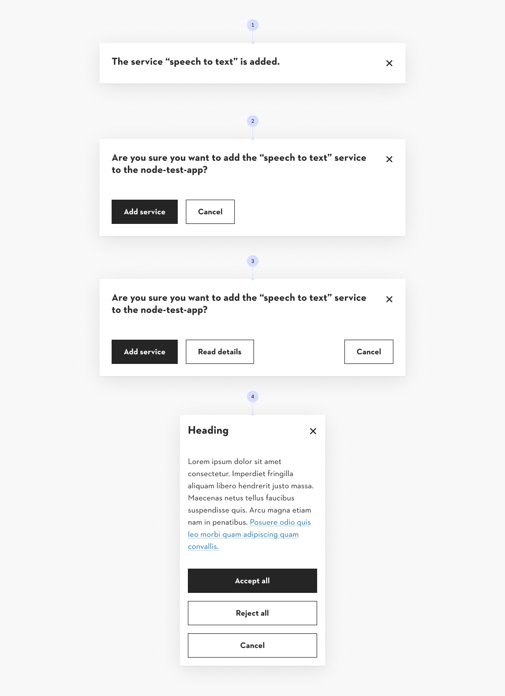

_Figure: Four numbered dialog examples by number of action buttons, stacked vertically. Callout 1: a desktop dialog with zero action buttons, only the text "The service “speech to text” is added." and a close icon, which is then mandatory. Callout 2: a desktop dialog with the question "Are you sure you want to add the “speech to text” service to the node-test-app?", a close icon and two left-aligned buttons, a filled "Add service" and an outline "Cancel". Callout 3: the same dialog with three buttons: filled "Add service" and outline "Read details" on the left and outline "Cancel" on the right. Callout 4: a narrow mobile dialog with the "Heading", a close icon, lorem ipsum text containing an inline link, and three full-width stacked buttons: filled "Accept all", outline "Reject all" and outline "Cancel"._

#### Button placement recommendation

1. Left aligned, together with the copy. Buttons are faster reached by eye and/or mouse.
1. Right alignment is common for dialogs with actions that proceed (e.g., "Next", "Submit")

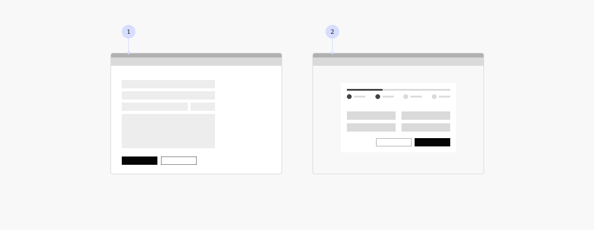

_Figure: Two wireframes of browser windows showing button placement. Callout 1 shows a page with form field placeholders where a filled black button and an outline button sit left-aligned directly below the content (recommended: reached faster by eye or mouse). Callout 2 shows a centered dialog-like panel with a step progress bar and two columns of fields, where an outline button and a filled black button are right-aligned at the bottom, common for actions that proceed, such as "Next" or "Submit"._

#### Button placement warning

Do not center the button or paired buttons

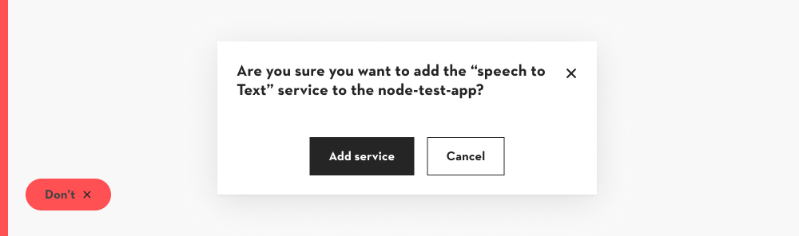

_Figure: Don't example, marked with a red "Don't" label and a red bar on the left edge: a desktop dialog with the heading "Are you sure you want to add the “speech to Text” service to the node-test-app?" and a close button, whose footer buttons, a filled "Add service" and an outline "Cancel", are centered horizontally. Wrong because the button or paired buttons must not be centered._

**Exception: slider and pagination.** You may place the pagination in the center of the custom footer area.

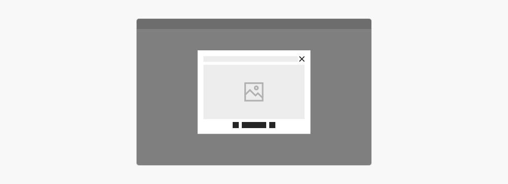

_Figure: Exception example for slider and pagination: a wireframe of a small dialog on a dimmed browser window, with a header bar and close button, a large image placeholder, and a centered footer containing pagination controls (a small square, a wider bar and another small square). Pagination may be placed in the center of the custom footer area._

**Mobile**

#### Stacked buttons

The buttons in the footer area should be stacked on mobile screens. The primary actions is in most cases at the top.

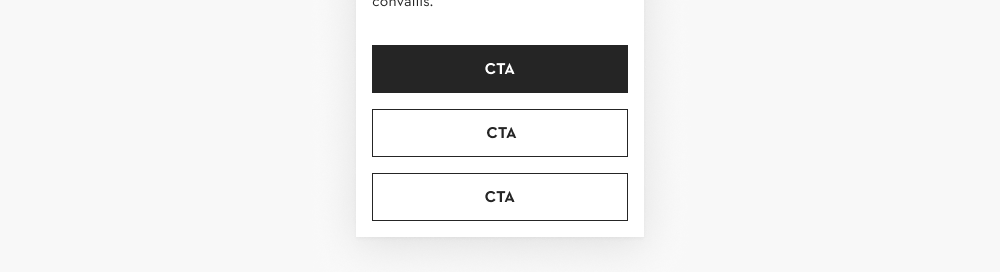

_Figure: Bottom part of a mobile dialog (the top is cropped) with lorem ipsum text above three full-width stacked footer buttons, all labelled "CTA": a dark filled primary button at the top, followed by two outline buttons. On mobile screens the footer buttons are stacked vertically, with the primary action usually at the top._

#### Small buttons

The footer area is sticky and can take up too much height.

**\< 3 buttons** Default button size allowed. Test the viewport in all browsers. otherwise consider the small button size

**3 buttons** Default and small buttons allowed.

**\> 4 buttons** When 4 or more buttons are needed, use small buttons. Also, consider placing inline links and buttons in the content area.

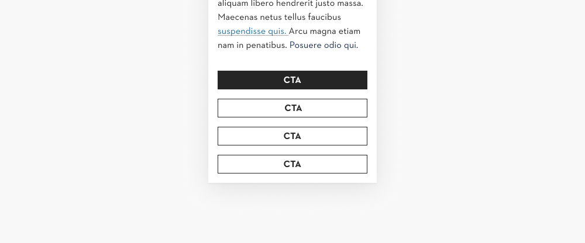

_Figure: Bottom part of a mobile dialog (the top is cropped) with lorem ipsum text containing an inline link, above four full-width stacked small buttons all labelled "CTA": one dark filled primary button at the top and three outline buttons below. Small buttons are used so the sticky footer takes less height; with 4 or more buttons small buttons should be used and inline links or buttons in the content area considered._

## Behavior

### User interaction required

In case the user closes **(1)** the dialog, the exit animation is triggered immediately.

Closing the dialog by click on the backdrop **(2)** can be disabled. The default is enabled.

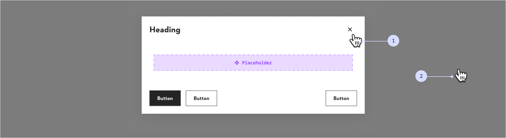

_Figure: Desktop dialog with the heading "Heading", a close button at the top right, a purple dashed "Placeholder" content area and a horizontal footer with three buttons labelled "Button" (the primary dark button and one outlined button on the left, one outlined button on the right), on a dimmed grey backdrop. Callout 1 with a pointer cursor points at the close button: closing the dialog triggers the exit animation immediately. Callout 2 with a pointer cursor points at the dimmed backdrop outside the dialog: closing by click on the backdrop can be disabled; the default is enabled._

### Focus management

When the dialog opens, focus should be set to the first actionable element, typically the primary action button or the first input field **(1)**. It can also be the close icon.

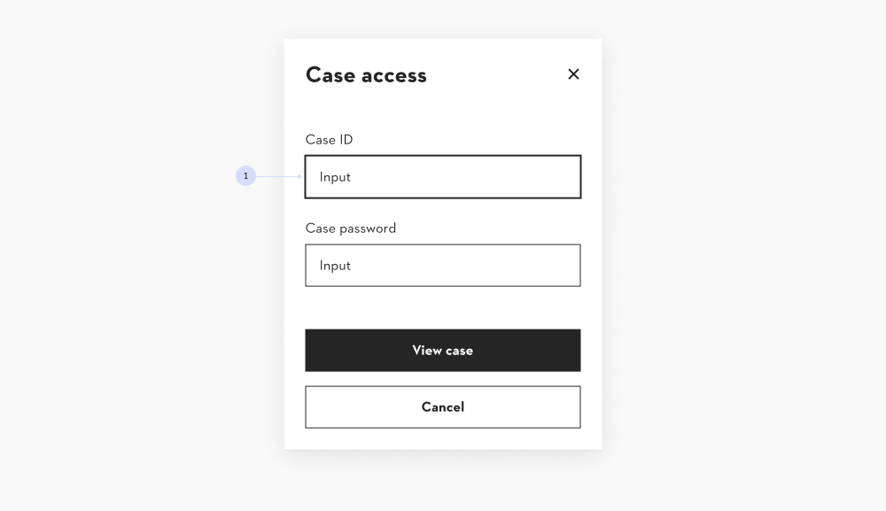

_Figure: Desktop dialog "Case access" with a close button and two stacked text inputs, "Case ID" and "Case password", both showing the placeholder "Input". Below are a full-width primary button "View case" and a full-width outlined button "Cancel" in a vertical footer. Callout 1 points at the "Case ID" input, the first input field, which has a thicker dark border showing it has initial focus when the dialog opens._

### Loading state

In case data-heavy tasks are connected to the action, provide visual feedback, such as [the loading spinner within the button.](https://www.figma.com/design/qXldpLO6gxHJNLdcXIPxYt/Pattern-Library-%F0%9F%96%A5-Web-1.0?node-id=1404-8289&t=sVQWNMJR5xeiaak3-4)

The other actions are disabled while submit is ongoing. The dialog does not close, while the submit is pending.

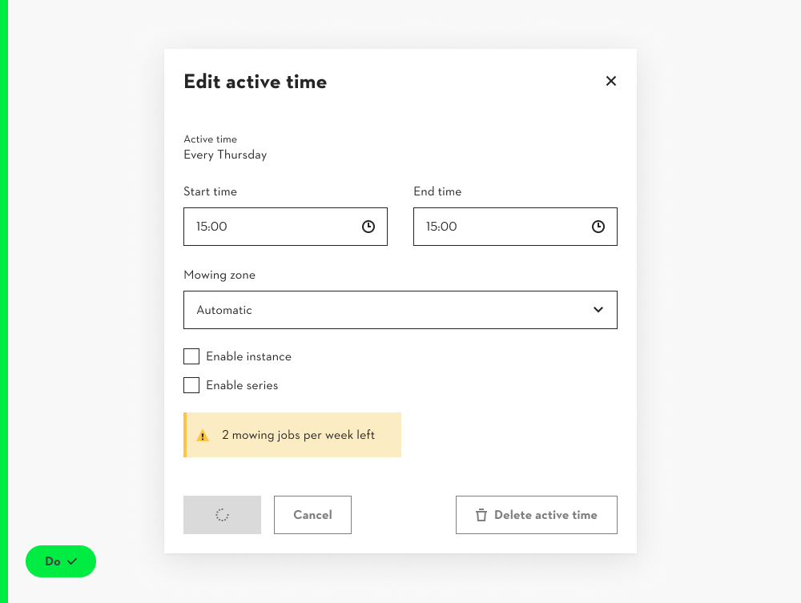

_Figure: Do example: loading state of the desktop dialog "Edit active time". It contains "Active time Every Thursday", time inputs "Start time" and "End time" (both "15:00"), a "Mowing zone" select with "Automatic", unchecked checkboxes "Enable instance" and "Enable series", and a yellow warning "2 mowing jobs per week left". In the footer the primary button is greyed out and shows a loading spinner instead of a label, while "Cancel" and "Delete active time" (with trash icon) are greyed out as disabled during the pending submit; the dialog stays open._

## Usage Guidelines

### Functionality & Priority

Components are chosen based on their level of urgency:

1. **Dialog** Highest urgency. Requires explicit user action before continuing. → [See Dialog](https://www.figma.com/design/qXldpLO6gxHJNLdcXIPxYt?node-id=14115-4051)

1. **Notification / Toast** Draws attention but does not block usage. Useful for immediate or transient feedback. → [See Notification](https://www.figma.com/design/qXldpLO6gxHJNLdcXIPxYt?node-id=7251-8) → [See Toast](https://www.figma.com/design/qXldpLO6gxHJNLdcXIPxYt?node-id=8844-4923)

1. **Banner** Persistent but non-blocking. Ideal for supporting information, promotions, or optional actions. → [See Banner](https://www.figma.com/design/Ie2r0R9QwjEc7O3nrFbXhV/Web-Pattern-Library?node-id=7171-9055)

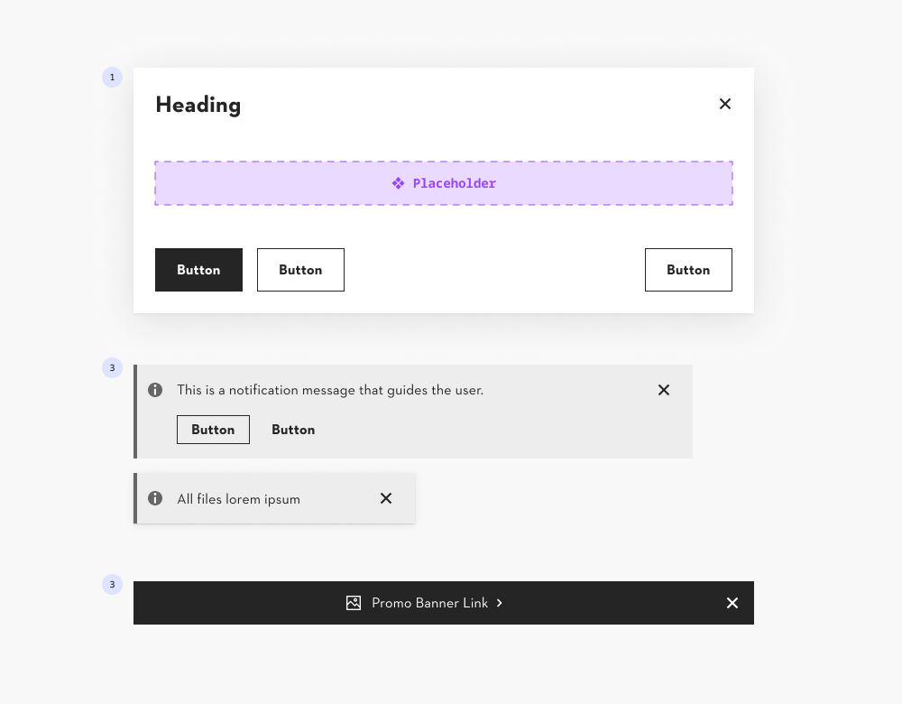

_Figure: Three components stacked by urgency, each with a numbered callout. Callout 1 marks the desktop dialog with the heading "Heading", a close button, a purple "Placeholder" area and three "Button" buttons (highest urgency, requires explicit user action). Callout 3 marks, in a first group, a grey info notification "This is a notification message that guides the user." with an outlined "Button", a text "Button" and a close button, plus a small info toast "All files lorem ipsum" with a close button. A second callout 3 marks a dark banner with an image icon, "Promo Banner Link", a chevron and a close button._

### Use Cases

#### System / Mandatory

- **System feedback (success, error)** → Notification / Toast
- **Cookies / Privacy notices** → Banner (if navigation can continue without consent) → Dialog (if explicit consent is required before continuing)
- **Urgent notifications (downtime, outages, maintenance)** → Notification (when only informing) → Dialog (when user actions are blocked)
- **Critical announcements (recalls, legal or policy changes)** → Notification (when only informing) → Dialog (when user actions are blocked)

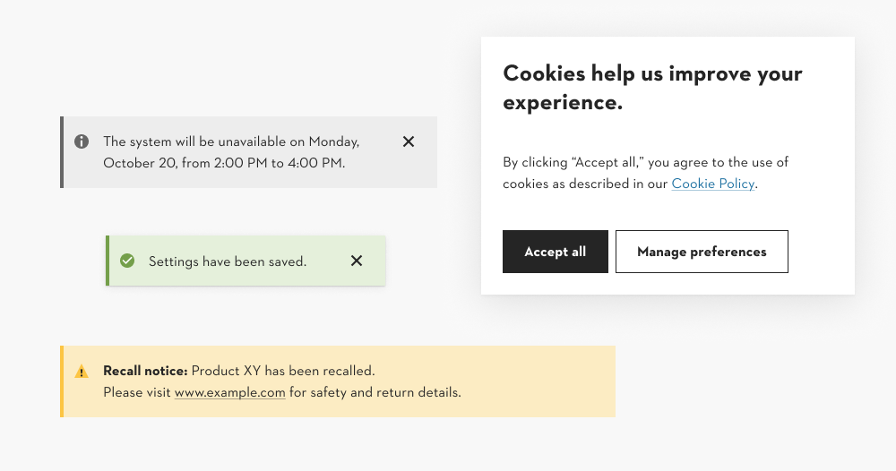

_Figure: Examples of components for system and mandatory messages. A dialog on the right with the heading "Cookies help us improve your experience.", the text "By clicking “Accept all,” you agree to the use of cookies as described in our Cookie Policy." and the buttons "Accept all" (primary) and "Manage preferences" (outlined). On the left, a grey info notification "The system will be unavailable on Monday, October 20, from 2:00 PM to 4:00 PM." with a close button, a green success toast "Settings have been saved." with a close button, and a yellow warning notification "Recall notice: Product XY has been recalled. Please visit www.example.com for safety and return details."_

#### Marketing / Engagement

- **Sales & promotions** → Banner
- **Seasonal campaigns** → Banner
- **USPs / Value propositions** → Banner (for general positioning) → Notification (when contextually relevant, e.g., delivery info next to cart price)
- **Newsletter sign-up / Loyalty programs / Referrals** → Banner

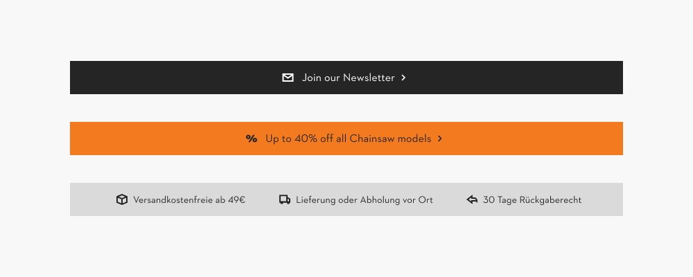

_Figure: Three full-width banners without close buttons for marketing and engagement. A dark default banner with a mail icon and "Join our Newsletter" with a chevron, an orange highlight banner with a percent icon and "Up to 40% off all Chainsaw models" with a chevron, and a light grey banner with three USPs, each with an icon: "Versandkostenfreie ab 49€", "Lieferung oder Abholung vor Ort" and "30 Tage Rückgaberecht"._

#### Informational

- **Product / feature updates (non-critical)** → Banner
- **Tips, nudges, reminders** → Banner

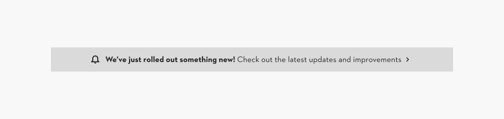

_Figure: Light grey secondary banner without a close button for informational messages, with a bell icon, the bold text "We’ve just rolled out something new!" followed by "Check out the latest updates and improvements" and a chevron._

## Examples/Variants

### Use for tasks in main flows

The dialog component is suited for tasks (use cases) that are closely connected to the main flow.

**Attention**: The user is limited inside a dialog. If a task is multifaceted, consider a link to a new page instead. Explore the efficiency of a complex user flow containing a dialog through usability testing.

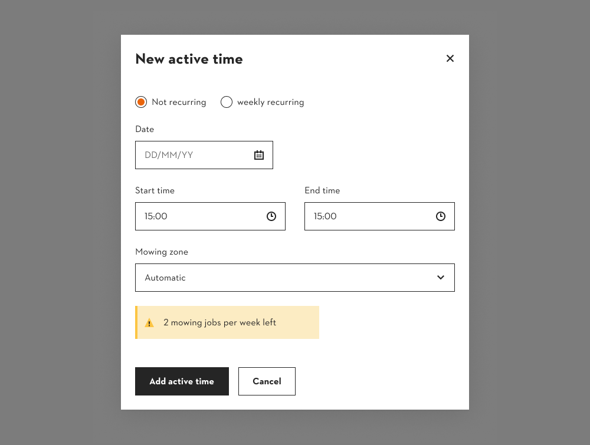

_Figure: Desktop dialog "New active time" on a dimmed backdrop, as a task closely connected to the main flow. It has a close button, radio buttons "Not recurring" (selected) and "weekly recurring", a "Date" input with the placeholder "DD/MM/YY" and calendar icon, "Start time" and "End time" inputs (both "15:00") side by side, a "Mowing zone" select with "Automatic", a yellow warning "2 mowing jobs per week left", and a footer with the primary button "Add active time" and the outlined button "Cancel"._

### Common use cases

- Confirmation
- Form to add/edit objects
- Information purposes
- Selection purposes

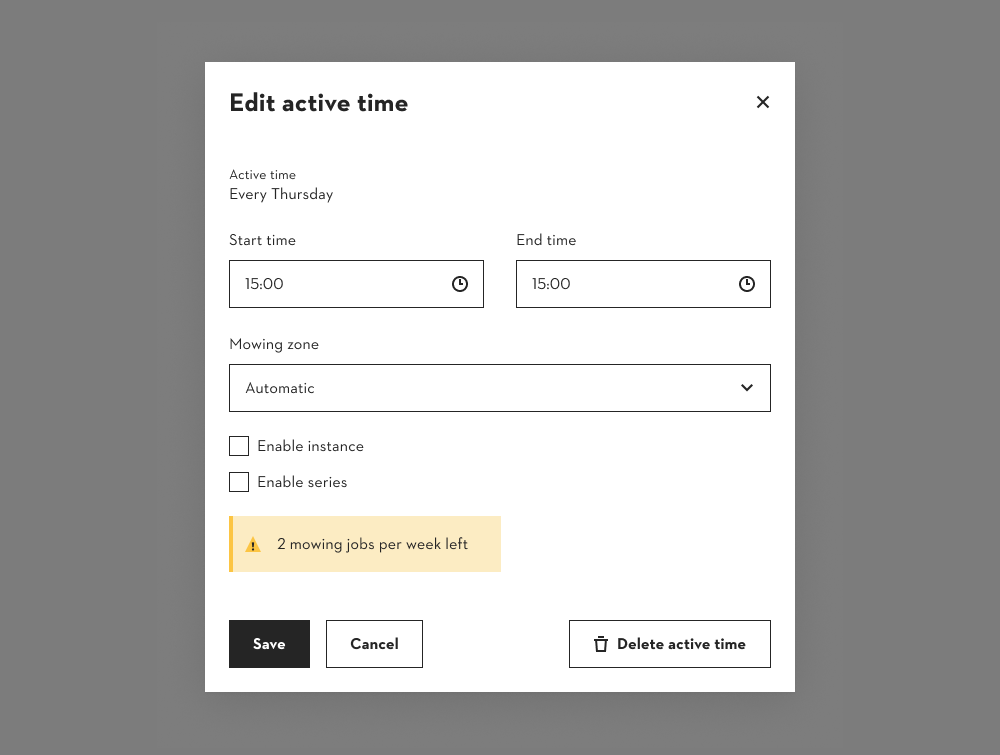

_Figure: Desktop dialog "Edit active time" on a dimmed backdrop, as a form to edit an object. It has a close button, "Active time Every Thursday", "Start time" and "End time" inputs (both "15:00"), a "Mowing zone" select with "Automatic", unchecked checkboxes "Enable instance" and "Enable series", and a yellow warning "2 mowing jobs per week left". The footer has the primary button "Save" and outlined "Cancel" on the left and the outlined "Delete active time" with a trash icon on the right._

### Immediate response

Dialog component is ideal for:

- Immediate response required
- Confirmation for destructive actions
- Quick interactions

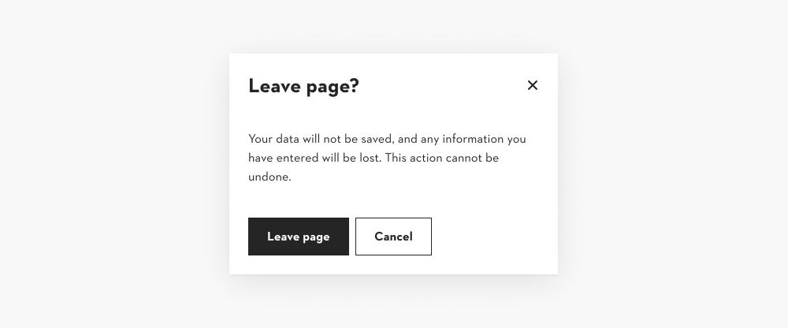

_Figure: Desktop dialog for an immediate response, a white panel on a light grey page with a close (X) button at the top right. It has the heading "Leave page?", the body text "Your data will not be saved, and any information you have entered will be lost. This action cannot be undone.", and a horizontal footer with the filled primary button "Leave page" on the left and the outlined secondary button "Cancel" next to it. It illustrates a confirmation for a destructive action._

### Recommendations for mobile

1. Short copy in forms
1. Optimized and tested content

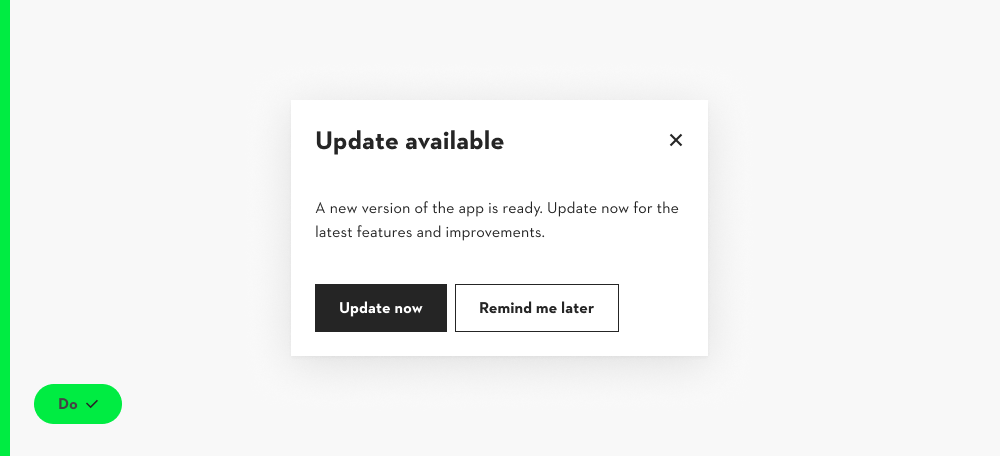

_Figure: Do example: a dialog with short, optimized copy for mobile use. The white panel has the heading "Update available", a close (X) button, the two-line text "A new version of the app is ready. Update now for the latest features and improvements.", and a horizontal footer with the filled primary button "Update now" on the left and the outlined button "Remind me later" next to it._

### Warning for mobile

1. Avoid scrolling, if possible
1. Avoid small touch targets: Inline links that are placed too close together
1. Avoid data-heavy tasks that might slowly load.

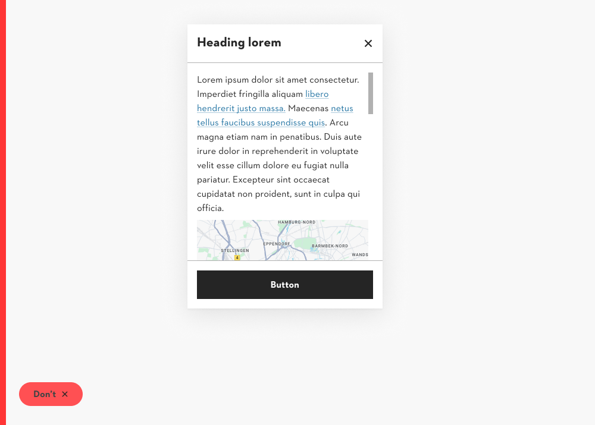

_Figure: Don't example: a mobile dialog with the heading "Heading lorem" and a close (X) button, separated by lines from a long body that has to be scrolled (visible scrollbar). The body is lorem ipsum text with several inline links placed close together, followed by a map image that is cut off at the bottom, and the footer has a single full-width filled "Button". It is wrong because it requires scrolling, has small touch targets from closely spaced inline links, and contains heavy content such as a map that may load slowly._

## Building elements

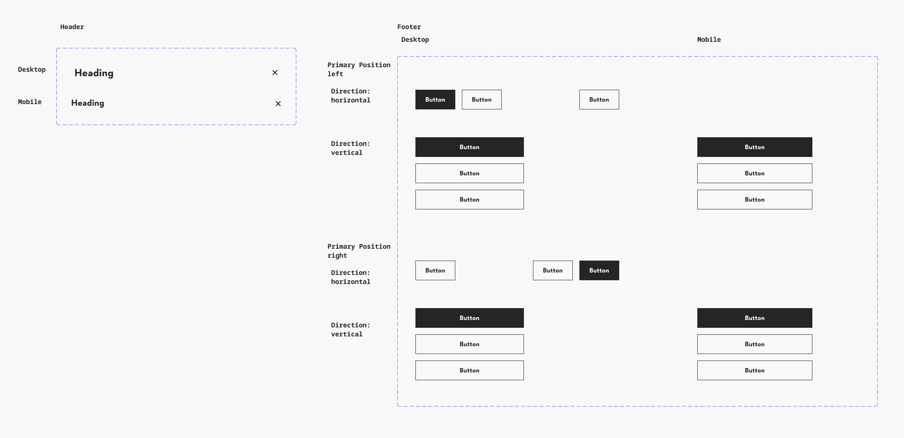

_Figure: Building elements of the dialog, shown in two purple dashed frames. "Header" contains the "Heading" with a close (X) button on the right, once for "Desktop" and once for "Mobile" (smaller heading). "Footer" is split into "Desktop" and "Mobile" with the rows "Primary Position left" and "Primary Position right", each with "Direction: horizontal" and "Direction: vertical". With primary position left, the horizontal desktop footer shows the filled primary "Button" and an outlined "Button" side by side on the left and a third outlined "Button" set apart on the right; with primary position right it is mirrored: one outlined "Button" on the left, then an outlined "Button" and the filled "Button" on the right. Vertical footers, on desktop and mobile, stack three full-width buttons with the filled "Button" on top and two outlined ones below; mobile has only the vertical layout._

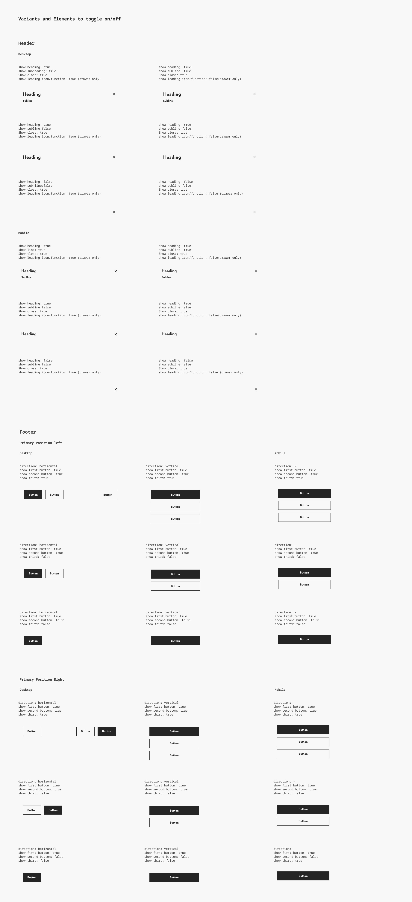

_Figure: Overview "Variants and Elements to toggle on/off" for the dialog header and footer; each variant is labelled with its toggles. "Header", "Desktop" and "Mobile": three rows in two columns each, the left column with the leading icon/function on and the right column with it off (drawer only). Rows: "Heading" with "Subline" and a close (X) button; "Heading" with close button only; close button only without heading. "Footer", "Primary Position left" and "Primary Position Right", each for "Desktop" (direction horizontal or vertical) and "Mobile" (no direction, buttons stacked): three rows show all three buttons, first and second button only, or the first button only. The primary button is filled and the others are outlined. In the primary-left horizontal layout the third button sits apart from the first two. With primary position right the order is reversed: the outlined button comes first and the filled primary button is last. The last mobile row of primary position right (first true, second false, third true) shows a single filled "Button"._
