# Dialog

## Dialog

Overview:

- Common use cases are confirmation dialog, form dialog, informational dialog and selection dialog.
- The dialog component is suited for tasks (use cases) that are closely connected to the main flow.
- The dialog size adjusts to the inserted content.
- Content overflow: header area and footer area are sticky, while the content area is scrolls.
- Ensure a clear hierarchy between the headline and content, so that the user can navigate quickly and move on.
- When on mobile 3 or more buttons, use small buttons to leave more space for the content area.
- When the dialog opens, focus should be set to the first actionable element.

### Component

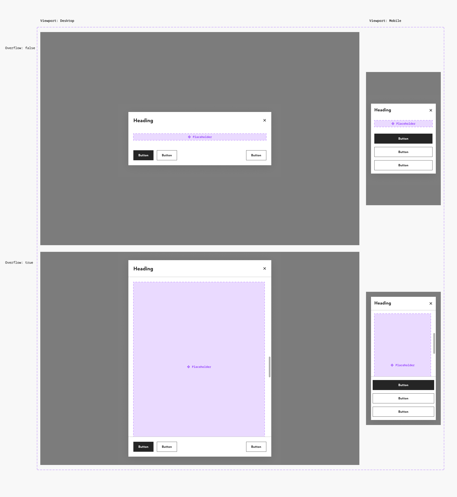

#### Further guidelines

[Storybook documentation](https://main--63440bbb95889041542a5ba3.chromatic.com/?path=/docs/components-dialog--documentation&globals=backgrounds.name:!undefined;backgrounds.value:!undefined)

Decision tree

#### Similar components

**Component**

**Trigger**

**Placement**

**Content**

**Intention**

**Tooltip**

Hover or focus of an interactive element

In proximity to the triggering element, non-modal

Text only

Provide short, contextual information or clarify unlabeled controls

**Popover**

Click or tap of an interactive element

In proximity to the triggering button, non-modal

Text, icon, image and interactive elements

Provide additional information or quick actions without leaving the current context

**Dialog**

Triggered by the system in response to user interaction

Center of the screen, with backdrop, modal

Text, icon, image and interactive elements

Confirm important actions, guide users through complex tasks, or temporarily block interaction to focus attention

**Toast**

Triggered by the system in response to user interaction

Bottom of the screen, non-modal

Text, icon, and optional dismiss button

Provide brief, lightweight feedback on user actions such as error or success.

**Notification**

Triggered by the system in response to events or interactions

Within the content area of the page, in relation to relevant elements

Text, icon, links and buttons

Deliver important updates or status messages that may require user attention or follow-up

#### Related elements

[Drawer](https://www.figma.com/design/qXldpLO6gxHJNLdcXIPxYt?node-id=16282-9317)

[Combobox](https://www.figma.com/design/qXldpLO6gxHJNLdcXIPxYt/Pattern-Library-%F0%9F%96%A5-Web-1.0?node-id=2659-3954)

[Fieldset](https://www.figma.com/design/Ie2r0R9QwjEc7O3nrFbXhV/Web-Pattern-Library?node-id=8-154)

[Toast](https://www.figma.com/design/qXldpLO6gxHJNLdcXIPxYt/Pattern-Library-%F0%9F%96%A5-Web-1.0?node-id=8844-4923)

[Notification](https://www.figma.com/design/qXldpLO6gxHJNLdcXIPxYt/Pattern-Library-%F0%9F%96%A5-Web-1.0?node-id=7251-8)

[Button](https://www.figma.com/design/qXldpLO6gxHJNLdcXIPxYt/Pattern-Library-%F0%9F%96%A5-Web-1.0?node-id=162-126)

[Tooltip](https://www.figma.com/design/HovZmjHiwxguawTWTO6ibS/DS-1085-Design-%7C-Web-%7C-Tootlip?node-id=36194-1244)

[Popover](https://www.figma.com/design/qXldpLO6gxHJNLdcXIPxYt?node-id=26075-11456)

#### Contribute

Contribute to improving this component by sharing your feedback, asking questions, or suggesting features [here](https://www.figma.com/design/lLmw7PfIdKjFG4uT3B2Hyj/Onboarding-%F0%9F%93%96?node-id=446-868&t=zKmRu4kAkxMeRDmK-4).

## Formatting and Construction

### Anatomy

1. **Custom header area**
1. **Custom content area (optional)**
1. **Custom footer area (optional)**
1. **Backdrop**

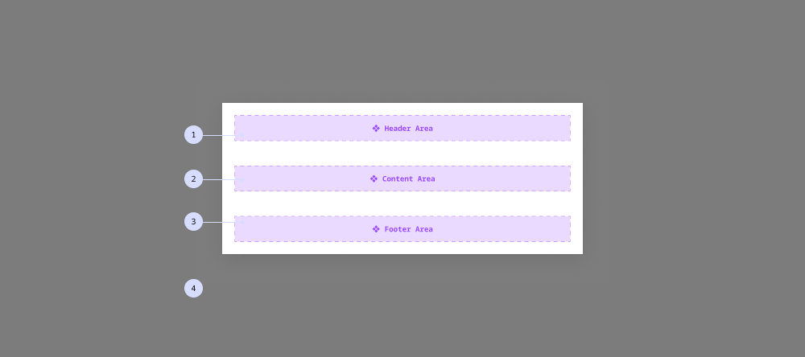

#### Figma component

Although technically a freely configurable slot, the figma components for **header area (1)** and **footer area (3)** provide a few options for common use case. The content area can be replaced with a **placeholder component (2)** that contain an additional text or image option.

Feel free to swap this with your own placeholder components or modules.

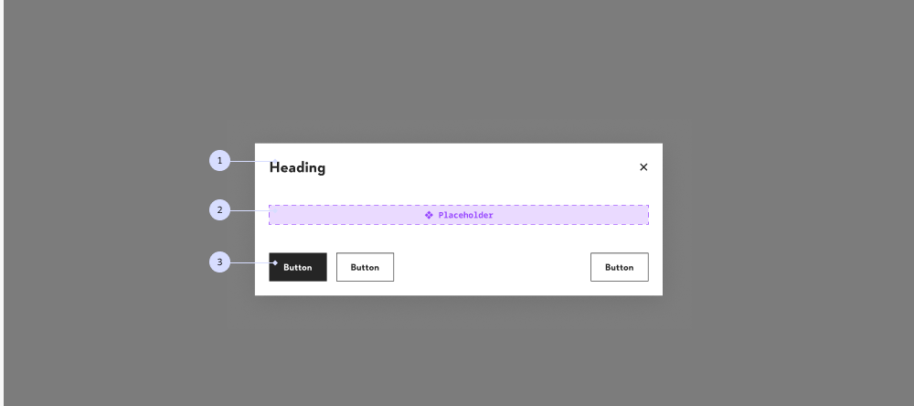

### Sizing

#### Minimum width

The dialog adjusts to the width of the inserted content. Minimum size ist based on the smallest viewport size: 272px

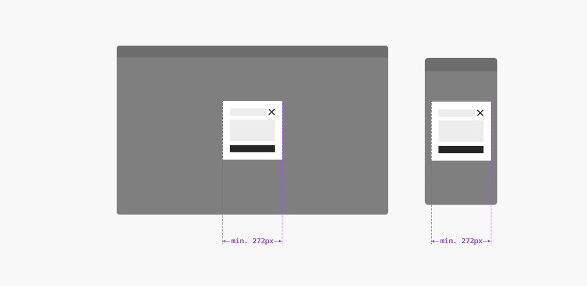

#### Maximum width

The dialog adjusts to the width of the inserted content. It can’t exceed [content narrow area ](https://www.figma.com/design/JyyYtoCYbtJrzqHs38OXSQ/Grid-%26-Spacing-%F0%9F%A7%AE?node-id=1-132)width.

**Minimum space between browser edge and dialog, left and right:**

- On bigger screens the distance is 40px.
- On smaller screens it is 24px.

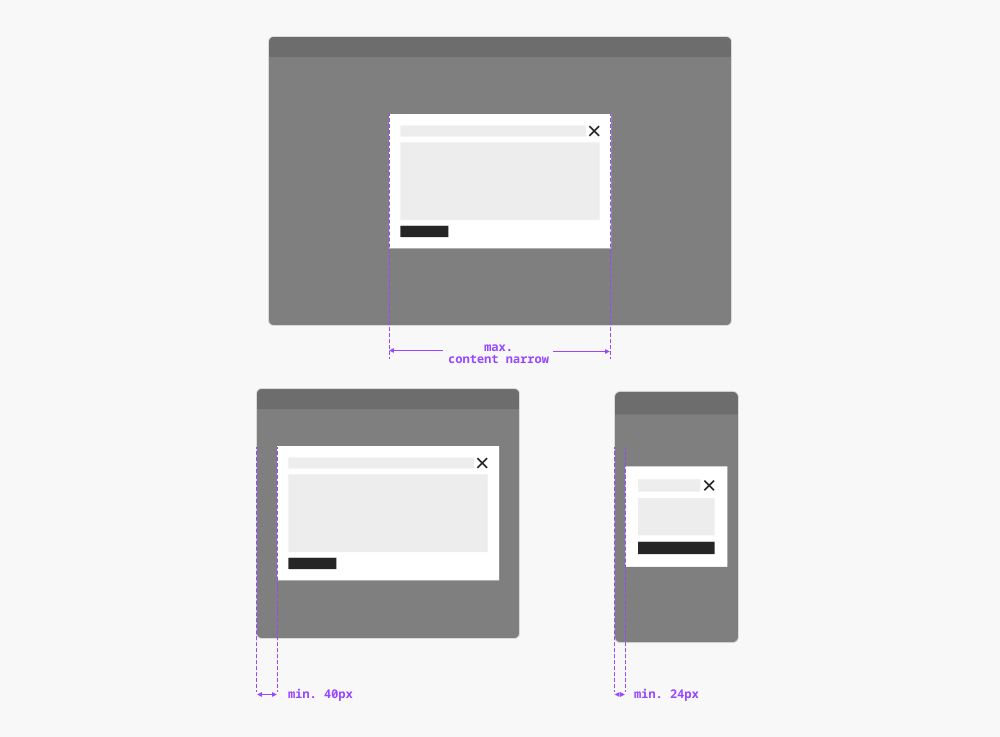

#### Maximum height

The dialog adjusts to the length of the inserted content. Content overflow may occur.

**Minimum space between browser edge and dialog, top and bottom:**

- On bigger screens the distance is 40px.
- On smaller screens it is 24px.

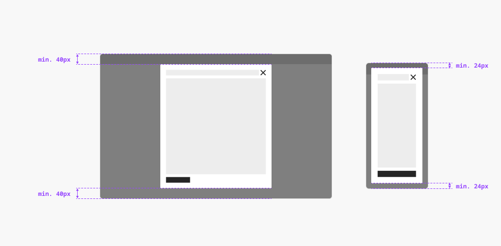

#### Content overflow

- **The content area is scrollable.**
- Header area and footer area are sticky.
- Both header and footer get a border.

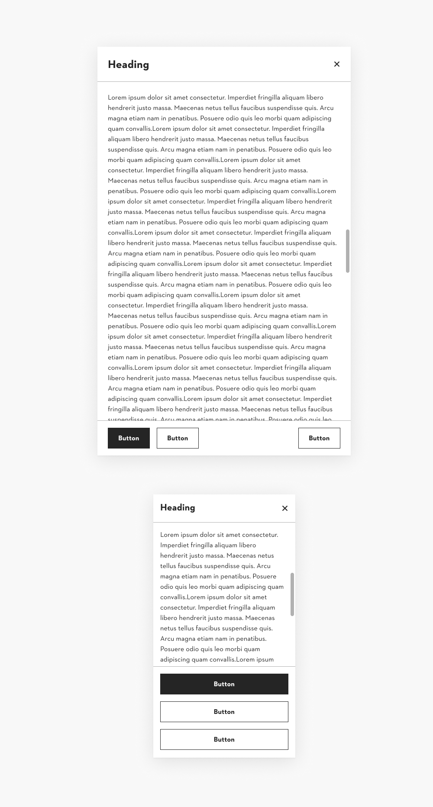

#### Placement

The content area can be various lengths and widths.

The dialog moves in from the top and is placed in the center of the viewport.

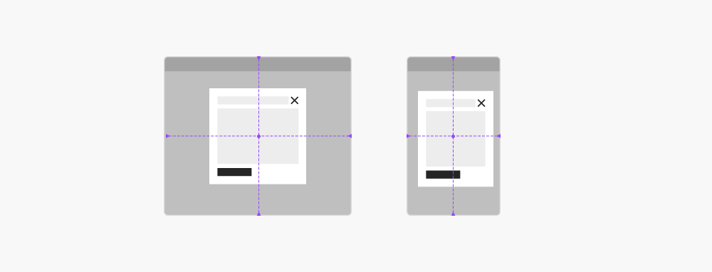

### Motion

[Motion guidelines →](https://www.figma.com/design/UYHZEckQObDvLuuRoMP8ps/Styles-%F0%9F%AA%AD?m=auto&t=4yiq5f9rjU14BQYJ-6)

#### Enter animation dialog

**Animation type:** move: in from top to center fade: opacity (0-100%) **Duration:** 400ms **Easing:** motion-functional-ease-out

#### Backdrop dimming

**Animation type:** move: in from top to center fade: opacity (0-100%) (color: black 50%) **Duration:** 400ms **Easing:** motion-functional-ease-out

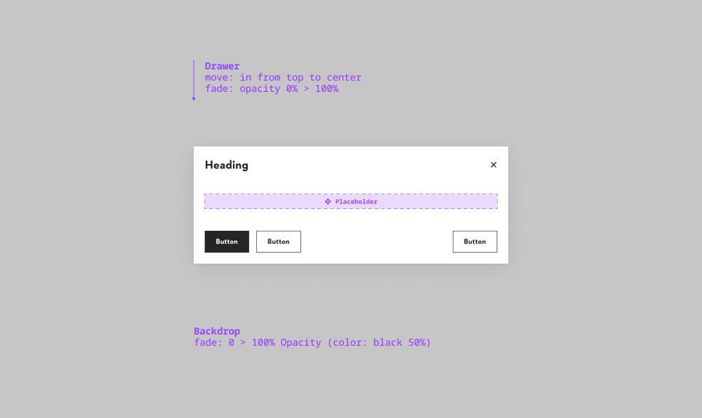

#### Exit animation dialog

**Animation type:** move: out from center to top fade: opacity (100-0%) **Duration:** 400ms **Easing:** motion-functional-ease-in

#### Backdrop dimming

**Animation type:** fade: opacity (100-0%) (color black 50%) **Duration:** 400ms **Easing:** motion-functional-ease-in

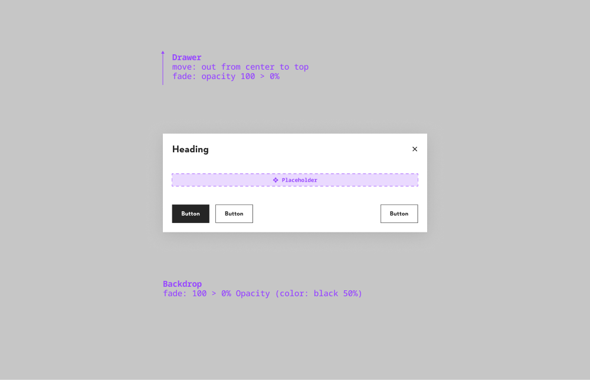

## Content

### Hierachy

In most cases, the user’s task in the dialog disturbs the user-flow.

It is important to ensure a clear hierarchy, so that the user can navigate quickly and move on.

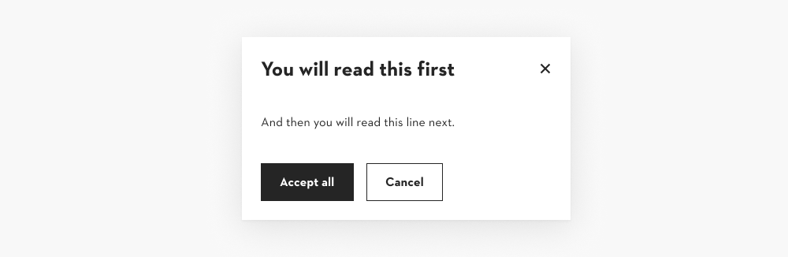

### Custom header area

#### Formatting examples

1. Heading L with topline
1. Uppercase is better suitable for large dialogs.
1. [Title component](https://www.figma.com/design/Ie2r0R9QwjEc7O3nrFbXhV/Web-Pattern-Library?node-id=7-19) is better suitable for impactful and emotional headers.
1. Content icon placed left of the heading and subline.

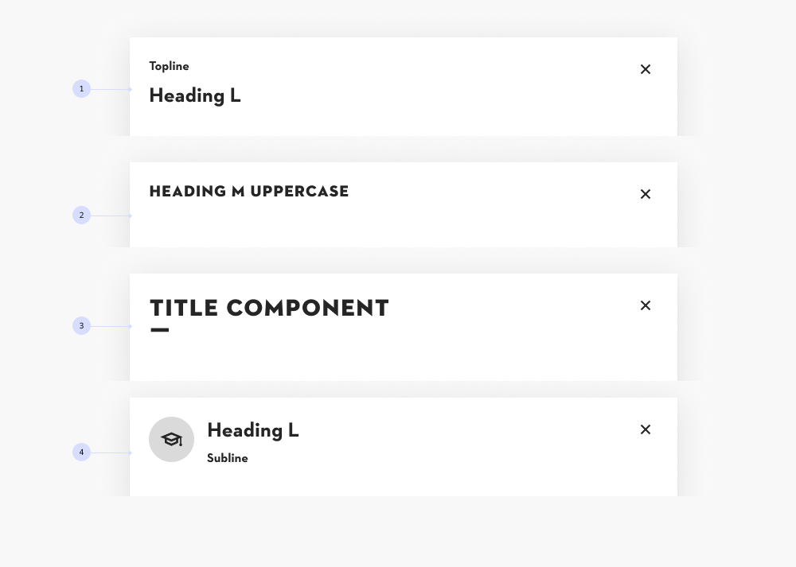

#### Header as a message

Short messages can be placed completely in the header element. It adds visual clarity.

**When using the header as the main copy, the custom content area must remain empty.**

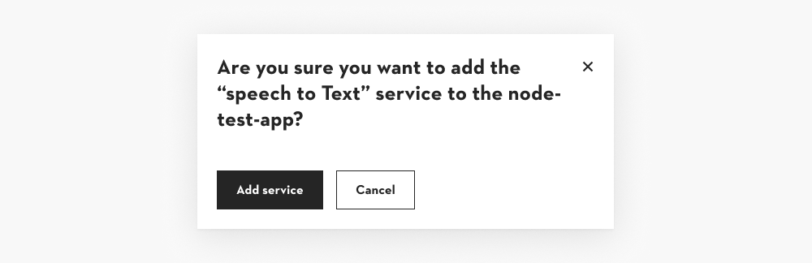

### Custom content area

#### Long copy, input fields

Keep copy short, when in combination with a input field component or fieldset container.

[Input guidelines →](https://www.figma.com/design/qXldpLO6gxHJNLdcXIPxYt/Pattern-Library-%F0%9F%96%A5-Web-1.0?node-id=1591-2)

[Fieldset guidelines →](https://www.figma.com/design/Ie2r0R9QwjEc7O3nrFbXhV/Web-Pattern-Library?node-id=8-154)

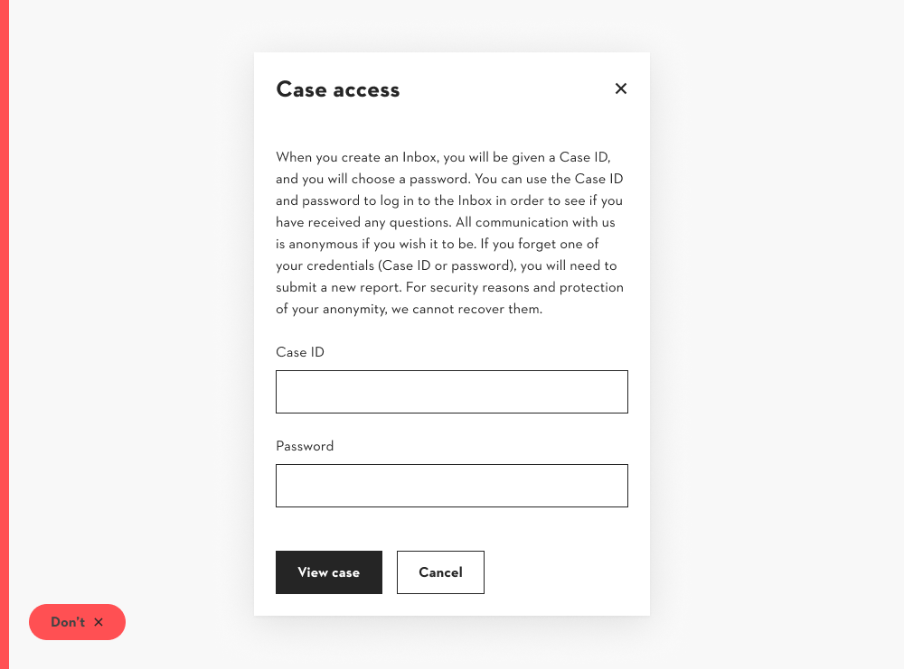

#### Edge case: large content areas

The dialog follows the size of the content area.

Optimize the content and test edge cases like extra large and small screens.

Especially with images and iframe elements, like maps.

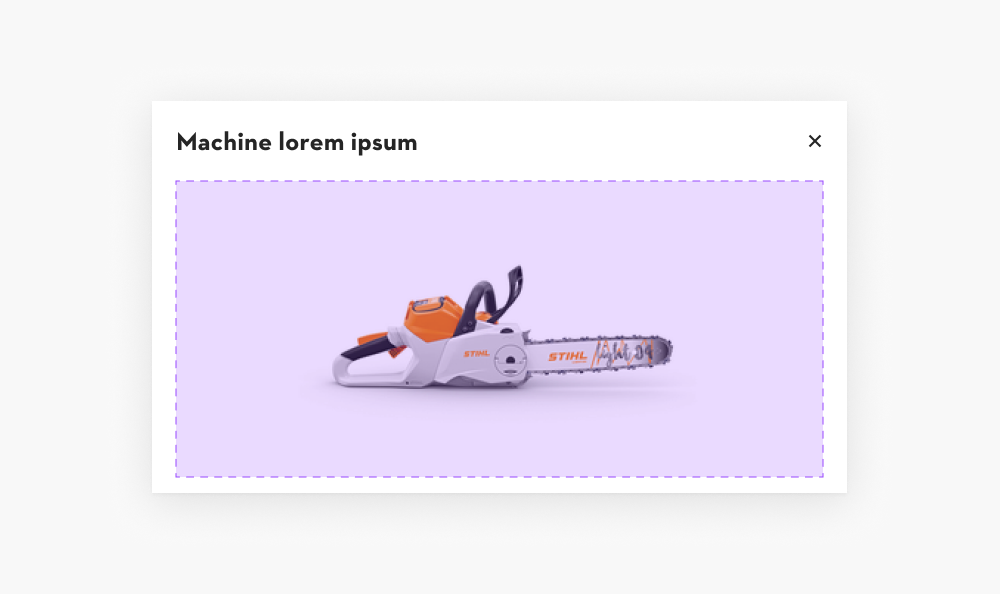

#### Edge case: columns

Add a column lay-out to the custom area if needed.

A few examples of possible layouts:

- 50/50
- 60/40
- 40/60
- 33/33/33

**Note:** In this use case contains a 50/50 column lay-out and the footer is left empty.

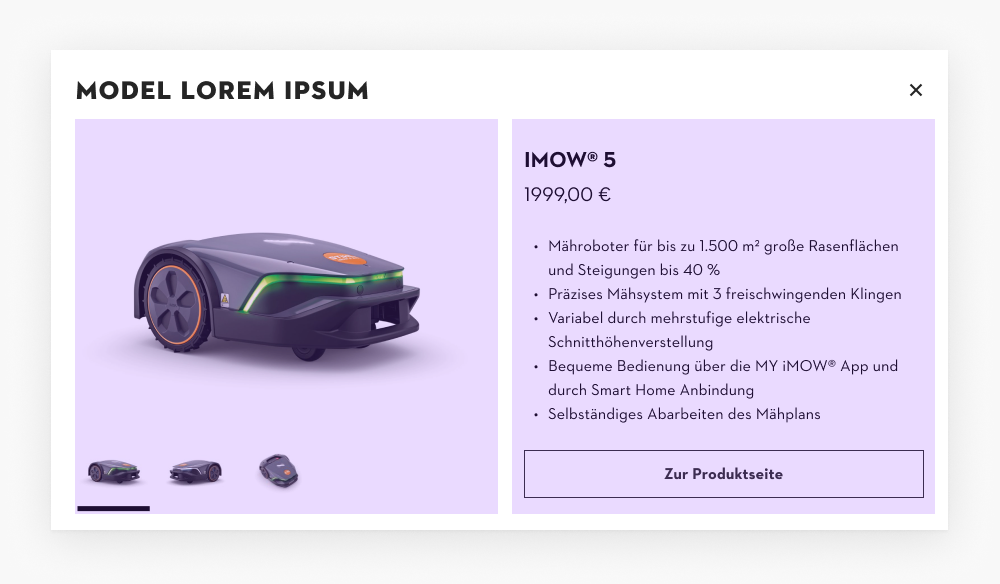

### Custom footer area

#### Hierarchie: Button pairing

Consider the order and hierarchy, when pairing button styles. Read the extensive [alignment and pairing guidelines ](https://www.figma.com/design/qXldpLO6gxHJNLdcXIPxYt/Pattern-Library-%F0%9F%96%A5-Web-1.0?node-id=1883-9858&t=sVQWNMJR5xeiaak3-4)on buttons.

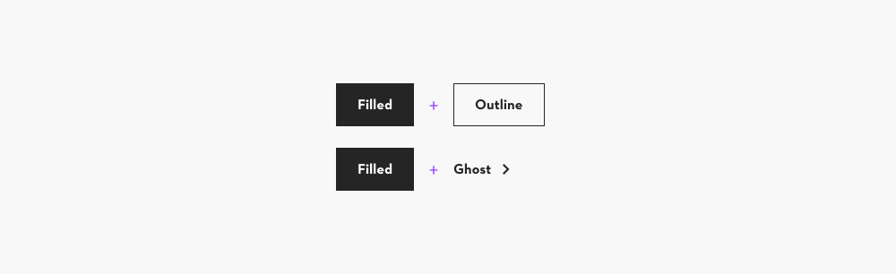

#### Number of action buttons

1. If zero, the close icon is mandatory.
1. Ideally, use a close button, additionally to the buttons in the action area.
1. If needed, use more than 2 buttons in max 2 different styles.
1. In case of many buttons, combine inline links in the content area with the buttons in the action area.

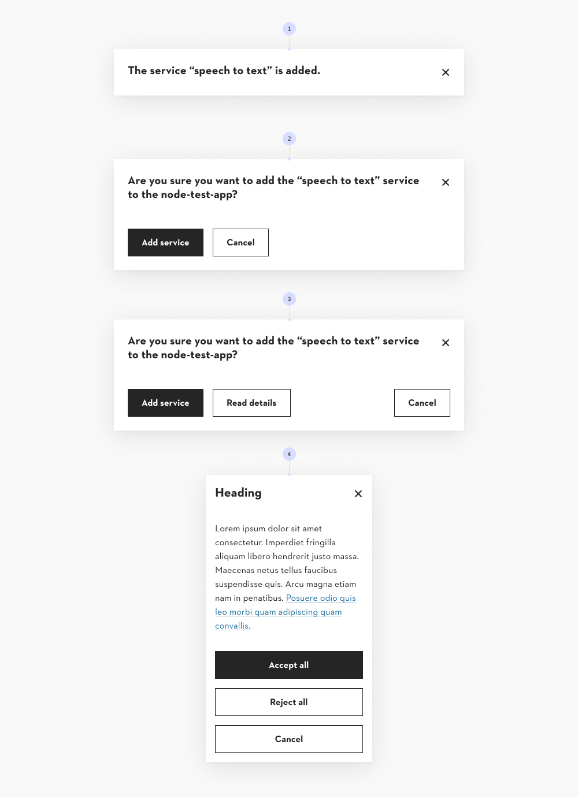

#### Button placement recommendation

1. Left aligned, together with the copy. Buttons are faster reached by eye and/or mouse.
1. Right alignment is common for dialogs with actions that proceed (e.g., "Next", "Submit")

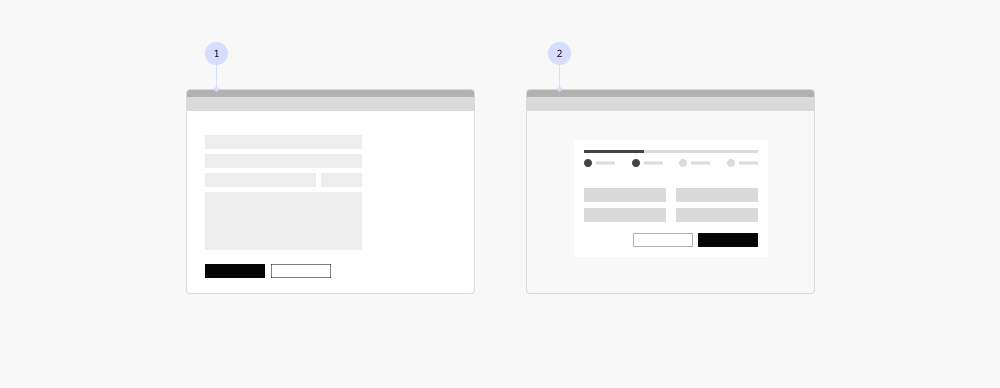

#### Button placement warning

Do not center the button or paired buttons

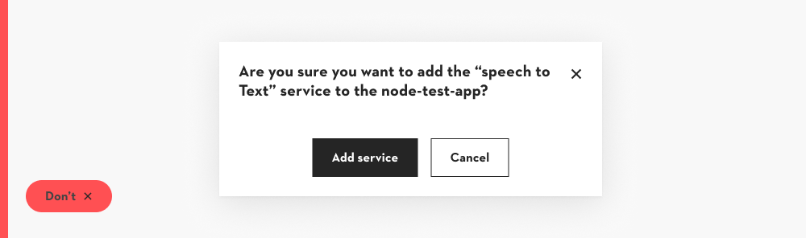

**Exception: slider and pagination.** You may place the pagination in the center of the custom footer area.

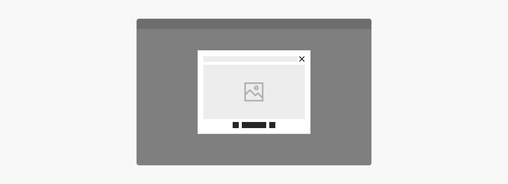

**Mobile**

#### Stacked buttons

The buttons in the footer area should be stacked on mobile screens. The primary actions is in most cases at the top.

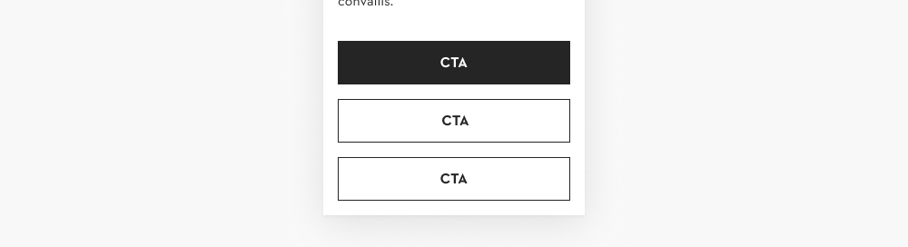

#### Small buttons

The footer area is sticky and can take up too much height.

**\< 3 buttons** Default button size allowed. Test the viewport in all browsers. otherwise consider the small button size

**3 buttons** Default and small buttons allowed.

**\> 4 buttons** When 4 or more buttons are needed, use small buttons. Also, consider placing inline links and buttons in the content area.

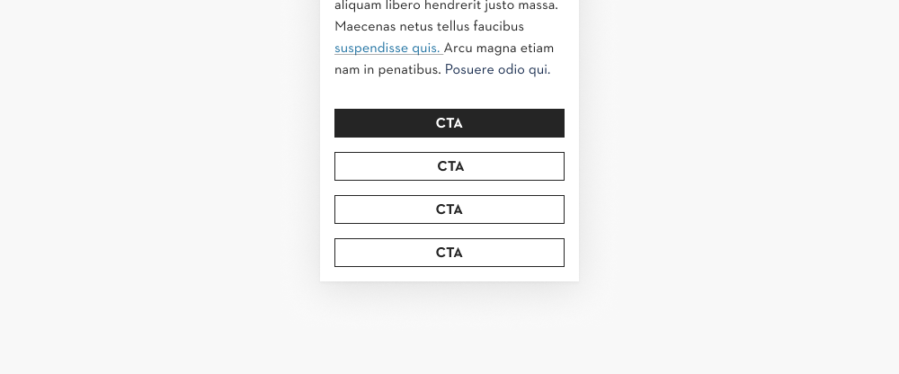

## Behavior

### User interaction required

In case the user closes **(1)** the dialog, the exit animation is triggered immediately.

Closing the dialog by click on the backdrop **(2)** can be disabled. The default is enabled.

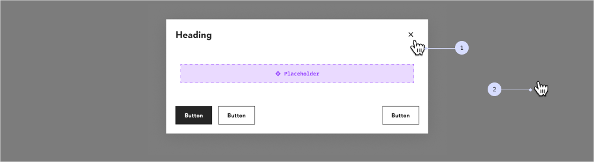

### Focus management

When the dialog opens, focus should be set to the first actionable element, typically the primary action button or the first input field **(1)**. It can also be the close icon.

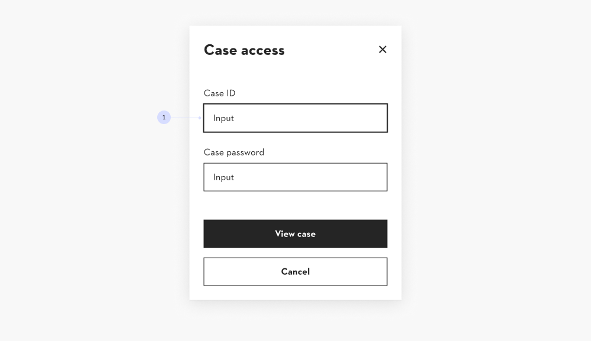

### Loading state

In case data-heavy tasks are connected to the action, provide visual feedback, such as [the loading spinner within the button.](https://www.figma.com/design/qXldpLO6gxHJNLdcXIPxYt/Pattern-Library-%F0%9F%96%A5-Web-1.0?node-id=1404-8289&t=sVQWNMJR5xeiaak3-4)

The other actions are disabled while submit is ongoing. The dialog does not close, while the submit is pending.

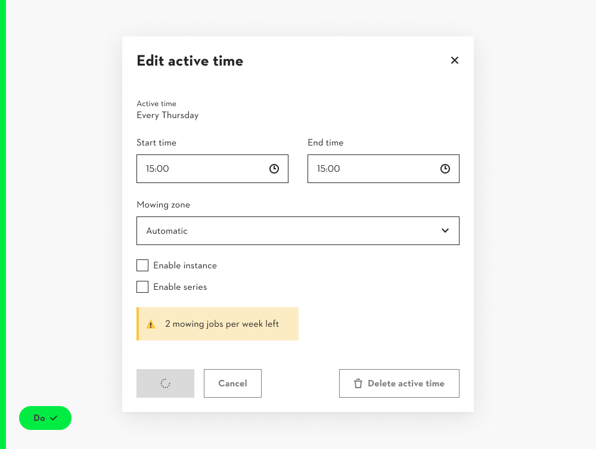

## Usage Guidelines

### Functionality & Priority

Components are chosen based on their level of urgency:

1. **Dialog** Highest urgency. Requires explicit user action before continuing. → [See Dialog](https://www.figma.com/design/qXldpLO6gxHJNLdcXIPxYt?node-id=14115-4051)

1. **Notification / Toast** Draws attention but does not block usage. Useful for immediate or transient feedback. → [See Notification](https://www.figma.com/design/qXldpLO6gxHJNLdcXIPxYt?node-id=7251-8) → [See Toast](https://www.figma.com/design/qXldpLO6gxHJNLdcXIPxYt?node-id=8844-4923)

1. **Banner** Persistent but non-blocking. Ideal for supporting information, promotions, or optional actions. → [See Banner](https://www.figma.com/design/Ie2r0R9QwjEc7O3nrFbXhV/Web-Pattern-Library?node-id=7171-9055)

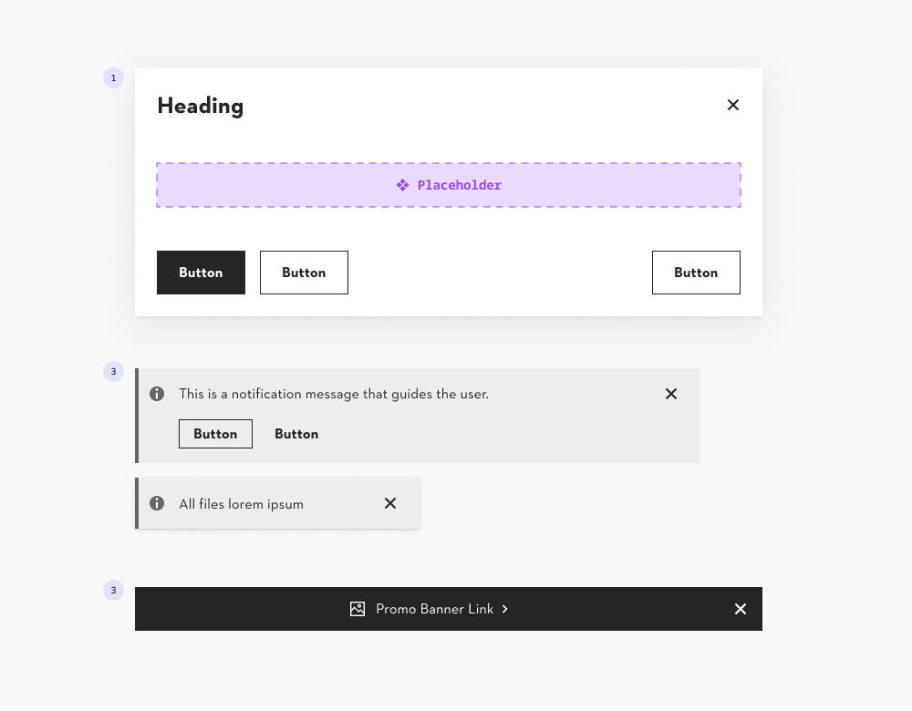

### Use Cases

#### System / Mandatory

- **System feedback (success, error)** → Notification / Toast
- **Cookies / Privacy notices** → Banner (if navigation can continue without consent) → Dialog (if explicit consent is required before continuing)
- **Urgent notifications (downtime, outages, maintenance)** → Notification (when only informing) → Dialog (when user actions are blocked)
- **Critical announcements (recalls, legal or policy changes)** → Notification (when only informing) → Dialog (when user actions are blocked)

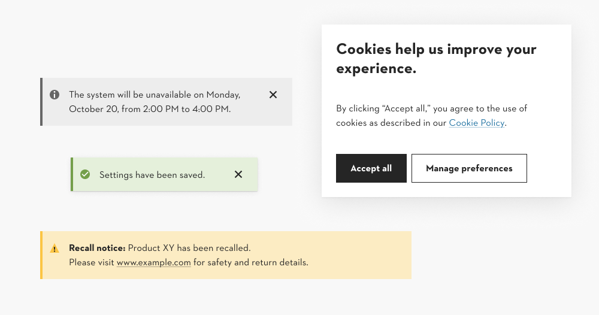

#### Marketing / Engagement

- **Sales & promotions** → Banner
- **Seasonal campaigns** → Banner
- **USPs / Value propositions** → Banner (for general positioning) → Notification (when contextually relevant, e.g., delivery info next to cart price)
- **Newsletter sign-up / Loyalty programs / Referrals** → Banner

#### Informational

- **Product / feature updates (non-critical)** → Banner
- **Tips, nudges, reminders** → Banner

## Examples/Variants

### Use for tasks in main flows

The dialog component is suited for tasks (use cases) that are closely connected to the main flow.

**Attention**: The user is limited inside a dialog. If a task is multifaceted, consider a link to a new page instead. Explore the efficiency of a complex user flow containing a dialog through usability testing.

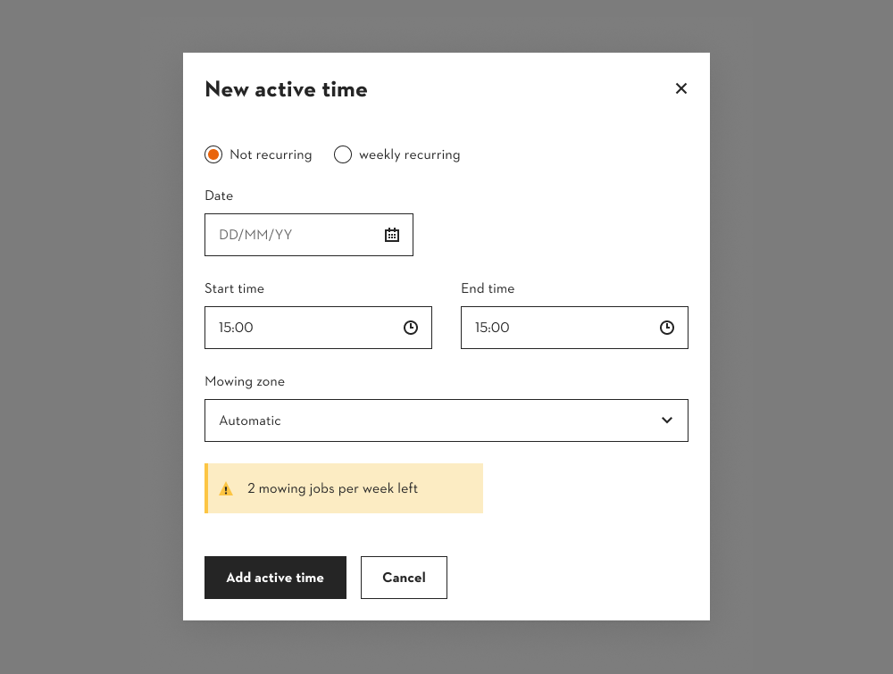

### Common use cases

- Confirmation
- Form to add/edit objects
- Information purposes
- Selection purposes

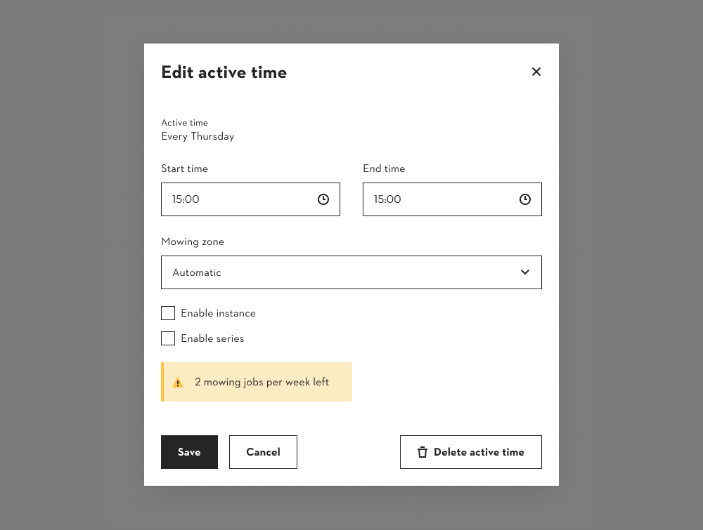

### Immediate response

Dialog component is ideal for:

- Immediate response required
- Confirmation for destructive actions
- Quick interactions

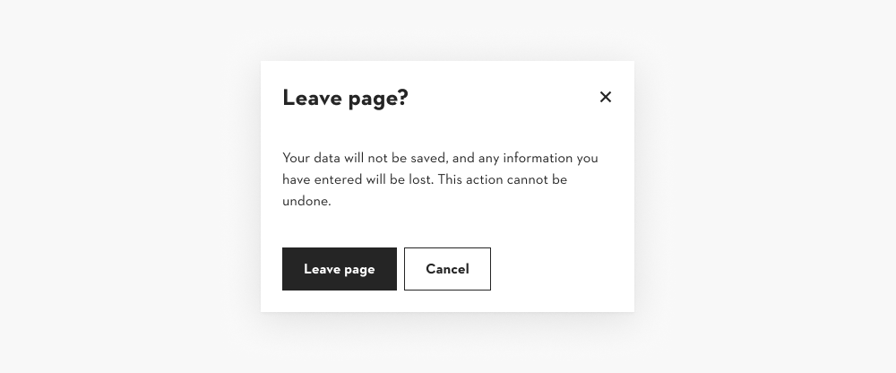

### Recommendations for mobile

1. Short copy in forms
1. Optimized and tested content

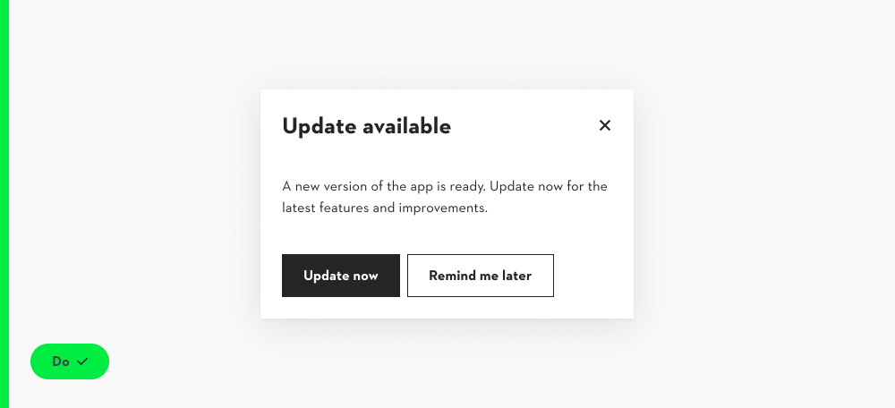

### Warning for mobile

1. Avoid scrolling, if possible
1. Avoid small touch targets: Inline links that are placed too close together
1. Avoid data-heavy tasks that might slowly load.

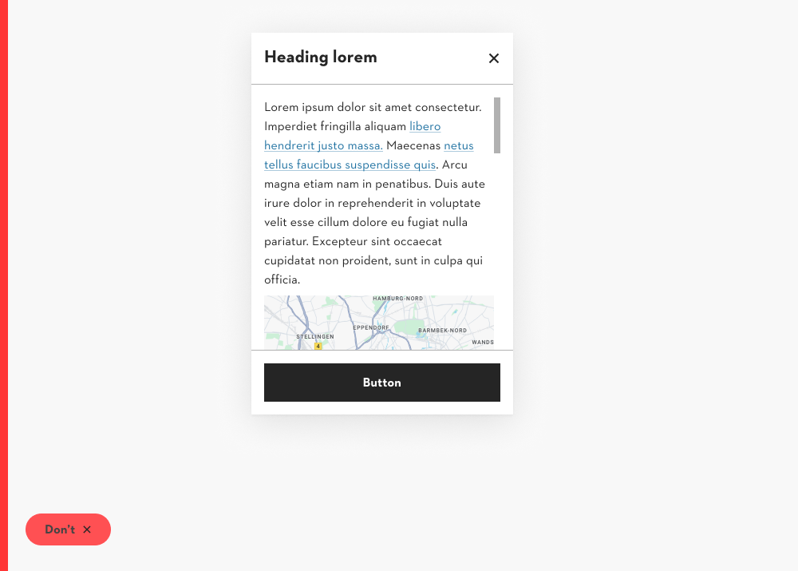

## Building elements

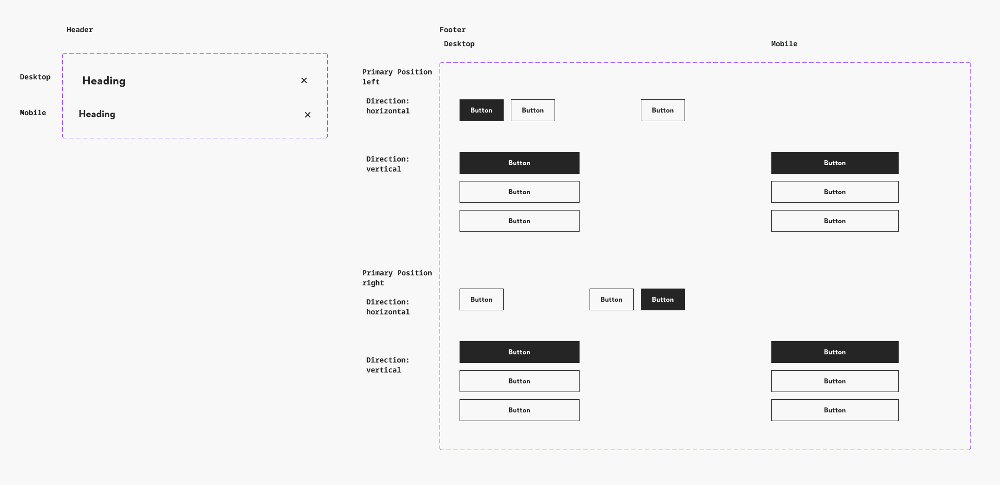

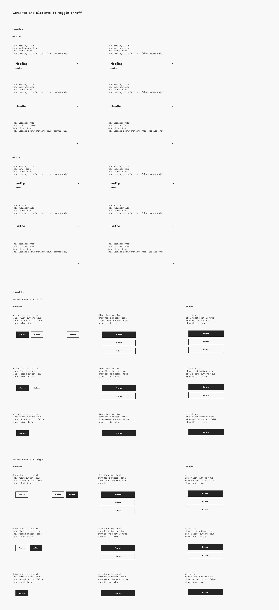
