# Dialog

## Dialog

Overview:

- Common use cases are confirmation dialog, form dialog, informational dialog and selection dialog.
- The dialog component is suited for tasks (use cases) that are closely connected to the main flow.
- The dialog size adjusts to the inserted content.
- Content overflow: header area and footer area are sticky, while the content area is scrolls.
- Ensure a clear hierarchy between the headline and content, so that the user can navigate quickly and move on.
- When on mobile 3 or more buttons, use small buttons to leave more space for the content area.
- When the dialog opens, focus should be set to the first actionable element.

### Component

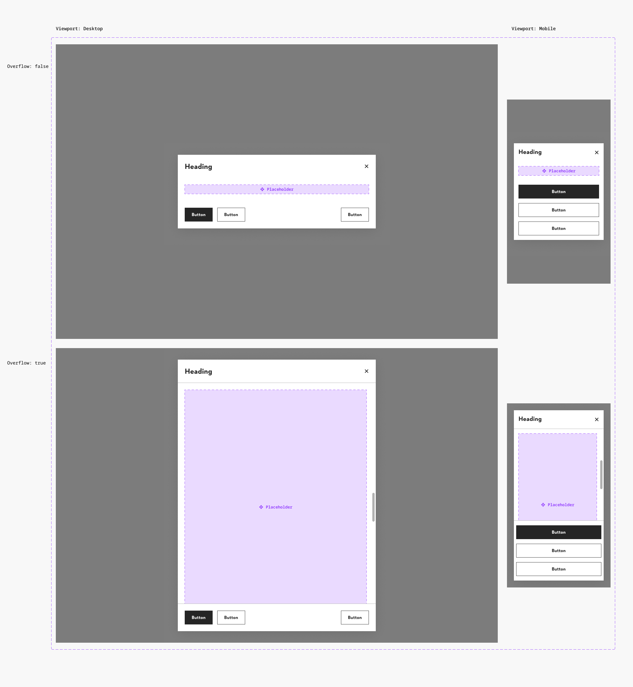

_Figure: Shows header-dialog (heading, close button, viewport=desktop); footer-dialog (first button, second button, third button, viewport=desktop, direction=horizontal, primary position=left); header-dialog (heading, close button, viewport=mobile); footer-dialog (first button, second button, third button, viewport=mobile, direction=vertical, primary position=left). Text in the figure: "Viewport: Desktop", "Viewport: Mobile", "Heading", "❖ Placeholder", "Button", "Overflow: false", "Overflow: true"._

#### Further guidelines

[Storybook documentation](https://main--63440bbb95889041542a5ba3.chromatic.com/?path=/docs/components-dialog--documentation&globals=backgrounds.name:!undefined;backgrounds.value:!undefined)

Decision tree

#### Similar components

**Component**

**Trigger**

**Placement**

**Content**

**Intention**

**Tooltip**

Hover or focus of an interactive element

In proximity to the triggering element, non-modal

Text only

Provide short, contextual information or clarify unlabeled controls

**Popover**

Click or tap of an interactive element

In proximity to the triggering button, non-modal

Text, icon, image and interactive elements

Provide additional information or quick actions without leaving the current context

**Dialog**

Triggered by the system in response to user interaction

Center of the screen, with backdrop, modal

Text, icon, image and interactive elements

Confirm important actions, guide users through complex tasks, or temporarily block interaction to focus attention

**Toast**

Triggered by the system in response to user interaction

Bottom of the screen, non-modal

Text, icon, and optional dismiss button

Provide brief, lightweight feedback on user actions such as error or success.

**Notification**

Triggered by the system in response to events or interactions

Within the content area of the page, in relation to relevant elements

Text, icon, links and buttons

Deliver important updates or status messages that may require user attention or follow-up

#### Related elements

[Drawer](https://www.figma.com/design/qXldpLO6gxHJNLdcXIPxYt?node-id=16282-9317)

[Combobox](https://www.figma.com/design/qXldpLO6gxHJNLdcXIPxYt/Pattern-Library-%F0%9F%96%A5-Web-1.0?node-id=2659-3954)

[Fieldset](https://www.figma.com/design/Ie2r0R9QwjEc7O3nrFbXhV/Web-Pattern-Library?node-id=8-154)

[Toast](https://www.figma.com/design/qXldpLO6gxHJNLdcXIPxYt/Pattern-Library-%F0%9F%96%A5-Web-1.0?node-id=8844-4923)

[Notification](https://www.figma.com/design/qXldpLO6gxHJNLdcXIPxYt/Pattern-Library-%F0%9F%96%A5-Web-1.0?node-id=7251-8)

[Button](https://www.figma.com/design/qXldpLO6gxHJNLdcXIPxYt/Pattern-Library-%F0%9F%96%A5-Web-1.0?node-id=162-126)

[Tooltip](https://www.figma.com/design/HovZmjHiwxguawTWTO6ibS/DS-1085-Design-%7C-Web-%7C-Tootlip?node-id=36194-1244)

[Popover](https://www.figma.com/design/qXldpLO6gxHJNLdcXIPxYt?node-id=26075-11456)

#### Contribute

Contribute to improving this component by sharing your feedback, asking questions, or suggesting features [here](https://www.figma.com/design/lLmw7PfIdKjFG4uT3B2Hyj/Onboarding-%F0%9F%93%96?node-id=446-868&t=zKmRu4kAkxMeRDmK-4).

## Formatting and Construction

### Anatomy

1. **Custom header area**
1. **Custom content area (optional)**
1. **Custom footer area (optional)**
1. **Backdrop**

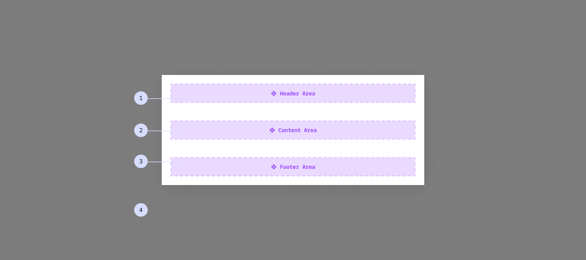

_Figure: Callouts 1, 2, 3, 4. Text in the figure: "❖ Header Area", "❖ Content Area", "❖ Footer Area"._

#### Figma component

Although technically a freely configurable slot, the figma components for **header area (1)** and **footer area (3)** provide a few options for common use case. The content area can be replaced with a **placeholder component (2)** that contain an additional text or image option.

Feel free to swap this with your own placeholder components or modules.

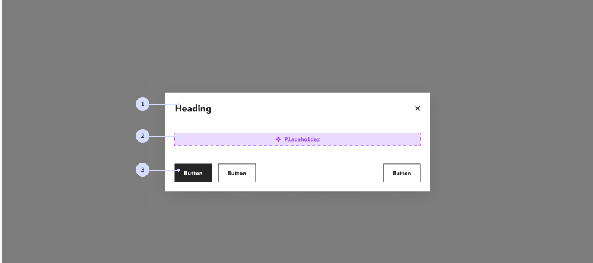

_Figure: Shows dialog (viewport=desktop, overflow=false). Callouts 1, 2, 3. Text in the figure: "Heading", "❖ Placeholder", "Button"._

### Sizing

#### Minimum width

The dialog adjusts to the width of the inserted content. Minimum size ist based on the smallest viewport size: 272px

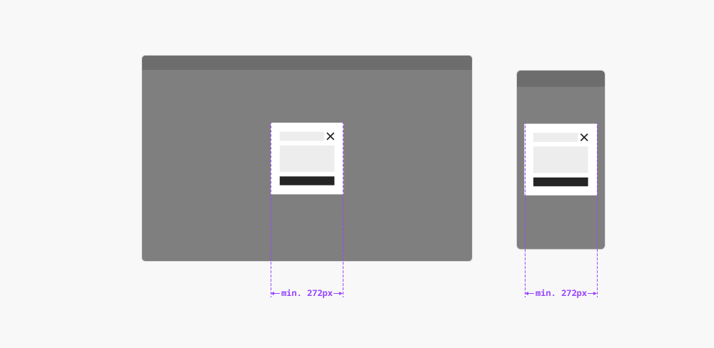

_Figure: Text in the figure: "min. 272px"._

#### Maximum width

The dialog adjusts to the width of the inserted content. It can’t exceed [content narrow area ](https://www.figma.com/design/JyyYtoCYbtJrzqHs38OXSQ/Grid-%26-Spacing-%F0%9F%A7%AE?node-id=1-132)width.

**Minimum space between browser edge and dialog, left and right:**

- On bigger screens the distance is 40px.
- On smaller screens it is 24px.

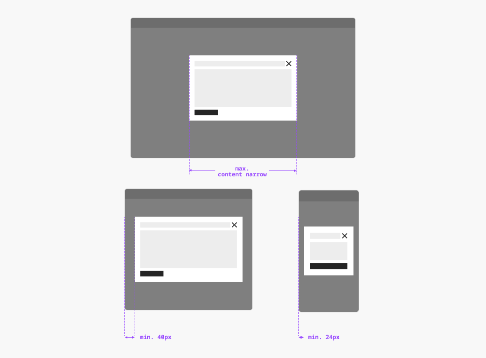

_Figure: Text in the figure: "max. content narrow", "min. 40px", "min. 24px"._

#### Maximum height

The dialog adjusts to the length of the inserted content. Content overflow may occur.

**Minimum space between browser edge and dialog, top and bottom:**

- On bigger screens the distance is 40px.
- On smaller screens it is 24px.

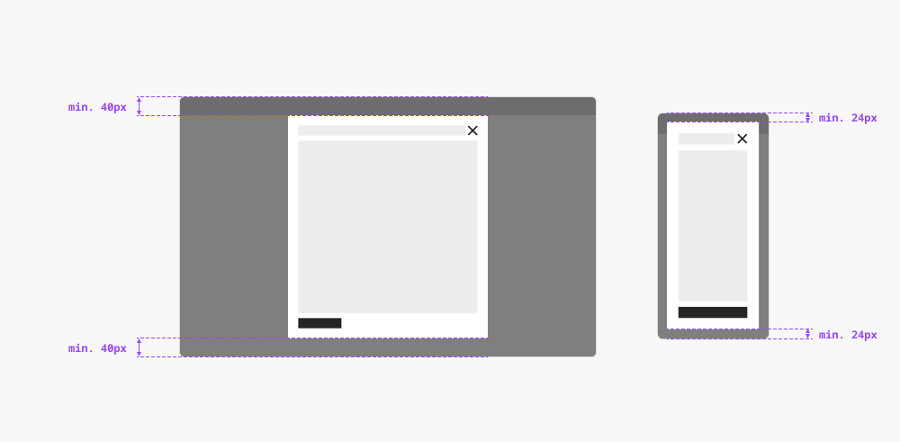

_Figure: Text in the figure: "min. 40px", "min. 24px"._

#### Content overflow

- **The content area is scrollable.**
- Header area and footer area are sticky.
- Both header and footer get a border.

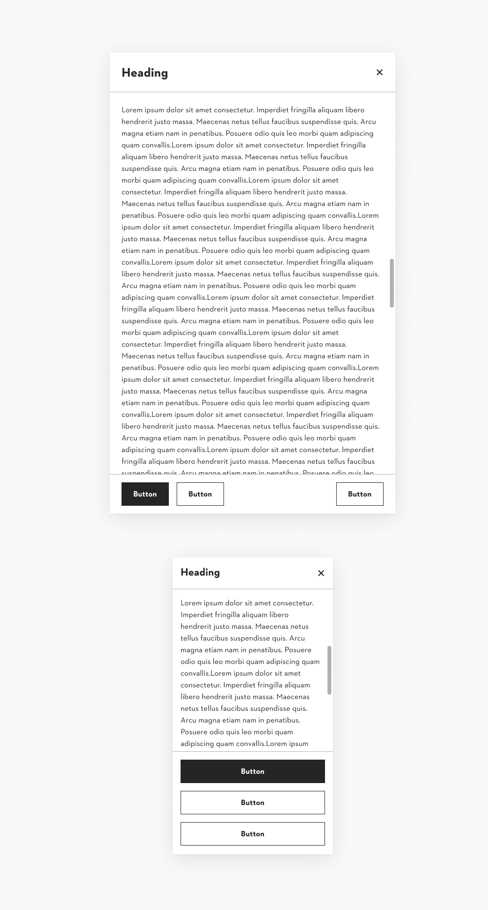

_Figure: Shows header-dialog (heading, close button, viewport=desktop); placeholder: text + image; footer-dialog (first button, second button, third button, viewport=desktop, direction=horizontal, primary position=left); header-dialog (heading, close button, viewport=mobile); footer-dialog (first button, second button, third button, viewport=mobile, direction=vertical, primary position=left). Text in the figure: "Heading", "Lorem ipsum dolor sit amet consectetur. Imperdiet fringilla aliquam libero he...", "Button"._

#### Placement

The content area can be various lengths and widths.

The dialog moves in from the top and is placed in the center of the viewport.

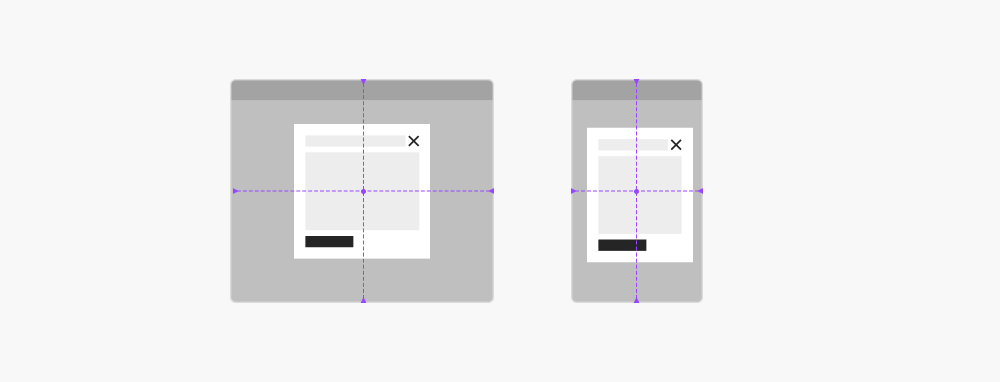

### Motion

[Motion guidelines →](https://www.figma.com/design/UYHZEckQObDvLuuRoMP8ps/Styles-%F0%9F%AA%AD?m=auto&t=4yiq5f9rjU14BQYJ-6)

#### Enter animation dialog

**Animation type:** move: in from top to center fade: opacity (0-100%) **Duration:** 400ms **Easing:** motion-functional-ease-out

#### Backdrop dimming

**Animation type:** move: in from top to center fade: opacity (0-100%) (color: black 50%) **Duration:** 400ms **Easing:** motion-functional-ease-out

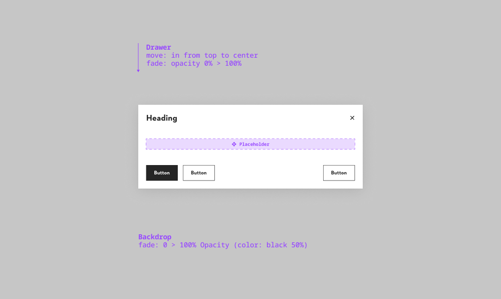

_Figure: Shows dialog (viewport=desktop, overflow=false). Text in the figure: "Heading", "❖ Placeholder", "Button", "Drawer move: in from top to center fade: opacity 0% \> 100%", "Backdrop fade: 0 \> 100% Opacity (color: black 50%)"._

#### Exit animation dialog

**Animation type:** move: out from center to top fade: opacity (100-0%) **Duration:** 400ms **Easing:** motion-functional-ease-in

#### Backdrop dimming

**Animation type:** fade: opacity (100-0%) (color black 50%) **Duration:** 400ms **Easing:** motion-functional-ease-in

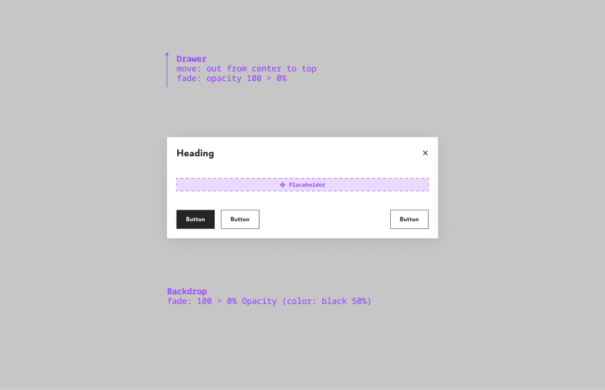

_Figure: Shows dialog (viewport=desktop, overflow=false). Text in the figure: "Heading", "❖ Placeholder", "Button", "Drawer move: out from center to top fade: opacity 100 \> 0%", "Backdrop fade: 100 \> 0% Opacity (color: black 50%)"._

## Content

### Hierachy

In most cases, the user’s task in the dialog disturbs the user-flow.

It is important to ensure a clear hierarchy, so that the user can navigate quickly and move on.

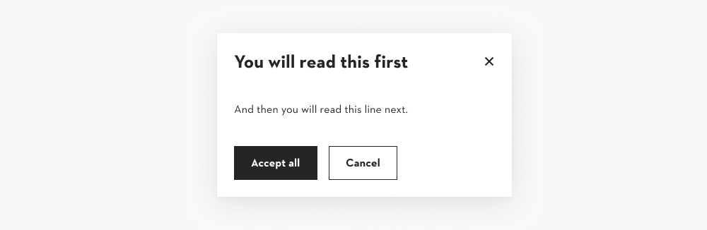

_Figure: Shows header-dialog (heading, close button, viewport=desktop); placeholder: text + image; footer-dialog (first button, second button, viewport=desktop, direction=horizontal, primary position=left). Text in the figure: "You will read this first", "And then you will read this line next.", "Accept all", "Cancel"._

### Custom header area

#### Formatting examples

1. Heading L with topline
1. Uppercase is better suitable for large dialogs.
1. [Title component](https://www.figma.com/design/Ie2r0R9QwjEc7O3nrFbXhV/Web-Pattern-Library?node-id=7-19) is better suitable for impactful and emotional headers.
1. Content icon placed left of the heading and subline.

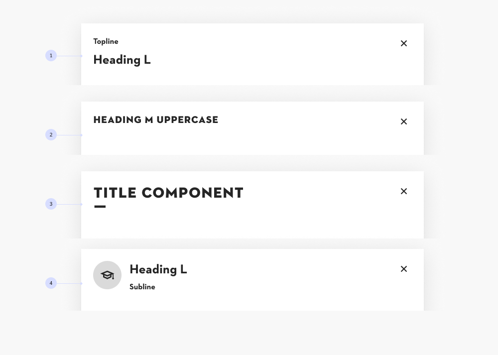

_Figure: Shows Button (button text=Button, variant=ghost, state=enabled, size=small, icon position=none, hide label=on, flush alignment=off); placeholder: text + image; primary (button text=Primary CTA, variant=filled, state=enabled, size=medium, icon position=none, hide label=off, flush alignment=off); secondary (button text=Secondary CTA, variant=outline, state=enabled, size=medium, icon position=none, hide label=off, flush alignment=off); secondary (button text=Tertiary CTA, variant=outline, state=enabled, size=medium, icon position=none, hide label=off, flush alignment=off). Callouts 1, 2, 3, 4. Text in the figure: "Topline", "Heading L", "Lorem ipsum dolor sit amet consectetur. Imperdiet fringilla aliquam libero he...", "Primary CTA", "Secondary CTA", "Tertiary CTA", "Heading M Uppercase", "Title Component", "ƒ", "Subline"._

#### Header as a message

Short messages can be placed completely in the header element. It adds visual clarity.

**When using the header as the main copy, the custom content area must remain empty.**

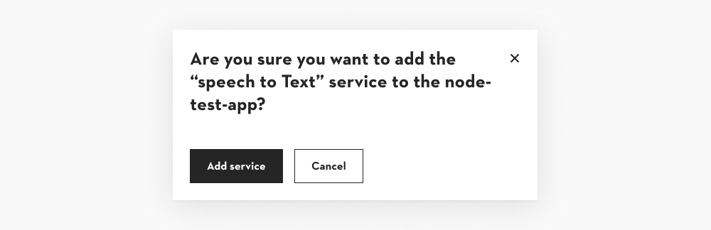

_Figure: Shows header-dialog (heading, close button, viewport=desktop); footer-dialog (first button, second button, viewport=desktop, direction=horizontal, primary position=left). Text in the figure: "Are you sure you want to add the “speech to Text” service to the node-test-app?", "Add service", "Cancel"._

### Custom content area

#### Long copy, input fields

Keep copy short, when in combination with a input field component or fieldset container.

[Input guidelines →](https://www.figma.com/design/qXldpLO6gxHJNLdcXIPxYt/Pattern-Library-%F0%9F%96%A5-Web-1.0?node-id=1591-2)

[Fieldset guidelines →](https://www.figma.com/design/Ie2r0R9QwjEc7O3nrFbXhV/Web-Pattern-Library?node-id=8-154)

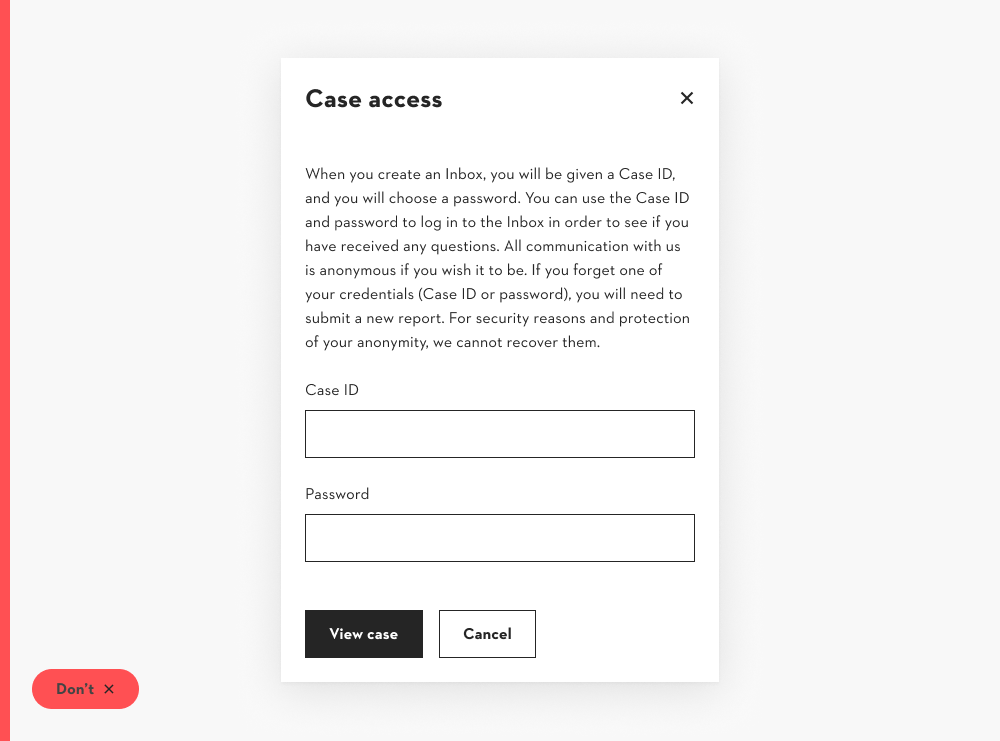

_Figure: Don't example. Shows header-dialog (heading, close button, viewport=desktop); placeholder: text + image; input (system feedback, hint=Lorem ipsum dolor sit amet, consectetur adipiscing elit. Cras nunc amet mauris turpis magna. Quisque ut mi rhoncus eget., input=Input, label=Case ID, size=medium, state=enabled, invalid=false); input (system feedback, hint=Lorem ipsum dolor sit amet, consectetur adipiscing elit. Cras nunc amet mauris turpis magna. Quisque ut mi rhoncus eget., input=Input, label=Password, size=medium, state=enabled, invalid=false); footer-dialog (first button, second button, viewport=desktop, direction=horizontal, primary position=left). Text in the figure: "Case access", "When you create an Inbox, you will be given a Case ID, and you will choose a...", "Case ID", "Password", "View case", "Cancel"._

#### Edge case: large content areas

The dialog follows the size of the content area.

Optimize the content and test edge cases like extra large and small screens.

Especially with images and iframe elements, like maps.

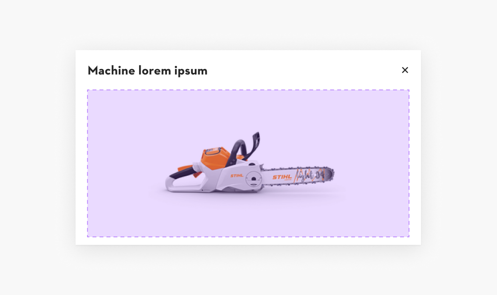

_Figure: Shows header-dialog (heading, close button, viewport=desktop). Text in the figure: "Machine lorem ipsum"._

#### Edge case: columns

Add a column lay-out to the custom area if needed.

A few examples of possible layouts:

- 50/50
- 60/40
- 40/60
- 33/33/33

**Note:** In this use case contains a 50/50 column lay-out and the footer is left empty.

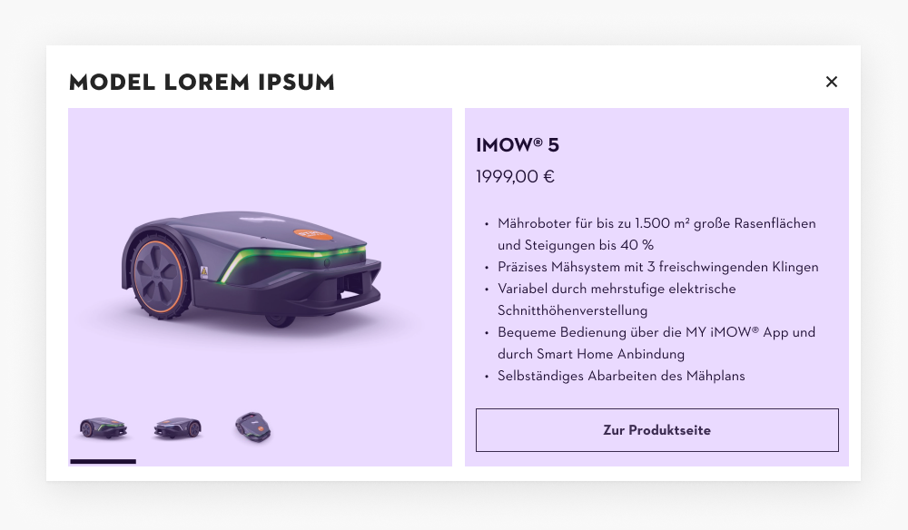

_Figure: Shows header-dialog (heading, close button, viewport=desktop); button (button text=Zur Produktseite, variant=outline, state=enabled, size=medium, icon position=none, hide label=off, flush alignment=off). Text in the figure: "Model lorem ipsum", "IMOW® 5", "1999,00 €", "Mähroboter für bis zu 1.500 m² große Rasenflächen und Steigungen bis 40 % Prä...", "Zur Produktseite"._

### Custom footer area

#### Hierarchie: Button pairing

Consider the order and hierarchy, when pairing button styles. Read the extensive [alignment and pairing guidelines ](https://www.figma.com/design/qXldpLO6gxHJNLdcXIPxYt/Pattern-Library-%F0%9F%96%A5-Web-1.0?node-id=1883-9858&t=sVQWNMJR5xeiaak3-4)on buttons.

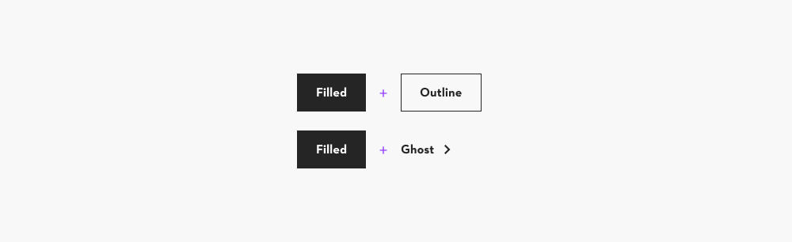

_Figure: Shows button (button text=Filled, variant=filled, state=enabled, size=medium, icon position=none, hide label=off, flush alignment=off); button (button text=Outline, variant=outline, state=enabled, size=medium, icon position=none, hide label=off, flush alignment=off); button (button text=Ghost, variant=ghost, state=enabled, size=medium, icon position=right, hide label=off, flush alignment=on). Text in the figure: "Filled", "Outline", "+", "Ghost"._

#### Number of action buttons

1. If zero, the close icon is mandatory.
1. Ideally, use a close button, additionally to the buttons in the action area.
1. If needed, use more than 2 buttons in max 2 different styles.
1. In case of many buttons, combine inline links in the content area with the buttons in the action area.

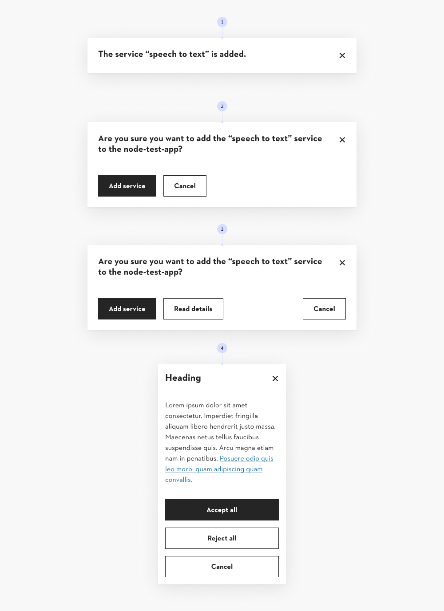

_Figure: Shows header-dialog (heading, close button, viewport=desktop); footer-dialog (first button, second button, viewport=desktop, direction=horizontal, primary position=left); footer-dialog (first button, second button, third button, viewport=desktop, direction=horizontal, primary position=left); header-dialog (heading, close button, viewport=mobile); placeholder: text + image; footer-dialog (first button, second button, third button, viewport=mobile, direction=vertical, primary position=left). Callouts 1, 2, 3, 4. Text in the figure: "The service “speech to text” is added.", "Are you sure you want to add the “speech to text” service to the node-test-app?", "Add service", "Cancel", "Read details", "Heading", "Lorem ipsum dolor sit amet consectetur. Imperdiet fringilla aliquam libero he...", "Accept all", "Reject all"._

#### Button placement recommendation

1. Left aligned, together with the copy. Buttons are faster reached by eye and/or mouse.
1. Right alignment is common for dialogs with actions that proceed (e.g., "Next", "Submit")

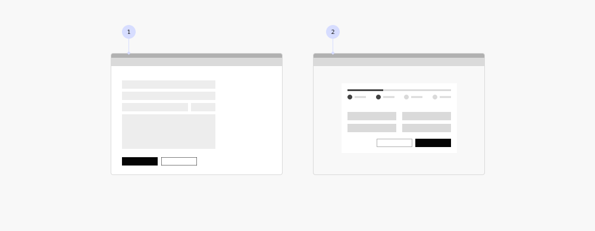

_Figure: Callouts 1, 2._

#### Button placement warning

Do not center the button or paired buttons

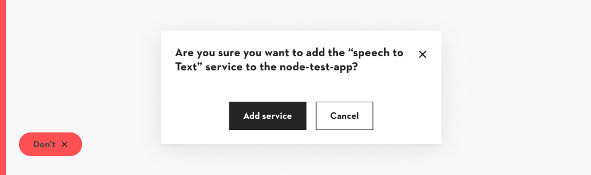

_Figure: Don't example. Shows header-dialog (heading, close button, viewport=desktop); footer-dialog (first button, second button, viewport=desktop, direction=horizontal, primary position=left). Text in the figure: "Are you sure you want to add the “speech to Text” service to the node-test-app?", "Add service", "Cancel"._

**Exception: slider and pagination.** You may place the pagination in the center of the custom footer area.

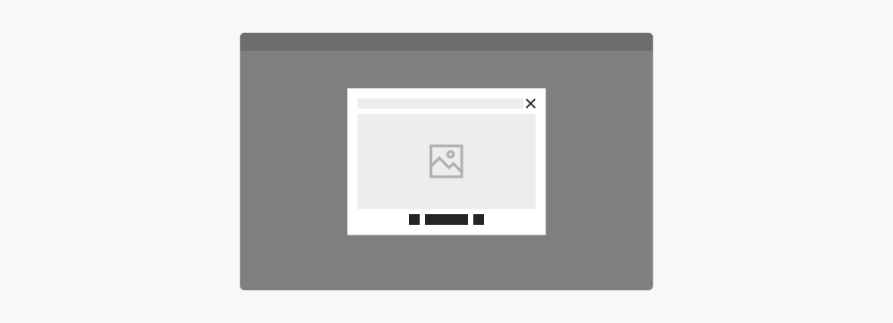

**Mobile**

#### Stacked buttons

The buttons in the footer area should be stacked on mobile screens. The primary actions is in most cases at the top.

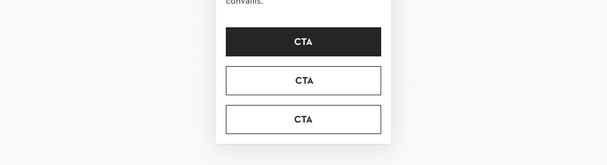

_Figure: Shows header-dialog (heading, close button, viewport=mobile); placeholder: text + image; footer-dialog (first button, second button, third button, viewport=mobile, direction=vertical, primary position=left). Text in the figure: "Heading", "Lorem ipsum dolor sit amet consectetur. Imperdiet fringilla aliquam libero he...", "CTA"._

#### Small buttons

The footer area is sticky and can take up too much height.

**\< 3 buttons** Default button size allowed. Test the viewport in all browsers. otherwise consider the small button size

**3 buttons** Default and small buttons allowed.

**\> 4 buttons** When 4 or more buttons are needed, use small buttons. Also, consider placing inline links and buttons in the content area.

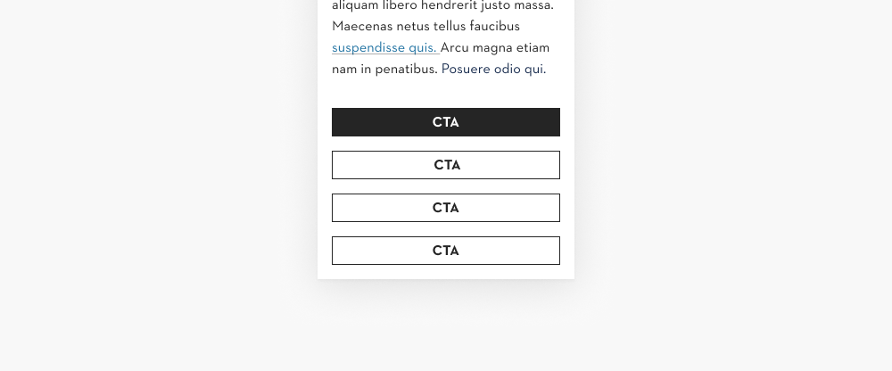

_Figure: Shows header-dialog (heading, close button, viewport=mobile); placeholder: text + image; primary (button text=CTA, variant=filled, state=enabled, size=small, icon position=none, hide label=off, flush alignment=off); secondary (button text= CTA, variant=outline, state=enabled, size=small, icon position=none, hide label=off, flush alignment=off); secondary (button text=CTA, variant=outline, state=enabled, size=small, icon position=none, hide label=off, flush alignment=off). Text in the figure: "Heading", "Lorem ipsum dolor sit amet consectetur. Imperdiet fringilla aliquam libero he...", "CTA"._

## Behavior

### User interaction required

In case the user closes **(1)** the dialog, the exit animation is triggered immediately.

Closing the dialog by click on the backdrop **(2)** can be disabled. The default is enabled.

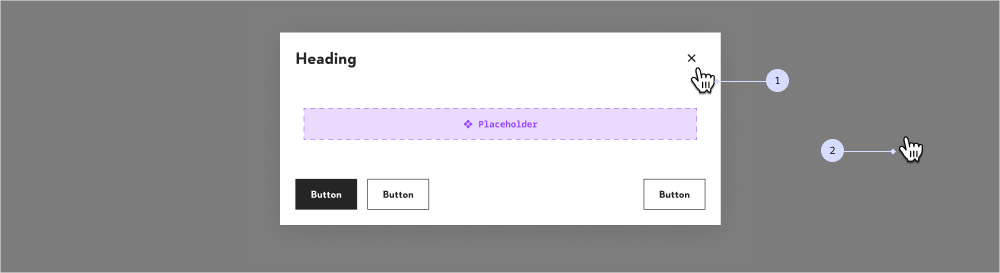

_Figure: Shows header-dialog (heading, close button, viewport=desktop); footer-dialog (first button, second button, third button, viewport=desktop, direction=horizontal, primary position=left). Callouts 1, 2. Text in the figure: "Heading", "❖ Placeholder", "Button"._

### Focus management

When the dialog opens, focus should be set to the first actionable element, typically the primary action button or the first input field **(1)**. It can also be the close icon.

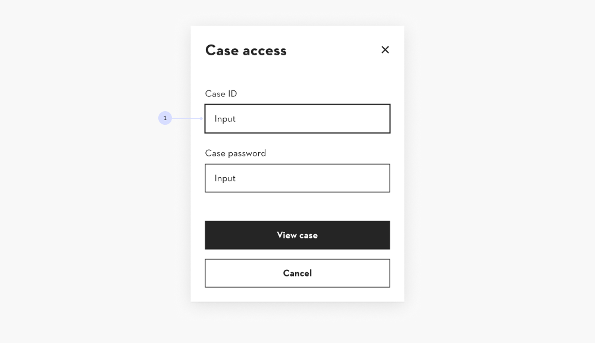

_Figure: Shows header-dialog (heading, close button, viewport=desktop); footer-dialog (first button, second button, viewport=desktop, direction=vertical, primary position=left). Callouts 1. Text in the figure: "Case access", "Case ID", "Input", "Case password", "View case", "Cancel"._

### Loading state

In case data-heavy tasks are connected to the action, provide visual feedback, such as [the loading spinner within the button.](https://www.figma.com/design/qXldpLO6gxHJNLdcXIPxYt/Pattern-Library-%F0%9F%96%A5-Web-1.0?node-id=1404-8289&t=sVQWNMJR5xeiaak3-4)

The other actions are disabled while submit is ongoing. The dialog does not close, while the submit is pending.

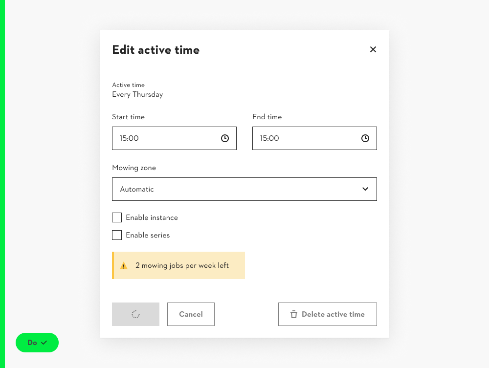

_Figure: Do example. Shows header-dialog (heading, close button, viewport=desktop); example\_component\_dialog (Property 1=Default); footer-dialog (first button, second button, third button, viewport=desktop, direction=horizontal, primary position=left). Text in the figure: "Edit active time", "Active time Every Thursday", "Start time", "15:00", "End time", "Mowing zone", "Automatic", "Enable instance", "Enable series", "2 mowing jobs per week left", "Cancel", "Delete active time"._

## Usage Guidelines

### Functionality & Priority

Components are chosen based on their level of urgency:

1. **Dialog** Highest urgency. Requires explicit user action before continuing. → [See Dialog](https://www.figma.com/design/qXldpLO6gxHJNLdcXIPxYt?node-id=14115-4051)

1. **Notification / Toast** Draws attention but does not block usage. Useful for immediate or transient feedback. → [See Notification](https://www.figma.com/design/qXldpLO6gxHJNLdcXIPxYt?node-id=7251-8) → [See Toast](https://www.figma.com/design/qXldpLO6gxHJNLdcXIPxYt?node-id=8844-4923)

1. **Banner** Persistent but non-blocking. Ideal for supporting information, promotions, or optional actions. → [See Banner](https://www.figma.com/design/Ie2r0R9QwjEc7O3nrFbXhV/Web-Pattern-Library?node-id=7171-9055)

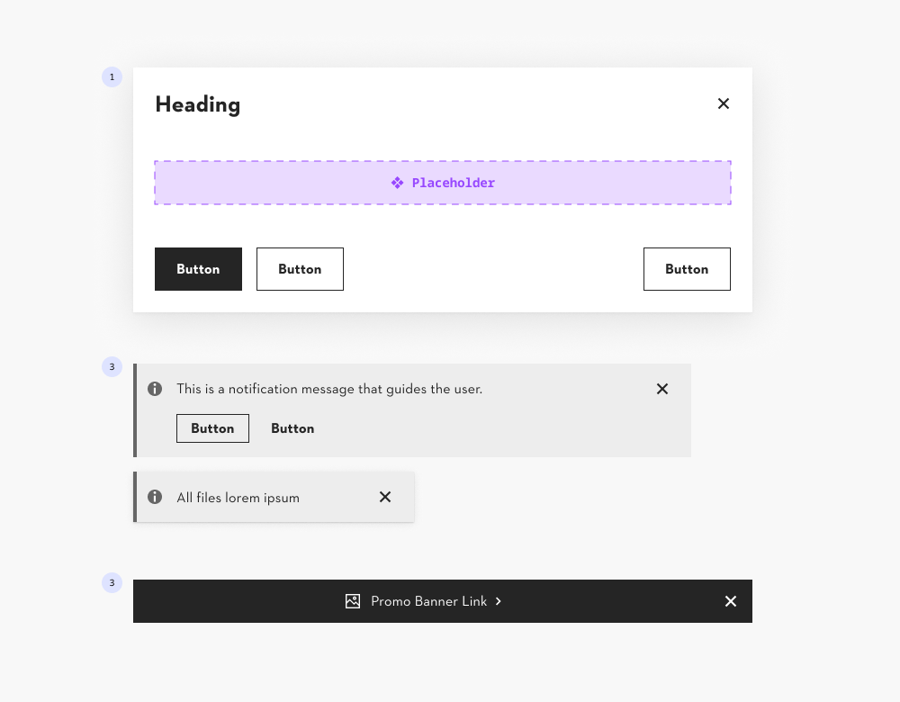

_Figure: Shows annotation-circle (number=1, type=center, color=blue); header-dialog (heading, close button, viewport=desktop); footer-dialog (first button, second button, third button, viewport=desktop, direction=horizontal, primary position=left); annotation-circle (number=3, type=center, color=blue); notification (action, close button, type=info, icon=True); toast (text=All files lorem ipsum, icon, type=info); banner (variant=default, viewport=m, content=promo, close-button=true). Callouts 1, 3. Text in the figure: "Heading", "❖ Placeholder", "Button", "This is a notification message that guides the user.", "All files lorem ipsum", "Promo Banner Link"._

### Use Cases

#### System / Mandatory

- **System feedback (success, error)** → Notification / Toast
- **Cookies / Privacy notices** → Banner (if navigation can continue without consent) → Dialog (if explicit consent is required before continuing)
- **Urgent notifications (downtime, outages, maintenance)** → Notification (when only informing) → Dialog (when user actions are blocked)
- **Critical announcements (recalls, legal or policy changes)** → Notification (when only informing) → Dialog (when user actions are blocked)

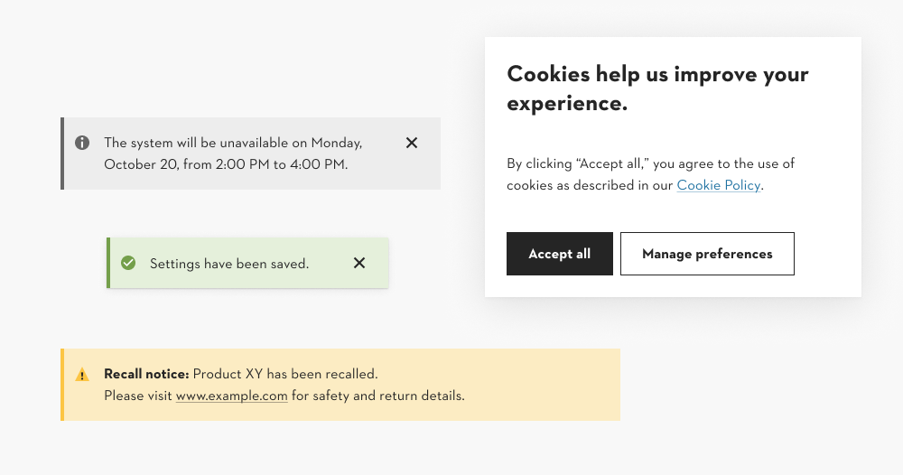

_Figure: Shows header-dialog (heading, viewport=desktop); placeholder: text + image; footer-dialog (first button, third button, viewport=desktop, direction=horizontal, primary position=left); notification (close button, type=info, icon=True); toast (text=Settings have been saved., icon, type=success); notification (type=warning, icon=True). Text in the figure: "Cookies help us improve your experience.", "By clicking “Accept all,” you agree to the use of cookies as described in our...", "Accept all", "Manage preferences", "The system will be unavailable on Monday, October 20, from 2:00 PM to 4:00 PM.", "Settings have been saved.", "Recall notice: Product XY has been recalled. Please visit www.example.com for..."._

#### Marketing / Engagement

- **Sales & promotions** → Banner
- **Seasonal campaigns** → Banner
- **USPs / Value propositions** → Banner (for general positioning) → Notification (when contextually relevant, e.g., delivery info next to cart price)
- **Newsletter sign-up / Loyalty programs / Referrals** → Banner

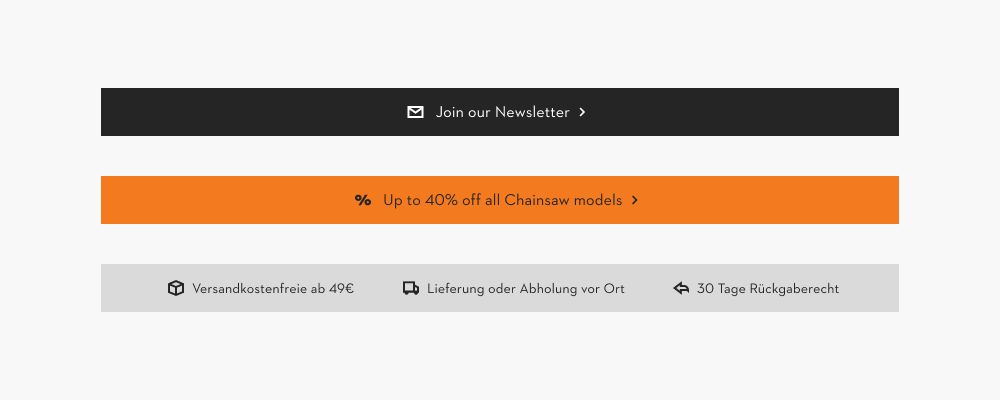

_Figure: Shows banner (variant=default, viewport=m, content=promo, close-button=false); banner (variant=highlight, viewport=m, content=promo, close-button=false). Text in the figure: "Join our Newsletter", "Up to 40% off all Chainsaw models", "Versandkostenfreie ab 49€", "Lieferung oder Abholung vor Ort", "30 Tage Rückgaberecht"._

#### Informational

- **Product / feature updates (non-critical)** → Banner
- **Tips, nudges, reminders** → Banner

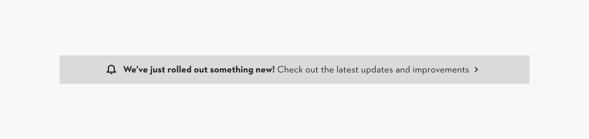

_Figure: Shows banner (variant=secondary, viewport=m, content=promo, close-button=false). Text in the figure: "We’ve just rolled out something new! Check out the latest updates and improve..."._

## Examples/Variants

### Use for tasks in main flows

The dialog component is suited for tasks (use cases) that are closely connected to the main flow.

**Attention**: The user is limited inside a dialog. If a task is multifaceted, consider a link to a new page instead. Explore the efficiency of a complex user flow containing a dialog through usability testing.

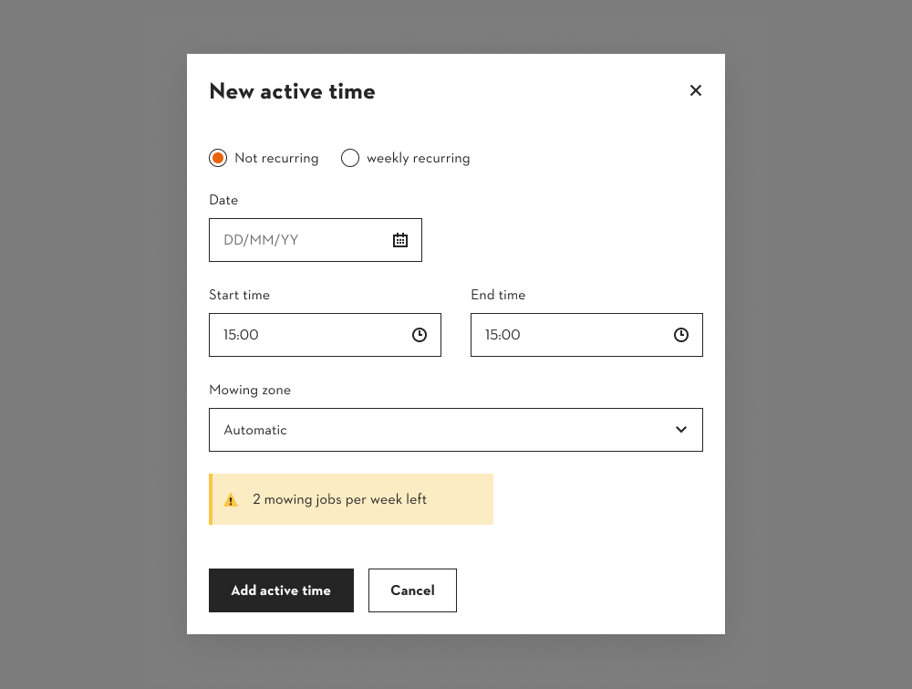

_Figure: Shows header-dialog (heading, close button, viewport=desktop); building-element-radio (label=Not recurring, label, type=label, state=enabled, checked=true, invalid=false); input-medium (system feedback, hint=Lorem ipsum dolor sit amet, consectetur adipiscing elit. Cras nunc amet mauris turpis magna. Quisque ut mi rhoncus eget., placeholder, input=Input, function, label=Date, size=medium, state=enabled, invalid=false); input-medium (system feedback, hint=Lorem ipsum dolor sit amet, consectetur adipiscing elit. Cras nunc amet mauris turpis magna. Quisque ut mi rhoncus eget., input=15:00, function, label=Start time, input, size=medium, state=enabled, invalid=false); input-medium (system feedback, hint=Lorem ipsum dolor sit amet, consectetur adipiscing elit. Cras nunc amet mauris turpis magna. Quisque ut mi rhoncus eget., input=15:00, function, label=End time, input, size=medium, state=enabled, invalid=false); select (label, input, state=enabled, invalid=false, size=medium); notification (type=warning, icon=True); footer-dialog (first button, second button, viewport=desktop, direction=horizontal, primary position=left). Text in the figure: "New active time", "Not recurring", "weekly recurring", "Date", "DD/MM/YY", "Start time", "15:00", "End time", "Mowing zone", "Automatic", "2 mowing jobs per week left", "Add active time", "Cancel"._

### Common use cases

- Confirmation
- Form to add/edit objects
- Information purposes
- Selection purposes

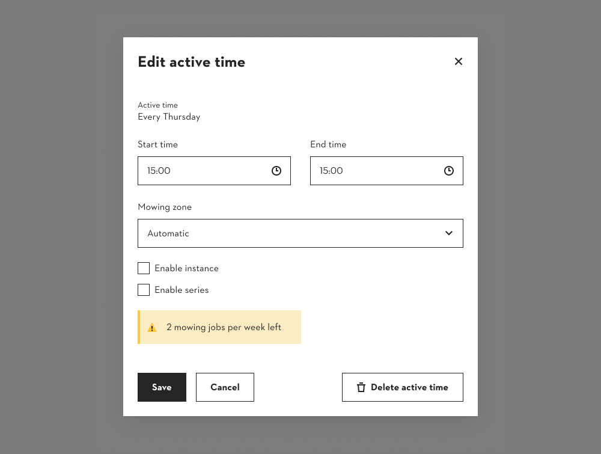

_Figure: Shows header-dialog (heading, close button, viewport=desktop); example\_component\_dialog (Property 1=Default); footer-dialog (first button, second button, third button, viewport=desktop, direction=horizontal, primary position=left). Text in the figure: "Edit active time", "Active time Every Thursday", "Start time", "15:00", "End time", "Mowing zone", "Automatic", "Enable instance", "Enable series", "2 mowing jobs per week left", "Save", "Cancel", "Delete active time"._

### Immediate response

Dialog component is ideal for:

- Immediate response required
- Confirmation for destructive actions
- Quick interactions

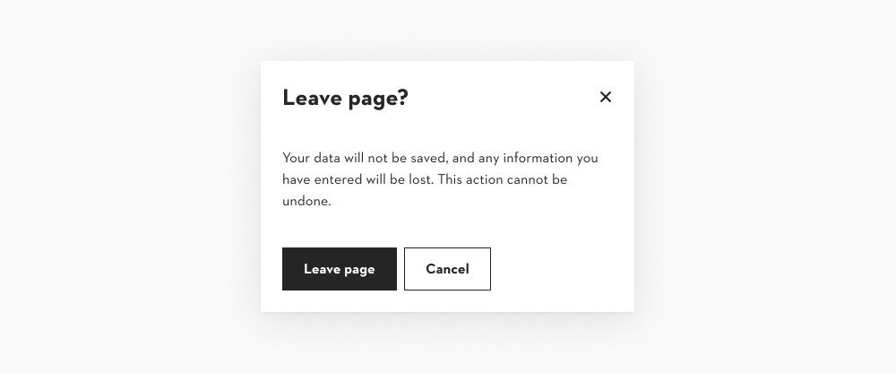

_Figure: Shows header-dialog (heading, close button, viewport=desktop); placeholder: text + image; footer-dialog (first button, third button, viewport=desktop, direction=horizontal, primary position=left). Text in the figure: "Leave page?", "Your data will not be saved, and any information you have entered will be los...", "Leave page", "Cancel"._

### Recommendations for mobile

1. Short copy in forms
1. Optimized and tested content

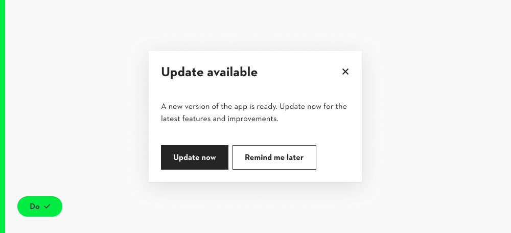

_Figure: Do example. Shows header-dialog (heading, close button, viewport=desktop); placeholder: text + image; footer-dialog (first button, third button, viewport=desktop, direction=horizontal, primary position=left). Text in the figure: "Update available", "A new version of the app is ready. Update now for the latest features and imp...", "Update now", "Remind me later"._

### Warning for mobile

1. Avoid scrolling, if possible
1. Avoid small touch targets: Inline links that are placed too close together
1. Avoid data-heavy tasks that might slowly load.

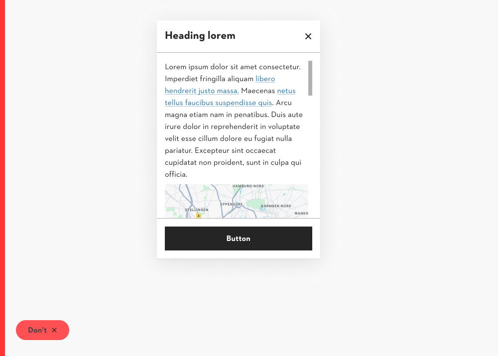

_Figure: Don't example. Shows header-dialog (heading, close button, viewport=mobile); footer-dialog (first button, viewport=mobile, direction=vertical, primary position=left). Text in the figure: "Heading lorem", "Lorem ipsum dolor sit amet consectetur. Imperdiet fringilla aliquam libero he...", "Button"._

## Building elements

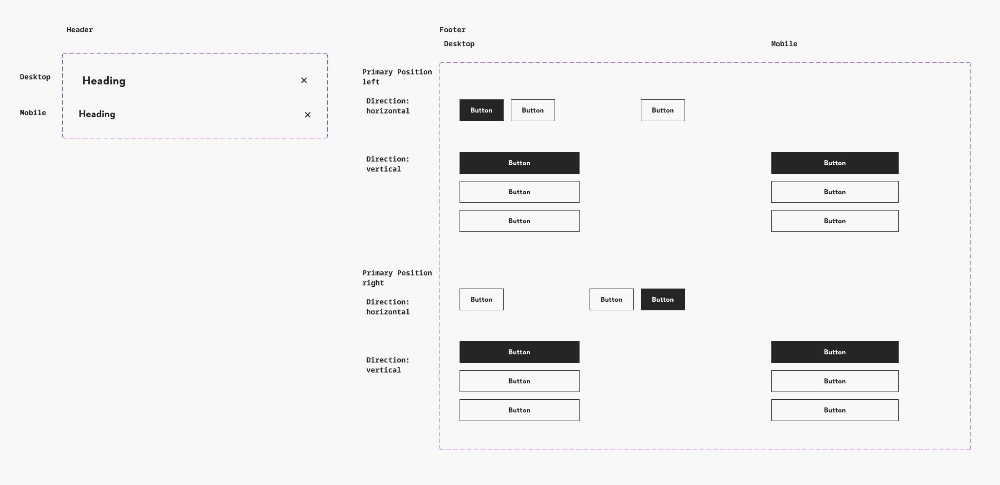

_Figure: Shows Button (button text=Button, variant=ghost, state=enabled, size=small, icon position=none, hide label=on, flush alignment=off); primary (button text=Button, variant=filled, state=enabled, size=medium, icon position=none, hide label=off, flush alignment=off); secondary (button text=Button, variant=outline, state=enabled, size=medium, icon position=none, hide label=off, flush alignment=off). Text in the figure: "Header", "Footer", "Desktop", "Mobile", "Heading", "Button", "Primary Position left", "Direction: horizontal", "Direction: vertical", "Primary Position right"._

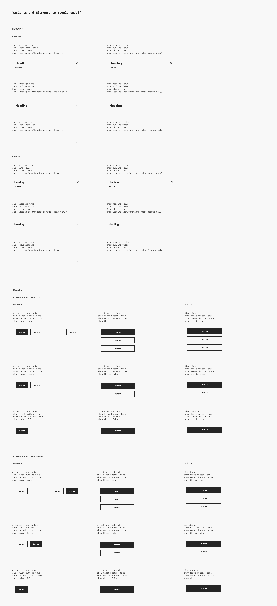

_Figure: Shows header-dialog (heading, subline, close button, viewport=desktop); header-dialog (heading, close button, viewport=desktop); header-dialog (close button, viewport=desktop); header-dialog (heading, subline, close button, viewport=mobile); header-dialog (heading, close button, viewport=mobile); header-dialog (close button, viewport=mobile); footer-dialog (first button, second button, third button, viewport=desktop, direction=horizontal, primary position=left); footer-dialog (first button, second button, third button, viewport=desktop, direction=vertical, primary position=left); footer-dialog (first button, second button, third button, viewport=mobile, direction=vertical, primary position=left); footer-dialog (first button, second button, viewport=desktop, direction=horizontal, primary position=left); footer-dialog (first button, second button, viewport=desktop, direction=vertical, primary position=left); footer-dialog (first button, second button, viewport=mobile, direction=vertical, primary position=left). Text in the figure: "Variants and Elements to toggle on/off", "Header", "Desktop", "show heading: true show subheading: true Show close: true show leading icon/f...", "show heading: true show subline: true Show close: true show leading icon/func...", "Heading", "Subline", "show heading: true show subline:false Show close: true show leading icon/func...", "show heading: false show subhline:false Show close: true show leading icon/fu...", "show heading: false show subline:false Show close: true show leading icon/fun...", "Mobile", "show heading: true show line: true Show close: true show leading icon/functio...", "Footer", "Primary Position left", "direction: horizontal show first button: true show second button: true show t...", "direction: vertical show first button: true show second button: true show thi...", "direction: - show first button: true show second button: true show third: true", "Button", "direction: - show first button: true show second button: true show third: false", "direction: horizontal show first button: true show second button: false show...", "direction: vertical show first button: true show second button: false show th...", "direction: - show first button: true show second button: false show third: false", "Primary Position Right", "direction: - show first button: true show second button: false show third: true"._
