# Drawer

## Drawer

Overview:

- Common use cases are: main or secondary navigation (especially mobile).
- The drawer component is suited for secondary tasks in the user-flows (e.g. log-in, additional filter or additional information).
- The drawer width adjusts to the inserted content. The height is always 100%
- Consider placing the button close to the content, in case the custom content area is half filled.
- Content overflow: header area and footer area are sticky, while the content area is scrolls.
- Ensure a clear hierarchy between the headline and content, so that the user can navigate quickly and move on.
- When on mobile 4 or more buttons, use small buttons to leave more space for the content area.
- When the drawer opens, focus should be set to the first actionable element.

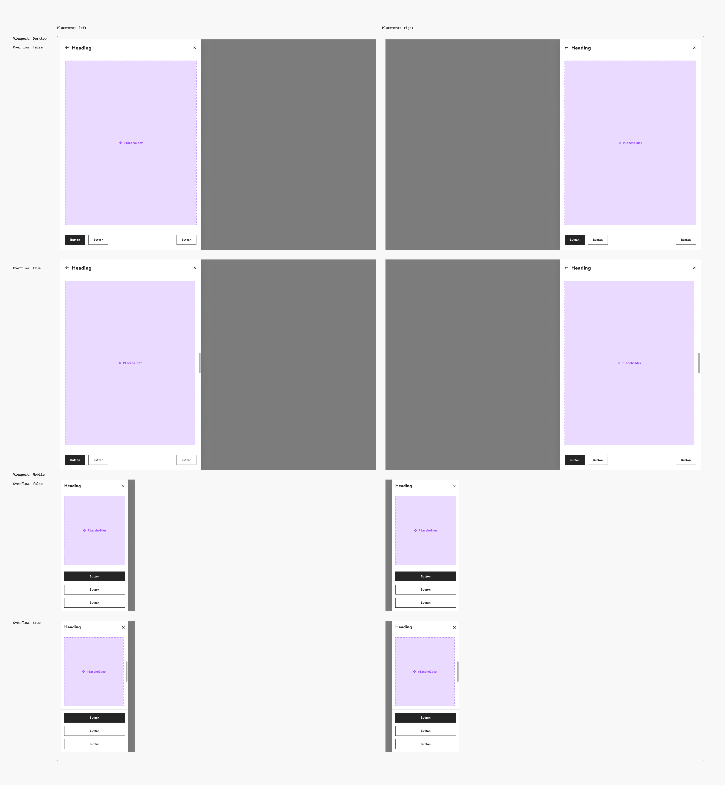

### Further guidelines

[Storybook documentation](https://main--63440bbb95889041542a5ba3.chromatic.com/?path=/docs/components-drawer--documentation)

### Related elements

[Iconography](https://www.figma.com/design/U218NNP4OsipaHOtv5flns/Iconography-%E2%9E%A1%EF%B8%8F?m=auto)

### Contribute

Contribute to improving this component by sharing your feedback, asking questions, or suggesting features [here](https://www.figma.com/design/lLmw7PfIdKjFG4uT3B2Hyj/Onboarding-%F0%9F%93%96?node-id=446-868&t=zKmRu4kAkxMeRDmK-4).

## Formatting and Construction

### Anatomy

#### Custom areas

1. **Custom header area (optional)**
1. **Custom content area**
1. **Custom footer area (optional)**
1. **Backdrop**

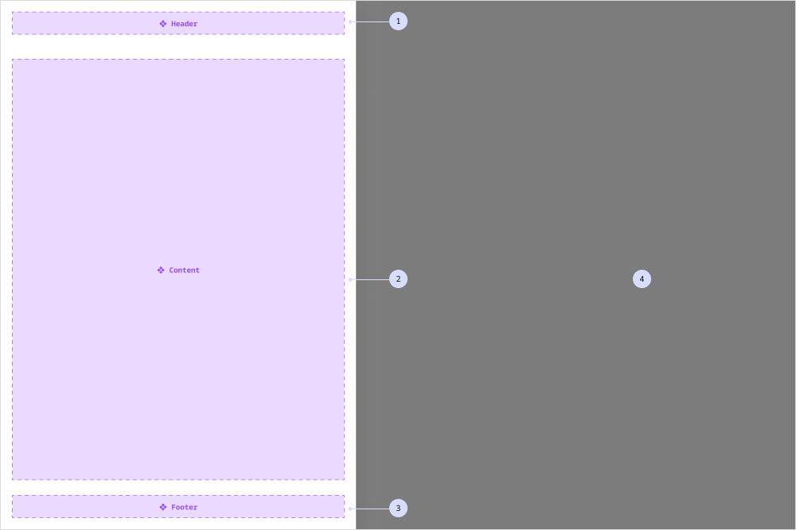

#### Figma component

Although technically a freely configurable slot, the figma components for **header area (1)** and **footer area (3)** provides a few options for common use case. The content area can be replaced with a **placeholder component (2)** that contain an additional text or image option.

Feel free to swap this with your own placeholder components or modules.

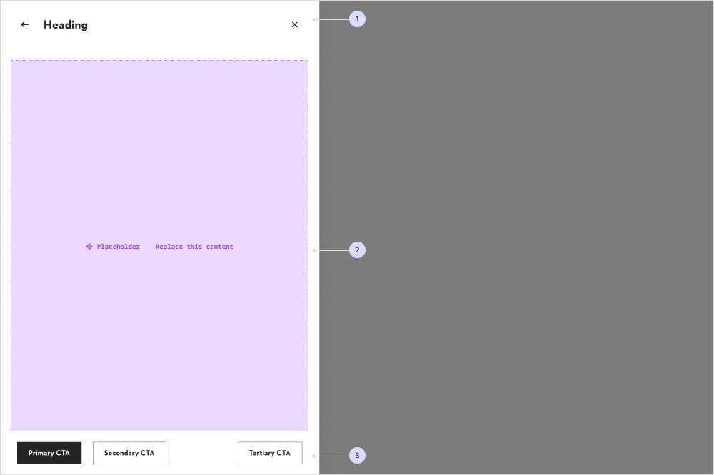

### Sizing

#### Minimum width

The drawer adjusts to the width of the inserted content. Minimum size ist based on the smallest viewport size: 272px

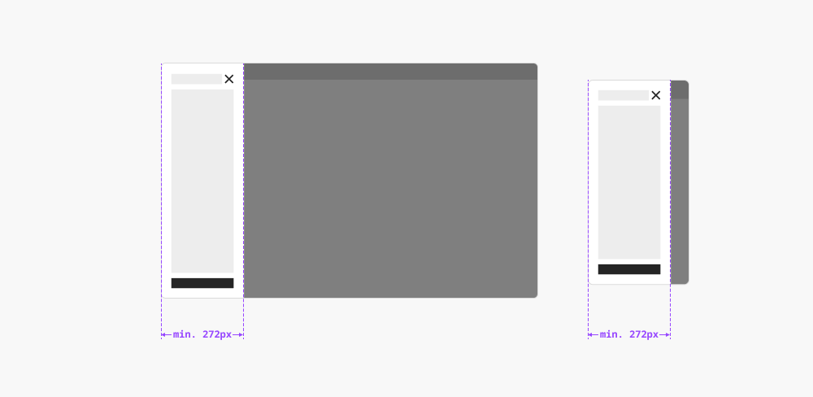

#### Maximum width

The drawer adjusts to the width of the inserted content. It can’t exceed the size of 1730px.

**Minimum space between browser edge and drawer, left or right:**

- On bigger screens (breakpoint m-xl) the distance is 80px.
- On smaller screens (breakpoint s) it is 32px.

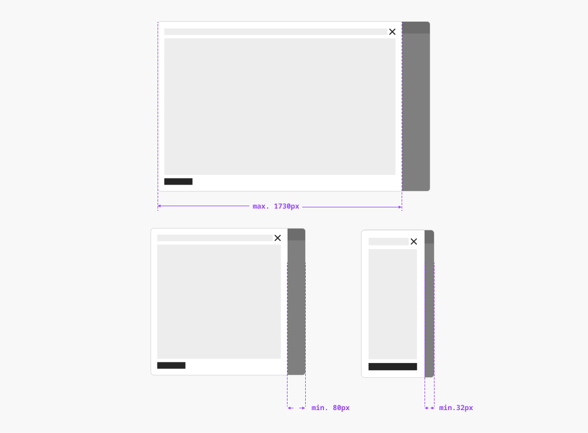

#### Width is dynamic, while opened

The width of the drawer does change to fit the content, in case more or less content becomes visible.

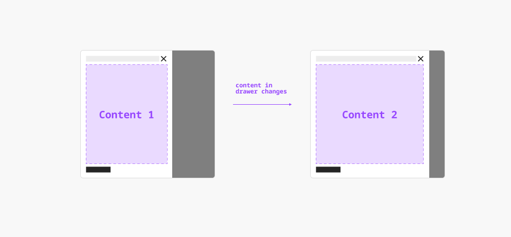

#### Aim for a consistent width, through content changes

By showing fewer transitions to the user, the user is less distracting.

Show deeper levels of the navigation in the same container of the drawer.

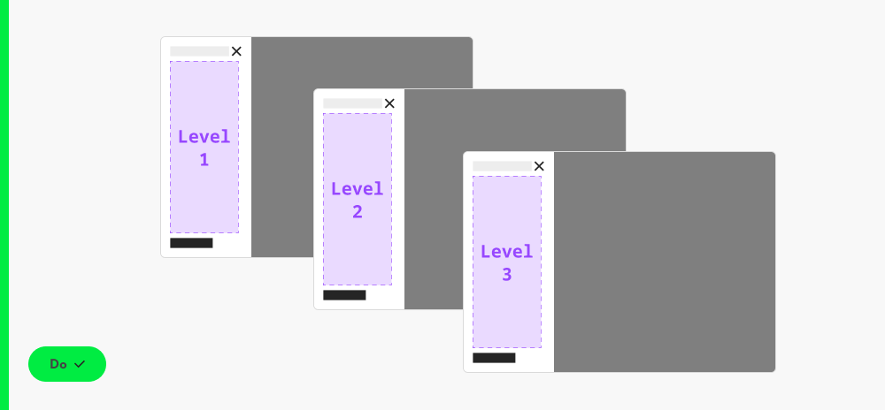

#### Drawers cover the full height of the screen

All sizes are cover the full height of the screen (100%)

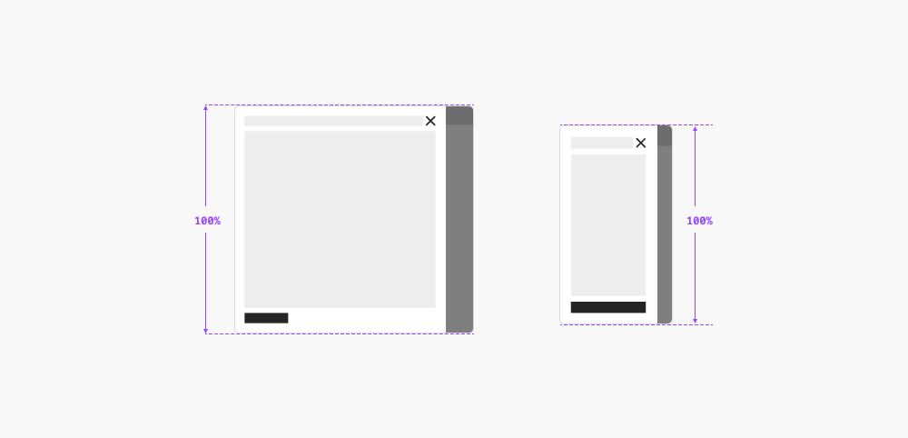

#### Content overflow

The content is scrollable, in case it exceeds the content area.

The header and footer area are fixed and sticky and gain an outline bottom/top

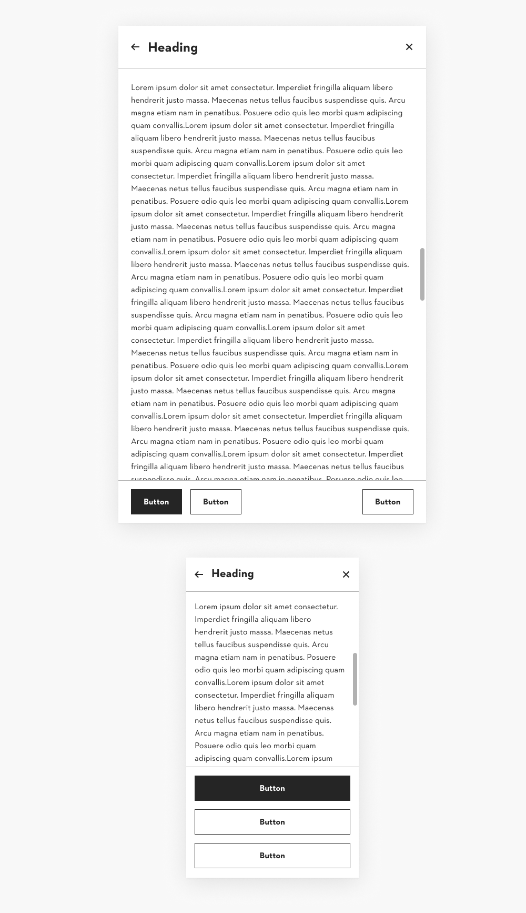

#### New page instead of a full-screen drawer

The drawer component cannot be full-screen. Place the content on it’s on page instead.

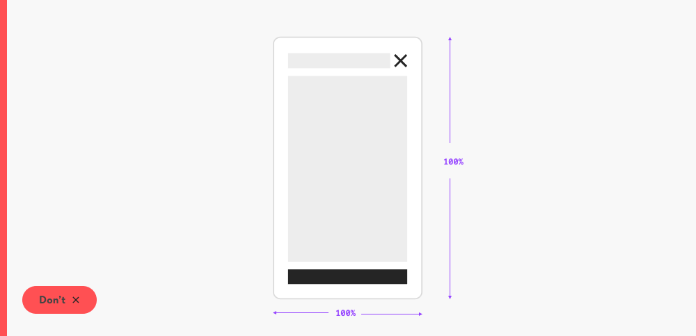

#### One drawer at a time

Don’t open multiple layers on top of each other

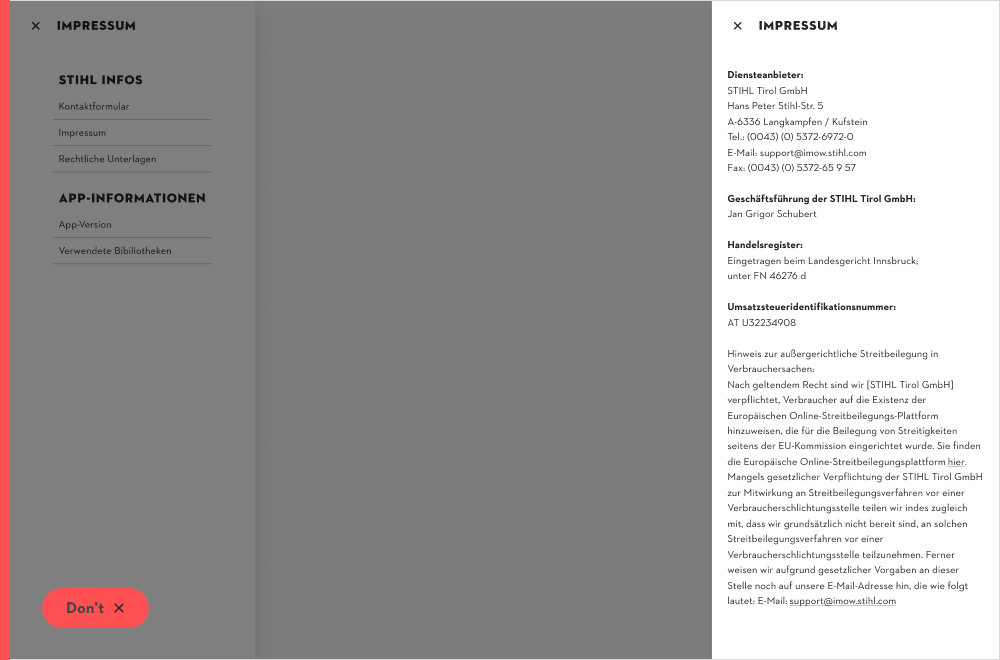

### Placement

#### Action and drawer relatedness

Depending on the position of the action, it feels more intuitive for the drawer to slide in from either the left or right side.

This is consistent with the real world and helps users predict the behavior of the interface, reducing the effort needed to understand interactions.

This follows the [heuristic from NN Group](https://www.nngroup.com/articles/match-system-real-world/) ‘Match Between the System & the Real World‘

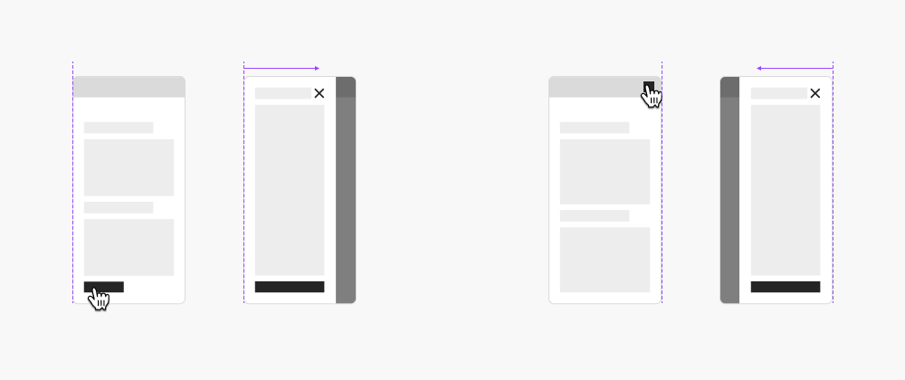

#### More than one drawer

If more than one drawer can be triggered in an interface, consider if they slide in from the same or from different sides.

- Same side: if the context of the task is connected.
- Different sides: clear distinction between the two task-flows.

**Note:** Though multiple drawers can be triggered in an interface, they are never opened at the same time.

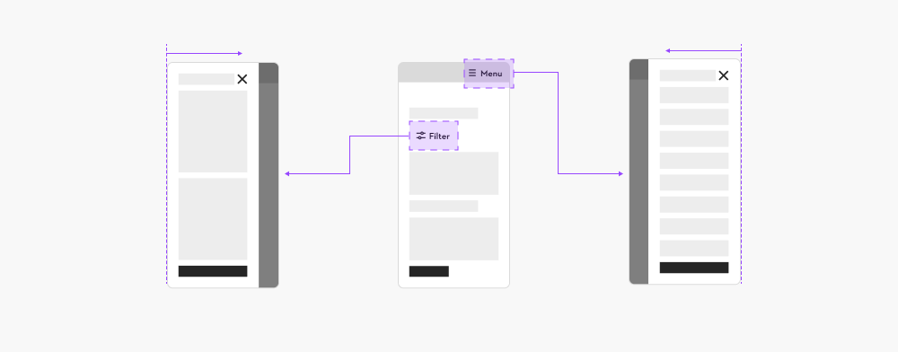

### Motion

#### Enter animation drawer

**Animation type:** move: from left or right **Duration:** 400ms **Easing:** motion-functional-ease-out

#### Backdrop dimming

**Animation type:** fade: opacity 0\>100% (color: black 50%) **Duration:** 400ms **Easing:** motion-functional-ease-out

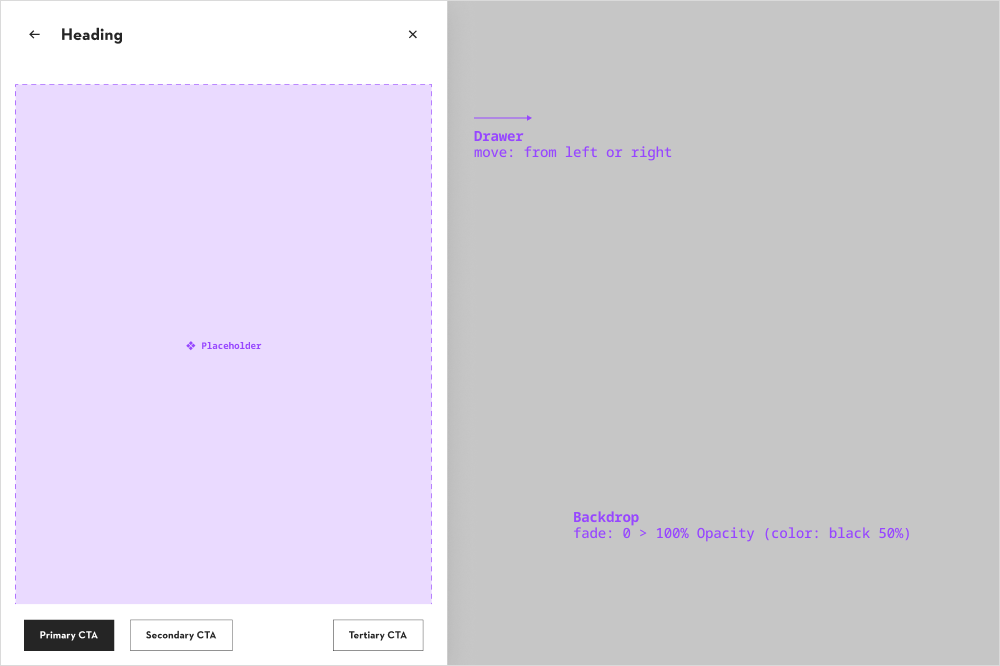

#### Exit animation drawer

**Animation type:** move: out to left or right **Duration:** 400ms **Easing:** motion-functional-ease-in

#### Backdrop dimming

**Animation type:** fade: opacity, 100\>0% (color black 50%) **Duration:** 400ms **Easing:** motion-functional-ease-in

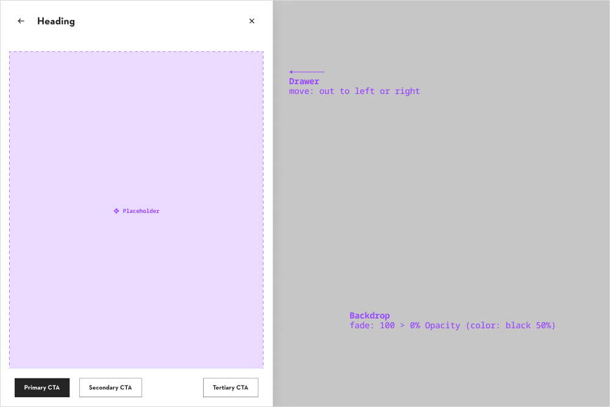

## Content

### Hierachy

In most cases the user-task in the drawer disturbs the user-flow. It is important to ensure a clear hierarchy, so that the user can navigate quickly and move on.

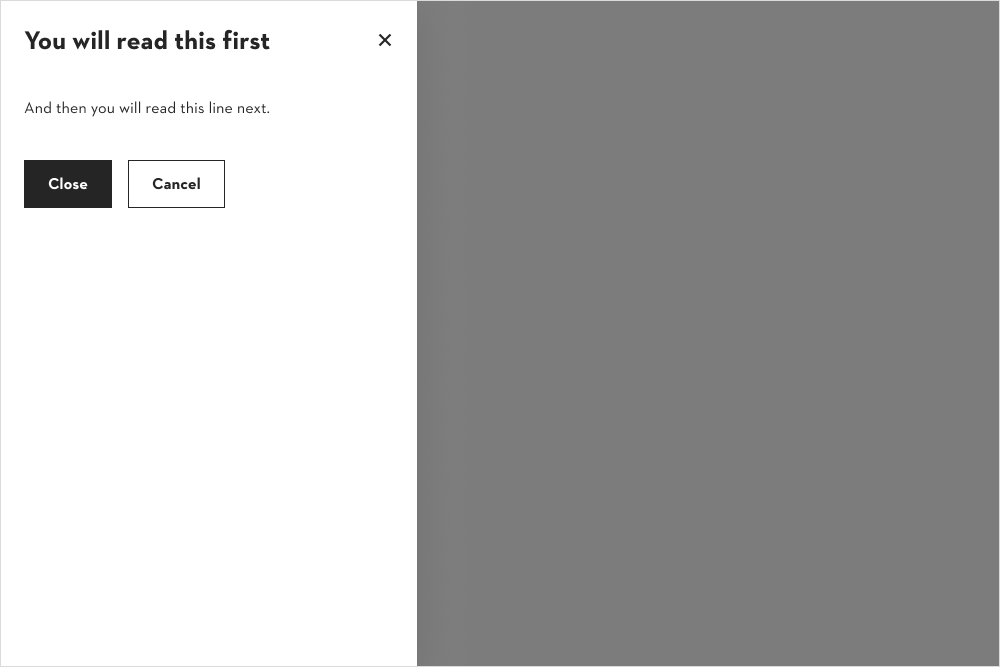

### Custom header area

#### Formatting examples

1. Heading L and topline, combined with a back button
1. Heading L, combined with a back button
1. [Title component ](https://www.figma.com/design/Ie2r0R9QwjEc7O3nrFbXhV/Web-Pattern-Library?node-id=7-19)is better suitable for impactful and emotional headers.

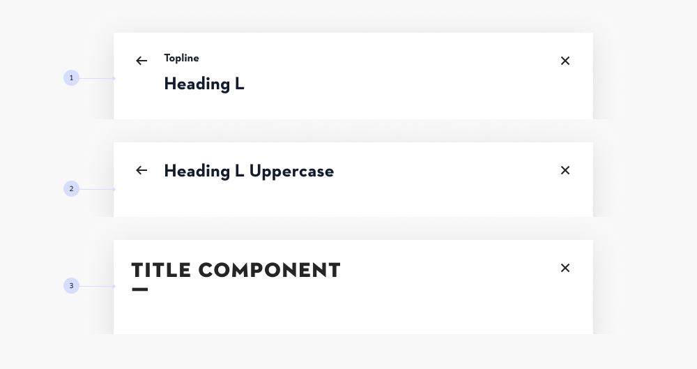

#### Formatting warning

Do not write full sentences in the header area.

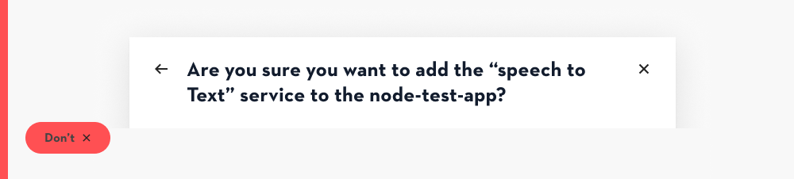

#### Topline conveys purpose

The topline explicitly references the page, feature title, or object to clearly convey the drawers purpose.

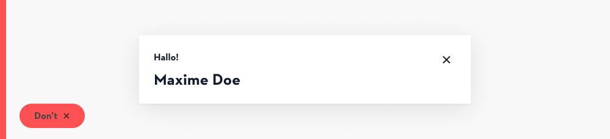

#### Header with ‘back’-link

Close icon on the right is preferred in both left and right placement.

#### Close icon placement

Close Icon on the right **(1)** is preferred in both left and right placement.

Close icon on the left **(2)** isn’t ideal, though acceptable.

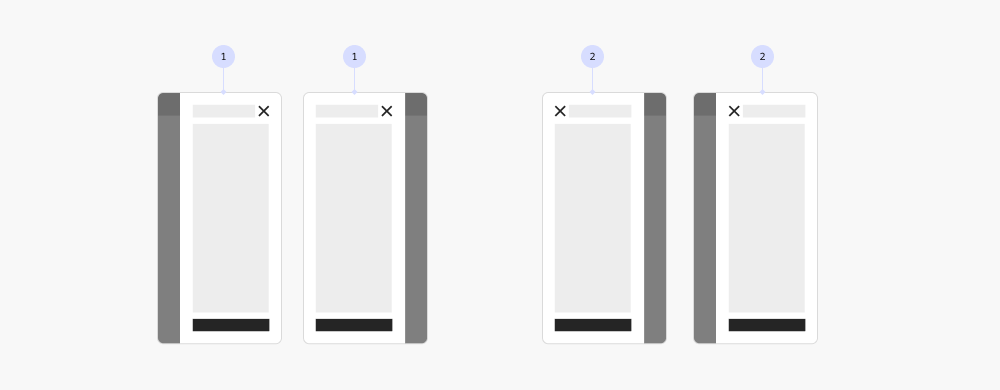

### Custom content area

#### Short content

Consider placing the button close to the content, in case the custom content area is half filled.

**Important:** Leave the footer area empty.

### Custom footer area

#### Footer area is optional

1. In some cases a close icon is sufficient.
1. In some cases the content is very short, place the button(s) closer to the content.

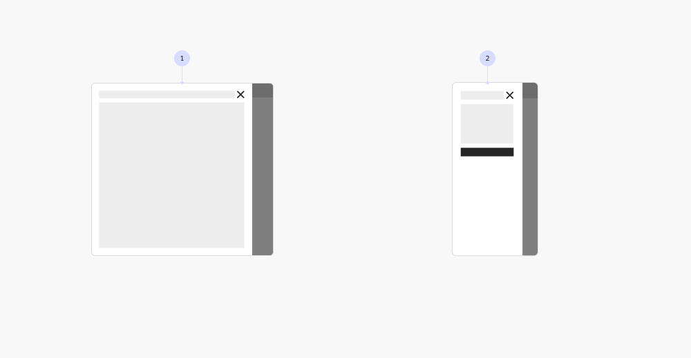

#### Button placement

Button placement recommendations depend on the use case, as well as the side the drawer appears from.

Check out the examples and variations on the last frame for some common use cases.

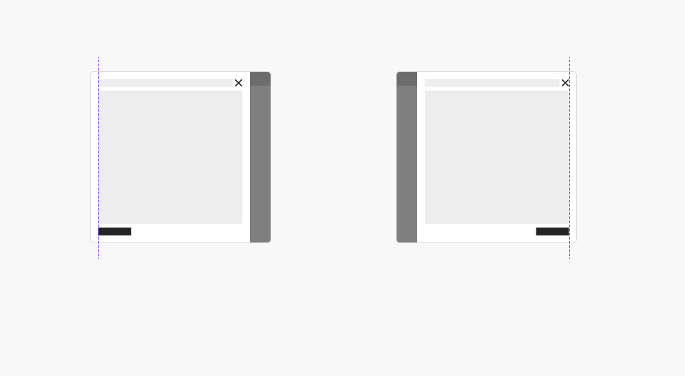

## Behavior

### Dismissed by the user

In case the user closes **(1)** the drawer, the exit animation is triggered immediately.

Closing the drawer by click on the dimmed backdrop **(2)** can be disabled, default is enabled.

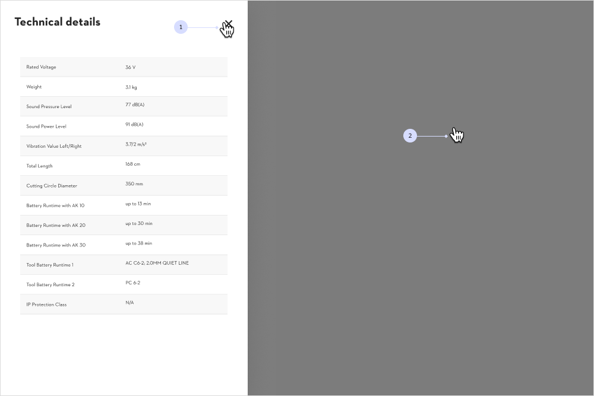

### Focus management

When the drawer opens, focus should be set to the first actionable element, typically the primary action button or the first input field.

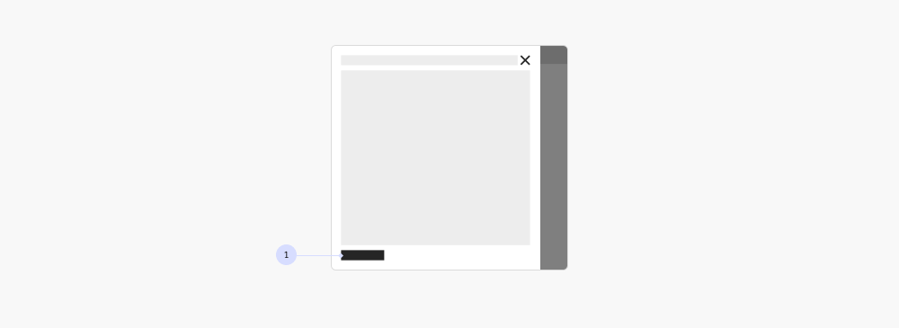

## Examples/Variants

### Navigation drill down

A drill down pattern is used, as the drawer maintains a specific width. This pattern works the same on mobile and desktop screens, therefore a common pattern that is easily learned by the user.

A drill down navigation allows users to progressively click through layers of information, starting broad and moving to specific content.

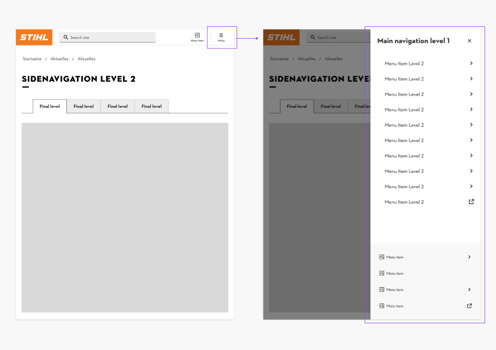

### Secondary flow

Use the drawer component for actions that are secondary to the user’s main task.

Examples are:

- Log-in (or any other type of identification)
- Additional filters
- Additional information

**Attention**: The user is limited inside a drawer. If a task is multifaceted, consider a link to a new page instead. Explore the efficiency of a complex user flow containing a drawer through usability testing.

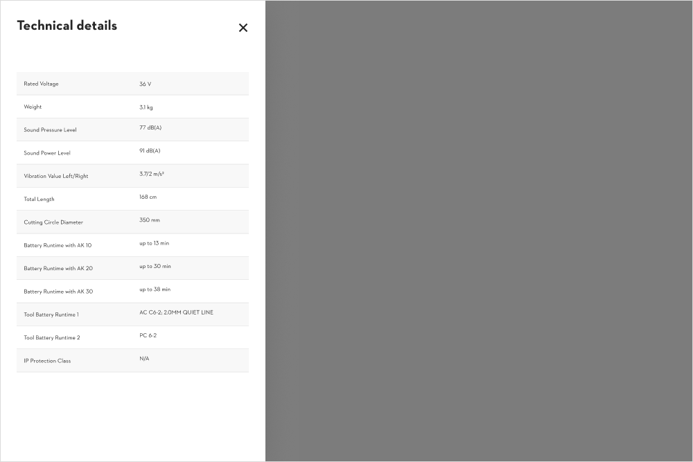

### Stepper navigation

A stepper navigation guides users through multi-step processes, showing progress with visual indicators, ensuring a user-friendly experience.

**Tip:** In order to visually distinguish the secondary navigation component, position the drawer to slide in from a different side than the main navigation.

**Note:** in this case the restart action is placed in the content area. Also, the header area is left empty.

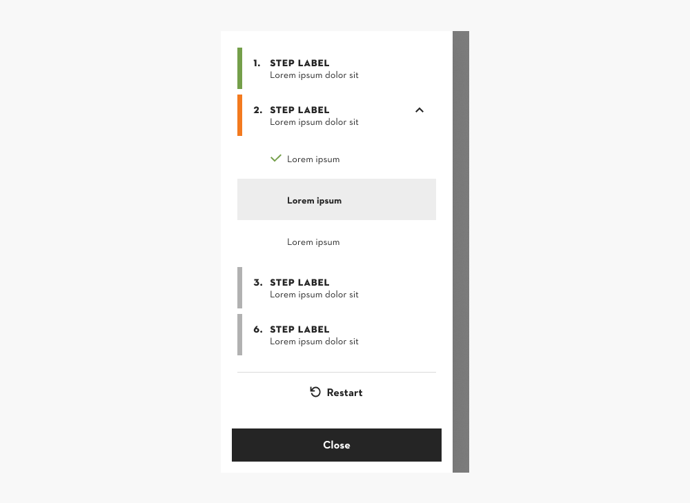

### Do not use for...

The drawer component is less suited for the use cases that are primary tasks.

- Creating objects
- Editing objects

Instead use a new page or [the dialog component.](https://www.figma.com/design/qXldpLO6gxHJNLdcXIPxYt?node-id=14115-4051)

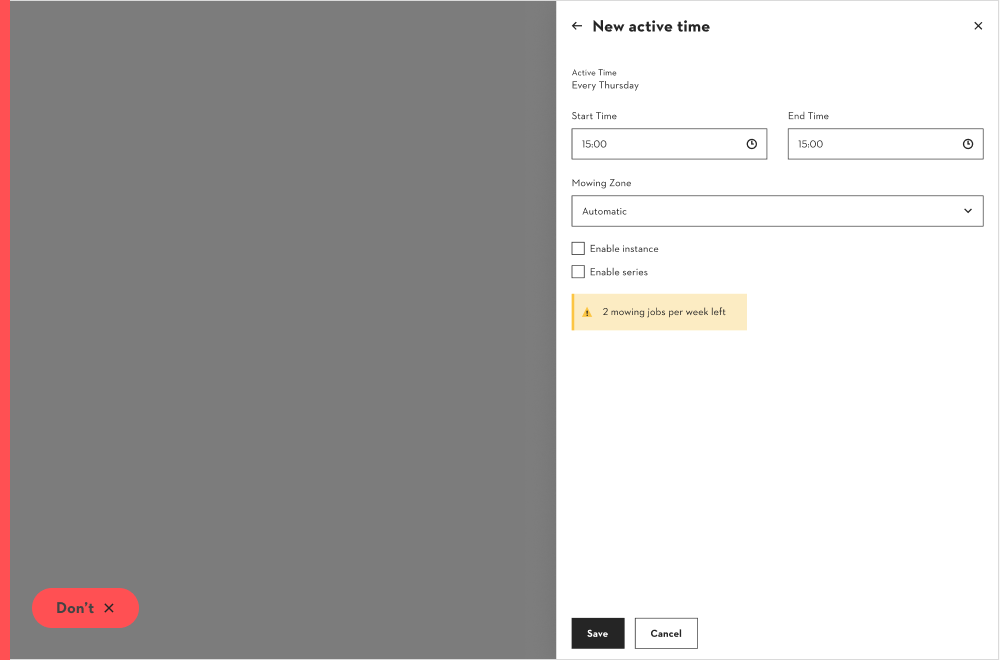

## Building elements

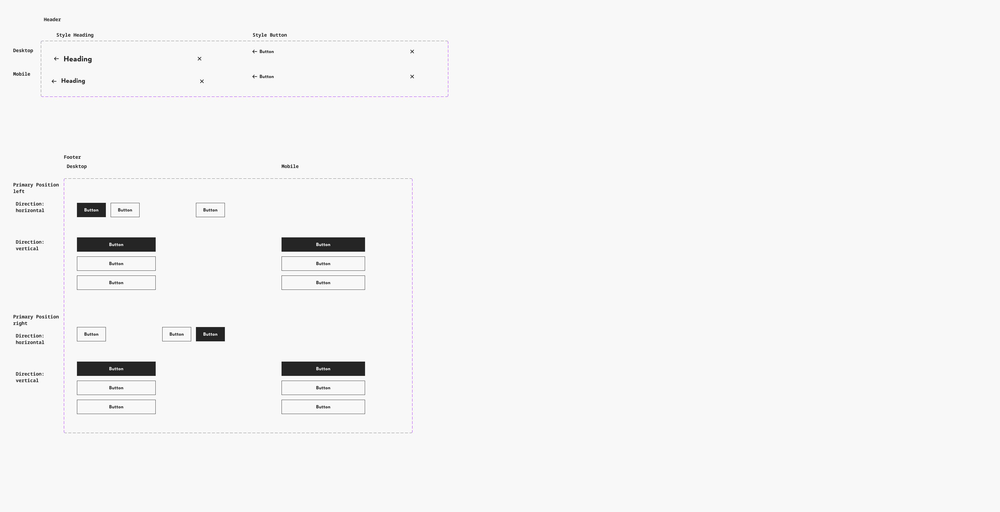

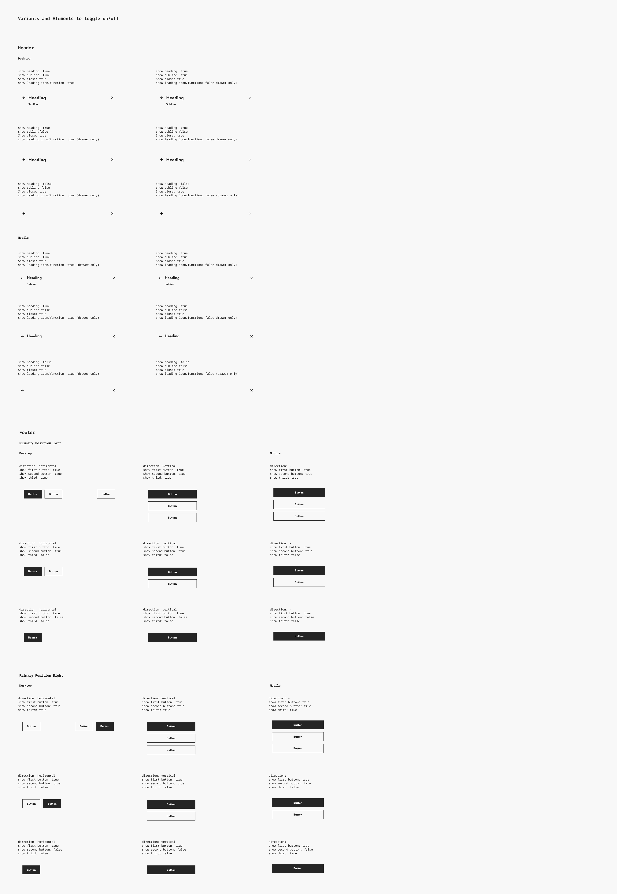
