# Drawer

## Drawer

Overview:

- Common use cases are: main or secondary navigation (especially mobile).
- The drawer component is suited for secondary tasks in the user-flows (e.g. log-in, additional filter or additional information).
- The drawer width adjusts to the inserted content. The height is always 100%
- Consider placing the button close to the content, in case the custom content area is half filled.
- Content overflow: header area and footer area are sticky, while the content area is scrolls.
- Ensure a clear hierarchy between the headline and content, so that the user can navigate quickly and move on.
- When on mobile 4 or more buttons, use small buttons to leave more space for the content area.
- When the drawer opens, focus should be set to the first actionable element.

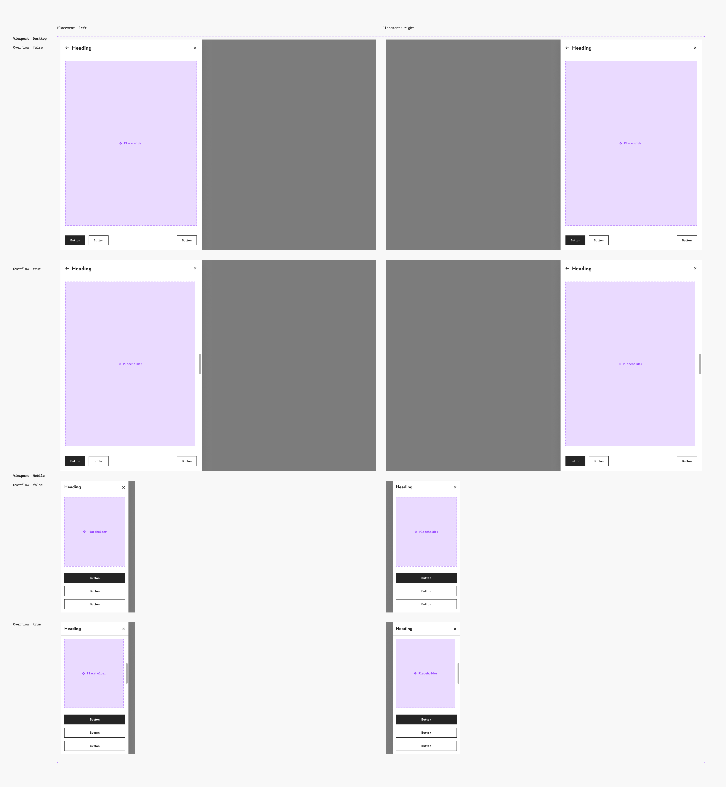

_Figure: The Drawer component in the STIHL Design System, displaying its variants and states for desktop and mobile viewports. It shows the Drawer with different placements (left and right), viewports (Desktop and Mobile), and overflow states (false and true). The Drawer includes a header-drawer with a heading, back button, close button, and a footer-drawer with buttons arranged horizontally on desktop and vertically on mobile. The width of the Drawer adjusts to the content, while the height is always 100%. The header area and footer area are sticky, allowing the content area to scroll if there is overflow..._

### Further guidelines

[Storybook documentation](https://main--63440bbb95889041542a5ba3.chromatic.com/?path=/docs/components-drawer--documentation)

### Related elements

[Iconography](https://www.figma.com/design/U218NNP4OsipaHOtv5flns/Iconography-%E2%9E%A1%EF%B8%8F?m=auto)

### Contribute

Contribute to improving this component by sharing your feedback, asking questions, or suggesting features [here](https://www.figma.com/design/lLmw7PfIdKjFG4uT3B2Hyj/Onboarding-%F0%9F%93%96?node-id=446-868&t=zKmRu4kAkxMeRDmK-4).

## Formatting and Construction

### Anatomy

#### Custom areas

1. **Custom header area (optional)**
1. **Custom content area**
1. **Custom footer area (optional)**
1. **Backdrop**

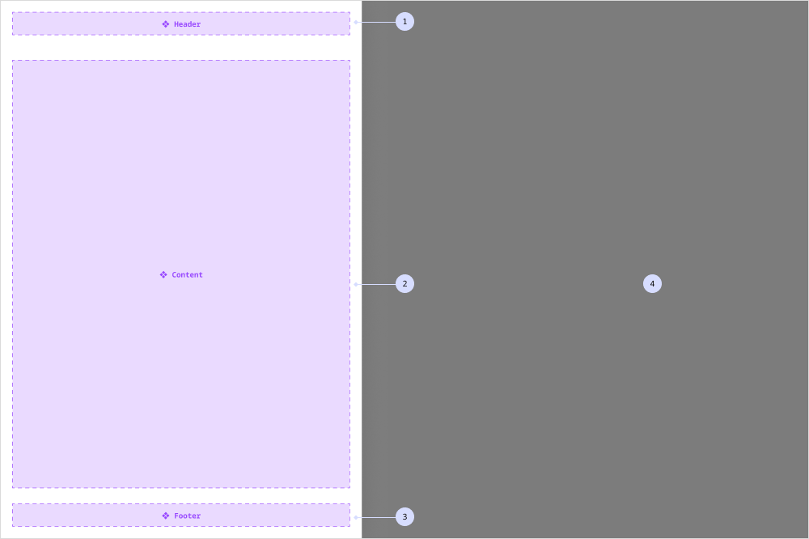

_Figure: A Drawer component with custom areas, showing the layout of a header, content, and footer within the drawer, along with a backdrop. The numbered callouts point to the following areas: 1 is the Custom header area, 2 is the Custom content area, 3 is the Custom footer area, and 4 is the Backdrop. The header and footer areas are optional, while the content area is mandatory._

#### Figma component

Although technically a freely configurable slot, the figma components for **header area (1)** and **footer area (3)** provides a few options for common use case. The content area can be replaced with a **placeholder component (2)** that contain an additional text or image option.

Feel free to swap this with your own placeholder components or modules.

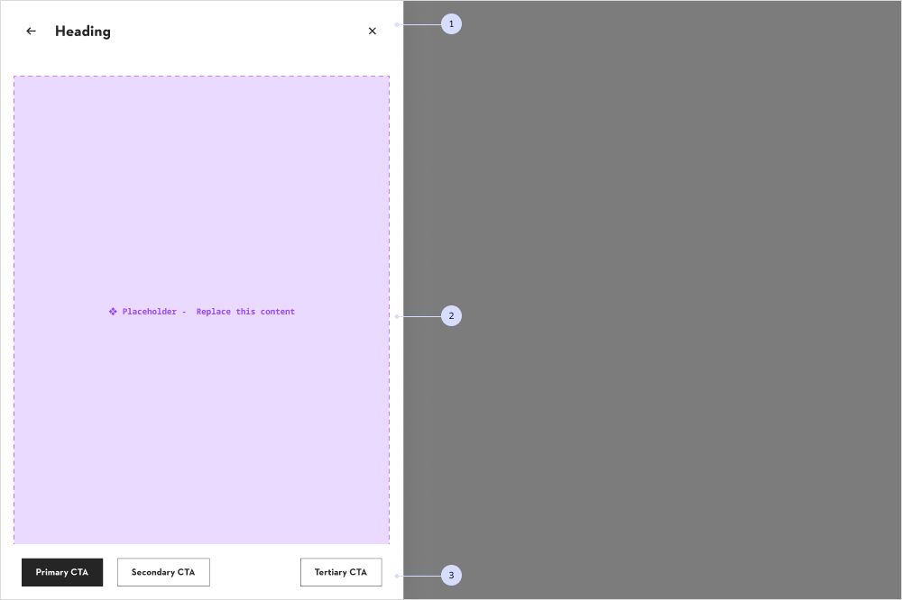

_Figure: A Drawer component with a header area, a content area, and a footer area. The header area, labeled as "Heading," is marked by callout 1. The content area, marked by callout 2, contains a placeholder component with the text "❖ Placeholder - Replace this content," and can be replaced with custom content. The footer area, marked by callout 3, includes three buttons: a "Primary CTA" button with a filled variant, a "Secondary CTA" button with an outline variant, and a "Tertiary CTA" button also with an outline variant. All buttons are enabled and of medium size._

### Sizing

#### Minimum width

The drawer adjusts to the width of the inserted content. Minimum size ist based on the smallest viewport size: 272px

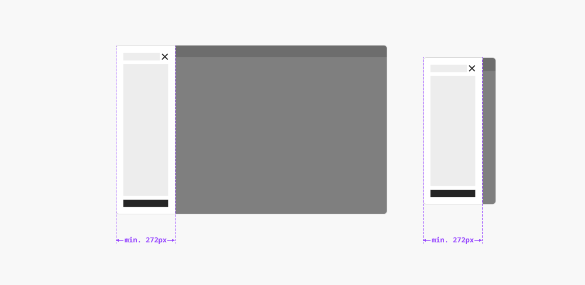

_Figure: The minimum width requirement for a Drawer component in a UI design system. The measurement of 272 pixels refers to the minimum width to which the drawer can adjust based on the smallest viewport size. The figure shows two variants of the Drawer component, one in a larger and one in a smaller viewport, both demonstrating the minimum width constraint._

#### Maximum width

The drawer adjusts to the width of the inserted content. It can’t exceed the size of 1730px.

**Minimum space between browser edge and drawer, left or right:**

- On bigger screens (breakpoint m-xl) the distance is 80px.
- On smaller screens (breakpoint s) it is 32px.

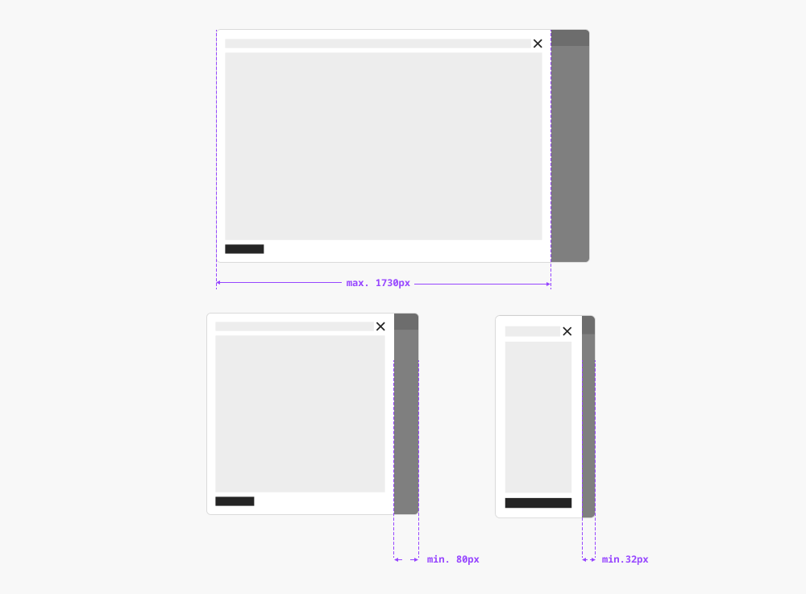

_Figure: The layout and width constraints of a drawer component in a UI design system. The maximum width of the drawer is 1730px, adjusting to the width of the inserted content without exceeding this size. The minimum space between the browser edge and the drawer is 80px on bigger screens and 32px on smaller screens._

#### Width is dynamic, while opened

The width of the drawer does change to fit the content, in case more or less content becomes visible.

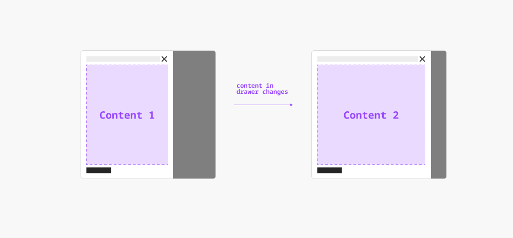

_Figure: A Drawer component in two states, demonstrating how its width adjusts dynamically based on the content displayed. The first state shows "Content 1" within the drawer, and the second state shows "Content 2," indicating that the drawer's width changes to fit the content when it is opened. The text "content in drawer changes" highlights this dynamic behavior._

#### Aim for a consistent width, through content changes

By showing fewer transitions to the user, the user is less distracting.

Show deeper levels of the navigation in the same container of the drawer.

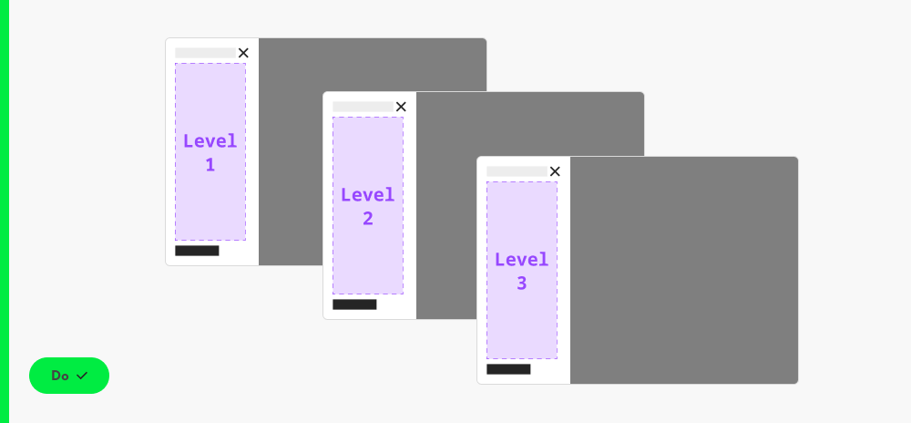

_Figure: A Drawer component with three levels of navigation, labeled "Level 1," "Level 2," and "Level 3," all within the same container. The example illustrates a consistent width across different levels of the drawer, aiming to reduce user distraction by minimizing transitions. This layout is marked as a "Do" example because it maintains a uniform width, enhancing user experience by showing deeper navigation levels within the same drawer container._

#### Drawers cover the full height of the screen

All sizes are cover the full height of the screen (100%)

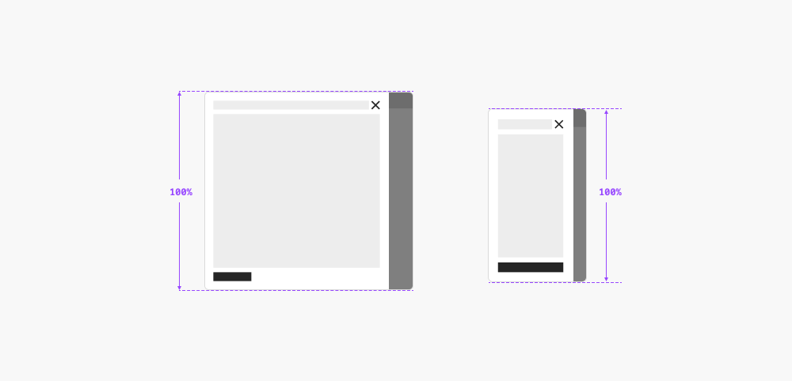

_Figure: A Drawer component that spans the full height of the screen in two different width variants. Each measurement labeled 100% indicates that the height of the drawer covers the entire height of the screen. The component includes a close button at the top right corner and a bar at the bottom, with the main content area in between._

#### Content overflow

The content is scrollable, in case it exceeds the content area.

The header and footer area are fixed and sticky and gain an outline bottom/top

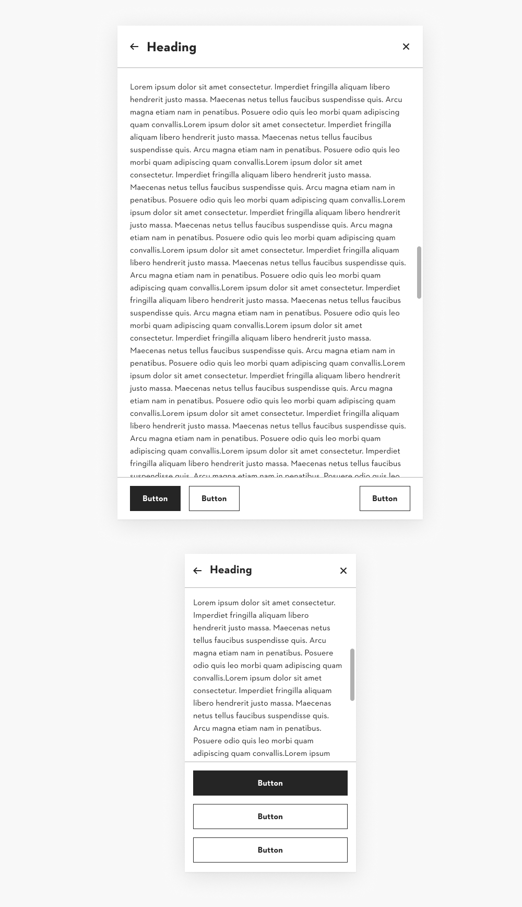

_Figure: The content overflow behavior of a drawer component in both desktop and mobile viewports. The header and footer areas are fixed and sticky, with an outline appearing at the bottom and top respectively when content overflows, making the content scrollable. The desktop variant shows a horizontal footer-dialog with three buttons, while the mobile variant displays a vertical footer-dialog with the same buttons. The header-drawer includes a heading, back button, and close button in both viewports._

#### New page instead of a full-screen drawer

The drawer component cannot be full-screen. Place the content on it’s on page instead.

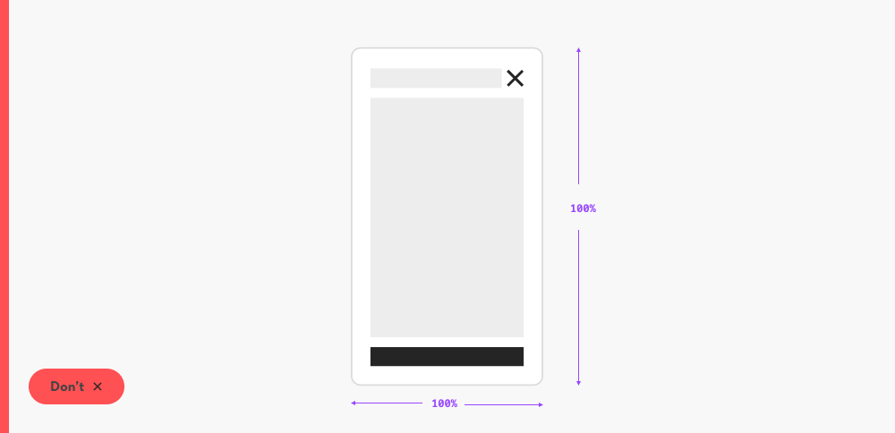

_Figure: A "Don't" example of a drawer component in a UI design system. It shows a full-screen drawer, which is marked as incorrect because the drawer component cannot be full-screen. The measurements labeled 100% refer to the width and height of the screen, indicating that the drawer occupies the entire screen area, which is not recommended._

#### One drawer at a time

Don’t open multiple layers on top of each other

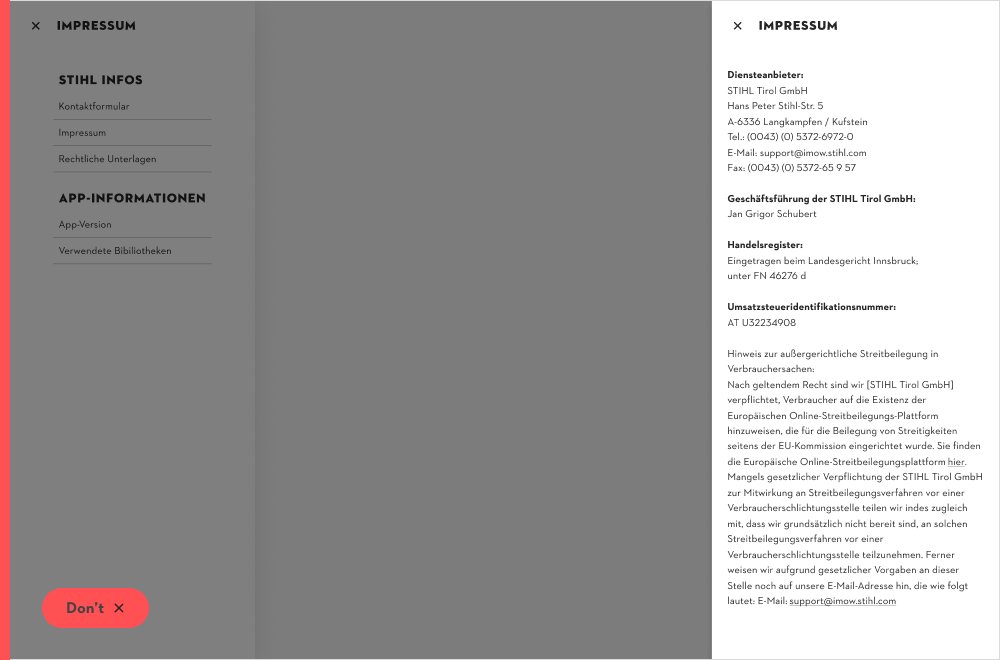

_Figure: A "Don't" example for using drawers in a UI design system, specifically the STIHL Design System. It shows a layout with a drawer open, containing a list of navigation items such as "STIHL Infos," "Kontaktformular," "Impressum," "Rechtliche Unterlagen," "App-Informationen," "App-Version," and "Verwendete Bibliotheken." The example is marked as incorrect because it demonstrates opening multiple layers on top of each other, which is not recommended. A small button labeled "Don't" with a red background and white text is visible, indicating the incorrect usage. The drawer includes detailed text under the heading "IMpressum," providing information such as the service provider details..._

### Placement

#### Action and drawer relatedness

Depending on the position of the action, it feels more intuitive for the drawer to slide in from either the left or right side.

This is consistent with the real world and helps users predict the behavior of the interface, reducing the effort needed to understand interactions.

This follows the [heuristic from NN Group](https://www.nngroup.com/articles/match-system-real-world/) ‘Match Between the System & the Real World‘

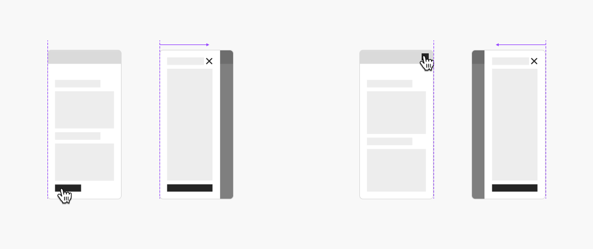

_Figure: A Drawer component with different action positions and their relatedness to the drawer's sliding direction. The measurements indicate the width of the drawer and the position of the action button. The first and fourth drawers slide from the right with the action button at the bottom right, while the second and third drawers slide from the left with the action button at the top left. This layout demonstrates how the position of the action influences the intuitive direction from which the drawer slides._

#### More than one drawer

If more than one drawer can be triggered in an interface, consider if they slide in from the same or from different sides.

- Same side: if the context of the task is connected.
- Different sides: clear distinction between the two task-flows.

**Note:** Though multiple drawers can be triggered in an interface, they are never opened at the same time.

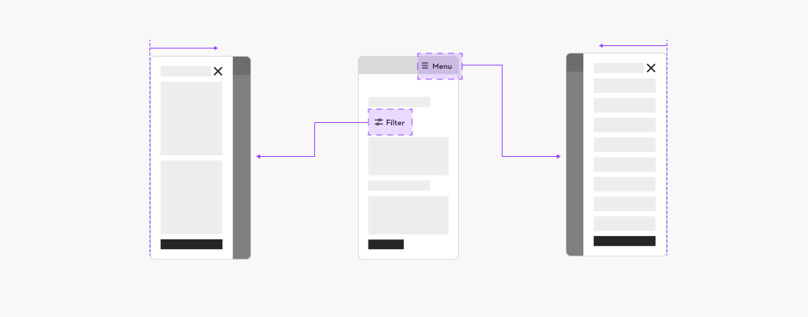

_Figure: The use of multiple drawers in a UI design system, specifically the STIHL Design System. It shows three mobile screens, each depicting different states of drawer interactions. The first screen shows a closed state with no drawers open. The second screen shows two drawers labeled "Menu" and "Filter" that can be triggered from the same side. The third screen shows a single drawer open from the opposite side. The figure demonstrates that drawers can slide in from the same side for connected tasks or from different sides for distinct task-flows, and notes that multiple drawers are never opened simultaneously._

### Motion

#### Enter animation drawer

**Animation type:** move: from left or right **Duration:** 400ms **Easing:** motion-functional-ease-out

#### Backdrop dimming

**Animation type:** fade: opacity 0\>100% (color: black 50%) **Duration:** 400ms **Easing:** motion-functional-ease-out

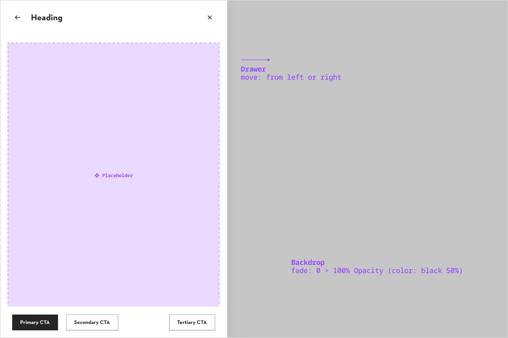

_Figure: A Drawer component with backdrop dimming. The backdrop fades from 0 to 100% opacity with a black color at 50% intensity over 400 milliseconds using motion-functional-ease-out easing. The layout includes a heading, a placeholder area, and three buttons labeled Primary CTA, Secondary CTA, and Tertiary CTA, each with specified variants and states. The Drawer moves from either the left or right, and the backdrop fades in as described._

#### Exit animation drawer

**Animation type:** move: out to left or right **Duration:** 400ms **Easing:** motion-functional-ease-in

#### Backdrop dimming

**Animation type:** fade: opacity, 100\>0% (color black 50%) **Duration:** 400ms **Easing:** motion-functional-ease-in

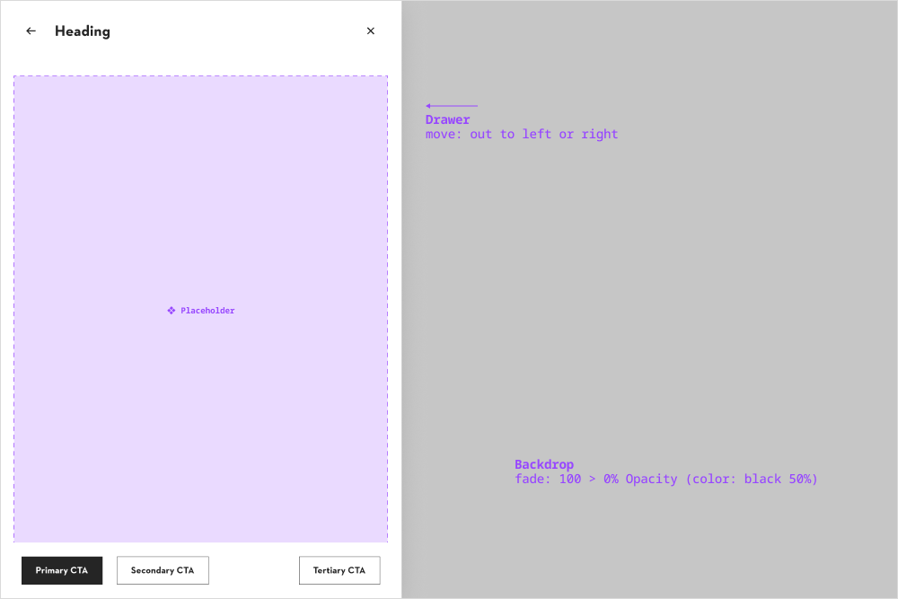

_Figure: A Drawer component with backdrop dimming, showing the drawer moving out to the left or right. The backdrop has a fade animation from 100% to 0% opacity with a black color at 50% intensity, lasting 400ms with motion-functional-ease-in easing. The layout includes a heading at the top, a placeholder area in the center, and three buttons at the bottom labeled Primary CTA, Secondary CTA, and Tertiary CTA, each with different variants and states. The Primary CTA button is filled, while the Secondary and Tertiary CTA buttons are outlined._

## Content

### Hierachy

In most cases the user-task in the drawer disturbs the user-flow. It is important to ensure a clear hierarchy, so that the user can navigate quickly and move on.

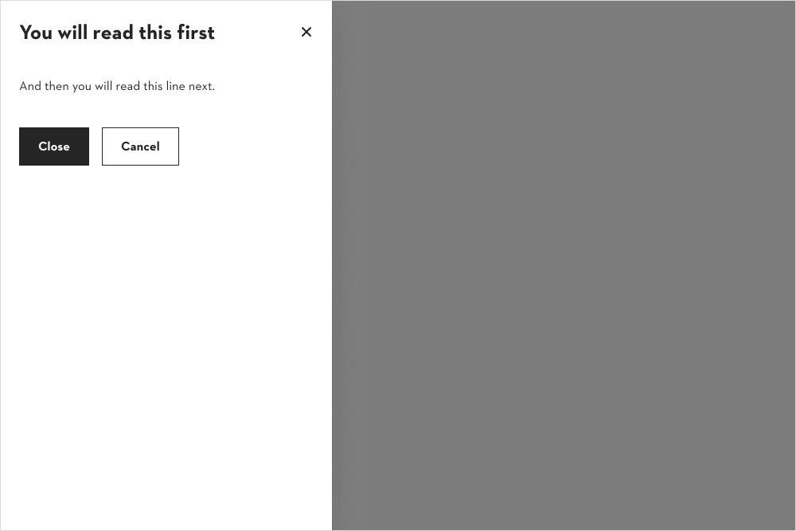

_Figure: A drawer component with a header-drawer containing a heading, a close button, and text. The header-drawer is followed by a placeholder with text and an image, and a footer-dialog with two buttons labeled "Close" and "Cancel" arranged horizontally, with the "Close" button in the primary position on the left. The text "You will read this first" is at the top, followed by "And then you will read this line next." The layout is for a desktop viewport._

### Custom header area

#### Formatting examples

1. Heading L and topline, combined with a back button
1. Heading L, combined with a back button
1. [Title component ](https://www.figma.com/design/Ie2r0R9QwjEc7O3nrFbXhV/Web-Pattern-Library?node-id=7-19)is better suitable for impactful and emotional headers.

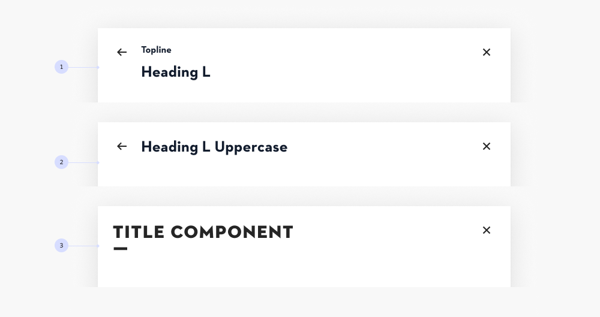

_Figure: Three formatting examples for headers within a drawer component. The first callout points to a combination of a "Topline" and "Heading L" with a back button. The second callout shows "Heading L Uppercase" combined with a back button. The third callout highlights a "Title component" suitable for impactful and emotional headers. Each example includes a small ghost variant back button on the left side and a close button on the right side._

#### Formatting warning

Do not write full sentences in the header area.

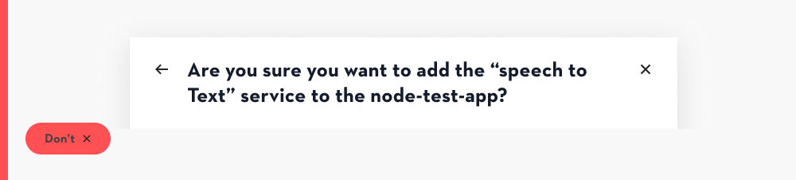

_Figure: A formatting warning for a drawer component in a UI design system. It shows a "Don't" example with a full sentence in the header area: "Are you sure you want to add the “speech to Text” service to the node-test-app?" The layout includes a highlighted button labeled "Don't" and a ghost button with an "x" icon for closing. There are also examples of primary, secondary, and tertiary call-to-action buttons, each with the variant filled, outline, and outline respectively, all in an enabled state and medium size. The text next to the figure advises not to write full sentences in the header area._

#### Topline conveys purpose

The topline explicitly references the page, feature title, or object to clearly convey the drawers purpose.

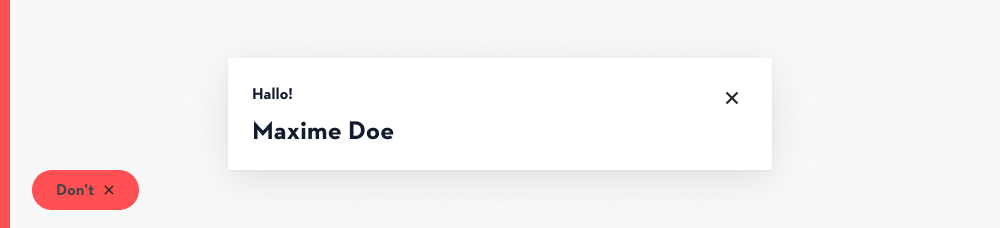

_Figure: A "Drawer" component marked as a "Don't" example. It includes a topline with the text "Hallo!" and "Maxime Doe," and a small ghost button with an "X" icon. The example is incorrect because the topline does not clearly convey the drawer's purpose, as it uses informal language and a name instead of a specific page, feature title, or object._

#### Header with ‘back’-link

Close icon on the right is preferred in both left and right placement.

_Figure: A header-drawer component variant for desktop viewports, styled with a heading. It includes a heading text labeled "Heading," a back button on the left, and a close button on the right. The text next to the figure specifies that the close icon on the right is preferred regardless of the drawer's placement._

#### Close icon placement

Close Icon on the right **(1)** is preferred in both left and right placement.

Close icon on the left **(2)** isn’t ideal, though acceptable.

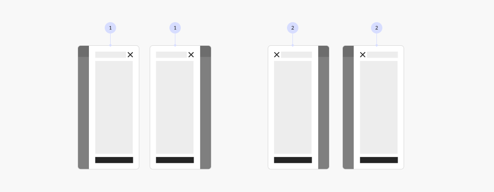

_Figure: A Drawer component with different Close icon placements. Callout 1 points to drawers with the Close icon on the right, which is the preferred placement for both left and right drawers. Callout 2 points to drawers with the Close icon on the left, which is not ideal but acceptable._

### Custom content area

#### Short content

Consider placing the button close to the content, in case the custom content area is half filled.

**Important:** Leave the footer area empty.

_Figure: A Drawer component with short content, illustrating the layout for when the custom content area is half filled. The button is placed close to the content, and the footer area is left empty as specified. The component includes a close button at the top right corner and a horizontal bar within the content area._

### Custom footer area

#### Footer area is optional

1. In some cases a close icon is sufficient.
1. In some cases the content is very short, place the button(s) closer to the content.

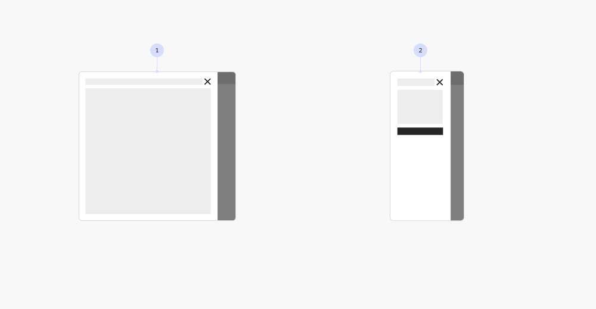

_Figure: Two variants of a Drawer component, illustrating the optional footer area. Callout 1 points to a Drawer with only a close icon and no footer area, indicating that in some cases a close icon is sufficient. Callout 2 points to a Drawer with a short content area and a button placed closer to the content, demonstrating that when the content is very short, the button can be positioned nearer to it._

#### Button placement

Button placement recommendations depend on the use case, as well as the side the drawer appears from.

Check out the examples and variations on the last frame for some common use cases.

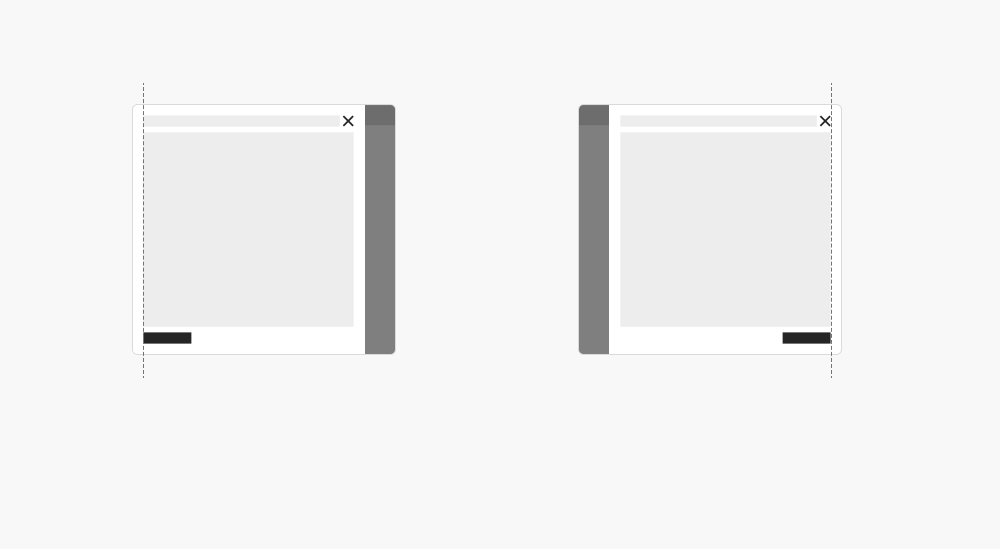

_Figure: Two variants of a Drawer component, illustrating different button placements based on the side from which the drawer appears. The left example shows a drawer opening from the right with a close button positioned at the top right corner and a secondary button at the bottom left. The right example shows a drawer opening from the left with a close button at the top right corner and a secondary button at the bottom right. The dashed purple lines indicate the boundaries of the drawer components._

## Behavior

### Dismissed by the user

In case the user closes **(1)** the drawer, the exit animation is triggered immediately.

Closing the drawer by click on the dimmed backdrop **(2)** can be disabled, default is enabled.

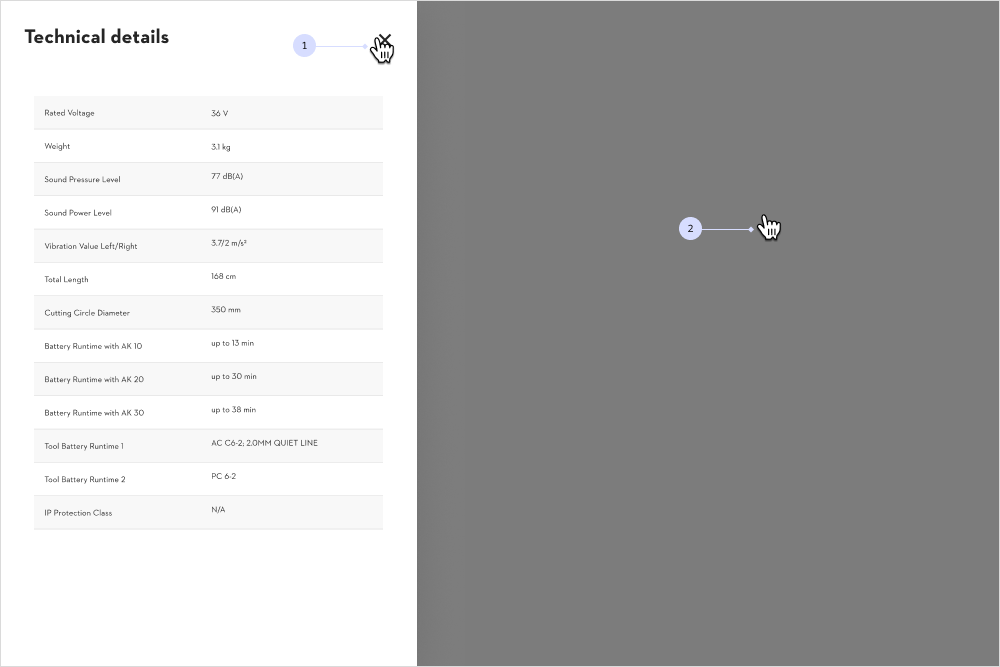

_Figure: A header-drawer component in the desktop viewport, displaying technical details with various specifications such as Rated Voltage, Weight, Sound Pressure Level, and others. The numbered callout 1 points to a close button in the header-drawer, which triggers an exit animation when clicked. The numbered callout 2 points to a dimmed backdrop, which can be clicked to close the drawer, although this feature can be disabled. The technical details include measurements like 36 V for Rated Voltage, 3.1 kg for Weight, 77 dB(A) for Sound Pressure Level, and so on._

### Focus management

When the drawer opens, focus should be set to the first actionable element, typically the primary action button or the first input field.

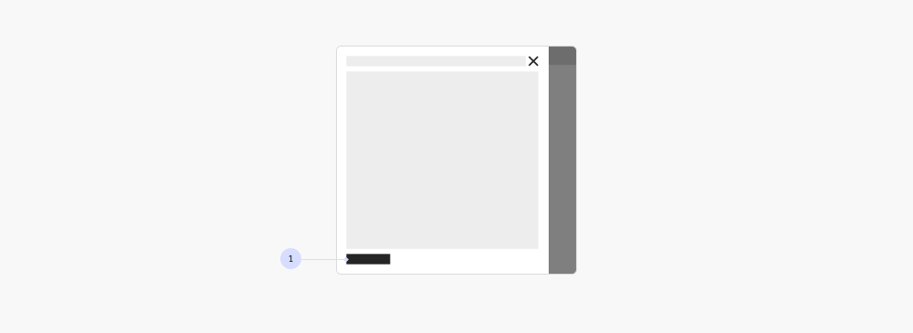

_Figure: A Drawer component in its open state, with a focus indicator on the first actionable element. The focus indicator is a blue circle with a white "i" inside, pointing to a black bar, which represents the first actionable element within the drawer. Numbered callout 1 points to this focus indicator, illustrating the focus management when the drawer opens._

## Examples/Variants

### Navigation drill down

A drill down pattern is used, as the drawer maintains a specific width. This pattern works the same on mobile and desktop screens, therefore a common pattern that is easily learned by the user.

A drill down navigation allows users to progressively click through layers of information, starting broad and moving to specific content.

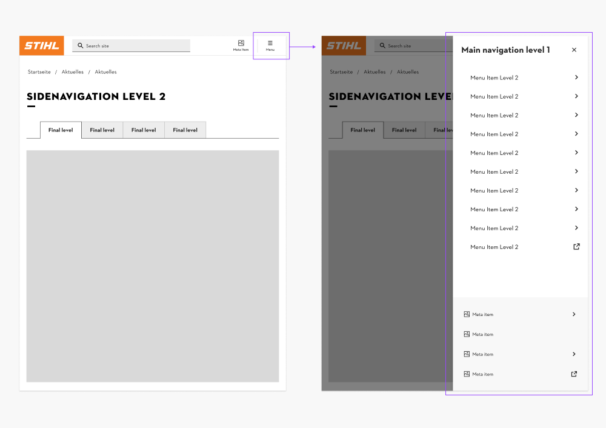

_Figure: Navigation drill down: a web page with a STIHL header, search field, "Meta Item" and "Menu" button is shown on the left. An arrow from the highlighted "Menu" button leads to the same page dimmed behind an open drawer on the right, titled "Main navigation level 1" with a close icon, a list of ten "Menu Item Level 2" entries (nine with a right chevron for drilling deeper, the last with an external link icon) and a footer area with four "Meta item" entries (two with chevrons, one with an external link icon, one plain)._

### Secondary flow

Use the drawer component for actions that are secondary to the user’s main task.

Examples are:

- Log-in (or any other type of identification)
- Additional filters
- Additional information

**Attention**: The user is limited inside a drawer. If a task is multifaceted, consider a link to a new page instead. Explore the efficiency of a complex user flow containing a drawer through usability testing.

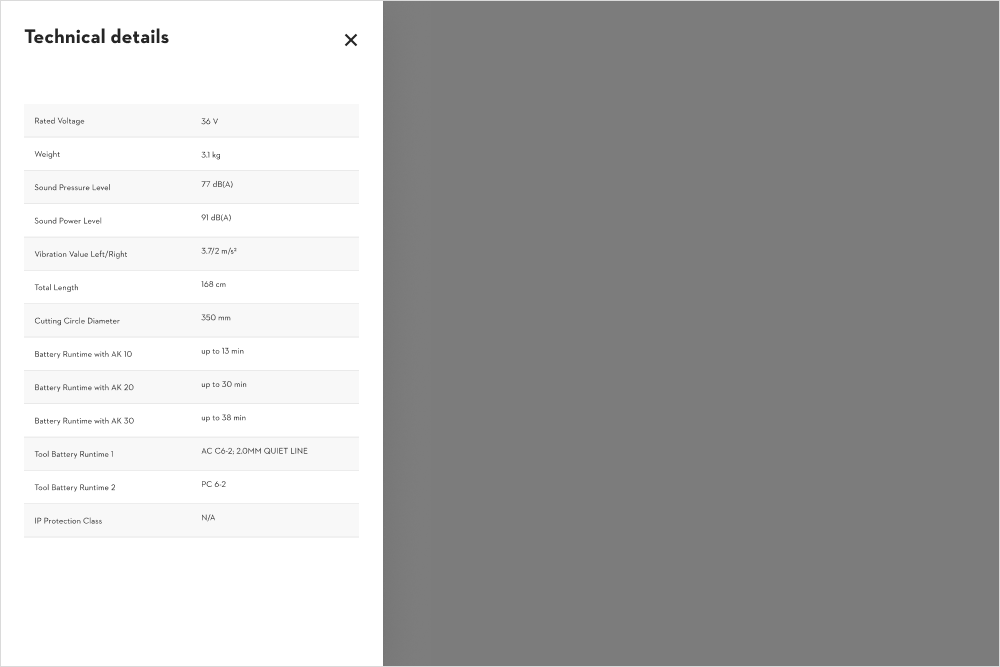

_Figure: A drawer component used for secondary actions, such as showing additional information. It includes a header with the title "Technical details" and a close button, followed by a list of technical specifications. Each specification is a link in the default variant, highlighted and enabled, without an icon. The measurements provided are: Rated Voltage is 36 V, Weight is 3.1 kg, Sound Pressure Level is 77 dB(A), Sound Power Level is 91 dB(A), Vibration Value Left/Right is 3.7/2 m/s², Total Length is 168 cm, Cutting Circle Diameter is 350 mm, Battery Runtime with AK 10 is up to 13 min, Battery Runtime with AK 20 is up to 30 min, Battery Runtime with AK 30 is up to 38 min..._

### Stepper navigation

A stepper navigation guides users through multi-step processes, showing progress with visual indicators, ensuring a user-friendly experience.

**Tip:** In order to visually distinguish the secondary navigation component, position the drawer to slide in from a different side than the main navigation.

**Note:** in this case the restart action is placed in the content area. Also, the header area is left empty.

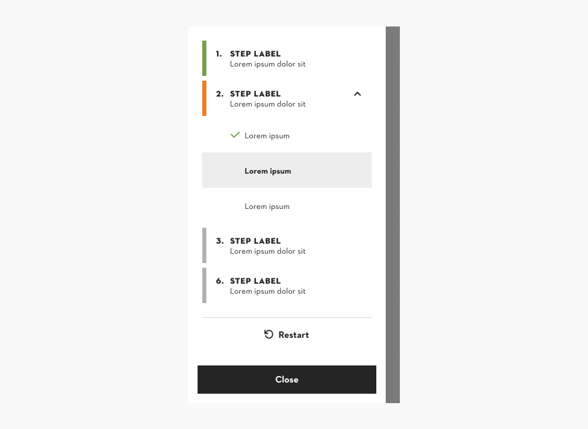

_Figure: A Stepper navigation component in a Drawer, showing a multi-step process with three visible steps and a restart action within the content area. The stepper includes visual indicators for progress, with the second step highlighted in orange, indicating it is the current step. The header area of the drawer is left empty, and the drawer is positioned to slide in from the right side. The steps are labeled as STEP LABEL with descriptive text underneath each label. The close button is located at the bottom of the drawer._

### Do not use for...

The drawer component is less suited for the use cases that are primary tasks.

- Creating objects
- Editing objects

Instead use a new page or [the dialog component.](https://www.figma.com/design/qXldpLO6gxHJNLdcXIPxYt?node-id=14115-4051)

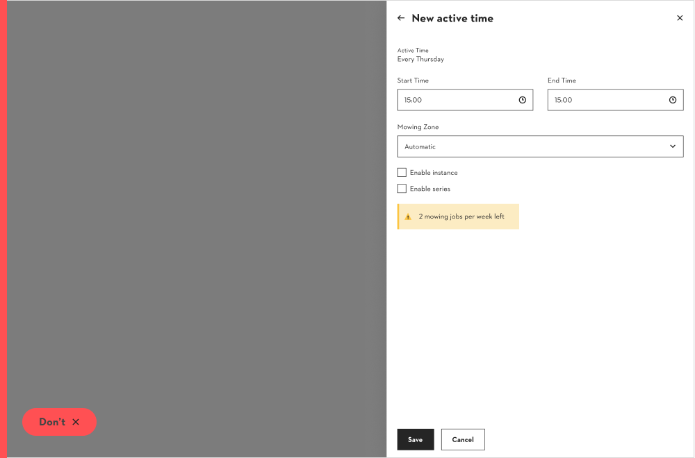

_Figure: A "header-drawer" with a heading "New active time" and a back button, along with a close button at the top right. It includes a form with fields for "Active Time", "Start Time", "End Time", and "Mowing Zone", with options like "Enable instance" and "Enable series". The "footer-drawer" contains two buttons labeled "Save" and "Cancel". The board is marked as a "Don't" example because the drawer component is not suited for primary tasks such as creating or editing objects, suggesting the use of a new page or dialog component instead._

## Building elements

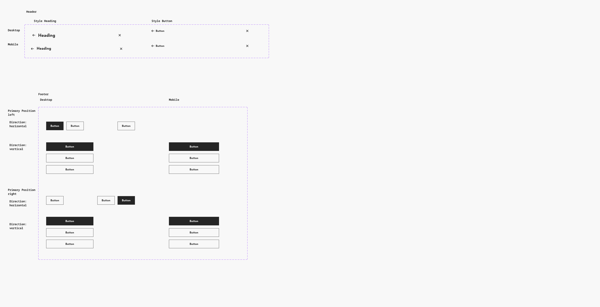

_Figure: The layout and styling of a Drawer component in a UI design system, comparing desktop and mobile views. It displays various Button components with different variants such as highlight, ghost, filled, and outline, along with states like enabled, sizes like small and medium, and icon positions. The layout examples show the positioning of buttons in both horizontal and vertical directions, with primary positions on the left and right for both desktop and mobile views._

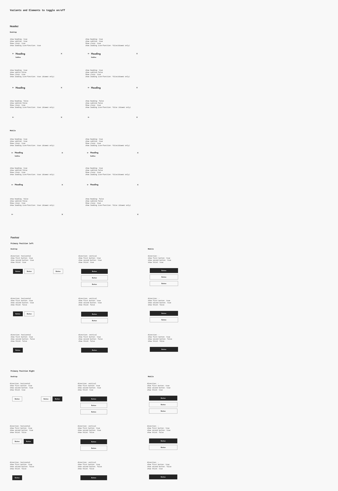

_Figure: Various variants and elements of the header-drawer and footer-drawer components for both desktop and mobile viewports. Each variant shows different combinations of elements such as heading, back button, subline, and close button for the header-drawer, and button arrangements for the footer-drawer. The figure illustrates different layouts and states, including horizontal and vertical directions and primary positions for buttons in the footer-drawer._
