# Drawer

## Drawer

Overview:

- Common use cases are: main or secondary navigation (especially mobile).
- The drawer component is suited for secondary tasks in the user-flows (e.g. log-in, additional filter or additional information).
- The drawer width adjusts to the inserted content. The height is always 100%
- Consider placing the button close to the content, in case the custom content area is half filled.
- Content overflow: header area and footer area are sticky, while the content area is scrolls.
- Ensure a clear hierarchy between the headline and content, so that the user can navigate quickly and move on.
- When on mobile 4 or more buttons, use small buttons to leave more space for the content area.
- When the drawer opens, focus should be set to the first actionable element.

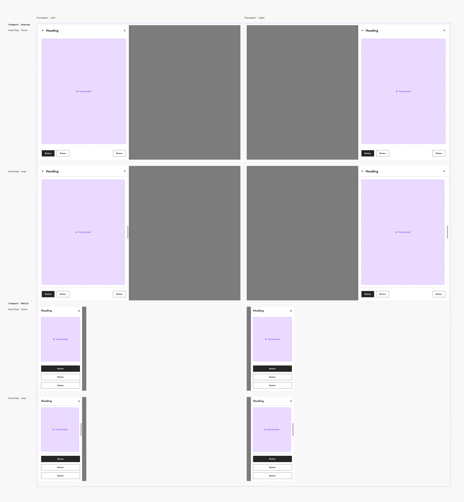

_Figure: Overview matrix of the drawer in two placements, "Placement: left" and "Placement: right", for "Viewport: Desktop" and "Viewport: Mobile", each with "Overflow: false" and "Overflow: true". On desktop the white drawer panel has a header with a back arrow, the "Heading" and a close button, a purple dashed "Placeholder" content area and a footer with three "Button" buttons in a row (first one dark and primary on the left, second outlined next to it, third outlined at the right edge), beside a dimmed grey backdrop that fills the rest of the screen. On mobile the drawer is narrow, has no back arrow, and the three "Button" buttons are stacked vertically at full width with the dark primary button on top; the backdrop is only a thin grey strip on the opposite side. With overflow true, thin divider lines separate header and footer from the content area and a scrollbar appears at the content edge, so header and footer stay fixed while the content scrolls._

### Further guidelines

[Storybook documentation](https://main--63440bbb95889041542a5ba3.chromatic.com/?path=/docs/components-drawer--documentation)

### Related elements

[Iconography](https://www.figma.com/design/U218NNP4OsipaHOtv5flns/Iconography-%E2%9E%A1%EF%B8%8F?m=auto)

### Contribute

Contribute to improving this component by sharing your feedback, asking questions, or suggesting features [here](https://www.figma.com/design/lLmw7PfIdKjFG4uT3B2Hyj/Onboarding-%F0%9F%93%96?node-id=446-868&t=zKmRu4kAkxMeRDmK-4).

## Formatting and Construction

### Anatomy

#### Custom areas

1. **Custom header area (optional)**
1. **Custom content area**
1. **Custom footer area (optional)**
1. **Backdrop**

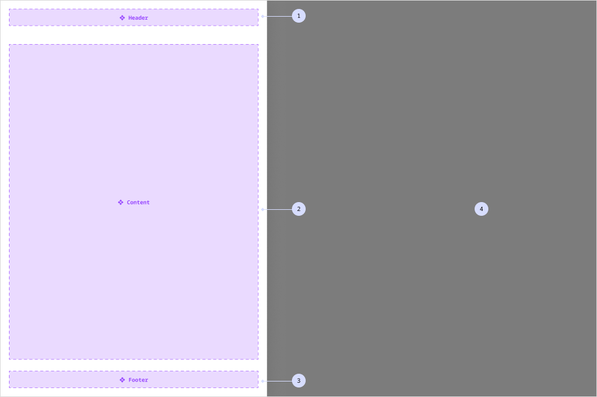

_Figure: Anatomy of the drawer with four numbered callouts: a white panel on the left with a dimmed grey backdrop on the right. Callout 1 points at the optional custom header area, a purple dashed slot labelled "❖ Header" at the top. Callout 2 points at the custom content area, the large purple dashed slot labelled "❖ Content". Callout 3 points at the optional custom footer area, a purple dashed slot labelled "❖ Footer" at the bottom. Callout 4 sits on the grey backdrop._

#### Figma component

Although technically a freely configurable slot, the figma components for **header area (1)** and **footer area (3)** provides a few options for common use case. The content area can be replaced with a **placeholder component (2)** that contain an additional text or image option.

Feel free to swap this with your own placeholder components or modules.

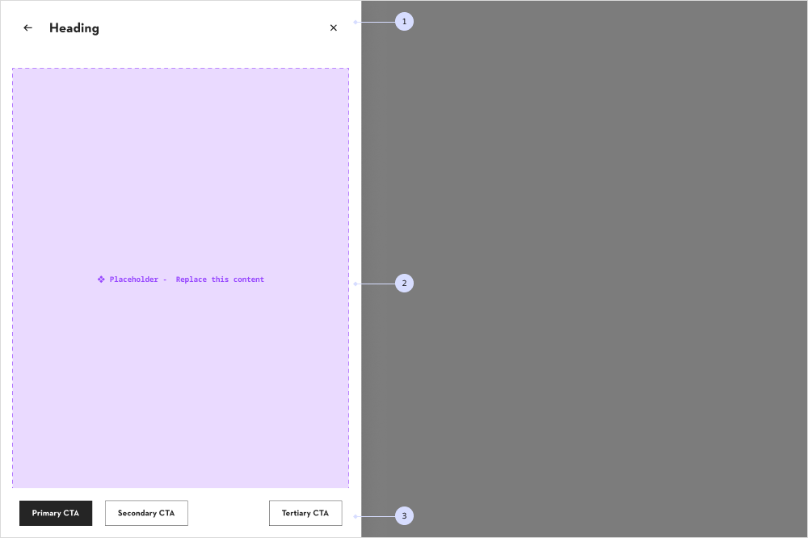

_Figure: Figma drawer component with three numbered callouts: a white panel on the left beside a dimmed grey backdrop. Callout 1 points at the header area with a back arrow, the "Heading" and a close button (x) at the right. Callout 2 points at the content area, a purple dashed placeholder labelled "❖ Placeholder - Replace this content" that can be swapped for custom content. Callout 3 points at the footer area with three buttons in a row: the dark filled "Primary CTA" and the outlined "Secondary CTA" at the left, and the outlined "Tertiary CTA" at the right._

### Sizing

#### Minimum width

The drawer adjusts to the width of the inserted content. Minimum size ist based on the smallest viewport size: 272px

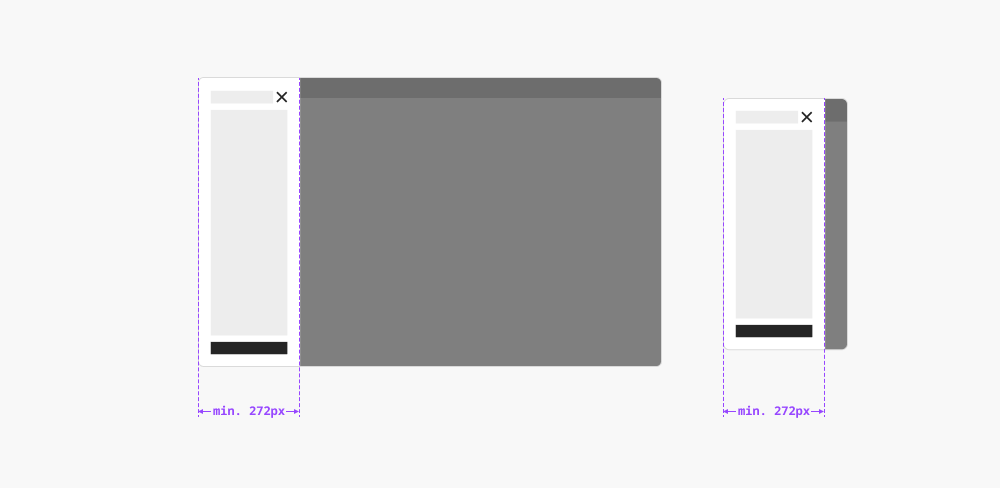

_Figure: Two schematic drawers, each a narrow white panel with a close button, header bar, content block and dark button, at the left edge of a dimmed grey browser window. A purple dashed measurement below each panel, "min. 272px", marks the minimum drawer width, which is based on the smallest viewport size. The left example is in a wide window; the right example is in a narrow window and the drawer has the same minimum width._

#### Maximum width

The drawer adjusts to the width of the inserted content. It can’t exceed the size of 1730px.

**Minimum space between browser edge and drawer, left or right:**

- On bigger screens (breakpoint m-xl) the distance is 80px.
- On smaller screens (breakpoint s) it is 32px.

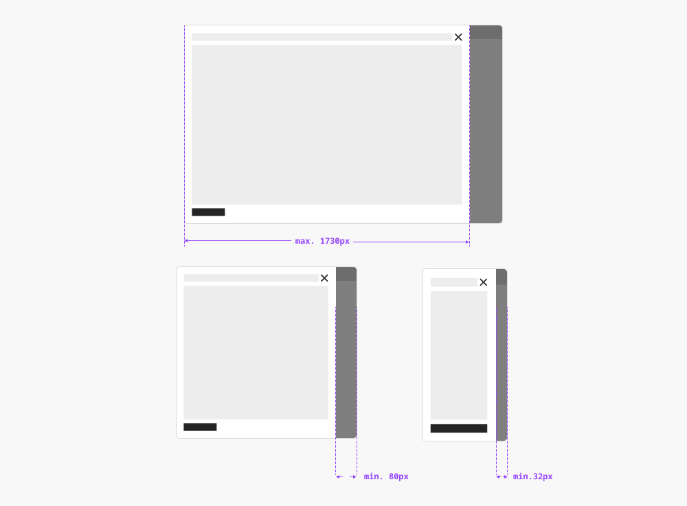

_Figure: Three schematic drawers (white panel with close button, header bar, content block and dark button) at the left of a dimmed grey browser window, showing maximum width and minimum edge distance. The large drawer at the top has a purple dashed arrow measurement "max. 1730px" across its width, the most the drawer can reach. Below, a medium drawer on a bigger screen (breakpoint m-xl) has a measurement "min. 80px" for the space between the drawer and the browser edge. A narrow drawer on a small screen (breakpoint s) has the measurement "min.32px" for the same space._

#### Width is dynamic, while opened

The width of the drawer does change to fit the content, in case more or less content becomes visible.

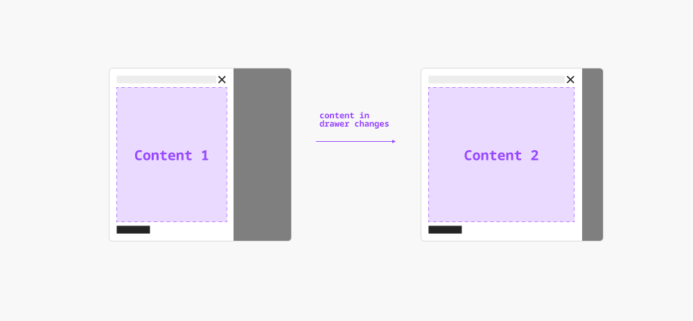

_Figure: Two drawers side by side, joined by a purple arrow labelled "content in drawer changes". The left drawer holds a dashed purple content area labelled "Content 1", with a wide strip of dimmed page visible to its right. The right drawer holds a wider content area labelled "Content 2" and is itself wider, so less of the dimmed page remains visible. Both have a header bar with a close button and a dark button at the bottom. The drawer width adapts to the content while it is open._

#### Aim for a consistent width, through content changes

By showing fewer transitions to the user, the user is less distracting.

Show deeper levels of the navigation in the same container of the drawer.

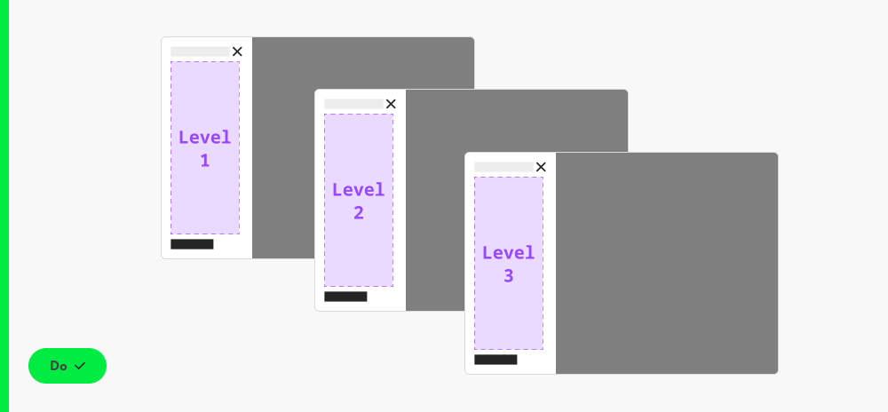

_Figure: Do example: three drawers stacked in a cascade, each on a dimmed page and each with a header bar, close button, dashed purple content area and dark button at the bottom. The content areas are labelled "Level 1", "Level 2" and "Level 3", and all three drawers have the same width. Deeper navigation levels are shown in the same drawer container with a consistent width, so the user sees fewer transitions and is distracted less._

#### Drawers cover the full height of the screen

All sizes are cover the full height of the screen (100%)

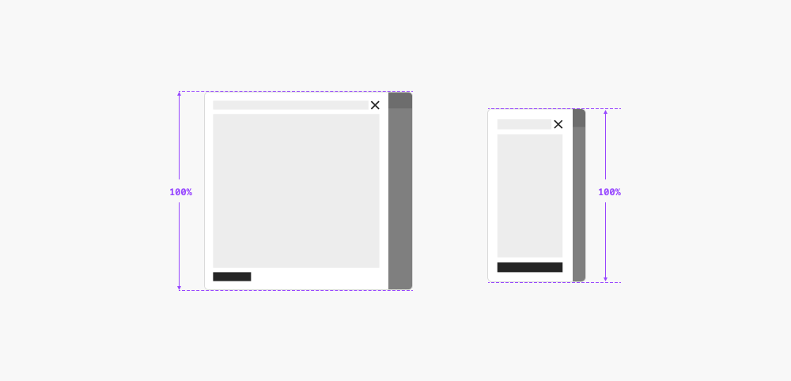

_Figure: Two drawers of different widths, a wide one on the left and a narrow one on the right, each a white panel on the left of a dimmed page strip with a header bar, close button, content area and dark button. A purple vertical arrow dimension labelled "100%" next to each drawer shows that it spans the full height of the screen, between two dashed lines at the top and bottom edges. All drawer sizes cover the full screen height._

#### Content overflow

The content is scrollable, in case it exceeds the content area.

The header and footer area are fixed and sticky and gain an outline bottom/top

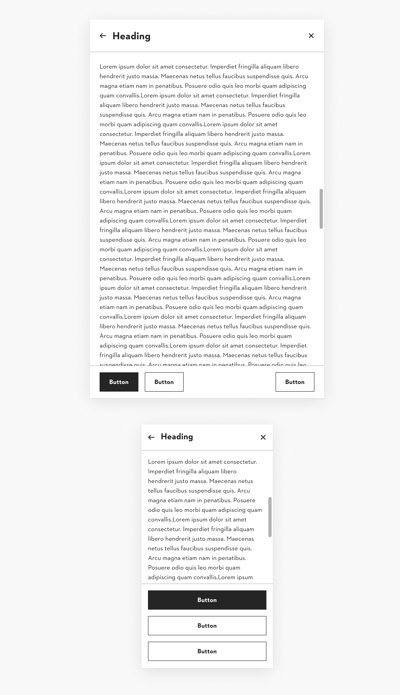

_Figure: Two drawers with scrolling content: a wide desktop drawer on top and a narrow mobile drawer below. Both have a header with a back arrow, the title "Heading" and a close button, a long lorem ipsum text with a scrollbar, and a footer with three buttons labelled "Button". The header and footer stay fixed and show a thin outline line at the bottom of the header and the top of the footer while the content scrolls. On desktop the footer buttons are horizontal: the filled primary and one outlined button on the left, a third outlined button on the right. On mobile the three buttons are stacked full width, the primary filled one first._

#### New page instead of a full-screen drawer

The drawer component cannot be full-screen. Place the content on it’s on page instead.

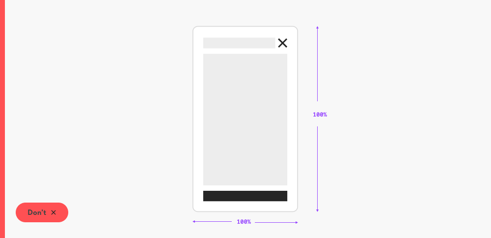

_Figure: Don't example: a full-screen drawer shown as a white panel with a header bar, close button, grey content area and dark button at the bottom. Purple arrow dimensions labelled "100%" mark that it takes the full height and the full width of the screen. This is wrong because the drawer component cannot be full-screen; the content should be placed on its own page instead._

#### One drawer at a time

Don’t open multiple layers on top of each other

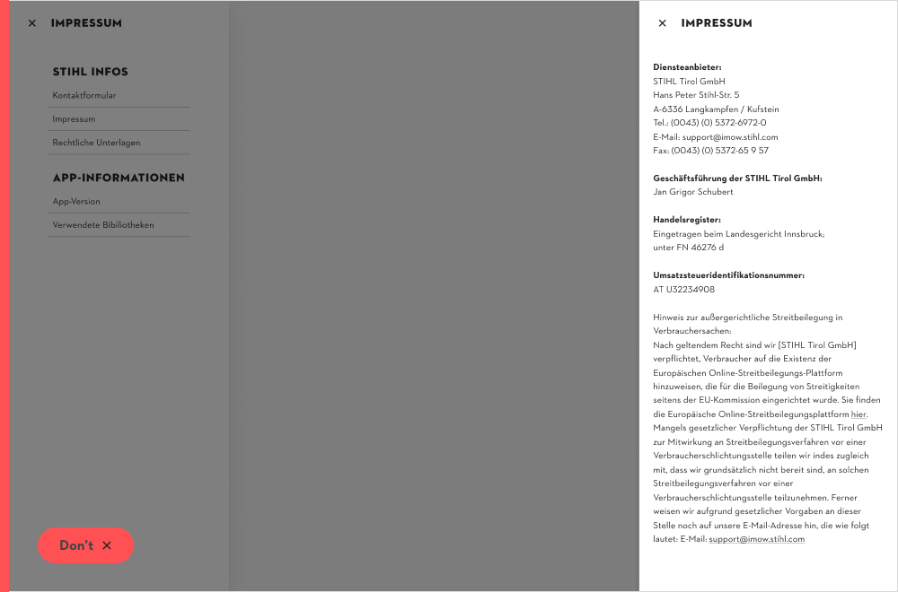

_Figure: Don't example: two drawers opened on top of each other. A dimmed first drawer on the left titled "IMPRESSUM" with a close button lists the menu "STIHL INFOS" with "Kontaktformular", "Impressum" and "Rechtliche Unterlagen", and "APP-INFORMATIONEN" with "App-Version" and "Verwendete Bibiliotheken". A second white drawer on the right, also titled "IMPRESSUM", shows the legal notice text starting with "Diensteanbieter:" and the STIHL Tirol GmbH address. Multiple layers must not be opened on top of each other; only one drawer at a time._

### Placement

#### Action and drawer relatedness

Depending on the position of the action, it feels more intuitive for the drawer to slide in from either the left or right side.

This is consistent with the real world and helps users predict the behavior of the interface, reducing the effort needed to understand interactions.

This follows the [heuristic from NN Group](https://www.nngroup.com/articles/match-system-real-world/) ‘Match Between the System & the Real World‘

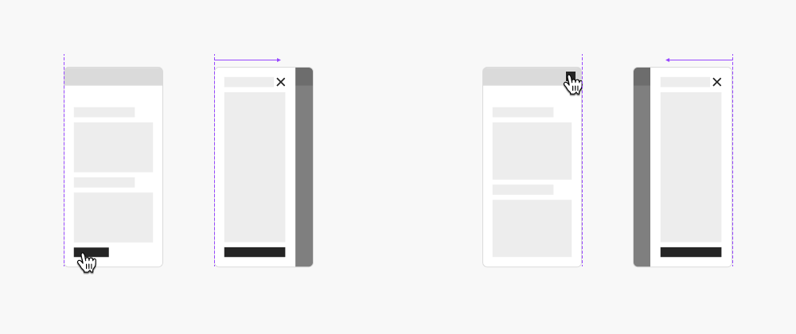

_Figure: Two pairs of page and drawer, showing that the drawer slides in from the side where the action is. Left pair: a hand cursor presses a dark button at the bottom left of the page, a dashed line marks the left screen edge, and a purple arrow points right as the drawer opens from the left edge, with the dimmed page on its right. Right pair: a hand cursor presses a small dark button in the top right header bar of the page, and a purple arrow points left as the drawer opens from the right edge, with the dimmed page on its left. Each drawer has a header bar, close button, content area and dark button._

#### More than one drawer

If more than one drawer can be triggered in an interface, consider if they slide in from the same or from different sides.

- Same side: if the context of the task is connected.
- Different sides: clear distinction between the two task-flows.

**Note:** Though multiple drawers can be triggered in an interface, they are never opened at the same time.

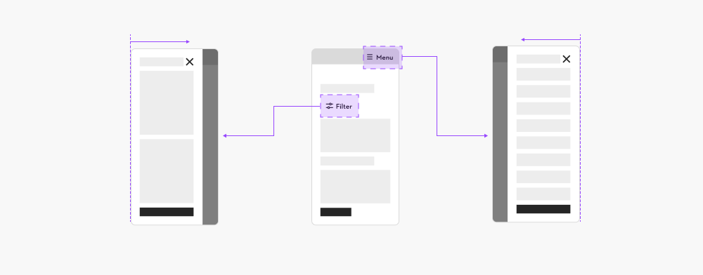

_Figure: Diagram of two drawers triggered from one page that slide in from different sides. In the center is a page with a highlighted "Menu" button at the top right and a highlighted "Filter" button (filter icon) in the content. A purple arrow from "Filter" points left to a drawer that slides in from the left edge, with a close button (X) at the top right of the drawer. A purple arrow from "Menu" points right to a drawer that slides in from the right edge, also with a close button; dashed lines and arrows at the outer edges mark the slide-in direction. The page stays visible as a dark strip beside each drawer._

### Motion

#### Enter animation drawer

**Animation type:** move: from left or right **Duration:** 400ms **Easing:** motion-functional-ease-out

#### Backdrop dimming

**Animation type:** fade: opacity 0\>100% (color: black 50%) **Duration:** 400ms **Easing:** motion-functional-ease-out

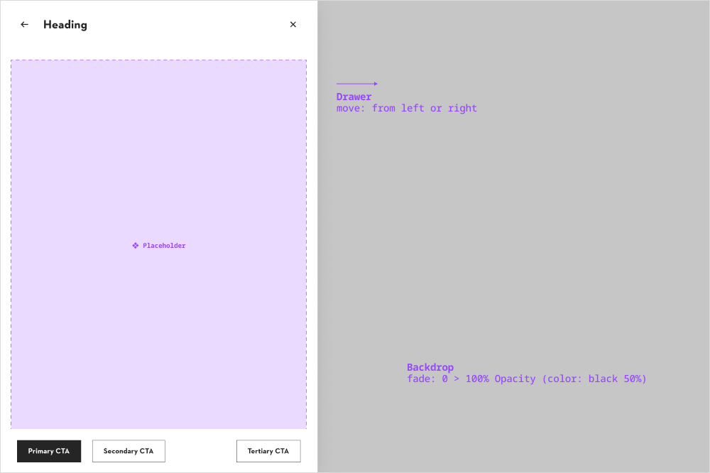

_Figure: Opening animation of the drawer with backdrop. A white drawer on the left has a header with a back arrow, "Heading" and a close button (X), a purple placeholder area for content, and a footer with a filled "Primary CTA" button, an outlined "Secondary CTA" button and an outlined "Tertiary CTA" button on the right. The rest of the screen is a grey dimmed backdrop. Annotations: an arrow with "Drawer" and "move: from left or right", and "Backdrop" with "fade: 0 \> 100% Opacity (color: black 50%)"._

#### Exit animation drawer

**Animation type:** move: out to left or right **Duration:** 400ms **Easing:** motion-functional-ease-in

#### Backdrop dimming

**Animation type:** fade: opacity, 100\>0% (color black 50%) **Duration:** 400ms **Easing:** motion-functional-ease-in

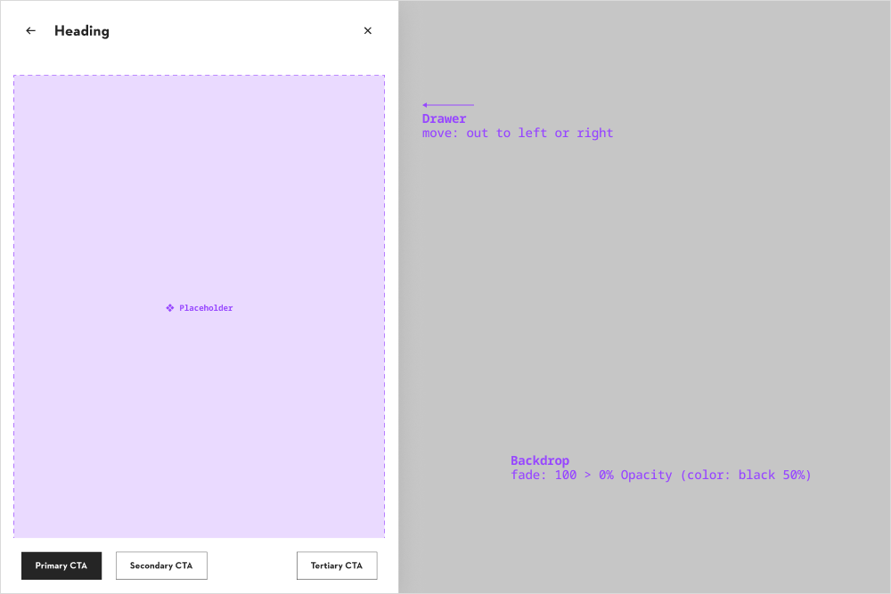

_Figure: Closing animation of the drawer with backdrop. A white drawer on the left has a header with a back arrow, "Heading" and a close button (X), a purple placeholder area for content, and a footer with a filled "Primary CTA" button, an outlined "Secondary CTA" button and an outlined "Tertiary CTA" button on the right. The rest of the screen is a grey dimmed backdrop. Annotations: an arrow with "Drawer" and "move: out to left or right", and "Backdrop" with "fade: 100 \> 0% Opacity (color: black 50%)"._

## Content

### Hierachy

In most cases the user-task in the drawer disturbs the user-flow. It is important to ensure a clear hierarchy, so that the user can navigate quickly and move on.

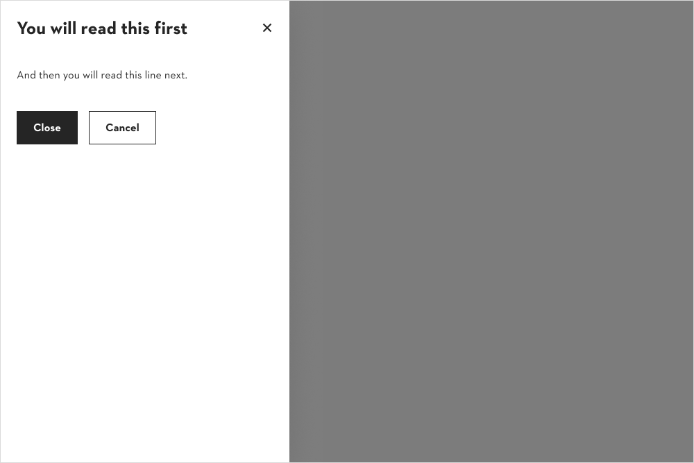

_Figure: Desktop drawer on the left of a dimmed page showing reading hierarchy. The header has the bold heading "You will read this first" with a close button (X) at the right, followed by the smaller body line "And then you will read this line next." Below are two buttons: a filled primary "Close" on the left and an outlined "Cancel"._

### Custom header area

#### Formatting examples

1. Heading L and topline, combined with a back button
1. Heading L, combined with a back button
1. [Title component ](https://www.figma.com/design/Ie2r0R9QwjEc7O3nrFbXhV/Web-Pattern-Library?node-id=7-19)is better suitable for impactful and emotional headers.

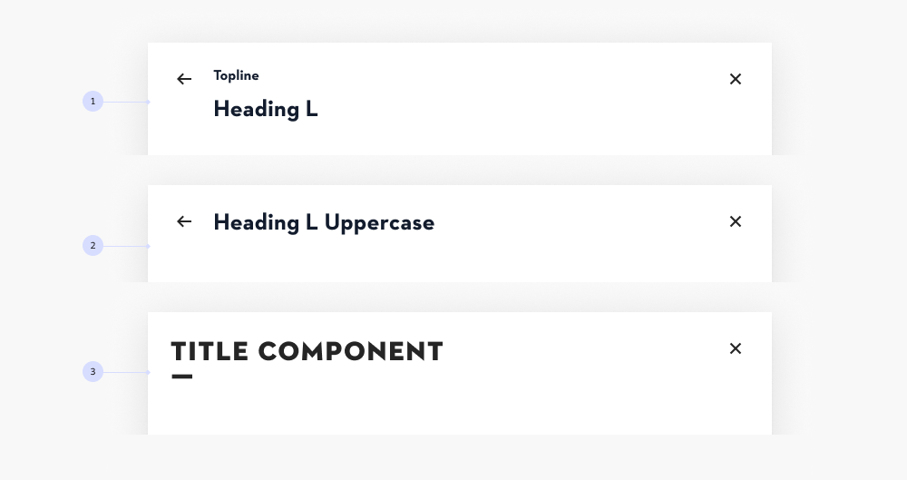

_Figure: Three drawer header formats, each with a close button (X) at the right. Callout 1 points at a header with a back arrow, the small "Topline" above and the heading "Heading L". Callout 2 points at a header with a back arrow and the single-line heading "Heading L Uppercase". Callout 3 points at a header without back arrow that uses the "Title Component": the uppercase text "TITLE COMPONENT" with a short bar underneath, suited to impactful and emotional headers._

#### Formatting warning

Do not write full sentences in the header area.

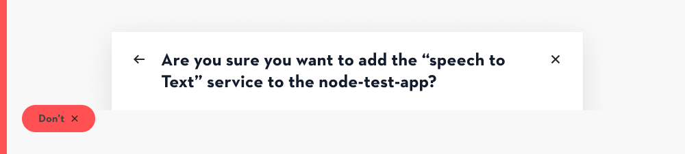

_Figure: Don't example: drawer header with a back arrow and a close button (X) whose heading is a full sentence over two lines: "Are you sure you want to add the “speech to Text” service to the node-test-app?". It is wrong because full sentences must not be written in the header area. Marked with a red "Don't" label and a red bar on the left edge._

#### Topline conveys purpose

The topline explicitly references the page, feature title, or object to clearly convey the drawers purpose.

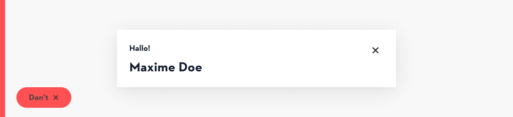

_Figure: Don't example: drawer header with the topline "Hallo!" above the heading "Maxime Doe" and a close button (X) at the right. It is wrong because the topline should reference the page, feature title or object to convey the drawer's purpose, and a greeting does not. Marked with a red "Don't" label and a red bar on the left edge._

#### Header with ‘back’-link

Close icon on the right is preferred in both left and right placement.

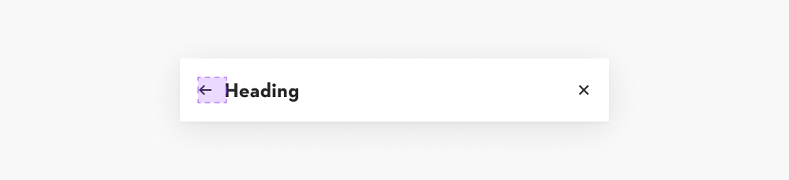

_Figure: Desktop drawer header with the heading "Heading". The back arrow button to the left of the heading is highlighted with a purple dashed box, and the close button (X) sits at the right end of the header, which is the preferred position for both left and right drawer placement._

#### Close icon placement

Close Icon on the right **(1)** is preferred in both left and right placement.

Close icon on the left **(2)** isn’t ideal, though acceptable.

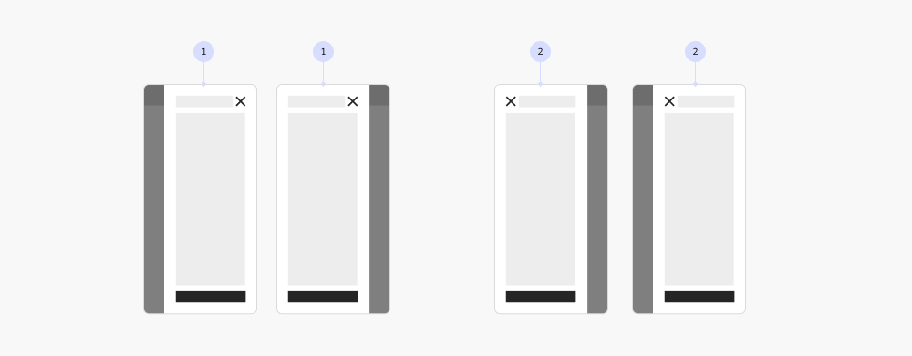

_Figure: Four schematic drawers, each a white panel with a header bar, a content block and a dark button at the bottom, next to a dimmed page strip. Callout 1 points at the two drawers with the close icon (X) on the right of the header, preferred, shown for a drawer sliding in from the right and one from the left. Callout 2 points at the two drawers with the close icon on the left of the header, not ideal though acceptable, again for a right and a left drawer._

### Custom content area

#### Short content

Consider placing the button close to the content, in case the custom content area is half filled.

**Important:** Leave the footer area empty.

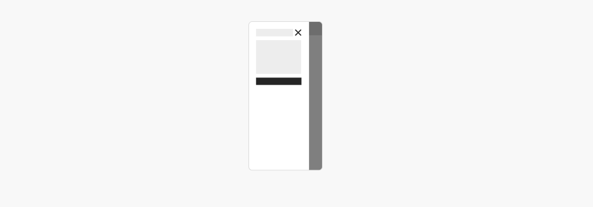

_Figure: Schematic drawer opening from the left with a close icon (X) at the top right of the header, next to a dimmed page strip. The content block is short, so the dark button sits directly below the content and the lower part of the drawer, including the footer area, is left empty._

### Custom footer area

#### Footer area is optional

1. In some cases a close icon is sufficient.
1. In some cases the content is very short, place the button(s) closer to the content.

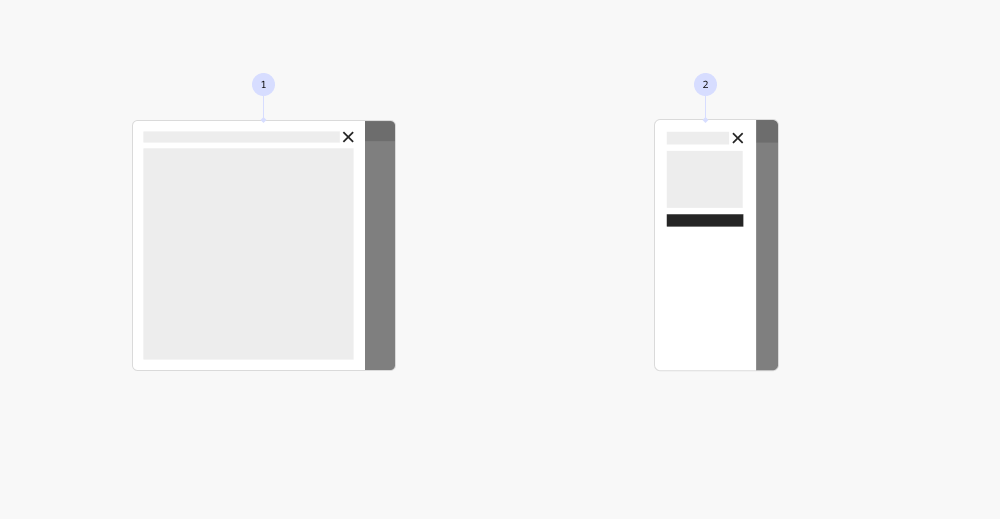

_Figure: Two schematic drawers opening from the left, each with a close icon (X) at the top right of the header and a dimmed page strip on the right. Callout 1 points at a wide drawer with a tall content block and no button and no footer area, where the close icon is sufficient. Callout 2 points at a narrow drawer with a short content block and a dark button placed directly below the content, leaving the rest of the drawer empty._

#### Button placement

Button placement recommendations depend on the use case, as well as the side the drawer appears from.

Check out the examples and variations on the last frame for some common use cases.

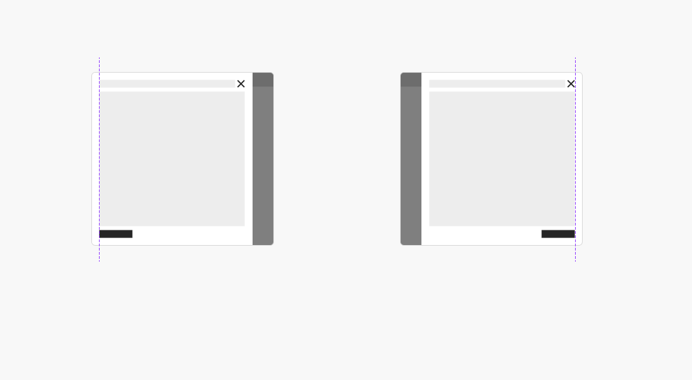

_Figure: Two schematic drawers with a header, a close icon (X) at the top right, a large content block and a small dark button in the footer. The left drawer slides in from the left with the dimmed page on its right, and its button is aligned to the left edge, marked by a dashed vertical line. The right drawer slides in from the right with the dimmed page on its left, and its button is aligned to the right edge, marked by a dashed vertical line._

## Behavior

### Dismissed by the user

In case the user closes **(1)** the drawer, the exit animation is triggered immediately.

Closing the drawer by click on the dimmed backdrop **(2)** can be disabled, default is enabled.

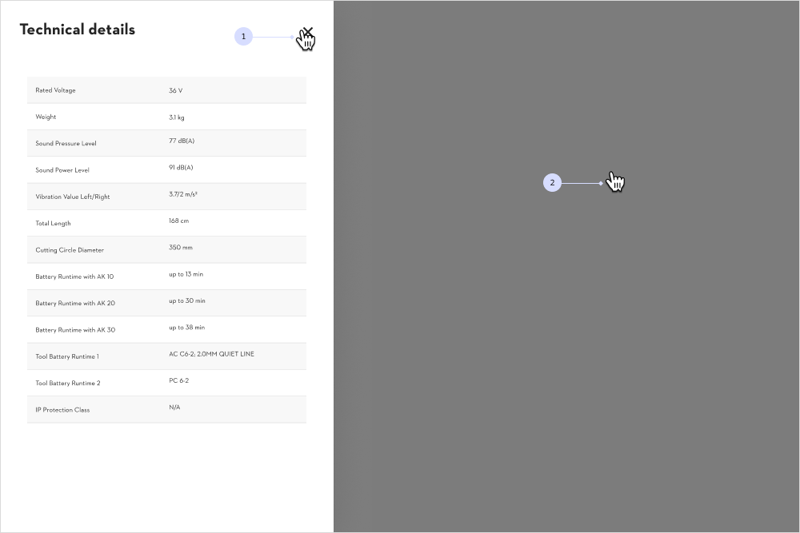

_Figure: Drawer titled "Technical details" on the left, listing a table of rows from "Rated Voltage" ("36 V") and "Weight" ("3.1 kg") down to "IP Protection Class", beside a dimmed backdrop filling the rest of the screen. Callout 1 points at the close icon in the top right of the drawer header, where a hand cursor is clicking it. Callout 2 points at the dimmed backdrop, where a hand cursor clicks to close the drawer; this can be disabled, default is enabled._

### Focus management

When the drawer opens, focus should be set to the first actionable element, typically the primary action button or the first input field.

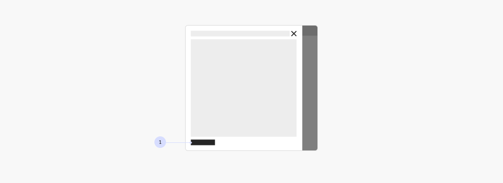

_Figure: Schematic drawer opening from the left with a header, a close icon (X) at the top right, a large content block and a small dark button at the bottom left, next to a dimmed page strip. Callout 1 points at that button, the first actionable element, which receives focus when the drawer opens._

## Examples/Variants

### Navigation drill down

A drill down pattern is used, as the drawer maintains a specific width. This pattern works the same on mobile and desktop screens, therefore a common pattern that is easily learned by the user.

A drill down navigation allows users to progressively click through layers of information, starting broad and moving to specific content.

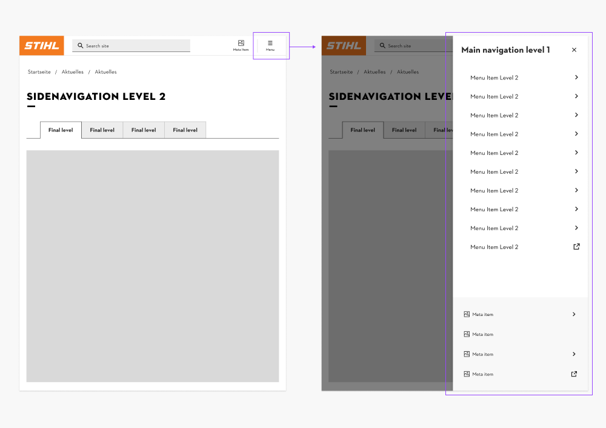

_Figure: Navigation drill down: a web page with a STIHL header, search field, "Meta Item" and "Menu" button is shown on the left. An arrow from the highlighted "Menu" button leads to the same page dimmed behind an open drawer on the right, titled "Main navigation level 1" with a close icon, a list of ten "Menu Item Level 2" entries (nine with a right chevron for drilling deeper, the last with an external link icon) and a footer area with four "Meta item" entries (two with chevrons, one with an external link icon, one plain)._

### Secondary flow

Use the drawer component for actions that are secondary to the user’s main task.

Examples are:

- Log-in (or any other type of identification)
- Additional filters
- Additional information

**Attention**: The user is limited inside a drawer. If a task is multifaceted, consider a link to a new page instead. Explore the efficiency of a complex user flow containing a drawer through usability testing.

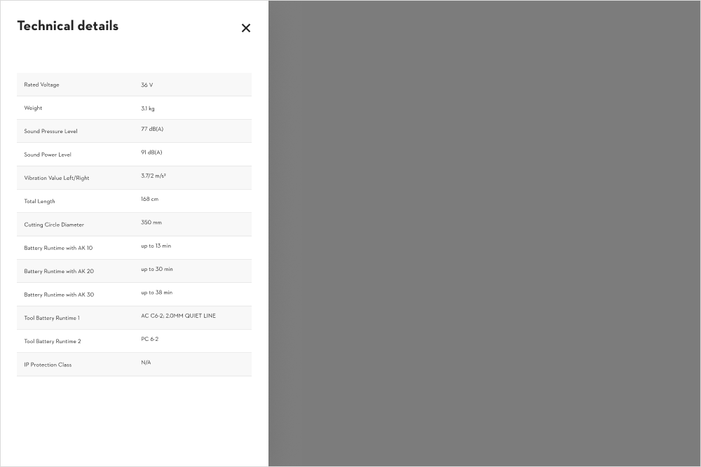

_Figure: Drawer opened from the left over a dimmed page, used for a secondary task. It has the heading "Technical details" with a close icon (X) at the top right and a striped table of specifications: "Rated Voltage" "36 V", "Weight" "3.1 kg", "Sound Pressure Level" "77 dB(A)", "Sound Power Level" "91 dB(A)", "Vibration Value Left/Right" "3.7/2 m/s²", "Total Length" "168 cm", "Cutting Circle Diameter" "350 mm", three "Battery Runtime with AK" rows (AK 10, AK 20, AK 30) with "up to 13 min", "up to 30 min" and "up to 38 min", "Tool Battery Runtime 1" "AC C6-2; 2.0MM QUIET LINE", "Tool Battery Runtime 2" "PC 6-2" and "IP Protection Class" "N/A"._

### Stepper navigation

A stepper navigation guides users through multi-step processes, showing progress with visual indicators, ensuring a user-friendly experience.

**Tip:** In order to visually distinguish the secondary navigation component, position the drawer to slide in from a different side than the main navigation.

**Note:** in this case the restart action is placed in the content area. Also, the header area is left empty.

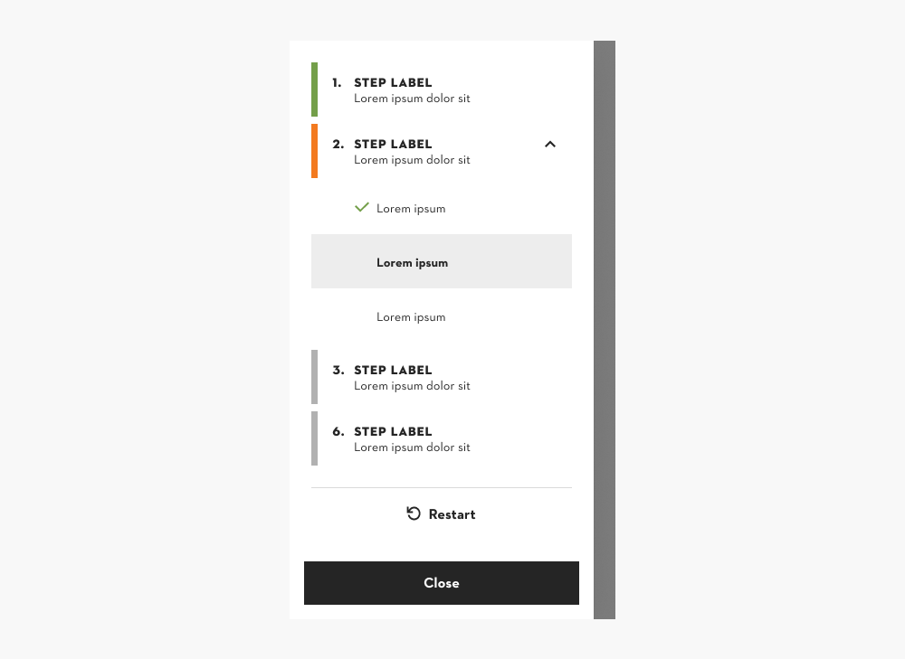

_Figure: Stepper navigation inside a drawer without a header, next to a dimmed page strip on the right. Steps "1. STEP LABEL" (green bar) and "2. STEP LABEL" (orange bar, expanded with a chevron up) show the text "Lorem ipsum dolor sit". Step 2 contains three sub-items: "Lorem ipsum" with a green check mark, "Lorem ipsum" in bold on a grey highlight, and a plain "Lorem ipsum". Below are the grey-bar steps "3. STEP LABEL" and "6. STEP LABEL", a divider, a "Restart" action with a restart icon in the content area, and a full-width dark "Close" button in the footer._

### Do not use for...

The drawer component is less suited for the use cases that are primary tasks.

- Creating objects
- Editing objects

Instead use a new page or [the dialog component.](https://www.figma.com/design/qXldpLO6gxHJNLdcXIPxYt?node-id=14115-4051)

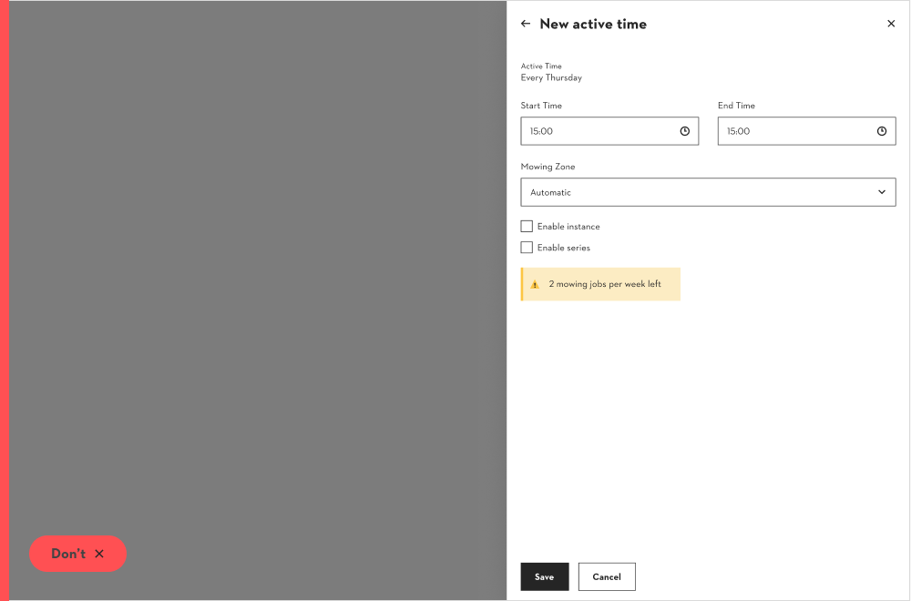

_Figure: Don't example: a desktop drawer opens as a white panel on the right of a greyed, dimmed page and is used as a form for creating or editing an object. The header has a back arrow, the heading "New active time" and a close button. The body shows "Active Time" with "Every Thursday", two time fields "Start Time" and "End Time" (both "15:00"), a "Mowing Zone" dropdown set to "Automatic", the checkboxes "Enable instance" and "Enable series" and a yellow warning "2 mowing jobs per week left". The footer has a filled "Save" button on the left and an outlined "Cancel" button. This is wrong because creating and editing objects are primary tasks; use a new page or the dialog component instead._

## Building elements

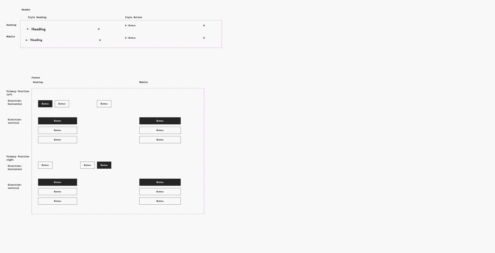

_Figure: Building elements of the drawer in two groups. "Header" for "Desktop" and "Mobile" in two styles: "Style Heading" with a back arrow, a bold "Heading" and a close button (the heading is larger on desktop), and "Style Button" with a back arrow followed by a small text button "Button" and a close button. "Footer" with a "Desktop" and a "Mobile" column, split by "Primary Position left" and "Primary Position right" and by "Direction: horizontal" and "Direction: vertical". With primary position left, the horizontal desktop footer shows a filled "Button" and an outlined "Button" side by side plus a third outlined "Button" set apart further right; with primary position right it is mirrored: one outlined "Button" set apart on the left, then an outlined "Button" and the filled "Button" at the right. The vertical footers, on desktop and mobile and for both positions, stack three full-width buttons with the filled "Button" on top and two outlined ones below. Mobile has no horizontal row._

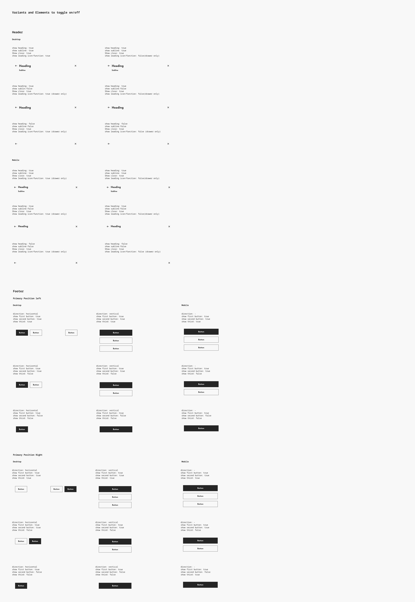

_Figure: Overview "Variants and Elements to toggle on/off" of the drawer header and footer. "Header": "Desktop" and "Mobile" each show six variants in two columns. The left column has show leading icon/function true, the right column false (drawer only). Rows: "Heading" with "Subline", "Heading" only, and no heading (show heading and show subline false); close is always shown. Back arrow and close button are drawn in all variants except the mobile one without heading and with leading icon false, which shows only the close button. "Footer": "Primary Position left" and "Primary Position Right", each with "Desktop" in direction horizontal and vertical and "Mobile" with direction "-". Rows toggle show first button, show second button and show third: all three, first and second, and only first. Horizontal desktop footers with three buttons show a pair plus a detached "Button". The filled button is at the left with primary position left and at the right of the pair with primary position right. Vertical and mobile footers stack full-width buttons with the filled one on top. The last mobile row of primary position right (first true, second false, third true) shows a single filled "Button"._
