# Flag

## Flag

Overview:

- A Flag is a non-interactive, read-only component used to communicate status, highlight content, or provide supplementary information (such as categories or metadata).
- Flags come in two variants: Status and Promo.
   - Status Flags indicate the state of an item or process, or provide neutral contextual labels.
   - Promo Flags highlight content and are often used alongside buttons.

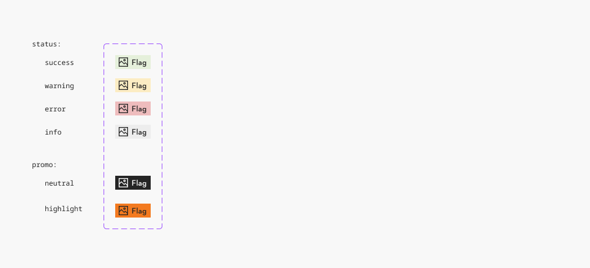

_Figure: Overview of the Flag component in its two variants, each flag with an image icon and the label "Flag", listed in a purple dashed frame. Under "status:" are four flags: "success" (light green background), "warning" (light yellow), "error" (light red) and "info" (light grey). Under "promo:" are two flags: "neutral" (black background, white text) and "highlight" (orange background)._

### Further guidelines

[Storybook documentation](https://main--63440bbb95889041542a5ba3.chromatic.com/?path=/docs/components-flag--documentation)

### Related elements

[Chip group](https://www.figma.com/design/qXldpLO6gxHJNLdcXIPxYt?node-id=18691-978)

[Notification](https://www.figma.com/design/qXldpLO6gxHJNLdcXIPxYt/Pattern-Library-%F0%9F%96%A5-Web-1.0?node-id=7251-8)

[Iconography](https://www.figma.com/design/U218NNP4OsipaHOtv5flns/Iconography-%E2%9E%A1%EF%B8%8F?m=auto)

[System feedback](https://www.figma.com/design/qXldpLO6gxHJNLdcXIPxYt/Pattern-Library-%F0%9F%96%A5-Web-1.0?node-id=14690-32&t=70clRGTOE7xoCl4t-4)

### Contribute

Contribute to improving this component by sharing your feedback, asking questions, or suggesting features [here](https://www.figma.com/design/lLmw7PfIdKjFG4uT3B2Hyj/Onboarding-%F0%9F%93%96?node-id=446-868&t=zKmRu4kAkxMeRDmK-4).

## Formatting and Construction

### Anatomy

1. **Icon (optional)**
1. **Label**

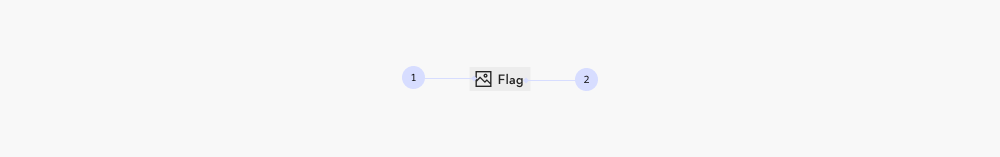

_Figure: Anatomy of the Flag with two numbered callouts, shown on an info flag (light grey) with an image icon and the label "Flag". Callout 1 points at the icon on the left (optional); callout 2 points at the label._

#### Variants

Flags have two variants: **Status and Promo**.

1. **Status:** Used to communicate the state of an item or to provide neutral contextual labeling.
   1. **Success**
   1. **Warning**
   1. **Error**
   1. **Info**
1. **Promo:** Used for marketing, highlighting, or drawing attention to specific content.
   1. **Neutral**
   1. **Highlight**

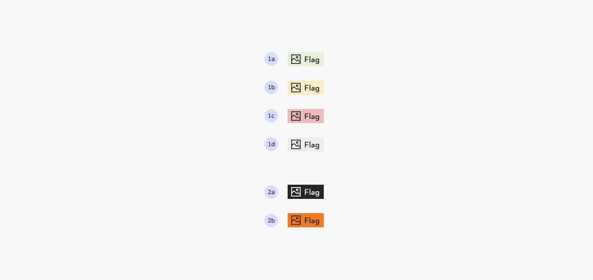

_Figure: Six flags stacked vertically, each with an image icon and the label "Flag", marked with callouts for the two variants. Status variant (callout 1): 1a is success (light green), 1b is warning (light yellow), 1c is error (light red), 1d is info (light grey). Promo variant (callout 2): 2a is neutral (black background, white text), 2b is highlight (orange background)._

### Sizing

#### As long as text

The width of the flag adjusts to the label length.

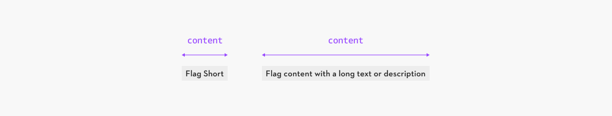

_Figure: Two light grey info flags without icons showing that the flag width follows the label length. The short flag "Flag Short" and the wide flag "Flag content with a long text or description" each have a purple double arrow above them labelled "content", spanning the full width of the flag._

### Spacing

Multiple flags can be placed together, and the spacing between elements is 8px.

If needed, wrap the items in the group. Vertical spacing is also 8px.

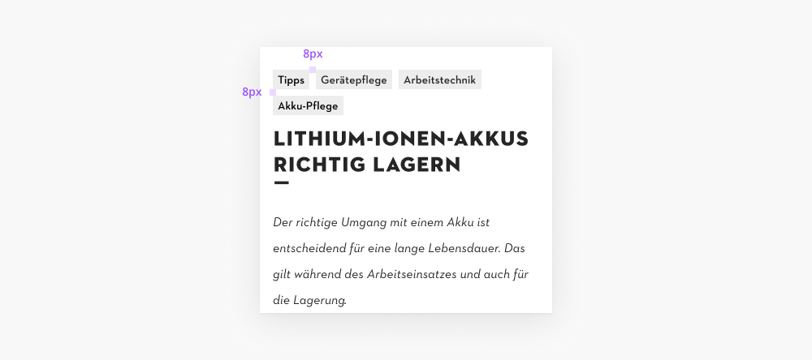

_Figure: Spacing of flags on an article teaser card. Four light grey flags "Tipps", "Gerätepflege", "Arbeitstechnik" and "Akku-Pflege" sit above the heading "Lithium-Ionen-Akkus richtig lagern" and a short German intro text about handling batteries. The first three flags are in one row and "Akku-Pflege" wraps to a second row. Purple markers labelled "8px" show the horizontal gap between neighbouring flags and the vertical gap between the rows._

## Content and Assets

### Labels

#### Do use concise labels

Use short words in simple language. They must be easy to understand. Also, avoid abbreviations for accessibility reasons.

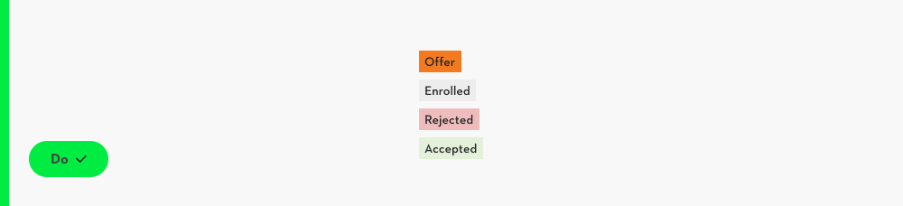

_Figure: Do example: use concise labels, with short simple words and no abbreviations. Four flags without icons are stacked: "Offer" (orange, highlight), "Enrolled" (light grey, info), "Rejected" (light red, error) and "Accepted" (light green, success). A green "Do" badge with a check mark is at the lower left._

#### Don’t repeat the subject in flag labels.

It creates unnecessary length.

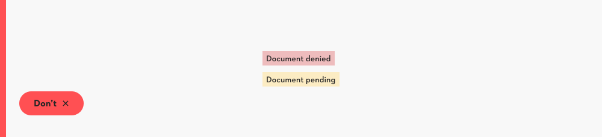

_Figure: Don't example: the subject is repeated in the flag labels, which creates unnecessary length. Two flags without icons are stacked: "Document denied" (light red, error) and "Document pending" (light yellow, warning). A red "Don't" badge with a cross is at the lower left._

#### Don’t use similar or synonymous terms across flags.

E.g. “Rejected” and “Declined”.

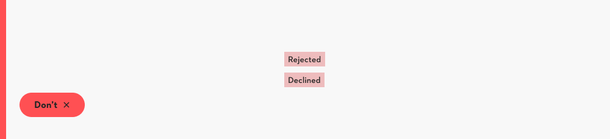

_Figure: Don't example: similar or synonymous terms are used across flags. Two light red error flags without icons are stacked, "Rejected" and "Declined", which mean the same thing. A red "Don't" badge with a cross is at the lower left._

### Icons

#### Icon usage with purpose

Icons are **optional**. Use icons sparingly, as excessive use can create unnecessary cognitive load.

When used, icons should support quick visual recognition and help users understand the meaning of the flag at a glance.

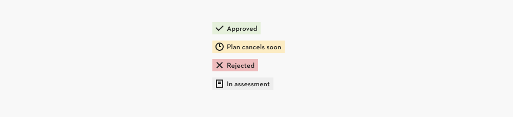

_Figure: Four status flags with a leading icon that supports the meaning of the label, stacked vertically: "Approved" (check mark, light green, success), "Plan cancels soon" (clock, light yellow, warning), "Rejected" (cross, light red, error) and "In assessment" (document icon, light grey, info)._

#### Icon type

1. Use Functional Icons for flags by default.
1. For the Status variants, System Feedback Icons may be used to reinforce meaning and ensure the status stands out visually.

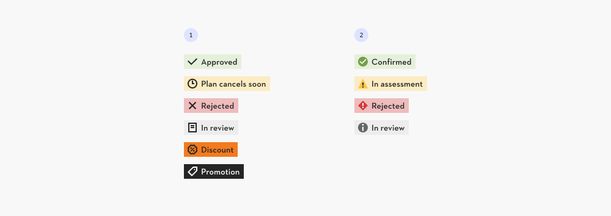

_Figure: Two columns of flags with icons comparing icon types. Callout 1 marks Functional Icons (the default), used on all variants: "Approved" (check mark, success), "Plan cancels soon" (clock, warning), "Rejected" (cross, error), "In review" (document, info), "Discount" (orange highlight promo flag with a discount icon) and "Promotion" (black neutral promo flag with a tag icon). Callout 2 marks System Feedback Icons, available for the Status variants only: "Confirmed" (green filled check circle, success), "In assessment" (warning triangle, warning), "Rejected" (red diamond with exclamation mark, error) and "In review" (grey filled info circle, info)._

#### Do use icons consistently within each variant

Flags with and without icons can be used together, as long as usage is consistent within each variant.

For example:

1. Status Info flags remain icon-free, while Status Warning flags include icons.
1. Status Info Flags may be icon-free, while Promo flags can use icons for emphasis.

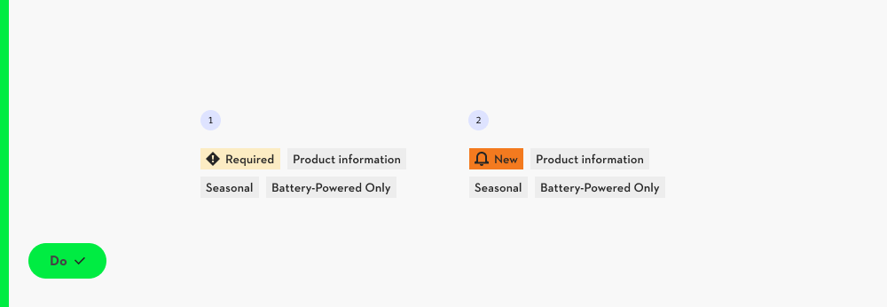

_Figure: Do example: icons are used consistently within each Flag variant. Callout 1 points at a group of four flags: a yellow warning flag "Required" with an exclamation icon, followed by the icon-free grey info flags "Product information", "Seasonal" and "Battery-Powered Only". Callout 2 points at a group where an orange promo flag "New" has a bell icon, followed by the icon-free grey info flags "Product information", "Seasonal" and "Battery-Powered Only". Flags with and without icons may be used together as long as usage is consistent within each variant._

#### Don’t mix icon usage within the same variant

Avoid combining flags with and without icons within a single variant, as this creates inconsistency and reduces clarity.

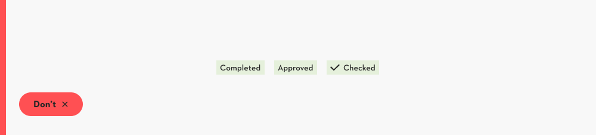

_Figure: Don't example: three light green success flags in a row, "Completed" and "Approved" without an icon and "Checked" with a check mark icon. Mixing flags with and without icons within a single variant creates inconsistency and reduces clarity._

### Numbers

#### Don’t use flags with numbers only.

Use a number indicator component instead.

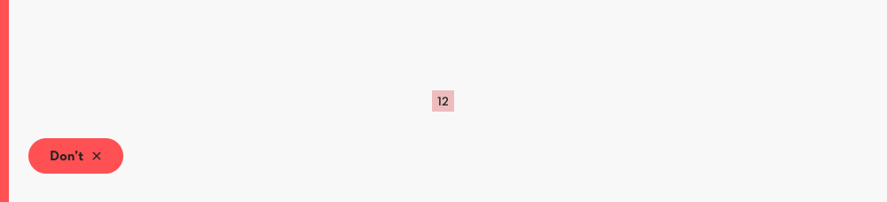

_Figure: Don't example: a single small red error flag that contains only the number "12" with no text label. Flags must not show numbers only; a number indicator component should be used instead._

#### Do pair numbers with a label when displaying counts.

Use brackets for secondary counts (e.g. “Comments (3)”).

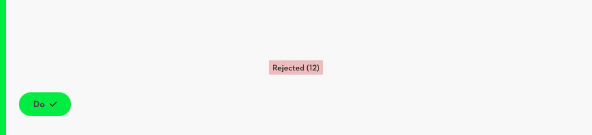

_Figure: Do example: a single red error flag labelled "Rejected (12)", where the number is paired with a text label and the secondary count is written in brackets (like "Comments (3)")._

## Usage

### Variants

#### Status

Used to communicate the state of an item:

1. **Success** Indicates a successful, completed, or approved state.
1. **Warning** Indicates a potential issue or situation that requires attention.
1. **Error** Indicates a failure, critical issue, or negative outcome.

or to provide neutral contextual labeling:

1. **Info** Indicates a neutral or ongoing state (e.g. in progress or under review). Can also be used for non-semantic labels such as categories, tags, or metadata when no status or urgency should be conveyed.

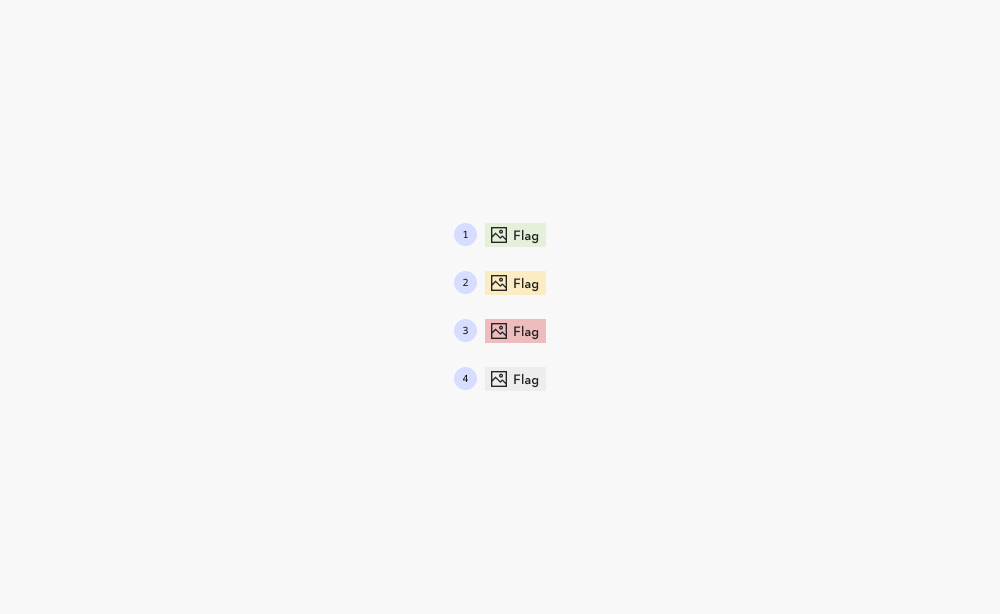

_Figure: Status flag variants stacked vertically, each labelled "Flag" with an image icon. Callout 1 points at the green success flag (successful, completed or approved state). Callout 2 points at the yellow warning flag (potential issue that requires attention). Callout 3 points at the red error flag (failure, critical issue or negative outcome). Callout 4 points at the grey info flag (neutral or ongoing state, or non-semantic labels such as categories, tags or metadata)._

#### Promo

Promo Flags are typically used alongside a button, but can also appear without one. Choose the variant based on context

- Primary button (background-color/primary-inverse) or no Button → use **Highlight Flag**
- Highlight Button (background-color/brand) → use **Neutral Flag**

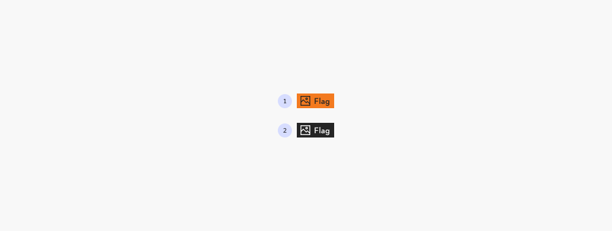

_Figure: Two Promo flag variants stacked vertically, each labelled "Flag" with an image icon. Callout 1 points at the orange Highlight flag, used with a primary button or no button. Callout 2 points at the dark, almost black Neutral flag with light text, used alongside a Highlight (brand) button._

### Groupings and combinations

#### Combining multiple Flags in one section are allowed.

Ensure each group has a clear and distinguishable purpose.

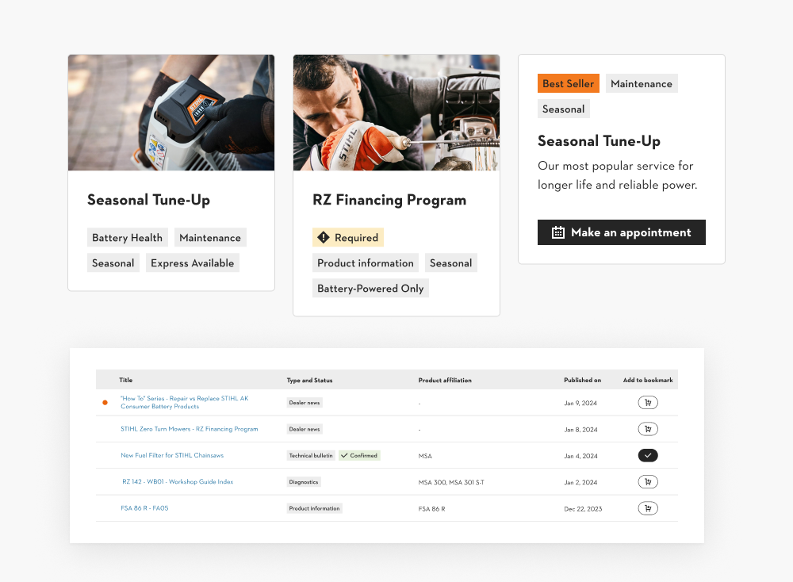

_Figure: Combining multiple flags in one section is allowed, as long as each group has a clear, distinguishable purpose. Top row, three cards: "Seasonal Tune-Up" with a battery photo and the grey flags "Battery Health", "Maintenance", "Seasonal" and "Express Available"; "RZ Financing Program" with a photo of a person working on a chainsaw, a yellow warning flag "Required" with an exclamation icon and grey flags "Product information", "Seasonal" and "Battery-Powered Only"; and a photo-less card with an orange flag "Best Seller", grey flags "Maintenance" and "Seasonal", the title "Seasonal Tune-Up", the text "Our most popular service for longer life and reliable power." and a dark button "Make an appointment" with a calendar icon. Below, a data table with the columns "Title", "Type and Status", "Product affiliation", "Published on" and "Add to bookmark"; its rows hold small grey type flags such as "Dealer news", "Technical bulletin", "Diagnostics" and "Product information", and one small green flag "Confirmed" with a check mark._

#### Don’t combine too many different Flag variants in one section.

It makes scanning and comprehension more difficult. Use a max. of two Flag types per section.

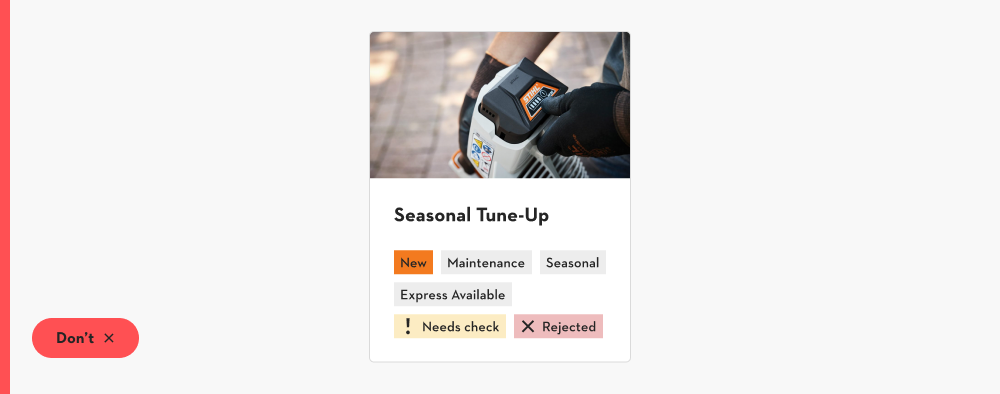

_Figure: Don't example: a card with a battery photo and the title "Seasonal Tune-Up", followed by too many different flag variants in one section: an orange promo flag "New", grey info flags "Maintenance", "Seasonal" and "Express Available", a yellow warning flag "Needs check" with an exclamation icon and a red error flag "Rejected" with a cross icon. This makes scanning and comprehension harder; use a maximum of two flag types per section._

#### Do use separate sections for each Flag variant.

It makes content easier to scan and understand.

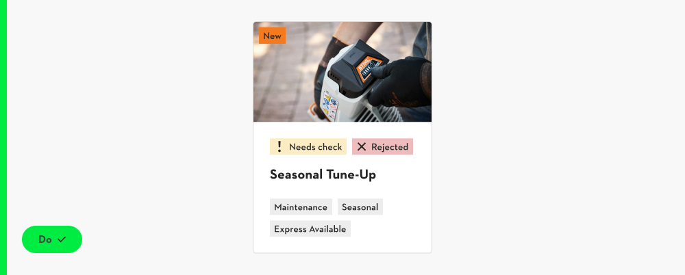

_Figure: Do example: each flag variant has its own section on the "Seasonal Tune-Up" card, which makes content easier to scan. The orange promo flag "New" sits on the top left of the photo, the yellow warning flag "Needs check" (exclamation icon) and red error flag "Rejected" (cross icon) sit together above the title, and the grey info flags "Maintenance", "Seasonal" and "Express Available" sit below it._

#### Don’t use multiple Promo Flags within a group.

Promo Flags should stand out and not compete with one another.

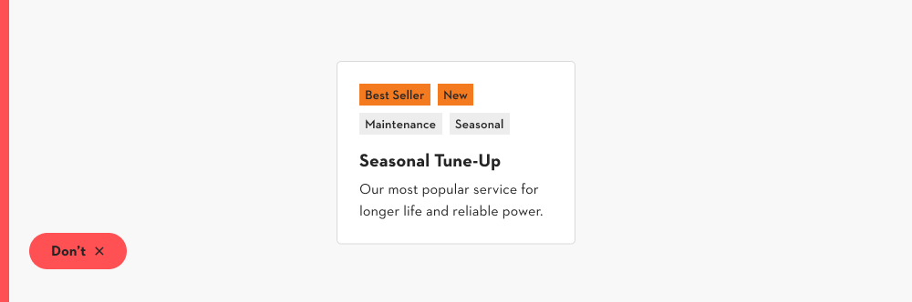

_Figure: Don't example: a card without a photo that shows two orange promo flags, "Best Seller" and "New", side by side above the grey flags "Maintenance" and "Seasonal", the title "Seasonal Tune-Up" and the text "Our most popular service for longer life and reliable power." Multiple Promo flags within a group compete with one another; a Promo flag should stand out._

#### Use a maximum of two Promo Flags per group, ensuring one is highlighted and the other is neutral.

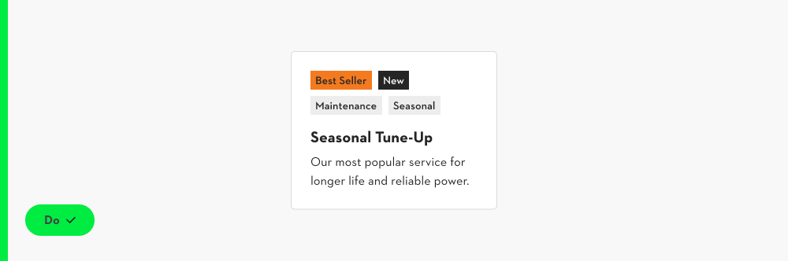

_Figure: Do example: a white card titled "Seasonal Tune-Up" with the text "Our most popular service for longer life and reliable power." Above the title are four Flags in two rows: two Promo Flags, a highlighted orange "Best Seller" and a neutral dark "New", followed by two light grey Flags "Maintenance" and "Seasonal". It shows the rule of a maximum of two Promo Flags per group, one highlighted and one neutral._

### Promo usage

#### Promo Flag Neutral vs. Highlight

The two Promo flag variants are used depending on the level of emphasis and the accompanying conversion element.

1. **Promo Neutral**
   - Used in combination with a Highlight Button. In this case, the button should remain the primary call to action, and the flag acts as a secondary element.
   - This is commonly used in Product cards.
1. **Promo Highlight**
   - Used with other interactive elements that are not the primary Highlight Button. In this case, the flag can take on more visual prominence to attract attention.
   - This is commonly used in Link Cards and Action Cards.

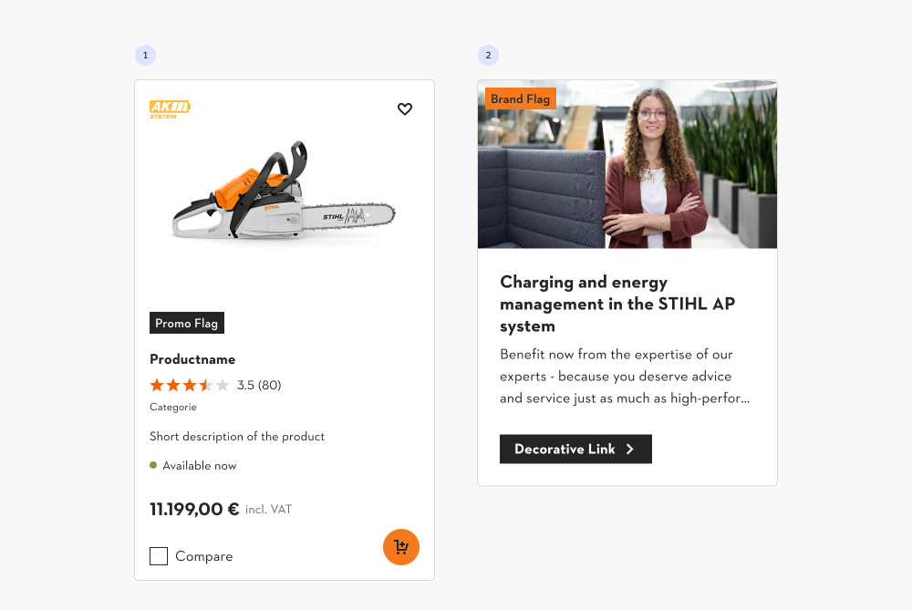

_Figure: Two cards using flags. Callout 1 points at a product card (chainsaw image, "Productname", rating "3.5 (80)", "Categorie", short description, "Available now", price "11.199,00 €" incl. VAT, "Compare" checkbox and an orange add-to-cart button) with a dark "Promo Flag" above the product name, the Promo Neutral variant used with a Highlight Button. Callout 2 points at a vertical link card with a photo, an orange "Brand Flag" on the image, the heading "Charging and energy management in the STIHL AP system", a truncated description and a "Decorative Link"._

### Color usage

#### Additional colors

Additional colors may be introduced **only when necessary** and when required by the product or layout.

These colors should be used exclusively for labeling purposes (e.g. categories) and must not be used to communicate status or promotional emphasis.

Ensure additional colors are visually distinct from the other Status Flags, so they are not confused with semantic states.

All color combinations must meet [WCAG AA contrast requirements](https://accessibleweb.com/color-contrast-checker/): **AA (minimum): 4.5:1 for normal text, 3:1 for large text and UI components**

The text label color must remain grey-ultra-deep (token: content-color/primary).

When introducing new colors, ensure they are accessible and behave consistently in dark mode.

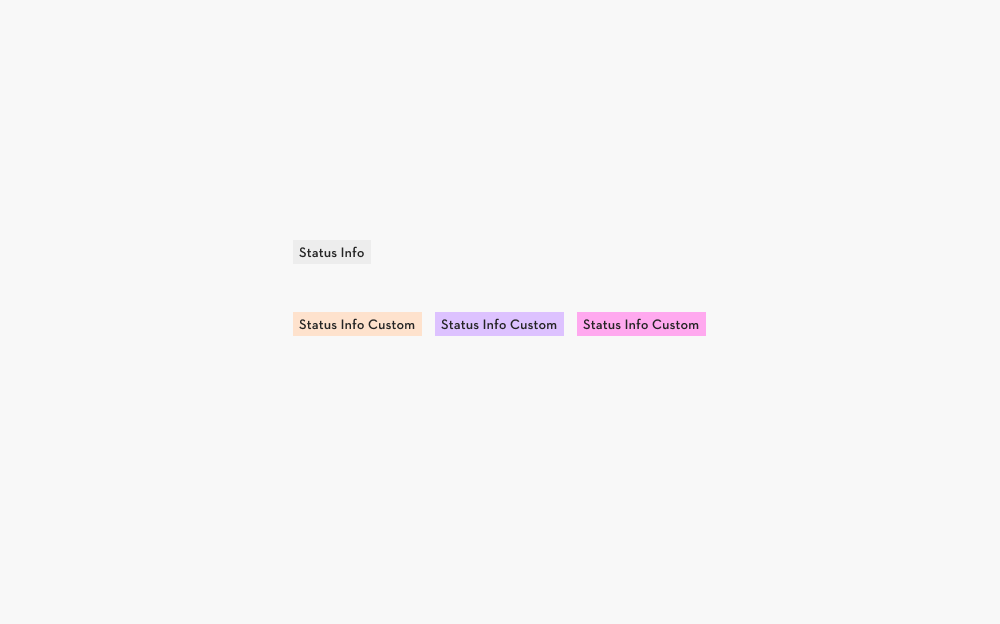

_Figure: Additional colors for the Flag. The standard light grey Flag "Status Info" is shown on its own in the upper row. Below it are three custom-colored Flags, each labelled "Status Info Custom": one light peach, one light purple and one pink, all with dark text. They illustrate additional label colors that stay visually distinct from the Status Flags._

#### Don’t use custom-colored Flags for the STIHL battery systems.

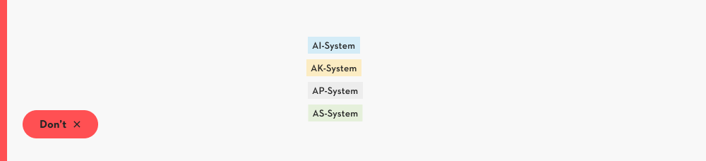

_Figure: Don't example: four text-only Flags stacked vertically, each in a different color: "AI-System" light blue, "AK-System" light yellow, "AP-System" light grey and "AS-System" light green. This is wrong because the STIHL battery systems must not be shown as custom-colored Flags; the dedicated battery system logos are used instead._

#### Do use the dedicated STIHL battery system logos .

Refer to the [STIHL brand portal](https://brandportal.stihl.com/de/basic-elements/layout-prinziples/drive-cordless-system-module) for details.

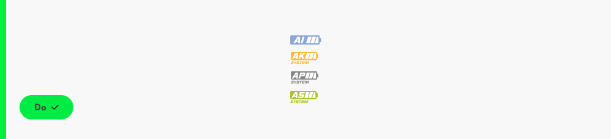

_Figure: Do example: the four dedicated STIHL battery system logos stacked vertically, each drawn as a small battery icon: AI in blue, AK System in orange, AP System in grey and AS System in green. This is right because the official logos are used for battery systems instead of custom-colored Flags; details are in the STIHL brand portal._

### Related components

#### Status Flag vs. System Feedback vs. Notification

These components serve different purposes and should not be used interchangeably.

1. **Status Flag** Communicates the state of an object or process:
   - Associated with a specific item (e.g. in a database)
   - Appears as part of the layout (e.g. within a Card or Table)
   - Can change, be replaced, or disappear as the state updates
1. **System Feedback** Guides the user in response to an interaction:
   - Triggered by user input or actions
   - Appears close to the relevant UI element (e.g. Input)
   - Helps users understand and resolve issues (e.g. errors, validation)
   - Typically disappears once the issue is resolved [System Feedback building block →](https://www.figma.com/design/qXldpLO6gxHJNLdcXIPxYt?node-id=14690-32)
1. **Notification** Informs the user about system events or updates:
   - Triggered by system logic, not direct user interaction
   - Appears within a flow or as an overlay
   - May require user attention or action
   - Can be dismissed by the user [Notification component →](https://www.figma.com/design/qXldpLO6gxHJNLdcXIPxYt?node-id=7251-8)
1. **Toast** Provides temporary, non-blocking feedback about an action or event:
   - Often triggered by user actions (e.g. “Saved successfully”)
   - Appears briefly as an overlay (e.g. bottom or top of screen)
   - Does not interrupt the user’s flow
   - Disappears automatically after a short duration [Toast component →](https://www.figma.com/design/qXldpLO6gxHJNLdcXIPxYt?node-id=8844-4923)

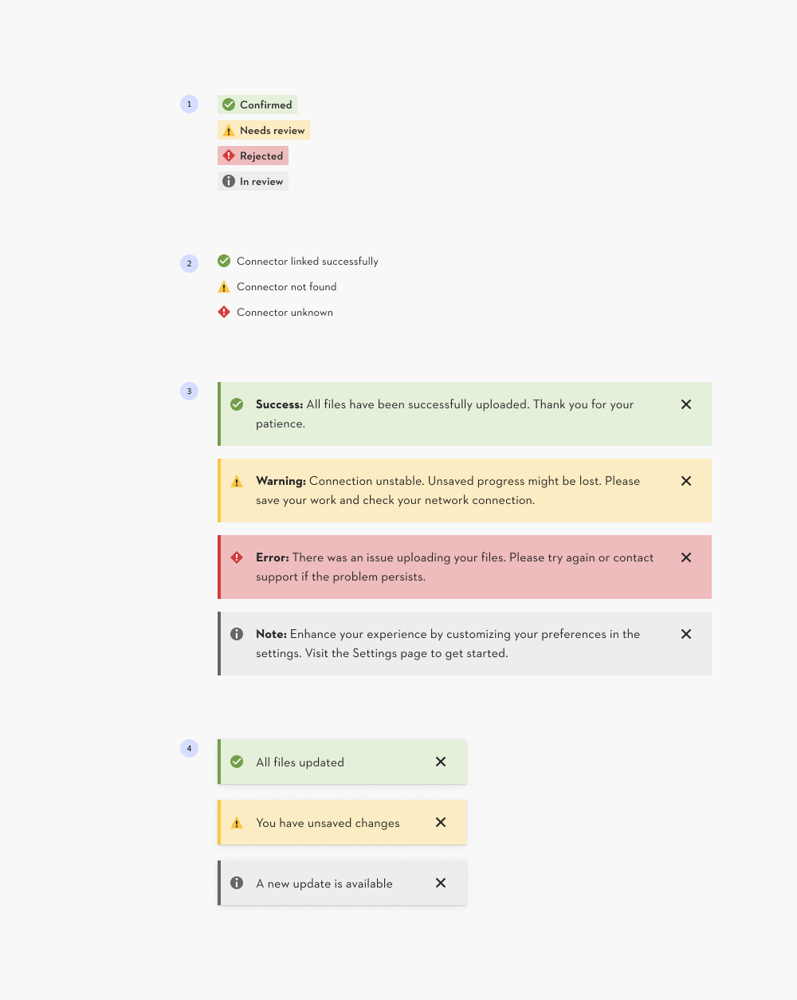

_Figure: Comparison of Status Flag, System Feedback and Notification with four numbered callouts. Callout 1 points at four Status Flags with icons: "Confirmed" (green), "Needs review" (yellow), "Rejected" (red) and "In review" (grey). Callout 2 points at three System Feedback messages, text with a status icon and no background: "Connector linked successfully", "Connector not found" and "Connector unknown". Callout 3 points at four full-width Notifications with colored left border, icon and close button: "Success: All files have been successfully uploaded. Thank you for your patience.", "Warning: Connection unstable. Unsaved progress might be lost. Please save your work and check your network connection.", "Error: There was an issue uploading your files. Please try again or contact support if the problem persists." and "Note: Enhance your experience by customizing your preferences in the settings. Visit the Settings page to get started." Callout 4 points at three smaller Toasts with shadow, icon and close button: "All files updated" (green), "You have unsaved changes" (yellow) and "A new update is available" (grey)._

## Examples

### STIHL Service Communication (SSC)

- Table with multiple functions
- Use of Status Flags

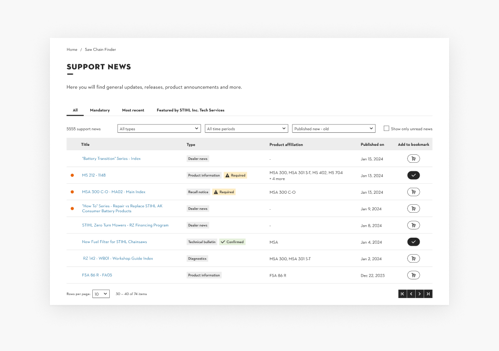

_Figure: STIHL Service Communication (SSC) page "SUPPORT NEWS" with the intro "Here you will find general updates, releases, product announcements and more.", tabs "All" (active), "Mandatory", "Most recent" and "Featured by STIHL Inc. Tech Services", and filters "All types", "All time periods", "Published new - old" and a "Show only unread news" checkbox. A table with columns "Title", "Type", "Product affiliation", "Published on" and "Add to bookmark" lists news items with small grey Type Flags such as "Dealer news", "Product information", "Recall notice", "Technical bulletin" and "Diagnostics". Some rows also carry a yellow status Flag "Required" with a warning icon, and one row a green Flag "Confirmed" with a check icon. Pagination shows "Rows per page: 10" and "30 – 40 of 74 items"._

### Timbersports Article

- Multiple Flags in articles to show categories

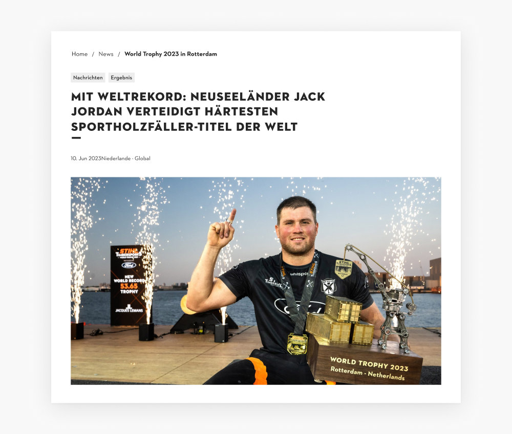

_Figure: Timbersports article page with breadcrumb "Home / News / World Trophy 2023 in Rotterdam". Two light grey category Flags, "Nachrichten" and "Ergebnis", sit above the uppercase headline "Mit Weltrekord: Neuseeländer Jack Jordan verteidigt härtesten Sportholzfäller-Titel der Welt", followed by the date line "10. Jun 2023Niederlande · Global" and a large photo of a smiling athlete with a medal and the World Trophy 2023 trophy._

### Corporate STIHL Journal

- Multiple Flags in Link Cards to show categories

_Figure: Corporate STIHL Journal page with the STIHL logo, a search field "Search Site", "Contact" and "English" links, and a navigation bar with "About STIHL", "Sustainability", "Careers", "STIHL Journal" and "Press". A grid of Link Cards shows one large card "Interview with Dr Michael Prochaska" and two cards "One lab for all", each with a photo, a short teaser text and two small grey category Flags at the bottom: "People and Stories" and "Interview" on the large card, "Backstage" and "Background Story" on the others. A cut-off second row has four cards titled "Charging and energy management in the STIHL AP"._

### Product Overview Page

- Proudct Card with a Promo Flag

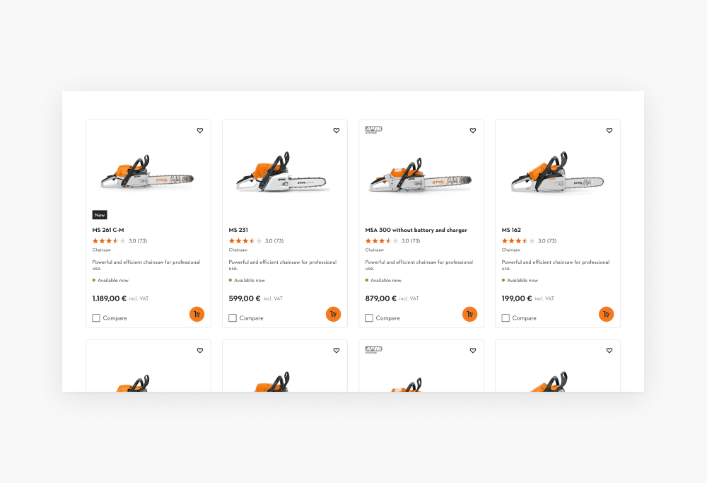

_Figure: Product overview page with a grid of four Product Cards per row, each with a chainsaw image, a heart icon, title, star rating, "Chainsaw" category, short description, "Available now", price, "Compare" checkbox and orange cart button. The first card "MS 261 C-M" carries a dark Promo Flag "New" above its title. The third card "MSA 300 without battery and charger" shows a grey AP System battery logo at its top left. The other cards "MS 231" and "MS 162" have no Flag. A second row of cards is cut off at the bottom._
