# Flag

## Flag

Overview:

- A Flag is a non-interactive, read-only component used to communicate status, highlight content, or provide supplementary information (such as categories or metadata).
- Flags come in two variants: Status and Promo.
   - Status Flags indicate the state of an item or process, or provide neutral contextual labels.
   - Promo Flags highlight content and are often used alongside buttons.

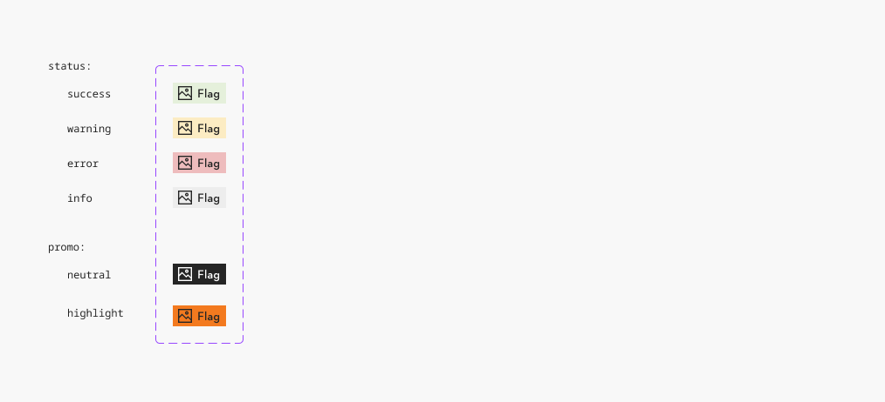

_Figure: The Flag component, which has two variants: Status and Promo. The Status variant includes four states labeled success, warning, error, and info, each with a different colored background. The Promo variant includes two states labeled neutral and highlight, each with a distinct background color. The layout shows each Flag with an icon and the text "Flag" next to it._

### Further guidelines

[Storybook documentation](https://main--63440bbb95889041542a5ba3.chromatic.com/?path=/docs/components-flag--documentation)

### Related elements

[Chip group](https://www.figma.com/design/qXldpLO6gxHJNLdcXIPxYt?node-id=18691-978)

[Notification](https://www.figma.com/design/qXldpLO6gxHJNLdcXIPxYt/Pattern-Library-%F0%9F%96%A5-Web-1.0?node-id=7251-8)

[Iconography](https://www.figma.com/design/U218NNP4OsipaHOtv5flns/Iconography-%E2%9E%A1%EF%B8%8F?m=auto)

[System feedback](https://www.figma.com/design/qXldpLO6gxHJNLdcXIPxYt/Pattern-Library-%F0%9F%96%A5-Web-1.0?node-id=14690-32&t=70clRGTOE7xoCl4t-4)

### Contribute

Contribute to improving this component by sharing your feedback, asking questions, or suggesting features [here](https://www.figma.com/design/lLmw7PfIdKjFG4uT3B2Hyj/Onboarding-%F0%9F%93%96?node-id=446-868&t=zKmRu4kAkxMeRDmK-4).

## Formatting and Construction

### Anatomy

1. **Icon (optional)**
1. **Label**

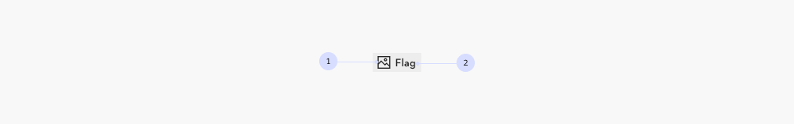

_Figure: The anatomy of a Flag component in a UI design system. The numbered callout 1 points to a circle on the left side of the Flag component, and the numbered callout 2 points to a circle on the right side of the Flag component. The Flag component includes an optional Icon and a Label named "Flag" with a color status of info._

#### Variants

Flags have two variants: **Status and Promo**.

1. **Status:** Used to communicate the state of an item or to provide neutral contextual labeling.
   1. **Success**
   1. **Warning**
   1. **Error**
   1. **Info**
1. **Promo:** Used for marketing, highlighting, or drawing attention to specific content.
   1. **Neutral**
   1. **Highlight**

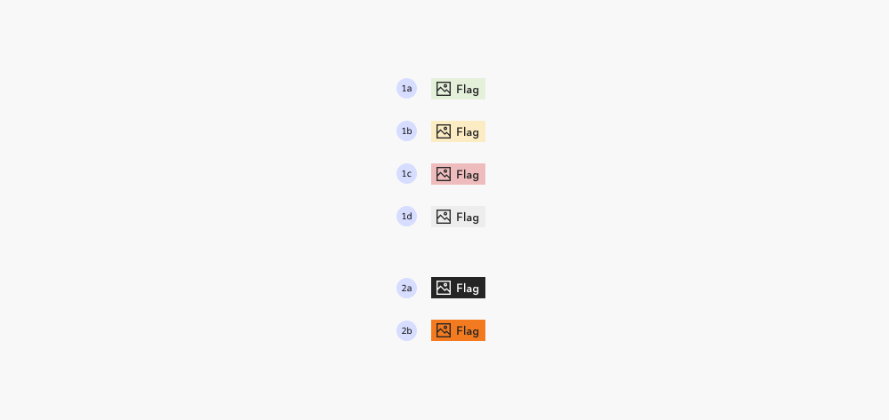

_Figure: The "Flag" component with its two variants: Status and Promo. The Status variant includes four states: success, warning, error, and info, while the Promo variant includes two states: neutral and highlight. Each numbered callout points to a specific example of the Flag component with its respective label and color: 1a is Flag with color status: success, 1b is Flag with color status: warning, 1c is Flag with color status: error, 1d is Flag with color status: info, 2a is Flag with color promo: neutral, and 2b is Flag with color promo: highlight._

### Sizing

#### As long as text

The width of the flag adjusts to the label length.

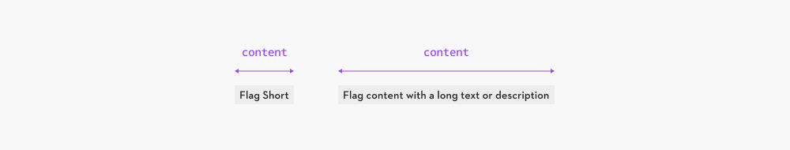

_Figure: Two variants of a flag component used in the STIHL Design System. The first flag is labeled "Flag Short" and the second flag is labeled "Flag content with a long text or description," both in the info status color. The width of each flag adjusts to the length of its respective label, demonstrating how the component scales with varying text lengths._

### Spacing

Multiple flags can be placed together, and the spacing between elements is 8px.

If needed, wrap the items in the group. Vertical spacing is also 8px.

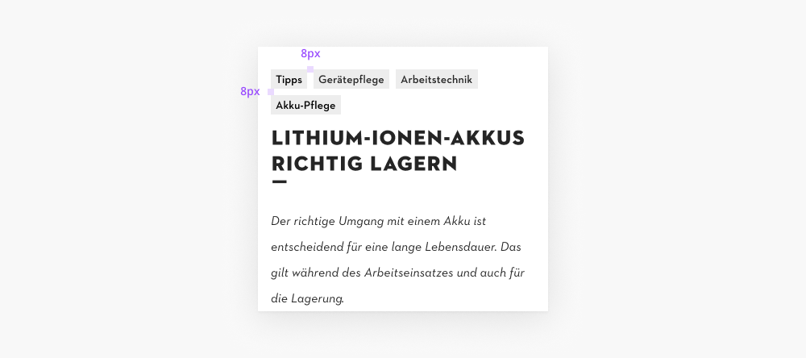

_Figure: A UI component called a "Flag" within the STIHL Design System. The spacing between multiple flags placed together is 8px, both horizontally and vertically. The text elements shown include "Tipps", "Gerätepflege", "Arbeitstechnik", "Akku-Pflege", "Lithium-Ionen-Akkus richtig lagern", and a paragraph starting with "Der richtige Umgang mit einem Akku ist entscheidend für eine lange Lebensdauer..."._

## Content and Assets

### Labels

#### Do use concise labels

Use short words in simple language. They must be easy to understand. Also, avoid abbreviations for accessibility reasons.

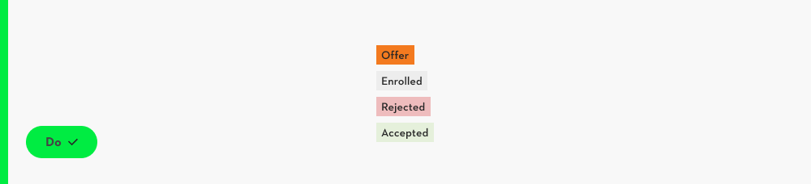

_Figure: A "Flag" component with various states, each using concise labels. The states shown are "Offer" in promo highlight color, "Enrolled" in status info color, "Rejected" in status error color, and "Accepted" in status success color. The example is marked as a "Do" because it uses short, simple words that are easy to understand and avoids abbreviations for better accessibility._

#### Don’t repeat the subject in flag labels.

It creates unnecessary length.

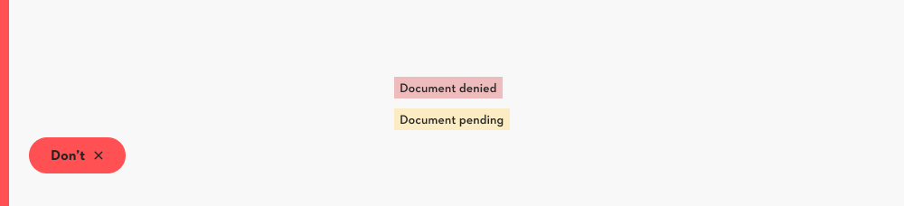

_Figure: Two flag components with labels "Document denied" and "Document pending". The "Document denied" flag is colored status: error, and the "Document pending" flag is colored status: warning. The example is marked as a "Don't" because it repeats the subject in flag labels, creating unnecessary length._

#### Don’t use similar or synonymous terms across flags.

E.g. “Rejected” and “Declined”.

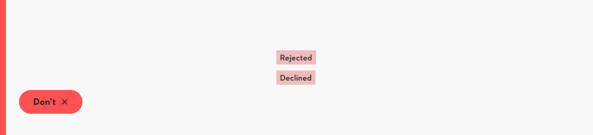

_Figure: Two flags labeled "Rejected" and "Declined", both with the color status of error. This is marked as a "Don't" example because it demonstrates the use of similar or synonymous terms across flags, which should be avoided. The flags are placed one above the other in the center of the image._

### Icons

#### Icon usage with purpose

Icons are **optional**. Use icons sparingly, as excessive use can create unnecessary cognitive load.

When used, icons should support quick visual recognition and help users understand the meaning of the flag at a glance.

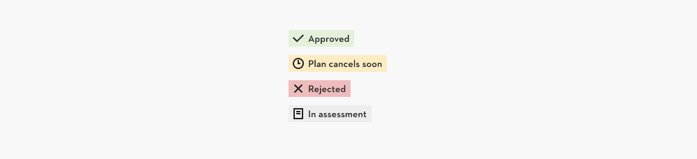

_Figure: A "Flag" component with four variants, each showing an icon paired with a label and a specific color indicating its status. The variants are "Approved" with a checkmark icon and green color, "Plan cancels soon" with a clock icon and yellow color, "Rejected" with an 'X' icon and red color, and "In assessment" with a square icon and grey color. Icons are used to support quick visual recognition and should be used sparingly to avoid unnecessary cognitive load._

#### Icon type

1. Use Functional Icons for flags by default.
1. For the Status variants, System Feedback Icons may be used to reinforce meaning and ensure the status stands out visually.

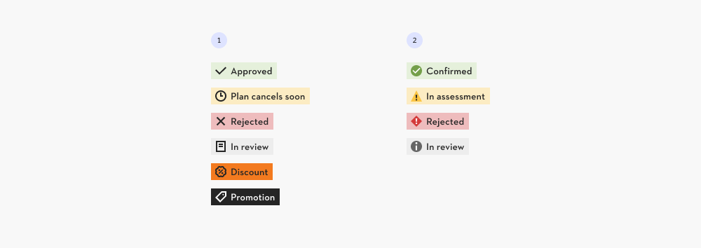

_Figure: Two sets of icons labeled with different statuses and actions, each set numbered 1 and 2. Callout 1 points to icons labeled Approved, Plan cancels soon, Rejected, In review, Discount, and Promotion, each with distinct colors and icons. Callout 2 points to icons labeled Confirmed, In assessment, Rejected, and In review, also with distinct colors and icons. The icons represent various states such as Approved, Rejected, In review, and others, each with specific colors indicating their status like success, warning, error, info, and promo._

#### Do use icons consistently within each variant

Flags with and without icons can be used together, as long as usage is consistent within each variant.

For example:

1. Status Info flags remain icon-free, while Status Warning flags include icons.
1. Status Info Flags may be icon-free, while Promo flags can use icons for emphasis.

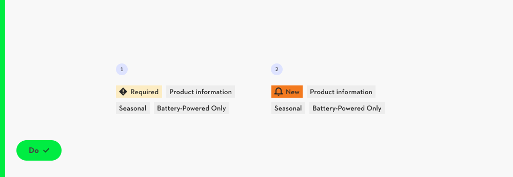

_Figure: Two examples of flag components with consistent icon usage within each variant. The first callout points to a flag labeled "Required" with no icon, indicating it is a Status Info flag. The second callout points to a flag labeled "New" with an icon, indicating it is a Promo flag. Both flags also include additional text labels such as "Product information," "Seasonal," and "Battery-Powered Only." The example demonstrates correct usage by maintaining consistency in icon presence within each flag variant._

#### Don’t mix icon usage within the same variant

Avoid combining flags with and without icons within a single variant, as this creates inconsistency and reduces clarity.

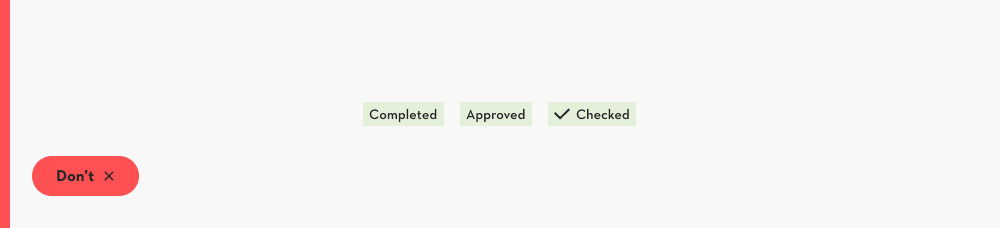

_Figure: Three flags in a row, all with the color status: success. The first flag has the label Completed, the second flag has the label Approved, and the third flag has an icon and the label Checked. The example is marked as a "Don't" because it mixes flags with and without icons within the same variant, which creates inconsistency and reduces clarity._

### Numbers

#### Don’t use flags with numbers only.

Use a number indicator component instead.

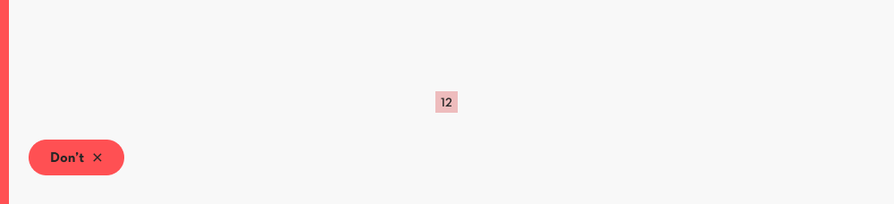

_Figure: A "Don't" example of a flag component labeled "12" with the color status: error. This example is incorrect because it uses a flag with a number only. Instead, a number indicator component should be used for such cases._

#### Do pair numbers with a label when displaying counts.

Use brackets for secondary counts (e.g. “Comments (3)”).

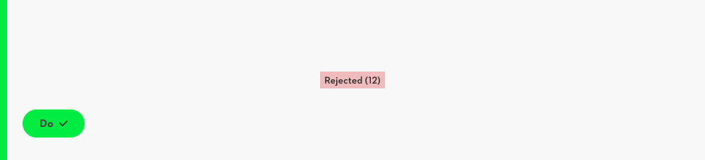

_Figure: A "Do" example for pairing numbers with a label when displaying counts in a UI design system. It shows a component with various states: "New" in green, "In assessment" in yellow with an icon, "Rejected" in red with and without an icon, and "Enrolled" in blue. The label "Rejected (12)" uses brackets to indicate a secondary count, which is the correct approach as specified in the documentation._

## Usage

### Variants

#### Status

Used to communicate the state of an item:

1. **Success** Indicates a successful, completed, or approved state.
1. **Warning** Indicates a potential issue or situation that requires attention.
1. **Error** Indicates a failure, critical issue, or negative outcome.

or to provide neutral contextual labeling:

1. **Info** Indicates a neutral or ongoing state (e.g. in progress or under review). Can also be used for non-semantic labels such as categories, tags, or metadata when no status or urgency should be conveyed.

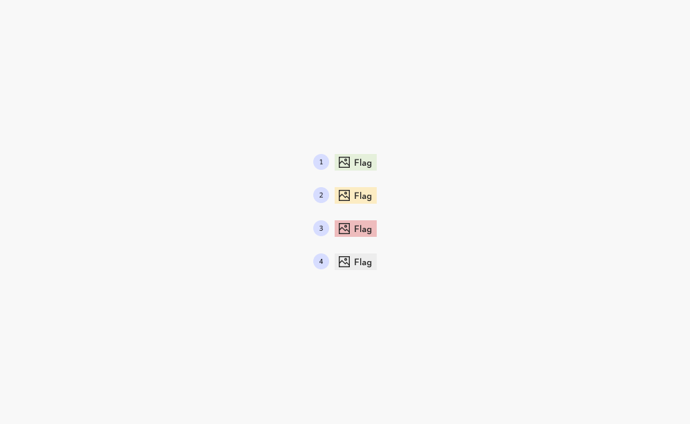

_Figure: A component named "Flag" with four variants, each indicating a different status: Success, Warning, Error, and Info. Each numbered callout points to a Flag icon with a specific color representing its status: Callout 1 is labeled "Flag" with the color status: success, Callout 2 is labeled "Flag" with the color status: warning, Callout 3 is labeled "Flag" with the color status: error, and Callout 4 is labeled "Flag" with no specific status color._

#### Promo

Promo Flags are typically used alongside a button, but can also appear without one. Choose the variant based on context

- Primary button (background-color/primary-inverse) or no Button → use **Highlight Flag**
- Highlight Button (background-color/brand) → use **Neutral Flag**

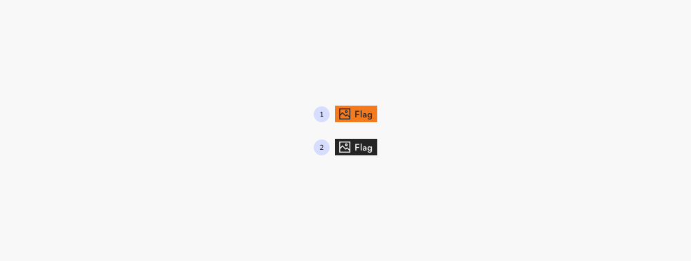

_Figure: Two variants of a Flag component used in a promo section. Callout 1 points to the Flag with the label "Flag" and color "promo: highlight," while callout 2 points to the Flag with the label "Flag" and color "promo: neutral." These flags are used based on the context of whether a primary button or a highlight button is present._

### Groupings and combinations

#### Combining multiple Flags in one section are allowed.

Ensure each group has a clear and distinguishable purpose.

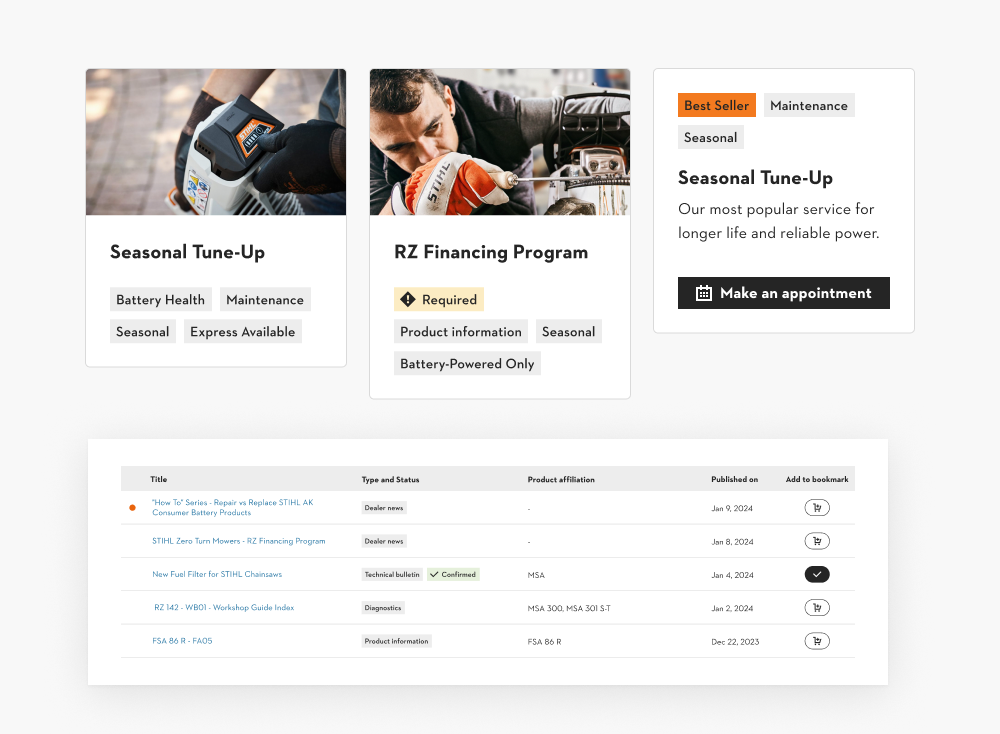

_Figure: Two action-card-vertical components with medium padding and content sizing set to hug. The first card is labeled "Seasonal Tune-Up" and includes flags such as "Battery Health," "Maintenance," "Seasonal," and "Express Available." The second card is labeled "RZ Financing Program" and includes flags such as "Required," "Product information," and "Battery-Powered Only." Additionally, the "Seasonal Tune-Up" card is marked as a "Best Seller" and includes a description and a call-to-action button labeled "Make an appointment." The layout demonstrates how multiple flags can be combined within a single section, each group having a clear and distinguishable purpose._

#### Don’t combine too many different Flag variants in one section.

It makes scanning and comprehension more difficult. Use a max. of two Flag types per section.

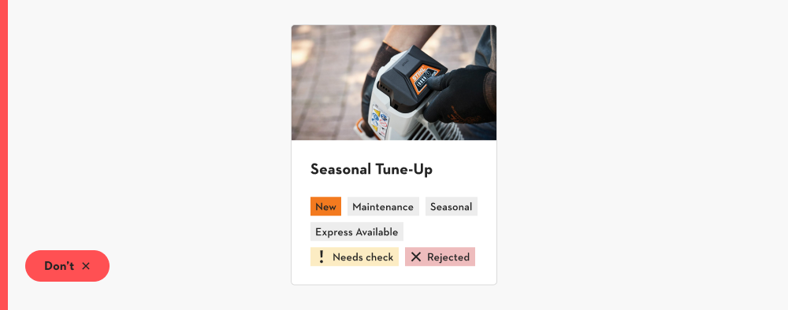

_Figure: An action-card-vertical component with a media slot, medium padding, and hug content sizing. It displays a "Seasonal Tune-Up" card with multiple flag variants including "New", "Maintenance", "Seasonal", "Express Available", "Needs check", and "Rejected". This is marked as a "Don't" example because combining too many different flag variants in one section makes scanning and comprehension more difficult; it is recommended to use a maximum of two flag types per section._

#### Do use separate sections for each Flag variant.

It makes content easier to scan and understand.

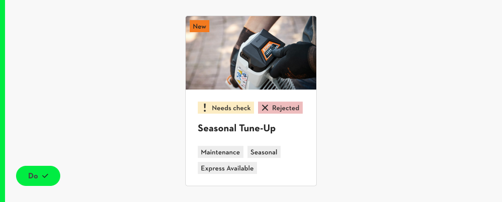

_Figure: An action-card-vertical component with a media slot, medium padding, and hug content sizing. It includes four flag variants: "New" labeled with a success status, "Needs check" with a warning status, "Rejected" with an error status, and "Enrolled" with an info status. The example is marked as a "Do" because it uses separate sections for each flag variant, making the content easier to scan and understand. The card also contains text elements including "Seasonal Tune-Up", "Maintenance", "Seasonal", and "Express Available"._

#### Don’t use multiple Promo Flags within a group.

Promo Flags should stand out and not compete with one another.

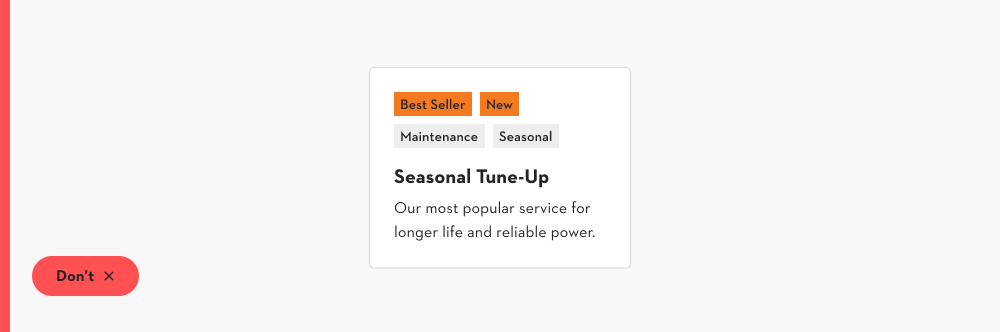

_Figure: An action-card-vertical component with padding set to medium and content sizing set to hug. It displays two Promo Flags labeled "Best Seller" and "New," along with two tabs labeled "Maintenance" and "Seasonal." The text "Seasonal Tune-Up" and "Our most popular service for longer life and reliable power" is also present. This example is marked as a "Don't" because it demonstrates that Promo Flags should not be used multiple times within a group as they should stand out and not compete with one another._

#### Use a maximum of two Promo Flags per group, ensuring one is highlighted and the other is neutral.

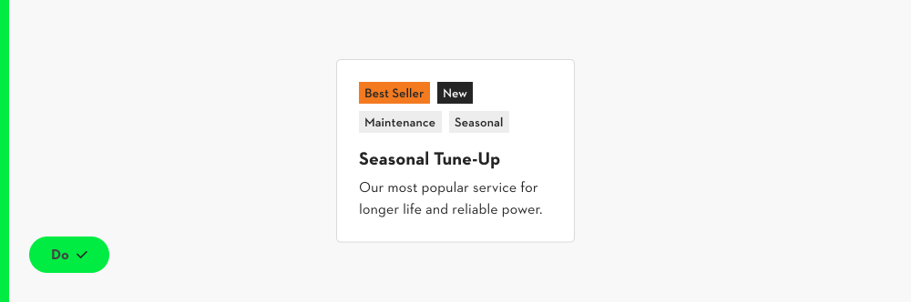

_Figure: An action-card-vertical component with medium padding and hug content sizing. It displays two Promo Flags: one highlighted as "Best Seller" and another neutral labeled "New". The card includes categories "Maintenance" and "Seasonal", with a title "Seasonal Tune-Up" and description "Our most popular service for longer life and reliable power." The board is marked as a "Do" example, indicating correct usage of a maximum of two Promo Flags per group, with one highlighted and the other neutral._

### Promo usage

#### Promo Flag Neutral vs. Highlight

The two Promo flag variants are used depending on the level of emphasis and the accompanying conversion element.

1. **Promo Neutral**
   - Used in combination with a Highlight Button. In this case, the button should remain the primary call to action, and the flag acts as a secondary element.
   - This is commonly used in Product cards.
1. **Promo Highlight**
   - Used with other interactive elements that are not the primary Highlight Button. In this case, the flag can take on more visual prominence to attract attention.
   - This is commonly used in Link Cards and Action Cards.

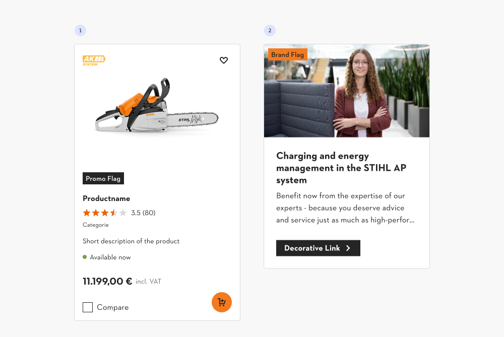

_Figure: Two cards using flags. Callout 1 points at a product card (chainsaw image, "Productname", rating "3.5 (80)", "Categorie", short description, "Available now", price "11.199,00 €" incl. VAT, "Compare" checkbox and an orange add-to-cart button) with a dark "Promo Flag" above the product name, the Promo Neutral variant used with a Highlight Button. Callout 2 points at a vertical link card with a photo, an orange "Brand Flag" on the image, the heading "Charging and energy management in the STIHL AP system", a truncated description and a "Decorative Link"._

### Color usage

#### Additional colors

Additional colors may be introduced **only when necessary** and when required by the product or layout.

These colors should be used exclusively for labeling purposes (e.g. categories) and must not be used to communicate status or promotional emphasis.

Ensure additional colors are visually distinct from the other Status Flags, so they are not confused with semantic states.

All color combinations must meet [WCAG AA contrast requirements](https://accessibleweb.com/color-contrast-checker/): **AA (minimum): 4.5:1 for normal text, 3:1 for large text and UI components**

The text label color must remain grey-ultra-deep (token: content-color/primary).

When introducing new colors, ensure they are accessible and behave consistently in dark mode.

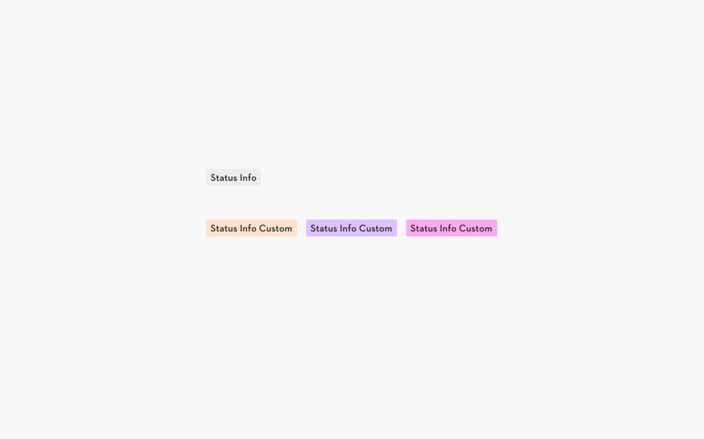

_Figure: Two instances of a flag component. The first flag is labeled "Status Info" with a color designated as status: info. The second flag is labeled "Status Info Custom" and also has a color designated as status: info, but it appears in three different custom colors. The text labels in both flags are in grey-ultra-deep color._

#### Don’t use custom-colored Flags for the STIHL battery systems.

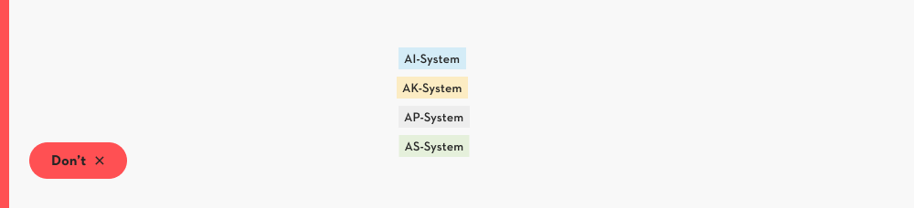

_Figure: Four flag components labeled AI-System, AK-System, AP-System, and AS-System, each with different colors: promo highlight, status warning, status info, and status success, respectively. The board is marked as a "Don't" example, indicating that custom-colored flags should not be used for the STIHL battery systems. Each flag represents a different system, but the use of custom colors is advised against in this context._

#### Do use the dedicated STIHL battery system logos .

Refer to the [STIHL brand portal](https://brandportal.stihl.com/de/basic-elements/layout-prinziples/drive-cordless-system-module) for details.

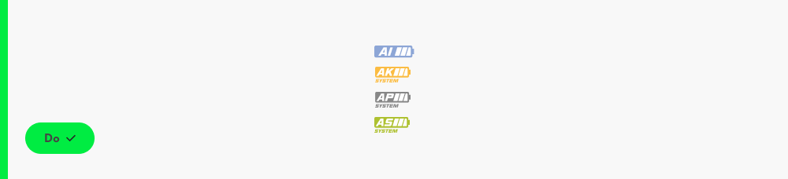

_Figure: The correct usage of dedicated STIHL battery system logos, specifying four variants: ai, ak-system, ap-system, and as-system. It also displays four status indicators: "New" in green, "In assessment" in yellow, "Rejected" in red, and "Enrolled" in blue. The board is marked as a "Do" example, indicating the correct use of these logos._

### Related components

#### Status Flag vs. System Feedback vs. Notification

These components serve different purposes and should not be used interchangeably.

1. **Status Flag** Communicates the state of an object or process:
   - Associated with a specific item (e.g. in a database)
   - Appears as part of the layout (e.g. within a Card or Table)
   - Can change, be replaced, or disappear as the state updates
1. **System Feedback** Guides the user in response to an interaction:
   - Triggered by user input or actions
   - Appears close to the relevant UI element (e.g. Input)
   - Helps users understand and resolve issues (e.g. errors, validation)
   - Typically disappears once the issue is resolved [System Feedback building block →](https://www.figma.com/design/qXldpLO6gxHJNLdcXIPxYt?node-id=14690-32)
1. **Notification** Informs the user about system events or updates:
   - Triggered by system logic, not direct user interaction
   - Appears within a flow or as an overlay
   - May require user attention or action
   - Can be dismissed by the user [Notification component →](https://www.figma.com/design/qXldpLO6gxHJNLdcXIPxYt?node-id=7251-8)
1. **Toast** Provides temporary, non-blocking feedback about an action or event:
   - Often triggered by user actions (e.g. “Saved successfully”)
   - Appears briefly as an overlay (e.g. bottom or top of screen)
   - Does not interrupt the user’s flow
   - Disappears automatically after a short duration [Toast component →](https://www.figma.com/design/qXldpLO6gxHJNLdcXIPxYt?node-id=8844-4923)

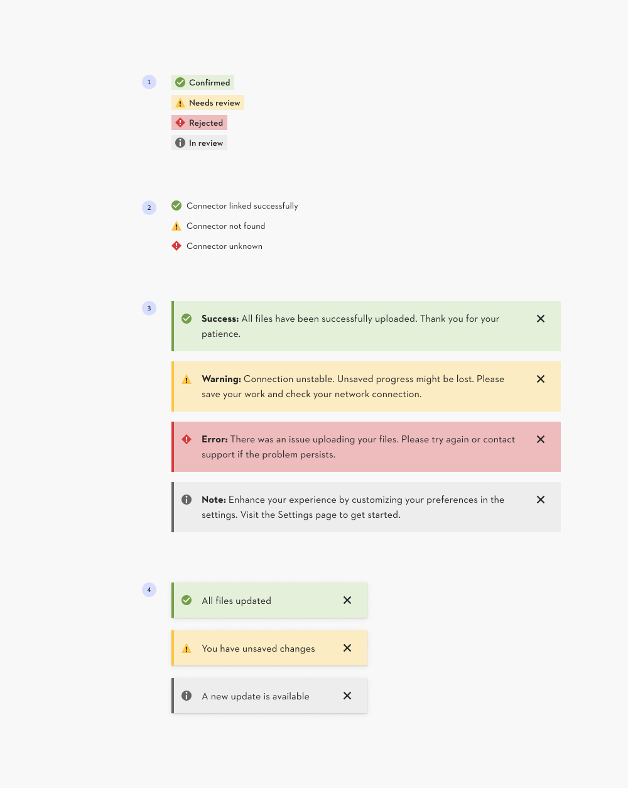

_Figure: The figure compares three different UI components: Status Flag, System Feedback, and Notification. Each component is shown with various states such as "Confirmed", "Needs review", "Rejected", "In review", "Connector linked successfully", "Connector not found", "Connector unknown", "Success", "Warning", "Error", and "Note". The numbered callouts point to examples of these components as follows: 1 points to Status Flags with labels "Confirmed", "Needs review", "Rejected", and "In review". 2 points to System Feedback examples with labels "Connector linked successfully", "Connector not found", and "Connector unknown"..._

## Examples

### STIHL Service Communication (SSC)

- Table with multiple functions
- Use of Status Flags

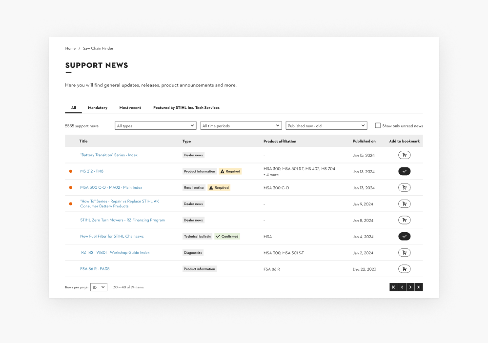

_Figure: A table from the STIHL Service Communication (SSC) section, titled "SUPPORT NEWS," which includes multiple functions and uses Status Flags. The table contains columns labeled Title, Type, Product affiliation, Published on, and Add to bookmark, with rows listing various news items and their details. Each row includes a Status Flag indicating the type of news, such as "Required," "Dealer news," "Recall notice," and "Confirmed." The table also features filters for types, time periods, and sorting options, along with pagination controls at the bottom._

### Timbersports Article

- Multiple Flags in articles to show categories

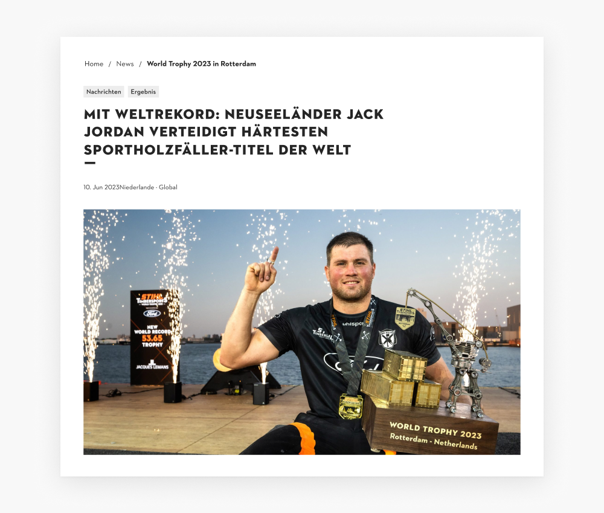

_Figure: A screenshot of a Timbersports Article with multiple Flags used to indicate categories. The text "Home / News / World Trophy 2023 in Rotterdam" shows a breadcrumb navigation, and the text "Nachrichten Ergebnis" represents tabs for different sections. The main headline reads "Mit Weltrekord: Neuseeländer Jack Jordan verteidigt härtesten Sportholzfäller-Titel der Welt," with a date and location noted as "10. Jun 2023 Niederlande · Global." The article includes an image of a person holding trophies with fireworks in the background._

### Corporate STIHL Journal

- Multiple Flags in Link Cards to show categories

_Figure: The Corporate STIHL Journal section with multiple Link Cards. Each Link Card contains a Flag component at the top to indicate categories. The layout shows a grid of Link Cards, each with an image, title, and description, and the Flags are used to categorize the content within each card._

### Product Overview Page

- Proudct Card with a Promo Flag

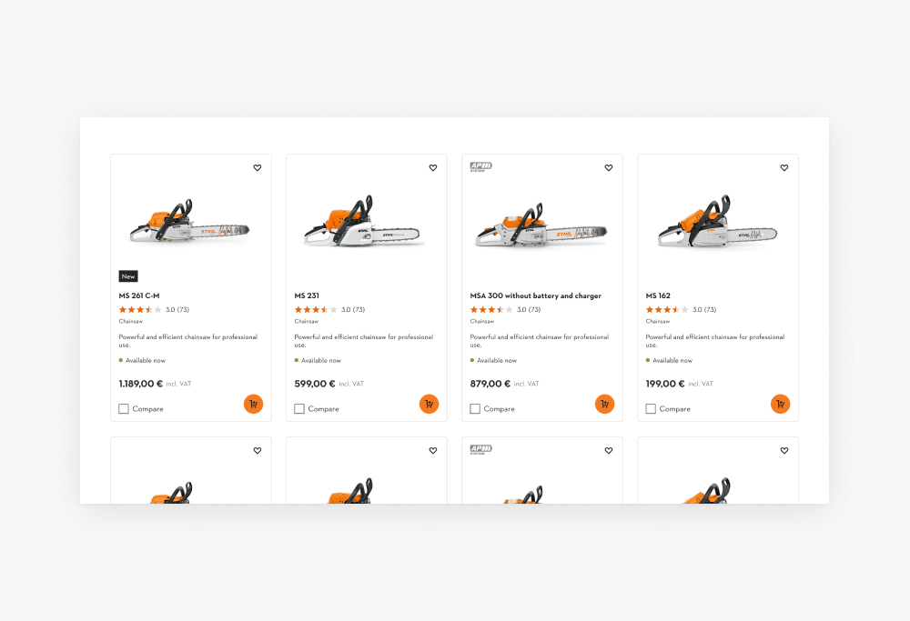

_Figure: A Product Overview Page with four Product Cards, each featuring a Promo Flag. Each Product Card includes an image of a chainsaw, the product name, rating, description, price, and a compare checkbox. The Promo Flag is an orange circle with a white number inside, indicating the number of items available. The layout is a grid with two rows and two columns, each card having the same structure and design elements._
