# Flag

## Flag

Overview:

- A Flag is a non-interactive, read-only component used to communicate status, highlight content, or provide supplementary information (such as categories or metadata).
- Flags come in two variants: Status and Promo.
   - Status Flags indicate the state of an item or process, or provide neutral contextual labels.
   - Promo Flags highlight content and are often used alongside buttons.

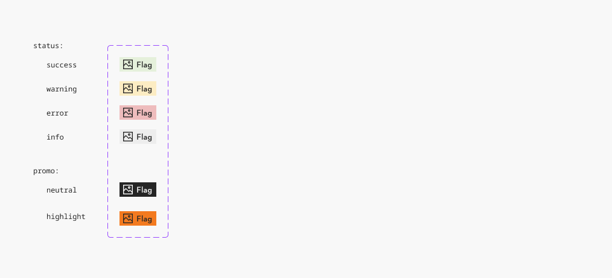

### Further guidelines

[Storybook documentation](https://main--63440bbb95889041542a5ba3.chromatic.com/?path=/docs/components-flag--documentation)

### Related elements

[Chip group](https://www.figma.com/design/qXldpLO6gxHJNLdcXIPxYt?node-id=18691-978)

[Notification](https://www.figma.com/design/qXldpLO6gxHJNLdcXIPxYt/Pattern-Library-%F0%9F%96%A5-Web-1.0?node-id=7251-8)

[Iconography](https://www.figma.com/design/U218NNP4OsipaHOtv5flns/Iconography-%E2%9E%A1%EF%B8%8F?m=auto)

[System feedback](https://www.figma.com/design/qXldpLO6gxHJNLdcXIPxYt/Pattern-Library-%F0%9F%96%A5-Web-1.0?node-id=14690-32&t=70clRGTOE7xoCl4t-4)

### Contribute

Contribute to improving this component by sharing your feedback, asking questions, or suggesting features [here](https://www.figma.com/design/lLmw7PfIdKjFG4uT3B2Hyj/Onboarding-%F0%9F%93%96?node-id=446-868&t=zKmRu4kAkxMeRDmK-4).

## Formatting and Construction

### Anatomy

1. **Icon (optional)**
1. **Label**

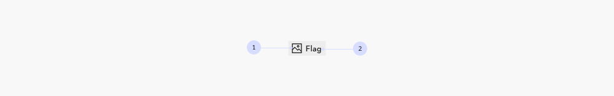

#### Variants

Flags have two variants: **Status and Promo**.

1. **Status:** Used to communicate the state of an item or to provide neutral contextual labeling.
   1. **Success**
   1. **Warning**
   1. **Error**
   1. **Info**
1. **Promo:** Used for marketing, highlighting, or drawing attention to specific content.
   1. **Neutral**
   1. **Highlight**

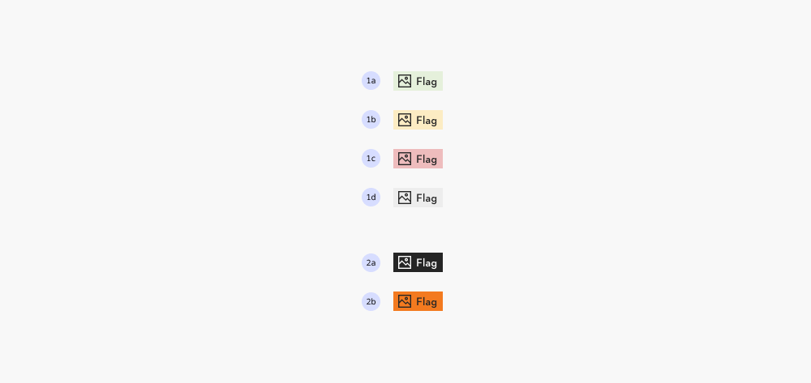

### Sizing

#### As long as text

The width of the flag adjusts to the label length.

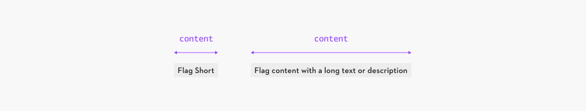

### Spacing

Multiple flags can be placed together, and the spacing between elements is 8px.

If needed, wrap the items in the group. Vertical spacing is also 8px.

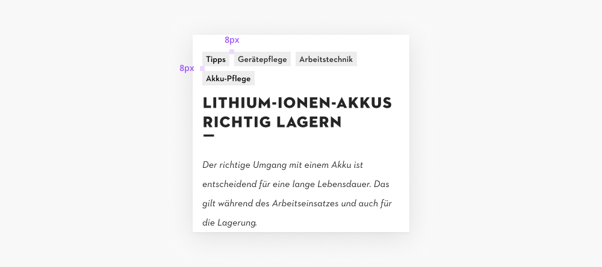

## Content and Assets

### Labels

#### Do use concise labels

Use short words in simple language. They must be easy to understand. Also, avoid abbreviations for accessibility reasons.

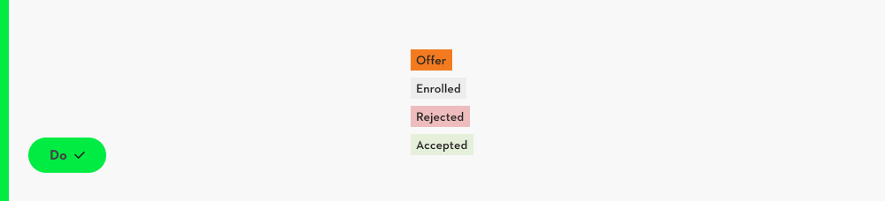

#### Don’t repeat the subject in flag labels.

It creates unnecessary length.

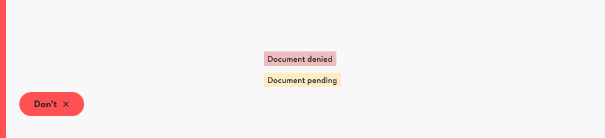

#### Don’t use similar or synonymous terms across flags.

E.g. “Rejected” and “Declined”.

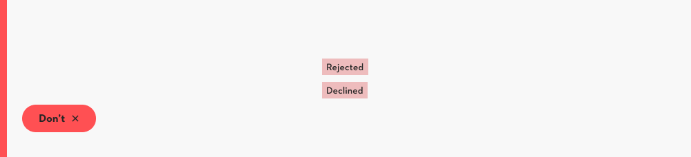

### Icons

#### Icon usage with purpose

Icons are **optional**. Use icons sparingly, as excessive use can create unnecessary cognitive load.

When used, icons should support quick visual recognition and help users understand the meaning of the flag at a glance.

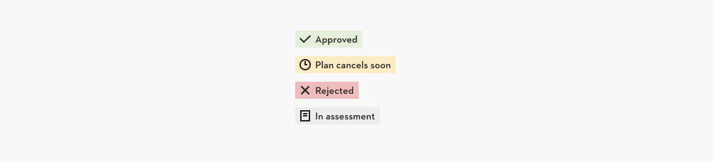

#### Icon type

1. Use Functional Icons for flags by default.
1. For the Status variants, System Feedback Icons may be used to reinforce meaning and ensure the status stands out visually.

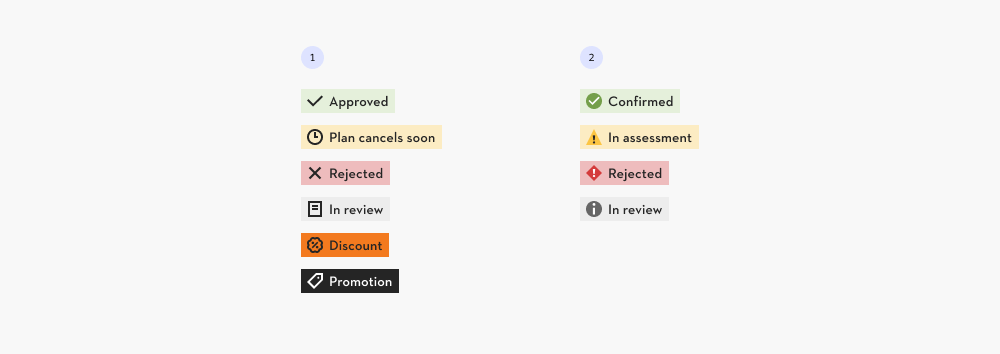

#### Do use icons consistently within each variant

Flags with and without icons can be used together, as long as usage is consistent within each variant.

For example:

1. Status Info flags remain icon-free, while Status Warning flags include icons.
1. Status Info Flags may be icon-free, while Promo flags can use icons for emphasis.

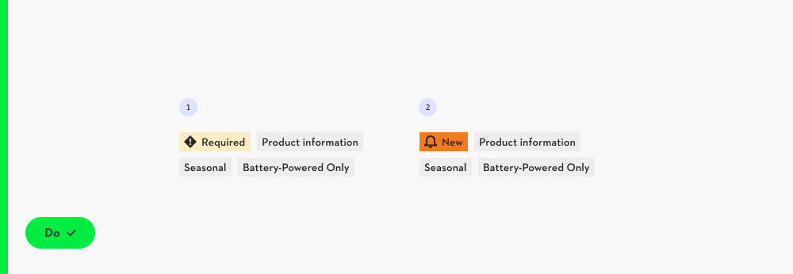

#### Don’t mix icon usage within the same variant

Avoid combining flags with and without icons within a single variant, as this creates inconsistency and reduces clarity.

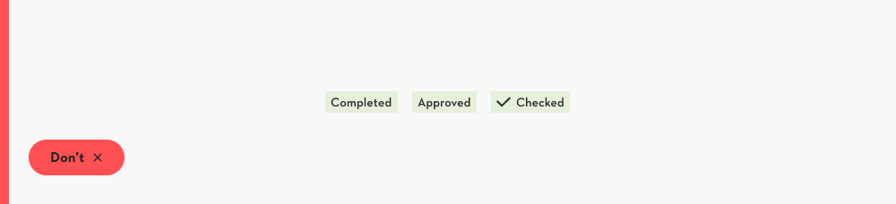

### Numbers

#### Don’t use flags with numbers only.

Use a number indicator component instead.

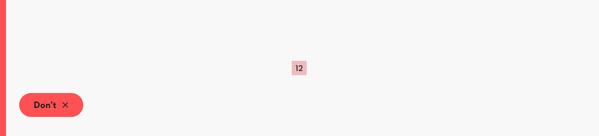

#### Do pair numbers with a label when displaying counts.

Use brackets for secondary counts (e.g. “Comments (3)”).

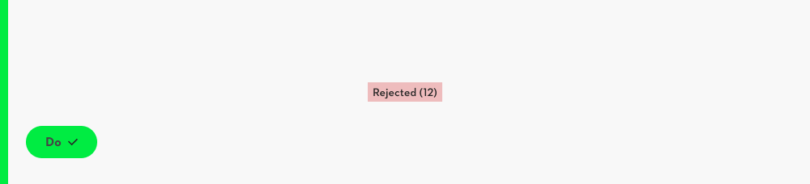

## Usage

### Variants

#### Status

Used to communicate the state of an item:

1. **Success** Indicates a successful, completed, or approved state.
1. **Warning** Indicates a potential issue or situation that requires attention.
1. **Error** Indicates a failure, critical issue, or negative outcome.

or to provide neutral contextual labeling:

1. **Info** Indicates a neutral or ongoing state (e.g. in progress or under review). Can also be used for non-semantic labels such as categories, tags, or metadata when no status or urgency should be conveyed.

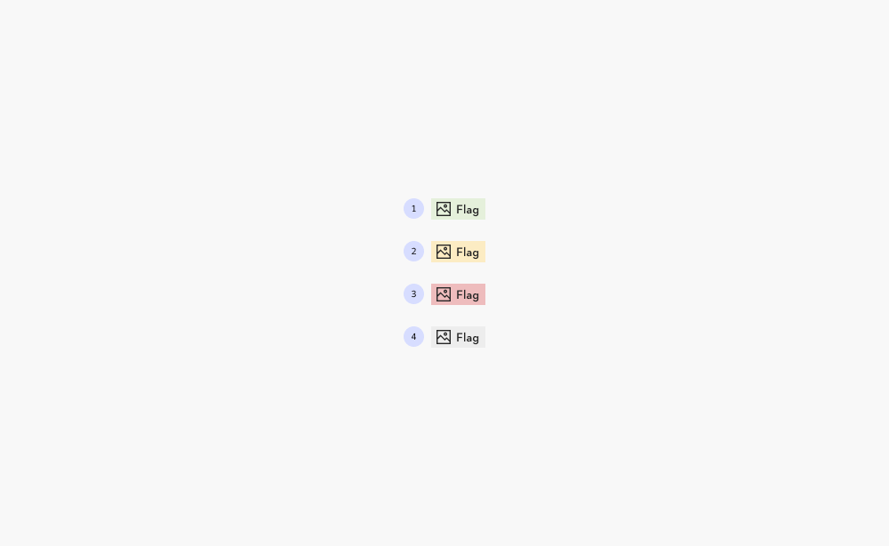

#### Promo

Promo Flags are typically used alongside a button, but can also appear without one. Choose the variant based on context

- Primary button (background-color/primary-inverse) or no Button → use **Highlight Flag**
- Highlight Button (background-color/brand) → use **Neutral Flag**

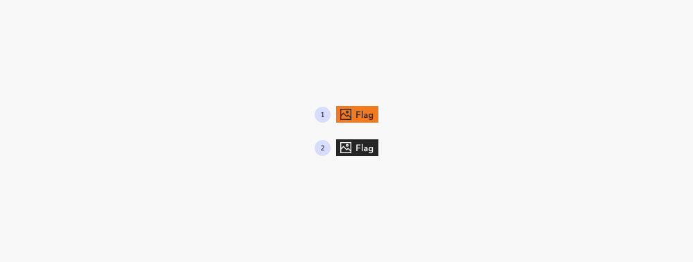

### Groupings and combinations

#### Combining multiple Flags in one section are allowed.

Ensure each group has a clear and distinguishable purpose.

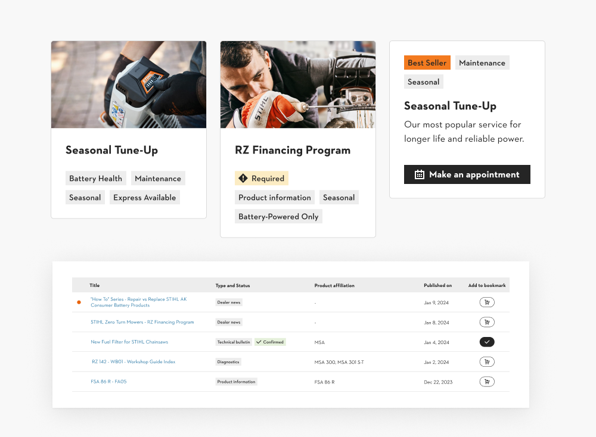

#### Don’t combine too many different Flag variants in one section.

It makes scanning and comprehension more difficult. Use a max. of two Flag types per section.

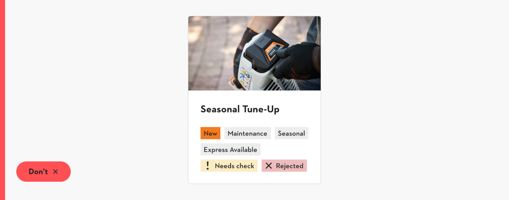

#### Do use separate sections for each Flag variant.

It makes content easier to scan and understand.

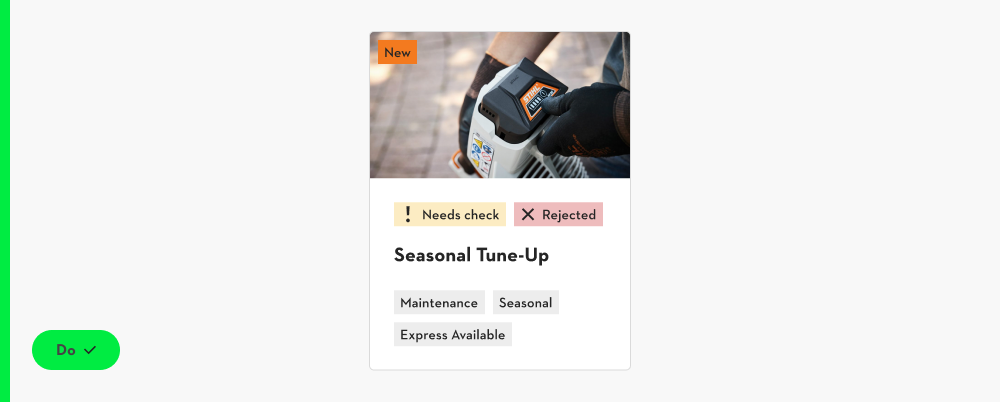

#### Don’t use multiple Promo Flags within a group.

Promo Flags should stand out and not compete with one another.

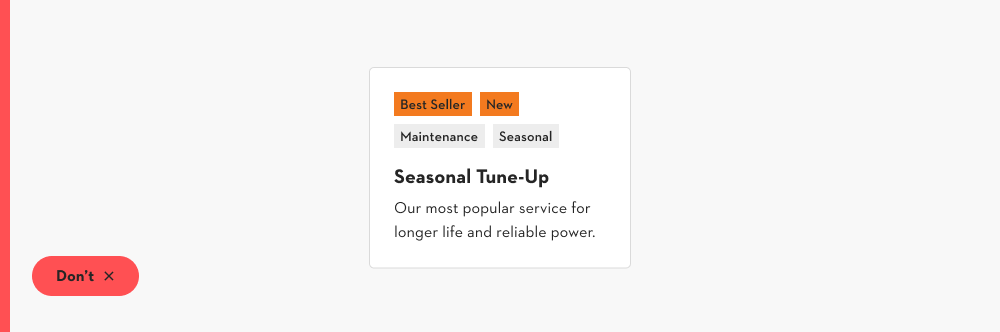

#### Use a maximum of two Promo Flags per group, ensuring one is highlighted and the other is neutral.

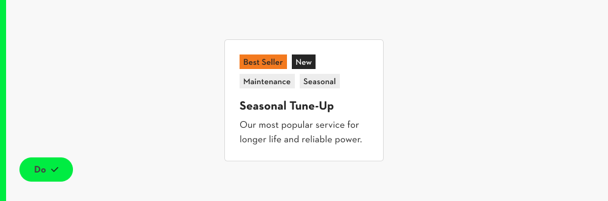

### Promo usage

#### Promo Flag Neutral vs. Highlight

The two Promo flag variants are used depending on the level of emphasis and the accompanying conversion element.

1. **Promo Neutral**
   - Used in combination with a Highlight Button. In this case, the button should remain the primary call to action, and the flag acts as a secondary element.
   - This is commonly used in Product cards.
1. **Promo Highlight**
   - Used with other interactive elements that are not the primary Highlight Button. In this case, the flag can take on more visual prominence to attract attention.
   - This is commonly used in Link Cards and Action Cards.

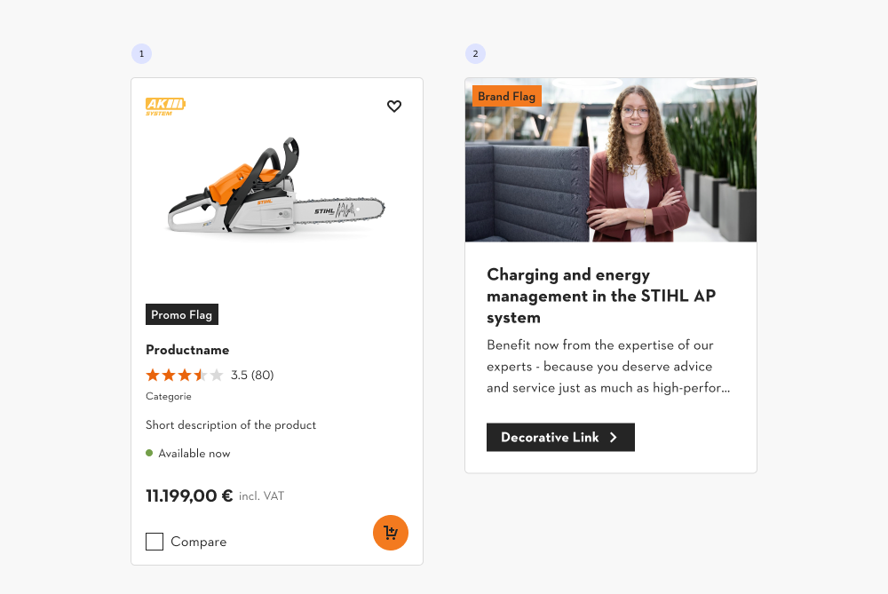

### Color usage

#### Additional colors

Additional colors may be introduced **only when necessary** and when required by the product or layout.

These colors should be used exclusively for labeling purposes (e.g. categories) and must not be used to communicate status or promotional emphasis.

Ensure additional colors are visually distinct from the other Status Flags, so they are not confused with semantic states.

All color combinations must meet [WCAG AA contrast requirements](https://accessibleweb.com/color-contrast-checker/): **AA (minimum): 4.5:1 for normal text, 3:1 for large text and UI components**

The text label color must remain grey-ultra-deep (token: content-color/primary).

When introducing new colors, ensure they are accessible and behave consistently in dark mode.

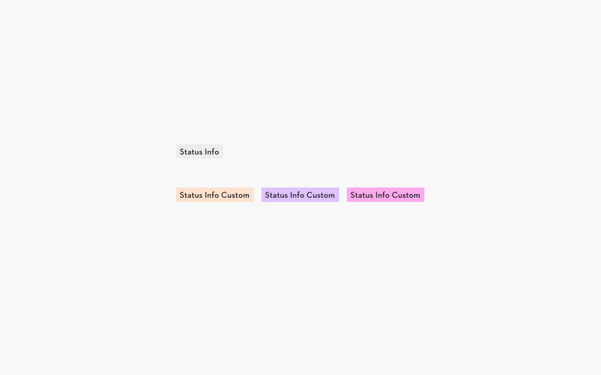

#### Don’t use custom-colored Flags for the STIHL battery systems.

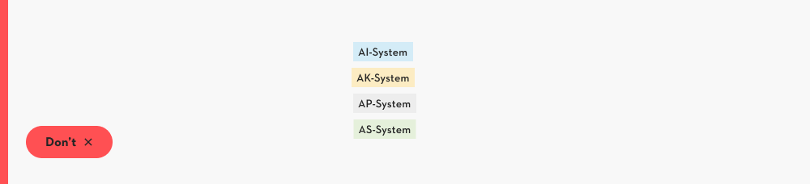

#### Do use the dedicated STIHL battery system logos .

Refer to the [STIHL brand portal](https://brandportal.stihl.com/de/basic-elements/layout-prinziples/drive-cordless-system-module) for details.

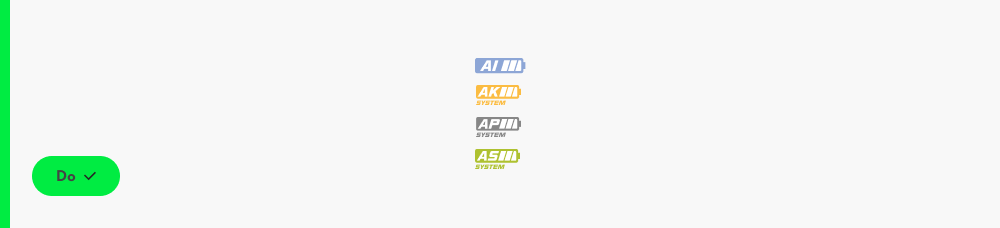

### Related components

#### Status Flag vs. System Feedback vs. Notification

These components serve different purposes and should not be used interchangeably.

1. **Status Flag** Communicates the state of an object or process:
   - Associated with a specific item (e.g. in a database)
   - Appears as part of the layout (e.g. within a Card or Table)
   - Can change, be replaced, or disappear as the state updates
1. **System Feedback** Guides the user in response to an interaction:
   - Triggered by user input or actions
   - Appears close to the relevant UI element (e.g. Input)
   - Helps users understand and resolve issues (e.g. errors, validation)
   - Typically disappears once the issue is resolved [System Feedback building block →](https://www.figma.com/design/qXldpLO6gxHJNLdcXIPxYt?node-id=14690-32)
1. **Notification** Informs the user about system events or updates:
   - Triggered by system logic, not direct user interaction
   - Appears within a flow or as an overlay
   - May require user attention or action
   - Can be dismissed by the user [Notification component →](https://www.figma.com/design/qXldpLO6gxHJNLdcXIPxYt?node-id=7251-8)
1. **Toast** Provides temporary, non-blocking feedback about an action or event:
   - Often triggered by user actions (e.g. “Saved successfully”)
   - Appears briefly as an overlay (e.g. bottom or top of screen)
   - Does not interrupt the user’s flow
   - Disappears automatically after a short duration [Toast component →](https://www.figma.com/design/qXldpLO6gxHJNLdcXIPxYt?node-id=8844-4923)

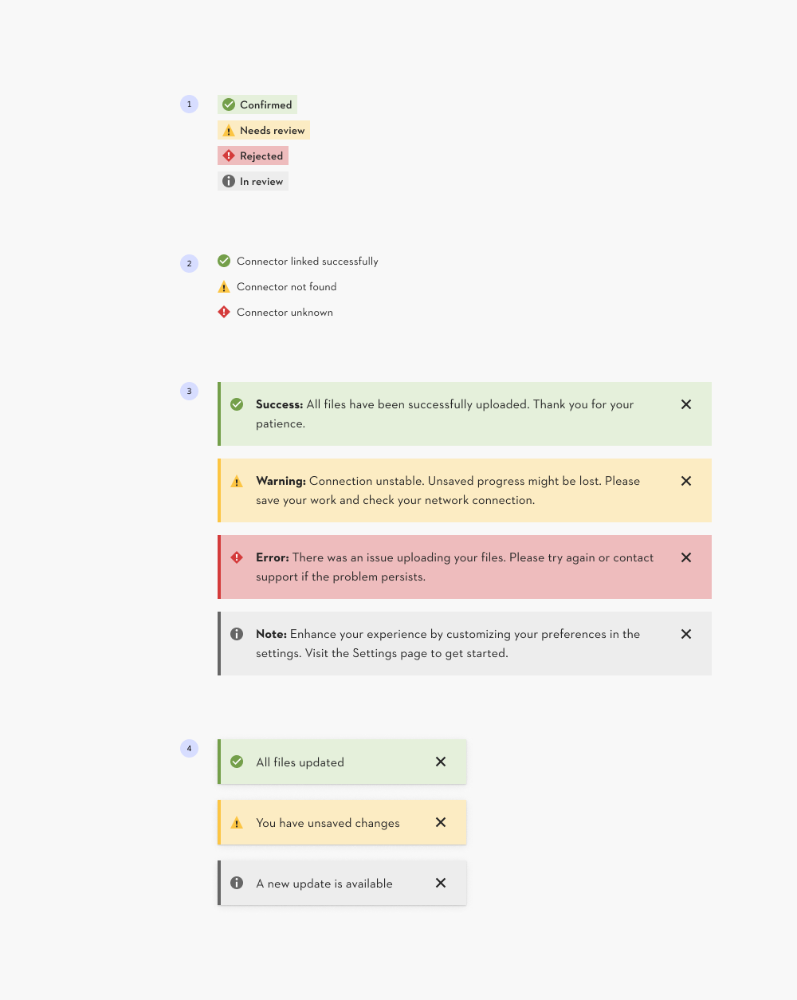

## Examples

### STIHL Service Communication (SSC)

- Table with multiple functions
- Use of Status Flags

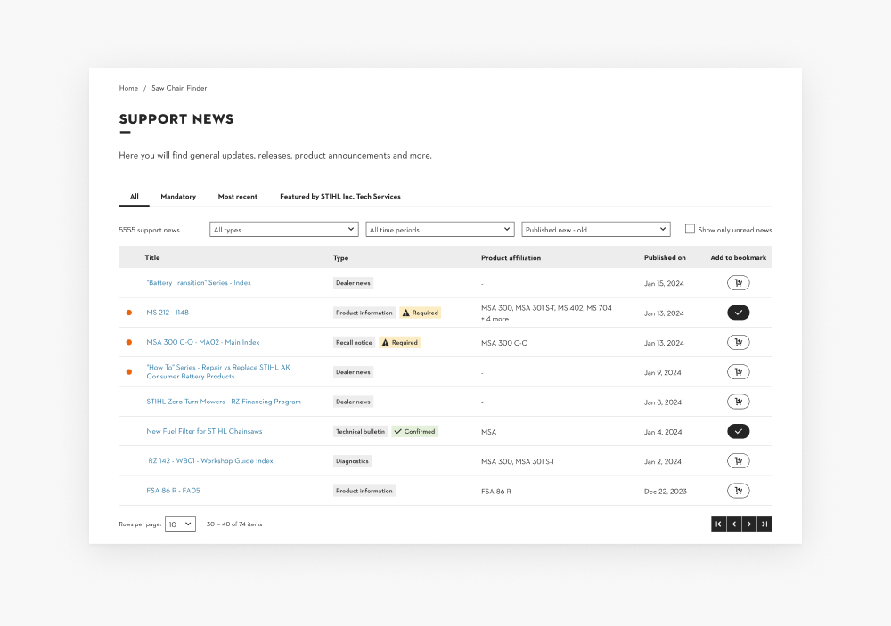

### Timbersports Article

- Multiple Flags in articles to show categories

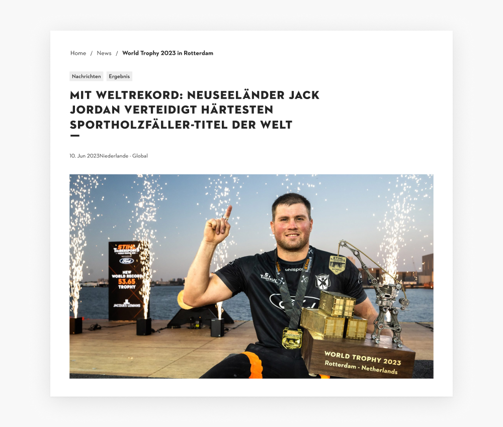

### Corporate STIHL Journal

- Multiple Flags in Link Cards to show categories

### Product Overview Page

- Proudct Card with a Promo Flag

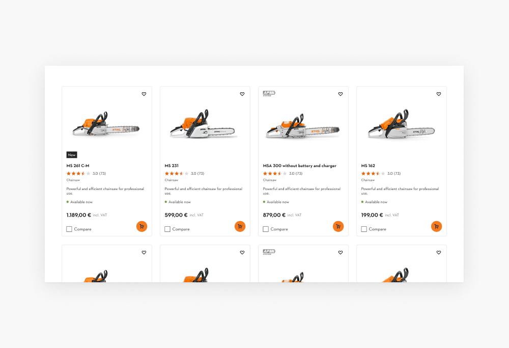
