# Input

## Input

Overview:

- use for basic text input in forms, messages, or search bars, for longer texts, see [text area](https://www.figma.com/design/qXldpLO6gxHJNLdcXIPxYt?node-id=4937-4402)
- the label, hint and field are one click area
- leading icons assist the label, reducing cognitive load, with non-interactive secondary content
- tailing icons contain a function, inherits the interaction styles of a [ghost button](https://www.figma.com/design/qXldpLO6gxHJNLdcXIPxYt?node-id=168-3943)
- helpful information should visible at all times and therefore in the hint

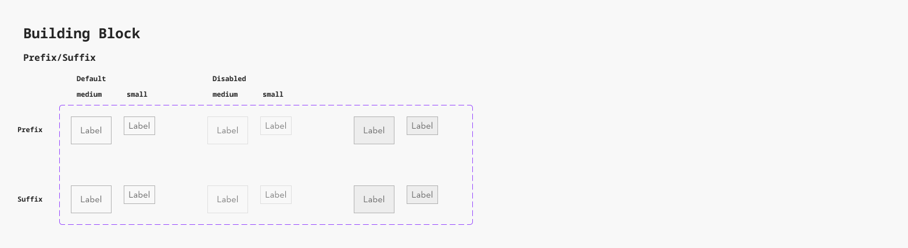

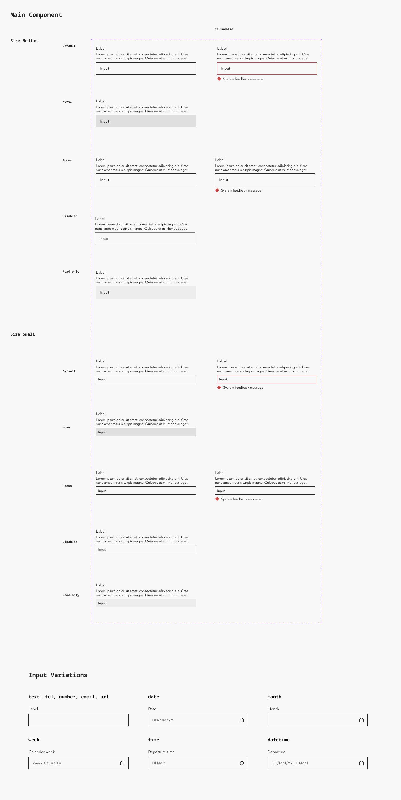

### Further guidelines

[Storybook documentation](https://main--63440bbb95889041542a5ba3.chromatic.com/?path=/docs/components-inputs-input--documentation)

### Related elements

[Fieldset](https://www.figma.com/design/Ie2r0R9QwjEc7O3nrFbXhV/Web-Pattern-Library?node-id=8-154)

[Iconography](https://www.figma.com/design/U218NNP4OsipaHOtv5flns/Iconography-%E2%9E%A1%EF%B8%8F?m=auto)

### Contribute

Contribute to improving this component by sharing your feedback, asking questions, or suggesting features [here](https://www.figma.com/design/lLmw7PfIdKjFG4uT3B2Hyj/Onboarding-%F0%9F%93%96?node-id=446-868&t=zKmRu4kAkxMeRDmK-4).

## Formatting and Construction

### Anatomy

1. **Label** Describes the required input
1. **Hint (optional)** Short copy that provides guidance and context. Copy is optional and only use if necessary
1. **Field** The area where you can fill in the information
1. **Placeholder text (optional)** Instruction text inside of the field
1. **Info Button (optional)** Can be used to trigger a popover with additional information
1. **Leading icon (optional)** This icon is optional. The icon is not interactive and therefore not clickable
1. **Tailing icon (optional)** This icon is optional. The icon is clickable and connected to an action
1. **User input** Data, entered by the user
1. **System feedback** Error or success message to help the user understand

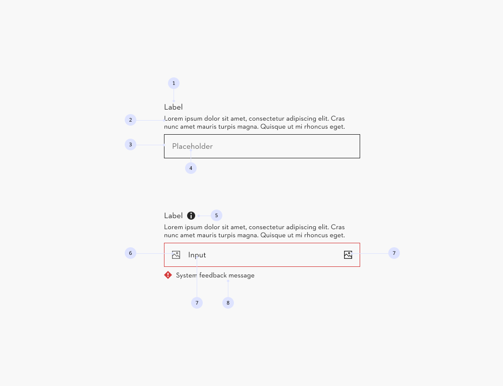

#### Input types by browser default

Types of input requested from the user are:

1. text, tel, number, email, url
1. date
1. month
1. week
1. time
1. date and time (local)

**Important notes:**

- behavior depends on the browser and its settings
- placeholder value changes depending on language and country
- the tailing icon can not be overwritten in every browser
- not all html input elements (e.g. color, file) are available as a code component
   - use the dedicated variants for input search, input number and input password, see below
   - use input number, if the number is incremental
   - use input (this component), if a digit can be freely typed in the keyboard (e.g. dates, values, units)

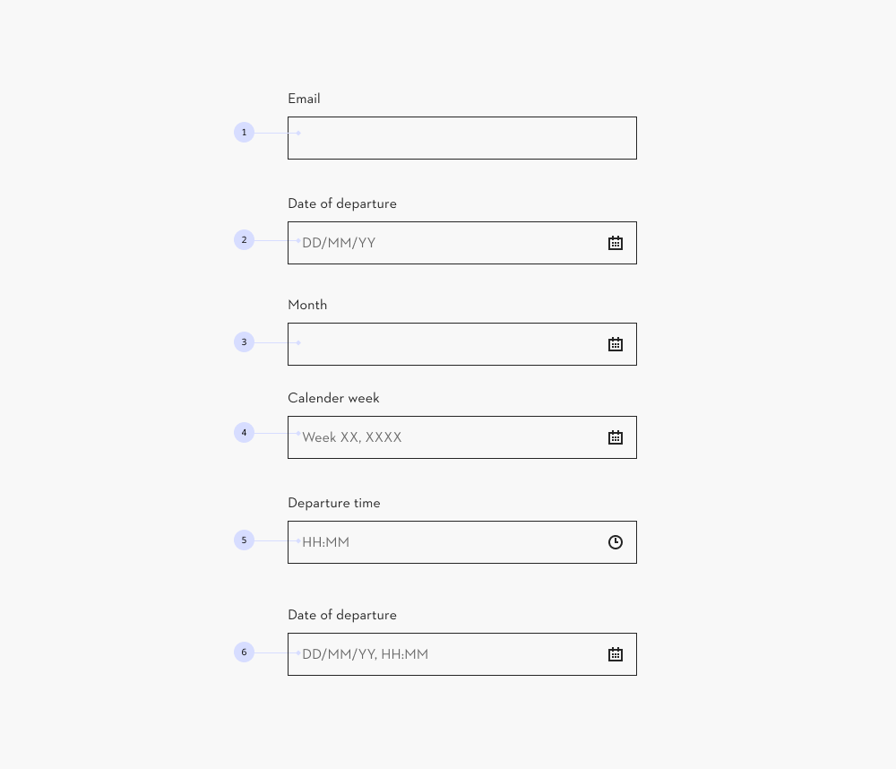

### Containing Elements

#### Prefix / Suffix

1. **Prefix** An element in front of the input text that defines a a unit or other input that is given in the input, eg “www.”, “€” or “http”
1. **Suffix:** An element in after of the input text that defines a unit or other input that is given in the input, eg. “.com”, “kg” or “cm”

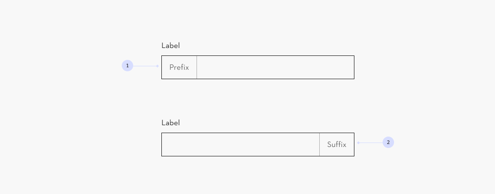

#### Icons with and without function

1. **Leading icon:**
- leading icons support the label and reduce the cognitive load
- the leading icon has as secondary content color to differentiate it from the function and has no interaction
1. **Tailing icon:**
- a tailing icon has a **function**, e.g. “show password”
- the icon is a **ghost button without a label**

[Button](https://www.figma.com/design/qXldpLO6gxHJNLdcXIPxYt?node-id=162-126)

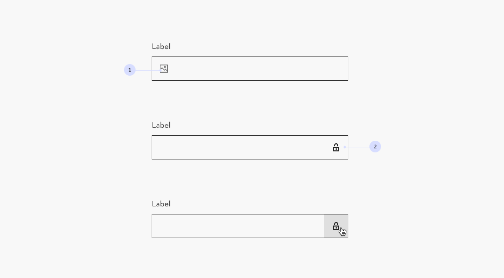

#### Do

The following combinations of pre- and suffix with leading and tailing are recommended, because of the optimized hierarchy and reduced mental load.

1. Prefix and Suffix
1. Prefix and Function
1. Leading Icons and Suffix
1. Icon and Function

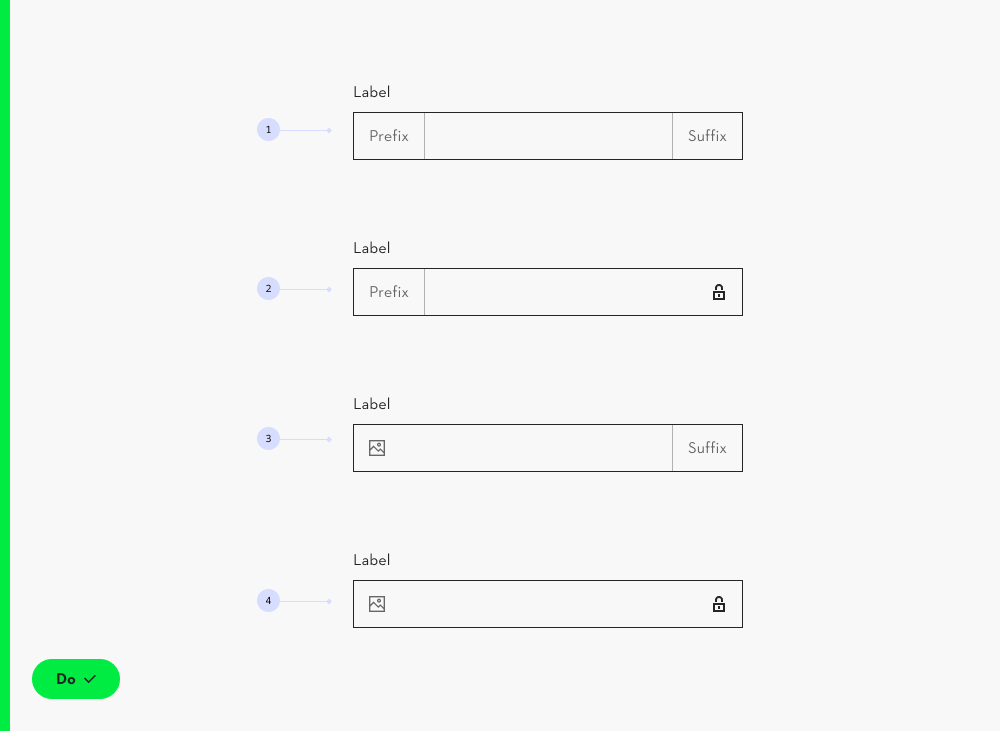

#### Don’t

In order to keep the component clearly structured and reduce mental load, the combination of Suffix and function **(1)** or Prefix and leading icon **(2)** shouldn’t be use

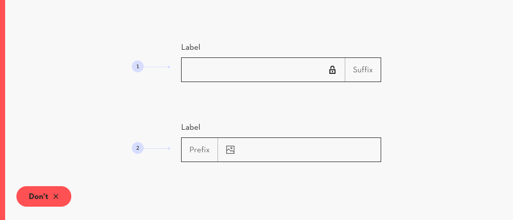

### Sizing

#### Maximum width

The width of an input field is determined by the container it is placed in. This should ideally be the “[content area narrow](https://www.figma.com/design/HHM9B6UjMStGLxMf6loNLn/DS-945-Grid-Optimisations-%7C-Design?node-id=1-857&t=FFOFP94g90gl91Ko-4)” defined within the grid layout.

While the input can adjust to fit its container, we recommend not exceeding a maximum width of 544px, matching the [maximum text width](https://www.figma.com/design/JyyYtoCYbtJrzqHs38OXSQ/Grid-%26-Spacing-%F0%9F%A7%AE?node-id=1-132), for better scanability and readability. This max width calculated by multiplying the font size with 34. For our default copy styling Text M (16px) that defines a max. width of 544px (16px\*34= 544px). This width should be set on a [fieldset](https://www.figma.com/design/Ie2r0R9QwjEc7O3nrFbXhV/Web-Pattern-Library?node-id=8-154) or container itself.

In the Figma component, the maximum width is set to the recommended 544px.

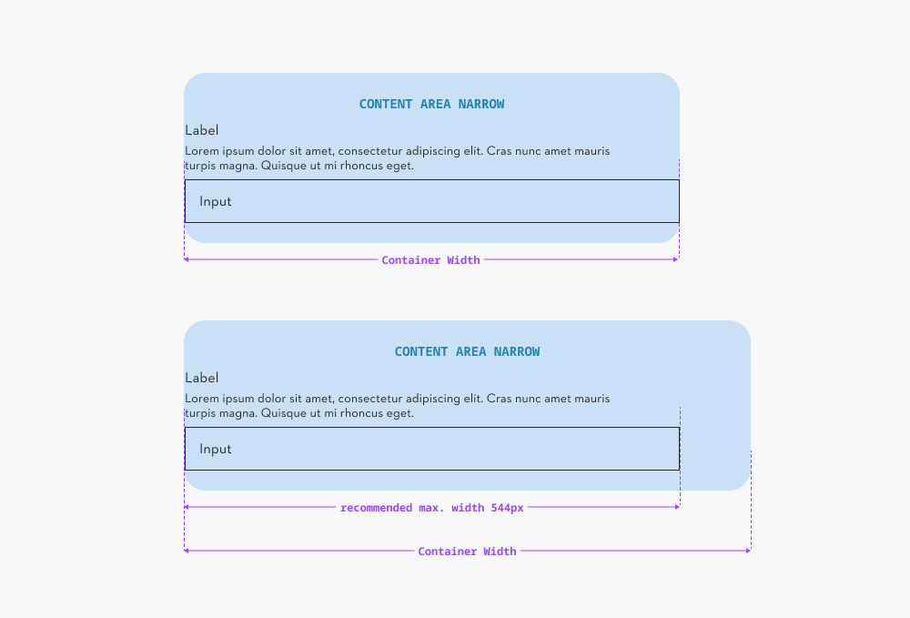

Available space does not necessitate that inputs span the full width. Defining an appropriate width enhances usability and contributes to a more structured and visually balanced layout. Especially when the expected input is short (e.g. Zip code) or if 2 inputs are used next too each other.

Additionally, according to Fitts’s Law, increasing the distance to a target (such as an input field) requires more time for the user to reach it, which can impact efficiency and usability.

[Article about Fitt’s Law on the NN Group website →](https://www.nngroup.com/articles/fitts-law/)

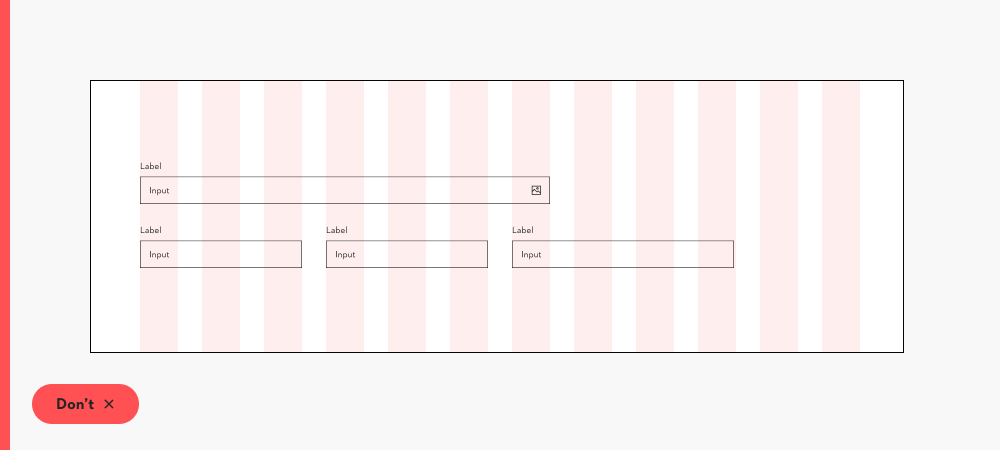

#### Input Grouping

A maximum of 2 input fields can be used next to each other if they are in context to each other.

A common combination is the postal code and city and also the street name and house number.

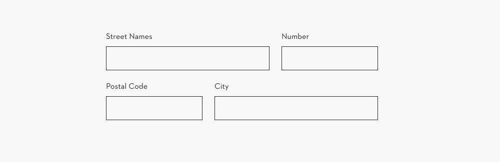

#### Grouping on mobile

On mobile devices all fields are stacked vertically.

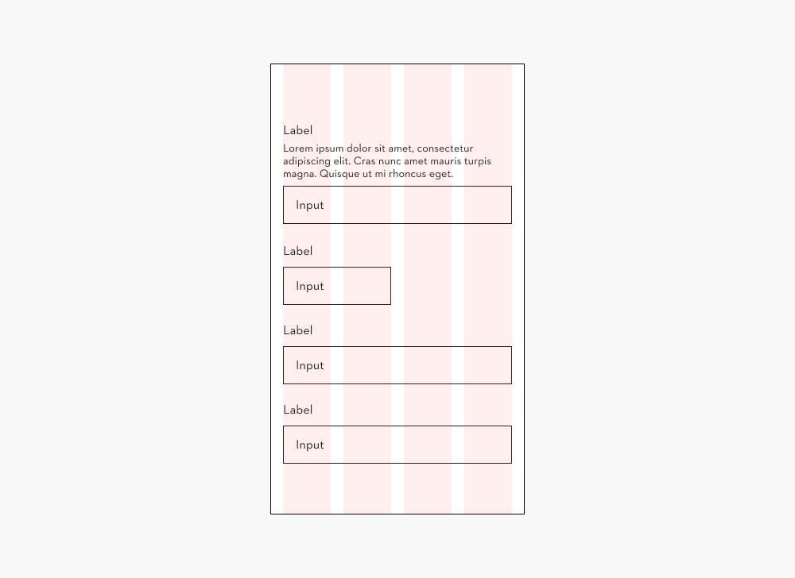

## Content and Assets

### Simple text

- Keep labels and hints short and simple.
- It is recommended to avoid abbreviations.
- Test the understandability of the copy in the form at all times.

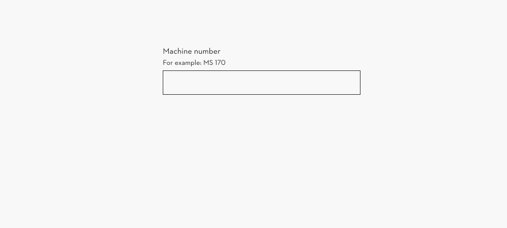

### Hint length

A hint is optional and should be used if clarity is needed.

Copy in the hint **(1)** should be ideally 1 sentence and 2 sentences maximum.

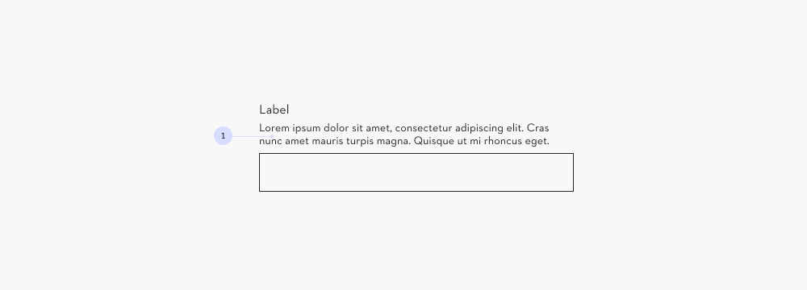

### Hint tone-of-voice

Be concise and to the point.

Do not use conversational language and avoid words like “Please”.

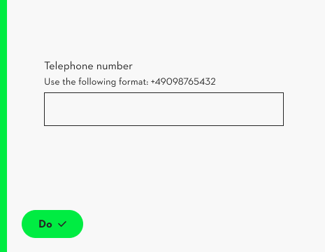

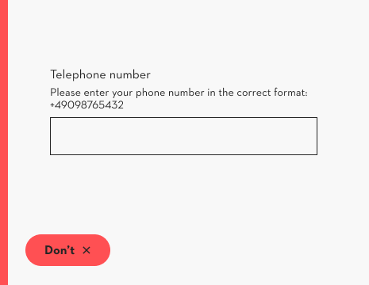

### Do

Helpful information should visible at all times and therefore in the hint.

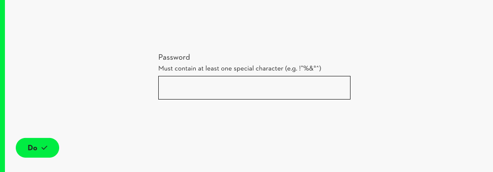

### Don’t

Helpful information cannot be in the placeholder, because the text disappears on focus.

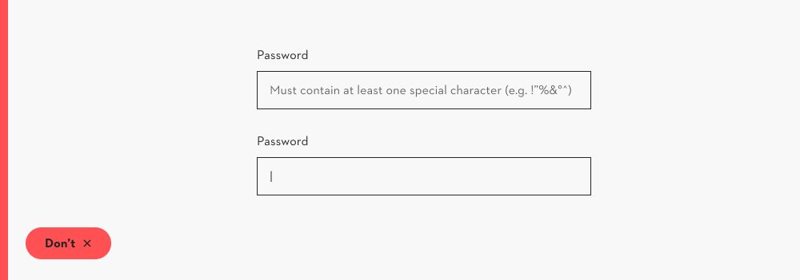

### Placeholder text

Placeholder text conveys information on the format of the desired input.

The examples show a field for a credit card number **(1)** and a date **(2).**

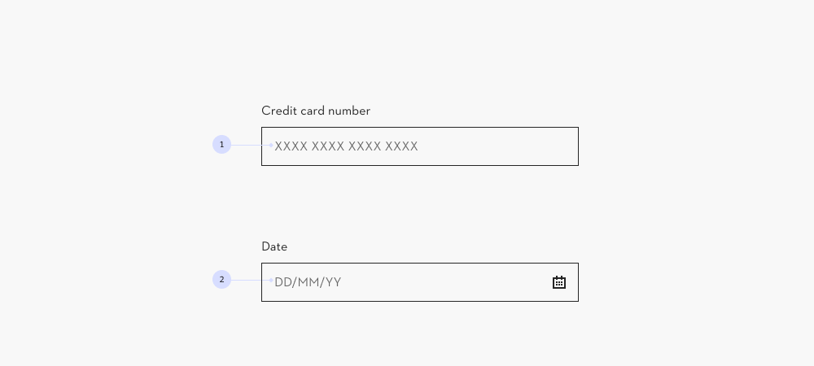

### Required and optional indicators

In order to communicate which fields are required to the user an asterisk **(1)** is shown next to the label. When using the code component the asterisk will be shown automatically when input is set to required.

Even when all fields in a form are mandatory, they should still be marked with an asterisk. Users often skip introductory text, so visual indicators like asterisks avoid ambiguity.

Optional fields are marked with the word “(optional)”, after the label **(2)**. In most cases, this has to be added manually in the Content Management System.

**Attention: Reduce the optional fields to a minimum.** Consider carefully, if the users needs to provide this information at this point in the journey.

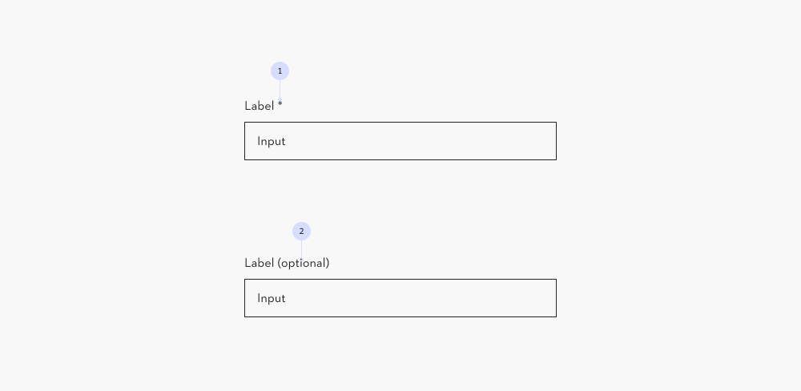

### Use cases for the prefix and suffix

- **most common use cases** include links and units of measurements (e.g. “kg.”) and symbols (e.g. “$”)
- the users input must **include digits only** if the unit type is in the prefix/suffix
- only use common abbreviations (e.g. “hr.”)
- use input field for numbers with large variability, [use input number for values that deviate little from the default.](https://www.figma.com/design/qXldpLO6gxHJNLdcXIPxYt?node-id=7342-2342)

### Copy length for the prefix and suffix

- maximum character count is 5 characters for both the pre- and suffix
- test the input field on all viewports to ensure quality and legibility, especially on shorter input fields

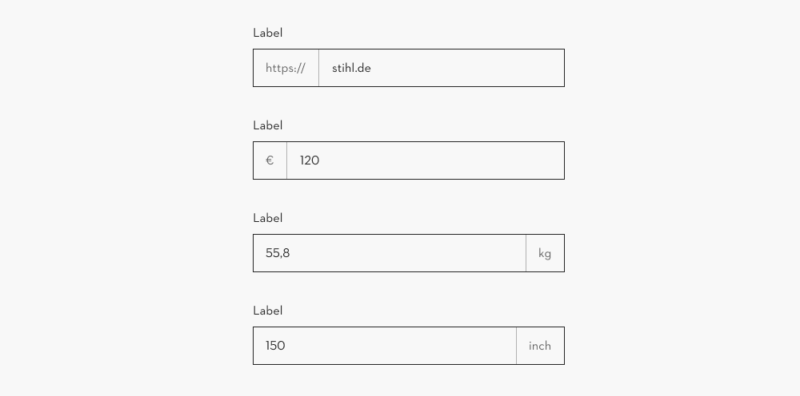

### Info Button

A popover button can be placed next to input or select labels to provide **additional contextual information.**

Popover content should be **limited to supplementary, non-critical information** — such as brief explanations, examples, or tips that aid understanding without being essential to task completion.

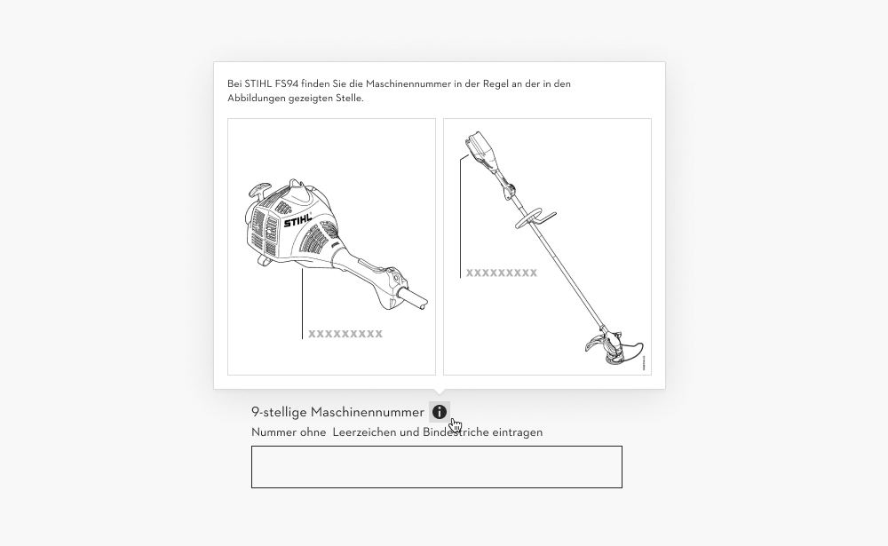

**Don’t use popovers for critical or required information.**

Use a hint instead, since essential details should never be hidden.

For more guidance, see the [Popover documentation](https://www.figma.com/design/qXldpLO6gxHJNLdcXIPxYt?node-id=35223-10505).

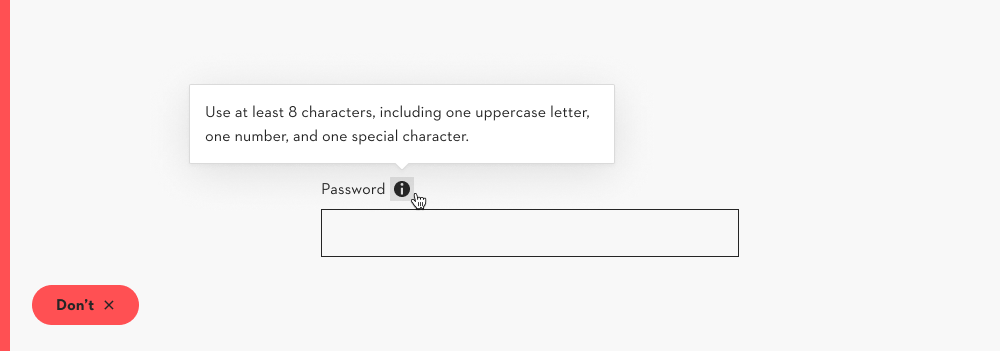

## Behavior

### System feedback

System feedback is placed below the input-field.

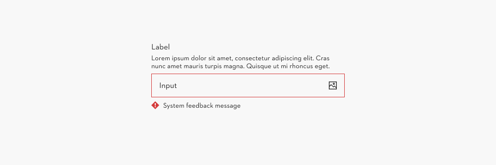

### Click behavior

The label, hint and field are one click area.

### Focus order

If the input field contains an leading icon / function, a screenreader focuses first on the input **(1)**, followed by the function **(2)**.

Navigating back from the content to the field, the input is focused **(3)**, so the user can delete it in one click.

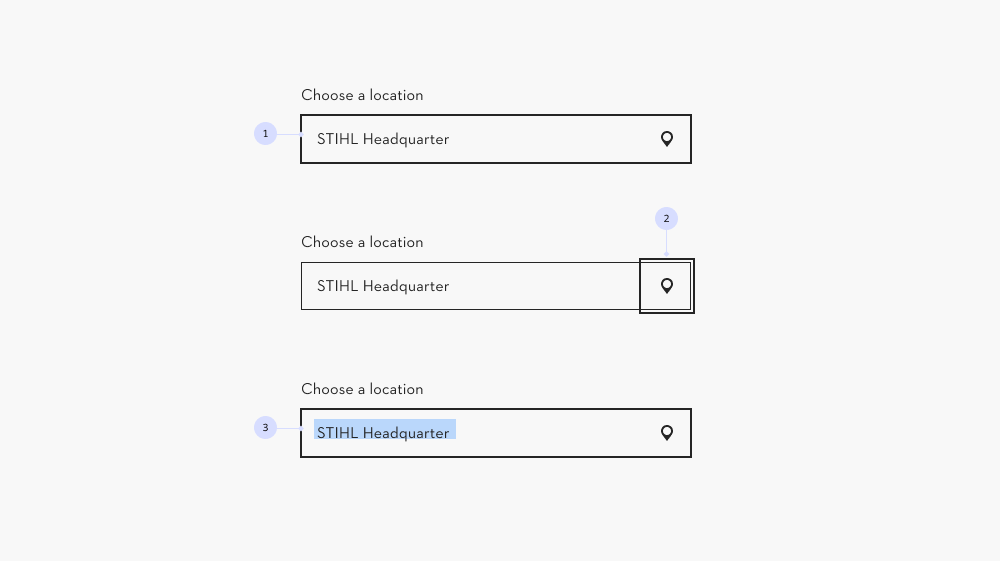

### Wizards by browser default

All browsers offer a default wizard to pick a date. Use the browser default, to improve usability and accessibility.

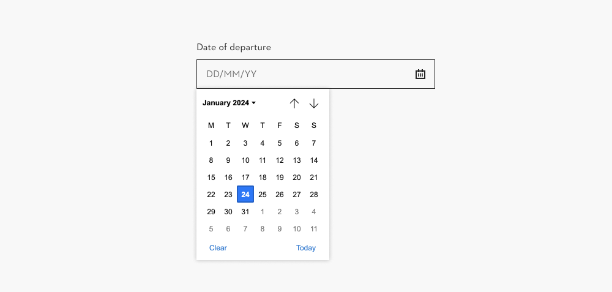

### Clear the input field

Some browser automatically show a clear action On click, the entered input from the user disappears.

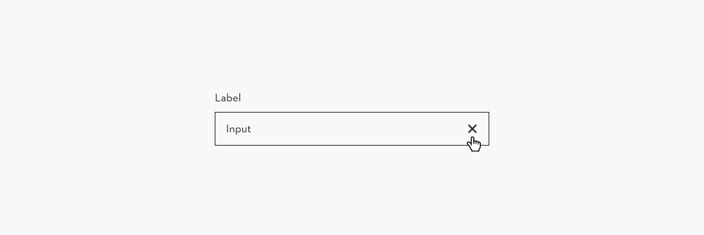

## Examples / Variations

### Coupon: input text

Mockup of the shopping cart: a single input text, where the user can enter a coupon code (stihl.de).

For multiple fields together, have a look at the fieldset.

[Fieldset component →](https://www.figma.com/design/Ie2r0R9QwjEc7O3nrFbXhV/Web-Pattern-Library?node-id=8-154)

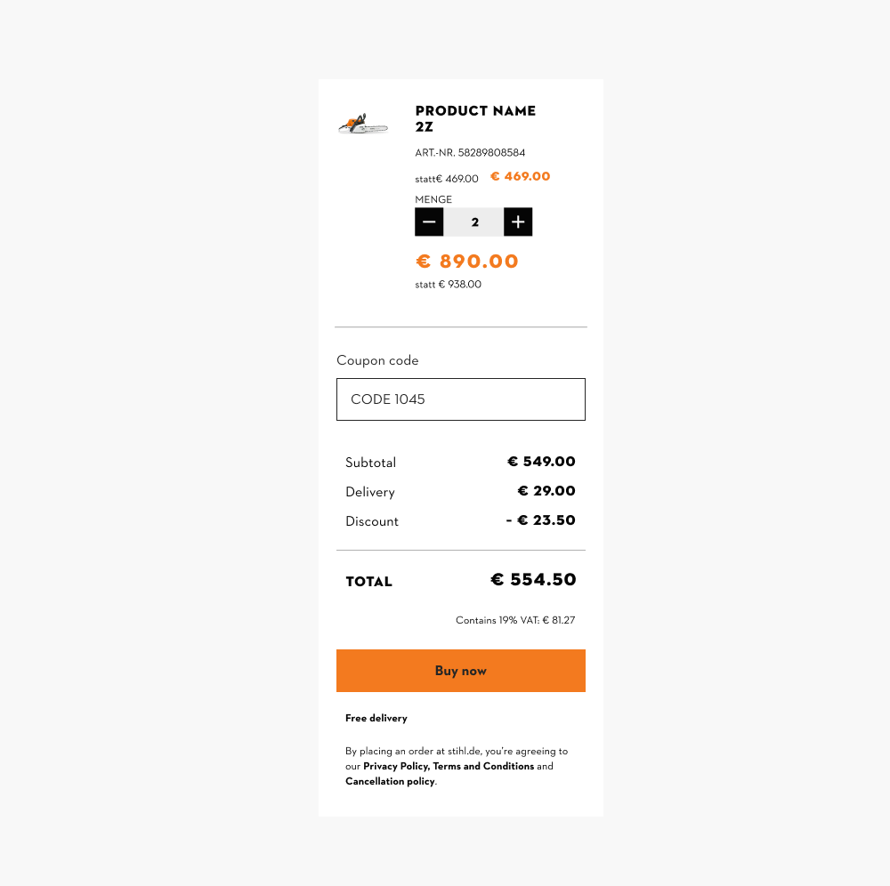

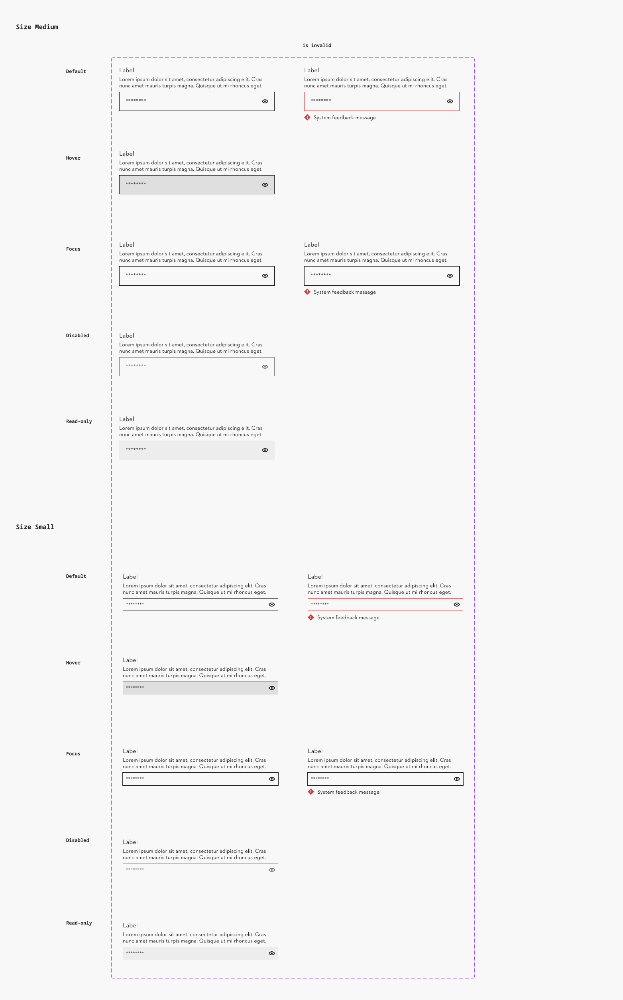

## Input Password

Overview:

- Use for secure text entry, hiding characters, typically in login or registration.
- A password field does not need any indicator, as it always required.

### Further guidelines

[Storybook documentation](https://main--63440bbb95889041542a5ba3.chromatic.com/?path=/docs/components-inputs-input-password--documentation)

### Related elements

[Iconography](https://www.figma.com/design/U218NNP4OsipaHOtv5flns/Iconography-%E2%9E%A1%EF%B8%8F?m=auto)

### Contribute

Contribute to improving this component by sharing your feedback, asking questions, or suggesting features [here](https://www.figma.com/design/lLmw7PfIdKjFG4uT3B2Hyj/Onboarding-%F0%9F%93%96?node-id=446-868&t=zKmRu4kAkxMeRDmK-4).

## Formatting and Construction

### Anatomy

1. **Label** Describes the required input
1. **Info Button (optional)** Can be used to trigger a popover with additional information
1. **Hint (optional)** Provides guidance or further context or clarity for making a selection.
1. **Text field** The area where you can fill in the password
1. **Function: show/hide password** The eye icon/eye-closed can be clicked to show/hide the password
1. **Input text** Default password input is shown with asterisks

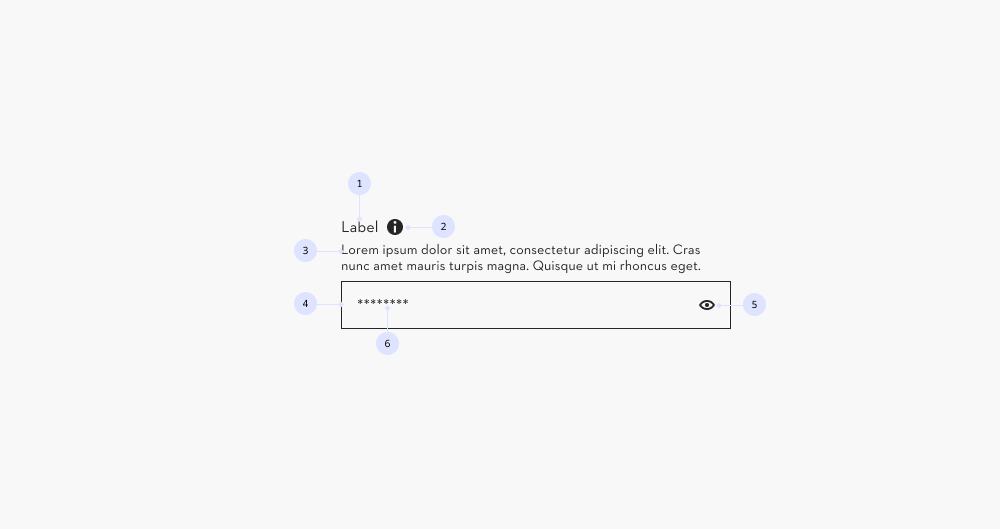

## Content and Assets

### Password requirements

The live validation of setting a new password is not part of the code component, therefore it is recommended to explain the password requirements in the hint. See [Storybook](https://main--63440bbb95889041542a5ba3.chromatic.com/?path=/docs/components-inputs-input-password--documentation) for the details according the attributes.

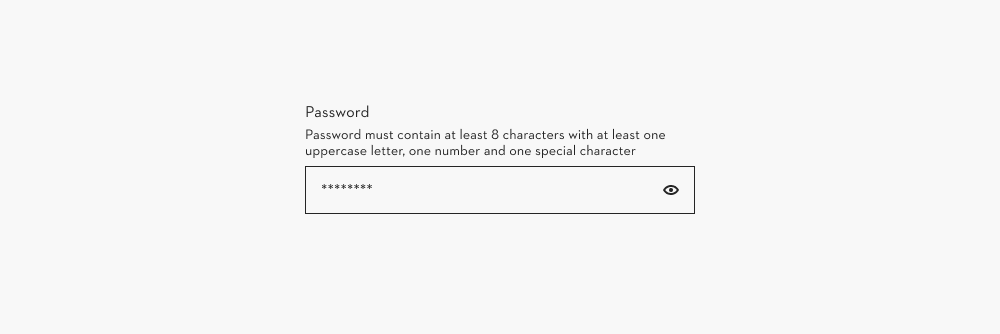

### Required and optional indicators

A password field does not need any indicator, as it always required.

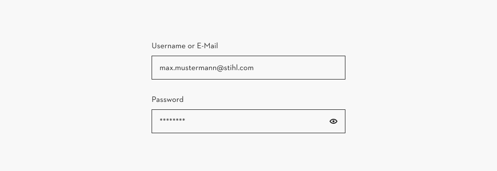

## Behavior

### System feedback

In case of an error message being displayed, is shown below the Text field.

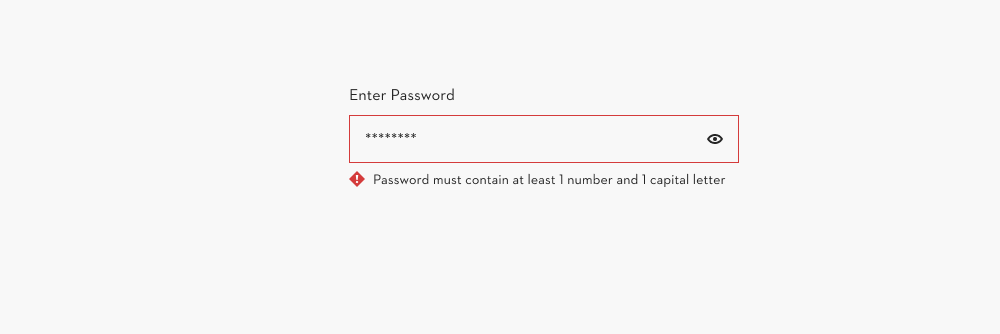

### Show and hide password

#### Icon switch

After clicking on the button to reveal the password, the icon will change from “eye” (show password) **(1)** to “eye-closed” (hide password) **(2)**.

Use a tooltip to communicate the function.

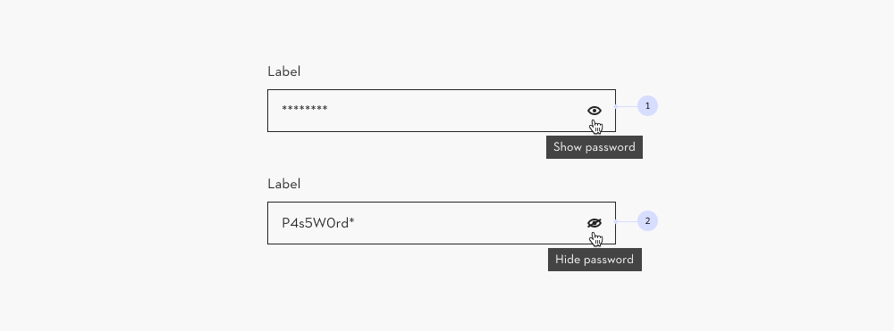

## Examples / Variations

### Log in to MY STIHL account

The mobile version of the STIHL web shop. Log in input fields mostly do not have a required asterisk.

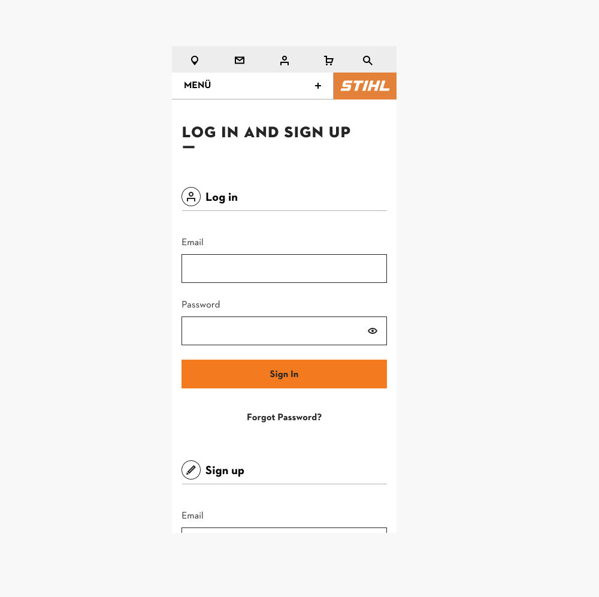

## Content and Assets

### Placeholder text

Placeholder text in a search field is commonly used to give a few examples, what to search for.

If the use-case and the lay-out allows, placing these examples in the hint is recommended, so that they don’t disappear on focus.

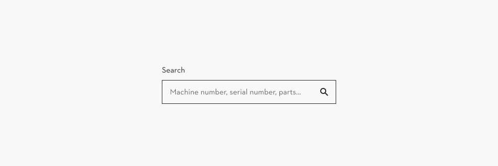

### Required and optional indicators

A search field does not need any indicator. In case the search command is submitted empty, **guide the user through copy in the empty state / no results state.**

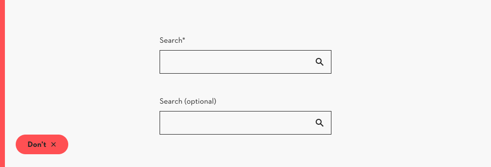

## Behavior

### Clear function

Clear the input on click. The function icon appears after input is entered by the user.

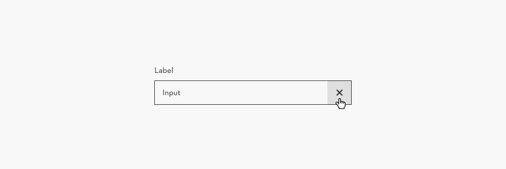

### Submit function

On click the submit button will trigger the search. Additionally, the submit function should be activated after pressing enter on the keyboard

### Keyboard navigation

The keyboard navigation jumps from the input **(1)** directly to the submit function **(3)** and skips the clear function **(2)**.

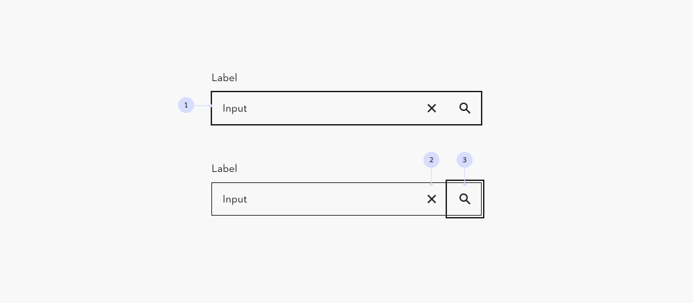

## Examples / Variations

### Trimmer, cutter and saw advisor in the STIHL web shop

At the beginning of the advisor, the user is asked to search for their machine number.

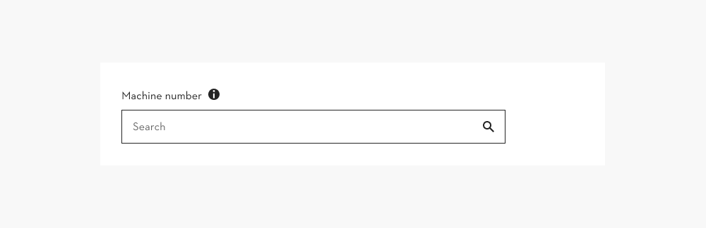

## Input Search

Overview:

- Use for querying data or filtering content in search interfaces.
- A search field does not need any indicator.

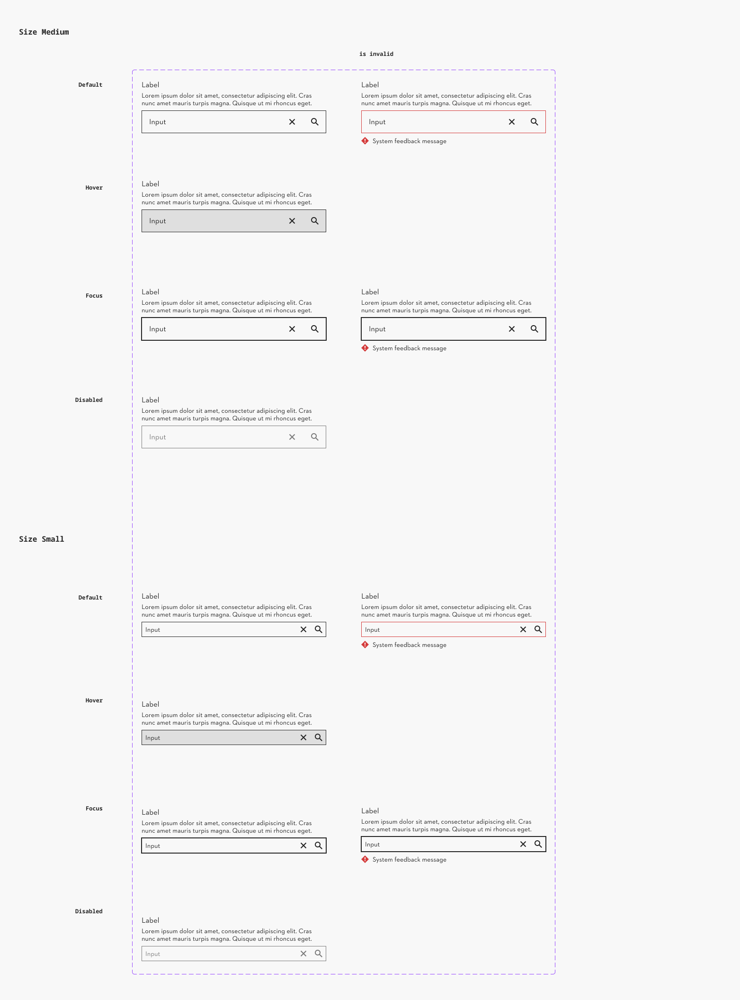

### Further guidelines

[Storybook documentation](https://main--63440bbb95889041542a5ba3.chromatic.com/?path=/docs/components-inputs-input-search--documentation)

### Related elements

[Iconography](https://www.figma.com/design/U218NNP4OsipaHOtv5flns/Iconography-%E2%9E%A1%EF%B8%8F?m=auto)

### Contribute

Contribute to improving this component by sharing your feedback, asking questions, or suggesting features [here](https://www.figma.com/design/lLmw7PfIdKjFG4uT3B2Hyj/Onboarding-%F0%9F%93%96?node-id=446-868&t=zKmRu4kAkxMeRDmK-4).

## Formatting and Construction

### Anatomy

#### Section Headline

1. **Label** Describes the required input
1. **Hint (optional)** Provides guidance or further context or clarity for making a selection.
1. **Text field** The area where you can fill in the search query
1. **Clear function (cross icon)** Clears the text in the search field
1. **Submit function (magnifiying glass icon)** Submits the search
1. **Info Button (optional)** Can be used to trigger a popover with additional information
1. **Placeholder text (optional)** Initial text to give further instruction/hint

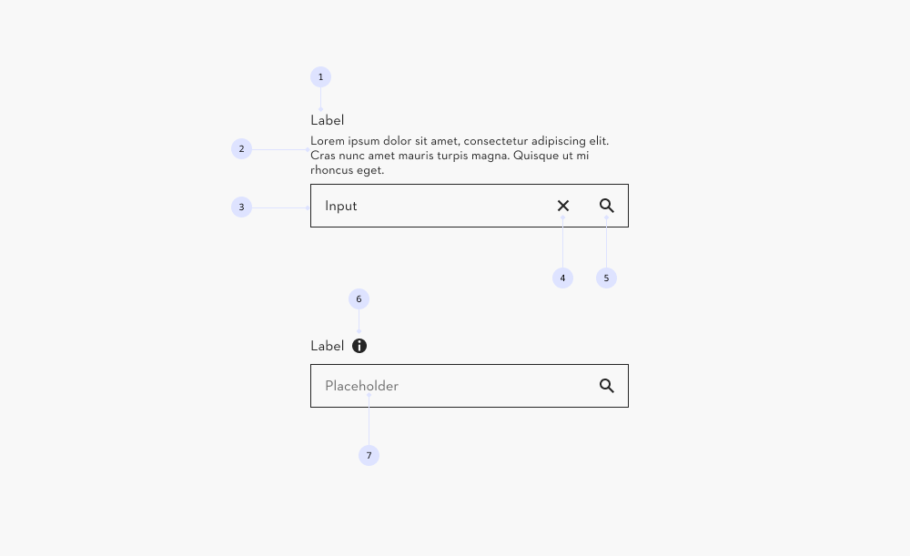

## Input Number

Overview:

- Use for numeric input, ideal for smaller numbers, like quantities, measurements, or numerical data entry.

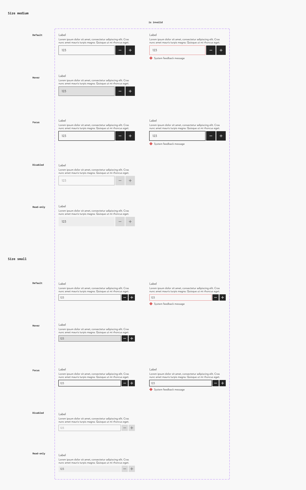

### Further guidelines

[Storybook documentation](https://main--63440bbb95889041542a5ba3.chromatic.com/?path=/docs/components-inputs-input-stepper--documentation)

### Related elements

[Checkbox](https://www.figma.com/design/qXldpLO6gxHJNLdcXIPxYt?node-id=1017-2316)

[Radio Group](https://www.figma.com/design/qXldpLO6gxHJNLdcXIPxYt?node-id=860-2728)

[Fieldset](https://www.figma.com/design/Ie2r0R9QwjEc7O3nrFbXhV/Web-Pattern-Library?node-id=8-154)

[Iconography](https://www.figma.com/design/U218NNP4OsipaHOtv5flns/Iconography-%E2%9E%A1%EF%B8%8F?m=auto)

### Contribute

Contribute to improving this component by sharing your feedback, asking questions, or suggesting features [here](https://www.figma.com/design/lLmw7PfIdKjFG4uT3B2Hyj/Onboarding-%F0%9F%93%96?node-id=446-868&t=zKmRu4kAkxMeRDmK-4).

## Formatting and Construction

### Anatomy

1. **Label** Describes the required input
1. **Info Button (optional)** Can be used to trigger a popover with additional information
1. **Hint (optional)** Provides guidance or further context or clarity for making a selection.
1. **Text field** The area where you can fill in the information
1. **Placeholder text (optional)** Initial text to give further instruction/hint
1. **Button** Add or subtract amount of increments

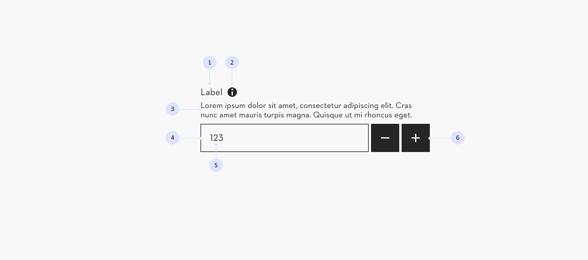

#### Prefix / Suffix

1. **Prefix** An element in front of the input text that defines a a unit or other input that is given in the input, eg “www.”, “€” or “http”
1. **Suffix:** An element in after of the input text that defines a a unit or other input that is given in the input, eg. “.com”, “kg” or “cm”

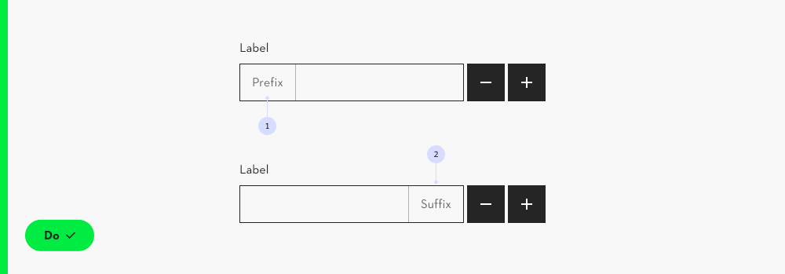

**Don’t**

It is not recommended to combine a prefix and suffix.

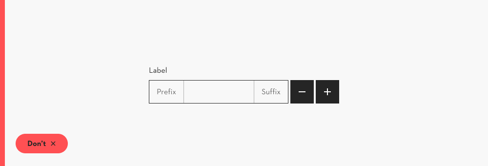

## Content and Assets

### Use cases for the prefix and suffix

- **most common use cases** include units of measurements (e.g. “kg.”) and symbols (e.g. “$”)
- the users input must **include digits only** if the unit type is in the prefix/suffix
- only use common abbreviations (e.g. “hr.”)
- [use input field for numbers with large variability](https://www.figma.com/design/qXldpLO6gxHJNLdcXIPxYt?node-id=4617-14548), use Input Number for values that deviate little from the default

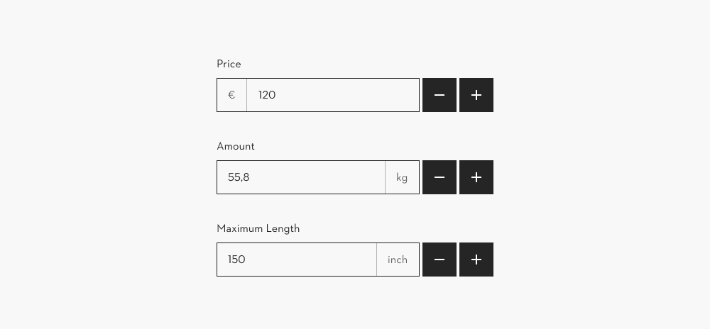

## Behavior

### Lowest and highest value

Disable the button, if the lowest or highest value is set, to communicate to the user that the maximum has been reached.

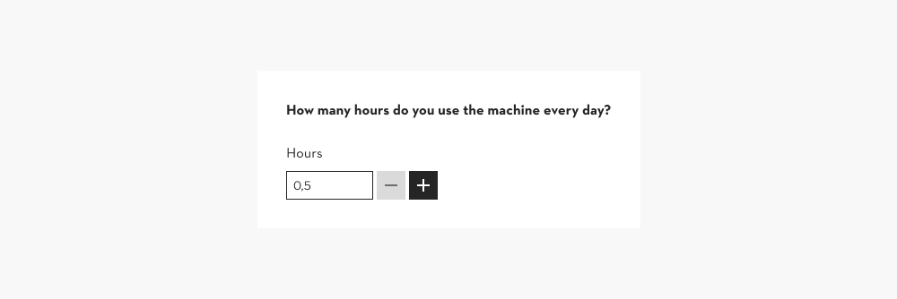

### Keyboard navigation focus order

The keyboard navigations follows the order of the elements semantically.

**Note:** both buttons are on the same side. In order to jump between the both buttons and to decrease/increase the value easily.

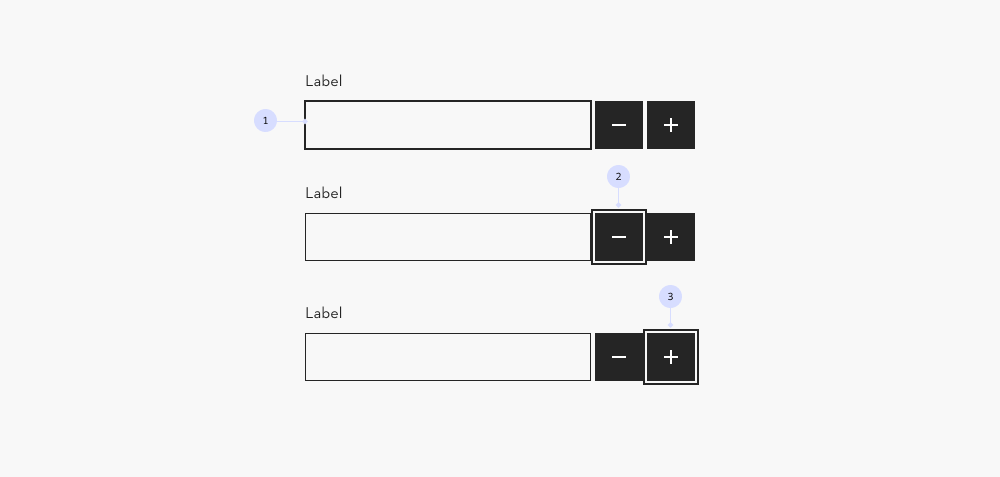

## Examples / Variations

### iMOW advisor in the web shop

The advisor uses the small Input Number, to reduce height in the layout of the product listing.

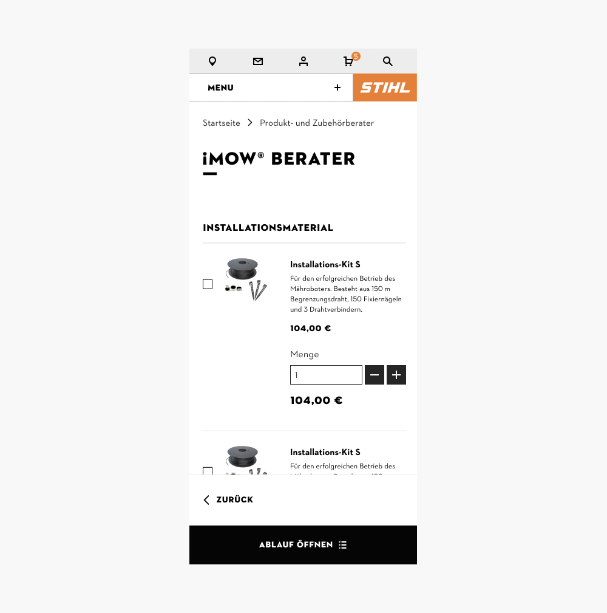

## Input Slider (horizontal single-point)

Overview:

- A horizontal track with predefined values (tick marks/increments) users can easily snap, or a minimal, continuous design trail.
- Enables users to select a value or range by dragging a handle.
- Enable both click and drag movements for a smooth and intuitive user experience.
- Enable keyboard navigation to allow users to use the arrow keys to changes the value.
- Offers intuitive and exploratory control for numeric adjustments.
- Use labels to indicate a minimum and maximum value on the slider’s range.
- Indicate the current value. The value is updated as the user slides over the track.
- Sliders offer less precision than direct numeric [input](https://www.figma.com/design/qXldpLO6gxHJNLdcXIPxYt/Core-Components-%F0%9F%92%A0?m=auto&node-id=1744-7211&t=pmGr8sT6vxYtgt0A-1), but encourage exploration and quick adjustments.
- Evaluate whether sliders are the best input method for your use cases:
   - Use a [radio group](https://www.figma.com/design/qXldpLO6gxHJNLdcXIPxYt/Core-Components-%F0%9F%92%A0?m=auto&node-id=860-2729&t=pmGr8sT6vxYtgt0A-1) instead of a slider for fewer options.
   - Do not use slider as a progress bar, [stepper](https://www.figma.com/design/qXldpLO6gxHJNLdcXIPxYt/Core-Components-%F0%9F%92%A0?m=auto&node-id=26075-10498&t=pmGr8sT6vxYtgt0A-1) (coming soon)

### Further guidelines

[Storybook documentation](https://main--63440bbb95889041542a5ba3.chromatic.com/?path=/docs/components-inputs-slider--documentation)

### Related elements

[Input](https://www.figma.com/design/qXldpLO6gxHJNLdcXIPxYt/Core-Components-%F0%9F%92%A0?node-id=1591-2)

[Stepper](https://www.figma.com/design/qXldpLO6gxHJNLdcXIPxYt/Core-Components-%F0%9F%92%A0?node-id=26075-10497)

[Tooltip](https://www.figma.com/design/qXldpLO6gxHJNLdcXIPxYt/Core-Components-%F0%9F%92%A0?node-id=26075-11658)

[Iconography](https://www.figma.com/design/U218NNP4OsipaHOtv5flns/Iconography-%E2%9E%A1%EF%B8%8F?m=auto)

### Contribute

Contribute to improving this component by sharing your feedback, asking questions, or suggesting features [here](https://www.figma.com/design/lLmw7PfIdKjFG4uT3B2Hyj/Onboarding-%F0%9F%93%96?node-id=446-868&t=zKmRu4kAkxMeRDmK-4).

## Formatting and Construction

### Anatomy

1. **Label** Text that outlines the necessary input requirements.
1. **Hint (optional)** A brief copy that provides guidance and context. This copy is optional and used only when necessary.
1. **Slider´s scale (track colour)** Visual, horizontal bar reflecting the range of options.
1. **Slider (tint colour)** Shows the selected value or range as visual feedback. The track's segment between the minimum value and the thumb is filled with colour.
1. **Thumb (handle)** The round element is used to drag/move the slider left and right across the slider's scale. Should be accessible via keyboard and touch input.
1. **Tooltip** Labelling the current value.
1. **Range Indicator (sliders directions)** Displays the minimum and maximum value of the input.
1. **Ticks (segments)** Breaking down the entire range into a set of equidistant segments. Predefined values users can easily snap/jump to.
1. **Number input** Displays current value (synchronized with the thumb position) and can be used to enter a value manually.
1. **Info Button (optional)** Can be used to trigger a popover with additional information

### 3 slider types

1. **Type “Default”** A slider variant that includes both, the slider and an input field (synchronised).
1. **Type “Minimal”** A slider variant without an input field. The current value is displayed when users hover over the slider, drags the thumb (with mouse or on touch screens) or focuses the component.
1. **Type “Steps”** Slider variants that come with predefined steps.

For detailed instructions on how to use these variants, visit the following page.

### Component Handling

#### Nested components

In Figma, the input component is nested within the default slider variant. Because of this, all input component parameters remain accessible when manually selecting the input.

However, only use the limited input options available in the **input-frame building block (1), NOT those options from the nested input component (2)**. The scope of input parameters has been intentionally reduced within the slider to maintain consistency and prevent unintended modifications.

### Sizing

#### Maximum width

The width of an input slider is determined by the container it is placed in. This should ideally be the “[content area narrow](https://www.figma.com/design/HHM9B6UjMStGLxMf6loNLn/DS-945-Grid-Optimisations-%7C-Design?node-id=1-857&t=FFOFP94g90gl91Ko-4)” defined within the grid layout.

While the input can adjust to fit its container, we recommend not exceeding a maximum width of 544px, matching the [maximum text width](https://www.figma.com/design/JyyYtoCYbtJrzqHs38OXSQ/Grid-%26-Spacing-%F0%9F%A7%AE?node-id=1-132), for better scanability and readability. This max width calculated by multiplying the font size with 34. For our default copy styling Text M (16px) that defines a max. width of 544px (16px\*34= 544px).

In the Figma component, the maximum width is set to the recommended 544px. ([Link to calculation](https://www.figma.com/design/JyyYtoCYbtJrzqHs38OXSQ/Grid-%26-Spacing-%F0%9F%A7%AE?m=auto&node-id=1-857&t=p2GU3oXS9Ao4MbV0-1))

If multiple sliders are used within the same form or fieldset, they should all maintain the same size for consistency.

#### Minimum width

The minimum width of 256px, applicable to both smaller and larger viewports.

#### Input Sizes

The input field within the slider component offers two size options: medium and small, which are inherited from the [input component.](https://www.figma.com/design/qXldpLO6gxHJNLdcXIPxYt/Core-Components-%F0%9F%92%A0?m=auto&node-id=1744-7384&t=lggFrDltF9gmXjof-1) This ensures consistency across the design system and allows for flexible usage depending on the context.

#### Input Width

Additionally, the input field has predefined minimum and maximum widths to ensure usability within the component. These constraints depend on the number of digits displayed:

- 1–3 digits → Minimum version
- 3+ digits → Maximum version Both variations are available with or without a suffix and in both input sizes.

The defined width constraints also account for the label and hint text, which are positioned next to the input field. This ensures that:

- Labels and hint text remain readable.
- Text does not break into too many lines.
- The overall layout maintains clarity and usability.

Further examples in the Content Section

### Alignment

#### Alignment of different elements

1. **Range values** The range values are centred on the first and last tick on the track, which also positions them at the start and end points of the thumb.
1. **Tooltip** The tooltip is always centred on the thumb and remains centred as the thumb moves.
1. **Thumb** The start and end positions of the thumb align with the ends of the track, the label, and the input.

#### Edge-Case alignment large range values

Although large range values should be avoided (see content guidelines), values exceeding three digits (e.g., 10,000) align to the right or left of the slider. This prevents numbers from extending beyond the grid, ensuring readability, especially on mobile devices.

### Animation

#### Thumb hover

**Animation type:** fade: color **Duration:** 100ms **Easing:** motion-functional-ease-in-and-out

#### Tooltip

The tooltip animation is triggered by hovering or focusing.

**Animation type:** fade: opacity 0\>100% **Duration:** 100ms **Easing:** motion-functional-ease-in-and-out

## Types

Further recommendations on their usage can be found in the content section.

### Type “Default”

#### Wide ranges

The default slider with the input is designed with a fluid behaviour, offering users the flexibility to continuously select any value within the given range, without being constrained by fixed steps or values.

If the value range is large, as a slider alone may lack precision.

#### Choose this option when precision is important.

The default slider, complemented by a text input field, not only displays the current value but also empowers users to make precise adjustments by manually entering a value.

This is particularly useful when exact values need to be selected or when small increments are important.

#### Accessibility

The input in the slider component, a reduced version of the input, inherits sizes, states, and suffix properties. It's worth noting that all slider variants meet WCAG accessibility AA standards by 01.01.2025, but this version is particularly beneficial for users with accessibility needs, providing an alternative method for inputting the value.

A text field helps users who struggle with fine motor control.

#### The slider as a mandatory form field

Using slider inputs for form fields can pose accessibility challenges, so their implementation should be carefully considered. Presenting other common options first and using a standard input field instead is advisable. Sliders are best suited for exploratory adjustments rather than precise value selection.

### Type “Minimal”

The minimal version of the slider operates with the same fluid behaviour as the default version, but it does not include an input field for manually entering a value.

In the default behaviour of the minimal slider variant, the current value is displayed when users hover over or focus on the thumb. This design allows for a smooth and continuous transition along the track.

#### Choose this type for quick adjustments & exploration

The minimal slider is designed for quick and intuitive adjustments, making it ideal for tasks that don’t require precise values, such as volume or brightness control. By allowing smooth, continuous changes rather than fixed increments, it provides a more natural and user-friendly experience. This simplicity ensures that users can make effortless adjustments without distraction, focusing on the overall effect rather than specific values.

#### Use this slider preferably for small Ranges

The minimal slider is best suited for situations where the user needs to select a value from a small range, typically less than 100. For larger ranges, the precision of the default slider might be more beneficial.

#### Don’t use

- If exact values matter (e.g., price range, scientific input).
- If users struggle to land on an exact number
- If the range is too large
- if Accessibility is a key consideration, especially for users with motor impairments or those requiring assistive technologies
- if mobile-first focus is essential for the application, as precise touch control may be limited with the minimal slider design.

### Type “Steps”

#### Choose this type for greater controll over the results.

Discrete sliders, with their predefined values, give users a sense of control. They can easily snap to the tick marks, enhancing their navigation within the slider. Even if users don't tap on these ticks, the visual cues serve as a guide, helping them feel more in control of their selection.

The spacing between tick marks is designed to be user-friendly, eliminating the need for excessive precision. This design choice instils confidence in the user's ability to navigate the slider.

By default, the current value is only displayed when hovering over the thumb, dragging the thumb (e.g. touch-screens) or focusing on the slider.

#### Don’t use

- If users need precise numerical input
- If the range is vast
- If there are more than five steps
- If smooth, continuous control is needed

Then, the considerations above will limit the number of critical tick marks (essential points on the slider) in your slider scale. You'd be able to accommodate at most five items comfortably.

#### Number of ticks & steps

The number of steps should be a **minimum of 3** and a **maximum of 11**. The exact maximum step count is determined by the size of the device, allowing for flexibility in design. This is to ensure users can select the ticks easily on mobile devices.

While a desktop-only design with extensive mouse interaction may allow for more steps, it's essential to always consider the potential usability and accessibility constraints.

For more steps, choose alternatives: [Select](https://www.figma.com/design/qXldpLO6gxHJNLdcXIPxYt/Core-Components-%F0%9F%92%A0?node-id=8139-4888) if many fixed choices are needed, [Number inputs ](https://www.figma.com/design/qXldpLO6gxHJNLdcXIPxYt/Core-Components-%F0%9F%92%A0?node-id=1591-2) for exact precision, and [Checkboxes](https://www.figma.com/design/qXldpLO6gxHJNLdcXIPxYt/Core-Components-%F0%9F%92%A0?node-id=1017-2316) or [Radio Buttons /Radio Group](https://www.figma.com/design/qXldpLO6gxHJNLdcXIPxYt/Core-Components-%F0%9F%92%A0?node-id=860-2728) for use-cases where high accessibility is required but only limited options are selectable.

## Content and Assets

### General

#### Use a predictable label

A slider only labelled with the "min" and "max" values can lead to confusion, so use transparent and predictable labels.

Keep labels and hints concise and straightforward. The first time you mention a measurement, write it in full before using the abbreviation or use the hint text.

Continuously test the clarity of the copy in the form.

#### Hint length

A hint is optional. Use it if clarity is needed.

Copy in the hint should be one line and 2/3 lines maximum.

#### Handling Space Constraints

Since the input field is placed next to the label and hint text, its maximum width is affected by the input size. This is especially important for smaller screen sizes, where space limitations can become problematic.

When space is tight, consider the following options:

1. **Remove the hint text** if it is not essential and **shorten the label** while maintaining clarity.
1. **Use the small input size** to save space.
1. **If precise input is not required, opt for the minimal slider version.**
1. **Evaluate whether a slider is the best input method** for the intended use case.

These adjustments help maintain usability and ensure a clean, readable layout.

#### Communicate the measurements within the label.

If using the minimal or step version of the component, it is essential to include the unit of measurement in the label to indicate clearly what the slider´s scale value represents.

#### Range values

The slider variant and use case may vary. Find the most frequent range and ensure your maximum and minimum value has no more than six characters.

#### Don't use the slider as a stepper or progress bar.

The slider is an interactive element and should not be used to show progress. Use a progress bar or [stepper](https://www.figma.com/design/qXldpLO6gxHJNLdcXIPxYt/Core-Components-%F0%9F%92%A0?node-id=26075-10497) instead.

#### Don't use on orange background.

As the slider is a input element it should , like other inputs, only on white or grey background.

## Behavior

### Enable click, drag, jump and arrow movements.

Users can adjust the value of the slider by moving the thumb. **(1)** Alternatively, they can click on the track, causing the thumb to jump to the clicked position and its corresponding value. **(2)** In the steps variant of the slider, when users drag the thumb, it will snap to the nearest defined step.

Once the user tabs through the page and hits the handle, they should be able to edit the numeric value and use left and right arrows to increment or decrement the value. The slider should provide auditory feedback to screen reader users.

### Focus

In the default slider, the first element focuses on the input **(1)**, while the second is the thumb **(2)**.

In the minimal and stepper version, the focus goes directly to the thumb.

Users can adjust the value when the thumb is focused by using the arrow keys to increment or decrement the value.

### Tooltip for the current value

The tooltip is only visible when hovering, focusing or dragging (on touch-screens) on the minimal and stepper slider versions.

You can overwrite this default property to display the tooltip permanently. We recommend doing so because when users perform a task, it implies less cognitive load than hovering to see the current value.

The boundaries by themselves are not sufficiently meaningful.

### Default values

Set the default value in the middle to avoid empty results when using the slider as a filter element and ensure a negative value is possible.

### Automatic correction to minimum and maximum

When a user manually inputs an invalid value, the system automatically adjusts it to prevent errors.

- If the entered value exceeds the maximum limit, the system will change it to the maximum allowed value.
- On the other hand, if the value falls below the minimum limit, it will be set to the minimum allowed value.

## Examples / Variations

### Filter

If a slider is intended to function as a filter, it can be placed in drawers or toolbars.

Sliders can also be positioned alongside other filtering options, as they typically do not require much space.

### Provide text fields for price filter values

Do not use a slider to define price ranges in filters. In these cases, a set of checkboxes (for filtering) or mutually exclusive radio buttons (for selecting one size, as on a product page) might work better.

Offer both predefined ranges and text fields for numeric filters. This supports users' exact filtering needs while helping them understand the range of prices available. ([Baymard](https://baymard.com/premium/guideline-collections/p8s4px/416))

### Show current value in forms

Sliders are an unusual and potentially confusing choice in form fields; **see accessibility constraints.**

**When using sliders, it's crucial always to display the current value to the user.** A visible current value ensures that the user, who may not immediately see the results of their slider behaviour, can be confident that they have entered the correct value when submitting the form.

In this design case example, you can switch on the tooltip visibility permanently.

### Precise input and efficiency

Currently, multiple slider designs are still in use (e.g., iMow App **(1)**). When adopting the new slider component, there are different approaches to implementing the design.

Introducing a minimal slider variant **(2)** can significantly enhance usability if a more exploratory approach is needed. If precise input—such as the exact placement of commas—is essential, use the default slider with input fields **(3)**. This approach allows users to enter data more efficiently, making it faster than estimating positions with a thumb.

If you're unsure which solution best fits your use case, we recommend conducting a usability test to evaluate thumb interaction with both slider options and their alternatives.

## Input File

**Purpose:**

The input file component allows users to select and upload files, such as images, documents, or videos. It ensures a clear, accessible, and user-friendly way to manage file uploads.

**Overview:**

- **Flexible Upload Methods:** uploading a single file (e.g., a picture or document), multiple files sequentially, or multiple files at once — either by selecting them together or using drag-and-drop, offering flexibility for different user preferences and devices.
- **Real-Time Feedback:** Files added to an upload queue, are displayed in a list with real-time status indicators: uploading, success, or error.
- **Error Handling:** Clear and actionable system feedback is shown per file in case of an upload error – including guidance on how to resolve the issue.
- **File Management:** Users can remove files from the upload queue or retry if an upload fails.
- Fully **keyboard-navigable** with structured focus order.
- **Handling Long File Names:** Long file names wrap across multiple lines for full readability.
- **Format icons** and optional **file previews** are included to support faster recognition.
- **Component variants** are available for: Simple form uploads, Complex multi-file upload, uploading profile pictures or attachments to a gallery.

### Further guidelines

[Storybook documentation](https://main--63440bbb95889041542a5ba3.chromatic.com/?path=/docs/components-inputs-input-file--documentation)

### Related elements

[Input](https://www.figma.com/design/qXldpLO6gxHJNLdcXIPxYt/Core-Components-%F0%9F%92%A0?node-id=1591-2)

[Button](https://www.figma.com/design/qXldpLO6gxHJNLdcXIPxYt/Core-Components-%F0%9F%92%A0?m=auto&node-id=165-151&t=KY1LumorDnAjQJYI-1)

[Notification](https://www.figma.com/design/qXldpLO6gxHJNLdcXIPxYt/Core-Components-%F0%9F%92%A0?m=auto&node-id=7251-17511&t=KY1LumorDnAjQJYI-1)

[Tooltip](https://www.figma.com/design/qXldpLO6gxHJNLdcXIPxYt/Core-Components-%F0%9F%92%A0?node-id=26075-11658)

[Iconography](https://www.figma.com/design/U218NNP4OsipaHOtv5flns/Iconography-%E2%9E%A1%EF%B8%8F?m=auto)

[Fieldset](https://www.figma.com/design/Ie2r0R9QwjEc7O3nrFbXhV/Web-Pattern-Library?m=auto&node-id=8-2322&t=6bajOIIvvUmhlM0J-1)

Progress Indicator (coming soon)

### Contribute

Contribute to improving this component by sharing your feedback, asking questions, or suggesting features [here](https://www.figma.com/design/lLmw7PfIdKjFG4uT3B2Hyj/Onboarding-%F0%9F%93%96?node-id=446-868&t=zKmRu4kAkxMeRDmK-4).

## Formatting and Construction

### Anatomy

**The file input consists of two main parts, each with its own structure and possible variants:**

1. **Upload field** (without and with a dropzone) This can be a standalone button or a drop area combined with a button. It is typically accompanied by labels and hint texts that guide users to select the correct file formats and sizes.
1. **File list** Displays a preview or list of the selected files. This includes file names, thumbnails or icons, file size, and actions like remove.

### Upload Field Elements

The Upload Field is available in three layout variants to support different use cases and screen sizes:

#### Upload Field without dropzone

**Recommended for:**

- Single file uploads
- Mobile interfaces where space is limited

**Anatomy:**

1. **Label** Describes the expected input (e.g., "Upload document").
1. **Hint Text** A short, optional text providing additional guidance, such as allowed formats or file size limits.
1. **Button** Opens the native file selection dialog and typically initiates the file selection process. Alternatively, users can drag and drop files onto the button to open the file selection dialog.
1. **Info Button (optional)** Can be used to trigger a popover with additional information

#### Upload Field with dropzone (hint inside)

**Recommended for:**

- Uploading multiple files
- Desktop interfaces with larger screen space, where elements can be visually separated.
- When hint text should remain close to the action button.

**Anatomy:**

1. **Label**
1. **Hint Text** – Positioned inside the dropzone
1. **Button**
1. **Info Button (optional)**
1. **Drop Zone** A drag-and-drop area enables users to drag files directly into the component. Additionally also supports click-to-select behavior.
1. **Icon** An optional visual cue (e.g., upload icon) to reinforce the purpose of the component.
1. **Supporting text**

#### Upload Field with dropzone (hint above)

**Recommended when:**

- The hint text is long and might clutter the dropzone area
- You want to provide more detailed guidance before the user selects a file

**Anatomy:** Same elements as the “Upload Field with Dropzone (Hint Inside)” variant, **but with the hint text positioned above the dropzone.**

### File List Elements

#### Anatomy Preview List Item

As the name suggests, the **Preview List Item** displays a **preview of the files selected by the user** through the upload field. At this point, no upload has been triggered yet.

**It contains the following elements:**

1. **File Preview** Shows a thumbnail (for images) or a file type icon (for other file types). For sensitive data, a preview is recommended to provide users with visual confirmation of their selection, allowing them to correct mistakes before initiating the upload.
1. **File name**
1. **File size**
1. **System feedback**
1. **Remove button** Allows users to manually remove the file from the preview list.

#### Anatomy Upload Queue Item

The **Upload Queue Item** appears once the **file has been selected for upload**.

**It contains the following elements:**

1. **File Preview** Same as in the preview state
   1. **icon**
   1. or **thumbnail providing** visual feedback of the file type.
1. **File name**
1. **File size**
1. **Progress indicator** Visual feedback showing the upload status. Currently available in two versions:
   1. **Minimal text only version**
   1. **Loading Bar (+ percentage label)**

More on accessibility requirements for progress indicators can be found in the WCAG Compliance Section

1. **System feedback** Provides users with clear status feedback, informing them if an error occurred during the upload or confirming success.
1. **Retry button** If an upload fails, a Retry button is positioned next to the file name, allowing the user to attempt the upload again.
1. **Loading Spinner**
1. **Info text**
1. **Remove button** Allows users to manually remove the file from the upload queue.

### Sizing

#### Maximum width

The maximum width of the input file component should align with the recommended [maximum text width](https://www.figma.com/design/JyyYtoCYbtJrzqHs38OXSQ/Grid-%26-Spacing-%F0%9F%A7%AE?node-id=1-132) of 544px. This guideline is based on established readability principles: a width of 544px has proven to be optimal for scanning and effectively processing text and form elements.

**Why 544px?** This value is calculated by multiplying the base font size by 34 (16px × 34 = 544px). It represents the ideal line length.

Although the upload field adjusts to its container - e.g., within a layout like “[content area narrow](https://www.figma.com/design/HHM9B6UjMStGLxMf6loNLn/DS-945-Grid-Optimisations-%7C-Design?node-id=1-857&t=FFOFP94g90gl91Ko-4)”, it is recommended not to exceed this width.

### Input File Gallery

The **Input File Gallery** component is a specialized extension of the upload field, tailored for uploading images in a gallery-style layout.

> **Component variant “ Input File - Gallery” only available in Figma:** This component variant is currently out of scope, but planned for a future release.

**Available Variants** The component is currently available in two sizes:

**Medium variant** includes:

1. **Clickable Drop Zone**
1. **Icon**
1. **Label**

**Small Variant (label omitted)** includes:

1. **Clickable Drop Zone**
1. **Icon**

Both variants support the following states: Enabled, Hover/Drag-over, Focus, Disabled, and Invalid. They are included within the component.

> **Please note:** This screen demonstrates the **positioning** of the Input Upload component variant used within a gallery template. **Hint text, error messages, upload logic, and status feedback** of this component variant are currently **out of scope**, but planned for a future release. These aspects must be handled by development teams based on project-specific requirements.

## Content and Assets

### General

#### Label & Hint Text

The following guidelines apply to **all Input File variants**:

1. **Label** Clearly describe what the user is expected to upload (e.g., “Upload Image”)
1. **Hint Text**
- Keep it short and relevant
- Add helpful info like allowed file types or maximum file size
- Hint text should not exceed **three lines** based on a mobile screen width

#### Required and Optional Indicators

To ensure clarity on field requirements:

- **Required Fields:** An asterisk \* **(1)** is shown next to the label to indicate that the field is mandatory. In code implementations, the asterisk is automatically displayed when the input is marked as required.
- **Optional fields:** These are labeled with the word “(optional)” after the field name **(2)**. In most cases, this needs to be manually added via the Content Management System.

### File instructions

#### Supported File Types

The upload component currently supports common file formats, such as:

1. **Image Formats (preview as image thumbnail or icon)** for example: .jpg, .jpeg, .gif, .tiff, .tif
1. **Video Formats (preview as icon)** for example: .mp4, .mov
1. **Portable Document Format (preview as icon)** for example: .pdf
1. **Documents (preview as icon)** for example: .doc, .docx
1. **Compressed Files (preview as icon)** for example: .zip, .rar
1. **General Files (preview as icon)** for example: .xls, .xlsx

Icons are provided through the [Iconography Library](https://www.figma.com/design/U218NNP4OsipaHOtv5flns/Iconography-%E2%9E%A1%EF%B8%8F?m=auto&t=TMdqNNDP7ylygeyF-6)

#### File Size & Number of Uploads

**File Size Limits**

- The recommended maximum file size is **7 MB**
- This limit is **customizable** based on project or stakeholder requirements.
- **Recommendation:** Always display the maximum file size near the upload field (e.g., in hint text)

**Number limits**

- Although there is **no system limit on the number of files** that can be uploaded, it is **recommended to set a limit for users** to maintain performance.
- **This number is project-dependent** (e.g., “Max. 3 files”).

### Button

The **Input File component** is most commonly used within forms that include additional input fields or appear in multi-step processes. In these scenarios, the call-to-action to browse or select files is typically styled as a **secondary (outline) button** to preserve visual hierarchy and avoid drawing attention away from the primary form submission. However, if the upload action stands alone—meaning it is not part of a form and represents **the primary interaction on the page — a filled button** **(1)** should be used to clearly emphasize its importance.

**Choose button style based on context:**

- **Outline:** when part of a larger form
- **Filled:** when the upload is the main or only action on the page

#### Info Button

A popover button can be placed next to input or select labels to provide **additional contextual information.**

Popover content should be **limited to supplementary, non-critical information** — for example, brief explanations, examples, or guidance that supports user understanding without being essential for task completion.

**Don’t use the popover for critical or required information**, use the hint instead. Critical information should not be hidden.

For mor Guidance on this topic see the [Popover documentation](https://www.figma.com/design/qXldpLO6gxHJNLdcXIPxYt?node-id=35223-10505)

## Behaviour

To illustrate the complex behavior of the upload process, **two different example flows** are provided on the “Examples and Variations” page.

### Upload field – States

#### Hover States

1. **Input File (without drop zone)** The hover effect is applied **only to the upload button**, as it is the sole interactive element in this variant.
1. **Input File (with drop zone)** While the entire drop zone is clickable, the hover effect appears **only when hovering over the button**.
1. **Input File Gallery** The **entire component receives a hover effect** to clearly indicate that the area is interactive.

> **Component variant “ Input File - Gallery” only available in Figma:** This component variant is currently out of scope, but planned for a future release.

#### Drag-Over States

1. **Input File (without drop zone)** In addition to clicking, users can also drag files onto this component. In such cases, the **drag-over effect is applied to the upload button only.**
1. **Input File (with drop zone)** When files are dragged over the component, the **entire drop zone is highlighted** with a background color to indicate it as an active target.
1. **Input File Gallery** The **entire component is highlighted** with a background color when files are dragged over it, reinforcing the area as a valid drop target.

#### Focus States

1. **Input File (without drop zone)** Only the “Upload files” button is focusable via keyboard navigation.
1. **Input File (with drop zone)** Keyboard users can only focus the “Browse Files” button; the drop-zone area itself is not keyboard-navigable.
1. **Input File Gallery** The entire component is focusable and displays a focus border, signaling that its contents are interactive via keyboard navigation.

### Upload Queue – States

#### Uploading

- This state is active while the file is uploading (0–99%). If the upload takes longer than 5 seconds, progress **must** be visually indicated using one of the following methods:
   1. **A simple text indicator** (e.g., "Upload status 50%")
   1. **A determinate** **progress bar and a text indicator** with the percentage (find the prototype [here](https://www.figma.com/proto/qXldpLO6gxHJNLdcXIPxYt/branch/CukNdS9kle00AQ2O7tUbaS/Core-Components-%F0%9F%92%A0?page-id=1591%3A2&node-id=44694-7185&viewport=-1397%2C-5230%2C0.24&t=OGQYgACtKxAkg1t4-1&scaling=min-zoom&content-scaling=fixed&starting-point-node-id=44694%3A7185))
- The **“X” button** functions as a **remove action** during this state. The button’s title and aria-label must clearly communicate this (e.g. “Remove file from upload list” or shorter “Remove file”).

#### Indeterminate Uploading

- Use this state when the upload is in progress but the upload progress cannot be determined, or the remaining wait time cannot be calculated.
- In this state, use one of the following indicators, depending on your chosen uploading-state display method, before (**a. text indicator** or **b. progress bar**): **a.** A **simple text indicator + loading spinner** combined with clear system feedback. **b.** An **indeterminate progress bar and a text indicator** with a clear system feedback (find the prototype [here](https://www.figma.com/proto/qXldpLO6gxHJNLdcXIPxYt/branch/CukNdS9kle00AQ2O7tUbaS/Core-Components-%F0%9F%92%A0?page-id=1591%3A2&node-id=44694-7185&viewport=-1397%2C-5230%2C0.24&t=OGQYgACtKxAkg1t4-1&scaling=min-zoom&content-scaling=fixed&starting-point-node-id=44694%3A7185)).
- No percentage and file size is shown in this state.

#### Error

- If adding a file to the upload queue fails, a **system feedback message** is shown. The message must clearly explain the issue and, if possible, how to resolve it.
- A **Retry button** is provided to allow users to attempt the upload again.
- Depending on your chosen uploading-state display method, use one of the following error visualization types to maintain visual consistency:
   - **a. A simple text indicator with error message:** Displays the system feedback message along with a text indicator showing the percentage at which the upload stopped. This option should also be used when the upload has not started, even if the upload state includes a progress bar (e.g., showing “0%”). **b. A stopped progress bar with error message:** Displays an error message alongside the same visual progress bar and percentage that was shown during the upload.

#### Success

- Once the file upload reaches 100%, **a success message** is displayed automatically (e.g. “Upload complete”).
- The **progress indicator is removed,** as the upload process is considered complete.
- The **“X” button** functions as a **remove action** during this state. The button’s title and aria-label must clearly communicate this (e.g. “Remove file from upload list”or shorter “Remove file”).

### Focus Order

#### Recommended focus order:

1. **Upload Field Elements**
   - **“Browse files” button** inside drop zone (initial interaction point).
   - The drop zone is clickable but intentionally does not receive focus, as it is primarily designed for drag-and-drop interactions, while keyboard and screen reader users are guided to use the dedicated upload button.
   - After **closing the native file picker** (finder/explorer) the **"Browse files" button is focused** again.
1. **Preview List Elements** - if files are selected
   - **Remove button** for each selected file
   - **Selecting new files (native behavior):** Selecting files again overwrites the previously selected files instead of appending them.

### Edge Case: Long File Names

#### Overflow – Long File Names

Currently, long file names are handled by **wrapping text onto multiple lines.** This ensures the full file name remains visible, allowing users to clearly identify the file.

#### Figma Component Handling

In the current Figma setup, the text box displaying the file name is set to **“Hug Content”** by default. If the file name exceeds the component boundary, the layout must be **manually adjusted** by switching the text box to **“Fill Container”** to allow for proper overflow handling.

### Overall Status Indicator

#### Usability Recommendation:

When uploading more than 5 to 10 files, it is recommended to:

1. **Display an overall status indicator (1)** to help users track progress during the upload process. (e.g. " 1 of 10 files uploaded."
1. **Collapse the upload list by default** and provide the user with an option to expand it. This helps structure the information, avoids overwhelming the interface, and improves readability—especially when handling a large number of files.

> **Please note the “Overall Status Indicator” is not available in Figma:** This functionality is not currently available. The reason is that the **Figma** **accordion component** currently only supports text, and additional functionality is required to enable this feature. It will be implemented once the accordion component is extended.

> **The “Overall Status Indicator” is not supported in the code component:** The implementation is planned for a future stage.

## Motion Design – progress bar

A progress bar provides visual feedback about the duration and progression of a process such as a download, file upload, or installation, indicating how long a user is expected to wait.

A progress bar can either be determinate or indeterminate.

### Determinate progress bar

The determinate variant is visualized as a track that fills from left to right, representing the progress.

**Use a determinate progress bar when accurate progress information is available. It conveys exact and quantitative feedback.**

**Determinate progress bars fill from 0 to 99%.** (at 100% the success status is shown)

**motion:** linear, 1100ms [Open prototype](https://www.figma.com/proto/qXldpLO6gxHJNLdcXIPxYt/branch/CukNdS9kle00AQ2O7tUbaS/Core-Components-%F0%9F%92%A0?page-id=1591%3A2&node-id=44694-7185&viewport=-12642%2C-30462%2C1.36&t=5I7D3uY0pxtp7eIa-1&scaling=min-zoom&content-scaling=fixed&starting-point-node-id=44694%3A7185)

### Indeterminate progress bar

The indeterminate variant is visualized as a bar moving along a fixed track at a constant speed, repeating over time.

**Use indeterminate progress bars when progress cannot be measured precisely. The animation continues until the process is complete.**

**motion:** ease in: 400ms, ease out: 400ms [Open prototype](https://www.figma.com/proto/qXldpLO6gxHJNLdcXIPxYt/branch/CukNdS9kle00AQ2O7tUbaS/Core-Components-%F0%9F%92%A0?page-id=1591%3A2&node-id=44694-7185&viewport=-12642%2C-30462%2C1.36&t=5I7D3uY0pxtp7eIa-1&scaling=min-zoom&content-scaling=fixed&starting-point-node-id=44694%3A7185)

## WCAG Compliance

### Relevant WCAG Success Criteria:

**Non-text Content:** Provide meaningful text alternatives for icons, buttons, and other non-text controls. **Keyboard:** Ensure all functionality is operable through a keyboard interface. **Error Identification:** Clearly indicate input errors and describe them in text. **Labels or Instructions:** Ensure form elements, including file inputs, have descriptive labels and instructions.

By meeting these standards, file upload components become more usable, understandable, and operable for a diverse range of users.

### Clear error messages

#### Validation for error and success messages

1. **File too large (native input):**
- Specify the maximum allowed size.
- If possible: Suggest an alternative file (e.g., compress).
1. **Invalid file format (native input).**
- Clearly state the allowed file types in the hint text (e.g. “The file type .pdf is not supported. Please upload a .png or .jpg file.”).
1. **Required fields where no file was selected (native input):**
- The error should appear immediately after clicking "Submit”.
1. **One file only (specific to the drag & drop field):**
- If multiple files are dropped and only one can be uploaded.

#### The following error and success message validations must be implemented by your development team:

**Please note:** While the Figma component provides the visual design and structure for the following error messages, the technical implementation is the responsibility of the individual teams.

1. **Upload failed (technical issue):**
- Specify the reason for the error if possible. (e.g. “Upload failed. Please check your internet connection and try again.”)
1. **Success message**
- Visual and Screenreader feedback when the upload is complete (e.g. “Upload complete”)

### Progess indicator

If a progress indicator is missing for uploads that take longer than 5 seconds, **screen reader users** receive no feedback about whether the upload is active, and **sighted users** may assume nothing is happening.

**Users must always know:**

- Whether the upload is in progress
- Approximately how long it will take (if possible)
- Whether the upload was successful or failed

[Further Accessibility guidelines](https://www.figma.com/design/QK21tdy8qGwluWsg7cab6A/Accessibility-Introduction?node-id=1228-440&t=2pXVb43vpePUJKSw-1)

#### Progress Indicator – Minimal Version

- **Percentage display** as a simple number
- No visual progress bar, but with **screen reader announcements:**
   - **Mandatory:** Announce start (e.g. “Upload started”), completion (e.g. “Upload complete!”), and error states.
   - **Optional:** Announce at key milestones (e.g., 25%, 50%, 75%) to give users more granular feedback without overwhelming them.

#### Progress Indicator – Best Practice

For actions that take more than 10 seconds, use a combination of:

- **Visual progress bar** for sighted users
- Screen reader-compatible **percentage indicator** for accessibility
- The progress indicator should also **include screen reader announcements**, ensuring that non-sighted users are informed about the upload status.

## Examples and Variations

### Common use cases

#### Submitting documents in forms

A typical scenario for file uploads where users need to upload documents (e.g., PDFs, images, or other file types) as part of a form submission. The file upload can be part of a multi-step process and should include clear status updates for the user.

#### Input File Flow Example – With Temporary Server Storage

In many cases, it is more **user-friendly to start the upload immediately** after file selection — without requiring an additional confirmation step. **Real-time visual status updates** ensure users remain informed throughout the process. By uploading to temporary server storage, you reduce friction, decouple the file transfer from the rest of the form submission and enable background tasks before finalizing. This works especially well for non-critical uploads. A clear progress indicator ensures users stay informed throughout the process, helping them understand that their files are being uploaded and how long it might take.

On mobile devices, the component variant without the drag-and-drop field is used. (the flow remains the same) Flow Example on the right.

**Please note:** The components for the flow are only available in Figma.

#### Input File Flow Example – With Preview List

In certain contexts, it is recommended to include an **explicit confirmation step before starting the upload**. This helps prevent accidental uploads —especially when dealing with sensitive or irreversible data submissions. On mobile devices, the component variant without the drag-and-drop field is used. (the flow remains the same) Flow Example on the right.

**Please note:** The components for the full flow — including the upload process — are only available in Figma. The coded component supports the flow up to the preview status only.

#### Uploading profile pictures or attachments into a gallery

This variant is **specifically designed** for uploading visual content like **profile pictures or gallery images**. Users can click or drag and drop an image, which is instantly uploaded.

**Please note:** Since the full upload process is embedded in an application-specific pattern, this flow is currently out of scope for detailed documentation. Therefore, only the initial screen is shown. However, the core component is available for teams to use in both Figma and code. A more detailed implementation is planned for a future stage.

