# Link

## Link

Use links when you want the users to navigate to another internal or external page

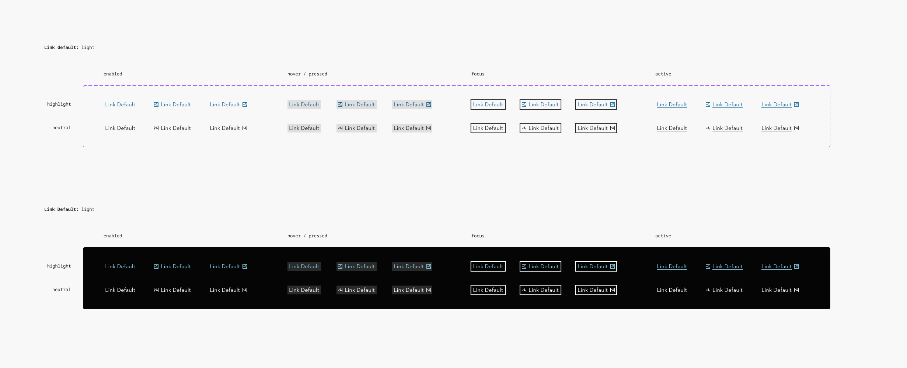

_Figure: Shows link-default (label=Link Default, variant=highlight, state=enabled, icon position=none); link-default (label=Link Default, variant=highlight, state=enabled, icon position=left); link-default (label=Link Default, variant=highlight, state=enabled, icon position=right); link-default (label=Link Default, variant=highlight, state=hover / pressed, icon position=none); link-default (label=Link Default, variant=highlight, state=hover / pressed, icon position=left); link-default (label=Link Default, variant=highlight, state=hover / pressed, icon position=right); link-default (label=Link Default, variant=highlight, state=focus, icon position=none); link-default (label=Link Default, variant=highlight, state=focus, icon position=left); link-default (label=Link Default, variant=highlight, state=focus, icon position=right); link-default (label=Link Default, variant=highlight, state=active, icon position=none); link-default (label=Link Default, variant=highlight, state=active, icon position=left); link-default (label=Link Default, variant=highlight, state=active, icon position=right). Text in the figure: "Link default: light", "enabled", "hover / pressed", "focus", "active", "Link Default", "highlight", "neutral", "Link Default: light"._

## Overview

Links are used as navigational elements.

### When to use

Use Standalone links when you want to link to other pages or external resources. They are used on their own or directly next to other content.

### When not to use

Do not use Standalone links within sentences or paragraphs. Use [Inline links](https://www.figma.com/design/qXldpLO6gxHJNLdcXIPxYt?node-id=168-6140) instead.

### Further guidelines

[Storybook documentation](https://main--63440bbb95889041542a5ba3.chromatic.com/?path=/docs/components-links-link--documentation)

## Formatting

### Anatomy

1. **Link Label**
1. **Underline**
1. **Icon (optional)**

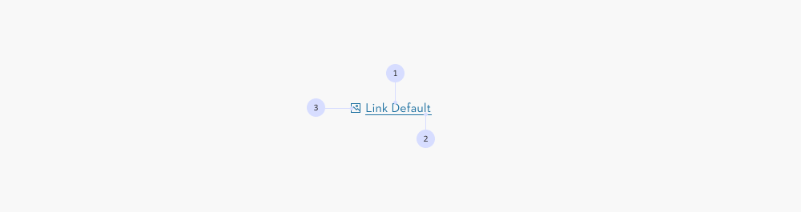

_Figure: Shows link-default (label=Link Default, variant=highlight, state=active, icon position=left). Callouts 1, 2, 3. Text in the figure: "Link Default"._

### Variants

There are two variants for Standalone links:

1. **Highlight:** These should be used per default since their interactivity is indicated by the color.
1. **Neutral:** This variant can be used when they sit within a context that makes it clear that they are an interactive element, i.e. breadcrumbs or footer links.

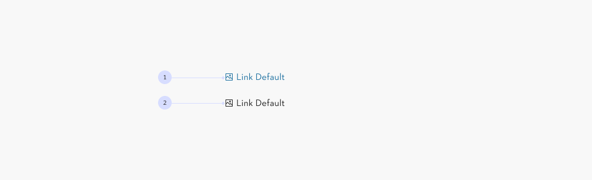

_Figure: Shows link-default (label=Link Default, variant=highlight, state=enabled, icon position=left); link-default (label=Link Default, variant=neutral, state=enabled, icon position=left). Callouts 1, 2. Text in the figure: "Link Default"._

### Icon

Standalone link can be feature an icon to clarify an action and to highlight a link. They are always placed left or right of the text label.

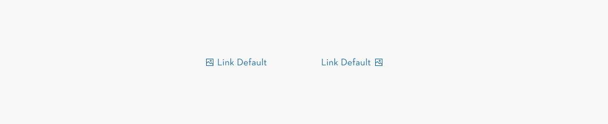

_Figure: Shows link-default (label=Link Default, variant=highlight, state=enabled, icon position=left); link-default (label=Link Default, variant=highlight, state=enabled, icon position=right). Text in the figure: "Link Default"._

## Content

### Character length Standalone Link

Standalone links can be set to a single word **(1)**, as well, as to full sentences **(2)**.

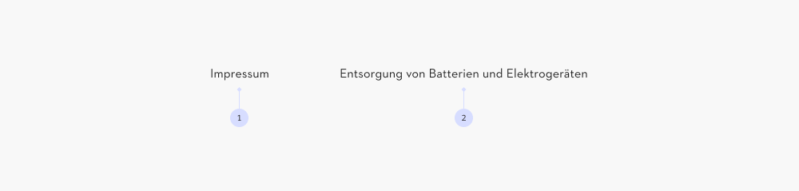

_Figure: Shows link-default (label=Impressum, variant=neutral, state=enabled, icon position=none); link-default (label=Entsorgung von Batterien und Elektrogeräten, variant=neutral, state=enabled, icon position=none). Callouts 1, 2. Text in the figure: "Impressum", "Entsorgung von Batterien und Elektrogeräten"._

### Overflow

Although its not recommended, overflow **(1)** can occur. The icon **(2)** is aligned centered to the text. The text should not overflow in more than two lines.

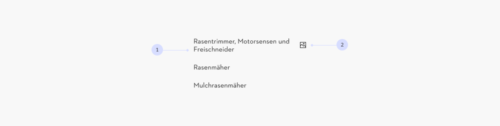

_Figure: Shows link-default (label=Rasentrimmer, Motorsensen und Freischneider, variant=neutral, state=enabled, icon position=right); link-default (label=Rasenmäher, variant=neutral, state=enabled, icon position=none); link-default (label=Mulchrasenmäher, variant=neutral, state=enabled, icon position=none). Callouts 1, 2. Text in the figure: "Rasentrimmer, Motorsensen und Freischneider", "Rasenmäher", "Mulchrasenmäher"._

## Colour combinations

### Background colours

Inline links should only be used on backgrounds as shown below:

#### Light mode

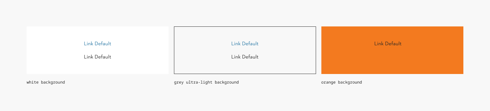

_Figure: Shows link-default (label=Link Default, variant=highlight, state=enabled, icon position=none); link-default (label=Link Default, variant=neutral, state=enabled, icon position=none). Text in the figure: "Link Default", "white background", "grey ultra-light background", "orange background"._

#### Dark mode

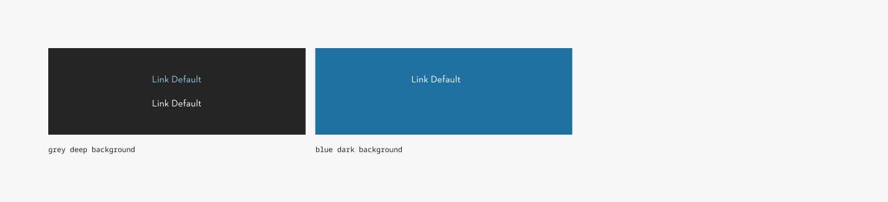

_Figure: Shows link-default (label=Link Default, variant=highlight, state=enabled, icon position=none); link-default (label=Link Default, variant=neutral, state=enabled, icon position=none). Text in the figure: "Link Default", "grey deep background", "blue dark background"._

## Link Button

A button link visually looks like a button but functions as a link

> **Disclaimer: Link CTA in Figma** In Figma, there is no visual distinction between the link-CTA and the [button component](https://www.figma.com/design/qXldpLO6gxHJNLdcXIPxYt/Core-Components-%F0%9F%92%A0?node-id=162-126). When designing, use the button component, but ensure that during the developer handoff, the correct code component is implemented based on its intended function.

[Storybook documentation](https://main--63440bbb95889041542a5ba3.chromatic.com/?path=/docs/components-links-link-button--documentation)

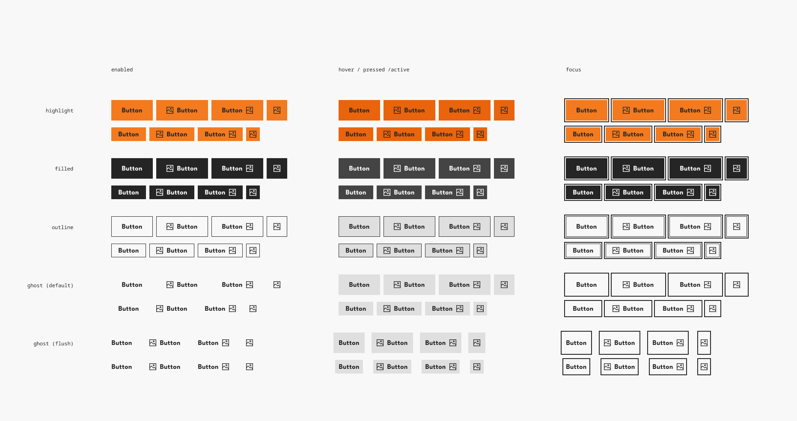

_Figure: Shows button (button text=Button, variant=highlight, state=enabled, size=medium, icon position=none, hide label=off, flush alignment=off); button (button text=Button, variant=highlight, state=enabled, size=medium, icon position=left, hide label=off, flush alignment=off); button (button text=Button, variant=highlight, state=enabled, size=medium, icon position=right, hide label=off, flush alignment=off); button (button text=Button, variant=highlight, state=enabled, size=medium, icon position=none, hide label=on, flush alignment=off); button (button text=Button, variant=highlight, state=hover / pressed, size=medium, icon position=none, hide label=off, flush alignment=off); button (button text=Button, variant=highlight, state=hover / pressed, size=medium, icon position=left, hide label=off, flush alignment=off); button (button text=Button, variant=highlight, state=hover / pressed, size=medium, icon position=right, hide label=off, flush alignment=off); button (button text=Button, variant=highlight, state=hover / pressed, size=medium, icon position=none, hide label=on, flush alignment=off); button (button text=Button, variant=highlight, state=focus, size=medium, icon position=none, hide label=off, flush alignment=off); button (button text=Button, variant=highlight, state=focus, size=medium, icon position=left, hide label=off, flush alignment=off); button (button text=Button, variant=highlight, state=focus, size=medium, icon position=right, hide label=off, flush alignment=off); button (button text=Button, variant=highlight, state=focus, size=medium, icon position=none, hide label=on, flush alignment=off). Text in the figure: "enabled", "hover / pressed /active", "focus", "Button", "highlight", "filled", "outline", "ghost (default)", "ghost (flush)"._

## Overview

A button link visually looks like a button but functions as a link

### When to use

- When the action navigates the user to another page or an external site.
- When the action is non-destructive (if the clicking the link) does not modify data, trigger irreversible changes, or require confirmation.
- When maintaining visual consistency with buttons while keeping standard link behavior.

### When not to use

Links should only used to navigate users to another location, such as a different page, an external site, or a specific section within the same page. So the button style linke should not be used

- For actions that change data, submit forms, or perform in-place updates—use a real button instead.
- When the action does not need the visual weight of a button.

### Alternatives

- Use a text link (inline link) when the action is secondary or part of a sentence.
- Use a standalone link when navigation is important but does notrequire strong visual emphasis

### Further guidelines

[Storybook documentation](https://main--63440bbb95889041542a5ba3.chromatic.com/?path=/docs/components-links-link-button--documentation)

## Formatting

> Most of the “Formatting and Construction” guidelines from the Tabs in-page component apply, see above.

### Icon

A button link can include an icon to clarify its purpose or add emphasis. Especially when linking to another page or an external website

Icons can be placed before or after the text label, though a left position is preferred for readability.

For general button behavior, refer to the [Button Documentation](https://www.figma.com/design/qXldpLO6gxHJNLdcXIPxYt/Core-Components-%F0%9F%92%A0?m=auto&node-id=1881-8244&t=6H7CjP58P7hAE6UF-1)

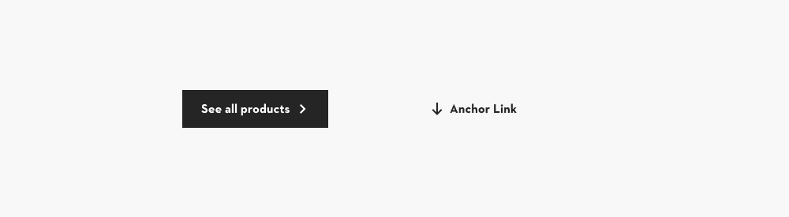

_Figure: Shows button (button text=See all products, variant=filled, state=enabled, size=medium, icon position=right, hide label=off, flush alignment=off); button (button text=Anchor Link, variant=ghost, state=enabled, size=medium, icon position=left, hide label=off, flush alignment=off). Text in the figure: "See all products", "Anchor Link"._

## Content

> Most of the “Formatting and Construction” guidelines from the Tabs in-page component apply, see above.

### Maximum character

Unlike standalone links, a button link should not contain full sentences. Instead, keep the text concise:

1. A maximum of **18 characters** without icon
1. A maximum of **16 characters** with icon

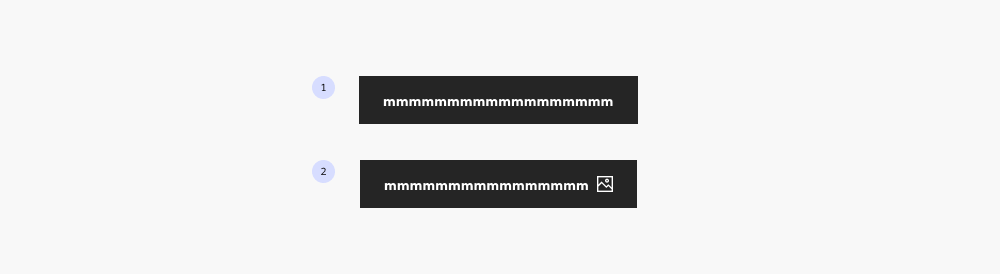

_Figure: Shows button (button text=mmmmmmmmmmmmmmmmmm, variant=filled, state=enabled, size=medium, icon position=none, hide label=off, flush alignment=off); button (button text=mmmmmmmmmmmmmmmm, variant=filled, state=enabled, size=medium, icon position=right, hide label=off, flush alignment=off). Callouts 1, 2. Text in the figure: "mmmmmmmmmmmmmmmmmm", "mmmmmmmmmmmmmmmm"._

### Overflow

Although its not recommended, overflow can occur. [In this case use ghost buttons styling if possible.](https://www.figma.com/design/qXldpLO6gxHJNLdcXIPxYt?node-id=168-3943) The icon is aligned centered to the text. The text should not overflow in more than two lines.

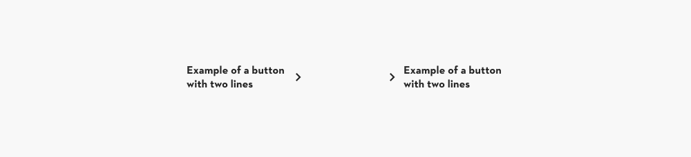

_Figure: Shows button (button text=Example of a button 
with two lines, variant=ghost, state=enabled, size=medium, icon position=right, hide label=off, flush alignment=off); button (button text=Example of a button 
with two lines, variant=ghost, state=enabled, size=medium, icon position=left, hide label=off, flush alignment=off). Text in the figure: "Example of a button with two lines"._

## Behavior

> Most of the “Formatting and Construction” guidelines from the Tabs in-page component apply, see above.

### Disable

The button linke has the same fcouse behaviour as the button component

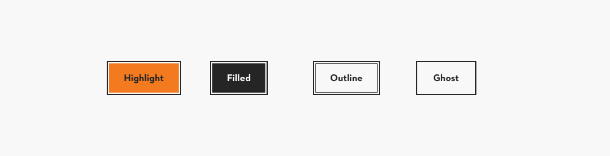

_Figure: Shows button (button text=Highlight, variant=highlight, state=focus, size=medium, icon position=none, hide label=off, flush alignment=off); button (button text=Filled, variant=filled, state=focus, size=medium, icon position=none, hide label=off, flush alignment=off); button (button text=Outline, variant=outline, state=focus, size=medium, icon position=none, hide label=off, flush alignment=off); button (button text=Ghost, variant=ghost, state=focus, size=medium, icon position=none, hide label=off, flush alignment=off). Text in the figure: "Highlight", "Filled", "Outline", "Ghost"._

## Inline Link

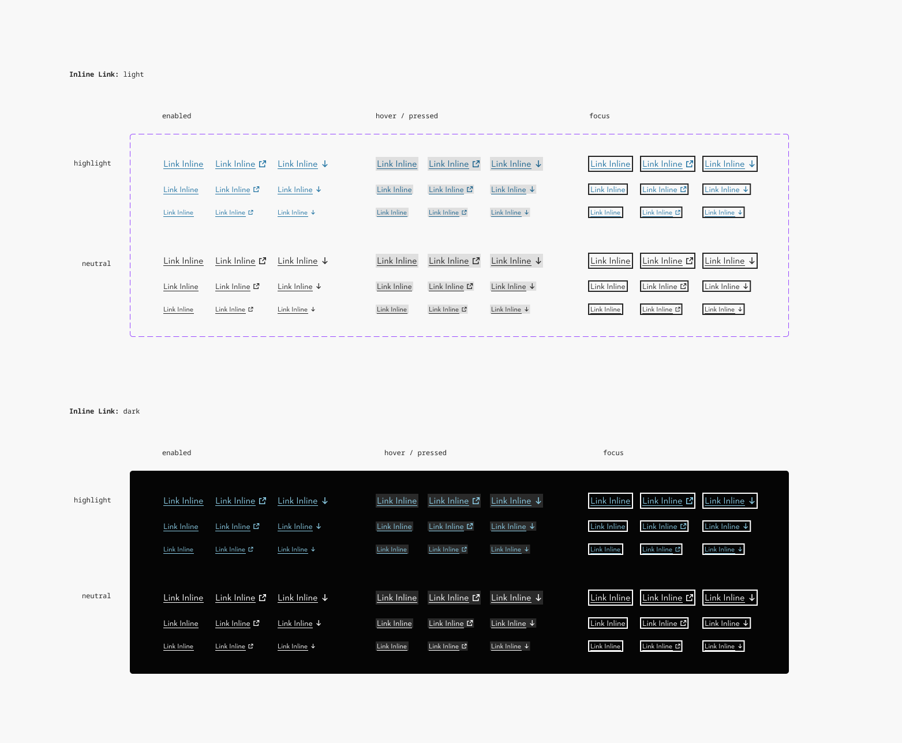

_Figure: Shows link-inline (label=Link Inline, variant=highlight, state=enabled, type=internal link, size=text M); link-inline (label=Link Inline, variant=highlight, state=enabled, type=external link, size=text M); link-inline (label=Link Inline, variant=highlight, state=enabled, type=anchor link, size=text M); link-inline (label=Link Inline, variant=highlight, state=hover / pressed, type=internal link, size=text M); link-inline (label=Link Inline, variant=highlight, state=hover / pressed, type=external link, size=text M); link-inline (label=Link Inline, variant=highlight, state=hover / pressed, type=anchor link, size=text M); link-inline (label=Link Inline, variant=highlight, state=focus, type=internal link, size=text M); link-inline (label=Link Inline, variant=highlight, state=focus, type=external link, size=text M); link-inline (label=Link Inline, variant=highlight, state=focus, type=anchor link, size=text M); link-inline (label=Link Inline, variant=highlight, state=enabled, type=internal link, size=text S); link-inline (label=Link Inline, variant=highlight, state=enabled, type=external link, size=text S); link-inline (label=Link Inline, variant=highlight, state=enabled, type=anchor link, size=text S). Text in the figure: "Inline Link: light", "enabled", "hover / pressed", "focus", "Link Inline", "highlight", "neutral", "Inline Link: dark"._

## Overview

Links are used as navigational elements.

### When to use

Use Inline links when you want to link to other pages or external resources within a sentence or paragraph.

### When not to use

Do not use Inline links outside of sentences or paragraphs. Use [Standalone links](https://www.figma.com/design/qXldpLO6gxHJNLdcXIPxYt?node-id=168-7210) instead.

### Links that look like buttons

There are instances when a link needs to be styled as a button because of its emphasis on the page.

In this case keep in mind that there is no disabled and loading state, since they are links.

### Component vs. style

In code Inline links are set up as a style. For ease of use in Figma we created the Inline link as a component that can be placed on top of sentences and paragraphs by using the “absolute position” function.

### Further guidelines

[Storybook documentation](https://main--63440bbb95889041542a5ba3.chromatic.com/?path=/docs/styles-link-inline--documentation)

## Formatting

### Anatomy

1. **Link label**
1. **Underline**
1. **Icon**

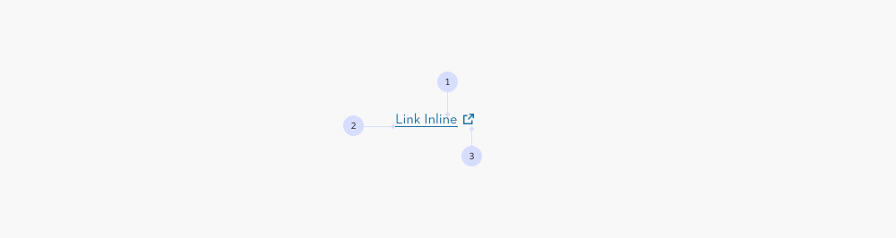

_Figure: Shows link-inline (label=Link Inline, variant=highlight, state=enabled, type=external link, size=text M). Callouts 1, 2, 3. Text in the figure: "Link Inline"._

### Types

There are three Inline link types:

1. Without icon (default)
1. With arrow out icon (external link)
1. With arrow down icon (anchor link)

**Attention**: In the code component only these three types are enabled.

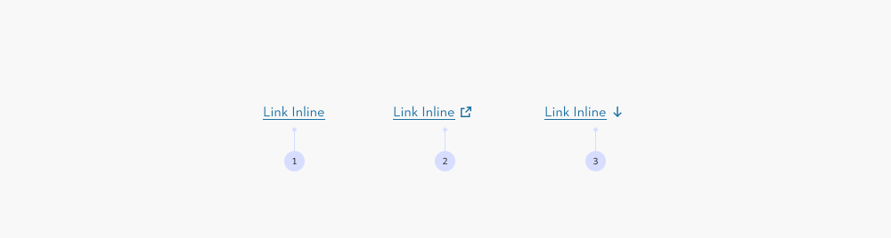

_Figure: Shows link-inline (label=Link Inline, variant=highlight, state=enabled, type=internal link, size=text M); link-inline (label=Link Inline, variant=highlight, state=enabled, type=external link, size=text M); link-inline (label=Link Inline, variant=highlight, state=enabled, type=anchor link, size=text M). Callouts 1, 2, 3. Text in the figure: "Link Inline"._

### Variants

Highlight **(1)** or neutral **(2).**

For accessibility reasons the highlight variation is recommended.

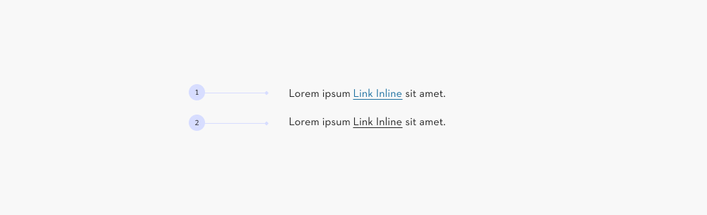

_Figure: Shows link-inline (label=Link Inline, variant=highlight, state=enabled, type=internal link, size=text M); link-inline (label=Link Inline, variant=neutral, state=enabled, type=internal link, size=text M). Callouts 1, 2. Text in the figure: "Lorem ipsum Inline Linksit amet.", "Link Inline"._

### Font size

For Inline links the font size adapts to the main copy.

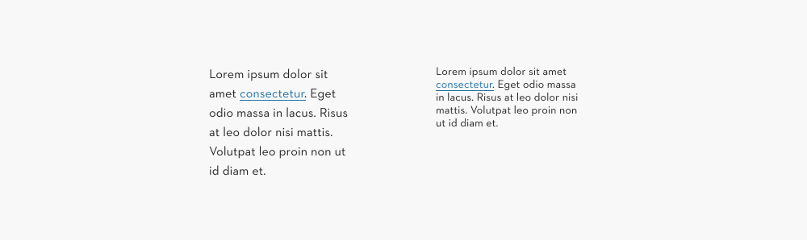

_Figure: Shows link-inline (label=consectetur, variant=highlight, state=enabled, type=internal link, size=text M); link-inline (label=consectetur, variant=highlight, state=enabled, type=internal link, size=text S). Text in the figure: "Lorem ipsum dolor sit amet consectetur. Eget odio massa in lacus. Risus at le...", "consectetur"._

### Icon size

For Inline links the icon size adapts to the font size:

1. Text M
1. Text S
1. Text XS

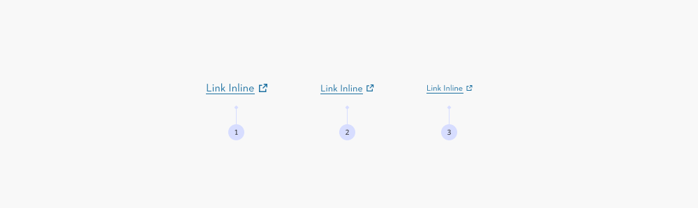

_Figure: Shows link-inline (label=Link Inline, variant=highlight, state=enabled, type=external link, size=text M); link-inline (label=Link Inline, variant=highlight, state=enabled, type=external link, size=text S); link-inline (label=Link Inline, variant=highlight, state=enabled, type=external link, size=text XS). Callouts 1, 2, 3. Text in the figure: "Link Inline"._

### Spacing

The spacing between text and icon is set to 0.375em in order to allow the spacing to grow depending on the font size.

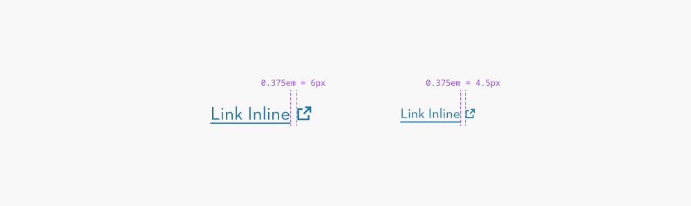

_Figure: Shows link-inline (label=Link Inline, variant=highlight, state=enabled, type=external link, size=text M); link-inline (label=Link Inline, variant=highlight, state=enabled, type=external link, size=text XS). Text in the figure: "0.375em = 6px", "0.375em = 4.5px", "Link Inline"._

## Content

### Character length Inline Link

Inline links can be set to a single word, as well, as to full sentences.

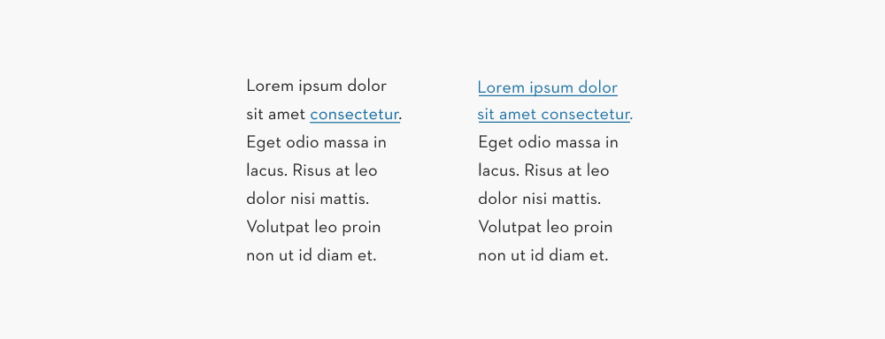

_Figure: Shows link-inline (label=Lorem ipsum dolor sit amet consectetur., variant=highlight, state=enabled, type=internal link, size=text M); link-inline (label=consectetur, variant=highlight, state=enabled, type=internal link, size=text M). Text in the figure: "Lorem ipsum dolor sit amet consectetur. Eget odio massa in lacus. Risus at le...", "Lorem ipsum dolor sit amet consectetur.", "consectetur", "Eget odio massa in lacus. Risus at leo dolor nisi mattis. Volutpat leo proin..."._

### Don’t link multiple sentences

It is not recommended to link multiple sentences or a full paragraph.

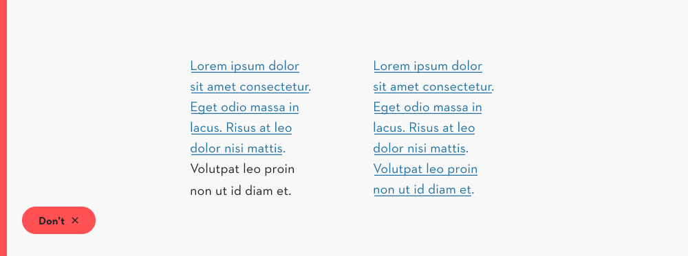

_Figure: Don't example. Shows link-inline (label=Lorem ipsum dolor sit amet consectetur. Eget odio massa in lacus. Risus at leo dolor nisi mattis., variant=highlight, state=enabled, type=internal link, size=text M); link-inline (label=Lorem ipsum dolor sit amet consectetur. Eget odio massa in lacus. Risus at leo dolor nisi mattis. Volutpat leo proin non ut id diam et., variant=highlight, state=enabled, type=internal link, size=text M). Text in the figure: "Lorem ipsum dolor sit amet consectetur. Eget odio massa in lacus. Risus at le...", "Volutpat leo proin non ut id diam et."._

## Behavior

### Focus edge case – Link over two lines

The edge case when the link expands over two lines

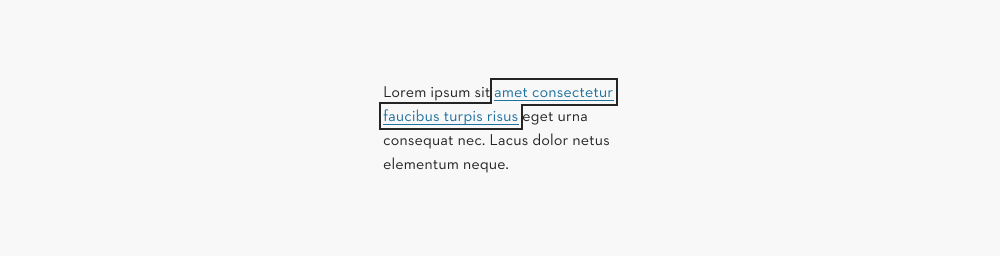

_Figure: Shows link-inline (label=amet consectetur, variant=highlight, state=focus, type=internal link, size=text M); link-inline (label=faucibus turpis risus, variant=highlight, state=focus, type=internal link, size=text M). Text in the figure: "Lorem ipsum sit amet consectetur faucibus turpis risus eget urna consequat ne...", "amet consectetur", "faucibus turpis risus"._

### Interaction trigger

Users can activate external links (dialogue, new tab or new window) or anchor links (same tab/page).

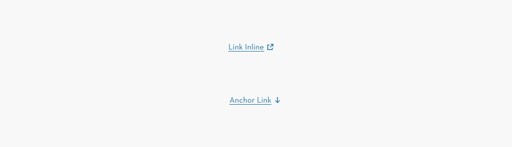

_Figure: Shows link-inline (label=Link Inline, variant=highlight, state=enabled, type=external link, size=text M); link-inline (label=Anchor Link, variant=highlight, state=enabled, type=anchor link, size=text M). Text in the figure: "Link Inline", "Anchor Link"._

## Colour combinations

### Background colours

Inline links should only be used on backgrounds as shown below:

#### Light mode

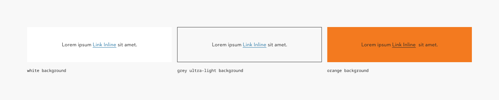

_Figure: Shows link-inline (label=Link Inline, variant=highlight, state=enabled, type=internal link, size=text M); link-inline (label=Link Inline, variant=neutral, state=enabled, type=internal link, size=text M). Text in the figure: "Lorem ipsum Inline Linksit amet.", "Link Inline", "Lorem ipsum Inline Link sit amet.", "white background", "grey ultra-light background", "orange background"._

#### Dark mode

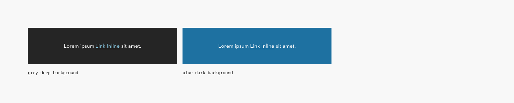

_Figure: Shows link-inline (label=Link Inline, variant=highlight, state=enabled, type=internal link, size=text M); link-inline (label=Link Inline, variant=neutral, state=enabled, type=internal link, size=text M). Text in the figure: "Lorem ipsum Inline Linksit amet.", "Link Inline", "grey deep background", "blue dark background"._
