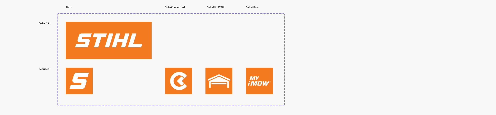
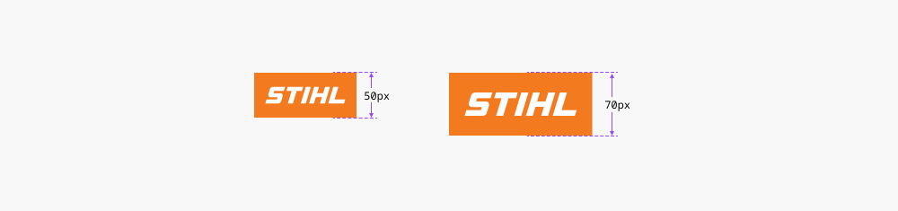
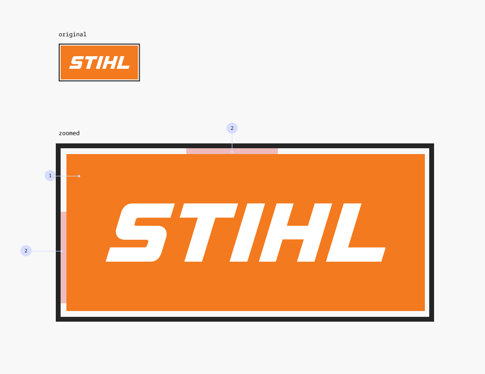
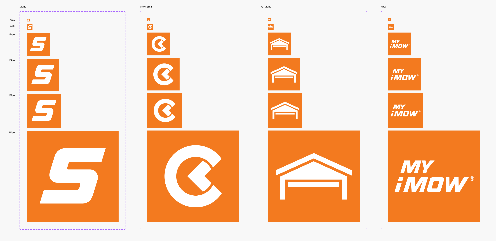
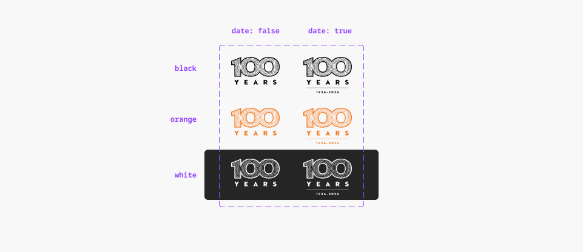
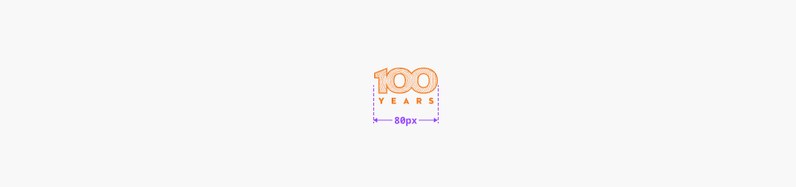
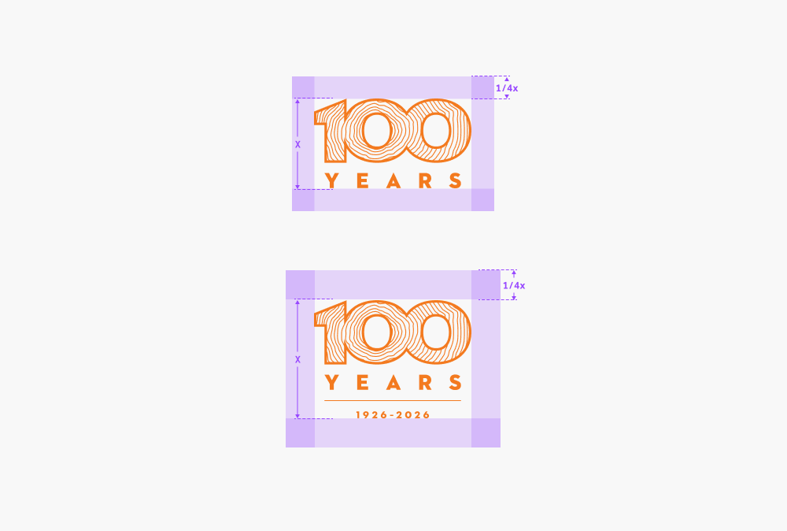
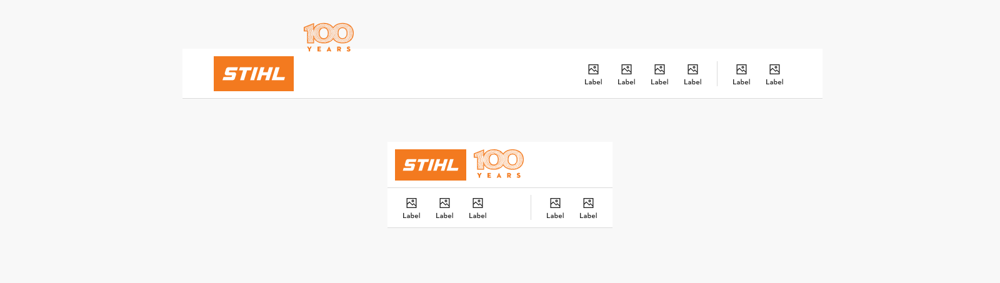

# Logo

## Logo

Overview:

- Information on how the logo is constructed and used can be found in the [STIHL Brand Portal](https://brandportal.stihl.com/de/logo.aspx).
- When the logo is used as an interactive element, the maximum height is 70px.
- The focus state is constructed the same way as the focus for [buttons](https://www.figma.com/design/qXldpLO6gxHJNLdcXIPxYt?node-id=162-126).

### Further guidelines

[Storybook documentation](https://main--63440bbb95889041542a5ba3.chromatic.com/?path=/docs/components-logo--documentation)

### Contribute

Contribute to improving this component by sharing your feedback, asking questions, or suggesting features [here](https://www.figma.com/design/lLmw7PfIdKjFG4uT3B2Hyj/Onboarding-%F0%9F%93%96?node-id=446-868&t=zKmRu4kAkxMeRDmK-4).

## Formatting and Construction

### Size for clickable logos

When the logo is used as an interactive element (i.e. as a link to the homepage inside the topbar) the following height limitations should be kept in mind:

- **max. height:** 70px
- **min. height:** 50px

### Focus State

The focus state uses the same styling as for buttons. A 2px wide border in the color grey-deep **(1)** with 2px distance **(2)** between the border an the component.

## Favicon

Overview:

- The favicon can be displayed by browsers in the browser's address bar, tabs, history, and next to the page's name in a list of bookmarks.

> **If a project requires a different favicon, it must be approved by Corporate Design.** This favicon should be used as default. For any further questions, please send an e-mail to design.system@stihl.de.

## 100 Year Logo

Overview:

- The 100-year logo is a special, temporary mark created to celebrate STIHL’s centenary. It will be used throughout 2026 to communicate the company’s 100th anniversary since its founding.
- In digital applications, the logo will primarily appear in the top bar, as well as in teaser assets or within custom components designed for the anniversary campaign.

**Additional Information:**

Access all language versions of the 100 Years logo in [SharePoint](https://stihlgroup.sharepoint.com/sites/MMKVUHUB/018_100_years_anniversary/Forms/AllItems.aspx?csf=1&web=1&e=hY9K4g&CID=089fad52%2Dfa0b%2D49e9%2Dbebe%2Dac3e9970e866&FolderCTID=0x0120009D49E9F110A93949AEFB37E63134FCD3&id=%2Fsites%2FMMKVUHUB%2F018%5F100%5Fyears%5Fanniversary%2F001%5F100%20Years%20Logo&ovuser=702ed1df%2Dfbf3%2D42e7%2Da14d%2Ddb80a314e632%2Cbenedikt%2Eschramm%40stihl%2Ede&OR=Teams%2DHL&CT=1775559685637&clickparams=eyJBcHBOYW1lIjoiVGVhbXMtRGVza3RvcCIsIkFwcFZlcnNpb24iOiI0OS8yNjAyMjcwNDIxNSIsIkhhc0ZlZGVyYXRlZFVzZXIiOmZhbHNlfQ%3D%3D).

If you require the l**ogo in high resolution for print applications**, or if you need **detailed print guidelines**, please contact the STIHL Brand Team: Oliver Ecke: [oliver.ecke@stihl.de](mailto:oliver.ecke@stihl.de) Damaris Brenner: [damaris.brenner@stihl.de](mailto:damaris.brenner@stihl.de)

## Formatting and Construction

### Minimum Size

The 100-year logo must be at least **80 px wide** in digital applications.

### Save Zone

For print applications, the safe zone is defined as 2% of the shorter side of the format in which the logo is placed. **In digital contexts**, where layouts and page sizes are dynamic, the safe zone should be **at least 1/4 of the logo’s height (x)** on all sides.

## Usage

### General Guidelines

The 100-year logo can be integrated into components and digital assets. When doing so, keep the following in mind:

- Use only the **three provided brand colors.**
- Ensure **sufficient contrast** against the background for readability.
- **Maintain the safe zone** to avoid overlaps, cropping, or visual clutter

### Example: Top Bar Logo add on

In the top bar, use the **black logo without the date in its minimum size version (80 px width)**. It is placed in the designated add-on slot of the top bar logo component. In development, this will be provided as a predefined property for the brand add-on and doesn’t need to be inserted manually

