# Notification

## Notification

Overview:

- Use to communicate feedback non-intrusively .
- The four types are success, error, warning, and info.
- The three most common use cases are system feedback, content highlight, and guidance message.
- The component is divided into two sections: content section and action section.
- As the component is primarily a content module, test the copy for optimal length and tone-of-voice.
- Ensure a clear hierarchy of content elements and action buttons.

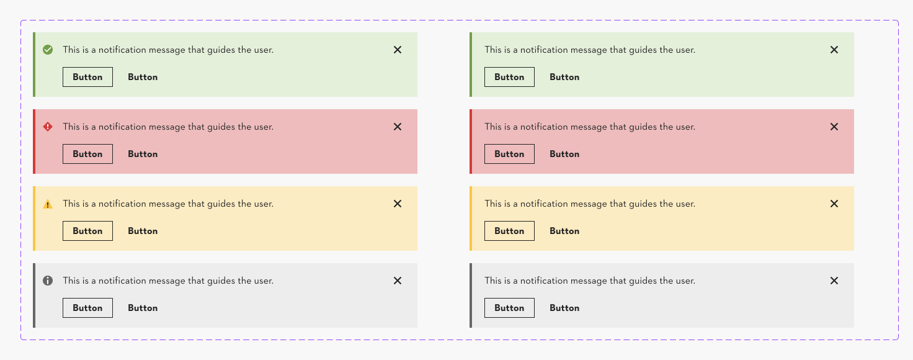

### Further guidelines

[Storybook documentation](https://main--63440bbb95889041542a5ba3.chromatic.com/?path=/docs/components-notification--documentation&globals=backgrounds.name:!undefined;backgrounds.value:!undefined)

Decision tree

### Similar components

**Component**

**Trigger**

**Placement**

**Content**

**Intention**

**Tooltip**

Hover or focus of an interactive element

In proximity to the triggering element, non-modal

Text only

Provide short, contextual information or clarify unlabeled controls

**Popover**

Click or tap of an interactive element

In proximity to the triggering button, non-modal

Text, icon, image and interactive elements

Provide additional information or quick actions without leaving the current context

**Dialog**

Triggered by the system in response to user interaction

Center of the screen, with backdrop, modal

Text, icon, image and interactive elements

Confirm important actions, guide users through complex tasks, or temporarily block interaction to focus attention

**Toast**

Triggered by the system in response to user interaction

Bottom of the screen, non-modal

Text, icon, and optional dismiss button

Provide brief, lightweight feedback on user actions such as error or success.

**Notification**

Triggered by the system in response to events or interactions

Within the content area of the page, in relation to relevant elements

Text, icon, links and buttons

Deliver important updates or status messages that may require user attention or follow-up

### Related components

[Typography](https://www.figma.com/design/d9wrOp4aCplDsV9AVC87Xn/Typography-%F0%9F%85%B0%EF%B8%8F?m=auto&t=4yiq5f9rjU14BQYJ-6)

[Toast](https://www.figma.com/design/qXldpLO6gxHJNLdcXIPxYt?node-id=8844-4923)

[Button](https://www.figma.com/design/qXldpLO6gxHJNLdcXIPxYt?node-id=162-126)

[Iconography](https://www.figma.com/design/U218NNP4OsipaHOtv5flns/Iconography-%E2%9E%A1%EF%B8%8F?m=auto)

[Tooltip](https://www.figma.com/design/HovZmjHiwxguawTWTO6ibS/DS-1085-Design-%7C-Web-%7C-Tootlip?node-id=36194-1244)

[Popover](https://www.figma.com/design/qXldpLO6gxHJNLdcXIPxYt?node-id=26075-11456)

[Dialog](https://www.figma.com/design/qXldpLO6gxHJNLdcXIPxYt/Core-Components-%F0%9F%92%A0?node-id=14115-4051)

### Contribute

Contribute to improving this component by sharing your feedback, asking questions, or suggesting features [here](https://www.figma.com/design/lLmw7PfIdKjFG4uT3B2Hyj/Onboarding-%F0%9F%93%96?node-id=446-868&t=zKmRu4kAkxMeRDmK-4).

## Formatting and Construction

### Anatomy

1. **Icon (optional)** Optional, additional visual indicate what type of notification is used.
1. **Custom content area** Information or guidance for the user
1. **Custom action area (optional)** Place buttons to help the user continue after the feedback is given.
1. **Close icon (optional):** Use to close a notification, in case it is dismissible.

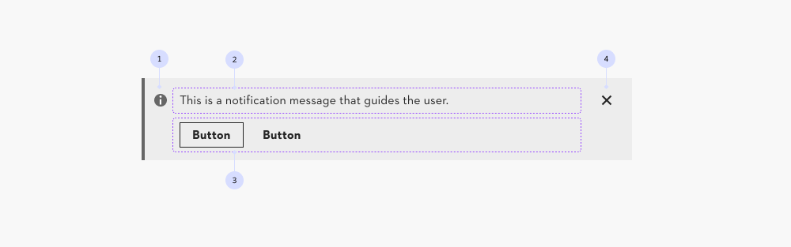

#### Variants

1. **Success** Provide positive feedback to reassure the user.
1. **Error** Provide guidance on how to fix the issue or try again.
1. **Warning** Encourage caution without indicating an immediate error.
1. **Info** Convey neutral information that does not require immediate action.

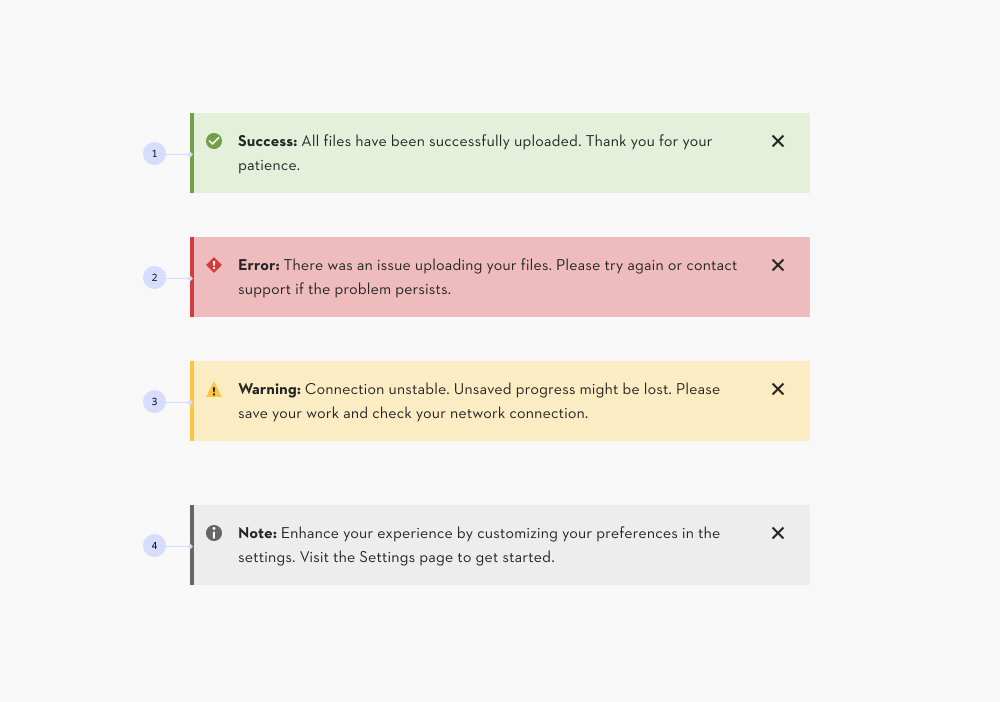

### Sizing

#### Minimum width

The minimum width is 272px, based on smaller screens

#### Height recommendation: optimize for mobile screens

In case the content is longer, ensure it is optimized for mobile presentation. Avoid exceeding one viewport so that users can read the entire message and retain the context of the page.

The average height of a mobile screen is approximately 800px, excluding navigation elements. Therefore, **stay below a height of 350px for smaller screens.**

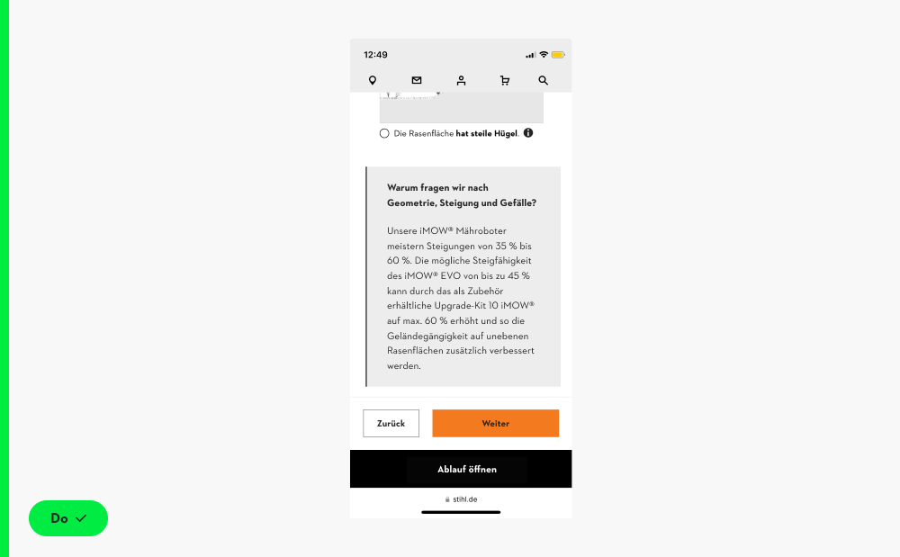

### Placement

#### Layout Placement

Notifications should appear close to and above the element or action that triggered them. Placement depends on the context and scope of the message. There are three main types:

**1. Global**

- Positioned below the header, spanning the full width of the viewport.
- Used for system-wide or mandatory alerts (e.g., maintenance alerts, recalls).

> **Note:** The current notification uses a hard-coded maximum width. A revised version with adjustable sizing and additional updates will be released in a future iteration.

**2. Page**

- Positioned at the top of the main page content area.
- Used for page-level alerts (e.g., page failed to load, data refresh required).

**3. Group**

- Positioned above a specific module, section, or component.
- Used for context-specific alerts (e.g., product in cart is no longer available).

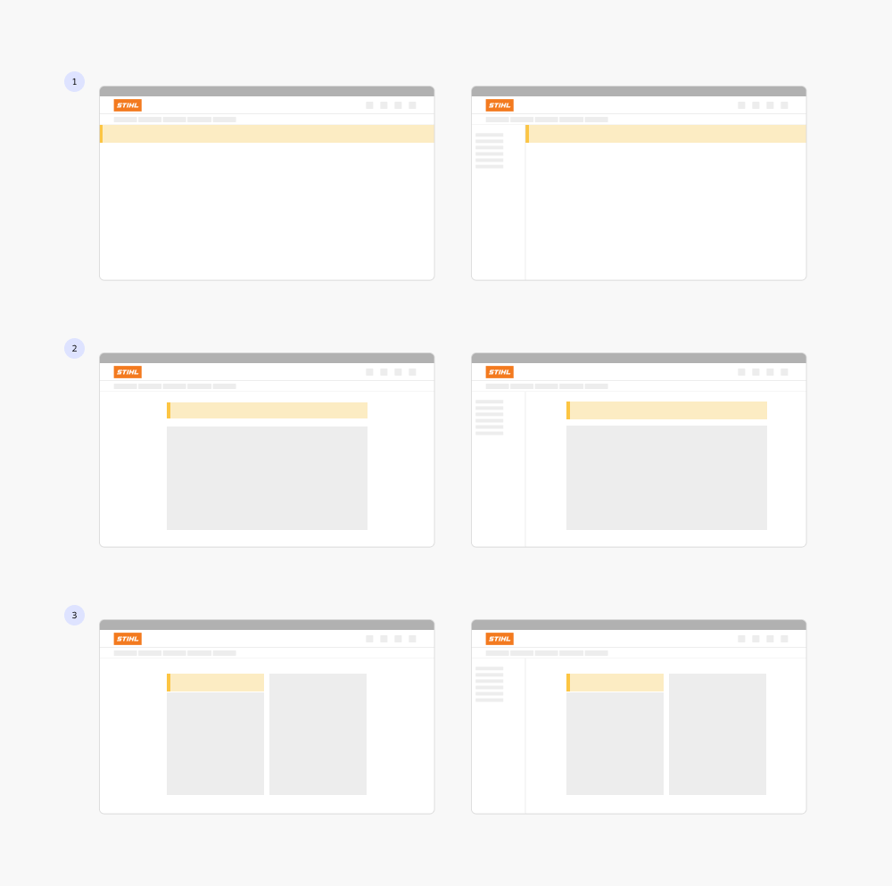

#### Grid Placement

Notifications should align with the Grid Content Areas:

1. **Global Notifications** appear within the Full content area and span the entire width.
1. **Page** and **Group Notifications** should be placed within the Narrower content area or smaller.

[Content placement guidelines](https://www.figma.com/design/JyyYtoCYbtJrzqHs38OXSQ/Grid-%26-Spacing-%F0%9F%A7%AE?node-id=1-132)

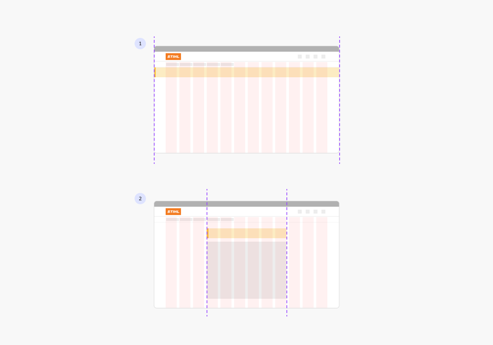

## Content and Assets

### Custom content area

#### Formatting

A content section is filled with formatted text. E.g heading style **(1)** , bold text **(2)**) and inline links **(3).**

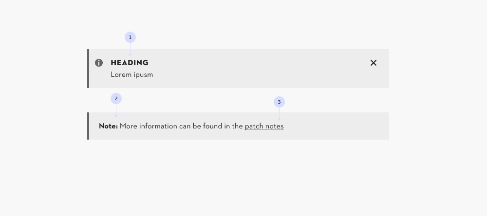

#### Hierarchy recommendations

1. Headline S, with or without uppercase.
1. Format the first few words bold, followed with a “:”.
1. Set inline-links, containing a few words.

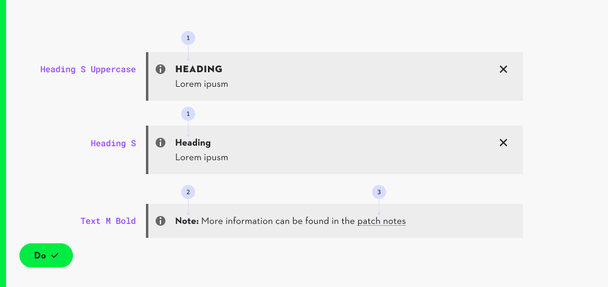

#### Hierarchy warnings

1. Heading M is too big, as its bigger than the icon
1. Do not use bold text with a break, it is not semantic (Tip: Heading S is the same size)
1. Use italic formatting in exceptions only
1. Do not place an inline link on the full sentence
1. Do not format the complete message bold, as it does not provide hierarchy and therefore lacking focus.

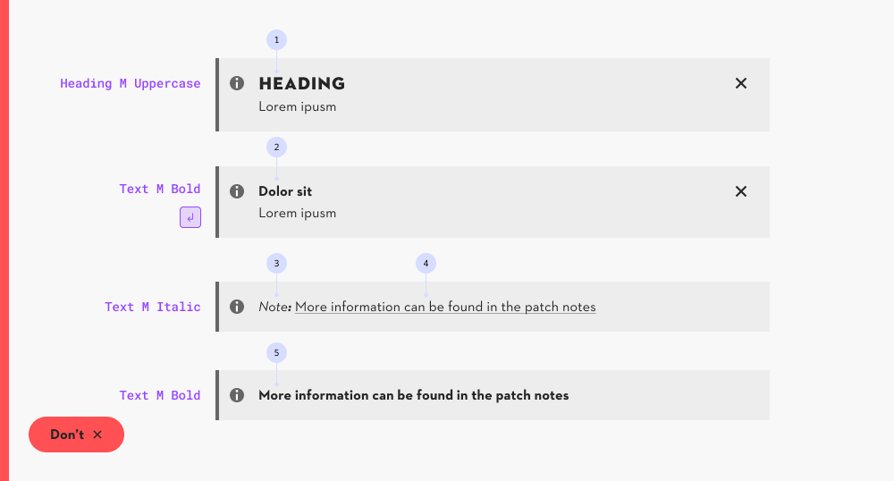

#### Content length

Be concise and to the point.

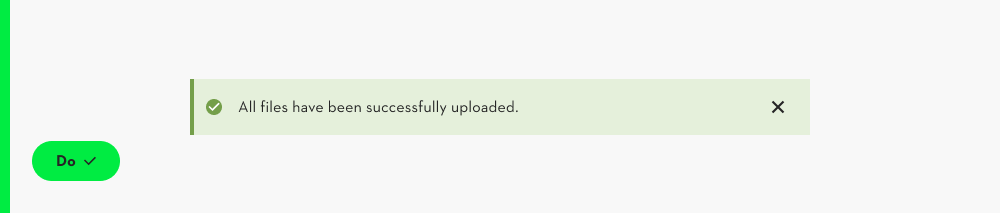

#### One thing at a time

Do not combine two different messages in one alert.

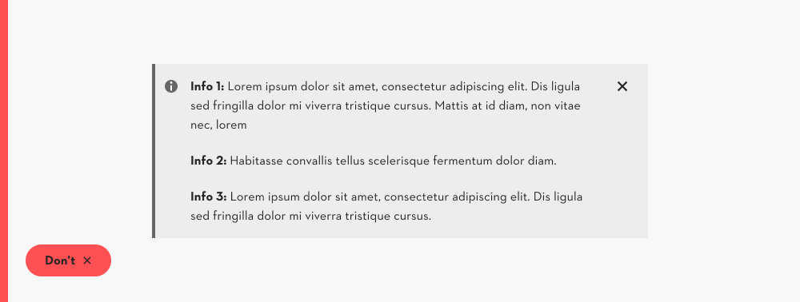

#### Do not use images

Do not use illustrations, content icons, photos, etc. in the content section.

Use a popover tip instead.

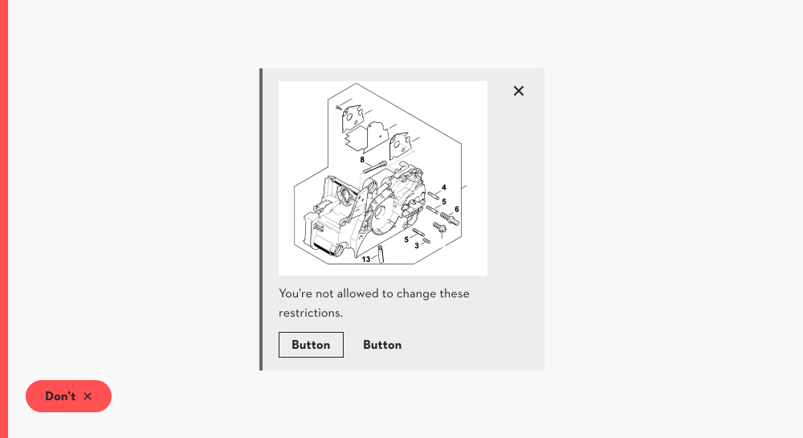

### Custom action area

#### Actions

- The custom action area is optional.
- It can contain the following elements:
   - a link (that looks like a button)
   - a button
- The maximum is 2 buttons.

For pairing buttons, check out the guidelines:

Button guidelines

[Link guidelines](https://www.figma.com/design/qXldpLO6gxHJNLdcXIPxYt?node-id=26711-8034)

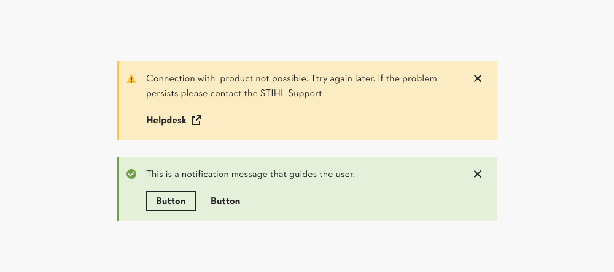

#### Use icons with purpose

Not every notification, needs an icon.

**Do**: get rid of the icon, in case of visual clutter and cognitive load.

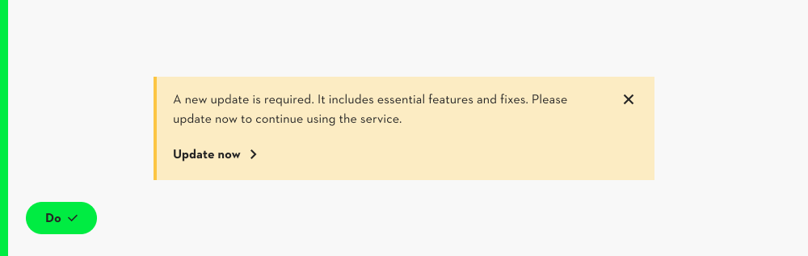

#### Reduce stress

**Don’t:** if the message isn't time-sensitive, the icon could be intrusive to the user.

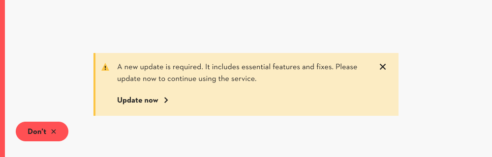

#### Hierarchy recommendations

1. **Ghost button + outline button** The most common and recommended hierarchy for button pairing. Icons are optional.
1. **Single outline button** Combine with an inline line if needed. Icon is optional.
1. **Single ghost button** Icon recommended, combine with an inline line if needed.

[More documentation on button pairing](https://www.figma.com/design/qXldpLO6gxHJNLdcXIPxYt/Pattern-Library-%F0%9F%96%A5-Web-1.0?m=auto&node-id=1883-9757&t=vvQmgCEnIhnqwZm1-1)

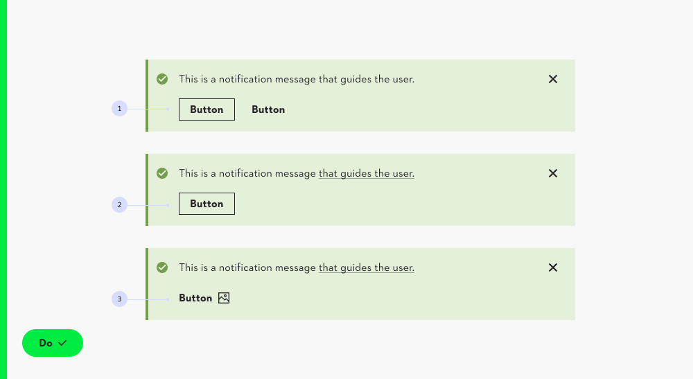

#### Color and hierarchy warnings

1. **Highlight button + filled button** This color combination is not allowed, due to the background color of the component.
1. **Filled button + outline button** The filled button takes too much attention and is most likely not in balance with the rest of the interface and its primary actions.
1. **Two ghost buttons** With or without icons, the hierarchy is limited and therefore not recommended.

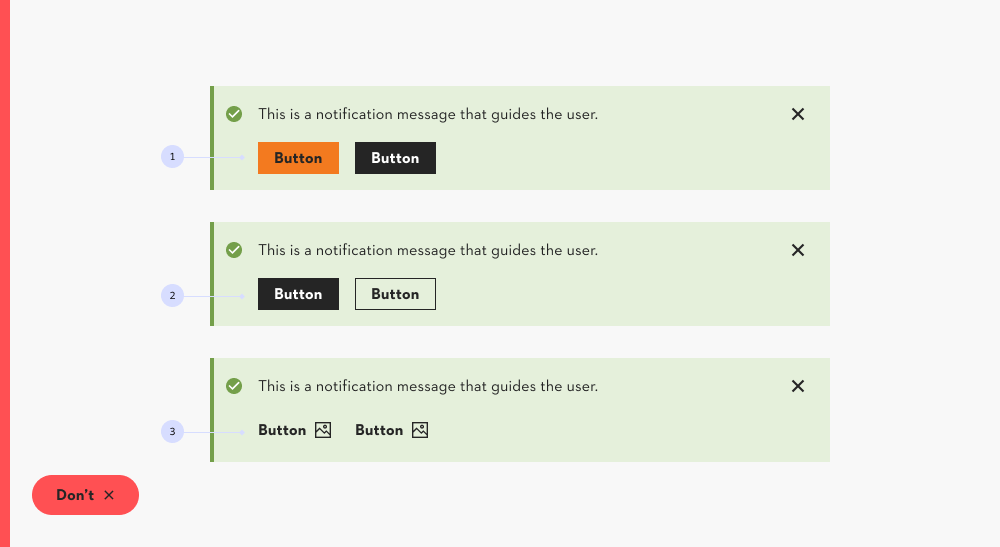

#### Use flush alignment, when buttons are stacked

In case of a longer labels, stack the buttons. Primary action must come first.

Use flush alignment, when ghost buttons are combined with outline buttons.

## Behavior

### Trigger

Notifications can be used as static content modules or system feedback.

1. **System feedback** is triggered by human computer interaction.
1. **Content module** is a fixed module within a page lay-out.

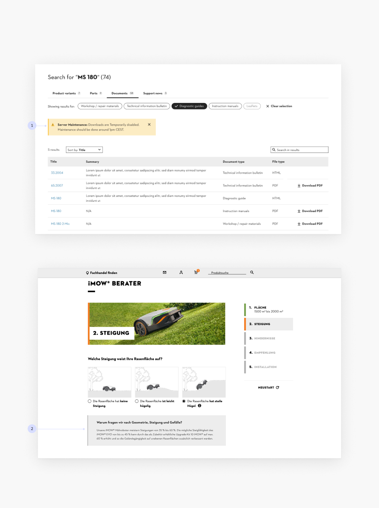

## Usage Guidelines

### Functionality & Priority

Components are chosen based on their level of urgency:

1. **Dialog** Highest urgency. Requires explicit user action before continuing. → [See Dialog](https://www.figma.com/design/qXldpLO6gxHJNLdcXIPxYt?node-id=14115-4051)

1. **Notification / Toast** Draws attention but does not block usage. Useful for immediate or transient feedback. → [See Notification](https://www.figma.com/design/qXldpLO6gxHJNLdcXIPxYt?node-id=7251-8) → [See Toast](https://www.figma.com/design/qXldpLO6gxHJNLdcXIPxYt?node-id=8844-4923)

1. **Banner** Persistent but non-blocking. Ideal for supporting information, promotions, or optional actions. → [See Banner](https://www.figma.com/design/Ie2r0R9QwjEc7O3nrFbXhV/Web-Pattern-Library?node-id=7171-9055)

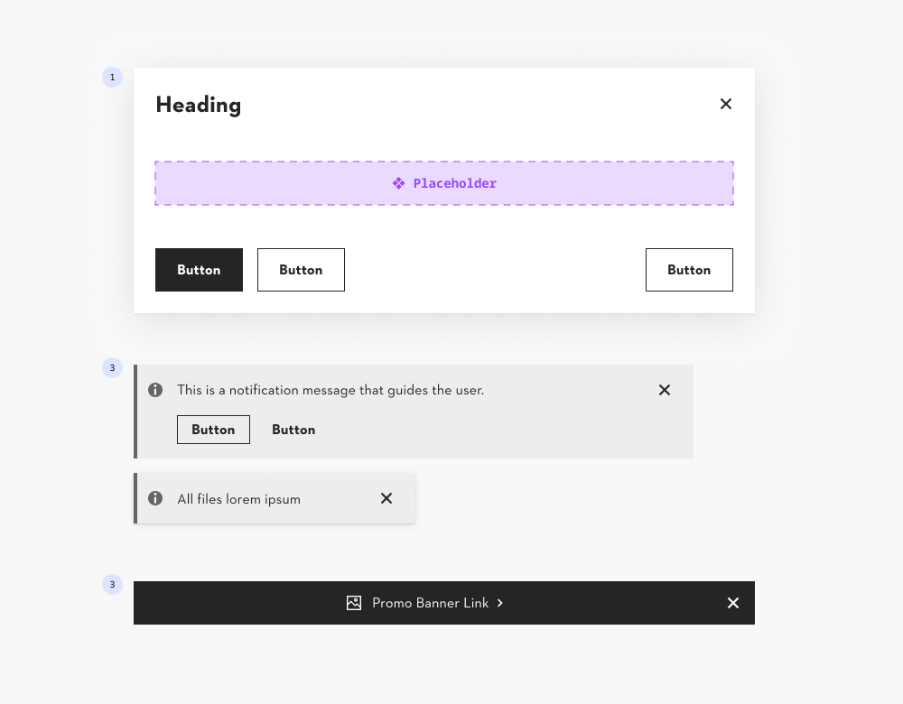

### Use Cases

#### System / Mandatory

- **System feedback (success, error)** → Notification / Toast
- **Cookies / Privacy notices** → Banner (if navigation can continue without consent) → Dialog (if explicit consent is required before continuing)
- **Urgent notifications (downtime, outages, maintenance)** → Notification (when only informing) → Dialog (when user actions are blocked)
- **Critical announcements (recalls, legal or policy changes)** → Notification (when only informing) → Dialog (when user actions are blocked)

#### Marketing / Engagement

- **Sales & promotions** → Banner
- **Seasonal campaigns** → Banner
- **USPs / Value propositions** → Banner (for general positioning) → Notification (when contextually relevant, e.g., delivery info next to cart price)
- **Newsletter sign-up / Loyalty programs / Referrals** → Banner

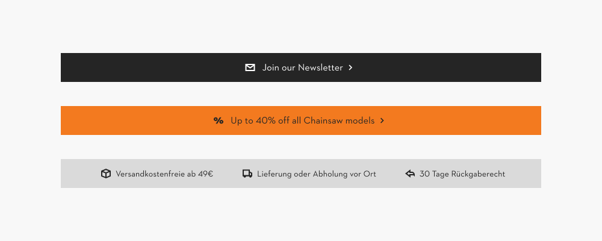

#### Informational

- **Product / feature updates (non-critical)** → Banner
- **Tips, nudges, reminders** → Banner

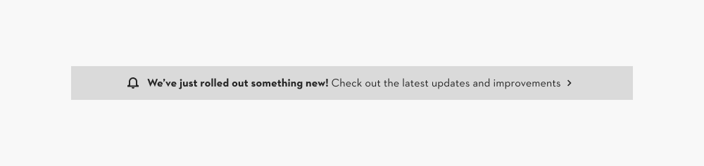

## Examples/Variants

The most common use cases for the notification component are:

### System feedback

Communicate system updates and guides the user in case of interruptions.

Recommended usage:

- dismissible
- icon is recommended
- use conversational language
- triggered by human computer interaction
- message is short and to the point
- explains problem and offers a solution
- action buttons are optional

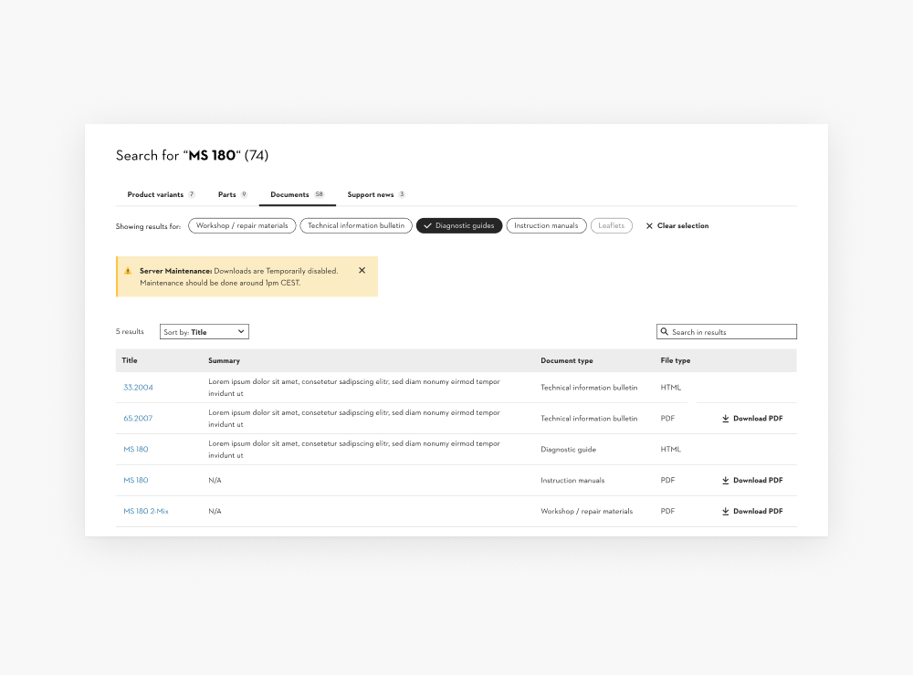

### Content highlight

A content module that has the function to highlight the content within.

Recommended usage:

- not dismissible
- icon optional
- longer character count allowed
- place inline links if relevant
- use images in exception
- action buttons are optional

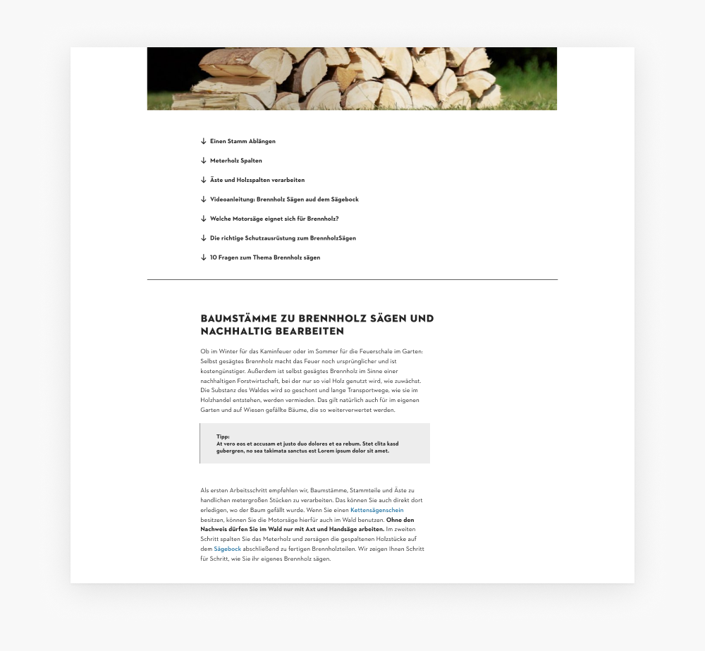

### Guidance message

Highlight microcopy to guide the user in complex processes and aim for a continuous user-flow.

Recommended usage:

- not dismissible
- use the info-icon, icon is optional
- message is short and to the point
- place inline links if relevant
- action buttons are optional

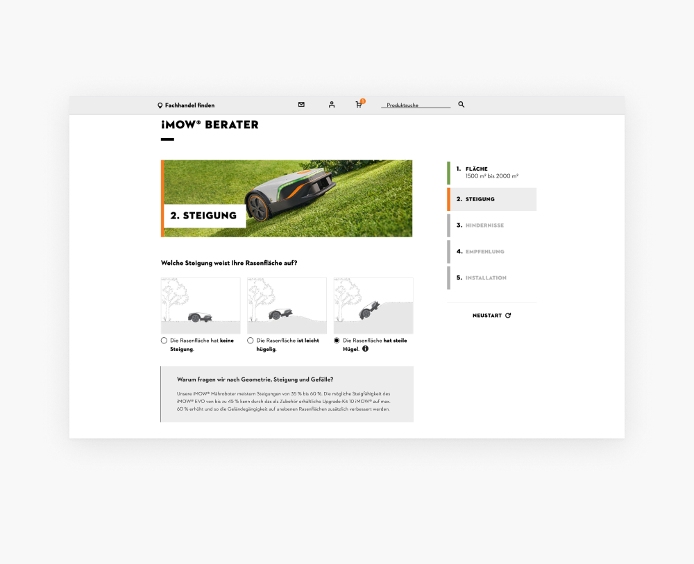
