# Pagination

## Pagination

**Pagination** is a navigation component that divides large data sets into discrete pages and allows users to move between them in a controlled way.

It can improve performance and reduces cognitive load by limiting the amount of information displayed at once.

As a structured data navigation pattern, Pagination provides clear orientation within large collections of content and enables efficient access to specific segments.

**When to use**

Use pagination when working with large amounts of structured or repeated data,, such as:

- Tables
- Lists and list views (e.g. search results)
- Card grids (e.g. product listings)

Pagination is especially useful when users need control, orientation, or the ability to access specific pages.

**When not to use**

Pagination should not be used as a default for continuous or media-driven experiences.

Avoid using pagination for:

- Image or video sliders
- Carousels or media galleries

These patterns support storytelling and exploration and are based on sequential browsing rather than structured navigation.

**Use cases**

- Data tables
- Search results
- Product lists
- Card-based content grids

### Alternative Loading Patterns

**Component**

**Description**

**Pagination**

- For Structured navigation with clear orientation within large data sets
- Direct access to specific pages
- Reduces cognitive load through segmentation

**Load More Button**

- Good for exploratory UIs
- Less control, but a smoother feel
- Alternative for lists and visual grids

**Infinite Scroll**

- For consumer experiences (feeds, social media)
- Not recommended for enterprise workflows

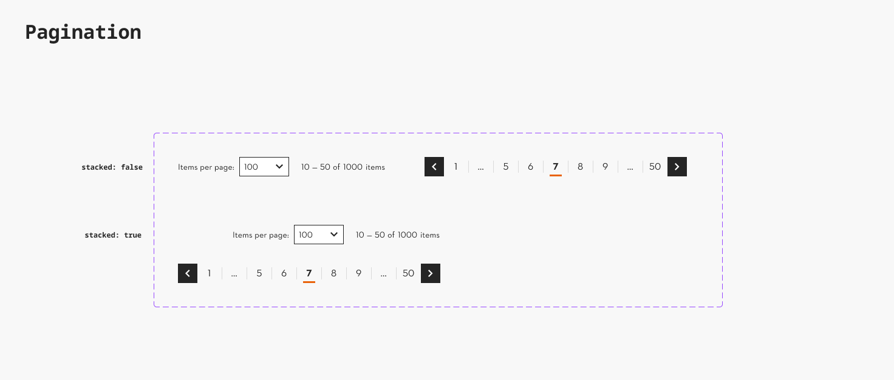

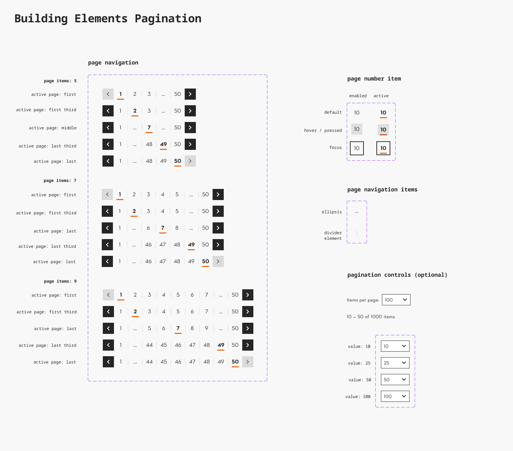

### Further guidelines

[Storybook documentation](https://main--63440bbb95889041542a5ba3.chromatic.com/?path=/docs/components-pagination--documentation)

### Related elements

[Table](https://www.figma.com/design/qXldpLO6gxHJNLdcXIPxYt?node-id=26075-11792)

### Contribute

Contribute to improving this component by sharing your feedback, asking questions, or suggesting features [here](https://www.figma.com/design/lLmw7PfIdKjFG4uT3B2Hyj/Onboarding-%F0%9F%93%96?node-id=446-868&t=zKmRu4kAkxMeRDmK-4).

## Formatting and Construction

### Anatomy

#### Pagination

The Pagination consists of a Page Navigation and optional Pagination Controls:

1. **Page Navigation** Allows users to move between pages
1. **Pagination Controls (optional)** Provide additional context and configuration for pagination.

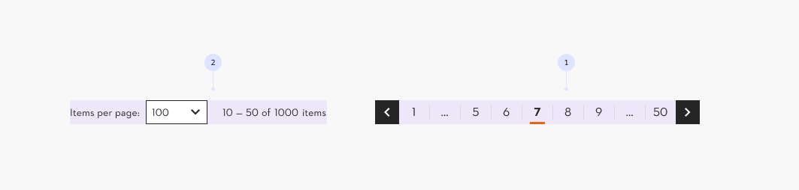

#### Page Navigation

1. **Previous link** Navigates to the previous page in the sequence.
1. **Next link** Navigates to the next page in the sequence.
1. **Page numbers** A centered group of Page number items and ellipsis.
1. **First page link** Navigates directly to the first page.
1. **Last page link** Navigates directly to the last page.
1. **Page number item** Navigates to a specific page within the sequence.
1. **Current page** Indicates the currently active page.
1. **Ellipsis** Indicates that additional pages exist outside the visible range.
1. **Divider** Separates navigation elements.

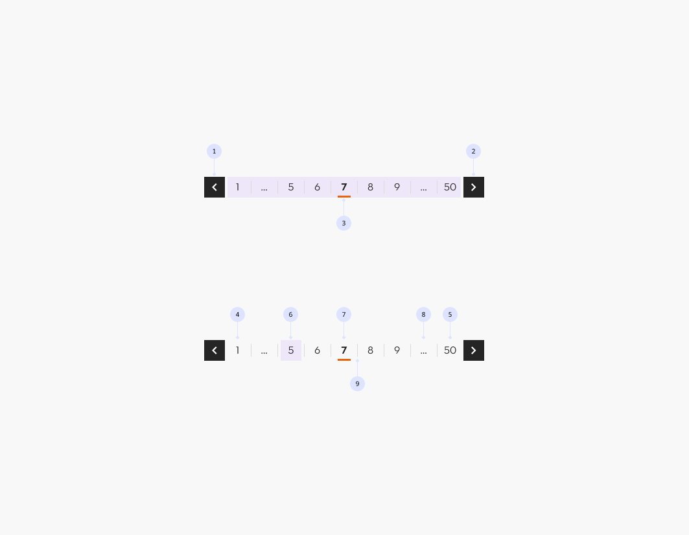

#### Pagination controls (optional)

1. **Page Size** Allows users to define how many items are displayed per page.
   1. **Label**
   1. **Selector (Dropdown / Select)**
1. **Range Indicator** Displays the range of items currently visible on the page.
   1. **Item Range**
   1. **Total Item Count**

### Placement

1. Pagination is typically placed below the content it controls.
1. For tables or large datasets, an additional Pagination component may be placed at the top to improve usability by reducing the need for excessive scrolling. However, pagination at the bottom remains mandatory.

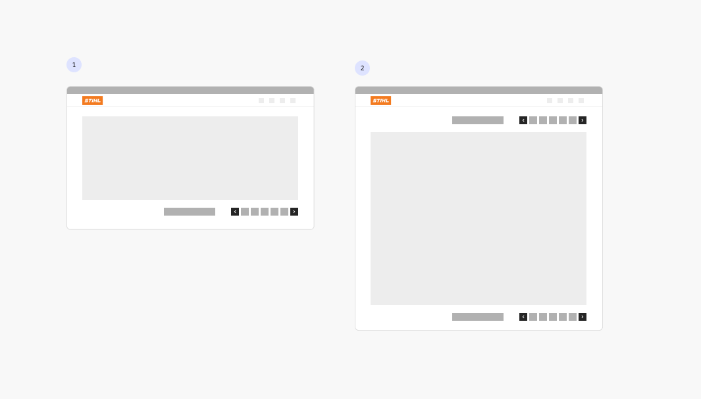

### Alignment

1. **Right alignment is the default**, as pagination typically functions as a control within a broader set of actions (e.g. filtering or sorting), making it more predictable when grouped on the right.
1. **Center alignment may be used** when pagination is part of a content consumption flow, where users expect the “next” step to appear at the end of the content. This applies only to Page Navigation without additional controls.

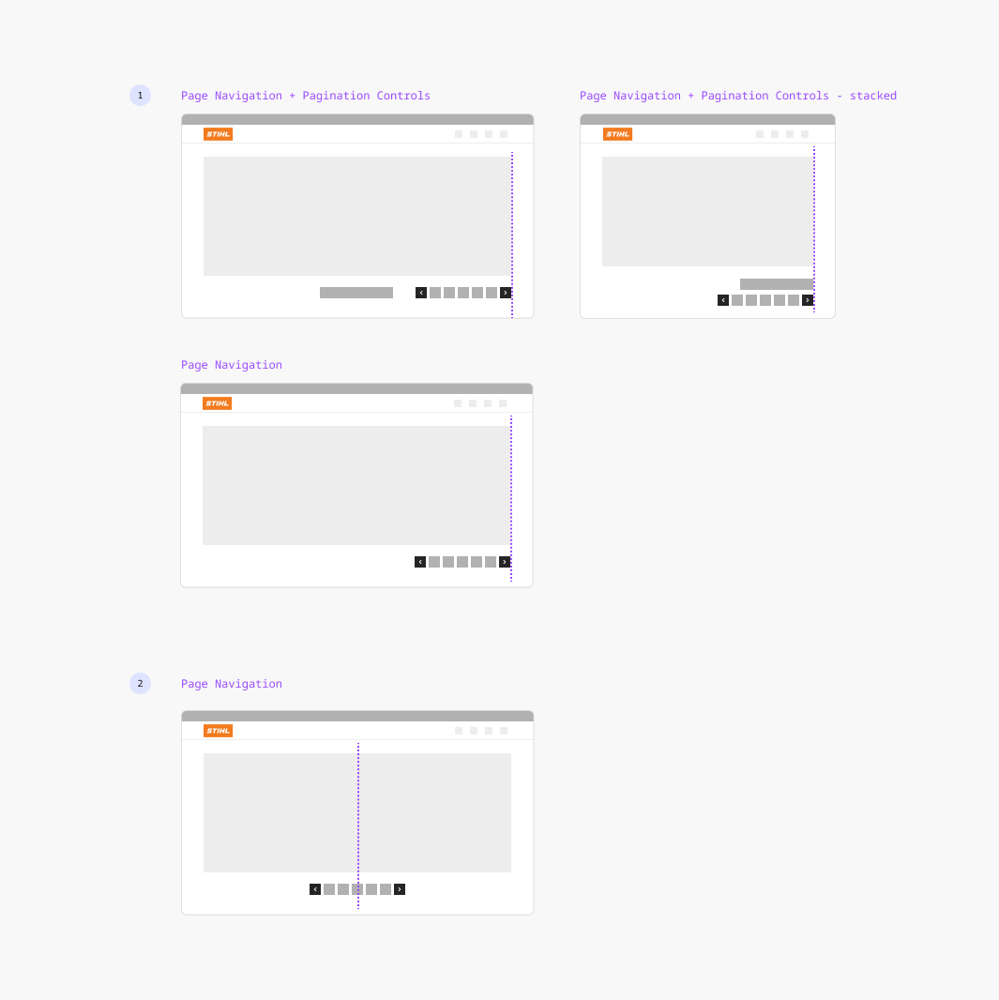

## Behavior

### Responsive Behavior

The pagination component adapts to available screen width.

- Pagination controls and page navigation may **wrap or stack** vertically when space is limited.
- On smaller screens, emphasis shifts to previous and next navigation, while page number items are being reduced to **a minimum of three visible pages** (first, current, last).
- Page size and range indicators remain accessible but may reposition or stack to preserve readability.

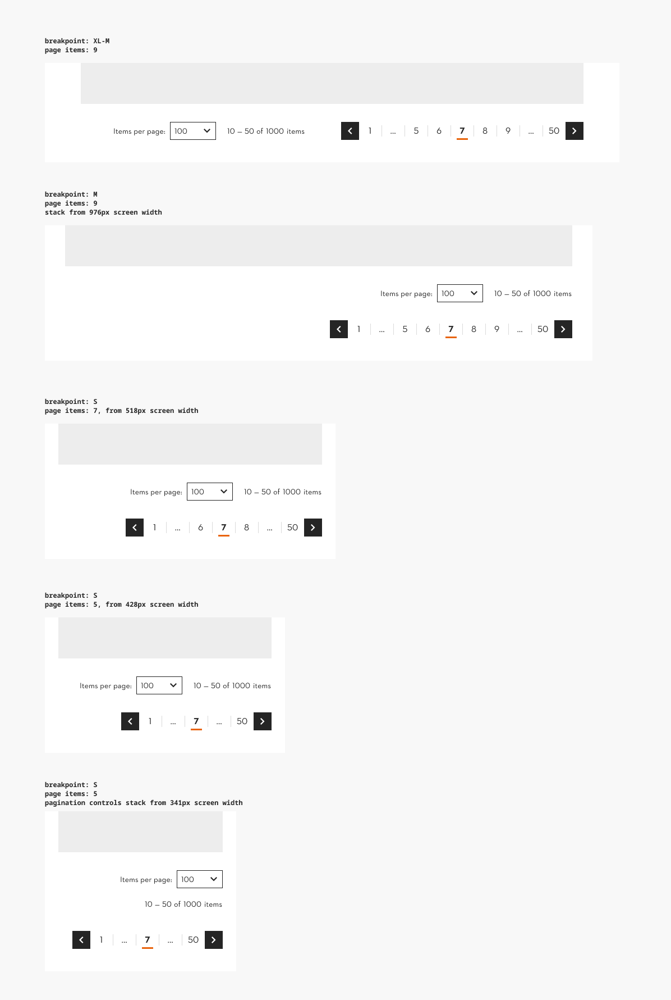

### Page Navigation Behaviour

The visible page range adapts dynamically based on the **current page:**

1. At the beginning, the pagination shows the first pages in sequence followed by an ellipsis and the last page.
1. As the user navigates forward, the current page moves into the center and the range shifts to show surrounding pages.
1. In the middle, the pagination displays previous, current, and next pages, with ellipses on both sides.
1. Near the end, the range expands toward the last pages, keeping the last pages visible in sequence.

The first and last pages remain accessible at all times. Previous and next controls are disabled at the boundaries.

A maximum of 5–7 visible page links should be used; too many numbers are overwhelming and unscannable.

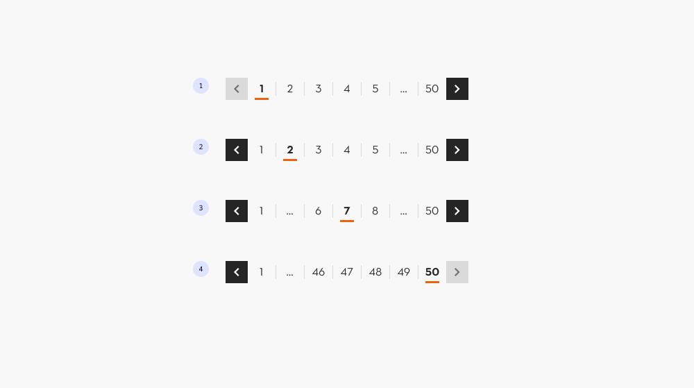

### Page Size Behaviour

Provide a small, predefined set of page size options (typically 3–5 values), for example: 10, 25, 50, and 100.

## Accessibility

### Focus management

Focus must remain stable when navigating between pages.

After a page change, focus should stay on the triggered pagination control to preserve context and ensure continuous keyboard navigation.

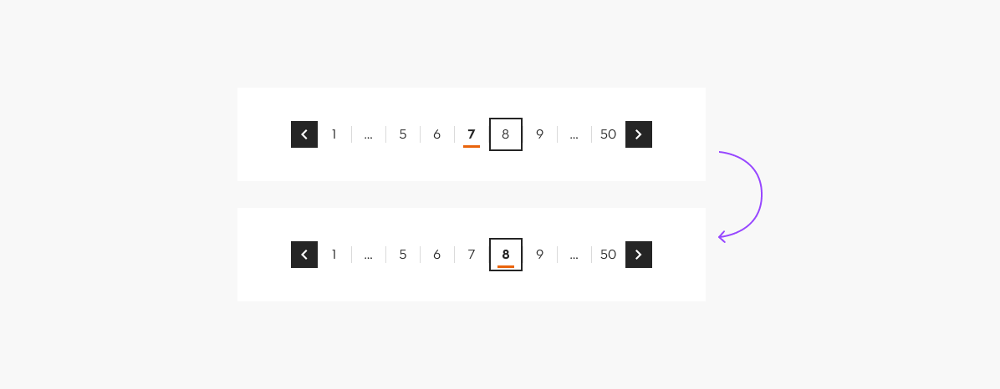

### Scroll behavior

**Do maintain the user’s current scroll position** when navigating between pages to preserve context and support accessibility.

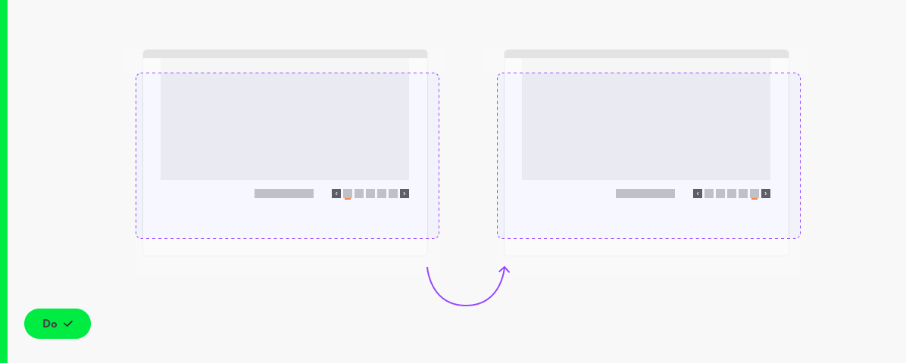

**Don’t automatically scroll to the top of the page** when switching pages, as it can disrupt context and confuse users, especially those using screen readers.

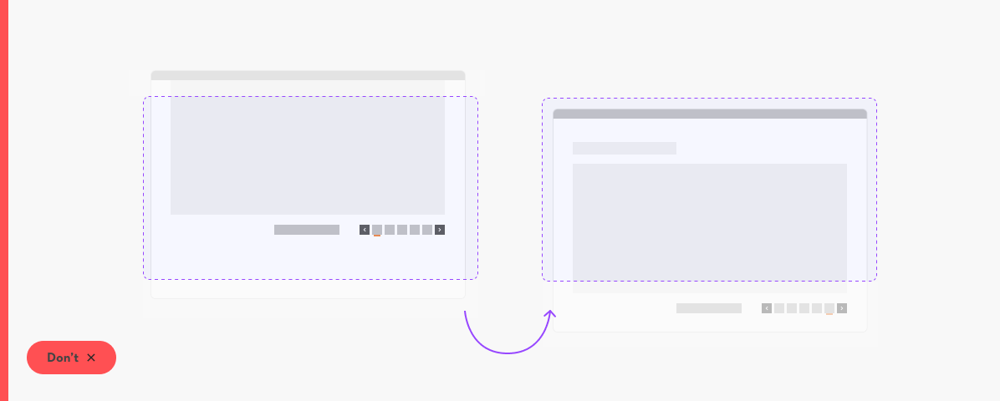

## Examples

### Search Result Page: Documents

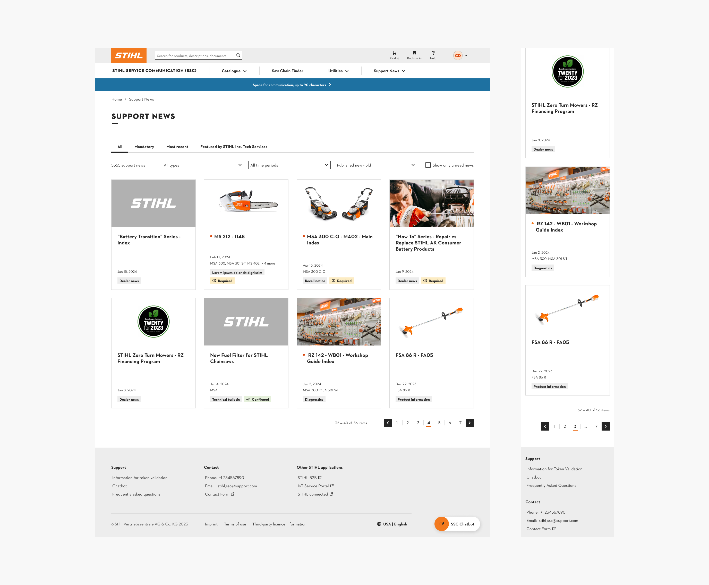

### (SSC) Search Result Page: Documents

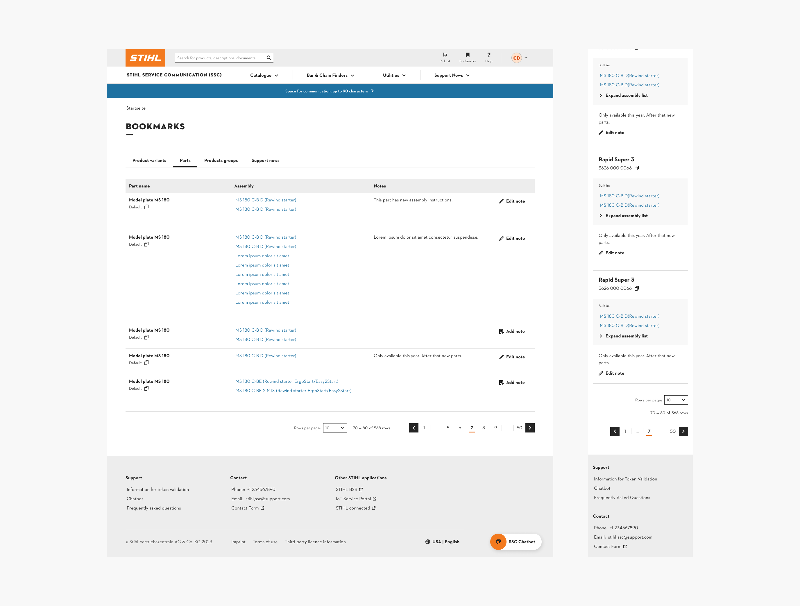
