# Popover

## Formatting and Construction

### Anatomy

1. **Popover** The Popover is a container that can display a variety of elements, such as text, buttons, images, action items, or lists.
1. **Triggering element** A Popover is always activated by a triggering element (not included in the Figma Popover component itself). The trigger must be a button or a button variant (for example, an action item or a navigation button).
1. **Scroll bar (optional)** When content overflows, a scrollbar appears to keep the component compact and navigable.

_Figure: White popover with a Placeholder content area, a scroll bar on its right side and an arrow below pointing to a triggering info icon button. Callout 1 points at the popover container, callout 2 at the triggering element below it, and callout 3 at the optional scroll bar._

### Variants

The Popover is available in two main variants:

1. **With Arrow:** To provide additional, non-critical information or actions without navigating away from the current context.
1. **Without Arrow:** Optimized for Dropdown and Navigational Menus containing lists of items, with adjusted margins and padding to maximize space efficiency.

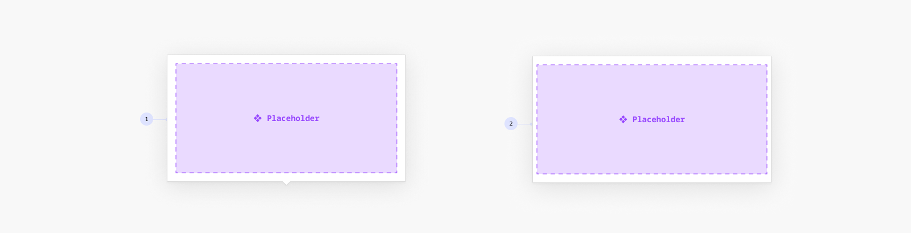

_Figure: Two white popovers with Placeholder content side by side. Callout 1 marks the popover with an arrow at the bottom center (arrow=true, arrow placement=below, arrow alignment=center); callout 2 marks the popover without an arrow (arrow=false)._

#### Color

Popovers are available in different color options depending on their style:

1. **Popover with arrow:** available in **white** and **grey**
1. **Popover without arrow:** available in **white only**

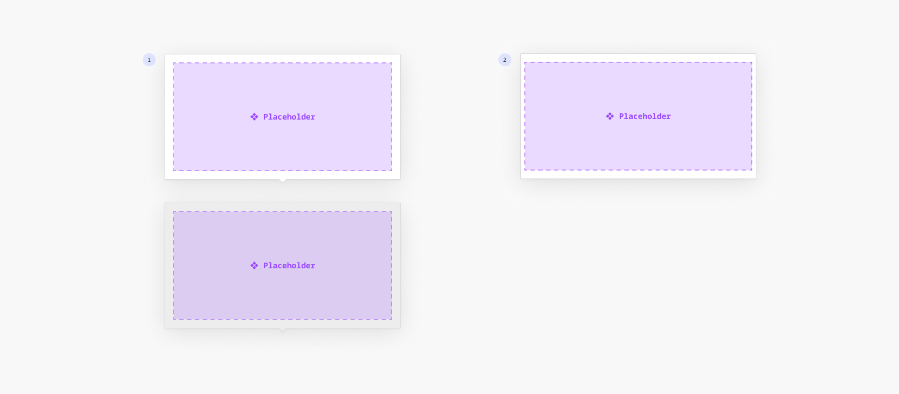

_Figure: Popovers with Placeholder content in different colors. Callout 1 marks the popovers with an arrow below, shown in white (top) and grey (bottom); callout 2 marks the popover without an arrow, shown in white only._

### Placement

#### Popover Placement (without Arrow)

This variant is mainly used for Dropdown Menus.

In this case, the Popover can **only be positioned below** the triggering element, **aligned either to the start (left) or end (right)** of the triggering button.

_Figure: Two dropdown menus, each opened below a "Label" button with an up chevron and listing eight "Label" items. The left one, annotated "below-start (left)", is aligned to the left edge of its button; the right one, annotated "below-end (right)", is aligned to the right edge of its button._

#### Popover Placement (with Arrow)

This variant can be placed relative to the triggering element in four directions:

- **above (default)** triggering element
- **below** triggering element
- **right** of triggering element
- **left** of triggering element

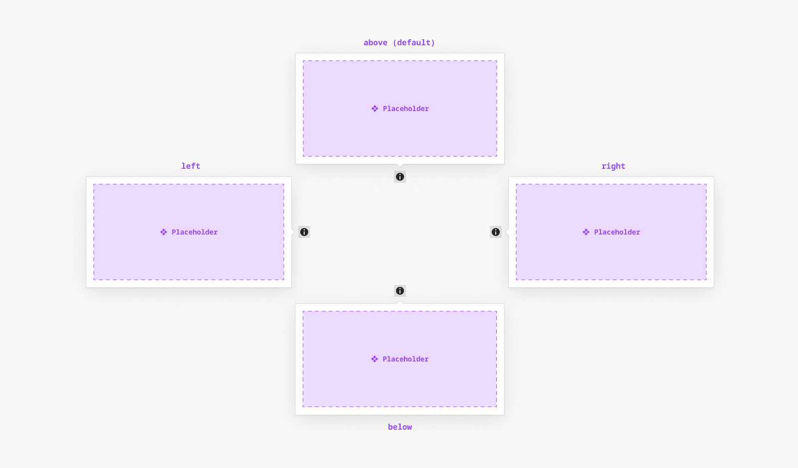

_Figure: Four white popovers with an arrow (color=white, arrow alignment=center), each filled with a Placeholder, around a small ghost icon button (info icon, size=small, state=hover / pressed): labelled "above (default)" with the popover above its trigger, "below" with the popover below, "left" with the popover left of its trigger and "right" with the popover right of its trigger. The arrow always points at the triggering button._

#### Arrow Alignment

In addition to the placement (see above), the Popover Arrow can be aligned with the triggering element in three ways:

- **start**
- **center (default)**
- **end**

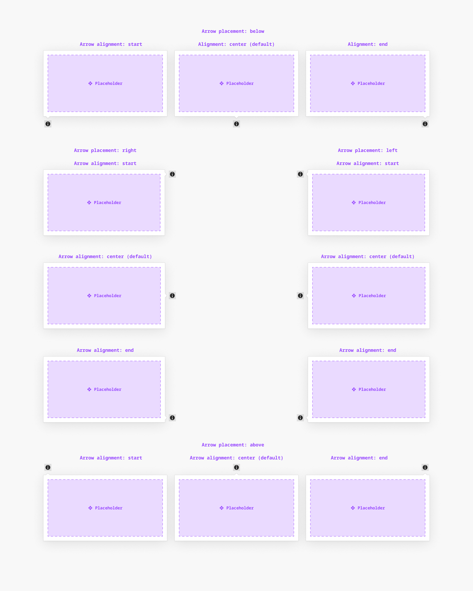

_Figure: Grid of white popovers with a Placeholder, each pointing its arrow at a small info icon button, showing the three arrow alignments (start, center (default), end) for each of the arrow placements below, right, left and above. For below and above the arrow sits at the left edge (start), the middle (center) or the right edge (end) of the popover; for right and left the arrow sits at the top (start), the middle (center) or the bottom (end) edge._

#### Distance

The default distance between the Popover and the triggering element is **6px**.

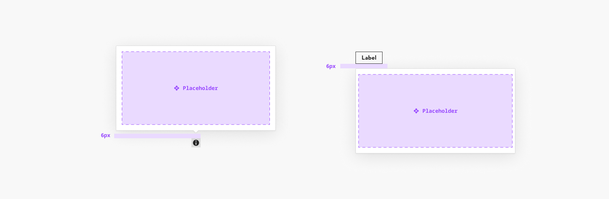

_Figure: Two popovers with the 6px gap highlighted: on the left a popover with an arrow above its small info icon button, on the right a popover without an arrow below a tooltip-like "Label" element. In both cases the "6px" marker spans the distance between the popover and the triggering element._

#### Edge cases:

If the preferred placement (for example, above-center) would cause the Popover to extend outside the viewport, it should automatically reposition to remain fully visible (e.g. above-end). The Popover must stay aligned with the triggering element while adjusting its position.

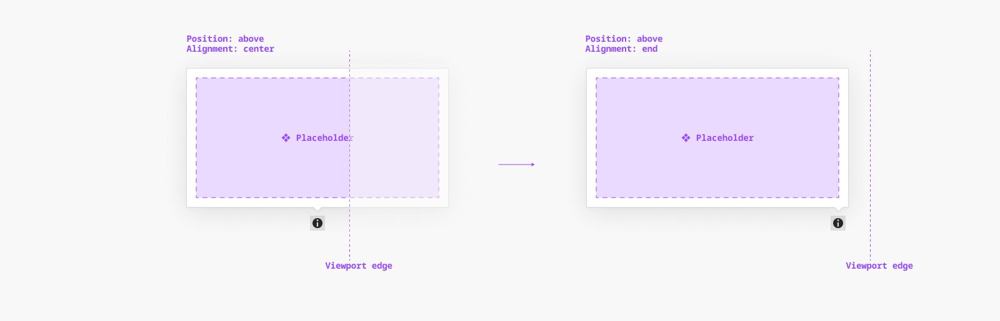

_Figure: Edge case before and after, linked by an arrow: on the left a popover with "Position: above" and "Alignment: center" extends past a dashed vertical line labelled "Viewport edge", so part of it is cut off; on the right the popover has repositioned to "Position: above" and "Alignment: end", with its arrow at the right edge above the trigger, and now lies fully inside the viewport edge._

### Sizing

#### Maximum width

The width of the Popover is dynamic and adjusts based on the content inside.

However, to maintain consistency and usability, the following constraints apply:

- **Minimum width:** 200px
- **Maximum width:** 540px

These limits ensure the pop-over remains readable and visually balanced, regardless of content length.

_Figure: Two popovers with arrow and Placeholder content side by side with width markers: a narrow one labelled "min. 200px" and a much wider one labelled "max. 540px", showing the minimum and maximum popover widths._

### Motion

#### Appear

**Animation type:** fade in **Duration:** 250ms **Easing:** motion-functional-ease-out

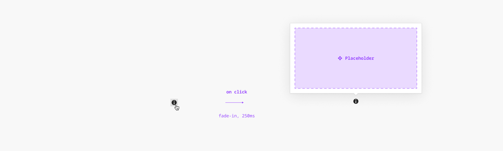

_Figure: Appear animation: a small info icon button with a pointer cursor on click leads, via an arrow labelled "on click" and "fade-in, 250ms", to the popover with a Placeholder shown above the same button, which has no popover before the click._

#### Disappear

**Animation type:** fade out **Duration:** 250ms **Easing:** motion-functional-ease-in

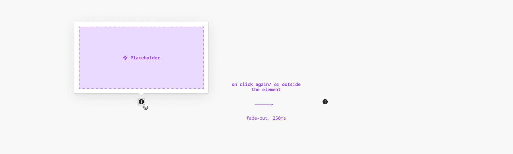

_Figure: Disappear animation: a visible popover with a Placeholder above its info icon button (pointer cursor on the button) leads, via an arrow labelled "on click again/ or outside the element" and "fade-out, 250ms", to the plain info icon button with the popover gone._

## Content and Assets

### Varaible content

A Popover can contain a variety of elements, such as text, buttons, images, action items, or lists.

_Figure: Popover with an arrow above its info icon button containing mixed content: the heading "Need more details?", the body text "Learn how to configure this feature step by step. The guide includes setup instructions, best practices, and troubleshooting tips to help you get started quickly." and a small filled "View Guide" button aligned to the bottom right._

### Maximum height

The height of the Popover is determined by its content. However, to ensure proper display and avoid visual overflow, the following rule applies:

There must be a minimum distance of 48px between the bottom of the pop-over and the bottom/top edge of the screen.

If the content exceeds the available space, the Popover becomes scrollable, preventing it from extending beyond the visible area.

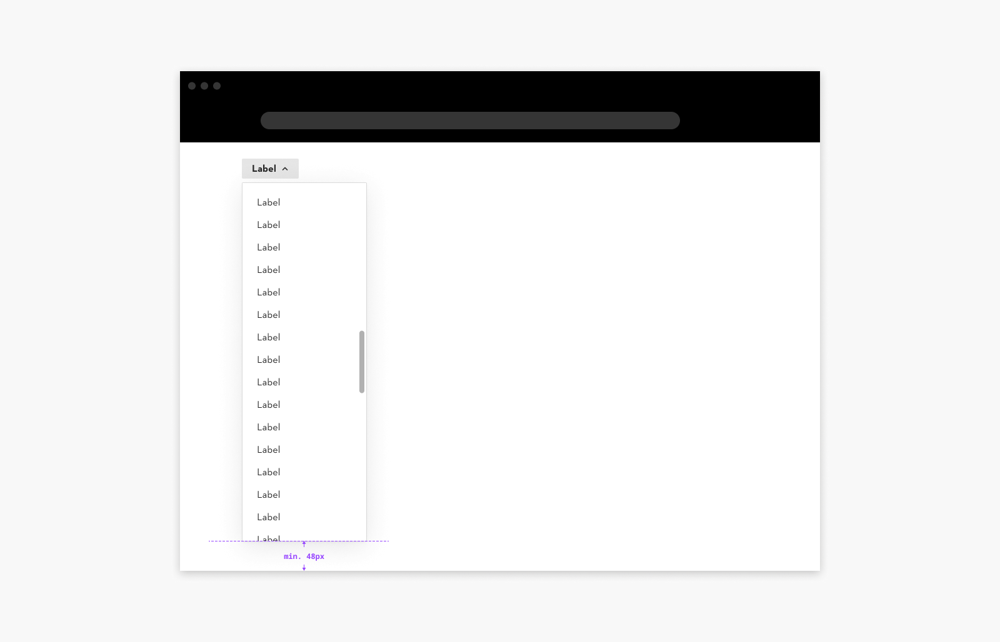

_Figure: Browser window with a trigger button "Label" (chevron up) and an open list of many "Label" action items in a popover with a scrollbar. The list is cut off at the bottom, and a marker labelled "min. 48px" shows the minimum distance between the bottom of the popover and the bottom edge of the screen, beyond which the content scrolls._

### Don’t use for long text and content

Popovers have no max height and content can overflow, but they should stay brief and focused.

For larger amounts of information use a separate page.

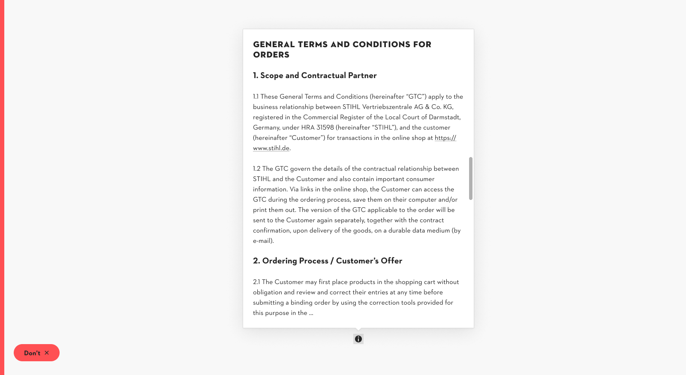

_Figure: Don't example: a very tall popover above an info icon button holds a long text, "General Terms and Conditions for Orders" with sections "1. Scope and Contractual Partner" and "2. Ordering Process / Customer's Offer", and a scrollbar. This is wrong because long text and content do not belong in a popover; it should stay brief and focused, and larger amounts of information belong on a separate page._

## Behavior & Usage

### Only buttons trigger popovers

A Popover must always be triggered by a button or a button variant.

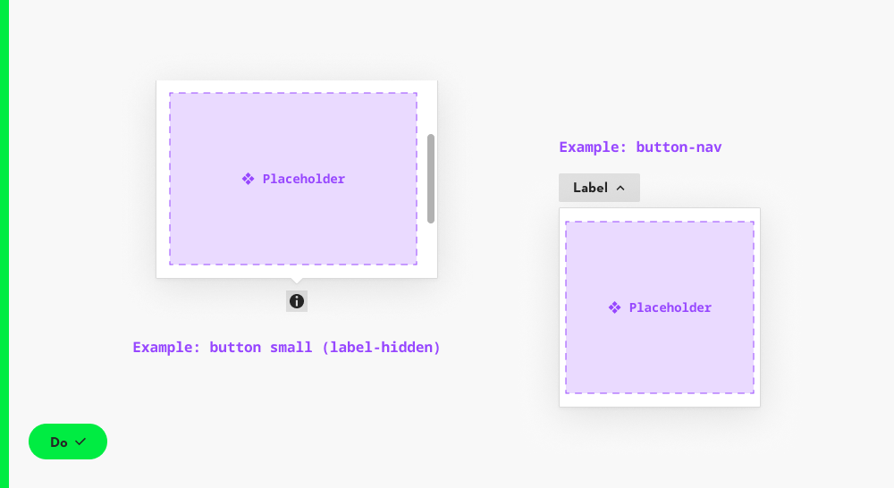

_Figure: Do example: two popovers, each opened by a button. On the left, a white popover with a "Placeholder" content area and a scrollbar sits above a small label-hidden info button, captioned "Example: button small (label-hidden)". On the right, a white popover with a "Placeholder" content area opens below a button-nav labelled "Label" with an upward chevron, captioned "Example: button-nav"._

Applying a Popover to **links or non-interactive elements (such as div, span, or p)** interferes with expected functionality and **makes the component inaccessible to keyboard and screen reader users.**

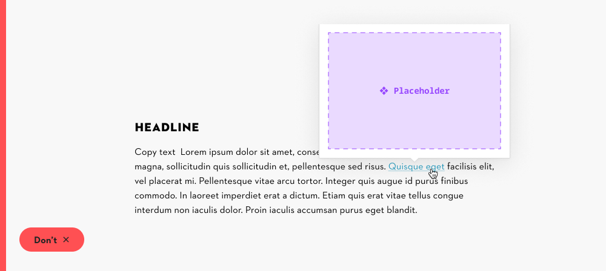

_Figure: Don't example: a white popover with a "Placeholder" content area is anchored to the underlined link "Quisque eget" inside body copy under the heading "HEADLINE", with a pointer cursor on the link. A popover must not be triggered by a link or other non-interactive text, which is inaccessible to keyboard and screen reader users._

### Triggers and dismissal

A Popover is triggered when:

- The user **clicking button or taps** (or button variant)

It is dismissed when:

- The user **clicks or taps the button again**
- The user **clicks or taps another element**
- The user **clicks or taps outside the Popover**

**Keyboard navigation** and accessibility-specific behavior are described in the **Accessibility section** of this documentation.

> Since Popovers support several dismissal methods, adding a manual close button (like an “X” in the top-right corner) is optional, not required.

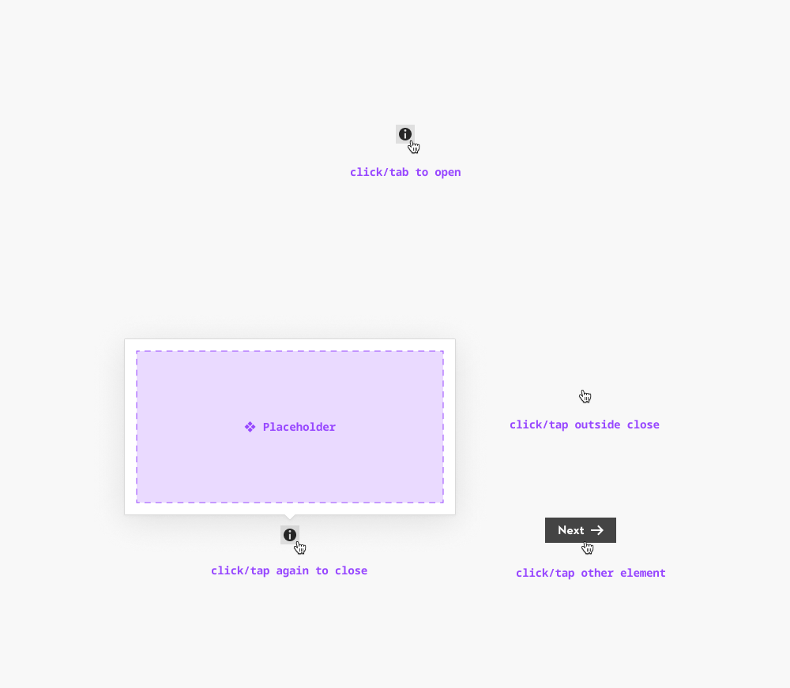

_Figure: Popover trigger and dismissal behaviour in four annotated cases: an info button with a pointer cursor labelled "click/tab to open"; an open white popover with "Placeholder" content above its info button labelled "click/tap again to close"; a lone pointer cursor in empty space labelled "click/tap outside close"; and a dark filled "Next" button with an arrow and pointer cursor labelled "click/tap other element"._

### Usecases

#### Additional non critical content

Popovers are best used for additional, non-critical content. They can provide supporting information, actions, or controls without disrupting the main task flow.

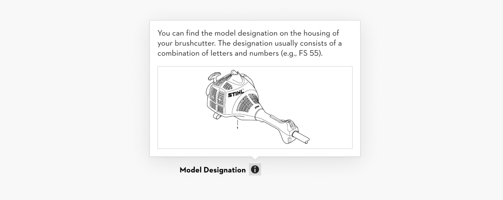

_Figure: White popover with an arrow pointing down at an info button next to the bold label "Model Designation". It contains the text "You can find the model designation on the housing of your brushcutter. The designation usually consists of a combination of letters and numbers (e.g., FS 55)." above a line drawing of a STIHL brushcutter engine housing with a callout marked 1, showing additional non-critical content._

### Alternatives for Popovers

Because popovers hide additional information and are only visible on interaction, consider carefully before using one. Ask yourself:

- Is the information essential for the user to complete their task?
- Could the interface be made clearer without a popover?
- Would it be better to show the information directly on the page by default?
- Is the information long or complex, making a different component more suitable?

**Alternative should be:**

#### Persistent Content

Popovers should not be used in forms to provide essential instructions, since they are only visible on interaction (e.g., clicking an info icon).

Instead, present critical information as persistent content, such as hint text for an input field.

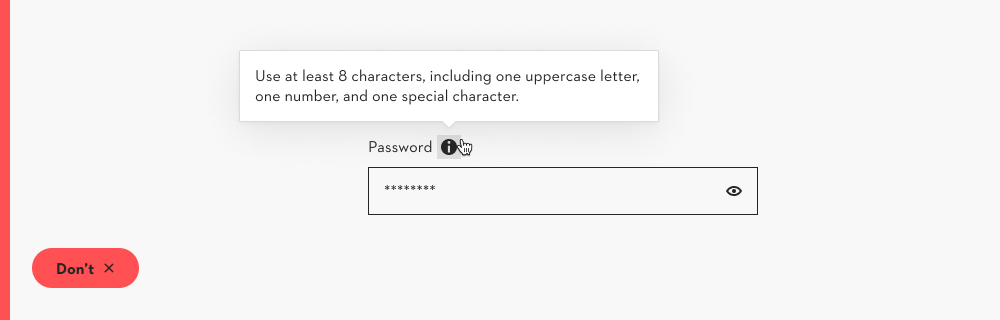

_Figure: Don't example: a password input labelled "Password" with an info button, masked value "\*\*\*\*\*\*\*\*" and a show-password eye icon. A popover opened from the info button holds the essential instruction "Use at least 8 characters, including one uppercase letter, one number, and one special character.", which is only visible on interaction and should be persistent hint text instead._

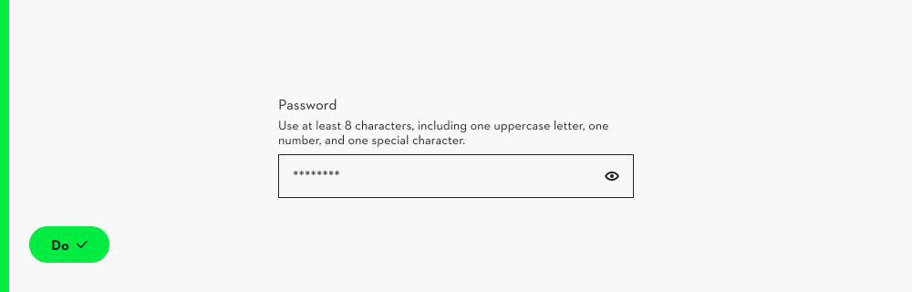

_Figure: Do example: a password input labelled "Password" with the masked value "\*\*\*\*\*\*\*\*" and an eye icon. The instruction "Use at least 8 characters, including one uppercase letter, one number, and one special character." is shown permanently as hint text between the label and the input field._

#### Expandable sections and accordions

When additional information is tied to a specific item (e.g., extra details in a list), do not hide it inside a Popover.

Instead, use expandable sections or accordions, which keep the information discoverable and accessible.

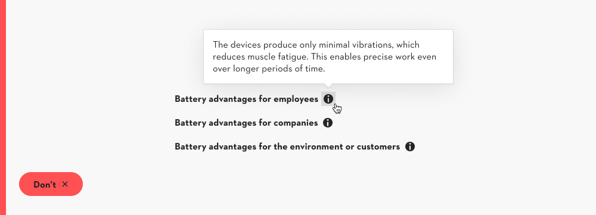

_Figure: Don't example: three bold headings, "Battery advantages for employees", "Battery advantages for companies" and "Battery advantages for the environment or customers", each followed by an info button. The first info button is pressed with a pointer cursor and opens a popover with the text "The devices produce only minimal vibrations, which reduces muscle fatigue. This enables precise work even over longer periods of time.", hiding item details in a popover._

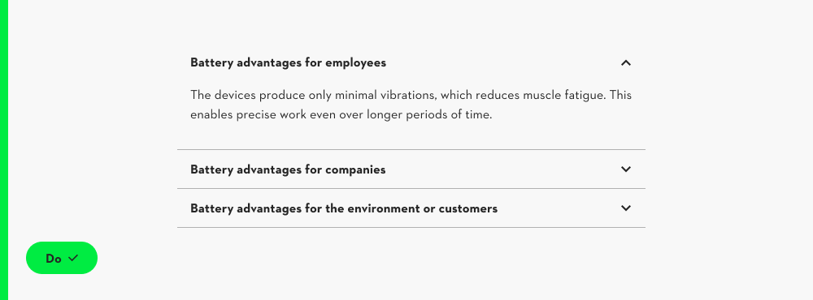

_Figure: Do example: an accordion group with three items separated by thin dividers. "Battery advantages for employees" is expanded with an upward chevron and shows the text "The devices produce only minimal vibrations, which reduces muscle fatigue. This enables precise work even over longer periods of time.", while "Battery advantages for companies" and "Battery advantages for the environment or customers" are collapsed with downward chevrons._

#### Mobile

Don’t use popovers on mobile. They’re hard to position on small screens, often cover important content, and their anchored placement makes them less discoverable or easy to miss. (A common use case on desktop is Utility Menus, such as for language selection.)

Do open the same content in a dialog on mobile. A centered dialog ensures clarity and readability, improves discoverability by taking the foreground, and helps users complete tasks without distraction.

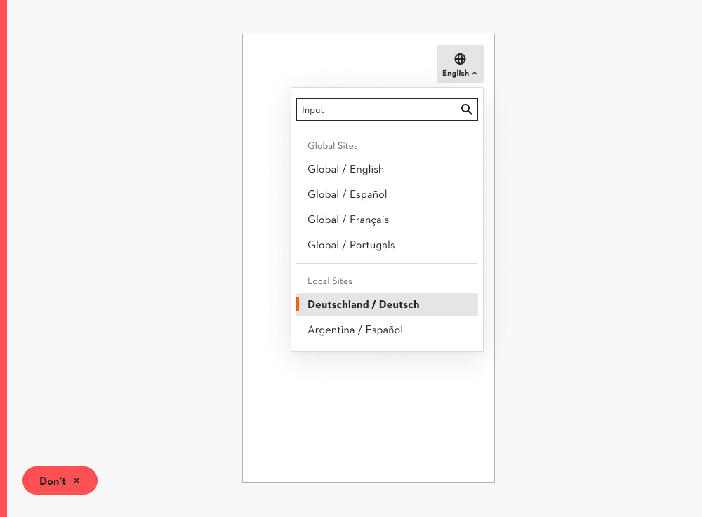

_Figure: Don't example: a mobile screen where a language selector button labelled "English" with a globe icon and upward chevron opens a popover anchored below it. The popover contains a search field with the placeholder "Input", a "Global Sites" group (Global / English, Global / Español, Global / Français, Global / Portugals) and a "Local Sites" group with "Deutschland / Deutsch" highlighted as active and "Argentina / Español", and it covers much of the small screen._

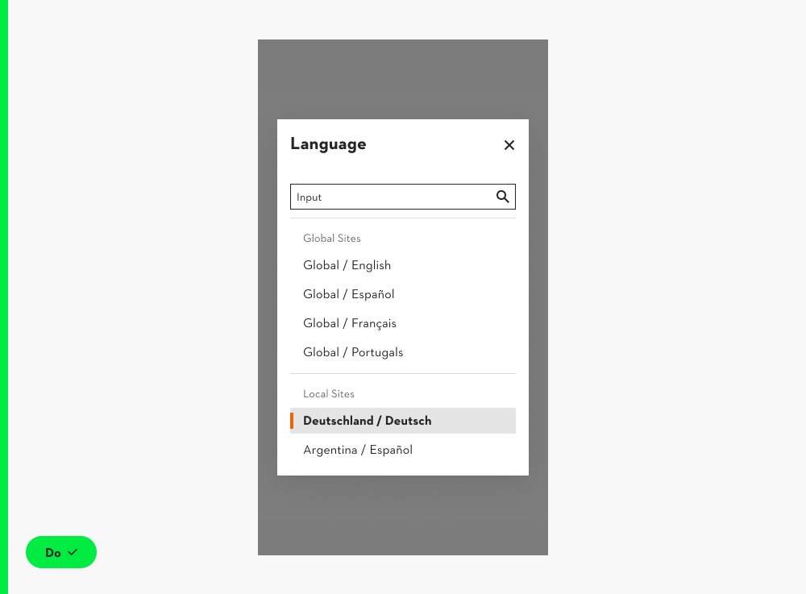

_Figure: Do example: on mobile the same language content opens in a centered dialog over a dimmed grey background. The dialog has the heading "Language" with a close button, a search field with the placeholder "Input", a "Global Sites" group (Global / English, Global / Español, Global / Français, Global / Portugals) and a "Local Sites" group with "Deutschland / Deutsch" highlighted as active and "Argentina / Español"._

## Accessiblity

### Focus order

When opened with the keyboard, focus moves to the **first focusable element** in the Popover.

From there, it follows a logical **top-to-bottom**, **left-to-right** sequence.

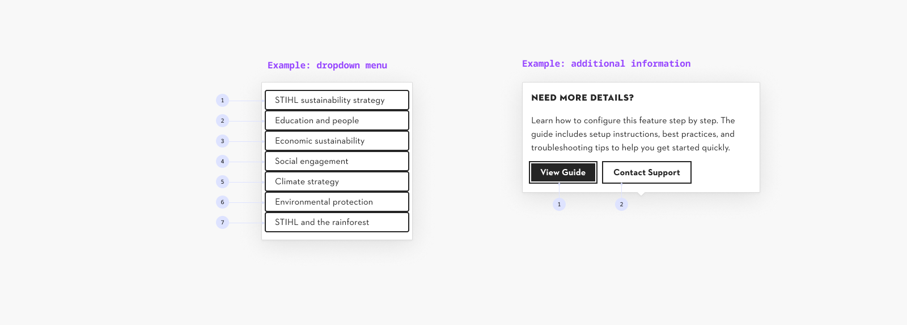

_Figure: Focus order in two Popover examples. In "Example: dropdown menu" the seven items (STIHL sustainability strategy, Education and people, Economic sustainability, Social engagement, Climate strategy, Environmental protection, STIHL and the rainforest) carry callouts 1 to 7 from top to bottom, each with a focus outline. In "Example: additional information" ("Need more details?" text) the buttons "View Guide" (filled, callout 1) and "Contact Support" (ghost, callout 2) are focused left to right._

### Keyboard navigation

Users can interact with the Popover using the following keyboard actions:

- **Open** the Popover by pressing **“Space”** or **“Enter”** on the trigger button.
- **Close** the Popover by pressing **“Esc”**, or by moving focus away from the Popover.
- **Navigate forward** to the next focusable element with **“Tab”**.
- **Navigate backward** to the previous focusable element with “**Shift + Tab”**.

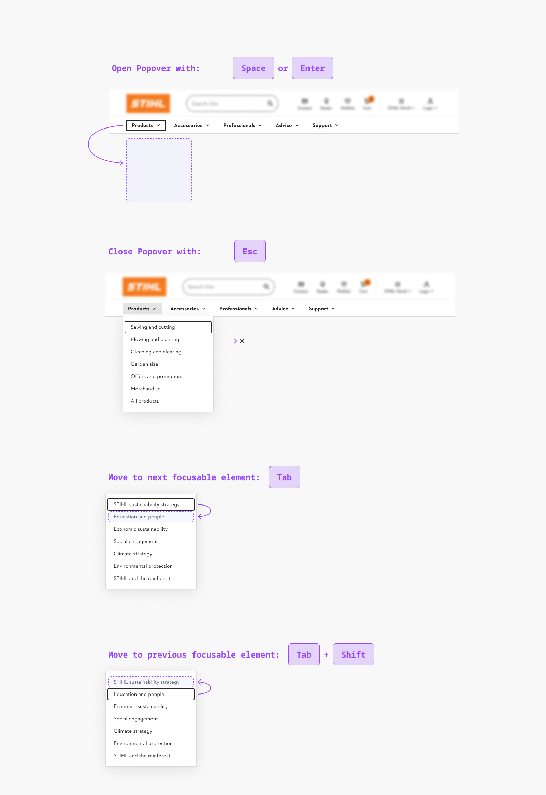

_Figure: Keyboard actions for a Popover opened from the "Products" nav bar item in the STIHL top bar. "Open Popover with:" Space or Enter on the focused trigger button reveals an empty dashed popover panel below it. "Close Popover with:" Esc closes the open menu (Sawing and cutting, Mowing and planting, Cleaning and clearing, Garden size, Offers and promotions, Merchandise, All products). "Move to next focusable element:" Tab moves focus from "STIHL sustainability strategy" to "Education and people", and "Move to previous focusable element:" Tab + Shift moves it back._

## Examples

### Utility Menu

Built on the Popover component the Utility Menu offers quick access to essential functions, user tools, and system-level actions — such as login, language selection, and other key options. More information regarding the Utility Menu can be found [here](https://www.figma.com/design/Ie2r0R9QwjEc7O3nrFbXhV/Web-Pattern-Library?m=auto&node-id=7158-33065&t=x1babMLUtlLvUiUI-1).

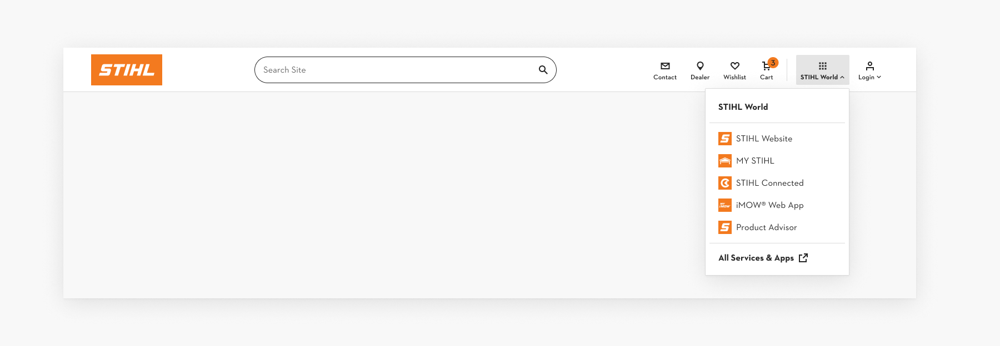

_Figure: Utility Menu built on the Popover, shown in the STIHL top bar (Search Site, Contact, Dealer, Wishlist, Cart with badge 3, STIHL World, Login). The open "STIHL World" panel below the active "STIHL World" button lists STIHL Website, MY STIHL, STIHL Connected, iMOW® Web App and Product Advisor with orange icons, and ends with the link "All Services & Apps" with an external-link icon._

### Dropdown Menu

Built on the Popover component the Dropdown Menu provides quick access to nested navigation items. Displaying a linear list of Action Items, triggered by clicking a Button Nav in the Nav Bar. It is designed to support a single level of navigation More information can be found [here](https://www.figma.com/design/Ie2r0R9QwjEc7O3nrFbXhV/Web-Pattern-Library?m=auto&node-id=6263-62113&t=x1babMLUtlLvUiUI-1).

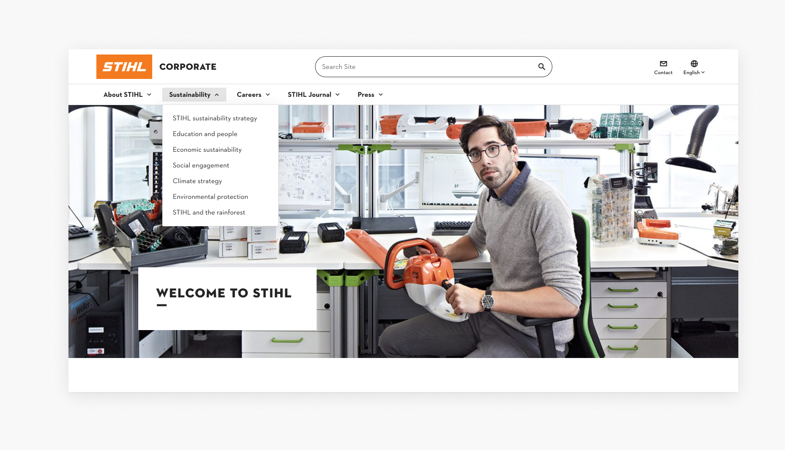

_Figure: \[unverified\] Dropdown Menu built on the Popover: in the STIHL top bar and nav bar, a linear list of Action Items opens below a nav bar Button Nav, under the title "Welcome to STIHL". The items are STIHL sustainability strategy, Education and people, Economic sustainability, Social engagement, Climate strategy, Environmental protection and STIHL and the rainforest, and the top bar shows Corporate, Search Site, Contact, English and the nav entries About STIHL, Sustainability, Careers, STIHL Journal, Press._

### Additional info

In the case of STIHL advisors, the Popover is used to provide users with additional guidance on where to find product-specific information, such as the machine or product number.

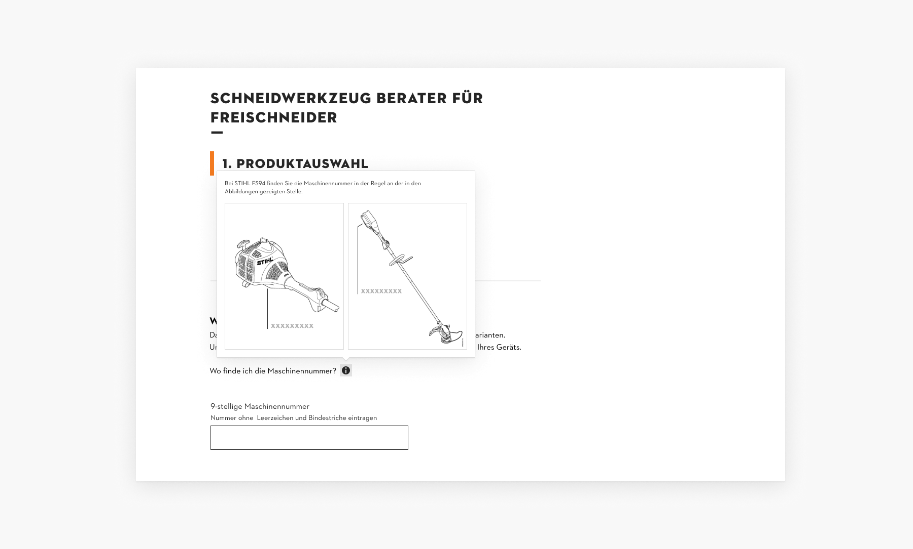

_Figure: Popover used for additional guidance in the STIHL advisor "Schneidwerkzeug berater für Freischneider" at step "1. Produktauswahl". Next to the question "Wo finde ich die Maschinennummer?" an info button opens a white Popover with an arrow pointing at it, containing a short text and two drawings of the machine with the number location marked "xxxxxxxxx". Below it is the input "9-stellige Maschinennummer" with the hint "Nummer ohne Leerzeichen und Bindestriche eintragen"._

## Popover

- A Popover is triggered by a button.
- It can contain text, lists, images, or interactive elements.
- Popovers are best suited for short, non-critical information or lightweight interactions without leaving the current context.
- Triggered on click or tap.

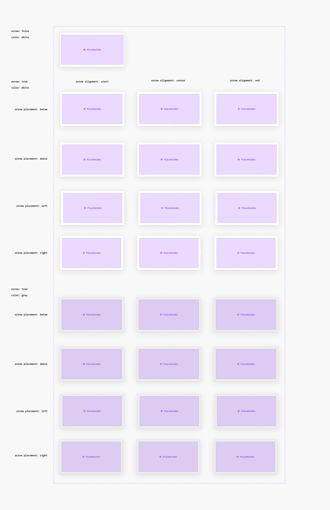

_Figure: Popover variants, each a rectangular container with a "Placeholder" content slot. "arrow: false, color: white" has no arrow. "arrow: true, color: white" and "arrow: true, color: grey" each show a grid of "arrow placement" (below, above, left, right) by "arrow alignment" (start, center, end), with the small arrow on the matching edge and corner position._

### Further guidelines

[Storybook documentation](https://main--63440bbb95889041542a5ba3.chromatic.com/?path=/docs/components-notification--documentation&globals=backgrounds.name:!undefined;backgrounds.value:!undefined)

[Decision tree](https://www.figma.com/design/qXldpLO6gxHJNLdcXIPxYt?node-id=26738-47603)

### Similar components

**Component**

**Trigger**

**Placement**

**Content**

**Intention**

**Tooltip**

Hover or focus of an interactive element

In proximity to the triggering element, non-modal

Text only

Provide short, contextual information or clarify unlabeled controls

**Popover**

Click or tap of an interactive element

In proximity to the triggering button, non-modal

Text, icon, image and interactive elements

Provide additional information or quick actions without leaving the current context

**Dialog**

Triggered by the system in response to user interaction

Center of the screen, with backdrop, modal

Text, icon, image and interactive elements

Confirm important actions, guide users through complex tasks, or temporarily block interaction to focus attention

**Toast**

Triggered by the system in response to user interaction

Bottom of the screen, non-modal

Text, icon, and optional dismiss button

Provide brief, lightweight feedback on user actions such as error or success.

**Notification**

Triggered by the system in response to events or interactions

Within the content area of the page, in relation to relevant elements

Text, icon, links and buttons

Deliver important updates or status messages that may require user attention or follow-up

### Related elements

[Tooltip](https://www.figma.com/design/HovZmjHiwxguawTWTO6ibS/DS-1085-Design-%7C-Web-%7C-Tootlip?node-id=36194-1244)

[Utility Menu](https://www.figma.com/design/Ie2r0R9QwjEc7O3nrFbXhV/Web-Pattern-Library?m=auto&node-id=7158-32869&t=JVVkPuiySoyYbdTa-1)

[Dropdown Menu](https://www.figma.com/design/Ie2r0R9QwjEc7O3nrFbXhV/Web-Pattern-Library?m=auto&node-id=6583-85690&t=JVVkPuiySoyYbdTa-1)

[Dialog](https://www.figma.com/design/qXldpLO6gxHJNLdcXIPxYt/Core-Components-%F0%9F%92%A0?node-id=14115-4051)

[Toast](https://www.figma.com/design/qXldpLO6gxHJNLdcXIPxYt/Core-Components-%F0%9F%92%A0?node-id=8844-4923)

[Notification](https://www.figma.com/design/qXldpLO6gxHJNLdcXIPxYt/Core-Components-%F0%9F%92%A0?node-id=7251-8)

### Contribute

Contribute to improving this component by sharing your feedback, asking questions, or suggesting features [here](https://www.figma.com/design/lLmw7PfIdKjFG4uT3B2Hyj/Onboarding-%F0%9F%93%96?node-id=446-868&t=zKmRu4kAkxMeRDmK-4).
