# Popover

## Formatting and Construction

### Anatomy

1. **Popover** The Popover is a container that can display a variety of elements, such as text, buttons, images, action items, or lists.
1. **Triggering element** A Popover is always activated by a triggering element (not included in the Figma Popover component itself). The trigger must be a button or a button variant (for example, an action item or a navigation button).
1. **Scroll bar (optional)** When content overflows, a scrollbar appears to keep the component compact and navigable.

### Variants

The Popover is available in two main variants:

1. **With Arrow:** To provide additional, non-critical information or actions without navigating away from the current context.
1. **Without Arrow:** Optimized for Dropdown and Navigational Menus containing lists of items, with adjusted margins and padding to maximize space efficiency.

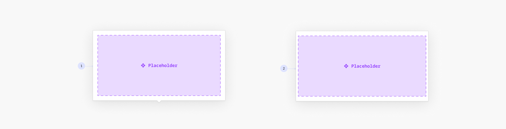

#### Color

Popovers are available in different color options depending on their style:

1. **Popover with arrow:** available in **white** and **grey**
1. **Popover without arrow:** available in **white only**

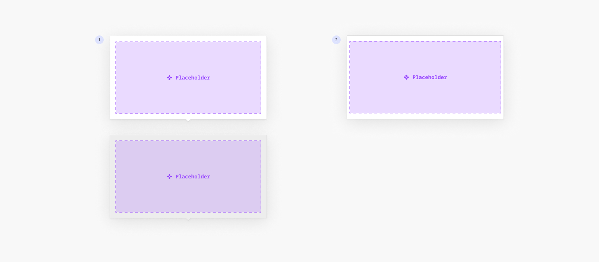

### Placement

#### Popover Placement (without Arrow)

This variant is mainly used for Dropdown Menus.

In this case, the Popover can **only be positioned below** the triggering element, **aligned either to the start (left) or end (right)** of the triggering button.

#### Popover Placement (with Arrow)

This variant can be placed relative to the triggering element in four directions:

- **above (default)** triggering element
- **below** triggering element
- **right** of triggering element
- **left** of triggering element

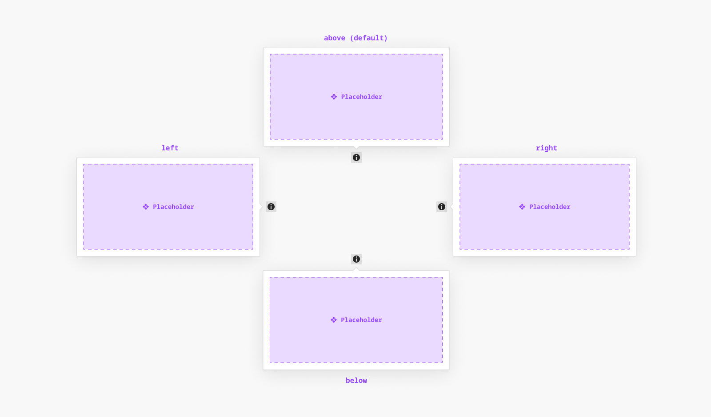

#### Arrow Alignment

In addition to the placement (see above), the Popover Arrow can be aligned with the triggering element in three ways:

- **start**
- **center (default)**
- **end**

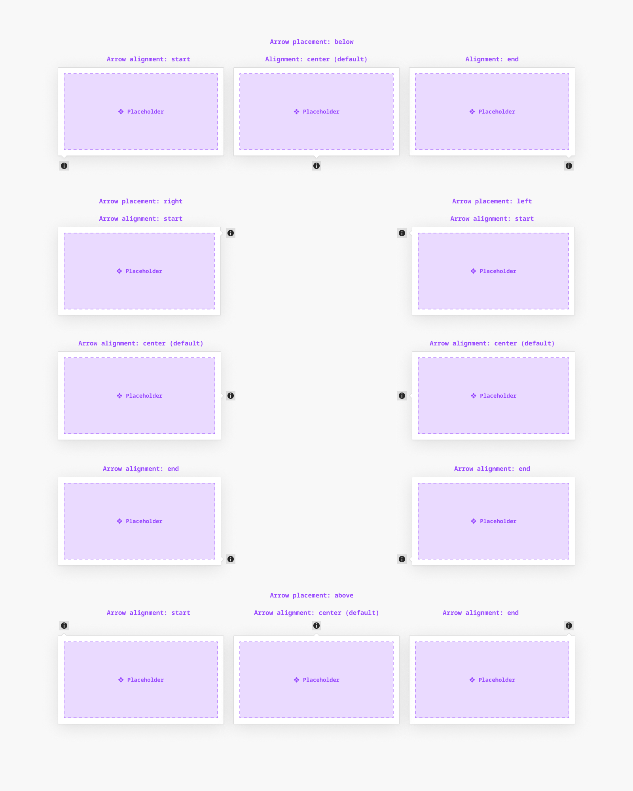

#### Distance

The default distance between the Popover and the triggering element is **6px**.

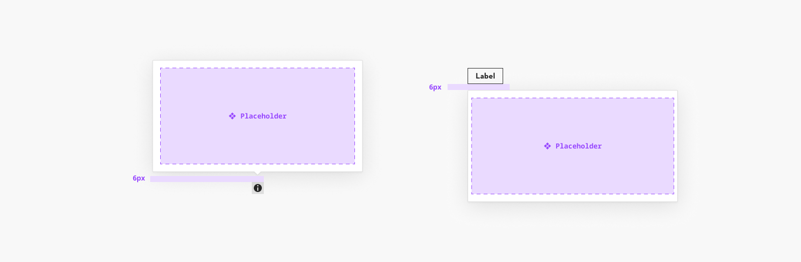

#### Edge cases:

If the preferred placement (for example, above-center) would cause the Popover to extend outside the viewport, it should automatically reposition to remain fully visible (e.g. above-end). The Popover must stay aligned with the triggering element while adjusting its position.

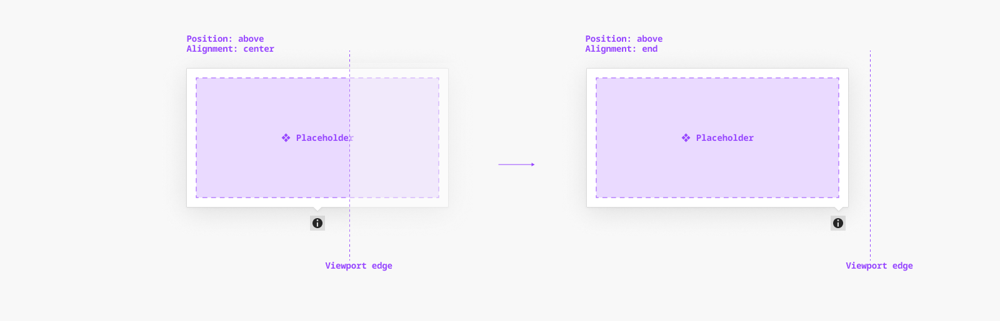

### Sizing

#### Maximum width

The width of the Popover is dynamic and adjusts based on the content inside.

However, to maintain consistency and usability, the following constraints apply:

- **Minimum width:** 200px
- **Maximum width:** 540px

These limits ensure the pop-over remains readable and visually balanced, regardless of content length.

### Motion

#### Appear

**Animation type:** fade in **Duration:** 250ms **Easing:** motion-functional-ease-out

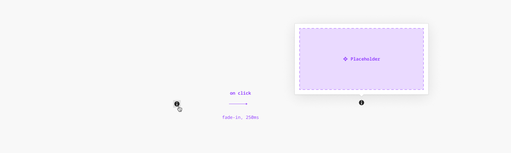

#### Disappear

**Animation type:** fade out **Duration:** 250ms **Easing:** motion-functional-ease-in

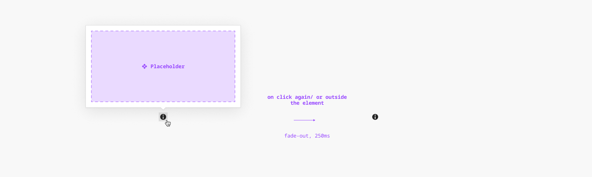

## Content and Assets

### Varaible content

A Popover can contain a variety of elements, such as text, buttons, images, action items, or lists.

### Maximum height

The height of the Popover is determined by its content. However, to ensure proper display and avoid visual overflow, the following rule applies:

There must be a minimum distance of 48px between the bottom of the pop-over and the bottom/top edge of the screen.

If the content exceeds the available space, the Popover becomes scrollable, preventing it from extending beyond the visible area.

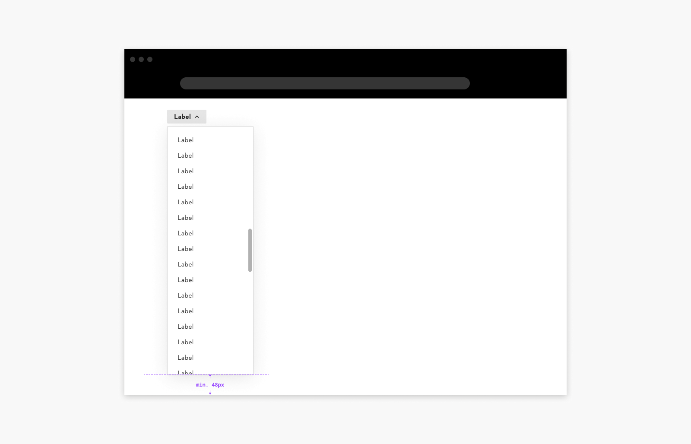

### Don’t use for long text and content

Popovers have no max height and content can overflow, but they should stay brief and focused.

For larger amounts of information use a separate page.

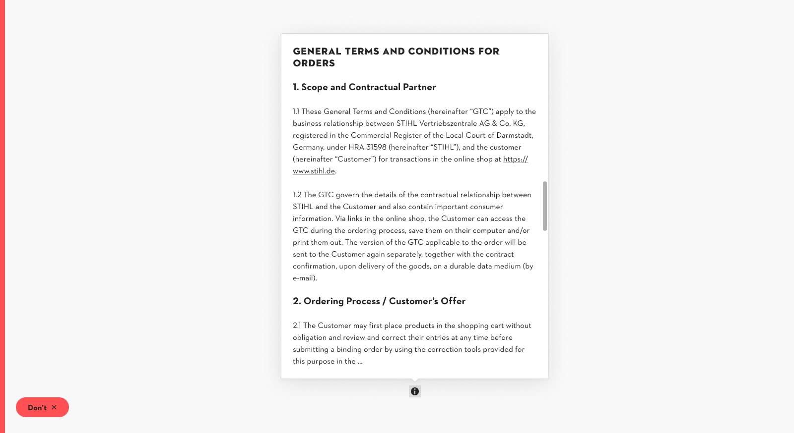

## Behavior & Usage

### Only buttons trigger popovers

A Popover must always be triggered by a button or a button variant.

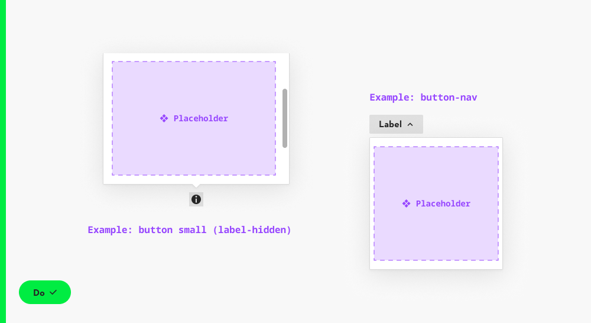

Applying a Popover to **links or non-interactive elements (such as div, span, or p)** interferes with expected functionality and **makes the component inaccessible to keyboard and screen reader users.**

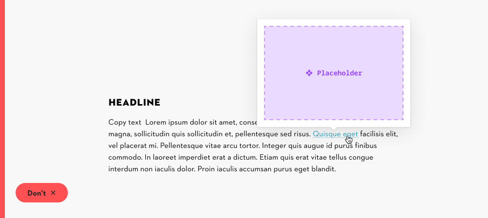

### Triggers and dismissal

A Popover is triggered when:

- The user **clicking button or taps** (or button variant)

It is dismissed when:

- The user **clicks or taps the button again**
- The user **clicks or taps another element**
- The user **clicks or taps outside the Popover**

**Keyboard navigation** and accessibility-specific behavior are described in the **Accessibility section** of this documentation.

> Since Popovers support several dismissal methods, adding a manual close button (like an “X” in the top-right corner) is optional, not required.

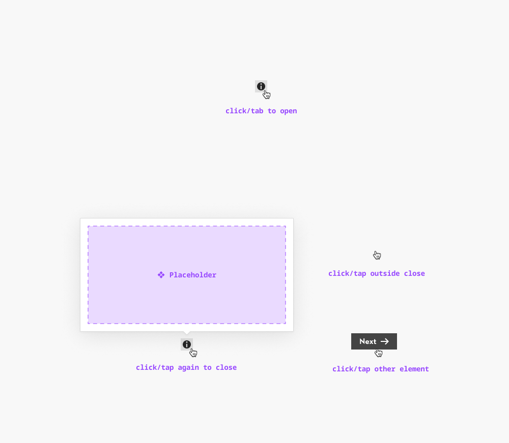

### Usecases

#### Additional non critical content

Popovers are best used for additional, non-critical content. They can provide supporting information, actions, or controls without disrupting the main task flow.

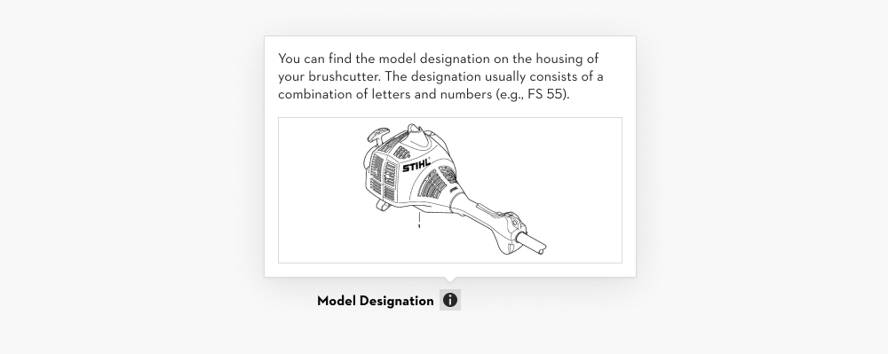

### Alternatives for Popovers

Because popovers hide additional information and are only visible on interaction, consider carefully before using one. Ask yourself:

- Is the information essential for the user to complete their task?
- Could the interface be made clearer without a popover?
- Would it be better to show the information directly on the page by default?
- Is the information long or complex, making a different component more suitable?

**Alternative should be:**

#### Persistent Content

Popovers should not be used in forms to provide essential instructions, since they are only visible on interaction (e.g., clicking an info icon).

Instead, present critical information as persistent content, such as hint text for an input field.

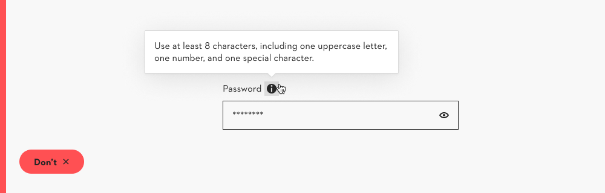

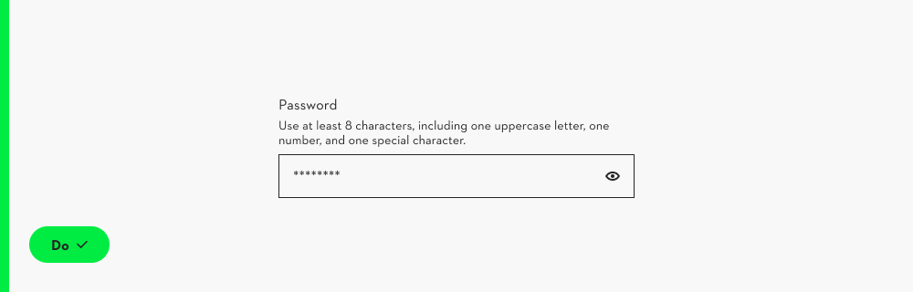

#### Expandable sections and accordions

When additional information is tied to a specific item (e.g., extra details in a list), do not hide it inside a Popover.

Instead, use expandable sections or accordions, which keep the information discoverable and accessible.

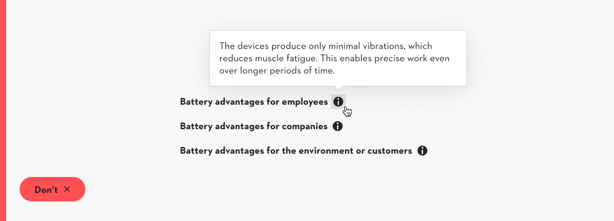

#### Mobile

Don’t use popovers on mobile. They’re hard to position on small screens, often cover important content, and their anchored placement makes them less discoverable or easy to miss. (A common use case on desktop is Utility Menus, such as for language selection.)

Do open the same content in a dialog on mobile. A centered dialog ensures clarity and readability, improves discoverability by taking the foreground, and helps users complete tasks without distraction.

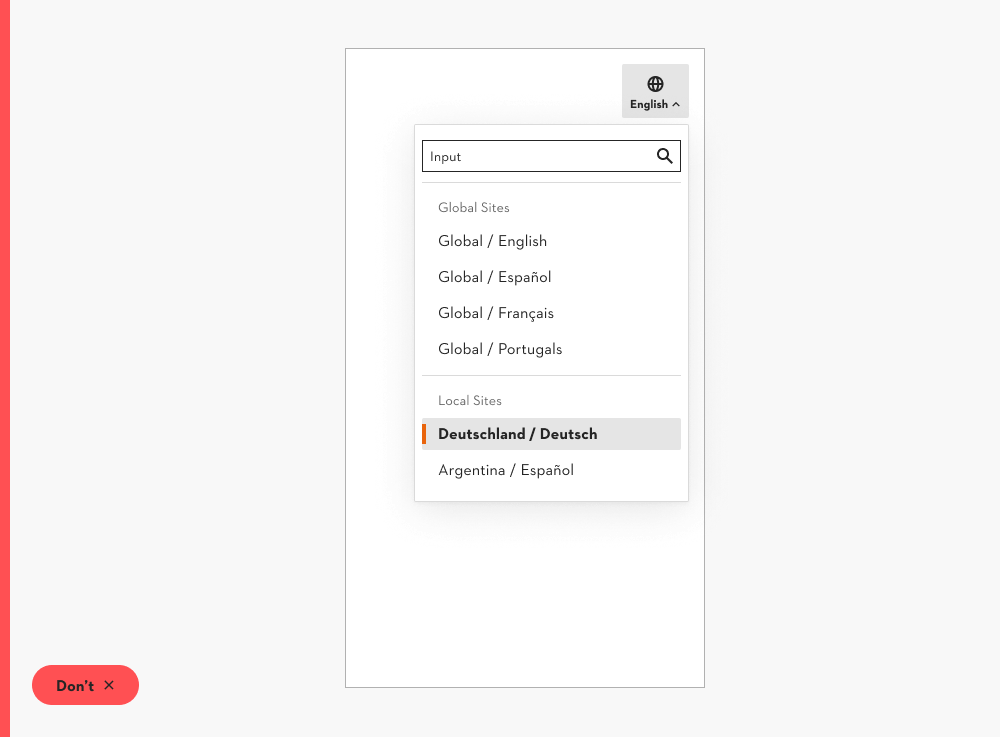

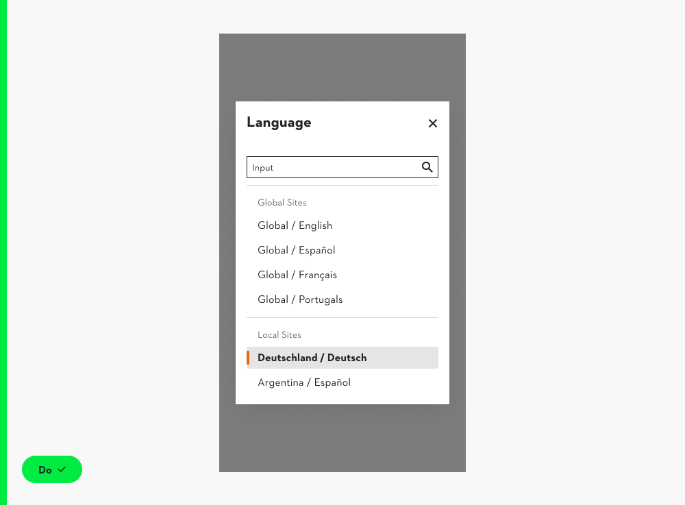

## Accessiblity

### Focus order

When opened with the keyboard, focus moves to the **first focusable element** in the Popover.

From there, it follows a logical **top-to-bottom**, **left-to-right** sequence.

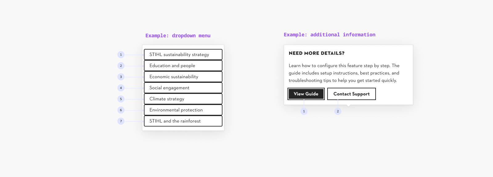

### Keyboard navigation

Users can interact with the Popover using the following keyboard actions:

- **Open** the Popover by pressing **“Space”** or **“Enter”** on the trigger button.
- **Close** the Popover by pressing **“Esc”**, or by moving focus away from the Popover.
- **Navigate forward** to the next focusable element with **“Tab”**.
- **Navigate backward** to the previous focusable element with “**Shift + Tab”**.

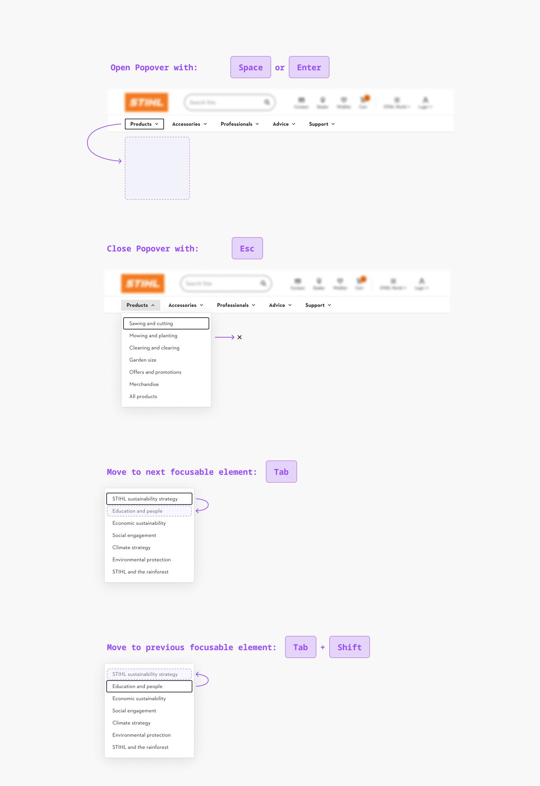

## Examples

### Utility Menu

Built on the Popover component the Utility Menu offers quick access to essential functions, user tools, and system-level actions — such as login, language selection, and other key options. More information regarding the Utility Menu can be found [here](https://www.figma.com/design/Ie2r0R9QwjEc7O3nrFbXhV/Web-Pattern-Library?m=auto&node-id=7158-33065&t=x1babMLUtlLvUiUI-1).

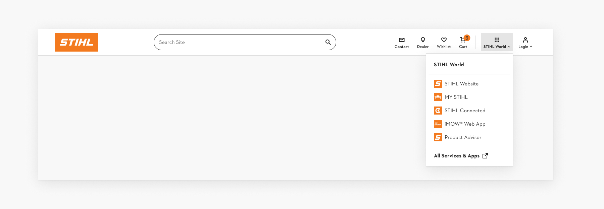

### Dropdown Menu

Built on the Popover component the Dropdown Menu provides quick access to nested navigation items. Displaying a linear list of Action Items, triggered by clicking a Button Nav in the Nav Bar. It is designed to support a single level of navigation More information can be found [here](https://www.figma.com/design/Ie2r0R9QwjEc7O3nrFbXhV/Web-Pattern-Library?m=auto&node-id=6263-62113&t=x1babMLUtlLvUiUI-1).

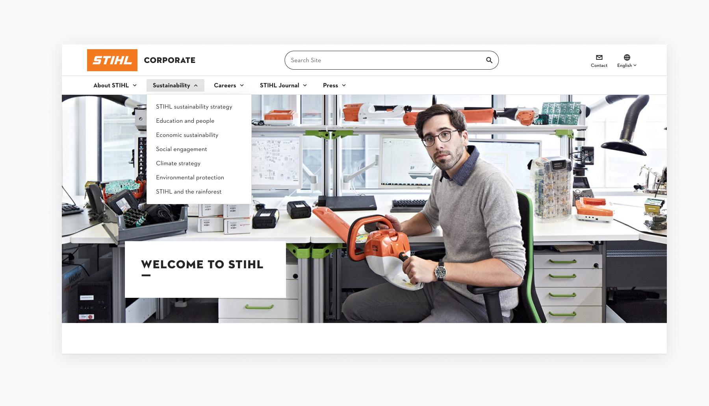

### Additional info

In the case of STIHL advisors, the Popover is used to provide users with additional guidance on where to find product-specific information, such as the machine or product number.

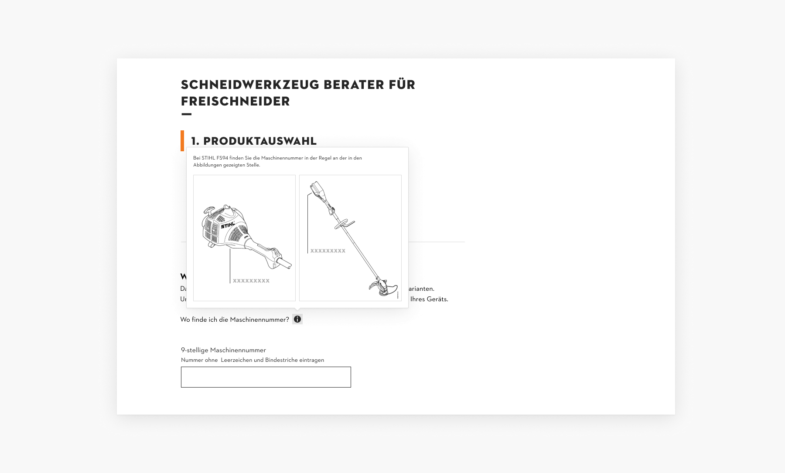

## Popover

- A Popover is triggered by a button.
- It can contain text, lists, images, or interactive elements.
- Popovers are best suited for short, non-critical information or lightweight interactions without leaving the current context.
- Triggered on click or tap.

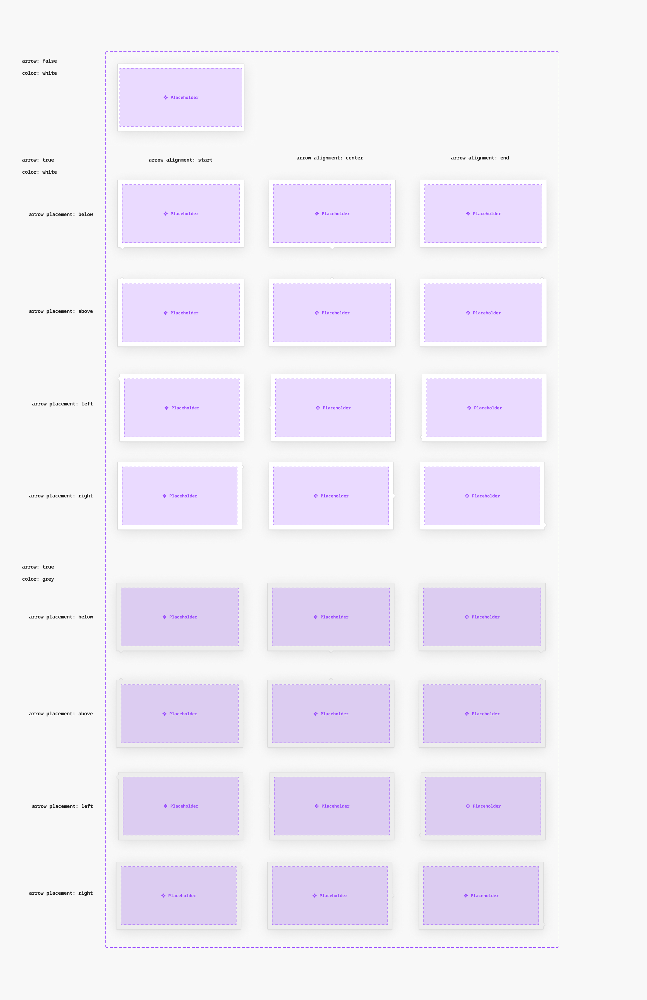

### Further guidelines

[Storybook documentation](https://main--63440bbb95889041542a5ba3.chromatic.com/?path=/docs/components-notification--documentation&globals=backgrounds.name:!undefined;backgrounds.value:!undefined)

[Decision tree](https://www.figma.com/design/qXldpLO6gxHJNLdcXIPxYt?node-id=26738-47603)

### Similar components

**Component**

**Trigger**

**Placement**

**Content**

**Intention**

**Tooltip**

Hover or focus of an interactive element

In proximity to the triggering element, non-modal

Text only

Provide short, contextual information or clarify unlabeled controls

**Popover**

Click or tap of an interactive element

In proximity to the triggering button, non-modal

Text, icon, image and interactive elements

Provide additional information or quick actions without leaving the current context

**Dialog**

Triggered by the system in response to user interaction

Center of the screen, with backdrop, modal

Text, icon, image and interactive elements

Confirm important actions, guide users through complex tasks, or temporarily block interaction to focus attention

**Toast**

Triggered by the system in response to user interaction

Bottom of the screen, non-modal

Text, icon, and optional dismiss button

Provide brief, lightweight feedback on user actions such as error or success.

**Notification**

Triggered by the system in response to events or interactions

Within the content area of the page, in relation to relevant elements

Text, icon, links and buttons

Deliver important updates or status messages that may require user attention or follow-up

### Related elements

[Tooltip](https://www.figma.com/design/HovZmjHiwxguawTWTO6ibS/DS-1085-Design-%7C-Web-%7C-Tootlip?node-id=36194-1244)

[Utility Menu](https://www.figma.com/design/Ie2r0R9QwjEc7O3nrFbXhV/Web-Pattern-Library?m=auto&node-id=7158-32869&t=JVVkPuiySoyYbdTa-1)

[Dropdown Menu](https://www.figma.com/design/Ie2r0R9QwjEc7O3nrFbXhV/Web-Pattern-Library?m=auto&node-id=6583-85690&t=JVVkPuiySoyYbdTa-1)

[Dialog](https://www.figma.com/design/qXldpLO6gxHJNLdcXIPxYt/Core-Components-%F0%9F%92%A0?node-id=14115-4051)

[Toast](https://www.figma.com/design/qXldpLO6gxHJNLdcXIPxYt/Core-Components-%F0%9F%92%A0?node-id=8844-4923)

[Notification](https://www.figma.com/design/qXldpLO6gxHJNLdcXIPxYt/Core-Components-%F0%9F%92%A0?node-id=7251-8)

### Contribute

Contribute to improving this component by sharing your feedback, asking questions, or suggesting features [here](https://www.figma.com/design/lLmw7PfIdKjFG4uT3B2Hyj/Onboarding-%F0%9F%93%96?node-id=446-868&t=zKmRu4kAkxMeRDmK-4).
