# Radio Group

## Radio Group

Overview:

- Radio items are always presented in a group and never used alone.
- They allow the user to select exactly one option.
- The user can change the selection, but cannot deselect an option.
- If applicable, include an opt-out option (e.g., “Other” or “None of the above”).

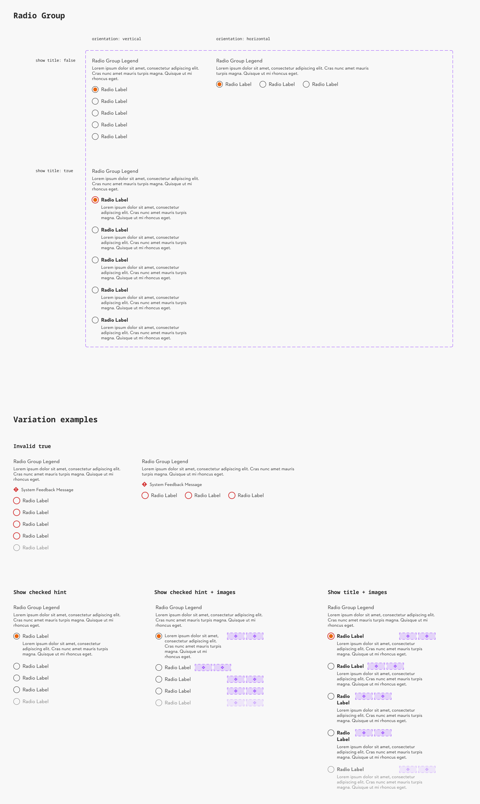

_Figure: Shows building-element-radio (label=Radio Label, label, type=label, state=enabled, checked=true, invalid=false); building-element-radio (label=Radio Label, label, type=label, state=enabled, checked=false, invalid=false); building-element-radio (label=Radio Label, label, type=title, state=enabled, checked=true, invalid=false); building-element-radio (label=Radio Label, label, type=title, state=enabled, checked=false, invalid=false); radio-group (item 5, legend, item 3, legend=Radio Group Legend, item 4, invalid, hint=Lorem ipsum dolor sit amet, consectetur adipiscing elit. Cras nunc amet mauris turpis magna. Quisque ut mi rhoncus eget., hint, orientation=vertical, show title=false); radio-group (item 4, legend, item 5, item 3, legend=Radio Group Legend, hint, invalid, hint=Lorem ipsum dolor sit amet, consectetur adipiscing elit. Cras nunc amet mauris turpis magna. Quisque ut mi rhoncus eget., orientation=horizontal, show title=false); radio-group (item 5, legend, item 3, legend=Radio Group Legend, item 4, hint=Lorem ipsum dolor sit amet, consectetur adipiscing elit. Cras nunc amet mauris turpis magna. Quisque ut mi rhoncus eget., hint, orientation=vertical, show title=false); radio-group (legend, item 5, item 3, hint=Lorem ipsum dolor sit amet, consectetur adipiscing elit. Cras nunc amet mauris turpis magna. Quisque ut mi rhoncus eget., item 4, legend=Radio Group Legend, hint, orientation=vertical, show title=true). Text in the figure: "Radio Group", "orientation: vertical", "orientation: horizontal", "Radio Group Legend", "Lorem ipsum dolor sit amet, consectetur adipiscing elit. Cras nunc amet mauri...", "Radio Label", "show title: false", "show title: true", "Variation examples", "Invalid true", "System Feedback Message", "Show checked hint", "Show checked hint + images", "Show title + images", "❖"._

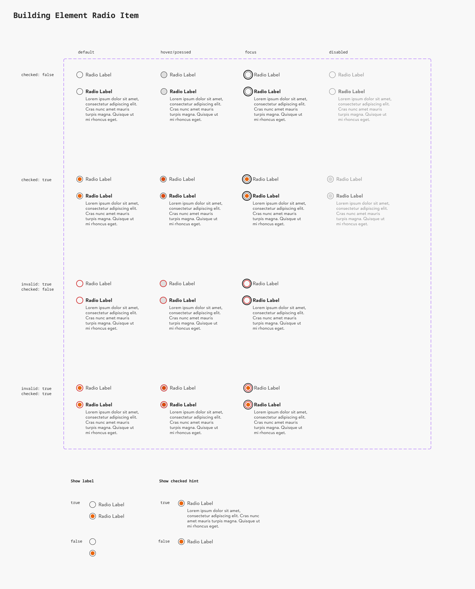

_Figure: "Building Element Radio Item" state matrix. Columns are default, hover/pressed, focus and disabled; rows are "checked: false", "checked: true", "invalid: true checked: false" and "invalid: true checked: true", each as a plain "Radio Label" and as a bold label with a hint text. Hover/pressed adds a grey fill, focus a dark outer ring, invalid a red ring, checked an orange dot, and disabled is greyed out with no invalid variants. Below, "Show label" true/false and "Show checked hint" true/false show the label hidden or the hint shown only when checked._

### Further guidelines

[Storybook documentation](https://main--63440bbb95889041542a5ba3.chromatic.com/?path=/docs/components-radio-group--documentation)

Decision tree

### Related elements

[Input](https://www.figma.com/design/qXldpLO6gxHJNLdcXIPxYt?node-id=1591-2)

[Checkbox](https://www.figma.com/design/qXldpLO6gxHJNLdcXIPxYt?node-id=1017-2316)

[Switch](https://www.figma.com/design/qXldpLO6gxHJNLdcXIPxYt?node-id=513-2)

### Contribute

Contribute to improving this component by sharing your feedback, asking questions, or suggesting features [here](https://www.figma.com/design/lLmw7PfIdKjFG4uT3B2Hyj/Onboarding-%F0%9F%93%96?node-id=446-868&t=zKmRu4kAkxMeRDmK-4).

## Formatting and Construction

### Anatomy

#### Radio Group

1. **Legend** Describes the purpose of the Radio Group.
1. **Info Button (Optional)** Opens a popover with additional information.
1. **Hint (Optional)** Provides extra guidance, context, or clarity for the selection.
1. **System Feedback (Optional)** Displays system-level messages (errors, warnings, confirmations) above the Radio Group.
1. **Item** A required element containing a Radio Item with label, and an optional hint.

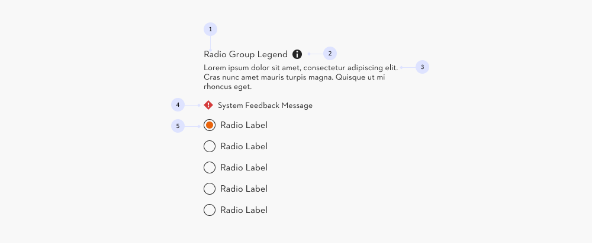

_Figure: Anatomy of a vertical Radio Group with numbered callouts: 1 points at the "Radio Group Legend", 2 at the info button next to the legend, 3 at the hint text below it, 4 at the "System Feedback Message" with a red warning icon, and 5 at the first "Radio Label" item, which is selected, followed by four unselected "Radio Label" items._

#### Radio Item

1. **Radio (Selected)** The active, chosen state of the radio option.
1. **Radio (Not Selected)** The default, unselected state of the radio option.
1. **Label** Text describing the option.
1. **Images (optional)** An area for up to two images (preferably for small logos i.e. payment logos).
1. **Hint (optional)** Provides additional guidance, context, or clarification.

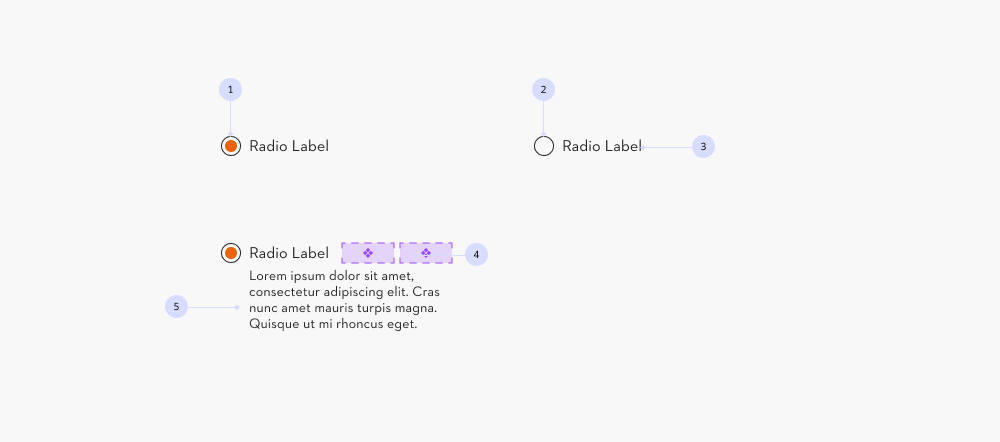

_Figure: Anatomy of the Radio Item with callouts: 1 points at the selected radio (orange dot), 2 at the unselected radio (empty circle), 3 at the "Radio Label" text, 4 at two image placeholders to the right of the label, and 5 at the hint text below the label of a selected item._

### Orientation

#### Vertical (default)

- Use the vertical orientation by default.
- Recommended for longer labels or copy.
- Supports additional content such as images and hints.

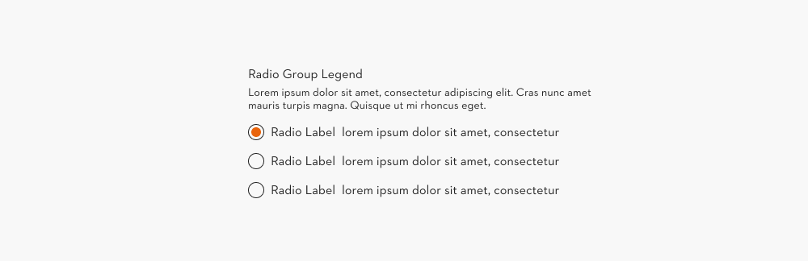

_Figure: Shows radio-group (item 5, legend, legend=Radio Group Legend, hint=Lorem ipsum dolor sit amet, consectetur adipiscing elit. Cras nunc amet mauris turpis magna. Quisque ut mi rhoncus eget., hint, orientation=vertical, show title=false). Text in the figure: "Radio Group Legend", "Lorem ipsum dolor sit amet, consectetur adipiscing elit. Cras nunc amet mauri...", "Radio Label lorem ipsum dolor sit amet, consectetur"._

#### Horizontal

- Consider the horizontal orientation when there are three or fewer radio buttons and the labels are short.

> **Note:** Images and hints are not supported in the horizontal layout.

_Figure: Horizontal radio group with the legend "Radio Group Legend" and a hint text, followed by two short "Radio Label" radio buttons placed side by side. The first is selected, the second is unselected._

### Sizing

#### Maximum width of text container

To ensure good readability the maximum width should not exceed 544px (16px\*34em calculation based on the font size).

[Typography→](https://www.figma.com/design/pQUiJaNuWrGzPaeMrEHf6N/DS-1117-Design-%7C-34em?node-id=2645-515)

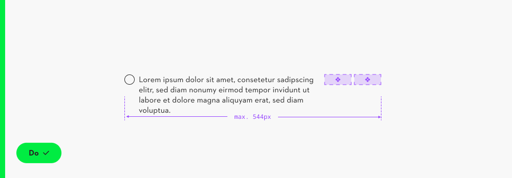

_Figure: Do example. Shows building-element-radio (images, label=Lorem ipsum dolor sit amet, consetetur sadipscing elitr, sed diam nonumy eirmod tempor invidunt ut labore et dolore magna aliquyam erat, sed diam voluptua. , label, type=label, state=enabled, checked=false, invalid=false). Text in the figure: "Lorem ipsum dolor sit amet, consetetur sadipscing elitr, sed diam nonumy eirm...", "❖", "max. 544px"._

Do not exceed 544px, even when the module or grid is wider.

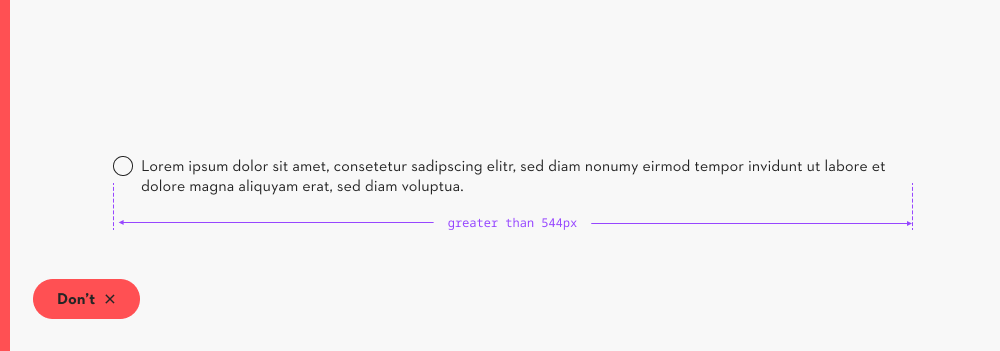

_Figure: Don't example: a radio button with a long label stretched over two wide lines, with a measurement line marked "greater than 544px". The text container is wider than the 544px maximum, which hurts readability._

### Images

#### Alignment

Images support two alignment options relative to the label:

1. **Hug** The image sits directly next to the label.
1. **Fill** The image is aligned to the far right of the container. Use this option when there are many options to scan, as consistent image positioning improves scannability.

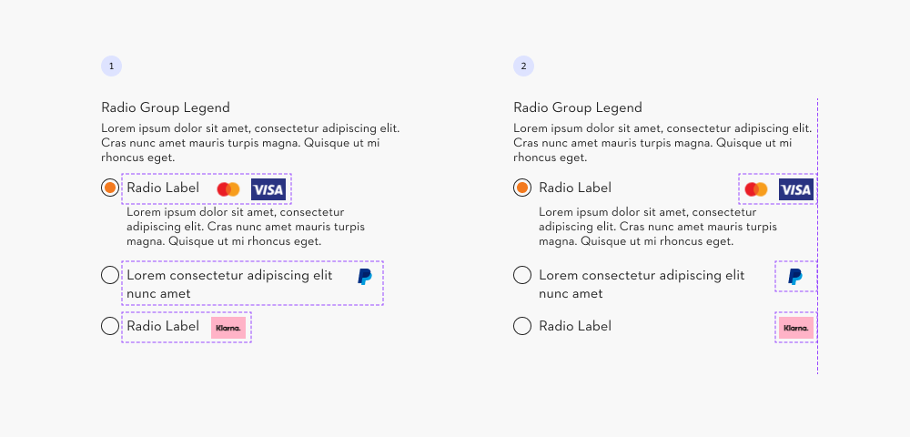

_Figure: Two radio groups with the legend "Radio Group Legend", hint text and payment logos (Mastercard, Visa, PayPal, Klarna) as images. Callout 1 (Hug): the logos sit directly next to each label. Callout 2 (Fill): the logos are aligned to the far right edge of the container, marked by a dashed vertical line._

#### Maximum height

**(Payment) logos:**

Do:

- Place logos in the image areas.
- Use images with a max. height of 32 px.

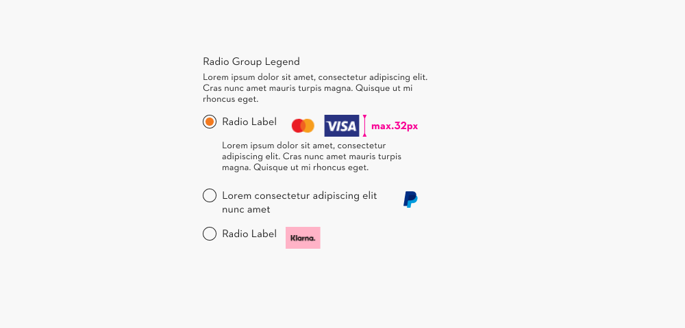

_Figure: Radio group with legend, hint text and payment logos (Mastercard, Visa, PayPal, Klarna) next to the labels "Radio Label" and "Lorem consectetur adipiscing elit nunc amet". A vertical measurement beside the Visa logo is marked "max.32px", the maximum image height._

#### Function icons

Don’t insert function icons in the image area, as functional icons width a height of 32px lack hierarchy and therefore do not mesh well.

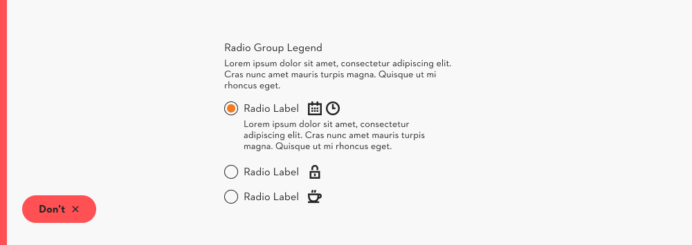

_Figure: Don't example: a radio group where function icons (calendar and clock, lock, coffee cup) are placed in the image area next to the "Radio Label" labels. Function icons lack hierarchy at this size and do not mesh well with the radio group; only logos or images belong there._

## Content and Assets

### Amount of radio buttons

- A radio group should contain at least 2 and no more than approximately 5 options.
- For more than 5 options, consider using a Select Component instead.

[Select→](https://www.figma.com/design/qXldpLO6gxHJNLdcXIPxYt?node-id=8139-4888)

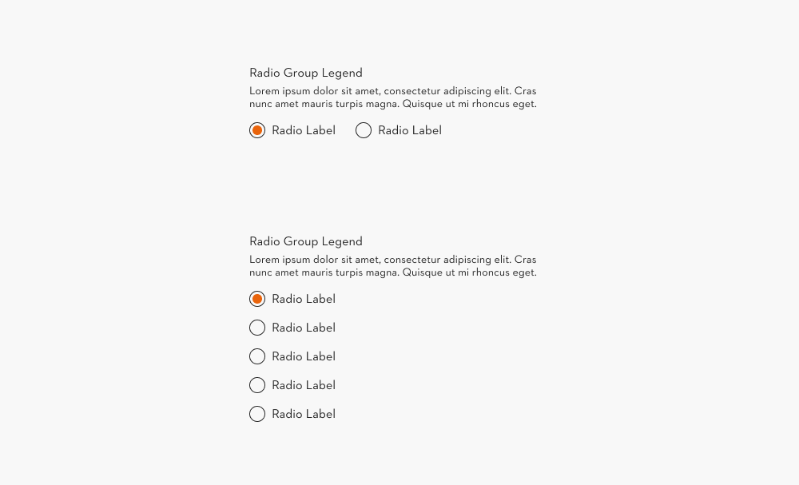

_Figure: Two radio groups with the legend "Radio Group Legend" and hint text. The upper one is horizontal with two "Radio Label" options, the lower one is vertical with five "Radio Label" options, the first selected, showing the range of two to about five options._

### Overflow behaviour

- Optimize labels to minimize text overflow.
- If overflow occurs, the radio element aligns with the first line of the label.

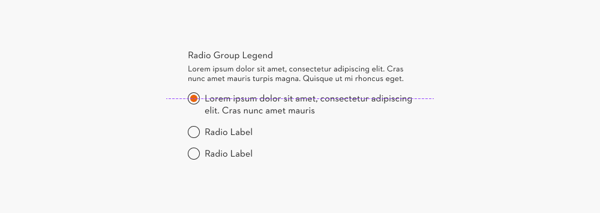

_Figure: Vertical radio group with legend and hint text. The first label is long and wraps onto a second line ("Lorem ipsum dolor sit amet, consectetur adipiscing elit. Cras nunc amet mauris"); a dashed horizontal line marks the first text line, to which the radio element is aligned. Two further "Radio Label" options follow._

### Long texts

**Attention:** Always test the length of the copy on a mobile device.

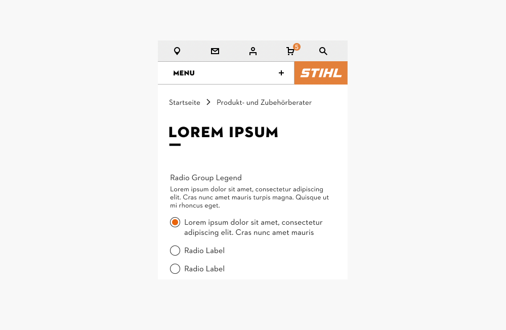

_Figure: Mobile page mockup with the STIHL header, "MENU" bar, breadcrumb "Startseite \> Produkt- und Zubehörberater" and the heading "LOREM IPSUM", followed by a vertical radio group with legend and hint. The first selected option has a long label wrapping onto two lines, followed by two "Radio Label" options, illustrating that label length must be tested on mobile._

### Required and optional indicators

1. To indicate that a Radio Group is **required**, display an asterisk (\*) next to the legend.
1. **Optional** Radio Groups are marked with “(optional)” after the legend. In most cases, this must be added manually in the Content Management System.

**Attention: Reduce the optional fields to a minimum.** Consider carefully, if the users needs to provide this information at this point in the journey.

> **Note:** Keep optional fields to a minimum. Carefully consider whether the user needs to provide this information at this stage of the journey.

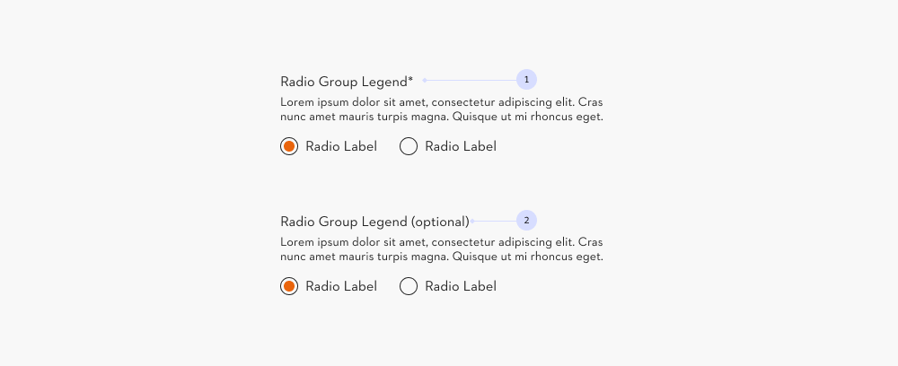

_Figure: Two horizontal Radio Groups, each with a legend, a hint ("Lorem ipsum dolor sit amet, consectetur adipiscing elit. Cras nunc amet mauris turpis magna. Quisque ut mi rhoncus eget.") and two options labelled "Radio Label", the first selected. Callout 1 points at the legend "Radio Group Legend\*", where the asterisk marks the group as required; callout 2 points at the legend "Radio Group Legend (optional)", where the suffix marks the group as optional._

### Bold labels when hints are visible

When all hints are shown, labels should be displayed in bold to help users scan the options more quickly.

To enable this behavior, set “**Show title**” to **true**.

**Tip:** Ensure that hints are of similar length to maintain visual balance and readability.

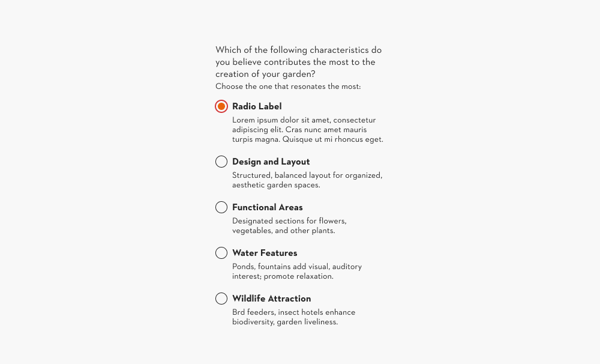

_Figure: Shows radio-group (legend, item 5, item 3, hint=Choose the one that resonates the most:, item 4, legend=Which of the following characteristics do you believe contributes the most to the creation of your garden?, hint, orientation=vertical, show title=true). Text in the figure: "Which of the following characteristics do you believe contributes the most to...", "Choose the one that resonates the most:", "Plant Diversity", "Variety of plants ensuring seasonal interest and visual appeal.", "Design and Layout", "Structured, balanced layout for organized, aesthetic garden spaces.", "Functional Areas", "Designated sections for flowers, vegetables, and other plants.", "Water Features", "Ponds, fountains add visual, auditory interest; promote relaxation.", "Wildlife Attraction", "Brd feeders, insect hotels enhance biodiversity, garden liveliness."._

### Prompting the user with a call to action

1. In some cases, it’s helpful to include an action verb such as **“choose”** or **“select”** in the label or hint to clarify what the user needs to do.
1. When doing so, end the sentence with a colon **(:)**.

**Example:**

“Choose the option that resonates most:”

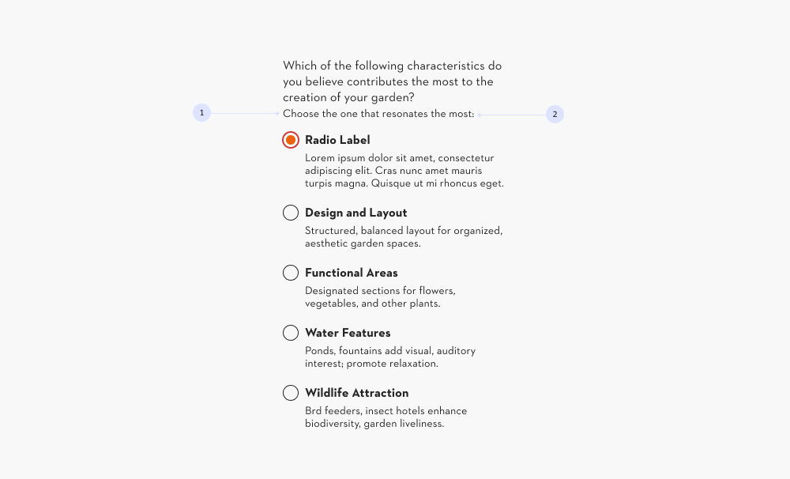

_Figure: Shows radio-group (legend, item 5, item 3, hint=Choose the one that resonates the most:, item 4, legend=Which of the following characteristics do you believe contributes the most to the creation of your garden?, hint, orientation=vertical, show title=true); annotation-circle (number=1, type=left, color=blue); annotation-circle (number=2, type=right, color=blue). Callouts 1, 2. Text in the figure: "Which of the following characteristics do you believe contributes the most to...", "Choose the one that resonates the most:", "Plant Diversity", "Variety of plants ensuring seasonal interest and visual appeal.", "Design and Layout", "Structured, balanced layout for organized, aesthetic garden spaces.", "Functional Areas", "Designated sections for flowers, vegetables, and other plants.", "Water Features", "Ponds, fountains add visual, auditory interest; promote relaxation.", "Wildlife Attraction", "Brd feeders, insect hotels enhance biodiversity, garden liveliness."._

### The hint appears on activation

In some cases, the information is secondary and appears after the Radio Button is activated.

The hint disappears again, when another Radio Button is activated. Read the[ motion guidelines](https://www.figma.com/design/UYHZEckQObDvLuuRoMP8ps/Styles-%F0%9F%AA%AD?node-id=1-148) for more information on the transition.

**Tip:** Perform a usability test to check if the information can really be left out of first sight.

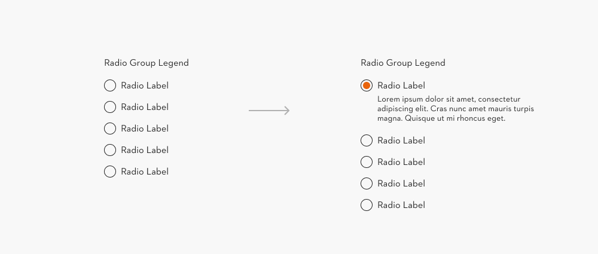

_Figure: Two states of a vertical Radio Group with the legend "Radio Group Legend" and five options labelled "Radio Label", connected by an arrow. On the left no option is selected and no hint is shown. On the right the first option is selected and its hint ("Lorem ipsum dolor sit amet, consectetur adipiscing elit. Cras nunc amet mauris turpis magna. Quisque ut mi rhoncus eget.") appears below its label, pushing the other options down._

## Behavior

### One choice

The defining characteristic of radio buttons is that users can select only one option at a time.

Once a selection is made, it can only be changed by choosing another option in the group; it cannot be cleared.

If applicable, provide an opt-out option (e.g., “Other” or “None of the above”).

[Checkbox (multiple choice)→](https://www.figma.com/design/qXldpLO6gxHJNLdcXIPxYt?node-id=1017-2316)

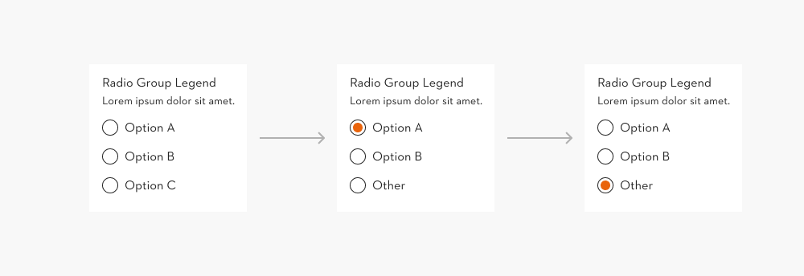

_Figure: Three steps of one vertical Radio Group with the legend "Radio Group Legend" and the hint "Lorem ipsum dolor sit amet.", connected by arrows. First step: "Option A", "Option B" and "Option C", none selected. Second step: "Option A" is selected and the third option is now "Other". Third step: "Other" is selected and "Option A" is deselected, showing that only one option can be active at a time and a selection is changed only by choosing another option._

### System feedback

Feedback always refers to the full list, instead to one single Radio Button.

[Text Input →](https://www.figma.com/design/qXldpLO6gxHJNLdcXIPxYt?node-id=1591-2)

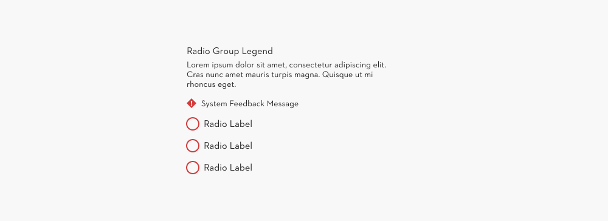

_Figure: Vertical Radio Group in the invalid state with the legend "Radio Group Legend" and a hint ("Lorem ipsum dolor sit amet, consectetur adipiscing elit. Cras nunc amet mauris turpis magna. Quisque ut mi rhoncus eget."). Below the hint a red error icon with the "System Feedback Message" applies to the whole list, and all three "Radio Label" options have red outlined radio buttons._

### Click behavior

The entire option is clickable, including the label and image, not just the radio button itself.

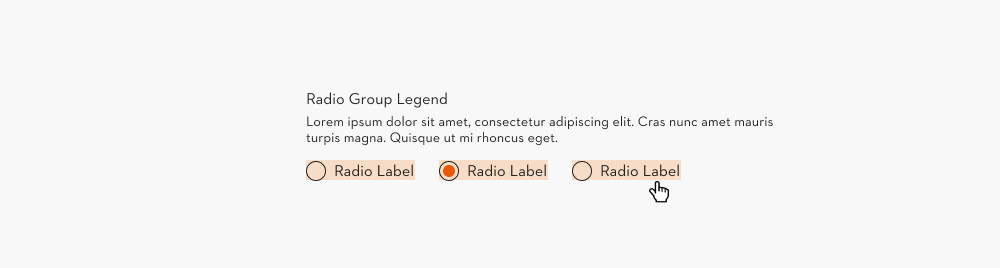

_Figure: Horizontal Radio Group with the legend "Radio Group Legend", a hint and three options labelled "Radio Label", the middle one selected. Each radio button and its label are highlighted with a light orange background to show the whole option is clickable, and a hand cursor hovers over the label of the third option._

## Examples

### Product Advisors

Radio Groups are used in combination with Radio Groups with Images within the Digital Advisors.

_Figure: Shows top-bar (grid variant=main, breakpoint=xl, brand add-on=false, number areas=2); nav-bar (variant=main, breakpoint=xl); breadcrumb (expanded=true); steps (hint=250 - 500 m², label=Search, status=current, state=enabled, orientation=vertical); steps (label=Device Selection, hint=Hint option.); steps (label=Technical Specification, hint=Hint option.); steps (label=Usage (Optional), hint=Hint option.); steps (label=Recommendation, hint=Hint option.); local/page header (Viewport=desktop); radio-group-with-image (legend=What are you looking for?\*, hint=Lorem ipsum dolor sit amet, consectetur adipiscing elit. Cras nunc amet mauris turpis magna. Quisque ut mi rhoncus eget., item 3, legend, show title=false); radio-group (legend, legend=I need the Saw Chain for ..., hint=Lorem ipsum dolor sit amet, consectetur adipiscing elit. Cras nunc amet mauris turpis magna. Quisque ut mi rhoncus eget., orientation=vertical, show title=false); button (button text=Next, variant=filled, state=enabled, size=medium, icon position=right, hide label=off, flush alignment=off). Text in the figure: "Search Site", "Contact", "Dealer", "Wishlist", "3", "Cart", "STIHL World", "Login", "Products", "Accessories", "Professionals", "Advice", "Support", "Home", "/", "Product-Advisors", "Bar-and-Chain-Advisor", "1", "Search", "2", "Device Selection", "Technical Specification", "4", "Usage (Optional)"._

## Radio Group with Image

Overview:

- Radio Group with Image works like a standard Radio Group but includes an additional image for each option.
- Use this component when a visual representation helps users understand and choose between options.
- Must contain 2–4 radio options in one row.
- Allows the user to select only one option at a time, just like a standard radio group.

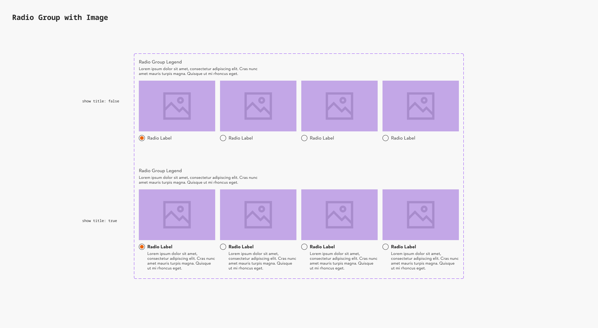

_Figure: Radio Group with Image shown twice, each with the legend "Radio Group Legend", a hint and four image options in one row, the first selected. With "show title: false" each option has a regular "Radio Label" beside its radio button and no hint. With "show title: true" the "Radio Label" is bold and a hint ("Lorem ipsum dolor sit amet, consectetur adipiscing elit. Cras nunc amet mauris turpis magna. Quisque ut mi rhoncus eget.") appears under each label._

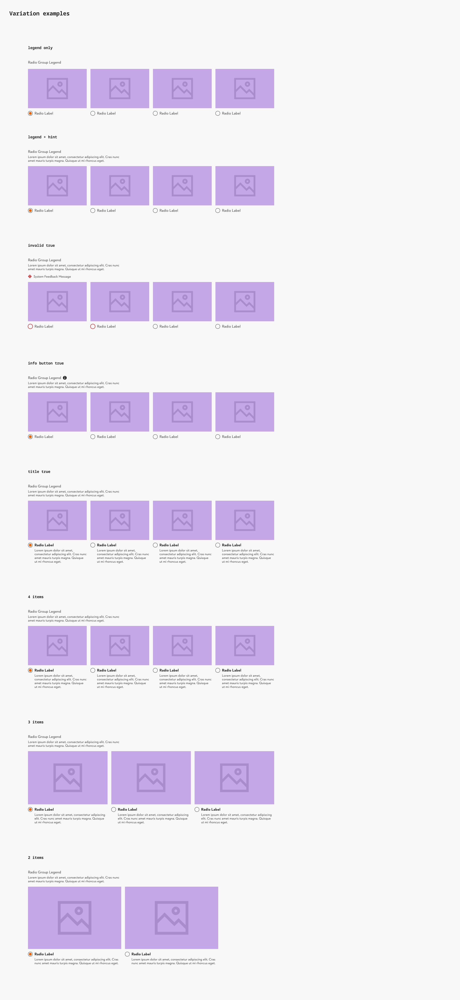

_Figure: Variation examples of Radio Group with Image, stacked vertically, each with image placeholders and "Radio Label" options, the first selected: "legend only" (legend, no hint), "legend + hint", "invalid true" (red "System Feedback Message" and red outlined radio buttons on the first two options), "info button true" (info icon after the legend), "title true" (bold labels with a hint under each), "4 items", "3 items" (wider images) and "2 items" (widest images)._

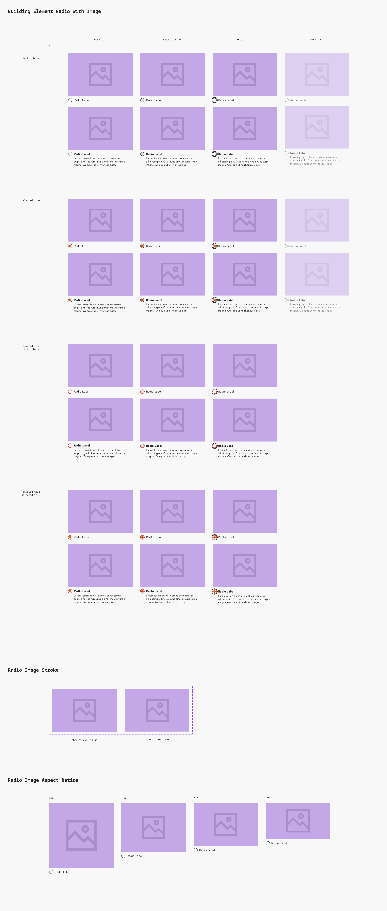

_Figure: Building Element Radio with Image shown as a matrix of purple placeholder images, each with a radio and a "Radio Label", once without and once with a hint text. Columns are the states default, hover/pressed, focus and disabled (disabled is faded), rows are selected false, selected true, invalid true selected false and invalid true selected true (invalid has a red radio, no disabled column). Below, Radio Image Stroke compares show stroke: false and show stroke: true, and Radio Image Aspect Ratios shows the image at 1:1, 4:3, 3:2 and 16:9._

### Further guidelines

[Storybook documentation](https://main--63440bbb95889041542a5ba3.chromatic.com/?path=/docs/components-radio-group--documentation)

Decision tree

### Related elements

[Image Placeholder](https://www.figma.com/design/qXldpLO6gxHJNLdcXIPxYt?node-id=16490-4893)

[Checkbox](https://www.figma.com/design/qXldpLO6gxHJNLdcXIPxYt?node-id=1017-2316)

### Contribute

Contribute to improving this component by sharing your feedback, asking questions, or suggesting features [here](https://www.figma.com/design/lLmw7PfIdKjFG4uT3B2Hyj/Onboarding-%F0%9F%93%96?node-id=446-868&t=zKmRu4kAkxMeRDmK-4).

## Formatting and Construction

> Most of the “Formatting and Construction” guidelines from the Radio Group component apply, see above.

### Anatomy

#### Radio Group with Image

1. **Legend** Describes the purpose of the Radio Group.
1. **Info Button (Optional)** Opens a popover with additional information.
1. **Hint (Optional)** Provides extra guidance, context, or clarity for the selection.
1. **System Feedback (Optional)** Displays system-level messages such as errors, warnings, confirmations. Appears above the Radio Group.
1. **Radio Item** A required component that includes:
   - an image representing the option
   - a radio button with label
   - an optional hint associated with the item

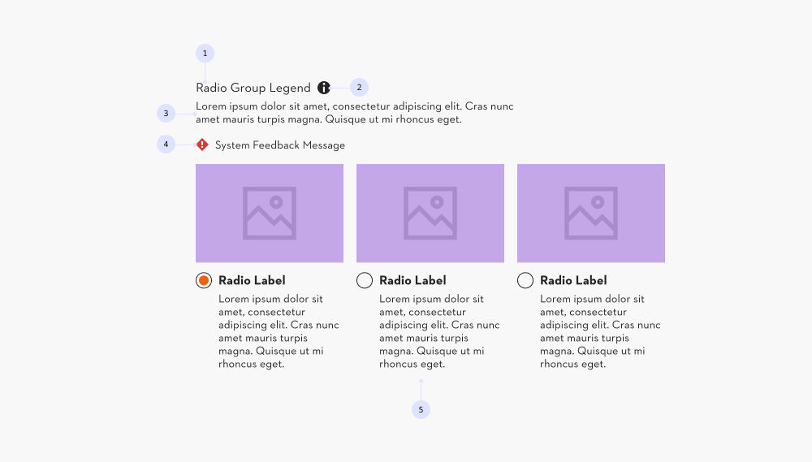

_Figure: Radio Group with Image with three items, each a placeholder image above a radio, a bold "Radio Label" and a hint, the first one selected. Above the items are the "Radio Group Legend" with an info icon, a hint text and a red "System Feedback Message". Callout 1 points at the legend, 2 at the info button, 3 at the hint below the legend, 4 at the system feedback message and 5 at the hint of a radio item._

#### Radio Item

1. **Image** Displays images or illustrations, representing the option. They support various aspect ratios.
1. **Radio (Selected)** The active, chosen state of the radio option.
1. **Radio (Not Selected)** The default, unselected state of the radio option.
1. **Label** Text describing the option.
1. **Label as Title** A label styled as a title; used only when paired with a hint to establish a clear visual hierarchy.
1. **Hint (Optional)** Provides additional guidance, context, or clarification.

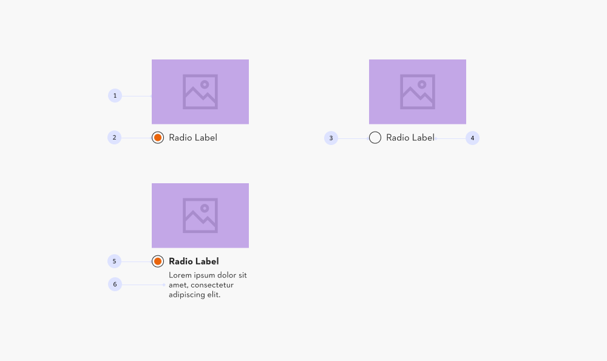

_Figure: Anatomy of a Radio Item in three variants: a selected radio with the label "Radio Label", an unselected radio with the label, and a selected radio with a bold label and a hint text below. Callout 1 points at the image, 2 at the selected radio, 3 at the unselected radio, 4 at the label, 5 at the label used as a title, and 6 at the hint._

### Scaling

The Radio Items scale evenly to fill the available container width, always left-aligned. This behavior is consistent whether the group contains two, three, or four items. Images scale proportionally and maintain their aspect ratios.

1. **Items fill the container** Items distribute evenly and expand to cover the full container width.
1. **Max Width: 400 px** Items expand until they reach a maximum width of 400 px. Beyond this point, they no longer grow and stay left-aligned within the container.
1. **Min Width: 160 px** Items shrink down to a minimum of 160 px. When the container becomes too narrow to fit all items horizontally at this minimum width, the items wrap onto the next line — wrapping one by one as needed.
1. **Image Behavior** Images scale proportionally within their item and always maintain their aspect ratio.

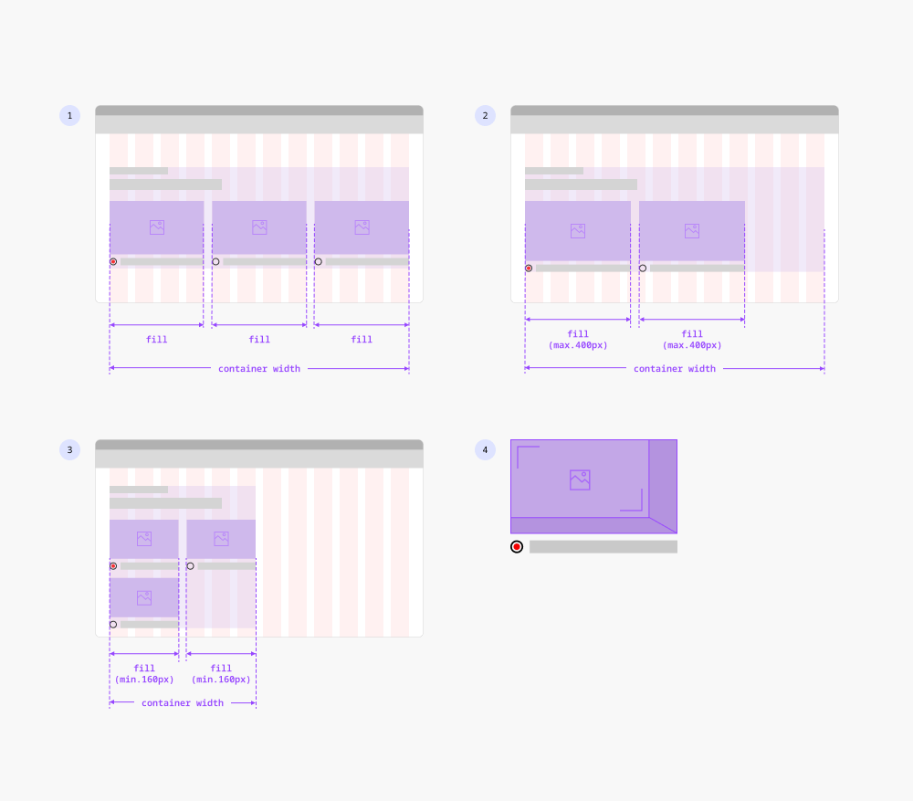

_Figure: Four diagrams of how Radio Items scale within a page grid. Callout 1: three items each marked "fill" share the "container width" evenly. Callout 2: two items marked "fill (max.400px)" stop growing at 400 px and stay left-aligned in a wider container. Callout 3: items marked "fill (min.160px)" shrink to 160 px and wrap into two rows in a narrow container. Callout 4: a single item with image, radio and label where the image scales proportionally._

> **Manual Pixel Alignment (Figma Bug)** Sometimes the component creates fractional pixel heights when scaling up and down. This is a known Figma issue. **Workaround:** Manually adjust the component’s height to a whole pixel value (rounded up or down). Enable “Lock aspect ratio” to prevent the component from reverting to fractional dimensions when resizing.

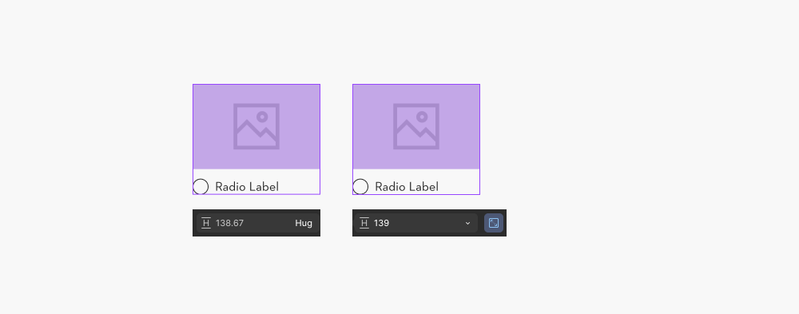

_Figure: Two copies of the same radio item (placeholder image above an unselected radio with "Radio Label") with their Figma height fields. The left one has a fractional height of 138.67 set to Hug. The right one has the rounded whole-pixel height 139 with the lock aspect ratio option enabled, as the workaround for fractional heights._

### Responsive behaviour

#### Alignment and Wrapping

The component automatically adapts to the width of its container. It uses a horizontal layout on larger screens and switches to a vertical layout on smaller ones.

1. **Horizontal Alignment** Recommended for wider layouts, especially on larger screens. Placing items side by side makes options easier to compare and scan.
1. **Wrapping and Vertical Alignment** On narrow screens, items wrap and stack vertically.

**Horizontal vs. Vertical Arrangement** Use a horizontal layout whenever possible to keep options comparable. Line breaks should be avoided where possible.

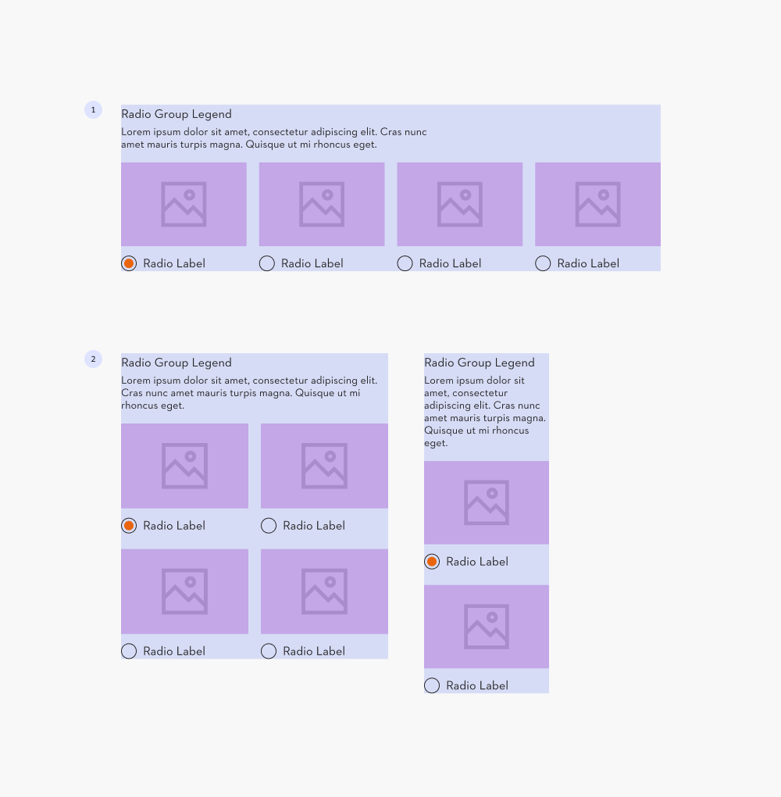

_Figure: Radio Group with Image with legend and hint in two layouts. Callout 1: horizontal alignment with four items side by side in one row (first one selected). Callout 2: wrapping, where on narrower widths the items wrap into a 2x2 grid and in an even narrower container stack vertically._

> The component features two **📐 layout helpe**r that should be used too ensure the correct item size when they wrap: Use **📐 layout helper** 1 **+ 📐 layout help**er2 to fill two empty item slots U**se 📐 layout help**er 1 to fill one empty item slot

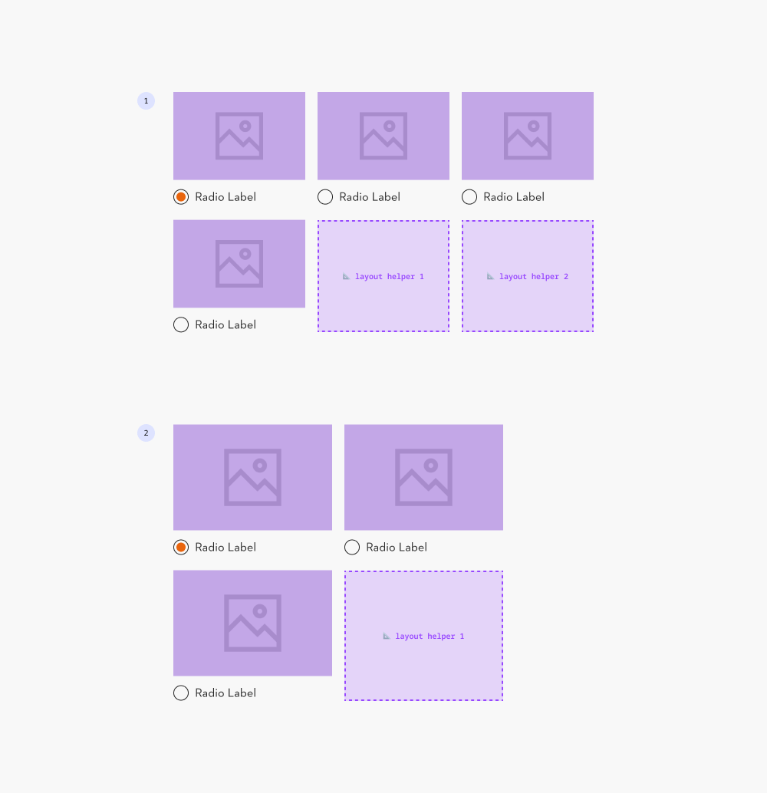

_Figure: Two wrapped Radio Groups showing the layout helper. Callout 1: four items in a three-column layout where the second row has one item plus dashed placeholders "layout helper 1" and "layout helper 2" filling the two empty slots. Callout 2: three items in a two-column layout where the second row has one item plus a dashed "layout helper 1" filling the one empty slot._

#### Spacing

The gaps between items are controlled by **dynamic spacing tokens**, which automatically adjust their size according to the active breakpoint.

Remeber applying the correct **Variable Mode** in your designs.

[See all Spacing Guidelines →](https://www.figma.com/design/JyyYtoCYbtJrzqHs38OXSQ/Grid---Spacing-%F0%9F%A7%AE?node-id=2-1934&t=ZxWmeoCh3JbSEpcm-4)

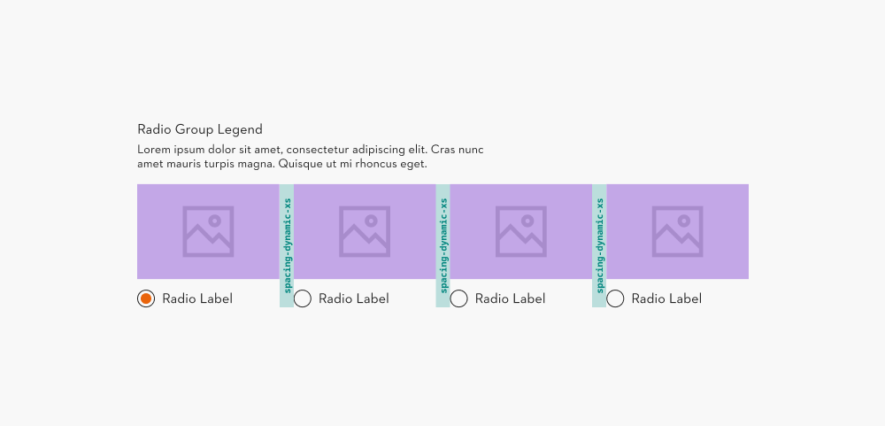

_Figure: Radio Group Legend with a hint above four radio items in a row (first one selected). The horizontal gap between each pair of neighbouring items is highlighted and labelled "spacing-dynamic-xs", the dynamic spacing token used between items._

### Placement

The Radio Group with Image is ideally placed within the appropriate Grid Content Areas:

1. **Main** Used for spacious layouts that take advantage of the full grid width.
1. **Narrow Left and Narrow Center** Typically used to keep layouts more compact and visually restrained.
1. **Two Thirds** Commonly used when a [Stepper](https://www.figma.com/design/qXldpLO6gxHJNLdcXIPxYt?node-id=26075-10497) is positioned to the left or right of the main content.

[See all Grid Guidelines →](https://www.figma.com/design/JyyYtoCYbtJrzqHs38OXSQ/Grid---Spacing-%F0%9F%A7%AE?node-id=1-857&t=ZxWmeoCh3JbSEpcm-4)

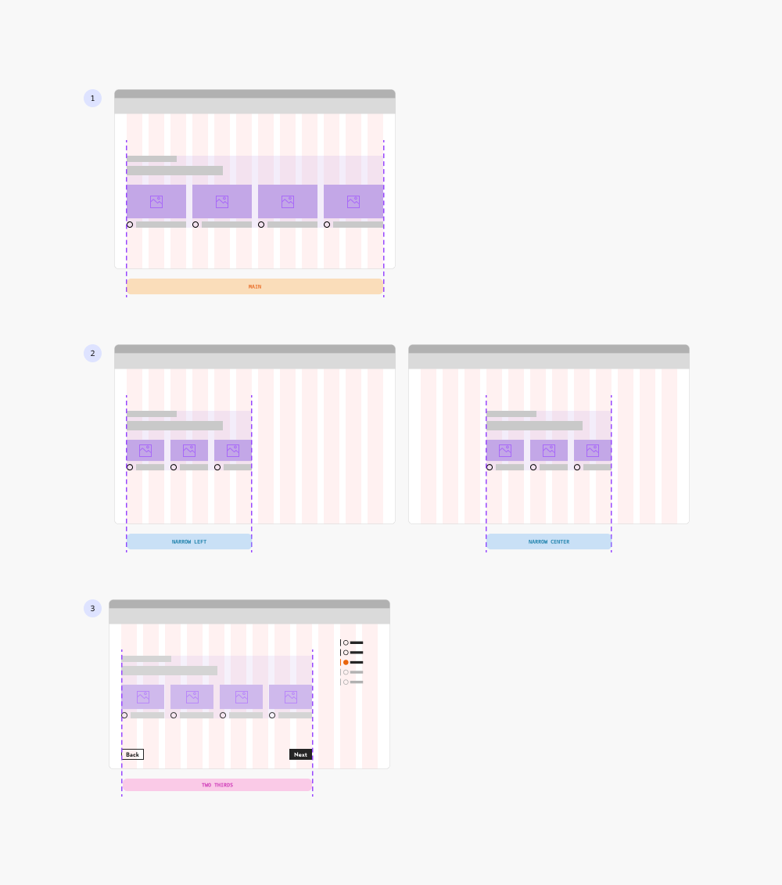

_Figure: Three page layouts with a Radio Group with Image placed in grid content areas. Callout 1: four items spanning the full grid width, labelled "main". Callout 2: three items in a narrow column, left-aligned ("Narrow left") or centered ("Narrow center"). Callout 3: four items in the "Two Thirds" area with "Back" and "Next" buttons below and a stepper on the right._

## Content and Assets

> Most of the “Formatting and Construction” guidelines from the Radio Group component apply, see above.

### Amount of Text

1. **Legend** Ideally use one line, two at most.
1. **Label** Keep the label short and clear. Aim for one line, with a maximum of two.
1. **Hint (optional)** Include a hint only if it provides real value. Keep it concise, with a maximum of three lines.

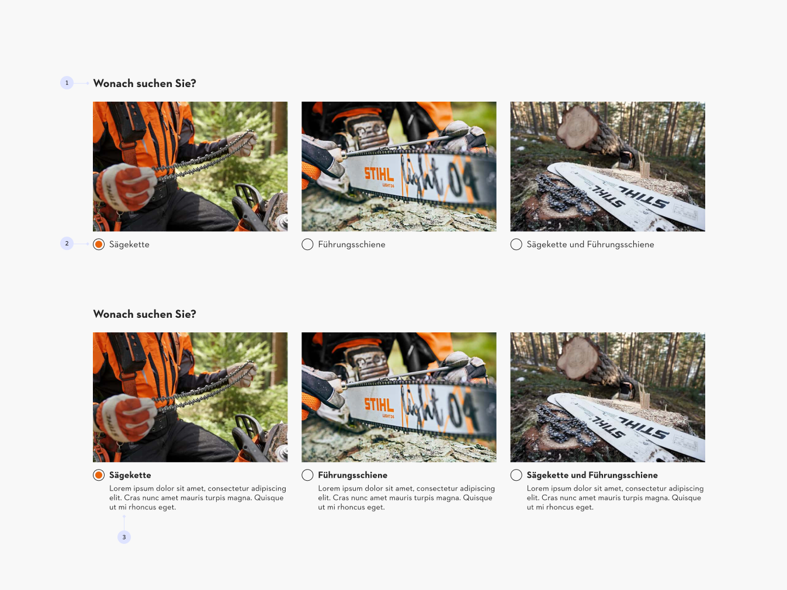

_Figure: Two Radio Groups with the legend "Wonach suchen Sie?" and three photo options: "Sägekette" (selected), "Führungsschiene" and "Sägekette und Führungsschiene". The first has only short labels, the second has bold labels with a three-line hint each. Callout 1 points at the legend (one line, two at most), 2 at the label (short, one line, two at most), and 3 at the hint (optional, maximum three lines)._

**Don’t use text elements inconsistently.**

1. Don’t omit labels—radio items always require clear text context.
1. Don’t mix different label types within the same row; if one item uses a hint, apply hints consistently across all items.

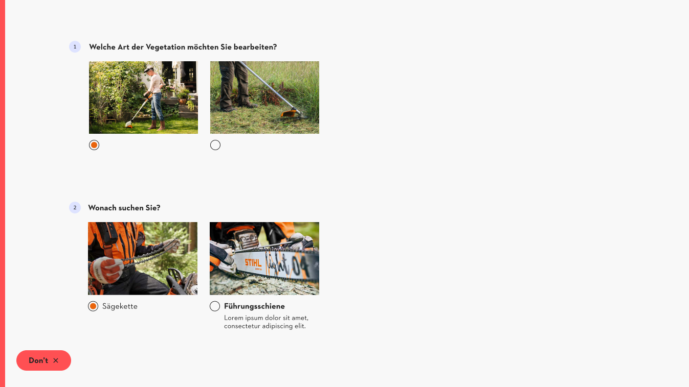

_Figure: Don't example with two image radio groups. Callout 1 marks the legend "Welche Art der Vegetation möchten Sie bearbeiten?" above two image radio items that have no labels at all (first selected), and callout 2 marks "Wonach suchen Sie?" with items "Sägekette" (plain label) and "Führungsschiene" (bold label plus a hint), which mixes label types within one row; labels must always be present and label types consistent._

### Usage of Images and Illustrations

1. **Images** Ensure images clearly distinguish each option so users can easily recognize what they are selecting.

[Imagery (STIHL brandportal) →](https://brandportal.stihl.com/de/bildwelt.aspx)

1. **Illustrations** Use illustrations when images are not available or when an illustration communicates the concept more clearly or effectively.

[Illustrations (STIHL brandportal) →](https://brandportal.stihl.com/de/illustrationen.aspx)

1. **Usage of outlines** If images or illustrations have a white, transparent, or very light background, use the bordered variant to ensure proper visibility.

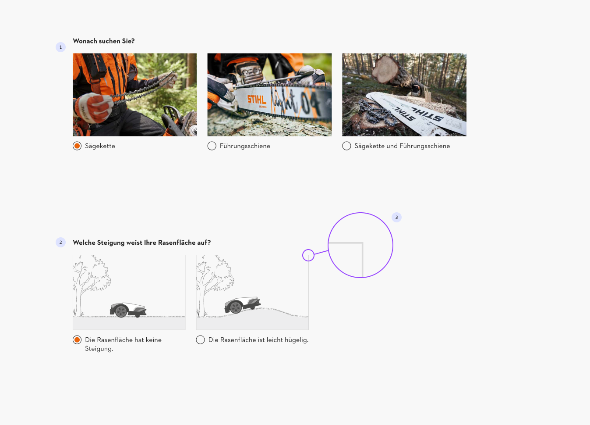

_Figure: Two image radio groups. Callout 1 marks the first group "Wonach suchen Sie?" with photographic images and the options "Sägekette" (selected), "Führungsschiene" and "Sägekette und Führungsschiene"; callout 2 marks the second group "Welche Steigung weist Ihre Rasenfläche auf?" with light line illustrations of a robotic mower and the options "Die Rasenfläche hat keine Steigung." (selected) and "Die Rasenfläche ist leicht hügelig."; callout 3 points with a magnified detail at the thin grey outline around an illustration, used because the illustration has a light background._

## Examples

### Product Advisors

Radio Groups with Images are mainly used within the Digital Advisors. Including images and illustrations helps users more quickly recognize and select the right option.

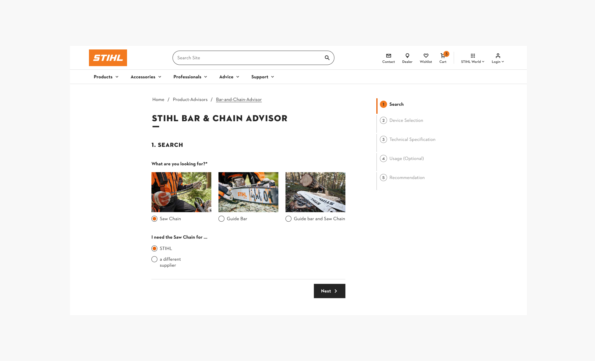

_Figure: Shows top-bar (grid variant=main, breakpoint=xl, brand add-on=false, number areas=2); nav-bar (variant=main, breakpoint=xl); breadcrumb (expanded=true); steps (hint=250 - 500 m², label=Search, status=current, state=enabled, orientation=vertical); steps (label=Device Selection, hint=Hint option.); steps (label=Technical Specification, hint=Hint option.); steps (label=Usage (Optional), hint=Hint option.); steps (label=Recommendation, hint=Hint option.); local/page header (Viewport=desktop); radio-group-with-image (legend=What are you looking for?\*, hint=Lorem ipsum dolor sit amet, consectetur adipiscing elit. Cras nunc amet mauris turpis magna. Quisque ut mi rhoncus eget., item 3, legend, show title=false); radio-group (legend, legend=I need the Saw Chain for ..., hint=Lorem ipsum dolor sit amet, consectetur adipiscing elit. Cras nunc amet mauris turpis magna. Quisque ut mi rhoncus eget., orientation=vertical, show title=false); button (button text=Next, variant=filled, state=enabled, size=medium, icon position=right, hide label=off, flush alignment=off). Text in the figure: "Search Site", "Contact", "Dealer", "Wishlist", "3", "Cart", "STIHL World", "Login", "Products", "Accessories", "Professionals", "Advice", "Support", "Home", "/", "Product-Advisors", "Bar-and-Chain-Advisor", "1", "Search", "2", "Device Selection", "Technical Specification", "4", "Usage (Optional)"._
