# Radio Group

## Radio Group

Overview:

- Radio items are always presented in a group and never used alone.
- They allow the user to select exactly one option.
- The user can change the selection, but cannot deselect an option.
- If applicable, include an opt-out option (e.g., “Other” or “None of the above”).

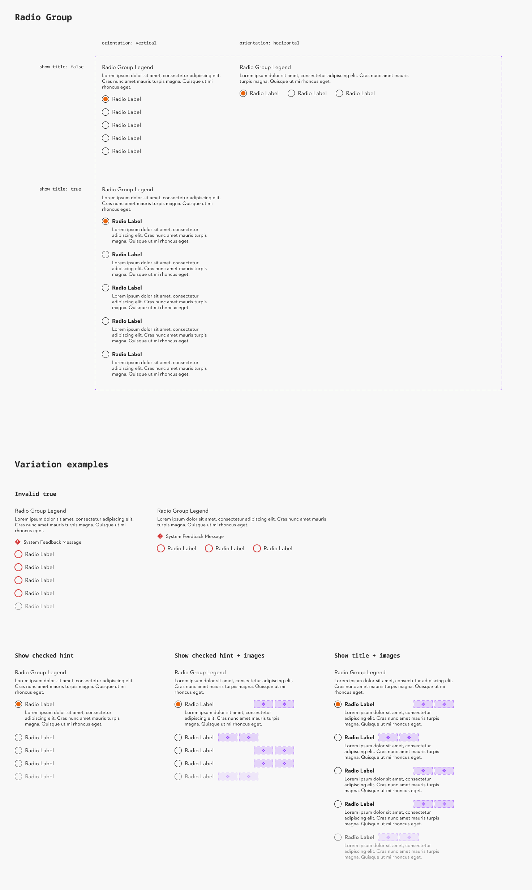

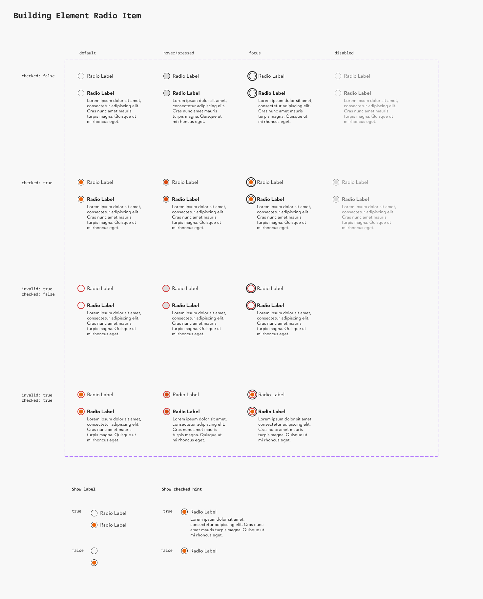

### Further guidelines

[Storybook documentation](https://main--63440bbb95889041542a5ba3.chromatic.com/?path=/docs/components-radio-group--documentation)

Decision tree

### Related elements

[Input](https://www.figma.com/design/qXldpLO6gxHJNLdcXIPxYt?node-id=1591-2)

[Checkbox](https://www.figma.com/design/qXldpLO6gxHJNLdcXIPxYt?node-id=1017-2316)

[Switch](https://www.figma.com/design/qXldpLO6gxHJNLdcXIPxYt?node-id=513-2)

### Contribute

Contribute to improving this component by sharing your feedback, asking questions, or suggesting features [here](https://www.figma.com/design/lLmw7PfIdKjFG4uT3B2Hyj/Onboarding-%F0%9F%93%96?node-id=446-868&t=zKmRu4kAkxMeRDmK-4).

## Formatting and Construction

### Anatomy

#### Radio Group

1. **Legend** Describes the purpose of the Radio Group.
1. **Info Button (Optional)** Opens a popover with additional information.
1. **Hint (Optional)** Provides extra guidance, context, or clarity for the selection.
1. **System Feedback (Optional)** Displays system-level messages (errors, warnings, confirmations) above the Radio Group.
1. **Item** A required element containing a Radio Item with label, and an optional hint.

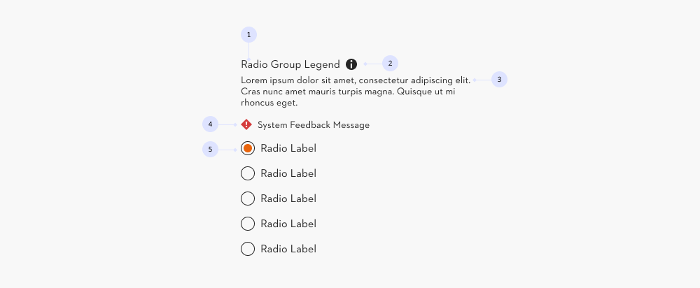

#### Radio Item

1. **Radio (Selected)** The active, chosen state of the radio option.
1. **Radio (Not Selected)** The default, unselected state of the radio option.
1. **Label** Text describing the option.
1. **Images (optional)** An area for up to two images (preferably for small logos i.e. payment logos).
1. **Hint (optional)** Provides additional guidance, context, or clarification.

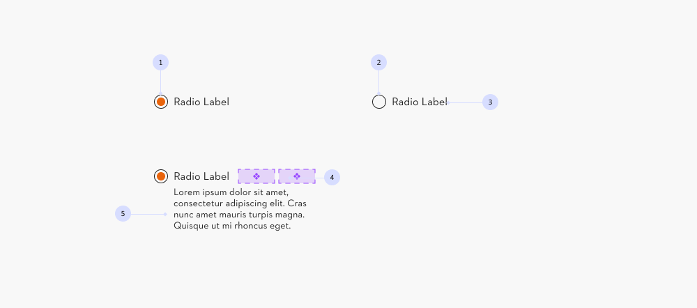

### Orientation

#### Vertical (default)

- Use the vertical orientation by default.
- Recommended for longer labels or copy.
- Supports additional content such as images and hints.

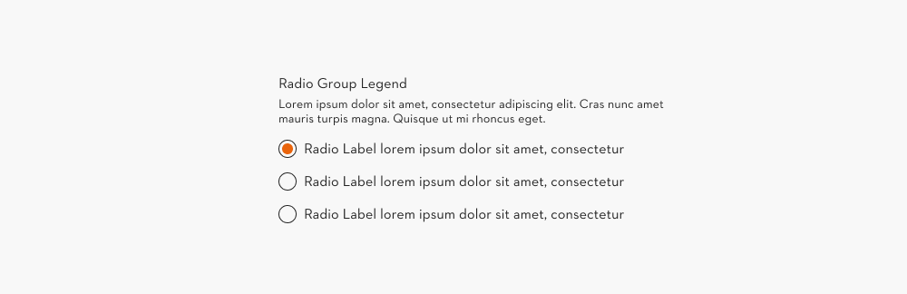

#### Horizontal

- Consider the horizontal orientation when there are three or fewer radio buttons and the labels are short.

> **Note:** Images and hints are not supported in the horizontal layout.

### Sizing

#### Maximum width of text container

To ensure good readability the maximum width should not exceed 544px (16px\*34em calculation based on the font size).

[Typography→](https://www.figma.com/design/pQUiJaNuWrGzPaeMrEHf6N/DS-1117-Design-%7C-34em?node-id=2645-515)

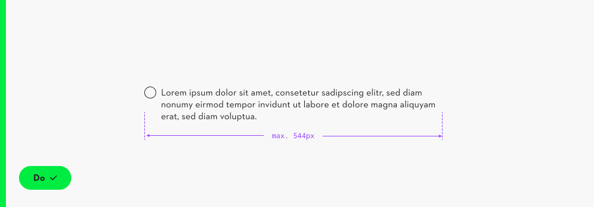

Do not exceed 544px, even when the module or grid is wider.

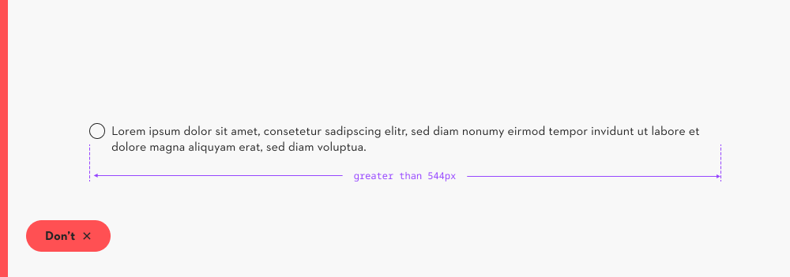

### Images

#### Alignment

Images support two alignment options relative to the label:

1. **Hug** The image sits directly next to the label.
1. **Fill** The image is aligned to the far right of the container. Use this option when there are many options to scan, as consistent image positioning improves scannability.

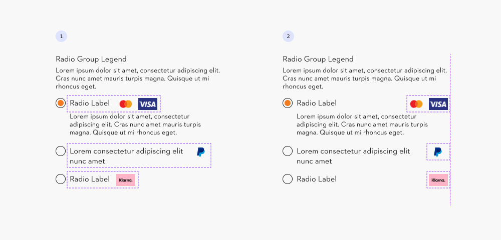

#### Maximum height

**(Payment) logos:**

Do:

- Place logos in the image areas.
- Use images with a max. height of 32 px.

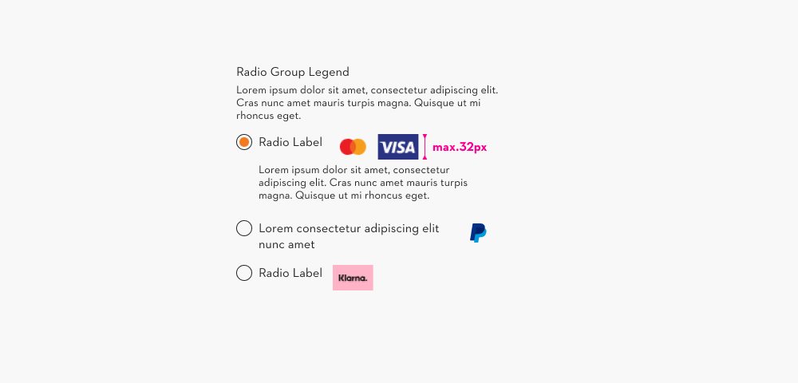

#### Function icons

Don’t insert function icons in the image area, as functional icons width a height of 32px lack hierarchy and therefore do not mesh well.

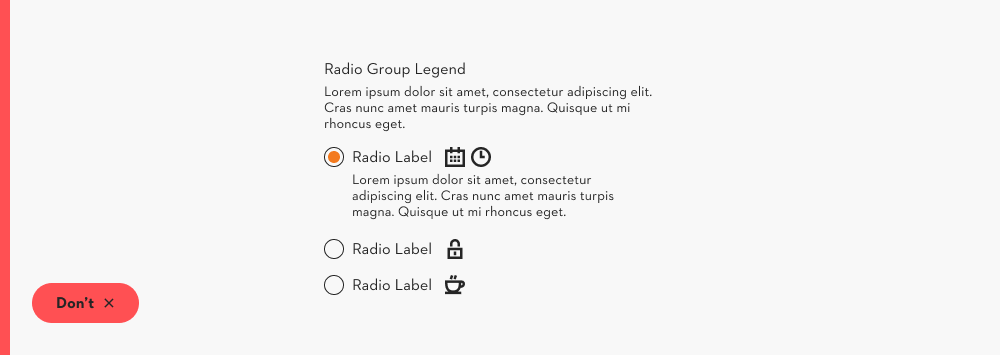

## Content and Assets

### Amount of radio buttons

- A radio group should contain at least 2 and no more than approximately 5 options.
- For more than 5 options, consider using a Select Component instead.

[Select→](https://www.figma.com/design/qXldpLO6gxHJNLdcXIPxYt?node-id=8139-4888)

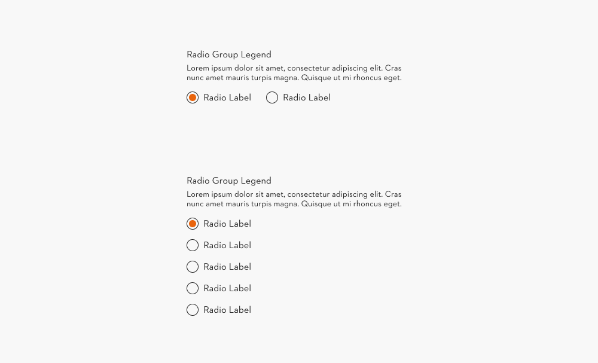

### Overflow behaviour

- Optimize labels to minimize text overflow.
- If overflow occurs, the radio element aligns with the first line of the label.

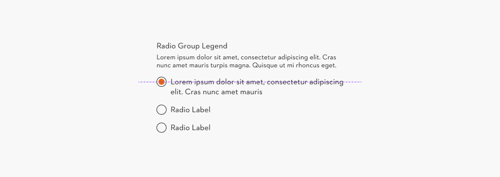

### Long texts

**Attention:** Always test the length of the copy on a mobile device.

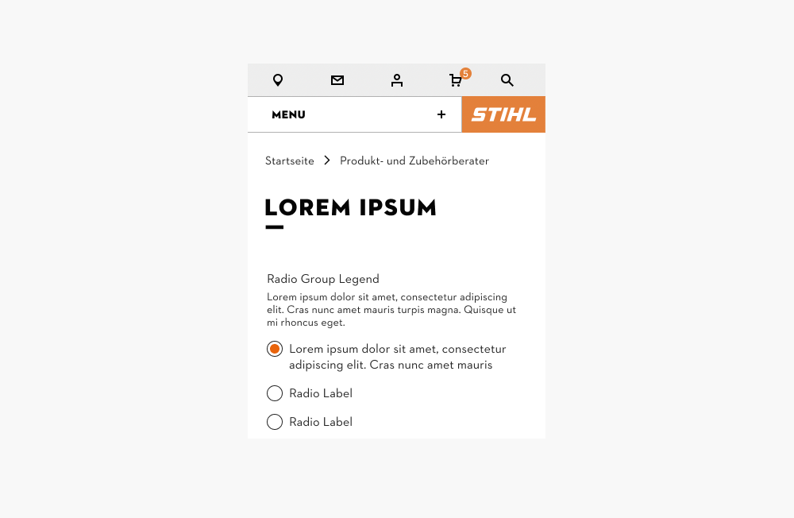

### Required and optional indicators

1. To indicate that a Radio Group is **required**, display an asterisk (\*) next to the legend.
1. **Optional** Radio Groups are marked with “(optional)” after the legend. In most cases, this must be added manually in the Content Management System.

**Attention: Reduce the optional fields to a minimum.** Consider carefully, if the users needs to provide this information at this point in the journey.

> **Note:** Keep optional fields to a minimum. Carefully consider whether the user needs to provide this information at this stage of the journey.

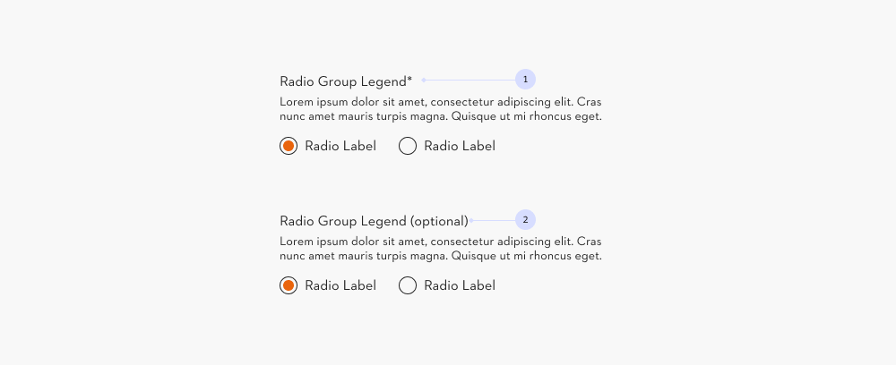

### Bold labels when hints are visible

When all hints are shown, labels should be displayed in bold to help users scan the options more quickly.

To enable this behavior, set “**Show title**” to **true**.

**Tip:** Ensure that hints are of similar length to maintain visual balance and readability.

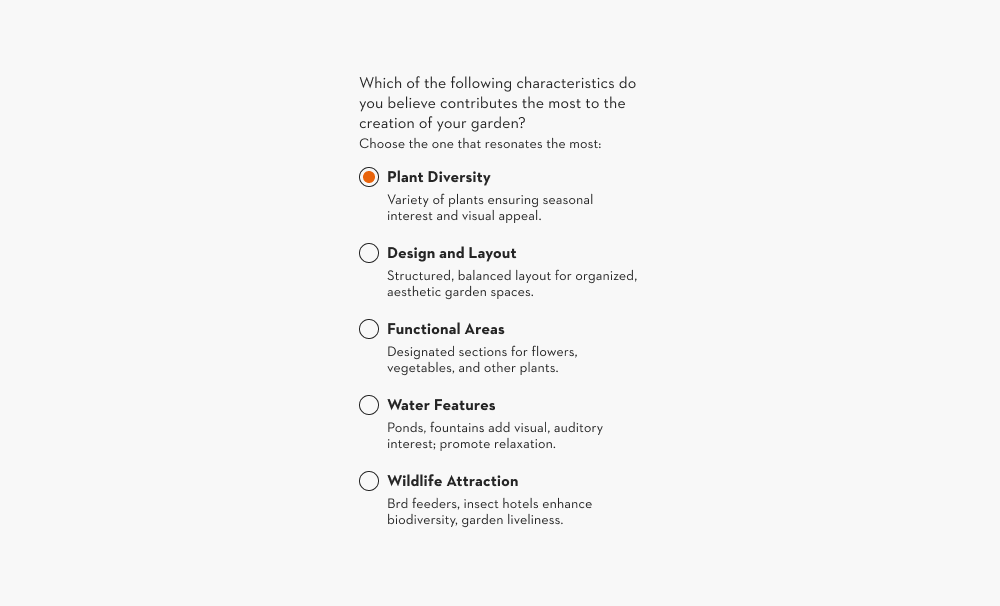

### Prompting the user with a call to action

1. In some cases, it’s helpful to include an action verb such as **“choose”** or **“select”** in the label or hint to clarify what the user needs to do.
1. When doing so, end the sentence with a colon **(:)**.

**Example:**

“Choose the option that resonates most:”

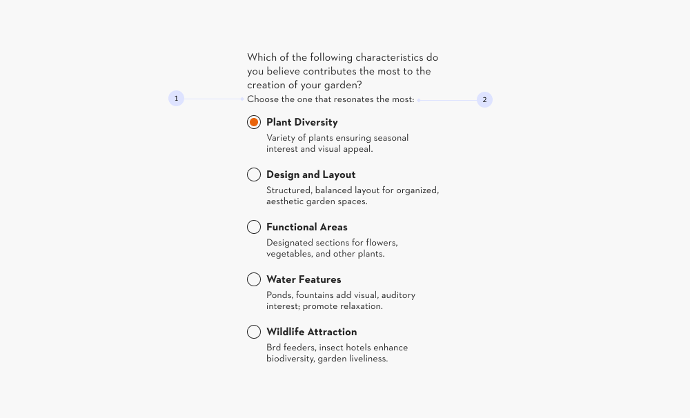

### The hint appears on activation

In some cases, the information is secondary and appears after the Radio Button is activated.

The hint disappears again, when another Radio Button is activated. Read the[ motion guidelines](https://www.figma.com/design/UYHZEckQObDvLuuRoMP8ps/Styles-%F0%9F%AA%AD?node-id=1-148) for more information on the transition.

**Tip:** Perform a usability test to check if the information can really be left out of first sight.

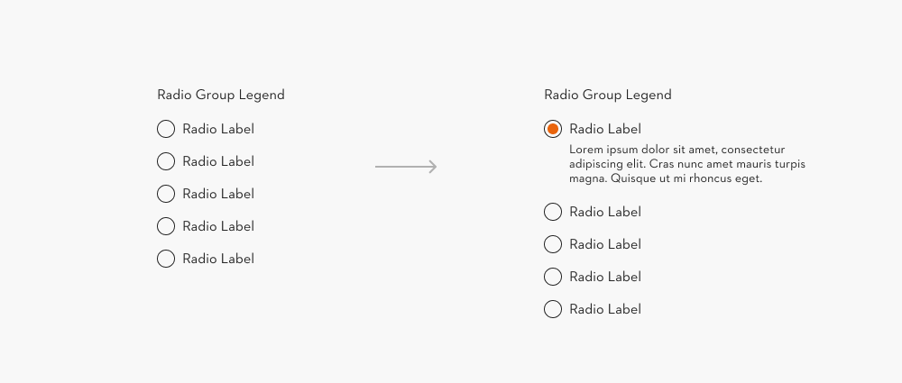

## Behavior

### One choice

The defining characteristic of radio buttons is that users can select only one option at a time.

Once a selection is made, it can only be changed by choosing another option in the group; it cannot be cleared.

If applicable, provide an opt-out option (e.g., “Other” or “None of the above”).

[Checkbox (multiple choice)→](https://www.figma.com/design/qXldpLO6gxHJNLdcXIPxYt?node-id=1017-2316)

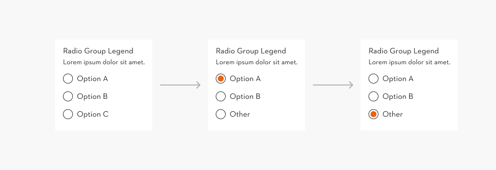

### System feedback

Feedback always refers to the full list, instead to one single Radio Button.

[Text Input →](https://www.figma.com/design/qXldpLO6gxHJNLdcXIPxYt?node-id=1591-2)

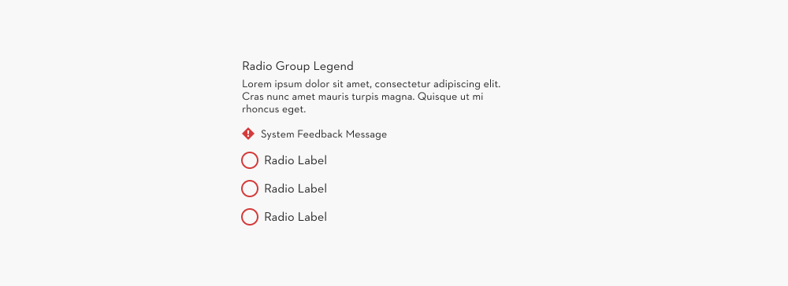

### Click behavior

The entire option is clickable, including the label and image, not just the radio button itself.

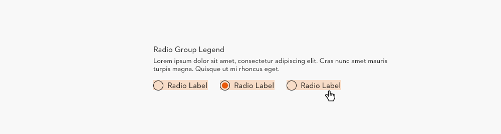

## Examples

### Product Advisors

Radio Groups are used in combination with Radio Groups with Images within the Digital Advisors.

## Radio Group with Image

Overview:

- Radio Group with Image works like a standard Radio Group but includes an additional image for each option.
- Use this component when a visual representation helps users understand and choose between options.
- Must contain 2–4 radio options in one row.
- Allows the user to select only one option at a time, just like a standard radio group.

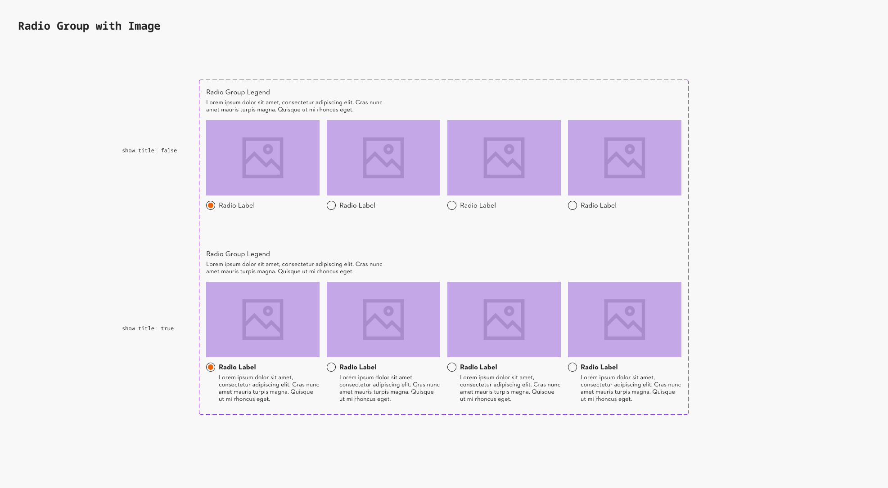

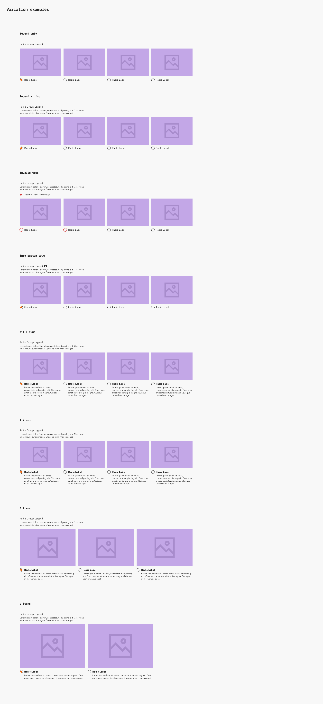

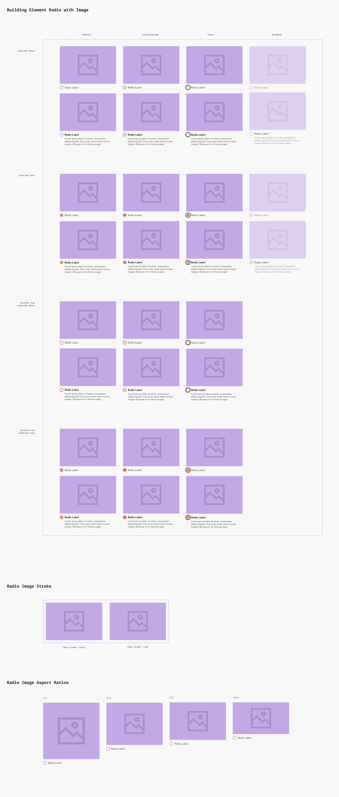

### Further guidelines

[Storybook documentation](https://main--63440bbb95889041542a5ba3.chromatic.com/?path=/docs/components-radio-group--documentation)

Decision tree

### Related elements

[Image Placeholder](https://www.figma.com/design/qXldpLO6gxHJNLdcXIPxYt?node-id=16490-4893)

[Checkbox](https://www.figma.com/design/qXldpLO6gxHJNLdcXIPxYt?node-id=1017-2316)

### Contribute

Contribute to improving this component by sharing your feedback, asking questions, or suggesting features [here](https://www.figma.com/design/lLmw7PfIdKjFG4uT3B2Hyj/Onboarding-%F0%9F%93%96?node-id=446-868&t=zKmRu4kAkxMeRDmK-4).

## Formatting and Construction

> Most of the “Formatting and Construction” guidelines from the Radio Group component apply, see above.

### Anatomy

#### Radio Group with Image

1. **Legend** Describes the purpose of the Radio Group.
1. **Info Button (Optional)** Opens a popover with additional information.
1. **Hint (Optional)** Provides extra guidance, context, or clarity for the selection.
1. **System Feedback (Optional)** Displays system-level messages such as errors, warnings, confirmations. Appears above the Radio Group.
1. **Radio Item** A required component that includes:
   - an image representing the option
   - a radio button with label
   - an optional hint associated with the item

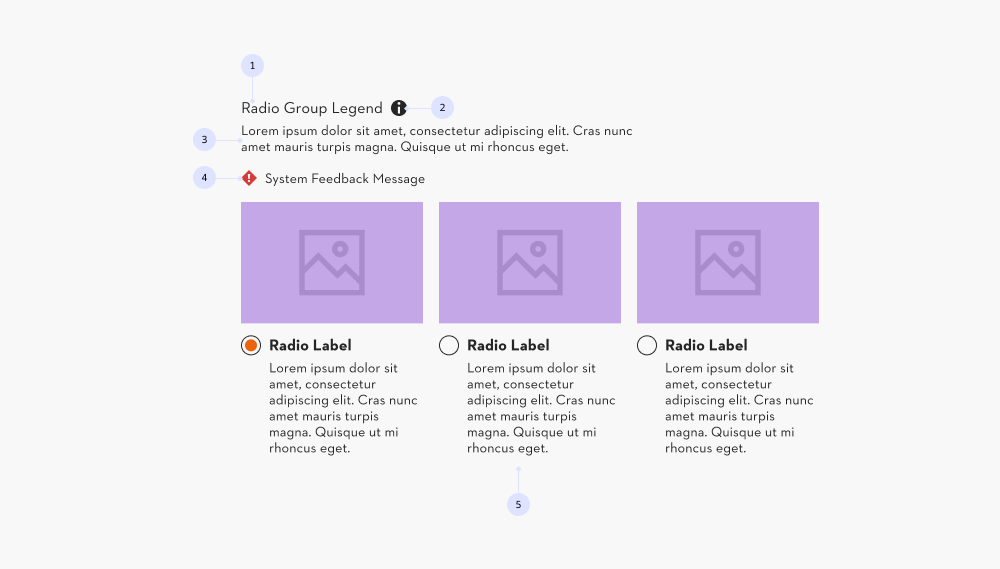

#### Radio Item

1. **Image** Displays images or illustrations, representing the option. They support various aspect ratios.
1. **Radio (Selected)** The active, chosen state of the radio option.
1. **Radio (Not Selected)** The default, unselected state of the radio option.
1. **Label** Text describing the option.
1. **Label as Title** A label styled as a title; used only when paired with a hint to establish a clear visual hierarchy.
1. **Hint (Optional)** Provides additional guidance, context, or clarification.

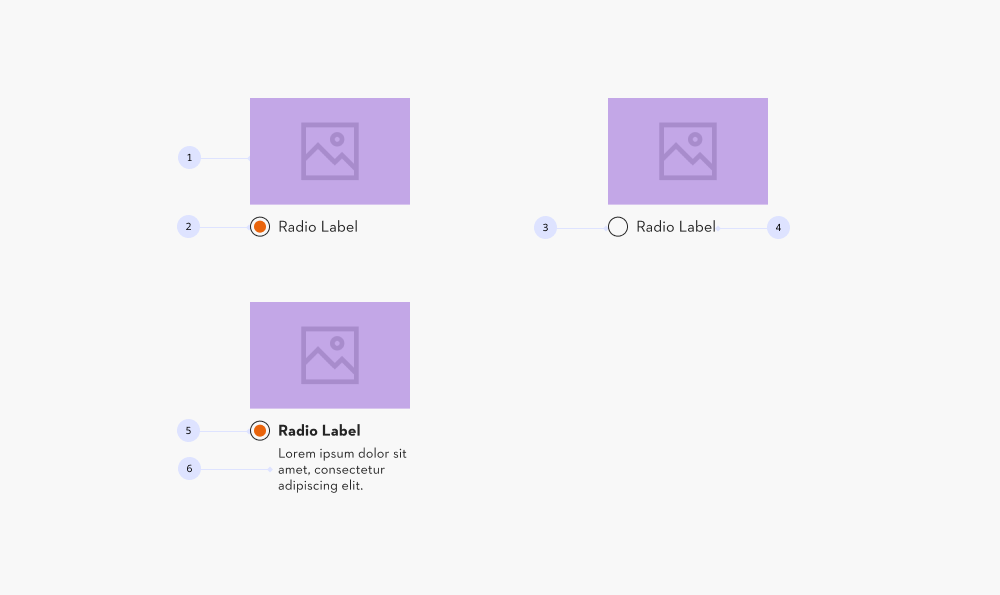

### Scaling

The Radio Items scale evenly to fill the available container width, always left-aligned. This behavior is consistent whether the group contains two, three, or four items. Images scale proportionally and maintain their aspect ratios.

1. **Items fill the container** Items distribute evenly and expand to cover the full container width.
1. **Max Width: 400 px** Items expand until they reach a maximum width of 400 px. Beyond this point, they no longer grow and stay left-aligned within the container.
1. **Min Width: 160 px** Items shrink down to a minimum of 160 px. When the container becomes too narrow to fit all items horizontally at this minimum width, the items wrap onto the next line — wrapping one by one as needed.
1. **Image Behavior** Images scale proportionally within their item and always maintain their aspect ratio.

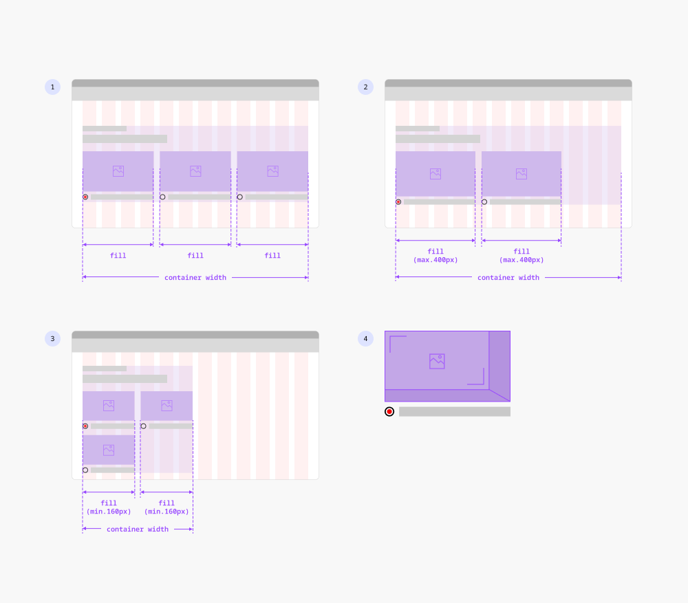

> **Manual Pixel Alignment (Figma Bug)** Sometimes the component creates fractional pixel heights when scaling up and down. This is a known Figma issue. **Workaround:** Manually adjust the component’s height to a whole pixel value (rounded up or down). Enable “Lock aspect ratio” to prevent the component from reverting to fractional dimensions when resizing.

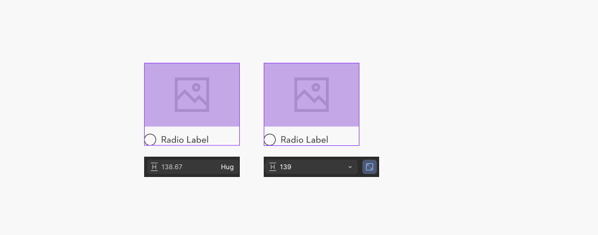

### Responsive behaviour

#### Alignment and Wrapping

The component automatically adapts to the width of its container. It uses a horizontal layout on larger screens and switches to a vertical layout on smaller ones.

1. **Horizontal Alignment** Recommended for wider layouts, especially on larger screens. Placing items side by side makes options easier to compare and scan.
1. **Wrapping and Vertical Alignment** On narrow screens, items wrap and stack vertically.

**Horizontal vs. Vertical Arrangement** Use a horizontal layout whenever possible to keep options comparable. Line breaks should be avoided where possible.

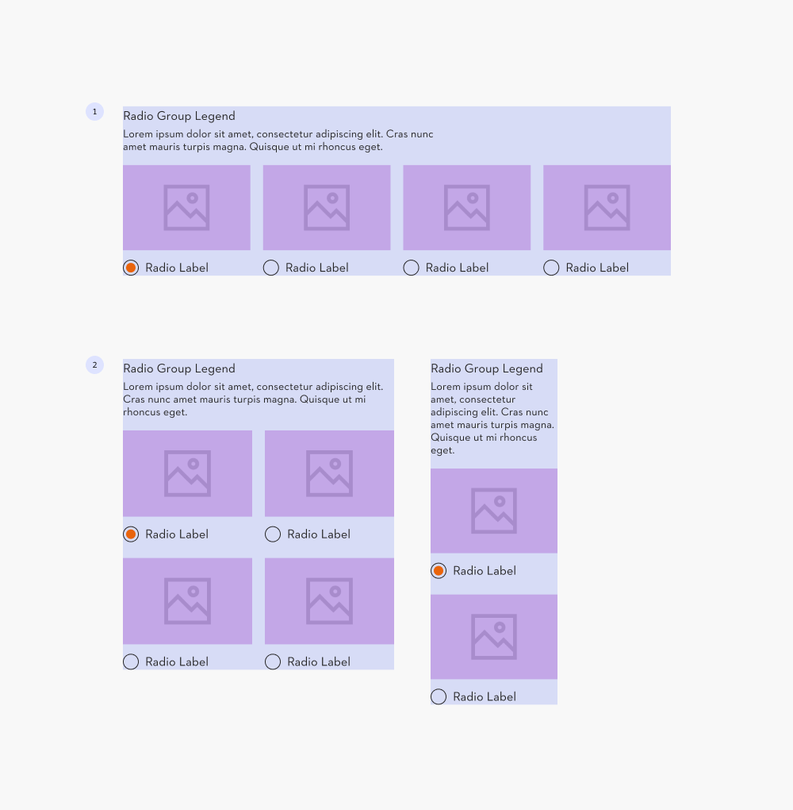

> The component features two **📐 layout helpe**r that should be used too ensure the correct item size when they wrap: Use **📐 layout helper** 1 **+ 📐 layout help**er2 to fill two empty item slots U**se 📐 layout help**er 1 to fill one empty item slot

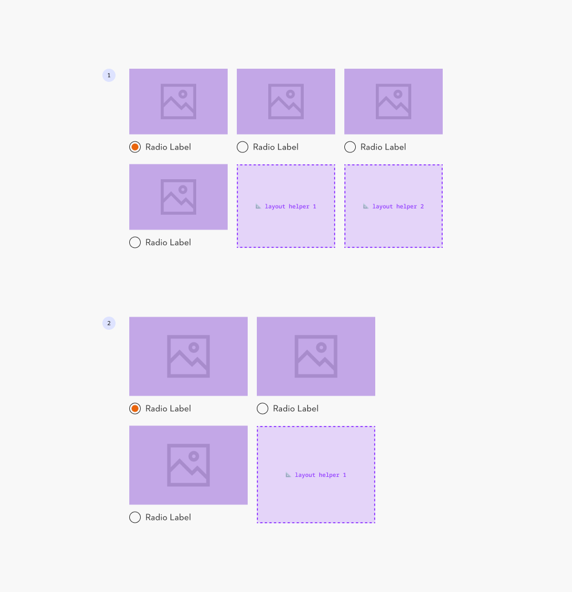

#### Spacing

The gaps between items are controlled by **dynamic spacing tokens**, which automatically adjust their size according to the active breakpoint.

Remeber applying the correct **Variable Mode** in your designs.

[See all Spacing Guidelines →](https://www.figma.com/design/JyyYtoCYbtJrzqHs38OXSQ/Grid---Spacing-%F0%9F%A7%AE?node-id=2-1934&t=ZxWmeoCh3JbSEpcm-4)

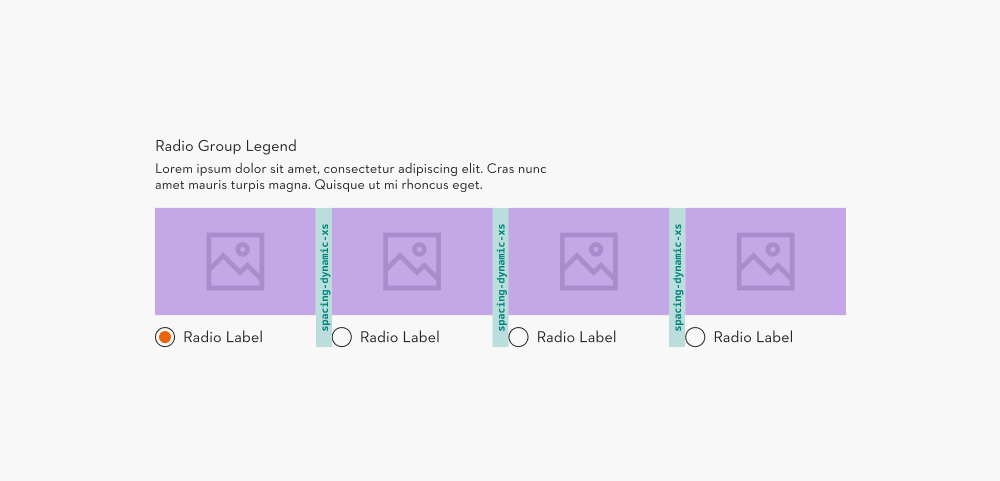

### Placement

The Radio Group with Image is ideally placed within the appropriate Grid Content Areas:

1. **Main** Used for spacious layouts that take advantage of the full grid width.
1. **Narrow Left and Narrow Center** Typically used to keep layouts more compact and visually restrained.
1. **Two Thirds** Commonly used when a [Stepper](https://www.figma.com/design/qXldpLO6gxHJNLdcXIPxYt?node-id=26075-10497) is positioned to the left or right of the main content.

[See all Grid Guidelines →](https://www.figma.com/design/JyyYtoCYbtJrzqHs38OXSQ/Grid---Spacing-%F0%9F%A7%AE?node-id=1-857&t=ZxWmeoCh3JbSEpcm-4)

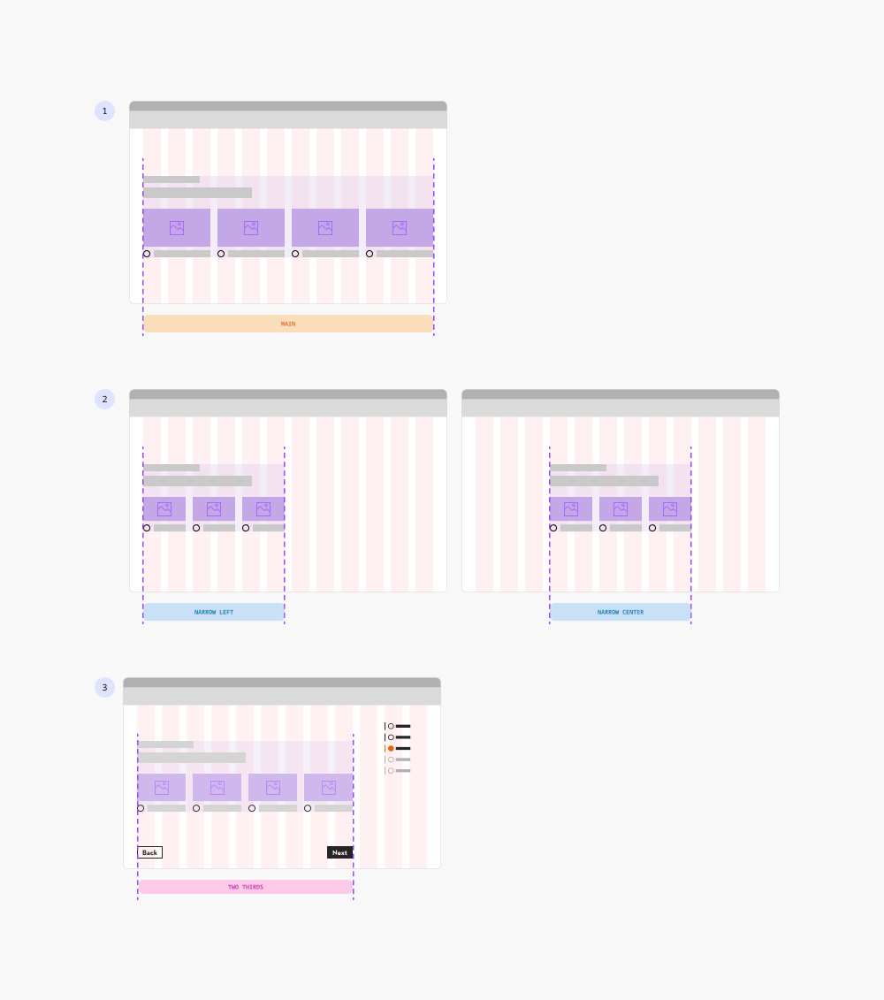

## Content and Assets

> Most of the “Formatting and Construction” guidelines from the Radio Group component apply, see above.

### Amount of Text

1. **Legend** Ideally use one line, two at most.
1. **Label** Keep the label short and clear. Aim for one line, with a maximum of two.
1. **Hint (optional)** Include a hint only if it provides real value. Keep it concise, with a maximum of three lines.

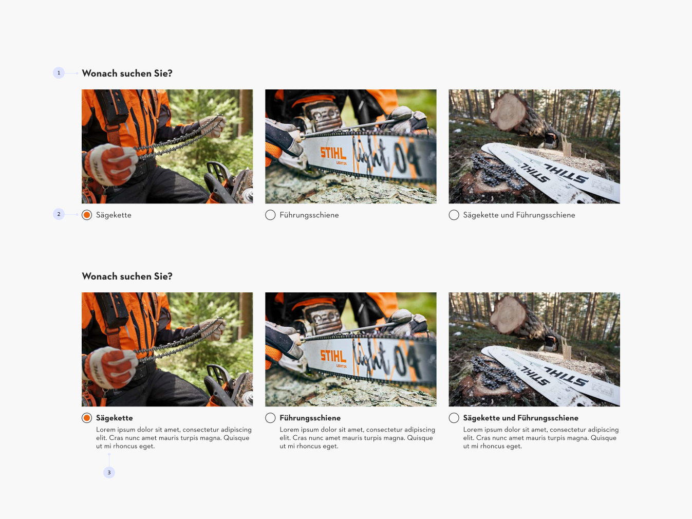

**Don’t use text elements inconsistently.**

1. Don’t omit labels—radio items always require clear text context.
1. Don’t mix different label types within the same row; if one item uses a hint, apply hints consistently across all items.

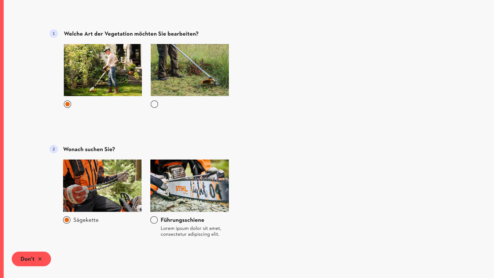

### Usage of Images and Illustrations

1. **Images** Ensure images clearly distinguish each option so users can easily recognize what they are selecting.

[Imagery (STIHL brandportal) →](https://brandportal.stihl.com/de/bildwelt.aspx)

1. **Illustrations** Use illustrations when images are not available or when an illustration communicates the concept more clearly or effectively.

[Illustrations (STIHL brandportal) →](https://brandportal.stihl.com/de/illustrationen.aspx)

1. **Usage of outlines** If images or illustrations have a white, transparent, or very light background, use the bordered variant to ensure proper visibility.

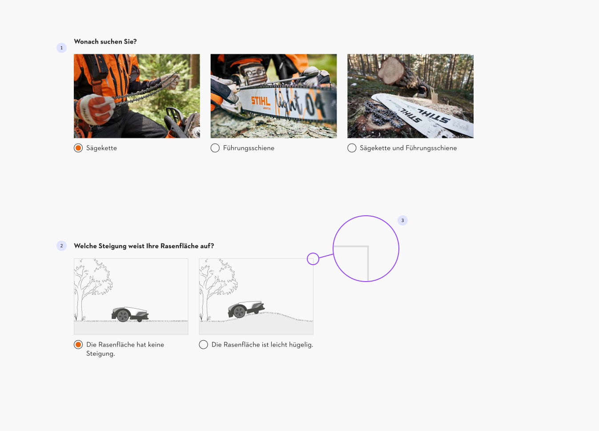

## Examples

### Product Advisors

Radio Groups with Images are mainly used within the Digital Advisors. Including images and illustrations helps users more quickly recognize and select the right option.

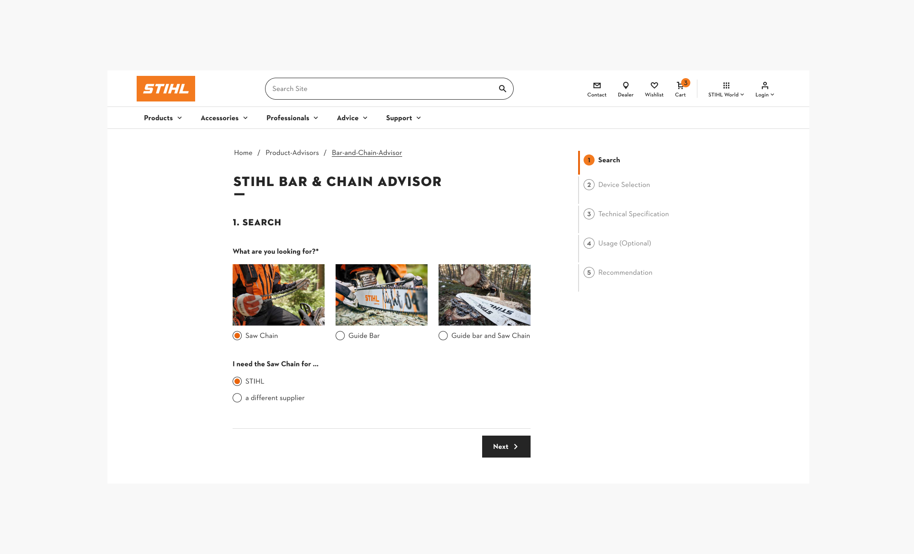
