# Select

## Select

Overview:

- The native select menu enhances the usability, as the component is familiar to the user.

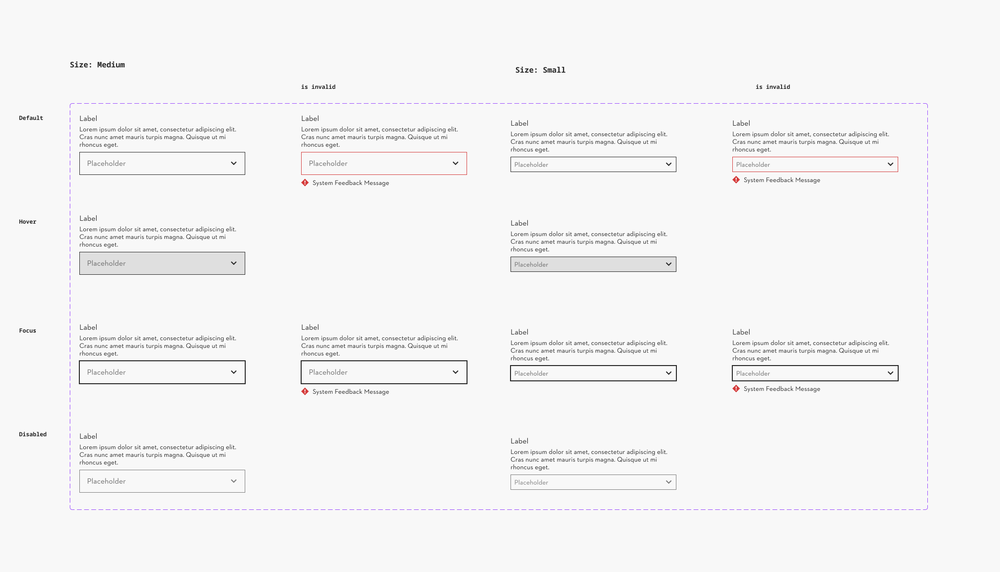

_Figure: Select states matrix for sizes Medium and Small, each with a default and an "is invalid" column and rows Default, Hover, Focus and Disabled. Every cell shows a "Label", a hint text and a bordered field with the placeholder "Placeholder" and a chevron; invalid cells (Default and Focus only) have a red border and a red "System Feedback Message", Hover has a grey filled field, Focus a thick dark border, and Disabled a light grey border and muted text._

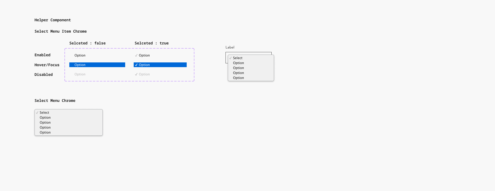

_Figure: Helper components for the native select menu. "Select Menu Item Chrome" shows an "Option" item with "Selceted : false" and "Selceted : true" in the states Enabled (plain text, a grey check mark when selected), Hover/Focus (blue highlight with white text, white check mark when selected) and Disabled (light grey text); "Select Menu Chrome" shows an open list with a checked "Select" entry followed by four "Option" entries, and a select field labelled "Label" with the same menu opened over it._

### Further guidelines

[Storybook documentation](https://main--63440bbb95889041542a5ba3.chromatic.com/?path=/docs/components-select--documentation)

Decision tree

### Related elements

[Combobox](https://www.figma.com/design/qXldpLO6gxHJNLdcXIPxYt?node-id=2659-3954)

[Input](https://www.figma.com/design/qXldpLO6gxHJNLdcXIPxYt?node-id=1591-2)

[Radio Group](https://www.figma.com/design/qXldpLO6gxHJNLdcXIPxYt?node-id=860-2728)

[Iconography](https://www.figma.com/design/U218NNP4OsipaHOtv5flns/Iconography-%E2%9E%A1%EF%B8%8F?m=auto)

[Fieldset](https://www.figma.com/design/Ie2r0R9QwjEc7O3nrFbXhV/Web-Pattern-Library?node-id=8-154)

### Contribute

Contribute to improving this component by sharing your feedback, asking questions, or suggesting features [here](https://www.figma.com/design/lLmw7PfIdKjFG4uT3B2Hyj/Onboarding-%F0%9F%93%96?node-id=446-868&t=zKmRu4kAkxMeRDmK-4).

## Formatting and Construction

### Anatomy

#### Select Field

1. **Label** Describes the required input
1. **Hint** Short copy that provides guidance and context
1. **Field** The area where you can fill in the information
1. **Chevron** Indicated the input field is a select component
1. **Info Button (optional):** Can be used to trigger a popover with additional information
1. **Placeholder text** Instruction text inside of the field
1. **System feedback** Error or success message to help the user understand

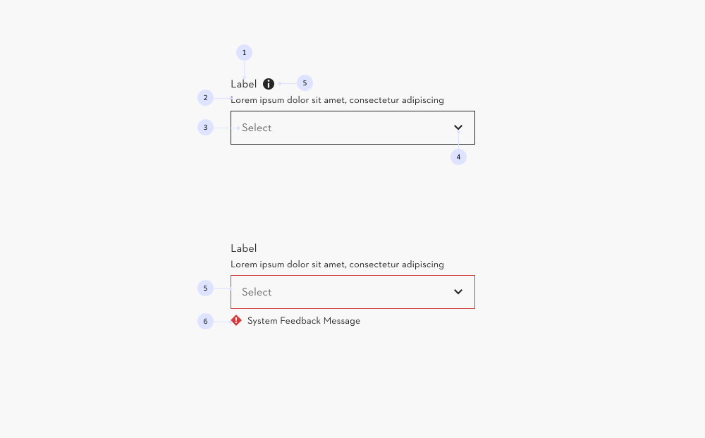

_Figure: Anatomy of the select field in two states. In the upper default field callout 1 marks the "Label", callout 5 the info button next to the label, callout 2 the hint text "Lorem ipsum dolor sit amet, consectetur adipiscing", callout 3 the placeholder "Select" inside the field and callout 4 the chevron on the right; in the lower invalid field with a red border, a second callout 5 marks the field and callout 6 the red "System Feedback Message" below it._

#### Native select menu

The select menu is defined by the the operating system or browsers design (example: native select menu from the desktop app Google Chrome).

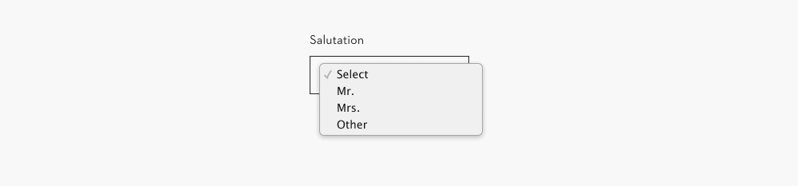

_Figure: Select field with the label "Salutation" and its native operating-system select menu opened over it, listing "Select" (checked), "Mr.", "Mrs." and "Other" in a grey rounded menu._

## Content and Assets

### Amount of items in the list

**\< 5** Consider the radio group component in case the list is shorter than 5 elements. E.g. in a list of 3 items, consider a radio button component instead. **(1)**

**5 - 20** The select menu opens on click. The user can make a choice from a fixed list. **(2)**

**\> 20** The list is too long to scroll in the native select component. Use the combobox with type to filter function instead **(3)**

[Radio group →](https://www.figma.com/design/qXldpLO6gxHJNLdcXIPxYt?node-id=860-2728)

[Combobox →](https://www.figma.com/design/qXldpLO6gxHJNLdcXIPxYt?node-id=2659-3954)

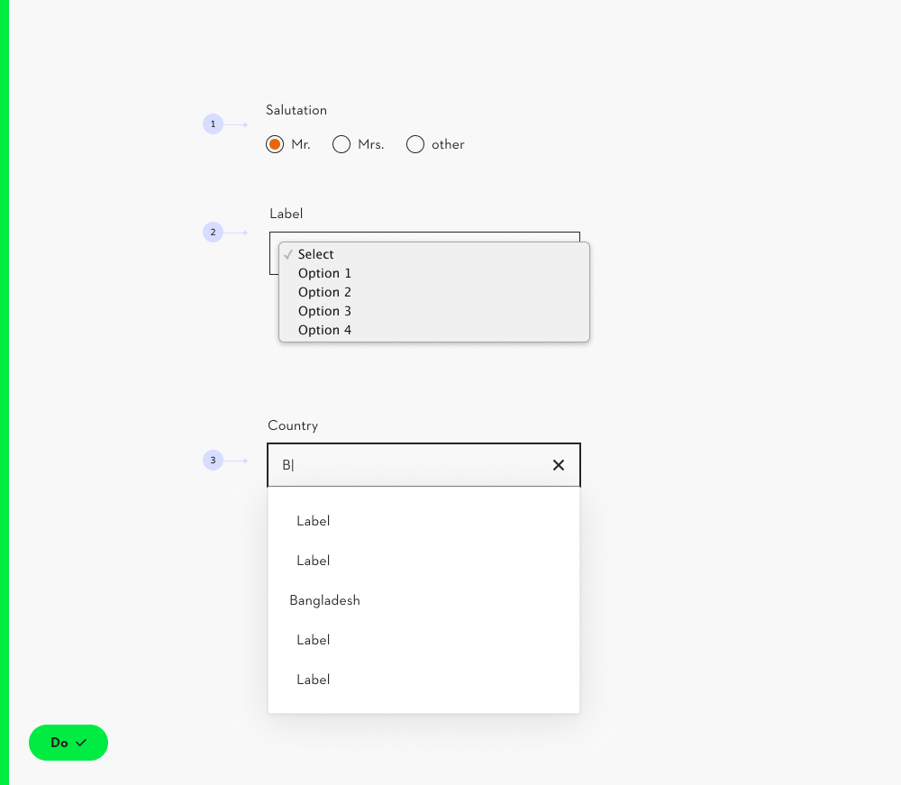

_Figure: Do example. Shows radio-group (item 4, legend, item 5, item 3, legend=Salutation, hint=Lorem ipsum dolor sit amet, consectetur adipiscing elit. Cras nunc amet mauris turpis magna. Quisque ut mi rhoncus eget., orientation=horizontal, show title=false); select (label, placeholder, state=enabled, invalid=false, size=medium); combobox (dropdown, state=active/focus, invalid=false). Callouts 1, 2, 3. Text in the figure: "Salutation", "Mr.", "Mrs.", "other", "Label", "Select", "Option 1", "Option 2", "Option 3", "Option 4", "Country", "B|", "Bangladesh"._

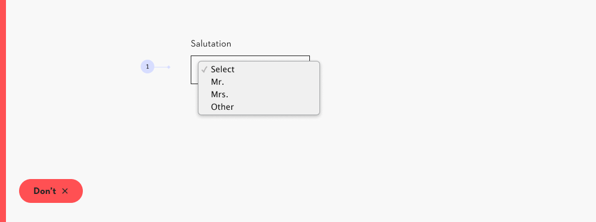

_Figure: Don't example: callout 1 marks a select labelled "Salutation" with its native menu open showing only "Select", "Mr." and "Mrs." and "Other"; with fewer than 5 options a radio group should be used instead of a select._

### Specific placeholder copy

Even though the default placeholder is “Select”. It is recommended to be as specific, as possible. E.g. “Select a country”.

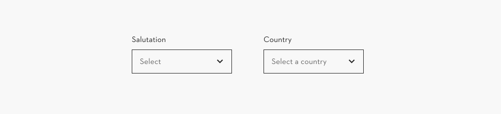

_Figure: Two select fields side by side: "Salutation" with the default placeholder "Select" and "Country" with the more specific placeholder "Select a country", each with a chevron._

### Truncation

**Attention:** beware of mobile presentation, as single items will be truncated.

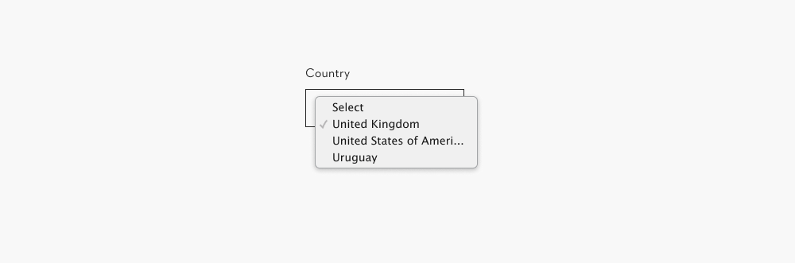

_Figure: Select with the label "Country" whose native dropdown is open, listing "Select", "United Kingdom" (checked), "United States of Ameri..." and "Uruguay"; the long option "United States of Ameri..." is cut off with an ellipsis because the list is narrower than the item._

### Info Button

A button to trigger a popover can be placed next to input or select labels to provide **additional contextual information.**

Popover content should be **limited to supplementary, non-critical information** — for example, brief explanations, examples, or guidance that supports user understanding without being essential for task completion.

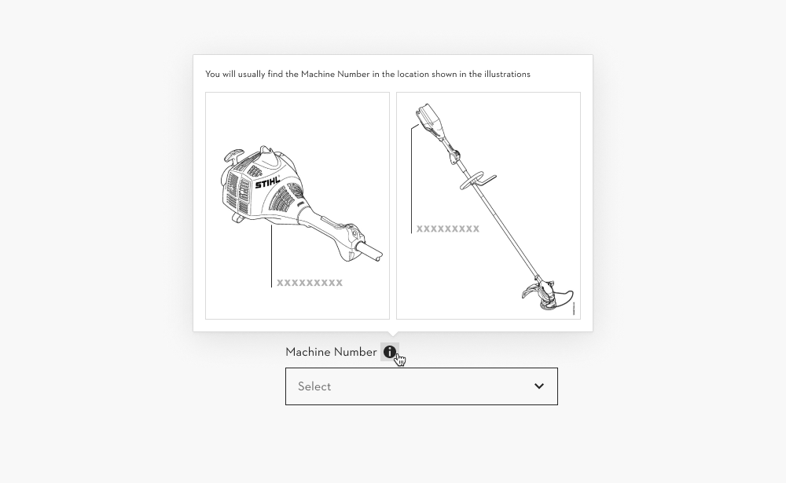

_Figure: Select labelled "Machine Number" with an info button (ℹ️) next to the label, hovered by a pointer cursor, with the placeholder "Select". A popover above it reads "You will usually find the Machine Number in the location shown in the illustrations" and shows two line drawings of STIHL machines with the number location marked as "xxxxxxxxx"._

**Don’t use the popover for critical or required information**, use the hint instead as critical information should net be hidden

For mor Guidance on this topic see the [Popover documentation](https://www.figma.com/design/qXldpLO6gxHJNLdcXIPxYt?node-id=35223-10505)

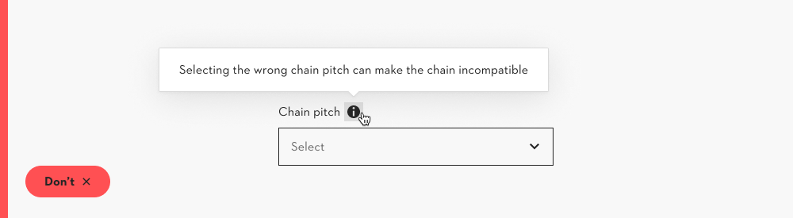

_Figure: Don't example: select labelled "Chain pitch" with an info button and the placeholder "Select", with a white popover above it reading "Selecting the wrong chain pitch can make the chain incompatible". Critical information must not be hidden in a popover; use the hint instead._

## Behavior

### Familiar pattern

The native select component enhances the usability, on all devices and in all browsers, as the component is familiar to the user.

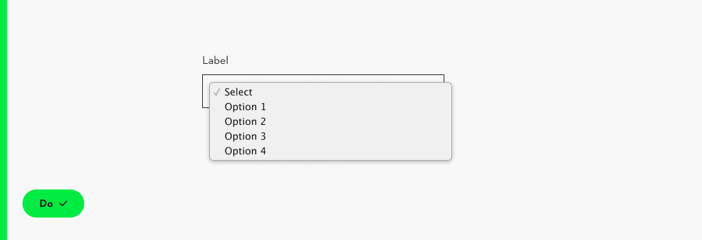

_Figure: Do example: select labelled "Label" using the native dropdown, which is open and lists "Select" (checked), "Option 1", "Option 2", "Option 3" and "Option 4". The native list is familiar to users on all devices and browsers._

### Trigger to open the dropdown

**On click:** the native dropdown opens on click and shows the full list.

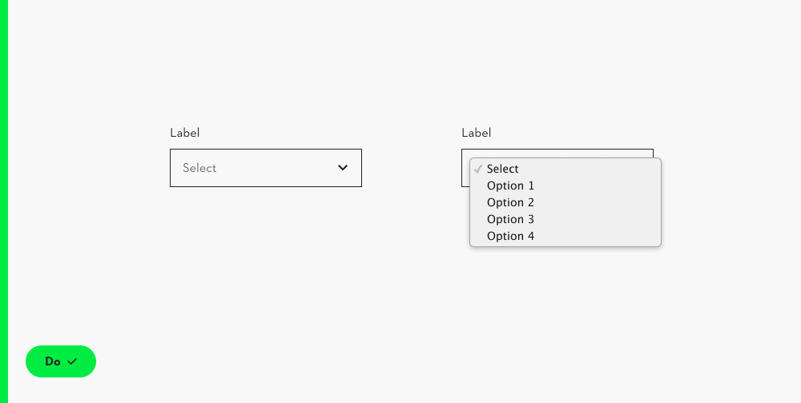

_Figure: Do example: two selects labelled "Label" side by side. The left one is closed with the placeholder "Select" and a chevron, the right one is open and shows the full native list "Select" (checked), "Option 1", "Option 2", "Option 3", "Option 4", which opens on click._

## Examples / Variations

### Native component test

It is recommended to **test the use case and copy** throughout all operating systems and browsers.

- Step 1: open the select component in [Storybook](https://main--63440bbb95889041542a5ba3.chromatic.com/?path=/docs/components-select--documentation&globals=backgrounds.name:!undefined;backgrounds.value:!undefined) in the most used browsers and devices.
- Step 2: edit and test the copy, when in doubt (extreme or edge cases).
