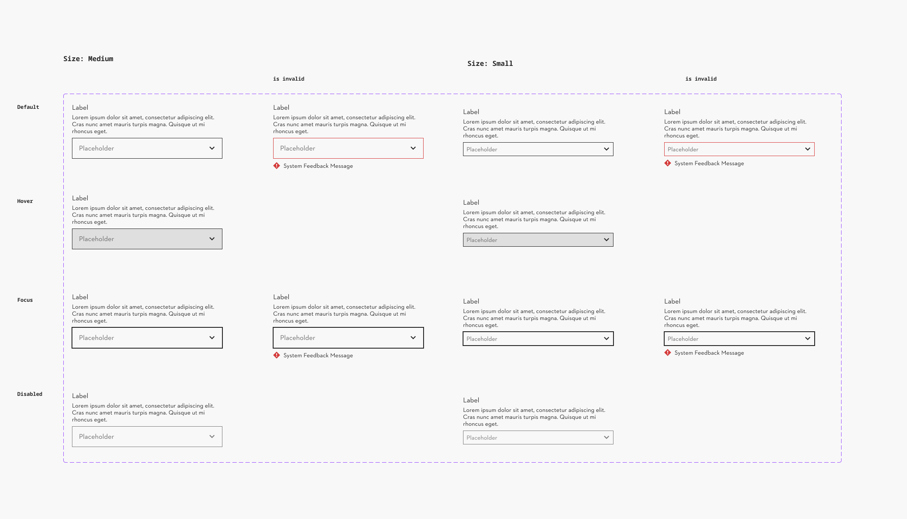
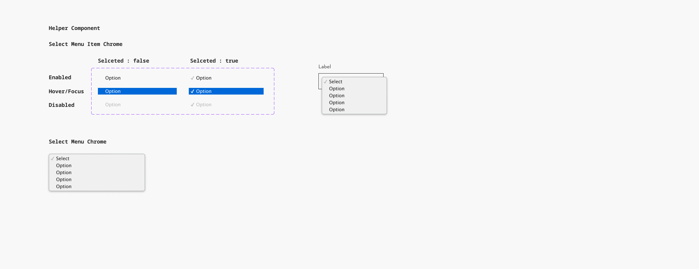
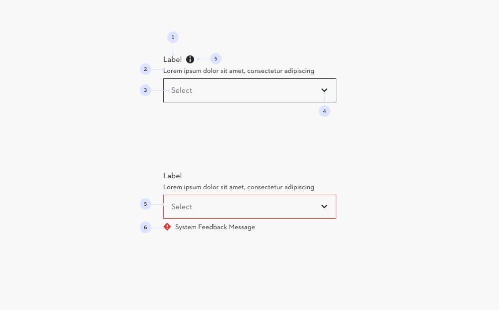
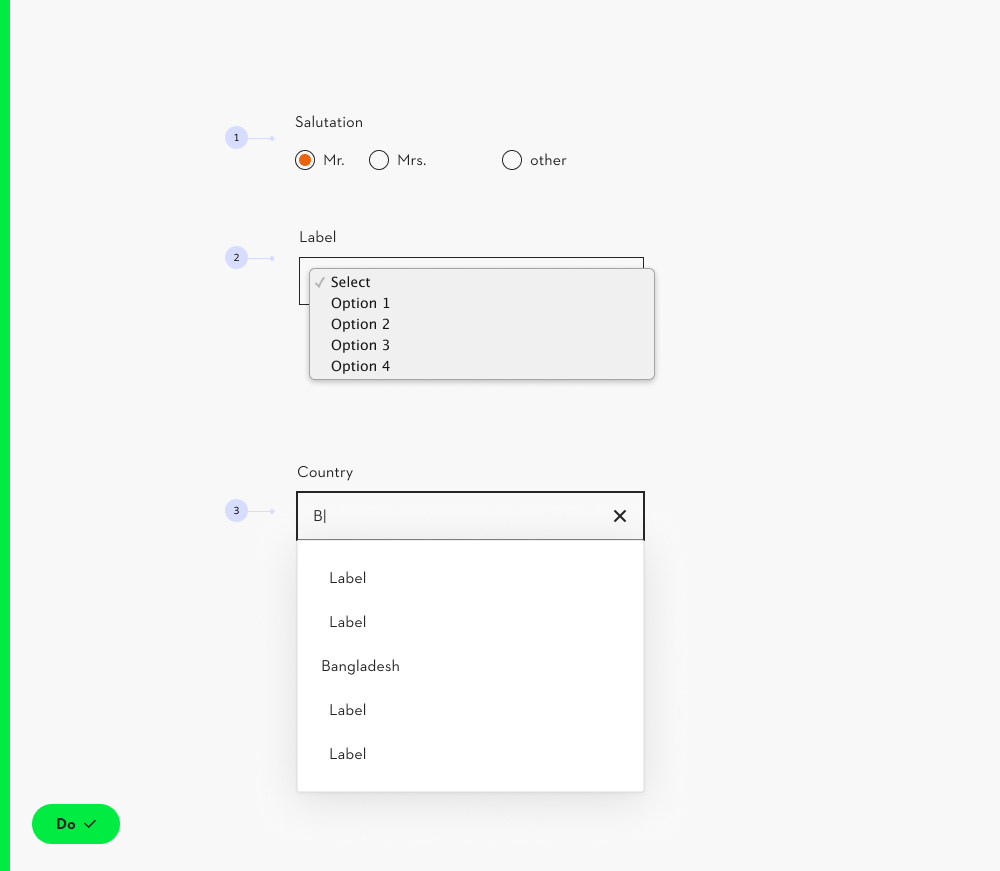
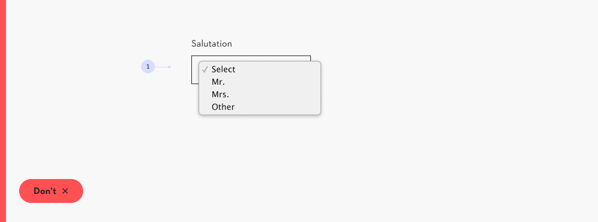
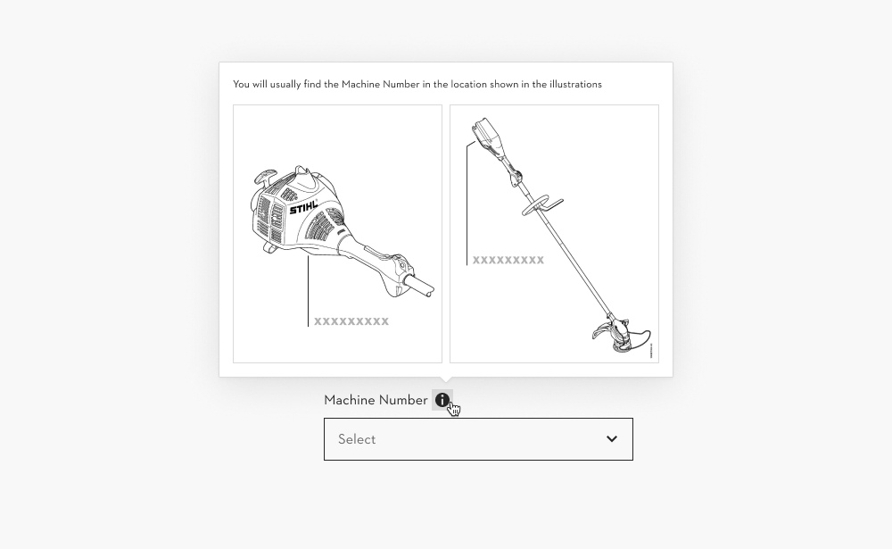
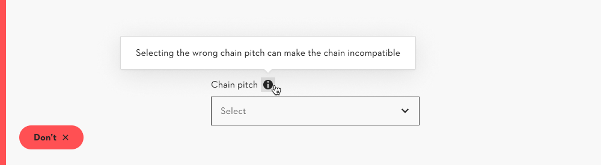
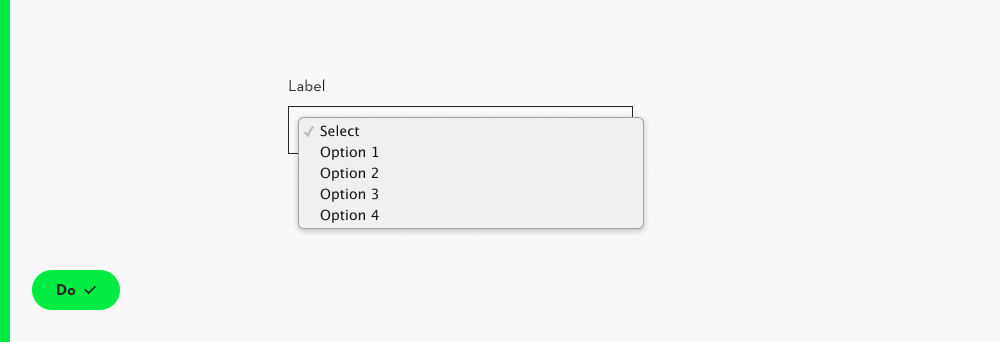
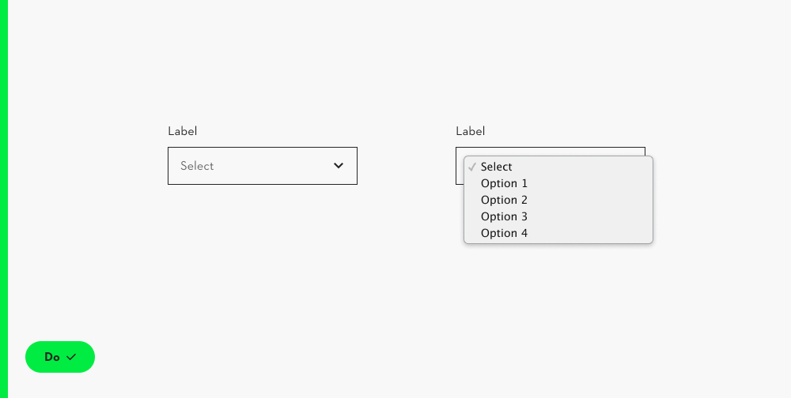

# Select

## Select

Overview:

- The native select menu enhances the usability, as the component is familiar to the user.

### Further guidelines

[Storybook documentation](https://main--63440bbb95889041542a5ba3.chromatic.com/?path=/docs/components-select--documentation)

Decision tree

### Related elements

[Combobox](https://www.figma.com/design/qXldpLO6gxHJNLdcXIPxYt?node-id=2659-3954)

[Input](https://www.figma.com/design/qXldpLO6gxHJNLdcXIPxYt?node-id=1591-2)

[Radio Group](https://www.figma.com/design/qXldpLO6gxHJNLdcXIPxYt?node-id=860-2728)

[Iconography](https://www.figma.com/design/U218NNP4OsipaHOtv5flns/Iconography-%E2%9E%A1%EF%B8%8F?m=auto)

[Fieldset](https://www.figma.com/design/Ie2r0R9QwjEc7O3nrFbXhV/Web-Pattern-Library?node-id=8-154)

### Contribute

Contribute to improving this component by sharing your feedback, asking questions, or suggesting features [here](https://www.figma.com/design/lLmw7PfIdKjFG4uT3B2Hyj/Onboarding-%F0%9F%93%96?node-id=446-868&t=zKmRu4kAkxMeRDmK-4).

## Formatting and Construction

### Anatomy

#### Select Field

1. **Label** Describes the required input
1. **Hint** Short copy that provides guidance and context
1. **Field** The area where you can fill in the information
1. **Chevron** Indicated the input field is a select component
1. **Info Button (optional):** Can be used to trigger a popover with additional information
1. **Placeholder text** Instruction text inside of the field
1. **System feedback** Error or success message to help the user understand

#### Native select menu

The select menu is defined by the the operating system or browsers design (example: native select menu from the desktop app Google Chrome).

## Content and Assets

### Amount of items in the list

**\< 5** Consider the radio group component in case the list is shorter than 5 elements. E.g. in a list of 3 items, consider a radio button component instead. **(1)**

**5 - 20** The select menu opens on click. The user can make a choice from a fixed list. **(2)**

**\> 20** The list is too long to scroll in the native select component. Use the combobox with type to filter function instead **(3)**

[Radio group →](https://www.figma.com/design/qXldpLO6gxHJNLdcXIPxYt?node-id=860-2728)

[Combobox →](https://www.figma.com/design/qXldpLO6gxHJNLdcXIPxYt?node-id=2659-3954)

### Specific placeholder copy

Even though the default placeholder is “Select”. It is recommended to be as specific, as possible. E.g. “Select a country”.

### Truncation

**Attention:** beware of mobile presentation, as single items will be truncated.

### Info Button

A button to trigger a popover can be placed next to input or select labels to provide **additional contextual information.**

Popover content should be **limited to supplementary, non-critical information** — for example, brief explanations, examples, or guidance that supports user understanding without being essential for task completion.

**Don’t use the popover for critical or required information**, use the hint instead as critical information should net be hidden

For mor Guidance on this topic see the [Popover documentation](https://www.figma.com/design/qXldpLO6gxHJNLdcXIPxYt?node-id=35223-10505)

## Behavior

### Familiar pattern

The native select component enhances the usability, on all devices and in all browsers, as the component is familiar to the user.

### Trigger to open the dropdown

**On click:** the native dropdown opens on click and shows the full list.

## Examples / Variations

### Native component test

It is recommended to **test the use case and copy** throughout all operating systems and browsers.

- Step 1: open the select component in [Storybook](https://main--63440bbb95889041542a5ba3.chromatic.com/?path=/docs/components-select--documentation&globals=backgrounds.name:!undefined;backgrounds.value:!undefined) in the most used browsers and devices.
- Step 2: edit and test the copy, when in doubt (extreme or edge cases).
