# Skeleton

## Skeleton

**Overview** A Skeleton is a visual placeholder that mimics the structure of upcoming content while data is loading. It helps maintain layout stability and reduces perceived loading time.

- Uses subtle animation (e.g. shimmer)
- Appears only briefly and is repressable
- Non-interactive and not focusable
- Fully responsive, matching the layout of final content

**When to use** Use Skeletons when:

- The final layout is known (e.g. cards, lists, table rows)
- Content loading takes noticeable time (recommended from \>500 ms)
- Layout shifts must be avoided
- Users should understand where content will appear

Typical scenarios: Content pages, dashboards, feeds, tables, detail views

**When not to use** Do not use Skeletons when:

- Loading time is very short (risk of flicker): \<500ms
- The final layout is unknown or unpredictable
- A user action is in progress or pending (e.g. save, submit)

**Use cases**

- Content cards (news, products, articles)
- Table rows with fixed structure
- Detail pages (header, meta, body)
- Dashboards with widgets
- Lists and feeds (mobile and desktop)

### Related components and patterns

**Component**

**Description**

**Spinner**

Spinners are used for actions or unknown charge levels. (Save, Submit, Upload, Payment)

**Progress Bar**

A progress bar is used when progress is measurable. (Upload, Installing, Update)

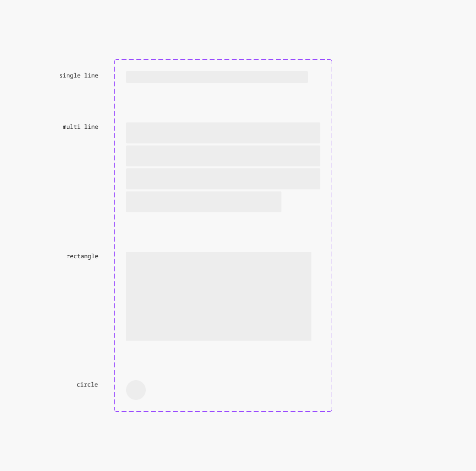

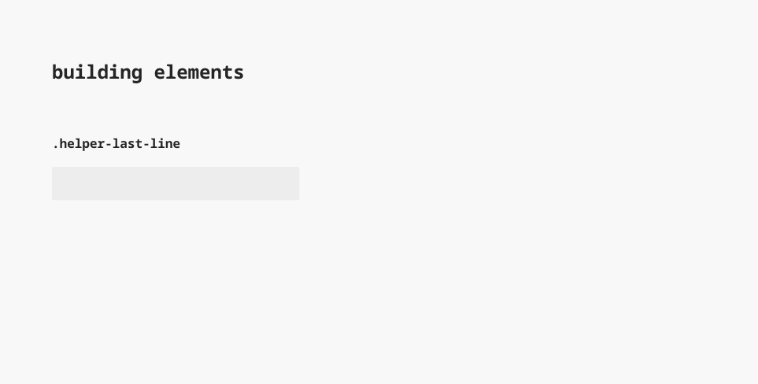

### Further guidelines

[Storybook documentation](https://main--63440bbb95889041542a5ba3.chromatic.com/?path=/docs/components-skeleton--documentation)

### Contribute

Contribute to improving this component by sharing your feedback, asking questions, or suggesting features [here](https://www.figma.com/design/lLmw7PfIdKjFG4uT3B2Hyj/Onboarding-%F0%9F%93%96?node-id=446-868&t=zKmRu4kAkxMeRDmK-4).

## Formatting and Construction

### Global Rules

Skeletons must match the final layout exactly.

- Same dimensions (width and height)
- Same spacing tokens
- Same radius tokens
- Same grid and layout structure
- No layout shift when content replaces the skeleton

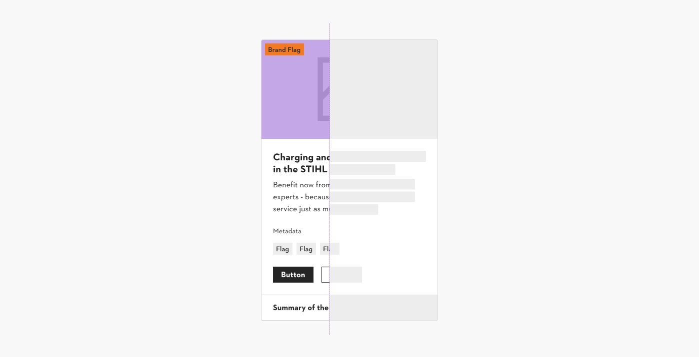

### Anatomy

#### Building elements

Skeletons are built from three main primitives:

1. **Line** Simulates text content.
   1. **Single Line:** represents one line of text
   1. **Multi Line:** represents multiple lines of text
1. **Rectangle** Simulates rectangular containers or surfaces.
1. **Circle** Simulates circular elements.

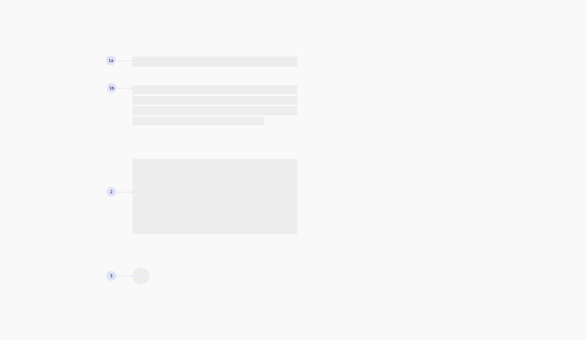

### Variants

#### Single Line

Represents a single line of text.

**Sizing**

- Width: matches the source element
- Height: equals the typography line-height token

**Style**

- Corner radius: radius-xs

**Use cases**

- Headline (single line)
- Text (single line)
- Label
- Meta text
- Table cell (single line)
- List title (single line)

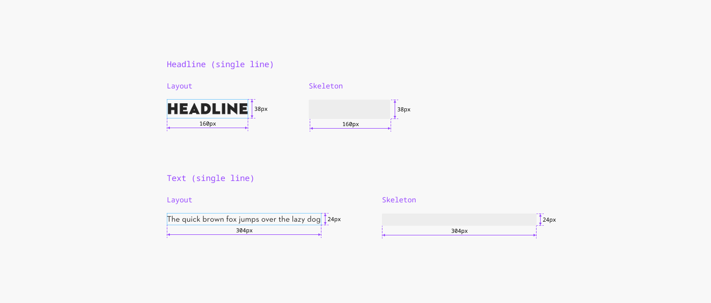

#### Multi Line (Text Skeleton Pattern)

Represents multiple lines of text.

**Behavior**

- Number of lines should match the original content

> **Figma only information** Maximum: 10 lines (Figma component constraint) Last line is shorter to indicate paragraph structure

**Sizing**

- Total height matches the original text container
- Lines are evenly distributed within the container
- Gap between lines: 4px (token)
- Last line width: default 80%

**Style**

- Corner radius: radius-xs

> **Calculation (Code)** skeleton line height = font size x font line height - gap-spacing-token **Example:** font size**:** 16px line height: 1.5 gap spacing token: 4px skeleton line height height = 16 x 1.5 - 4 = 20px

**Use cases**

- Headline (multi line)
- Paragraph text
- Description
- Teaser text
- Multi-line table content
- Card body text

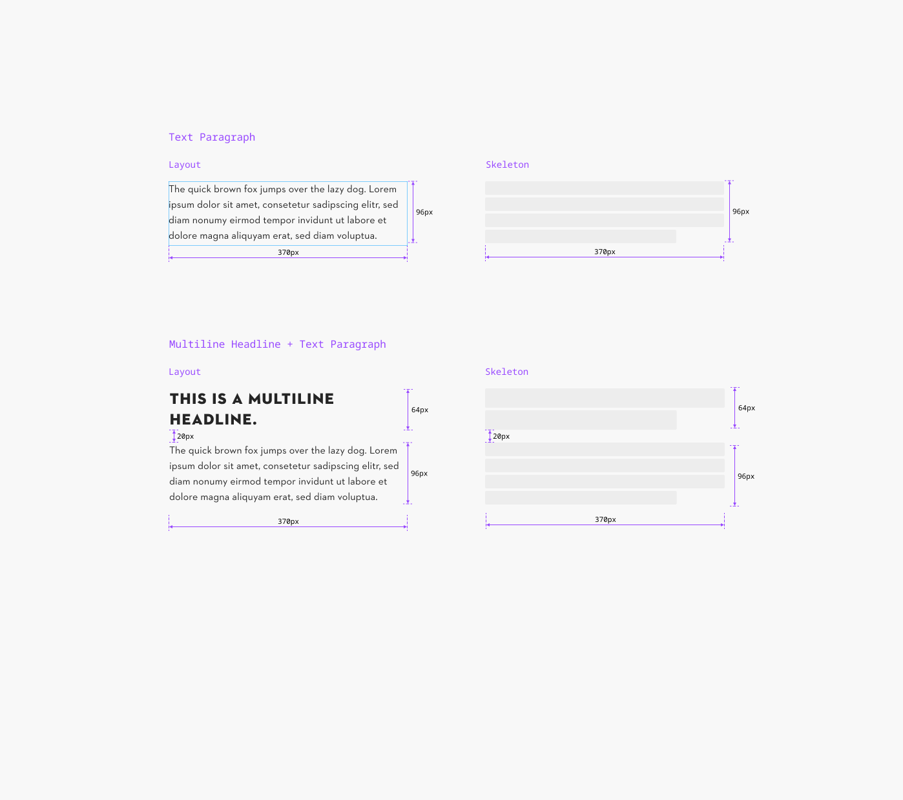

#### Rectangle

Represents rectangular containers and surfaces. **Sizing:**

- Width: matches source element
- Height: matches source element

**Style:**

- Inherits corner radius from source element

**When to use Rectangle instead of Line** Use Rect when the original content:

- is a surface or area
- has padding
- represents a container
- is not plain text

**Use cases**

- Images / media areas
- Buttons
- Cards
- Accordion items
- Table cell backgrounds
- Icon containers (if not circular)

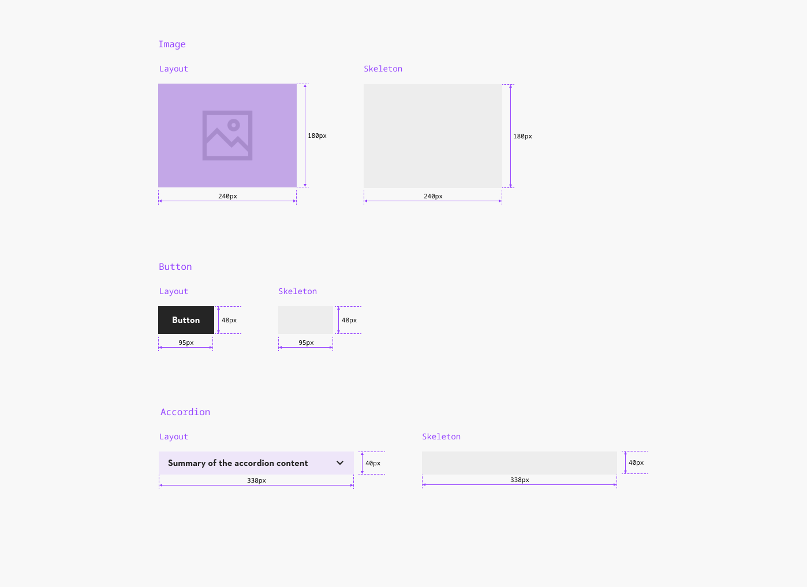

#### Circle

Represents circular shapes.

**Sizing**

- Width = Height (1:1 ratio)
- Matches size of source element

**Use Cases**

- Avatar
- Round button

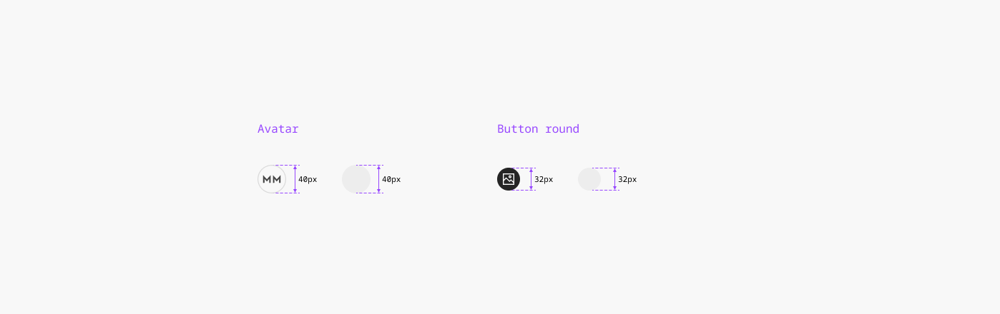

### Level of detail

Skeletons can represent different levels of fidelity.

1. **Low detail** One Rectangle represents the entire component
1. **High detail** Internal elements are replaced with corresponding primitives (Line, Rectangle, Circle)

**Example (Card)**

- Low detail: one Rectangle **(1)**
- High detail: primitves within container Rectangle (image) + Multi Line (title) + Multi Line (description) + Line (meta) + Rectangles (flags) + Rectangles (buttons) + Rectangle (accordion)

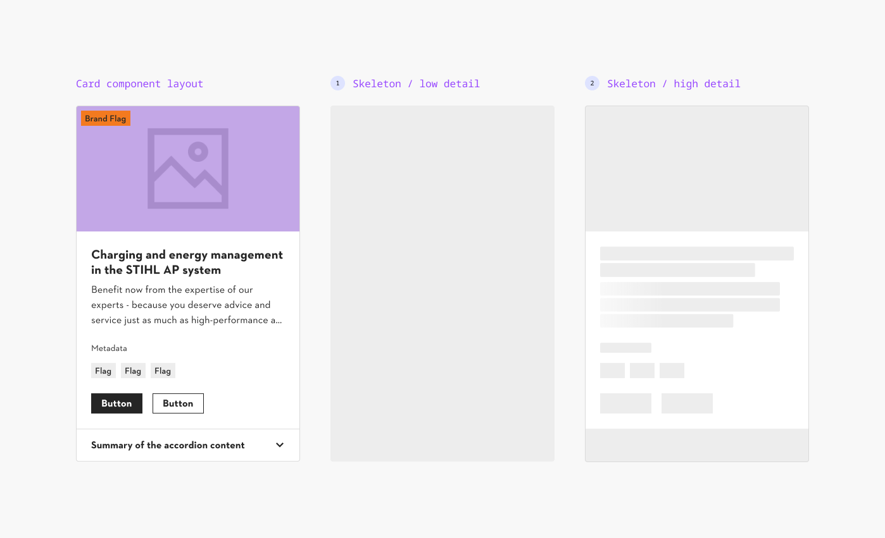

### Responsiveness, Layout & Alignment

Skeletons follow the same layout behavior as the final content shouldn’t create layout shift when content replaces the skeleton.

- Same responsive behavior across breakpoints
- Same grid structure and alignment
- Same wrapping and flow behavior
- Skeleton count reflects expected content amount (e.g. lists)

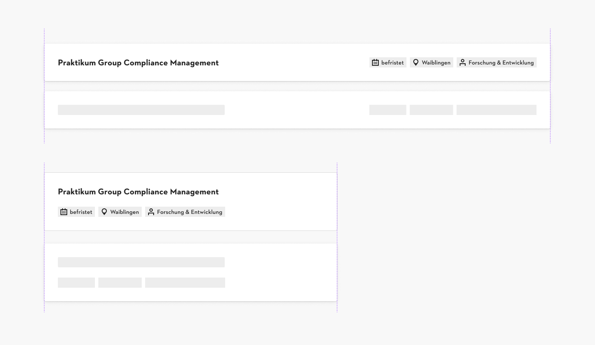

## Behavior

### Loading Behavior

Skeletons define how content is revealed during loading.

Content should be displayed progressively as it becomes available. This improves perceived performance and helps users understand the structure of the content early.

If progressive loading is not possible, content can be revealed all at once once loading is complete.

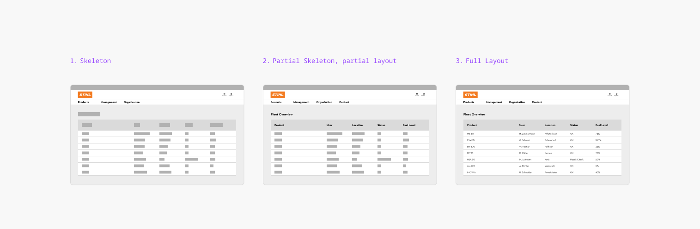

## Animation

> **Animation examples shown in documentation are for demonstration only.** • Not intended for direct use in UI layouts • Use the defined motion specs instead

### Background Shimmer

Skeleton animation is optional but recommended.

A subtle shimmer effect helps indicate loading activity and reduces perceived waiting time.

- Used to communicate ongoing loading
- Keeps motion subtle and non-distracting
- Can be disabled via user settings (accessibility)
- Fallback: static skeleton (no animation)

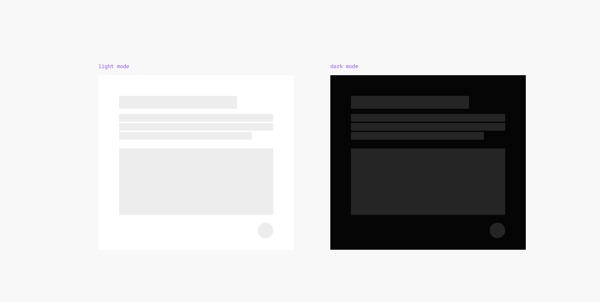

### Motion Specs

**Animation type:** move: from left or right **Duration:** 1600ms

> **Note:** Duration 1600 ms is not implemented as a token yet

**Delay:** 250ms **Easing:** motion-functional-ease-in-out

[Open prototype](https://www.figma.com/proto/qXldpLO6gxHJNLdcXIPxYt/branch/Mvz7H9IStbWkId9a2uXOv4/Core-Components-%F0%9F%92%A0?page-id=49465%3A7294&node-id=50929-11370&viewport=-2364%2C132%2C0.41&t=vNQCKS1SR3Fl22XG-1&scaling=min-zoom&content-scaling=fixed)

[Motion basics](https://www.figma.com/design/UYHZEckQObDvLuuRoMP8ps/Styles-%F0%9F%AA%AD?node-id=1-148&t=yE71yt0nET5AxjOI-1)

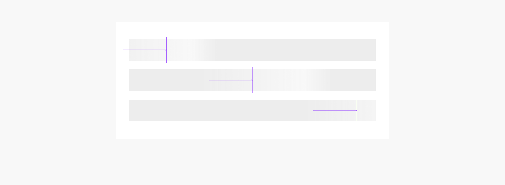

### Gradient Specs

The shimmer is created using a moving gradient overlay. **Light mode**

- Stop 1: 0% → grey/ultra-light, 0% opacity
- Stop 2: 80% → grey/ultra-light, 100% opacity
- Stop 3: 100% → grey/ultra-light, 0% opacity

**Dark mode**

- Stop 1: 0% → grey/dark, 0% opacity
- Stop 2: 80% → grey/dark, 100% opacity
- Stop 3: 100% → grey/dark, 0% opacity

> **Note** The core tokens are a placeholder until the semantic token is released

> **Implementation Notes** • Gradient values are not exposed as tokens • They define behavior, not reusable design elements

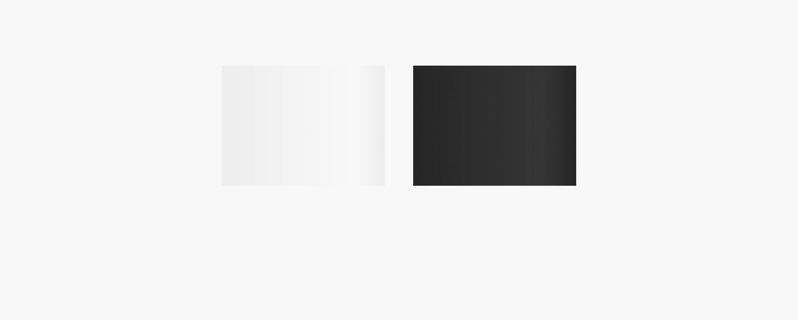

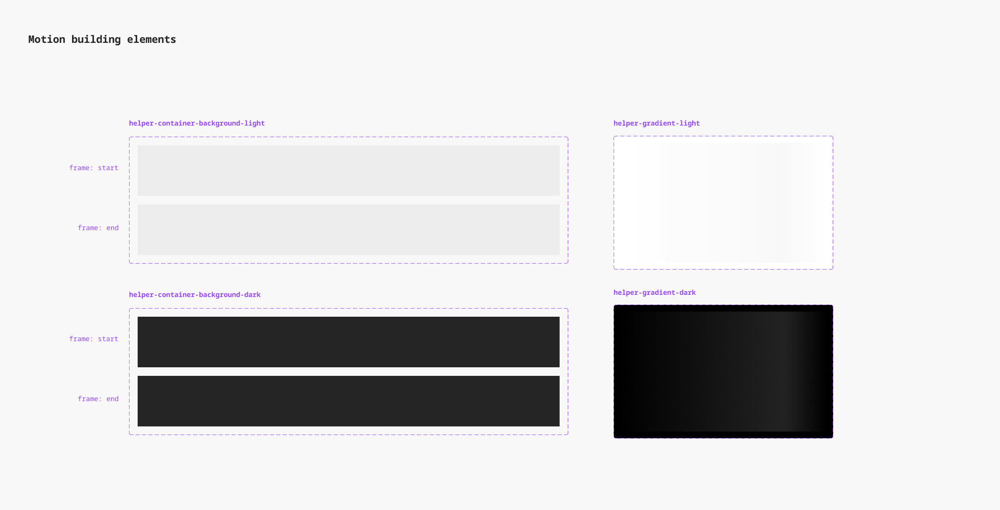

## Accessibility

### Screen Reader & Interaction

Skeletons are non-interactive and not focusable.

The skeleton is purely decorative and renders with aria-hidden="true".

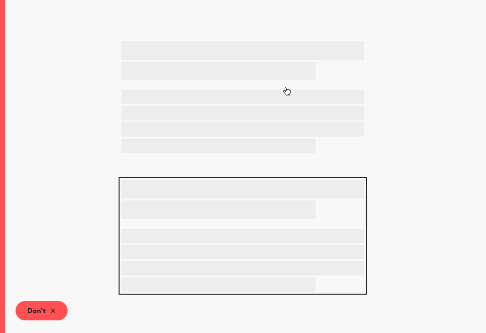

### Loading Status

The Skeleton does not communicate loading status themselves.

It is purely decorative and renders with aria-hidden="true".

If you need to convey loading state to screen reader users, pair it with an aria-live region or use the [Spinner](https://www.figma.com/design/qXldpLO6gxHJNLdcXIPxYt/Core-Components-%F0%9F%92%A0?node-id=26-3) component.

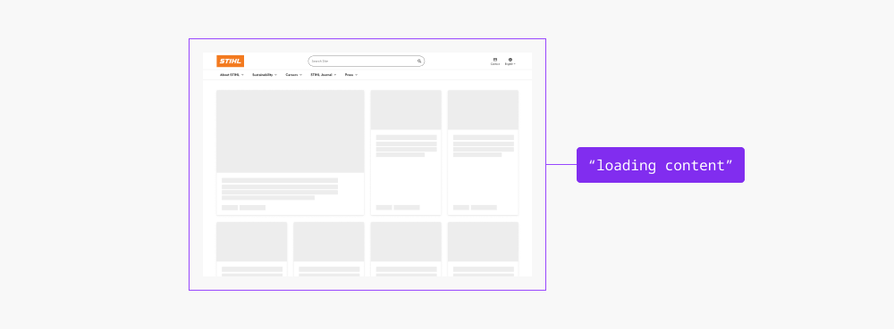

### Motion

Animation must respect user accessibility preferences:

- Support reduced motion settings
- Disable or reduce animation when prefers-reduced-motion is active
- Fallback: static skeleton (no animation)

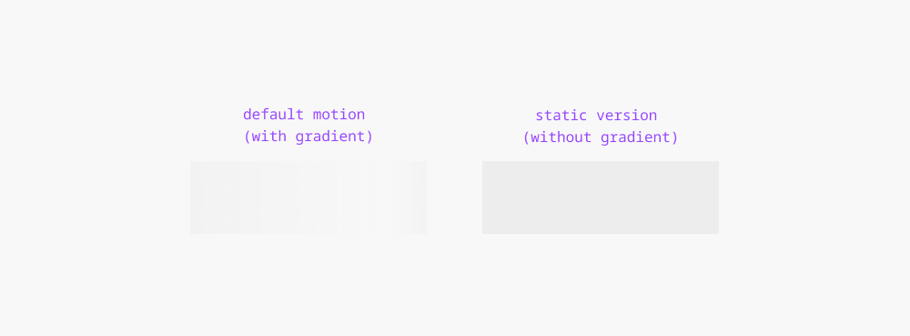

## Examples

> The use case examples shown feature the new Skeleton and do not reflect the current state of the product.

**Corporate and Careers** Journal page

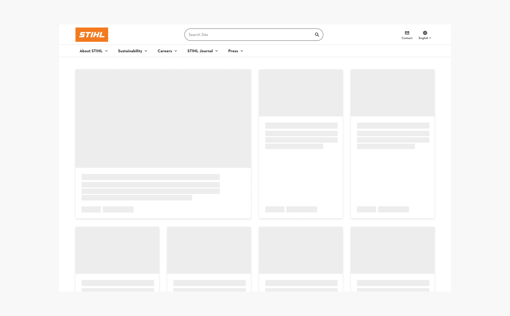

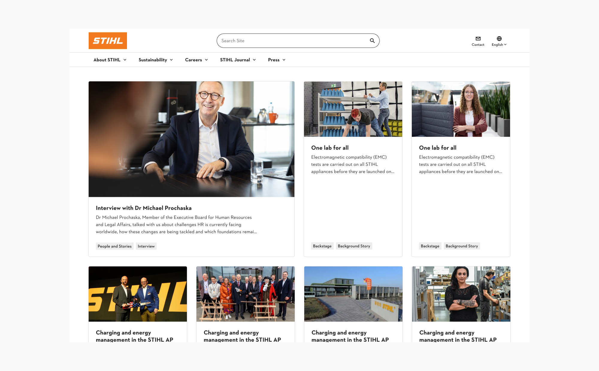

**Corporate and Careers** Job listing

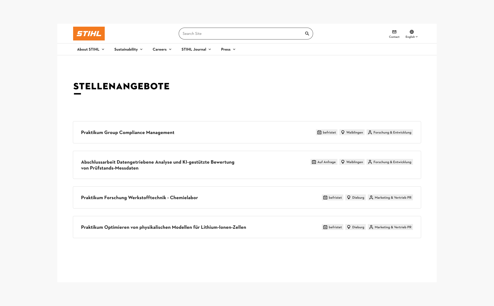

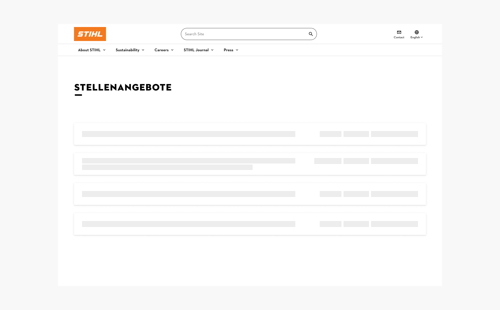
