# Skeleton

## Skeleton

**Overview** A Skeleton is a visual placeholder that mimics the structure of upcoming content while data is loading. It helps maintain layout stability and reduces perceived loading time.

- Uses subtle animation (e.g. shimmer)
- Appears only briefly and is repressable
- Non-interactive and not focusable
- Fully responsive, matching the layout of final content

**When to use** Use Skeletons when:

- The final layout is known (e.g. cards, lists, table rows)
- Content loading takes noticeable time (recommended from \>500 ms)
- Layout shifts must be avoided
- Users should understand where content will appear

Typical scenarios: Content pages, dashboards, feeds, tables, detail views

**When not to use** Do not use Skeletons when:

- Loading time is very short (risk of flicker): \<500ms
- The final layout is unknown or unpredictable
- A user action is in progress or pending (e.g. save, submit)

**Use cases**

- Content cards (news, products, articles)
- Table rows with fixed structure
- Detail pages (header, meta, body)
- Dashboards with widgets
- Lists and feeds (mobile and desktop)

### Related components and patterns

**Component**

**Description**

**Spinner**

Spinners are used for actions or unknown charge levels. (Save, Submit, Upload, Payment)

**Progress Bar**

A progress bar is used when progress is measurable. (Upload, Installing, Update)

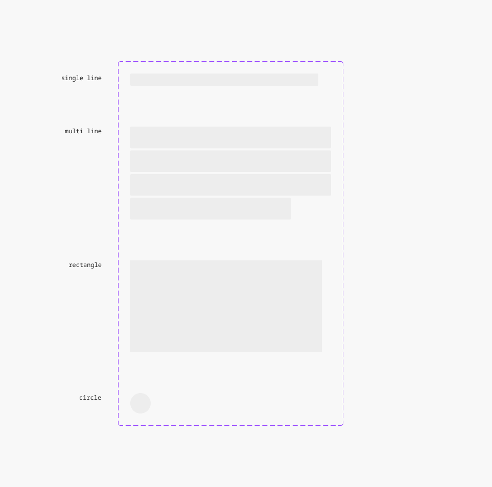

_Figure: Four light grey skeleton primitives stacked vertically inside a dashed purple frame, labelled on the left: "single line" (one bar), "multi line" (four bars, the last one shorter), "rectangle" (a large block) and "circle" (a small round shape)._

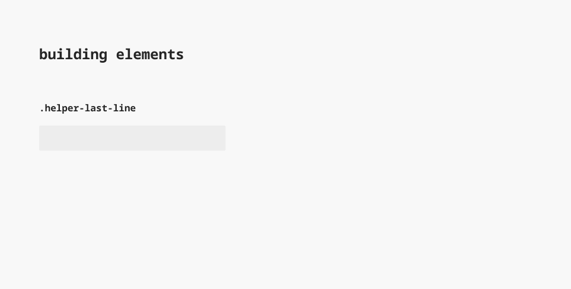

_Figure: Internal helper under the heading "building elements": the ".helper-last-line" spacer, shown as a single light grey bar at line width 80%, used as the shorter last line of multi-line skeletons._

### Further guidelines

[Storybook documentation](https://main--63440bbb95889041542a5ba3.chromatic.com/?path=/docs/components-skeleton--documentation)

### Contribute

Contribute to improving this component by sharing your feedback, asking questions, or suggesting features [here](https://www.figma.com/design/lLmw7PfIdKjFG4uT3B2Hyj/Onboarding-%F0%9F%93%96?node-id=446-868&t=zKmRu4kAkxMeRDmK-4).

## Formatting and Construction

### Global Rules

Skeletons must match the final layout exactly.

- Same dimensions (width and height)
- Same spacing tokens
- Same radius tokens
- Same grid and layout structure
- No layout shift when content replaces the skeleton

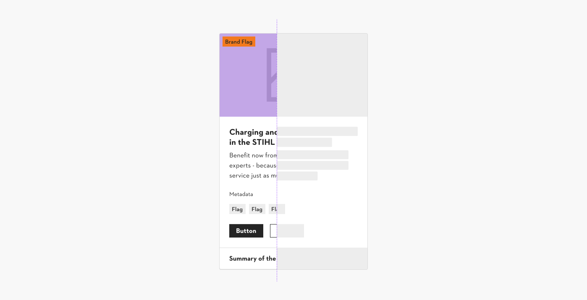

_Figure: Vertical action card split by a dotted line: the left half shows real content ("Brand Flag", the headline "Charging and energy management in the STIHL AP system", body text "Benefit now from the expertise of our experts - because you deserve advice an...", "Metadata", three "Flag" chips, a "Button" and "Summary of the accordion content"), the right half shows the skeleton of the same card with grey blocks at identical positions, sizes and spacing. This illustrates that a skeleton must match the final layout exactly so that nothing shifts when content loads (callout 3)._

### Anatomy

#### Building elements

Skeletons are built from three main primitives:

1. **Line** Simulates text content.
   1. **Single Line:** represents one line of text
   1. **Multi Line:** represents multiple lines of text
1. **Rectangle** Simulates rectangular containers or surfaces.
1. **Circle** Simulates circular elements.

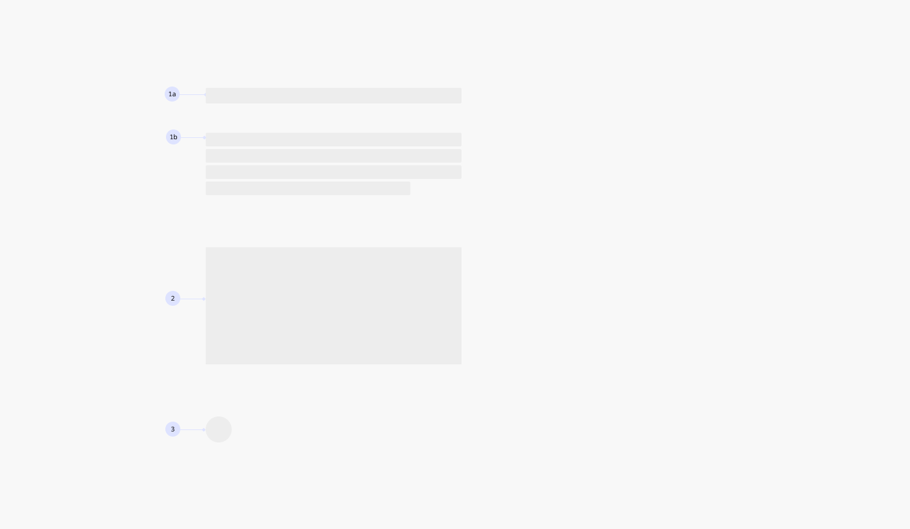

_Figure: The three skeleton building elements with numbered callouts: 1a points at the single line (one grey bar), 1b at the multi line (four bars, the last one shorter), 2 at the rectangle (a large grey block) and 3 at the circle (a small round shape)._

### Variants

#### Single Line

Represents a single line of text.

**Sizing**

- Width: matches the source element
- Height: equals the typography line-height token

**Style**

- Corner radius: radius-xs

**Use cases**

- Headline (single line)
- Text (single line)
- Label
- Meta text
- Table cell (single line)
- List title (single line)

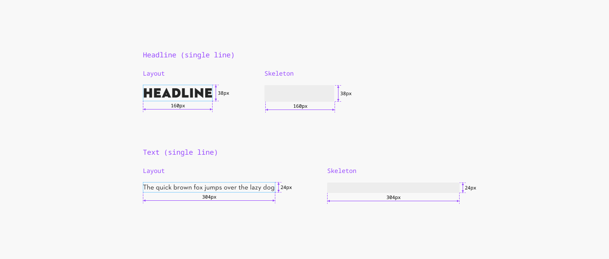

_Figure: Single line skeleton sizing, comparing Layout with Skeleton. "Headline (single line)": the headline text and its skeleton are both 160px wide and 38px high. "Text (single line)": the sentence "The quick brown fox jumps over the lazy dog" and its skeleton are both 304px wide and 24px high, so the skeleton matches the width of the source element and the line height of the typography._

#### Multi Line (Text Skeleton Pattern)

Represents multiple lines of text.

**Behavior**

- Number of lines should match the original content

> **Figma only information** Maximum: 10 lines (Figma component constraint) Last line is shorter to indicate paragraph structure

**Sizing**

- Total height matches the original text container
- Lines are evenly distributed within the container
- Gap between lines: 4px (token)
- Last line width: default 80%

**Style**

- Corner radius: radius-xs

> **Calculation (Code)** skeleton line height = font size x font line height - gap-spacing-token **Example:** font size**:** 16px line height: 1.5 gap spacing token: 4px skeleton line height height = 16 x 1.5 - 4 = 20px

**Use cases**

- Headline (multi line)
- Paragraph text
- Description
- Teaser text
- Multi-line table content
- Card body text

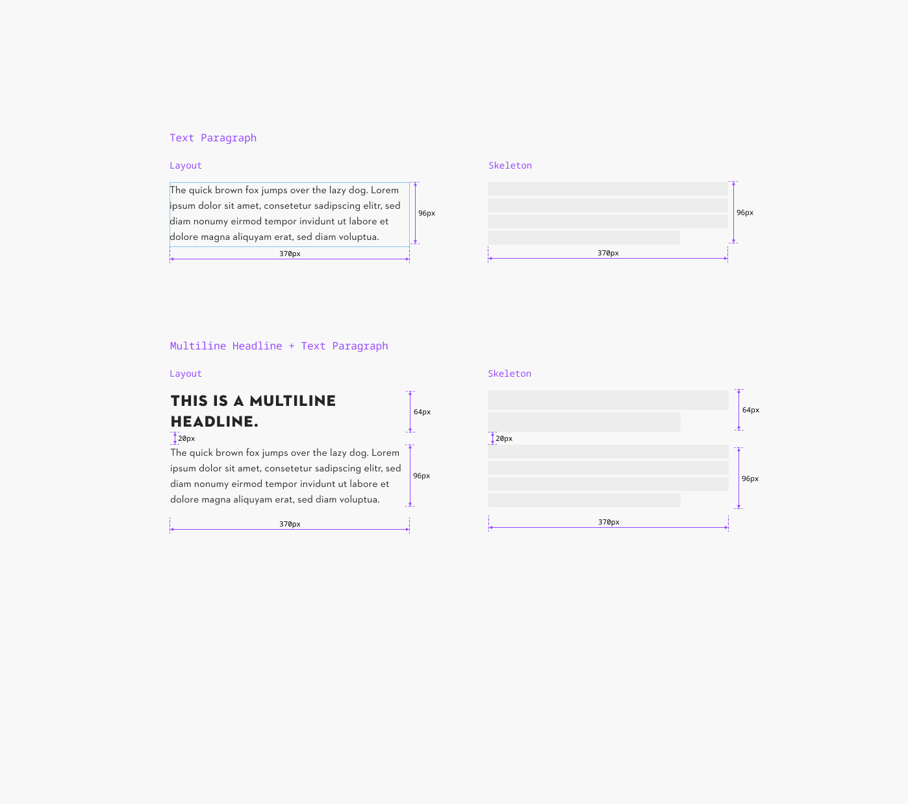

_Figure: Multi-line skeleton compared with its source layout in two cases, each 370px wide. For a Text Paragraph the four-line text block is 96px high and its skeleton is four grey bars of the same height, the last bar shorter. For a Multiline Headline + Text Paragraph the two-line headline (64px) and the paragraph (96px) are separated by a 20px gap, and the skeleton repeats this with two bars for the headline, a 20px gap and four bars for the paragraph, the last bar of each block shorter._

#### Rectangle

Represents rectangular containers and surfaces. **Sizing:**

- Width: matches source element
- Height: matches source element

**Style:**

- Inherits corner radius from source element

**When to use Rectangle instead of Line** Use Rect when the original content:

- is a surface or area
- has padding
- represents a container
- is not plain text

**Use cases**

- Images / media areas
- Buttons
- Cards
- Accordion items
- Table cell backgrounds
- Icon containers (if not circular)

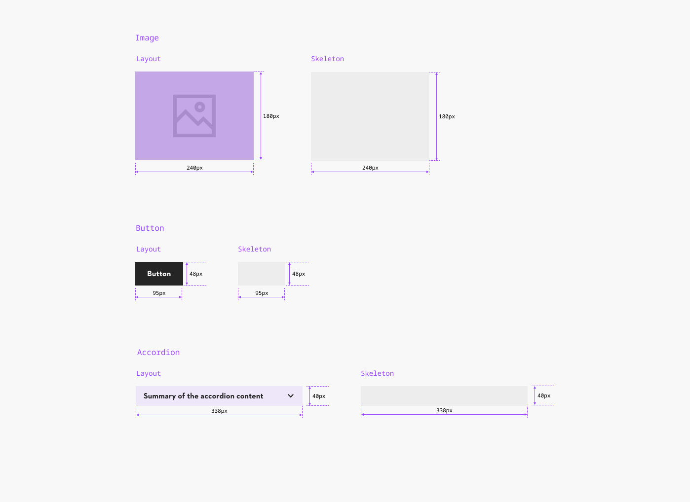

_Figure: Rectangle skeletons next to the layouts they replace, each with the same size as its source and plain grey fill. Image: 240px wide, 180px high. Button: 95px wide, 48px high. Accordion: 338px wide, 40px high, replacing the closed accordion with the summary "Summary of the accordion content"._

#### Circle

Represents circular shapes.

**Sizing**

- Width = Height (1:1 ratio)
- Matches size of source element

**Use Cases**

- Avatar
- Round button

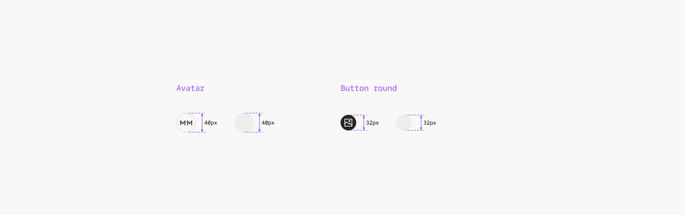

_Figure: Circle skeletons next to the layouts they replace, with width equal to height. Avatar (initials "MM") is 40px and becomes a 40px grey circle; Button round with an image icon is 32px and becomes a 32px grey circle._

### Level of detail

Skeletons can represent different levels of fidelity.

1. **Low detail** One Rectangle represents the entire component
1. **High detail** Internal elements are replaced with corresponding primitives (Line, Rectangle, Circle)

**Example (Card)**

- Low detail: one Rectangle **(1)**
- High detail: primitves within container Rectangle (image) + Multi Line (title) + Multi Line (description) + Line (meta) + Rectangles (flags) + Rectangles (buttons) + Rectangle (accordion)

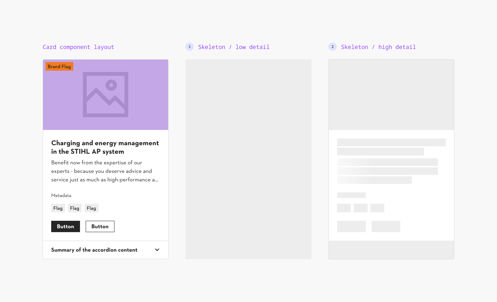

_Figure: A vertical card (media area with "Brand Flag", title "Charging and energy management in the STIHL AP system", description, "Metadata", three "Flag" tags, two "Button"s, and an accordion "Summary of the accordion content") shown with two skeleton versions. 1 Skeleton / low detail: a single grey rectangle covers the whole card. 2 Skeleton / high detail: a grey image rectangle, two title bars, three description bars, a metadata bar, three small flag rectangles, two button rectangles and a grey accordion rectangle inside the card container._

### Responsiveness, Layout & Alignment

Skeletons follow the same layout behavior as the final content shouldn’t create layout shift when content replaces the skeleton.

- Same responsive behavior across breakpoints
- Same grid structure and alignment
- Same wrapping and flow behavior
- Skeleton count reflects expected content amount (e.g. lists)

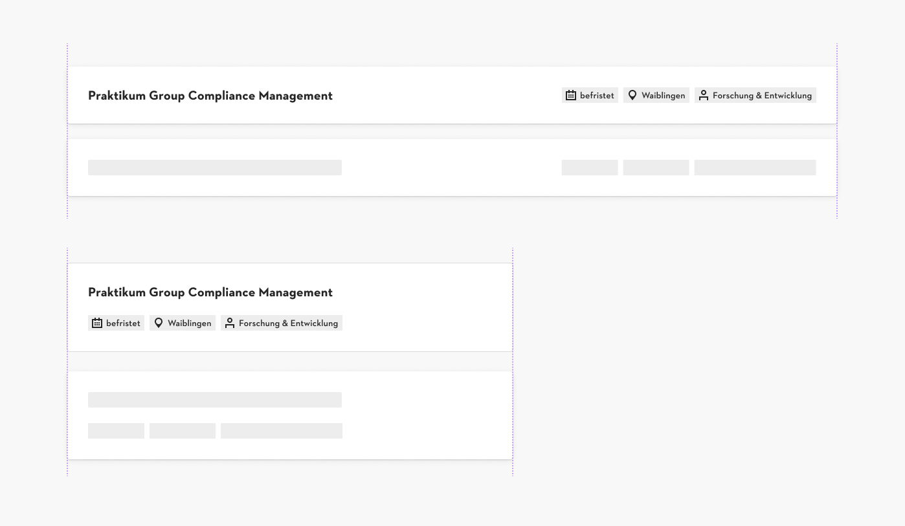

_Figure: Two horizontal link cards titled "Praktikum Group Compliance Management" with flags "befristet", "Waiblingen" and "Forschung & Entwicklung", each followed by its skeleton. In the wide layout the title and flags sit side by side, with the flags right-aligned; in the narrow layout the flags wrap below the title. Each skeleton keeps the same width, arrangement and wrapping as its layout (a title bar plus three flag rectangles), so no layout shift occurs when content replaces it._

## Behavior

### Loading Behavior

Skeletons define how content is revealed during loading.

Content should be displayed progressively as it becomes available. This improves perceived performance and helps users understand the structure of the content early.

If progressive loading is not possible, content can be revealed all at once once loading is complete.

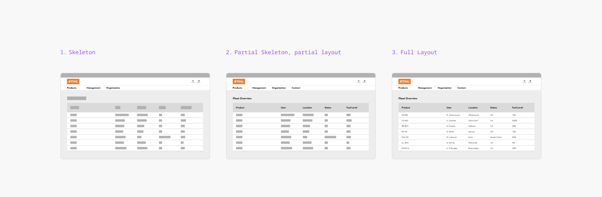

_Figure: Three stages of a "Fleet Overview" page with a STIHL top bar and a table (columns Product, User, Location, Status, Fuel Level; rows such as MS 881, H. Zimmermann, Affalterbach, OK, 75%). 1. Skeleton: the heading, navigation labels and all table cells are grey placeholder bars. 2. Partial Skeleton, partial layout: the navigation, heading and column headers are already real text while the table body is still skeleton bars. 3. Full Layout: all content is loaded. Measurements in the figure: 100%, 25%, 50%, 43%._

## Animation

> **Animation examples shown in documentation are for demonstration only.** • Not intended for direct use in UI layouts • Use the defined motion specs instead

### Background Shimmer

Skeleton animation is optional but recommended.

A subtle shimmer effect helps indicate loading activity and reduces perceived waiting time.

- Used to communicate ongoing loading
- Keeps motion subtle and non-distracting
- Can be disabled via user settings (accessibility)
- Fallback: static skeleton (no animation)

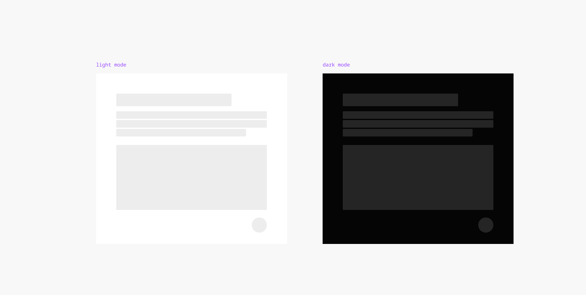

_Figure: Skeleton layouts in light mode and dark mode: a headline bar, three text line bars (the last shorter), a large rectangle and a small circle at the bottom right. In light mode the shapes are light grey on white; in dark mode they are dark grey on black._

### Motion Specs

**Animation type:** move: from left or right **Duration:** 1600ms

> **Note:** Duration 1600 ms is not implemented as a token yet

**Delay:** 250ms **Easing:** motion-functional-ease-in-out

[Open prototype](https://www.figma.com/proto/qXldpLO6gxHJNLdcXIPxYt/branch/Mvz7H9IStbWkId9a2uXOv4/Core-Components-%F0%9F%92%A0?page-id=49465%3A7294&node-id=50929-11370&viewport=-2364%2C132%2C0.41&t=vNQCKS1SR3Fl22XG-1&scaling=min-zoom&content-scaling=fixed)

[Motion basics](https://www.figma.com/design/UYHZEckQObDvLuuRoMP8ps/Styles-%F0%9F%AA%AD?node-id=1-148&t=yE71yt0nET5AxjOI-1)

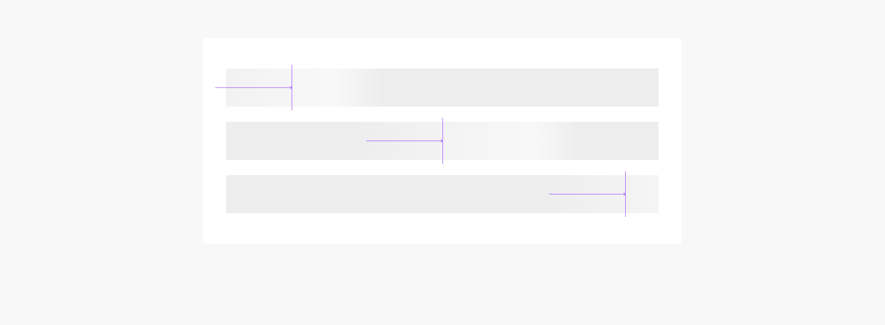

_Figure: Three skeleton bars on a white background, each with a soft light shimmer band and a purple arrow pointing right, at the left, middle and right of the bar. They show the gradient moving horizontally across the skeleton over time._

### Gradient Specs

The shimmer is created using a moving gradient overlay. **Light mode**

- Stop 1: 0% → grey/ultra-light, 0% opacity
- Stop 2: 80% → grey/ultra-light, 100% opacity
- Stop 3: 100% → grey/ultra-light, 0% opacity

**Dark mode**

- Stop 1: 0% → grey/dark, 0% opacity
- Stop 2: 80% → grey/dark, 100% opacity
- Stop 3: 100% → grey/dark, 0% opacity

> **Note** The core tokens are a placeholder until the semantic token is released

> **Implementation Notes** • Gradient values are not exposed as tokens • They define behavior, not reusable design elements

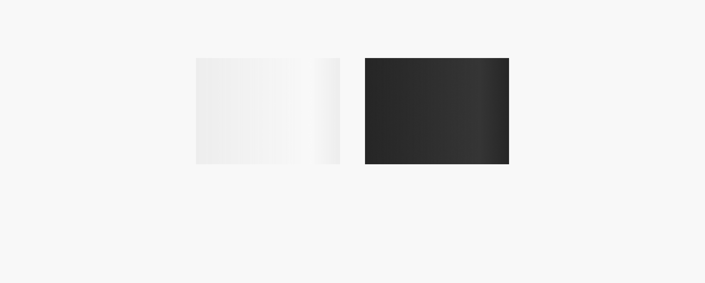

_Figure: Two gradient swatches: the light mode one is light grey fading to near white and back to light grey toward the right edge, and the dark mode one is dark grey brightening slightly near the right and fading back toward the edge._

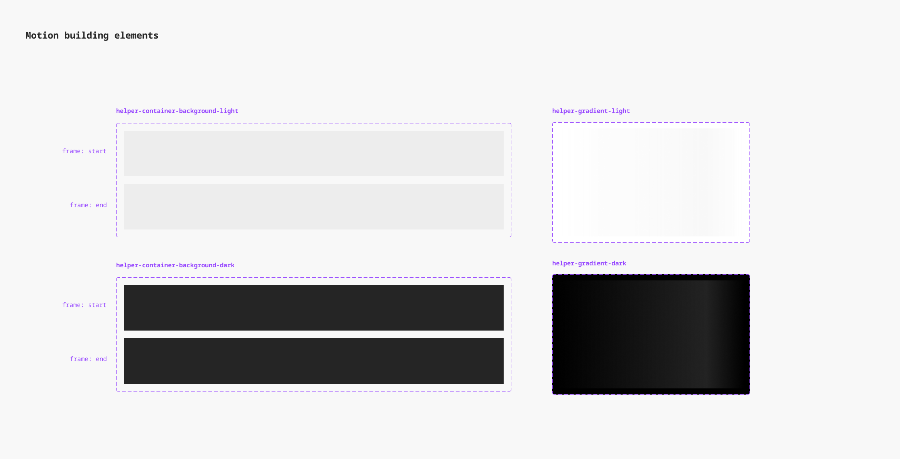

_Figure: Motion building elements for the shimmer. helper-container-background-light and helper-container-background-dark each hold two plain grey bars, "frame: start" and "frame: end", in light grey and dark grey respectively. helper-gradient-light is a white panel with a faint grey gradient, and helper-gradient-dark is a black panel with a gradient that brightens slightly toward the right and fades to black at the edge._

## Accessibility

### Screen Reader & Interaction

Skeletons are non-interactive and not focusable.

The skeleton is purely decorative and renders with aria-hidden="true".

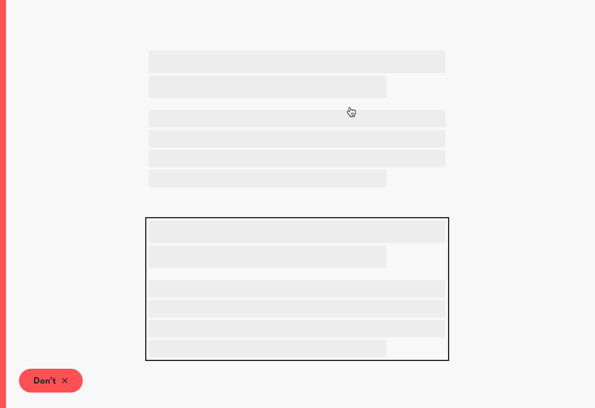

_Figure: Don't example: a multi-line text Skeleton (gray placeholder bars) with a pointer cursor hovering over it and the lower skeleton block outlined with a dark focus-style frame, showing that skeletons must not be interactive or focusable._

### Loading Status

The Skeleton does not communicate loading status themselves.

It is purely decorative and renders with aria-hidden="true".

If you need to convey loading state to screen reader users, pair it with an aria-live region or use the [Spinner](https://www.figma.com/design/qXldpLO6gxHJNLdcXIPxYt/Core-Components-%F0%9F%92%A0?node-id=26-3) component.

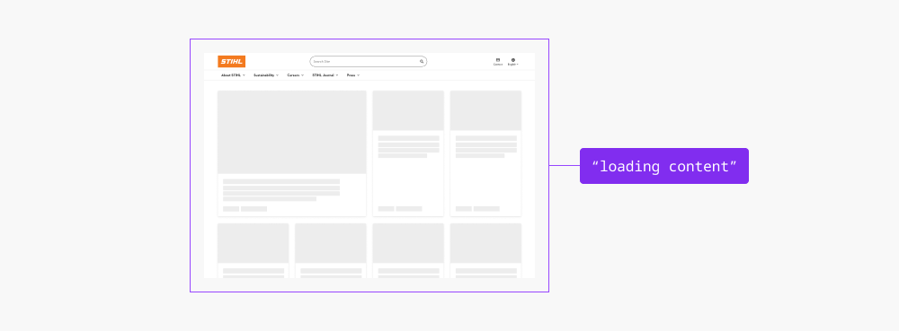

_Figure: A STIHL website page in loading state, with a header, search field and navigation but gray Skeleton placeholders instead of card images and text, enclosed in a purple frame with the callout "“loading content”" showing the text that can be announced to screen readers instead._

### Motion

Animation must respect user accessibility preferences:

- Support reduced motion settings
- Disable or reduce animation when prefers-reduced-motion is active
- Fallback: static skeleton (no animation)

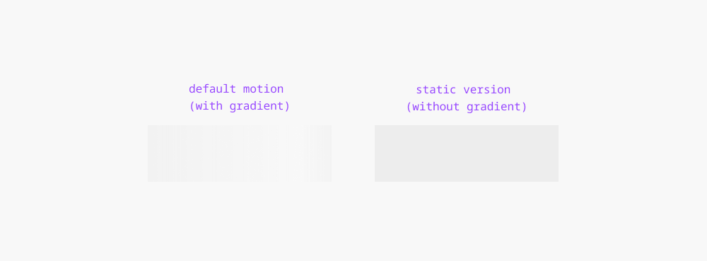

_Figure: Two skeleton rectangles on a light background side by side: "default motion (with gradient)" on the left shows a subtle shimmering gradient, and "static version (without gradient)" on the right shows a flat gray fill used as the reduced-motion fallback._

## Examples

> The use case examples shown feature the new Skeleton and do not reflect the current state of the product.

**Corporate and Careers** Journal page

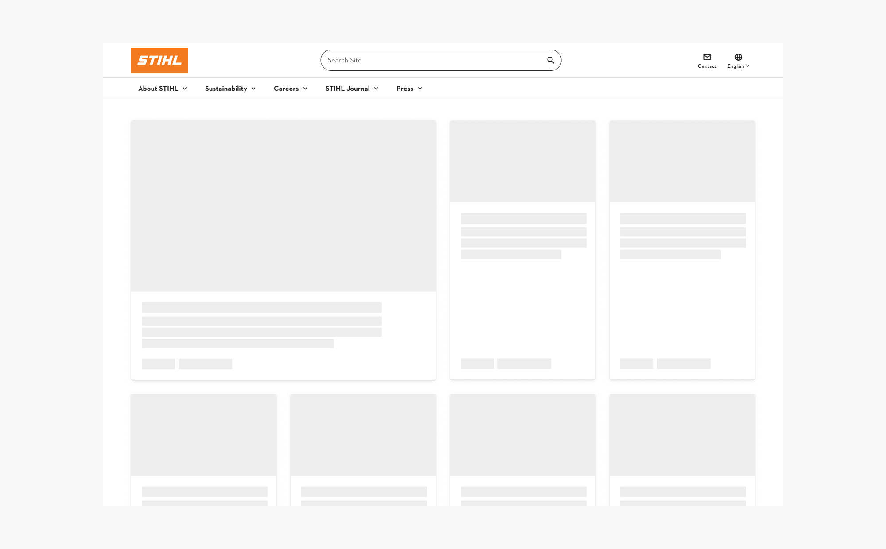

_Figure: Corporate and Careers Journal page in loading state at breakpoint xl, with the STIHL top bar ("Search Site", "Contact", "English") and main nav bar ("About STIHL", "Sustainability", "Careers", "STIHL Journal", "Press") above a grid of vertical link cards whose images, headings, descriptions and flags are replaced by rectangle, single line and multi line Skeletons._

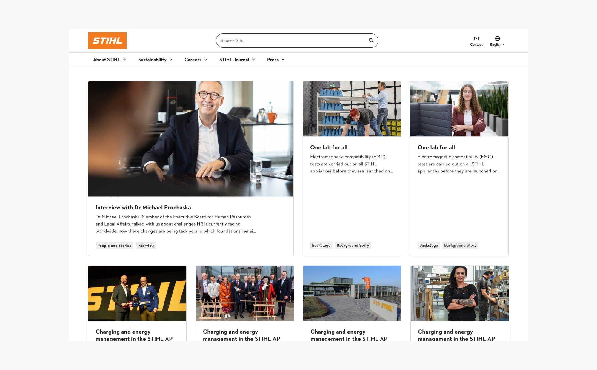

_Figure: Corporate and Careers Journal page once loaded, with the STIHL top bar and main nav bar at breakpoint xl above a grid of vertical link cards with photos, headings such as "Interview with Dr Michael Prochaska", "One lab for all" and "Charging and energy management in the STIHL AP system", truncated descriptions and flags like "Backstage" and "Background Story"; this is the real content that replaces the Skeleton version._

**Corporate and Careers** Job listing

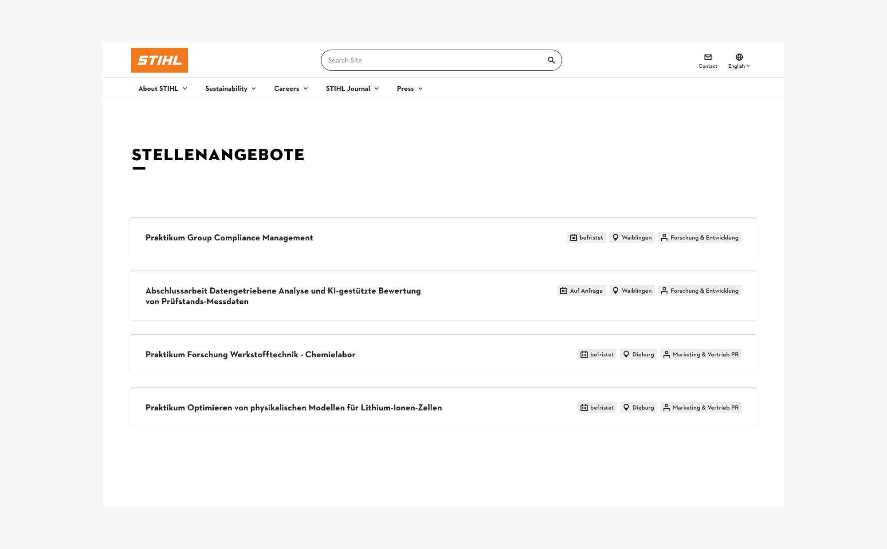

_Figure: Corporate and Careers job listing page once loaded, with the STIHL top bar and main nav bar at breakpoint xl, the heading "STELLENANGEBOTE" and four horizontal link cards, each with a job title (for example "Praktikum Group Compliance Management") and flags for contract type ("befristet", "Auf Anfrage"), location ("Waiblingen", "Dieburg") and department ("Forschung & Entwicklung", "Marketing & Vertrieb PR")._

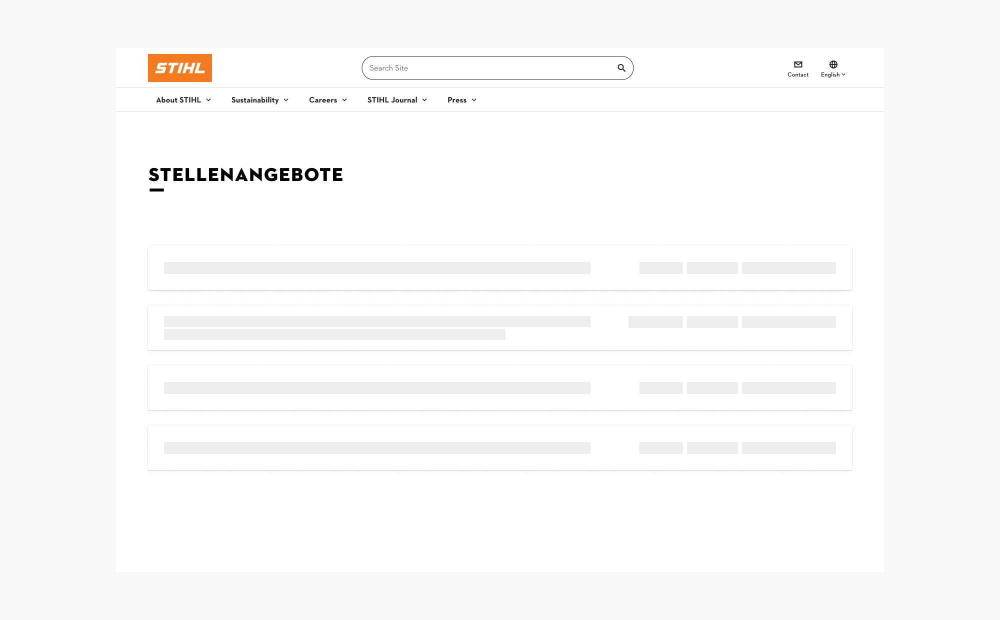

_Figure: Corporate and Careers job listing page in loading state, with the STIHL top bar, main nav bar and the heading "STELLENANGEBOTE" shown normally, and four horizontal cards whose titles and three flags each are replaced by single line Skeletons (two lines for the second card's title)._
