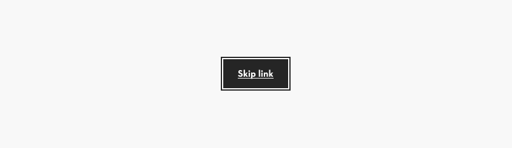
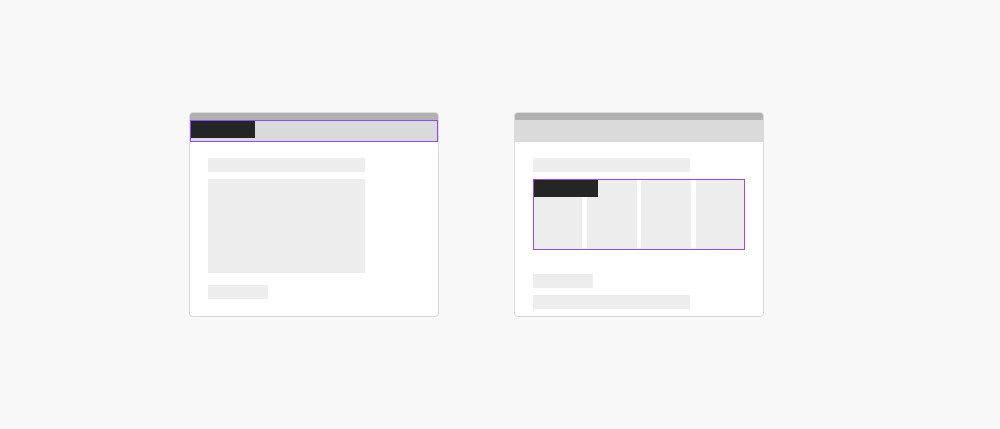

# Skip Link

## Skip Link

Overview:

- Enhances tab navigation usage, as it allows the user to quickly navigating past repetitive content to the following section, enhancing accessibility.
   - Examples of repetitive content are navigation lists, product lists, results lists.
- Ensure the skip link is visible when focused, typically at the top left corner of the page.
- Include descriptive text for screen readers to explain the link's function.

### Further guidelines

[Storybook documentation](https://main--63440bbb95889041542a5ba3.chromatic.com/?path=/docs/components-skip-to-content-link--documentation)

### Related elements

[Button](https://www.figma.com/design/qXldpLO6gxHJNLdcXIPxYt/Pattern-Library-%F0%9F%96%A5-Web-1.0?node-id=168-3943&t=xK8bst9jn472gahh-4)

### Contribute

Contribute to improving this component by sharing your feedback, asking questions, or suggesting features [here](https://www.figma.com/design/lLmw7PfIdKjFG4uT3B2Hyj/Onboarding-%F0%9F%93%96?node-id=446-868&t=zKmRu4kAkxMeRDmK-4).

## Formatting and Construction

### Placement

#### Place buttons at the top left corner of the content that should be skipped

As a general rule make sure that the buttons are aligned with the content within a layout: left, center or right.

