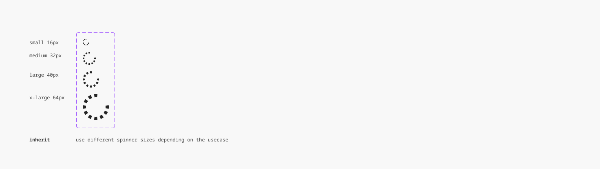

# Spinner

## Spinner

Overview:

- Shows the loading state and that the user request is being processed.
- Use them when retrieving data or performing slow computations.

### Further guidelines

[Storybook documentation](https://main--63440bbb95889041542a5ba3.chromatic.com/?path=/docs/components-spinner--documentation)

[Prototype](https://www.figma.com/design/qXldpLO6gxHJNLdcXIPxYt?node-id=47-108)

### Related elements

[Button](https://www.figma.com/design/qXldpLO6gxHJNLdcXIPxYt?node-id=162-126)

[Switch](https://www.figma.com/design/qXldpLO6gxHJNLdcXIPxYt?node-id=513-2)

### Contribute

Contribute to improving this component by sharing your feedback, asking questions, or suggesting features [here](https://www.figma.com/design/lLmw7PfIdKjFG4uT3B2Hyj/Onboarding-%F0%9F%93%96?node-id=446-868&t=zKmRu4kAkxMeRDmK-4).
