# Stepper

## Stepper

- Visualizes a multi-step process (3–6 steps) and shows current, completed, and upcoming steps.
- Guides users through tasks in a defined order with clear progress feedback.
- Best for long forms, onboarding, checkouts, or processes where validation is needed before continuing.
- Avoid using for fewer than 3 steps, non-linear/reorderable flows, or processes with changing step counts.

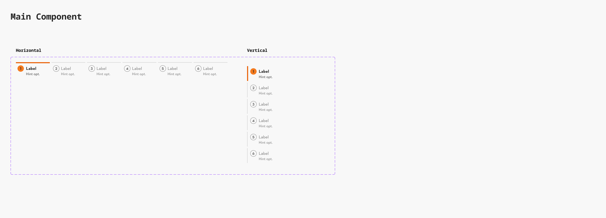

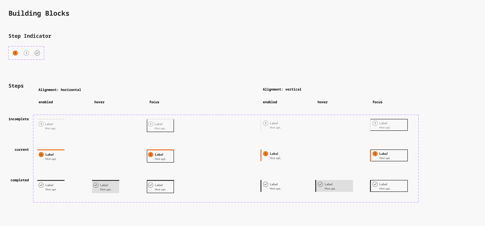

### Further guidelines

[Storybook documentation](https://main--63440bbb95889041542a5ba3.chromatic.com/?path=/docs/components-notification--documentation&globals=backgrounds.name:!undefined;backgrounds.value:!undefined)

### Related elements

[Fieldset](https://www.figma.com/design/Ie2r0R9QwjEc7O3nrFbXhV/Web-Pattern-Library?node-id=8-154)

[Input](https://www.figma.com/design/qXldpLO6gxHJNLdcXIPxYt/Core-Components-%F0%9F%92%A0?node-id=1591-2)

[Notification](https://www.figma.com/design/qXldpLO6gxHJNLdcXIPxYt/Core-Components-%F0%9F%92%A0?node-id=7251-8)

[Tabs](https://www.figma.com/design/qXldpLO6gxHJNLdcXIPxYt/Core-Components-%F0%9F%92%A0?node-id=24564-312)

### Contribute

Contribute to improving this component by sharing your feedback, asking questions, or suggesting features [here](https://www.figma.com/design/lLmw7PfIdKjFG4uT3B2Hyj/Onboarding-%F0%9F%93%96?node-id=446-868&t=zKmRu4kAkxMeRDmK-4).

## Formatting and Construction

### Anatomy

#### Steps

Steps are the core building blocks of the Stepper. Each step combines visual indicators and descriptive text to communicate progress, provide context, and guide users through the process.

1. **Indicator** Displays the number of steps and visually communicates the status of each step.
1. **Label** A short, descriptive title that identifies the step.
1. **Hint (optional)** Provides additional context or guidance for the step, or summarizes a user’s selection.
1. **Step Line** A visual element that sits above each step, to indicate progress and reflect the status of individual steps.

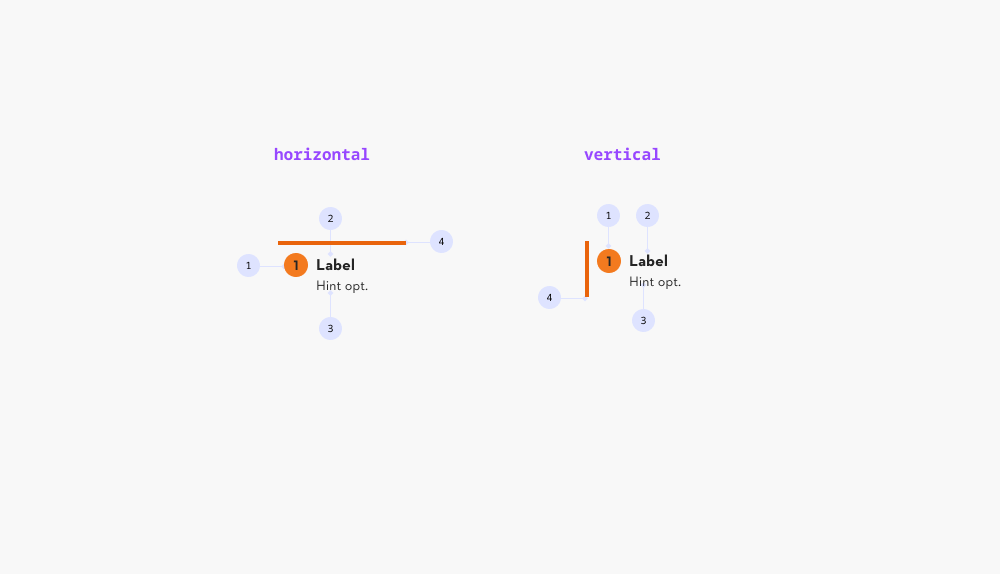

#### Stepper

The stepper serves as the container that groups all individual step elements. It visually connects the steps and communicates progress through their arrangement. Two orientation variants are available:

1. **horizontal**
1. **vertical**

allowing the component to adapt to different viewports and use cases.

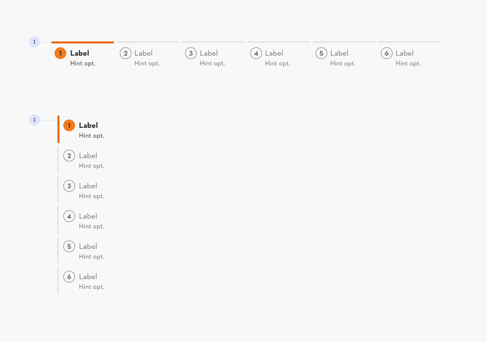

#### Pattern

The Stepper component doesn’t manage the entire flow on its own.

Each step must include:

1. **Stepper component**
1. **Content Placeholder**
1. **Step Control** (Button Group e.g., “Next” or “Back”)

The step controls handle step progression and validation, and are also an accessibility requirement, ensuring that keyboard and assistive technology users can move through the process.

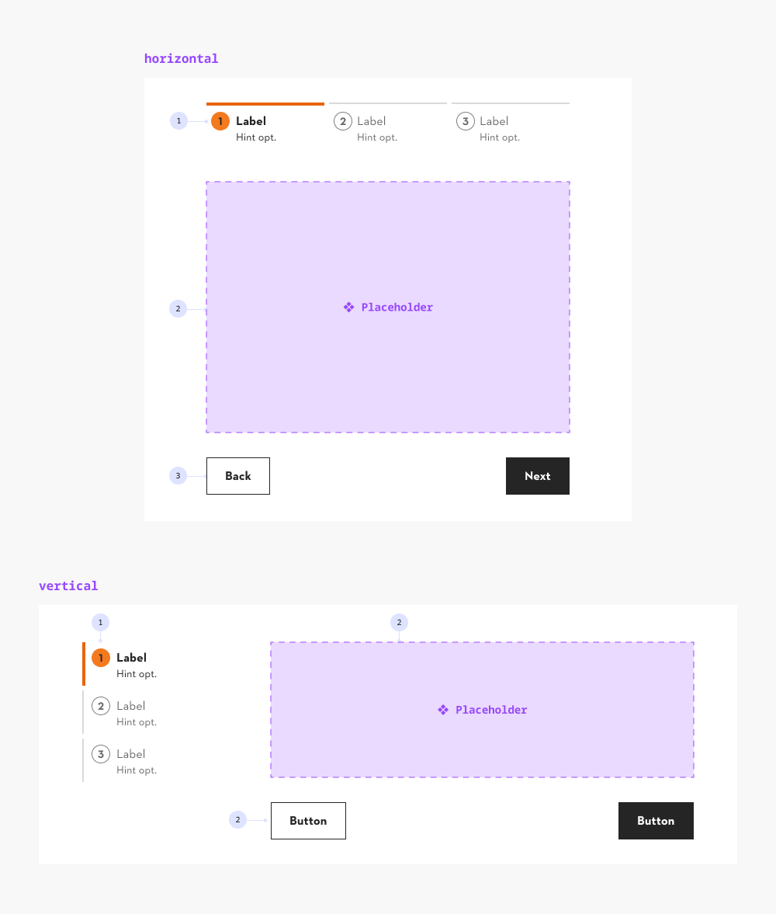

### State & Status

Each step in the Stepper has two distinct layers of visual feedback:

- **Interaction State:** How the step responds to user interactions (e.g., hover).
- **Step Status:** Where the step sits in the overall process (e.g., completed).

These layers work together to provide clear guidance and feedback.

#### Interaction States

Similar to button behavior, each step can display the following interaction states:

1. **Enabled** Default interactive state.
1. **Hover / Pressed** Visual feedback when a user hovers over or clicks the step.
1. **Focus** Indicates the step is currently focused.

> In code, the disabled state is implemented and used for the Incomplete status (see below). In Figma, a disabled state is intentionally omitted to reduce component complexity and prevent redundant property configurations.

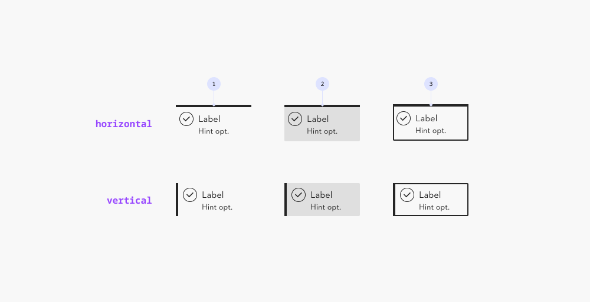

#### Step Status

Each step also reflects its role in the overall flow using one of the following statuses:

1. **Incomplete** The step has not yet been started.
1. **Current** The step the user is currently on.
1. **Completed** The step has been successfully finished.

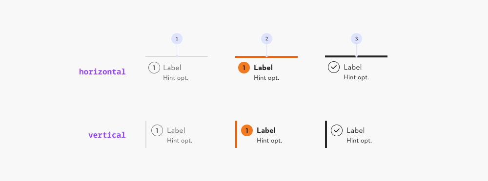

### Orientation

The Stepper supports two layout orientations:

1. **Horizontal Orientation** Use a horizontal stepper when conserving vertical space is important. Best suited for shorter processes with fewer steps that can be displayed side by side.
1. **Vertical Orientation** Choose a vertical stepper when vertical space is available. This orientation is ideal for smaller screens, longer labels, or more complex flows with several steps.

> Whenever possible, prefer the vertical layout for improved flexibility and readability.

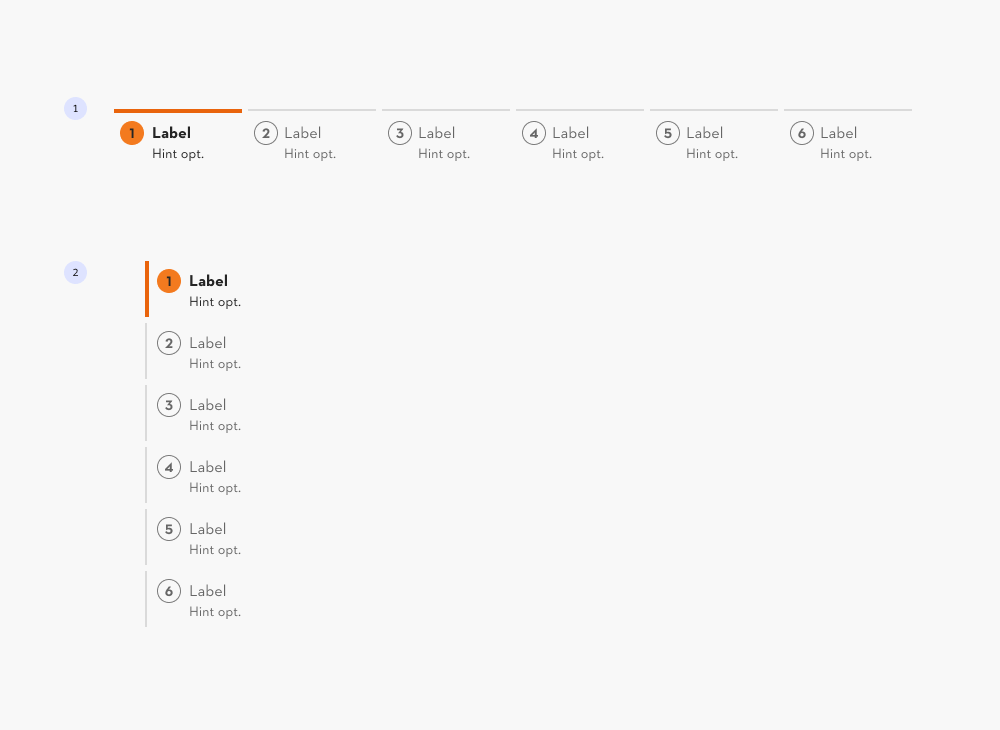

### Sizing

#### Horizontal Orientation

1. **Stepper**
- **Width:** Fixed (aligned to grid)
- **Height:** Hug contents
1. **Step:**
- **Width:** Fill container — min. 128 px
- **Height:** Hug contents — min. 46 px, max. 104 px

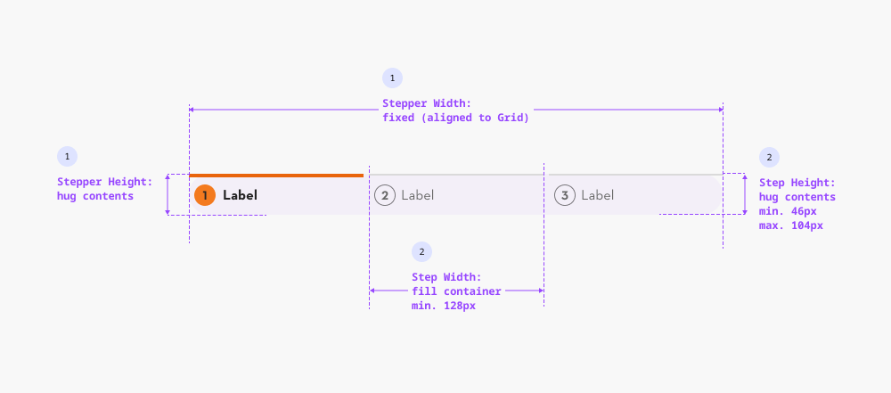

#### Vertical Orientation

1. **Stepper**
- **Width:** Fixed (aligned to grid)
- **Height:** Hug contents
1. **Step:**
- **Width:** Fill container — min. 128 px, max. 312 px
- **Height:** Hug contents — min. 52 px, max. 96 px

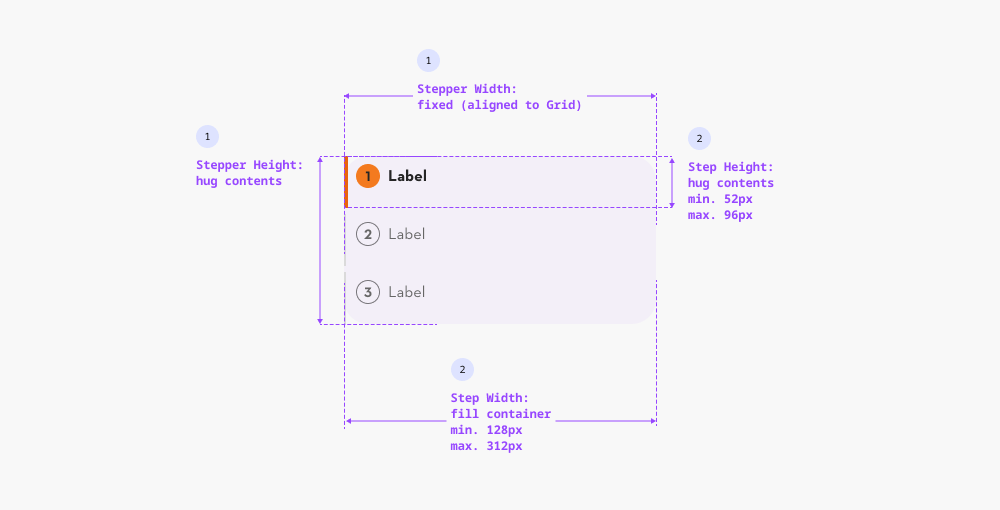

### Spacing

#### Distance

Regardless of orientation, the spacing between individual stepper elements is set to **4 px.**

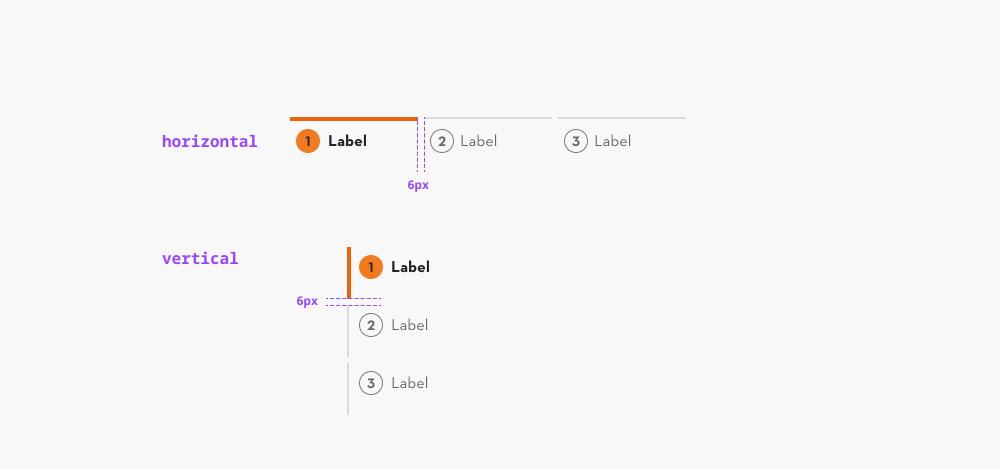

### Placement

#### Stepper above the Content

Both **Horizontal and Vertical Steppers** can be placed above the content depending on breakpoints.

1. **Horizontal Stepper** for Desktop and Tablet
1. **Vertical Stepper** for Mobile
1. **Vertical Stepper** within an Accordion for Mobile

Placing the stepper above the content follows the natural reading flow and is recommended for flows with fewer than four steps.

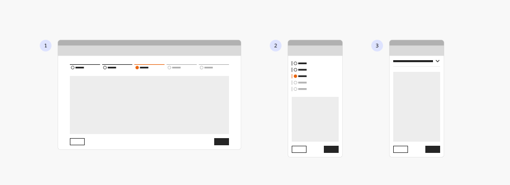

#### Stepper beside the Content

Only the **Vertical Stepper** can be placed beside the content.

1. **Left side (default):** Place the stepper to the left of the content area to preserve natural reading order and maintain consistency across responsive breakpoints.
1. **Right side:** Use only when layout constraints require the main content or form to occupy the left column.

Placing the stepper beside the content works well when a persistent overview of all steps is needed, especially in desktop layouts with ample horizontal space or more than four steps.

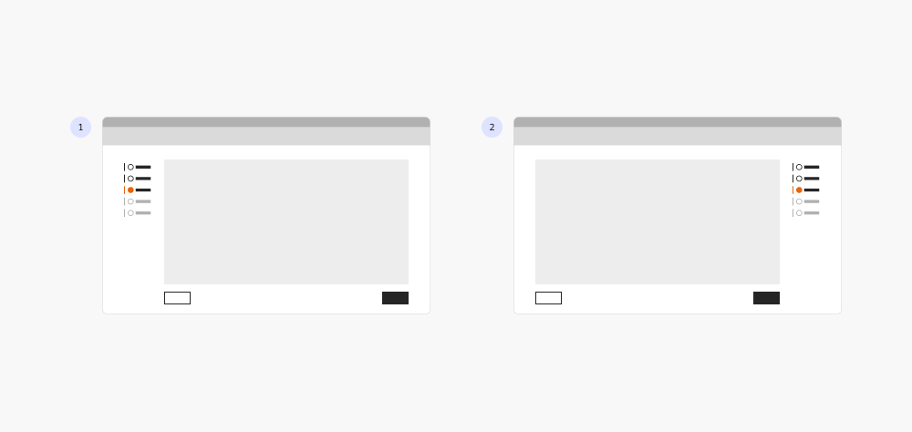

#### Placement of Stepper within the Grid

Both stepper variants — **Horizontal (1) and Vertical (2)** — can be placed freely within the grid and span the number of columns required by the layout.

Choose the number of columns carefully — ensure lthe Stepper has sufficient space to remain clear, well-structured, and easy to scan.

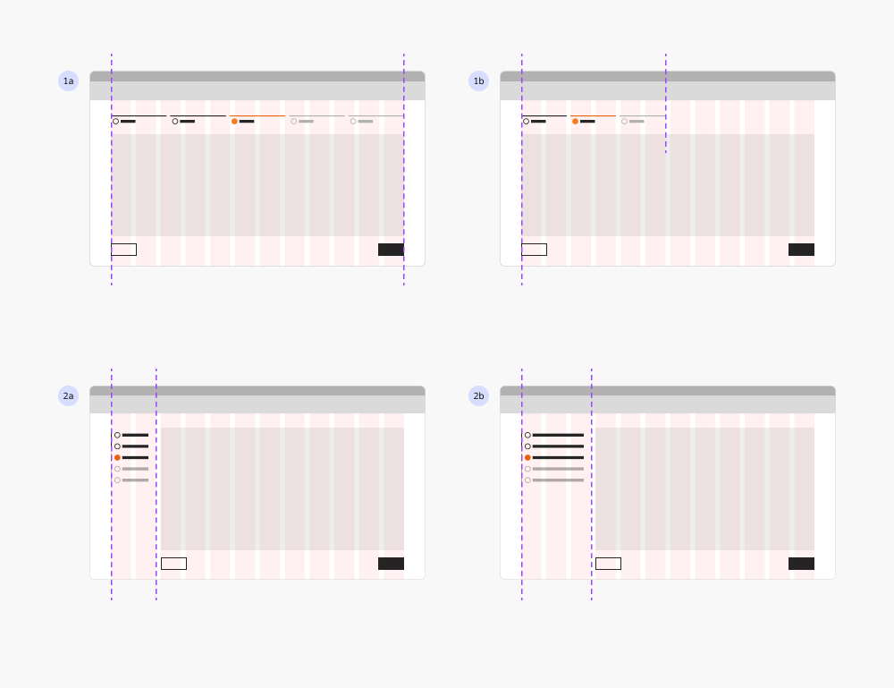

#### Placement of Step Controls (Button Group)

The step controls are always placed below the content, with the **Next button on the right** and the **Back button on the left**.

This serves as the recommended guideline but may be adjusted as needed to suit specific layouts.

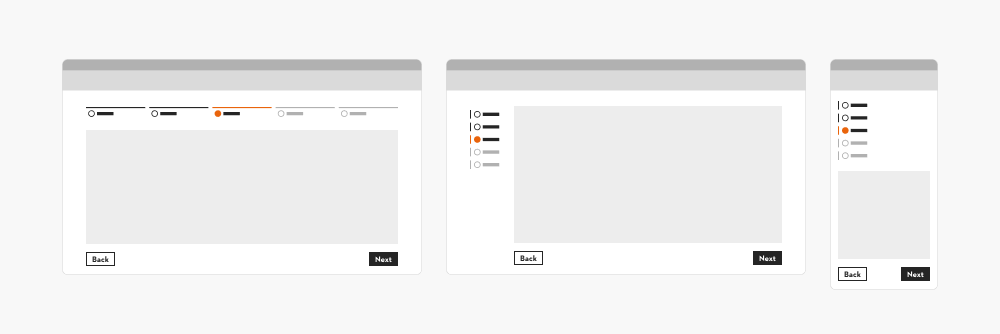

### Alignment

#### Aligned Left

When placed above, the content should always be aliged left with the content

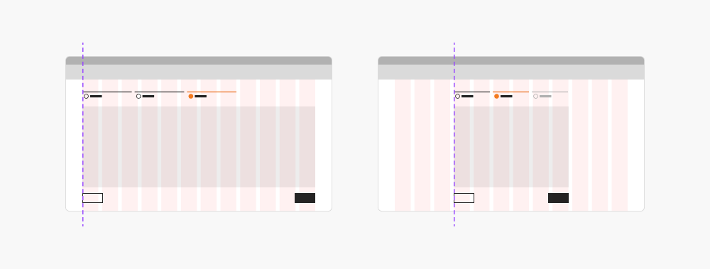

## Behavior & Usage

### Buttons

Steps in the Stepper are implemented as buttons (using variants of the action item). They are intended to transition between steps without leaving the current context and should **not**:

- Link to a different page
- Trigger a change in the URL

The Stepper is designed to guide users through a process within the same interface, keeping the user experience focused, seamless, and consistent.

### Process

#### Linear Flow

The Stepper supports a linear process, guiding users through steps in a defined order.

1. **Following steps** are locked until the current step is completed, ensuring users progress forward as intended.
1. The **Next button** allows users to proceed to the next step once all requirements of the current step are fulfilled.
1. **Previous steps** remain accessible, allowing users to navigate back and make changes if necessary — including skipping to an earlier step if needed.
1. The **Back button** enables users to return one step at a time.

This approach ensures a controlled forward progression while maintaining the flexibility to return to earlier steps for review or correction.

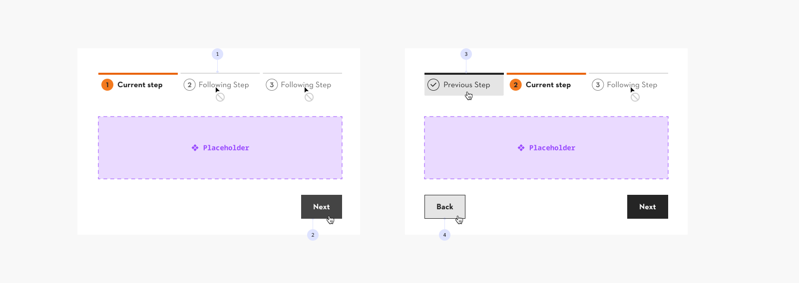

#### Initial State

When the Stepper is first displayed, the first step should be set to **“current”** by default.

This clearly indicates the starting point and provides a consistent entry for user navigation.

**Validation**

#### Current Step Validation

Validation occurs when the user selects the Next button to move to the following step. If errors are detected in the current step — such as missing or invalid input — the step cannot be marked as complete. All validation and error handling take place within the corresponding fieldset or form.

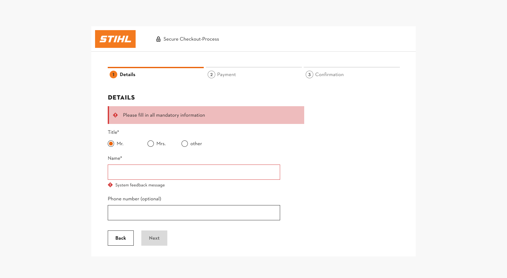

### Responsive behavior

#### Stepper above content

The horizontal Stepper adapts to available screen space and adjusts its layout based on breakpoints:

1. **Breakpoints XL & L (Desktop):** The Stepper is displayed horizontally and positioned above the content area.
1. **Breakpoint M (Tablet):** The Stepper remains horizontal and is positioned above the content. If all steps do not fit within the available width, overflow buttons appear to allow horizontal scrolling.
1. **Breakpoint S (Mobile):** The Stepper switches to a stacked layout and remains above the content. It may appear as a **standard vertical Stepper (a)** or be placed **inside a sticky accordion (b)** (see below for details).

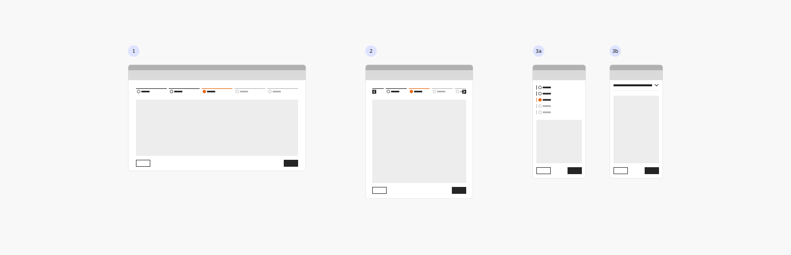

#### Stepper beside content

The vertical Stepper maintains a consistent orientation but adjusts its placement based on screen size:

1. **Breakpoints XL & L (Desktop):** The Stepper is displayed vertically and placed beside the content area — either to the left or right, depending on the layout.
1. **Breakpoint M (Tablet):** The Stepper remains vertical but is repositioned above the content to conserve horizontal space.
1. **Breakpoint S (Mobile):** The Stepper stays vertical and is placed above the content, ensuring all steps remain visible and accessible. As with the horizontal layout, it can appear as a **standard vertical Stepper (a)** or be nested **within a sticky accordion (b)** (see below).

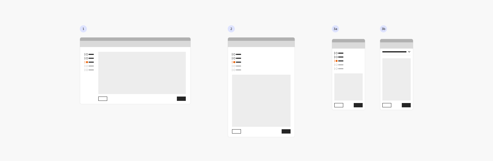

#### Stepper in an Accordion

On smaller breakpoints, where the vertical Stepper is placed above the content, embedding the Stepper inside a sticky Accordion component can help conserve space while keeping the steps easily accessible.

**This pattern is useful when:**

- The page is long, and users would otherwise need to scroll back up to access the Stepper.
- The steps should remain visible as users progress (sticky behavior).

**In this configuration:**

- The Accordion can be expanded by the user to view and navigate between steps.
- The Accordion summary should display the current step label.
- The Accordion hint should communicate progress, such as: “Step 2 of 5”.

This approach ensures that the Stepper remains accessible without taking up excessive screen space.

> **Note:** This is not a standalone Stepper variant. It is a composite pattern and is not provided as a coded component.

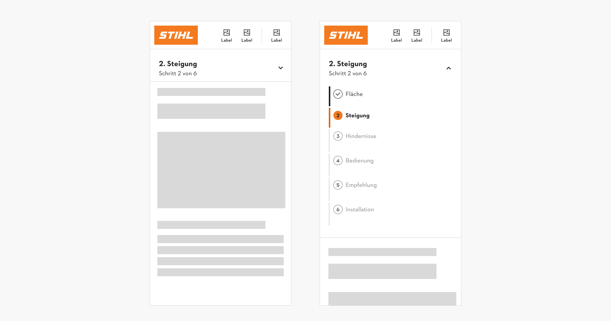

## Accessiblity

### Focus order

When the Stepper is opened via keyboard interaction, focus is automatically placed on the **first focusable element.**

Focus then moves in a logical sequence:

- **Left to right** for horizontal orientation **(1-4)**
- **Top to bottom** for vertical orientation **(1-4)**

This ensures a predictable and accessible navigation experience for keyboard users.

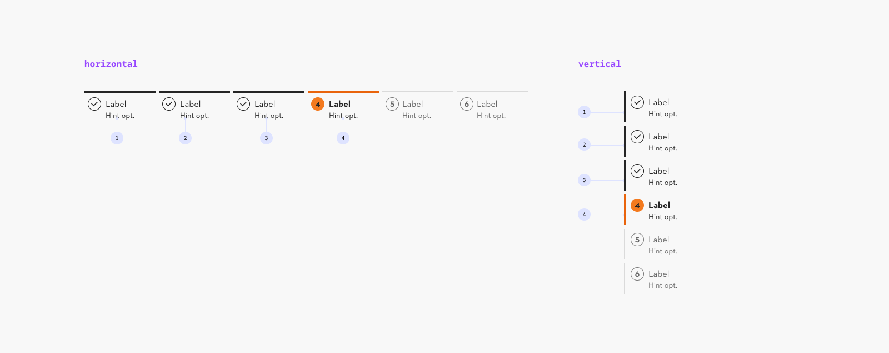

### Keyboard Navigation

#### Keyboard Navigation

Users can interact with the Stepper using the following keyboard actions:

- **Open** the Step by pressing **“Space”** or **“Enter”**.
- **Navigate forward** to the next focusable element with **“Tab”**.
- **Navigate backward** to the previous focusable element with “**Shift + Tab”**

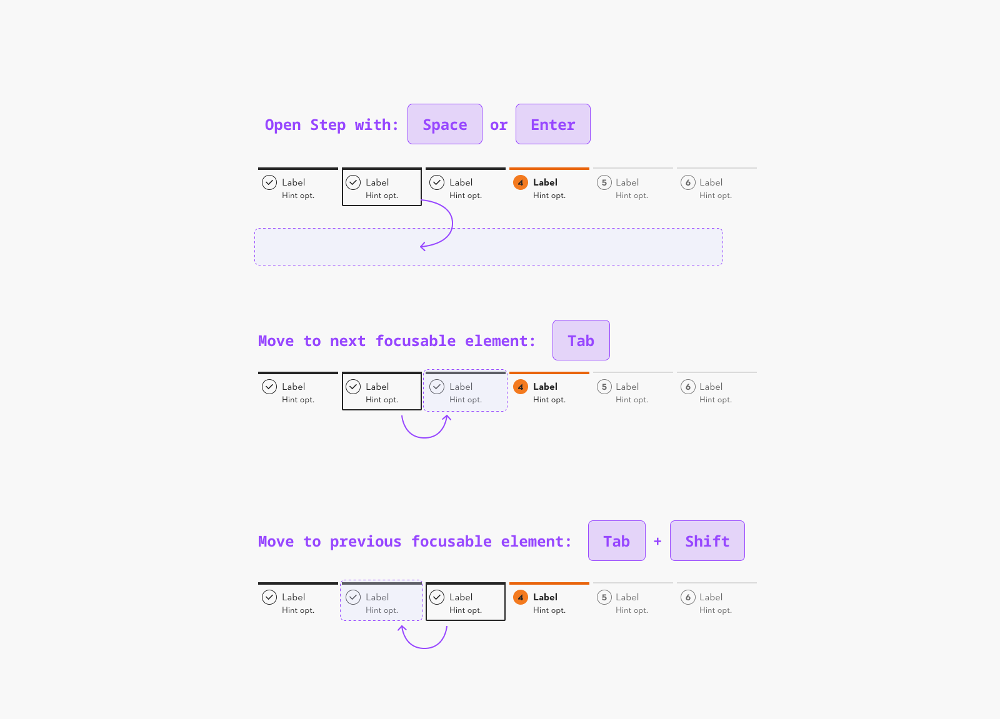

### Step Controls (Button Group)

**The Stepper should not be the only way to navigate through a multi-step process.** To ensure accessibility and usability.

Provide **additional Step Controls** within the content area, **such as a Button Group.**

This ensures that all users, including those relying on screen readers or keyboard navigation, can move through the process without relying solely on the stepper.

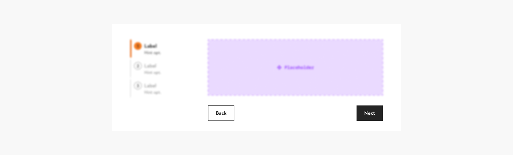

## Examples

### Checkout Process

Example of the new version of the stepper guides users through the checkout flow, making each stage— such as shipping, payment, and confirmation — clear and trackable.

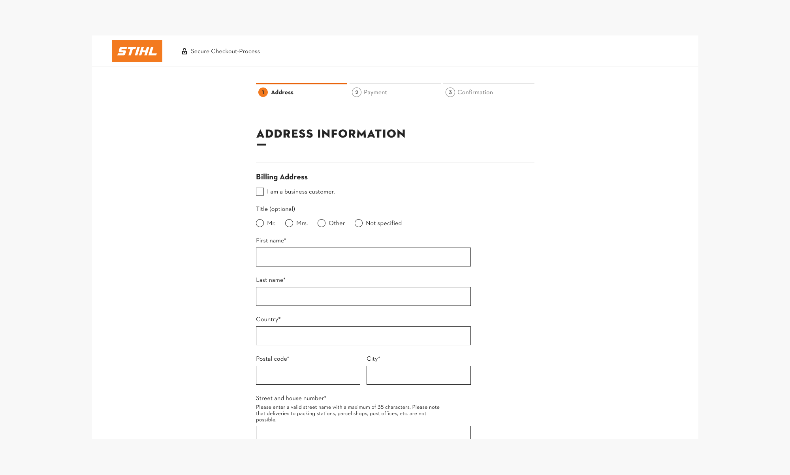

### Product Advisors

Example how the stepper could be adapted in product advisor tools, helping users progress through a guided sequence of questions and recommendations while showing how many steps remain.

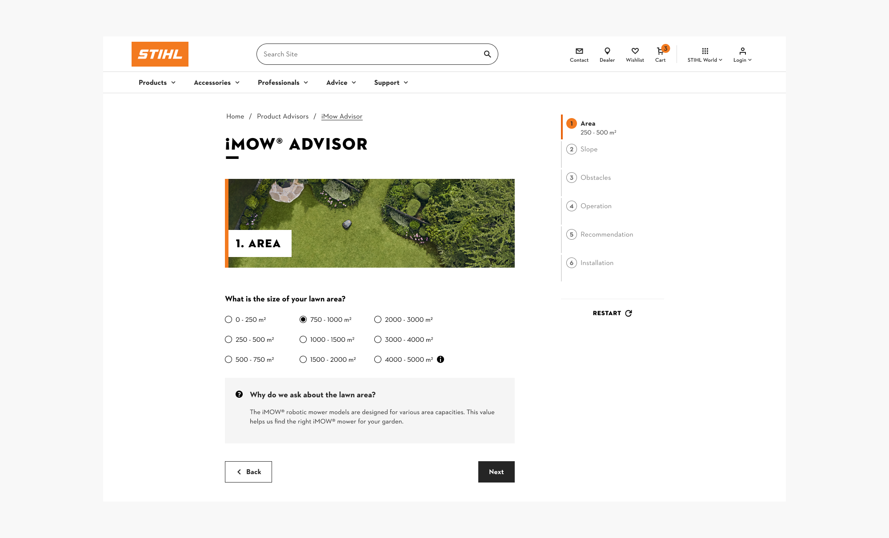

## Content and Assets

### Number of steps

A Stepper should contain

- **a minimum of 3 steps** Fewer than three steps do not require a Stepper, as the process is too short.
- **a maximum of 6 steps** More than six steps can overwhelm users and should be divided into smaller processes or grouped into sections.

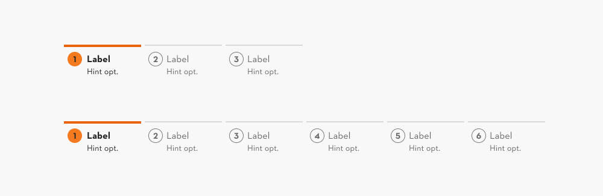

### Label Wording

Keep step labels short, clear, and action-oriented — **ideally one to two words.**

Labels should describe the step’s purpose at a glance (e.g., Details, Payment, Confirmation).

Avoid long phrases, punctuation, or unnecessary verbs to maintain readability and visual balance.

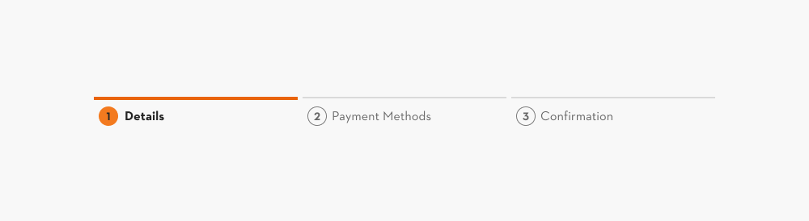

### Maximum Character Count

1. **Step labels** should not exceed 25 characters and should fit within two lines maximum.
1. **Hints** should not exceed 48 characters (or equivalent short text) and should also be limited to two lines.

> Keeping text concise helps maintain alignment and prevents layout inconsistencies across breakpoints.

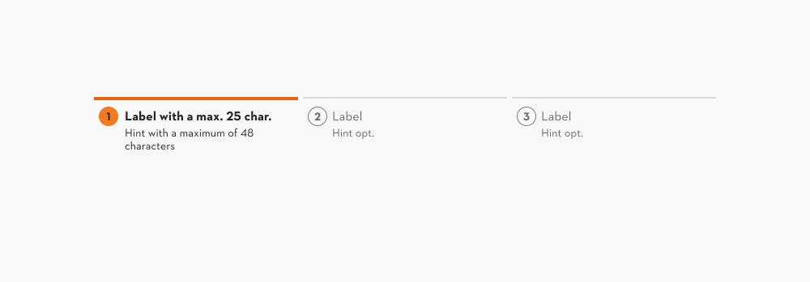

### Overflow Behavior

When the number of steps exceeds the available horizontal space, the Scroller component is used to navigate between steps.

There is no overflow behavior in the vertical orientation.

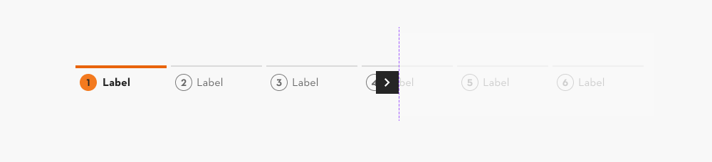

### Don’t truncate labels

Labels — especially in critical user flows such as transactions, deliveries, payments, or returns — should never be truncated.

Truncated text reduces clarity and can hinder understanding of the current step.

Whenever possible, allow labels to wrap to a second line rather than cutting off important information.

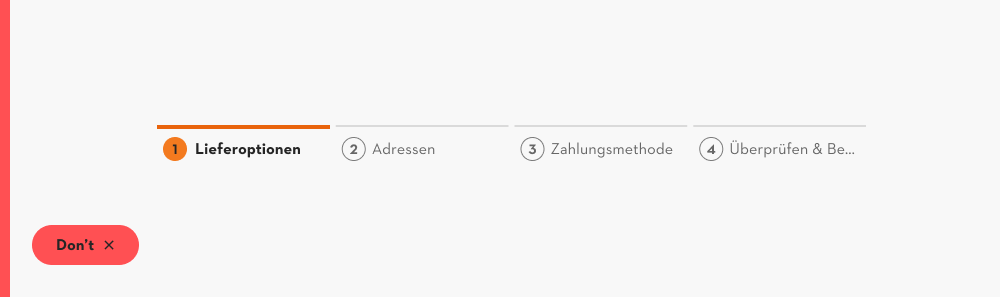

### Don’t use substeps

Do not nest or layer sub-steps within a Stepper.

Each step should represent a single, clear stage in the overall process.

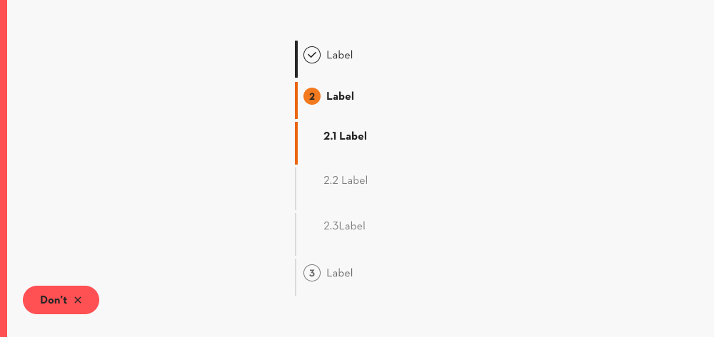

### Don’t mix variants (with and without hint)

All steps within a Stepper should follow a consistent pattern — either all include hints, or none do.

If only one step requires additional explanation, place that information directly within the step’s content area instead of the Stepper itself.

> Edgecase: In certain flows (i.e. [product advisors](https://www.figma.com/design/qXldpLO6gxHJNLdcXIPxYt?node-id=38478-4243)), hints may be used progressively to display a summary of user selections once a step is completed.

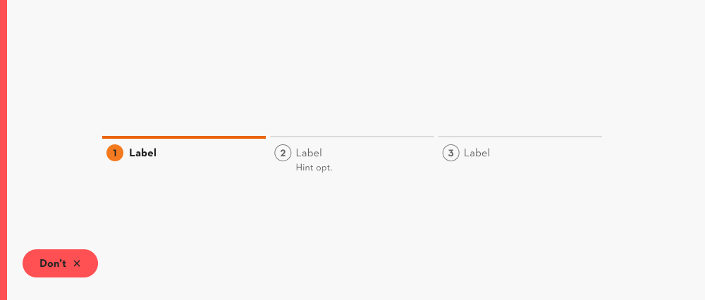

### Don’t use redundant labels

Do not use redundant labels such as “Step 1”, “Step 2”, etc.

The Stepper’s visual structure already communicates order — labels should instead focus on **descriptive** names that clarify the purpose of each step (e.g Details, Payment Method and Condirmation

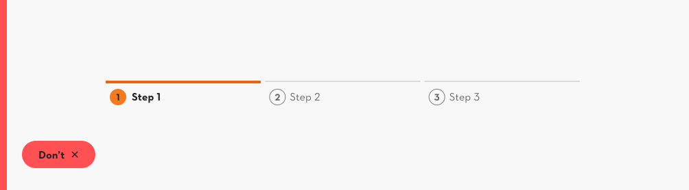

## Stepper: Pattern

- Patterns are provided for the Stepper component, designed to support a variety of use cases. These ready-to-use frames includes three key elements:
   - Stepper
   - Content Placeholder
   - Button Group (coming soon)
- These pattern promote consistency across implementations while allowing for easy customization and flexibility to suit specific needs.

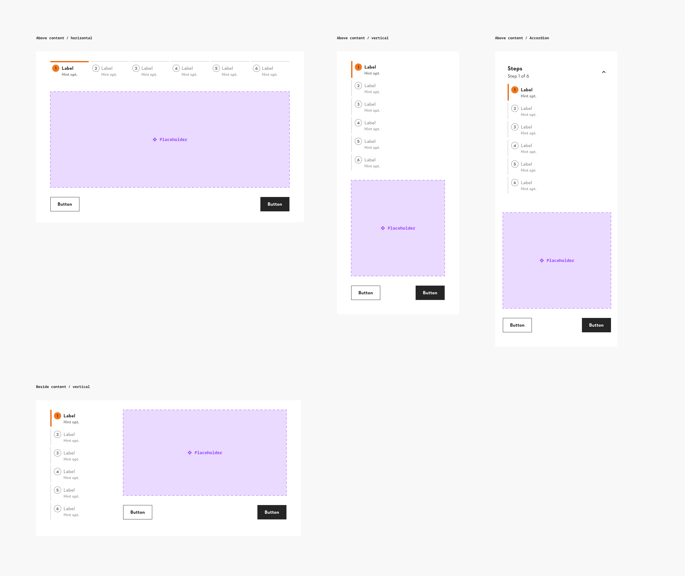
