# Stepper

## Stepper

- Visualizes a multi-step process (3–6 steps) and shows current, completed, and upcoming steps.
- Guides users through tasks in a defined order with clear progress feedback.
- Best for long forms, onboarding, checkouts, or processes where validation is needed before continuing.
- Avoid using for fewer than 3 steps, non-linear/reorderable flows, or processes with changing step counts.

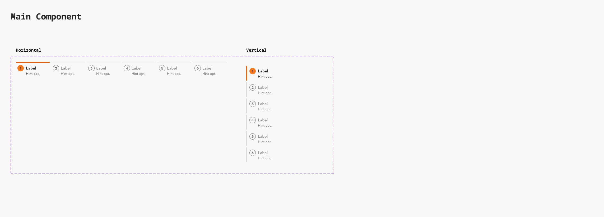

_Figure: Main Component of the Stepper in two orientations, Horizontal and Vertical, each with six steps showing Label and Hint opt. Step 1 is the current step (orange filled number badge, bold label, orange step line), steps 2 to 6 are incomplete (outlined number badge, grey label, grey step line), and the step line sits above each step in the horizontal variant and to the left in the vertical variant._

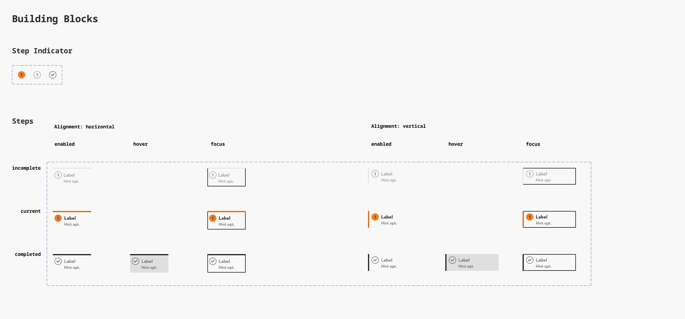

_Figure: Building Blocks of the Stepper. The Step Indicator appears as three circles with the number 1: incomplete (grey outline), current (orange filled) and complete (checkmark in a dark outline). Below, the Steps are shown for Alignment: horizontal and Alignment: vertical in the states enabled, hover and focus, for the statuses incomplete, current and completed, each with Label and Hint opt.; incomplete and current have no hover variant, hover shows a grey background, focus shows a dark outline, and the horizontal step has a minimum width of 128px._

### Further guidelines

[Storybook documentation](https://main--63440bbb95889041542a5ba3.chromatic.com/?path=/docs/components-notification--documentation&globals=backgrounds.name:!undefined;backgrounds.value:!undefined)

### Related elements

[Fieldset](https://www.figma.com/design/Ie2r0R9QwjEc7O3nrFbXhV/Web-Pattern-Library?node-id=8-154)

[Input](https://www.figma.com/design/qXldpLO6gxHJNLdcXIPxYt/Core-Components-%F0%9F%92%A0?node-id=1591-2)

[Notification](https://www.figma.com/design/qXldpLO6gxHJNLdcXIPxYt/Core-Components-%F0%9F%92%A0?node-id=7251-8)

[Tabs](https://www.figma.com/design/qXldpLO6gxHJNLdcXIPxYt/Core-Components-%F0%9F%92%A0?node-id=24564-312)

### Contribute

Contribute to improving this component by sharing your feedback, asking questions, or suggesting features [here](https://www.figma.com/design/lLmw7PfIdKjFG4uT3B2Hyj/Onboarding-%F0%9F%93%96?node-id=446-868&t=zKmRu4kAkxMeRDmK-4).

## Formatting and Construction

### Anatomy

#### Steps

Steps are the core building blocks of the Stepper. Each step combines visual indicators and descriptive text to communicate progress, provide context, and guide users through the process.

1. **Indicator** Displays the number of steps and visually communicates the status of each step.
1. **Label** A short, descriptive title that identifies the step.
1. **Hint (optional)** Provides additional context or guidance for the step, or summarizes a user’s selection.
1. **Step Line** A visual element that sits above each step, to indicate progress and reflect the status of individual steps.

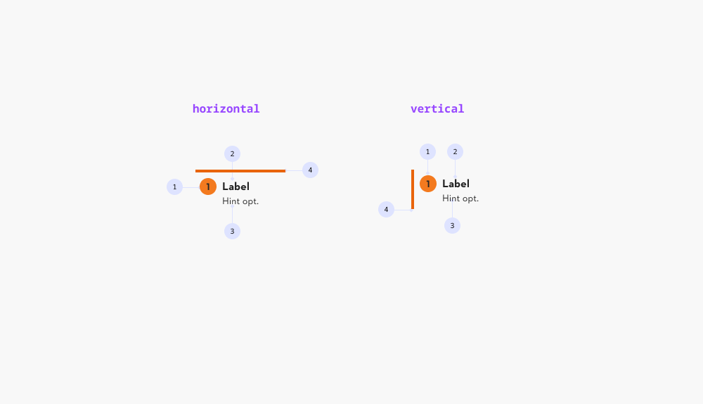

_Figure: Anatomy of a current step in the horizontal and vertical orientation with four numbered callouts. 1 points at the number Indicator, 2 at the Label, 3 at the Hint opt., and 4 at the orange Step Line above the step (horizontal) or beside it on the left (vertical)._

#### Stepper

The stepper serves as the container that groups all individual step elements. It visually connects the steps and communicates progress through their arrangement. Two orientation variants are available:

1. **horizontal**
1. **vertical**

allowing the component to adapt to different viewports and use cases.

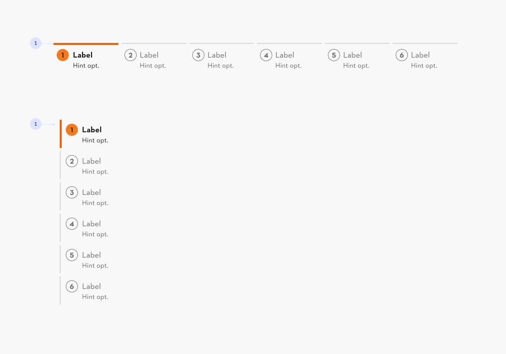

_Figure: The Stepper container (callout 1) in its two orientations, horizontal and vertical, each with six steps labelled Label and Hint opt. In both, step 1 is current (orange) and steps 2 to 6 are incomplete (grey)._

#### Pattern

The Stepper component doesn’t manage the entire flow on its own.

Each step must include:

1. **Stepper component**
1. **Content Placeholder**
1. **Step Control** (Button Group e.g., “Next” or “Back”)

The step controls handle step progression and validation, and are also an accessibility requirement, ensuring that keyboard and assistive technology users can move through the process.

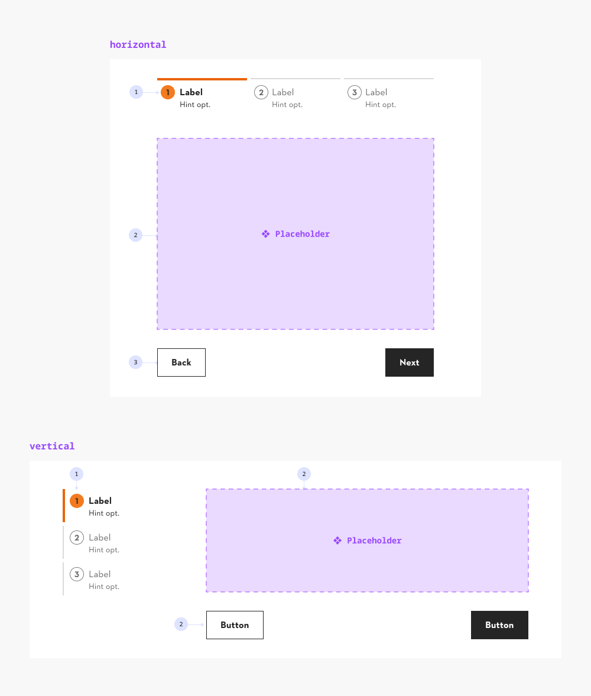

_Figure: Stepper pattern in a horizontal and a vertical layout, each with three steps, where callout 1 marks the Stepper component, callout 2 the Content Placeholder and callout 3 the Step Control. In the horizontal layout the stepper sits above the placeholder, with an outline Back button on the left and a filled Next button on the right below it. In the vertical layout the stepper sits on the left, with the placeholder to its right and an outline and a filled Button below it (both labelled Button)._

### State & Status

Each step in the Stepper has two distinct layers of visual feedback:

- **Interaction State:** How the step responds to user interactions (e.g., hover).
- **Step Status:** Where the step sits in the overall process (e.g., completed).

These layers work together to provide clear guidance and feedback.

#### Interaction States

Similar to button behavior, each step can display the following interaction states:

1. **Enabled** Default interactive state.
1. **Hover / Pressed** Visual feedback when a user hovers over or clicks the step.
1. **Focus** Indicates the step is currently focused.

> In code, the disabled state is implemented and used for the Incomplete status (see below). In Figma, a disabled state is intentionally omitted to reduce component complexity and prevent redundant property configurations.

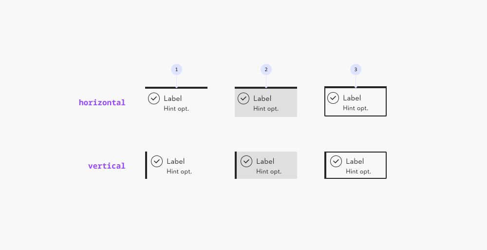

_Figure: Interaction states of a completed step (checkmark, Label, Hint opt.) in the horizontal and vertical orientation. Callout 1 is the enabled state (dark step line only), 2 is hover/pressed (grey background) and 3 is focus (dark outline around the step)._

#### Step Status

Each step also reflects its role in the overall flow using one of the following statuses:

1. **Incomplete** The step has not yet been started.
1. **Current** The step the user is currently on.
1. **Completed** The step has been successfully finished.

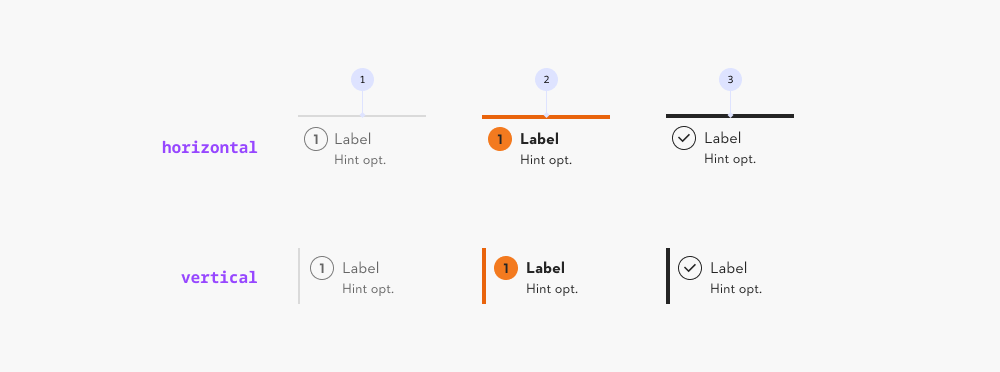

_Figure: Step statuses in the horizontal and vertical orientation, all in the enabled state. Callout 1 is Incomplete (outlined number, grey label and grey step line), 2 is Current (orange filled number, bold label, orange step line) and 3 is Completed (checkmark, dark step line)._

### Orientation

The Stepper supports two layout orientations:

1. **Horizontal Orientation** Use a horizontal stepper when conserving vertical space is important. Best suited for shorter processes with fewer steps that can be displayed side by side.
1. **Vertical Orientation** Choose a vertical stepper when vertical space is available. This orientation is ideal for smaller screens, longer labels, or more complex flows with several steps.

> Whenever possible, prefer the vertical layout for improved flexibility and readability.

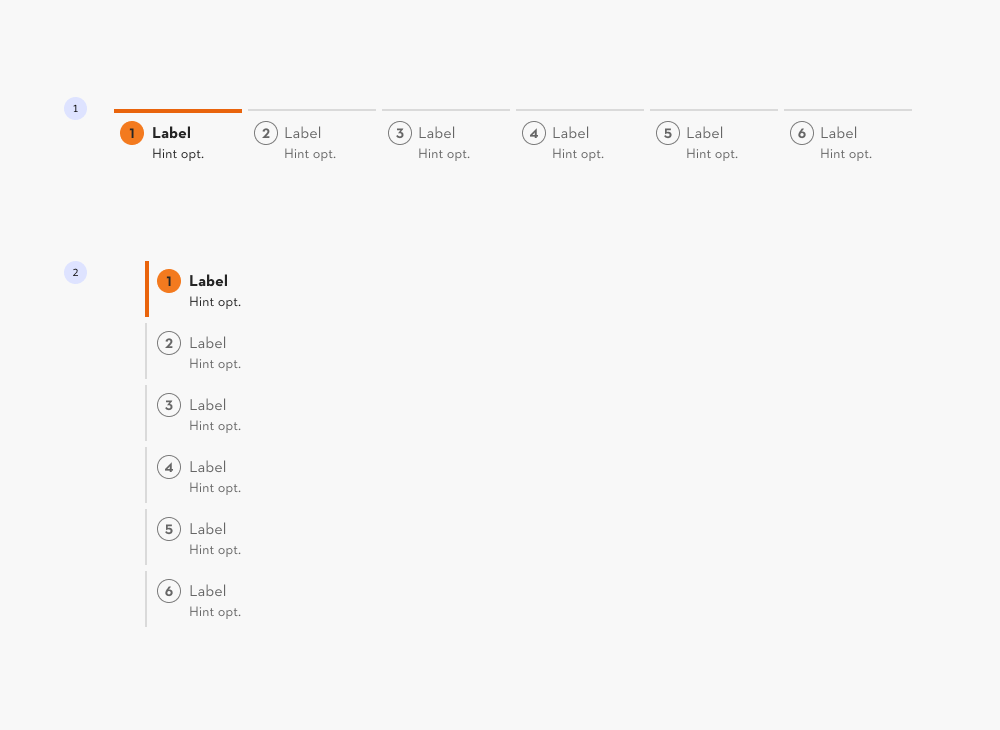

_Figure: The two Stepper orientations with six steps each (Label, Hint opt.; step 1 current, steps 2 to 6 incomplete). Callout 1 is the horizontal stepper with step lines above the steps, callout 2 is the vertical stepper with step lines at the left of the steps._

### Sizing

#### Horizontal Orientation

1. **Stepper**
- **Width:** Fixed (aligned to grid)
- **Height:** Hug contents
1. **Step:**
- **Width:** Fill container — min. 128 px
- **Height:** Hug contents — min. 46 px, max. 104 px

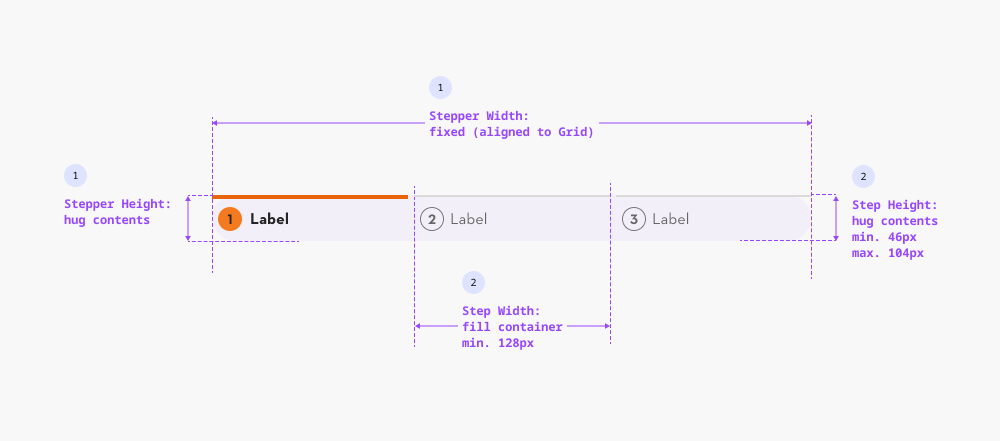

_Figure: Sizing of the horizontal stepper with three steps. Callout 1 marks the Stepper with Stepper Width: fixed (aligned to Grid) and Stepper Height: hug contents; callout 2 marks the Step with Step Width: fill container, min. 128px and Step Height: hug contents, min. 46px, max. 104px._

#### Vertical Orientation

1. **Stepper**
- **Width:** Fixed (aligned to grid)
- **Height:** Hug contents
1. **Step:**
- **Width:** Fill container — min. 128 px, max. 312 px
- **Height:** Hug contents — min. 52 px, max. 96 px

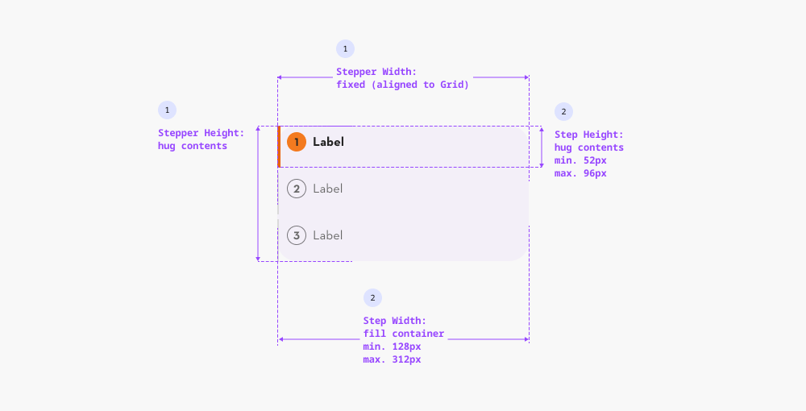

_Figure: Sizing of the vertical stepper with three steps. Callout 1 marks the Stepper with Stepper Width: fixed (aligned to Grid) and Stepper Height: hug contents; callout 2 marks the Step with Step Width: fill container, min. 128px, max. 312px and Step Height: hug contents, min. 52px, max. 96px._

### Spacing

#### Distance

Regardless of orientation, the spacing between individual stepper elements is set to **4 px.**

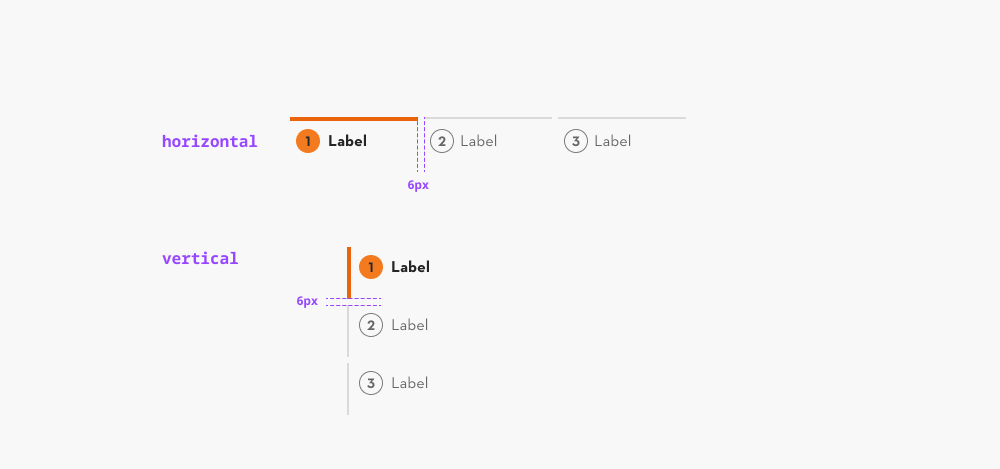

_Figure: Stepper in two orientations, each with three steps labelled "1 Label" (current, orange), "2 Label" and "3 Label" (following, grey). In the horizontal stepper the 6px measurement marks the gap between the progress lines of neighbouring steps, and in the vertical stepper it marks the gap between the vertical bars of neighbouring steps._

### Placement

#### Stepper above the Content

Both **Horizontal and Vertical Steppers** can be placed above the content depending on breakpoints.

1. **Horizontal Stepper** for Desktop and Tablet
1. **Vertical Stepper** for Mobile
1. **Vertical Stepper** within an Accordion for Mobile

Placing the stepper above the content follows the natural reading flow and is recommended for flows with fewer than four steps.

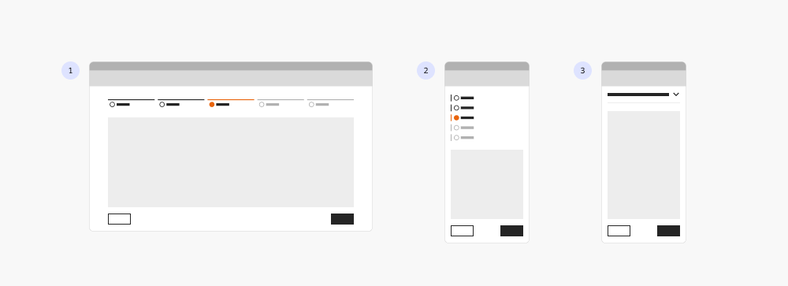

_Figure: Three wireframes of a stepper placed above the content, each with a content placeholder and Back and Next buttons below. Callout 1 is a Horizontal Stepper with five steps in a row for Desktop and Tablet, callout 2 is a Vertical Stepper with five steps stacked above the content for Mobile, and callout 3 is a Vertical Stepper collapsed within an Accordion (a dropdown header with chevron) for Mobile._

#### Stepper beside the Content

Only the **Vertical Stepper** can be placed beside the content.

1. **Left side (default):** Place the stepper to the left of the content area to preserve natural reading order and maintain consistency across responsive breakpoints.
1. **Right side:** Use only when layout constraints require the main content or form to occupy the left column.

Placing the stepper beside the content works well when a persistent overview of all steps is needed, especially in desktop layouts with ample horizontal space or more than four steps.

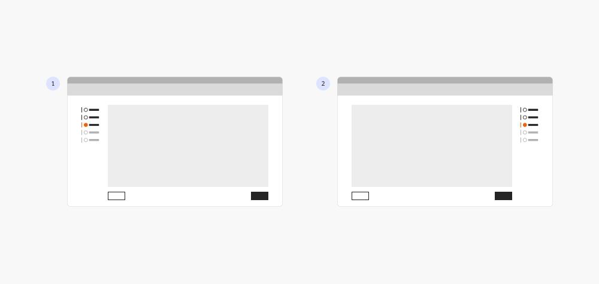

_Figure: Two desktop wireframes with a Vertical Stepper of five steps beside the content area, which has Back and Next buttons below it. Callout 1 shows the stepper on the left side of the content (default), callout 2 shows it on the right side of the content, used only when layout constraints require the content or form in the left column._

#### Placement of Stepper within the Grid

Both stepper variants — **Horizontal (1) and Vertical (2)** — can be placed freely within the grid and span the number of columns required by the layout.

Choose the number of columns carefully — ensure lthe Stepper has sufficient space to remain clear, well-structured, and easy to scan.

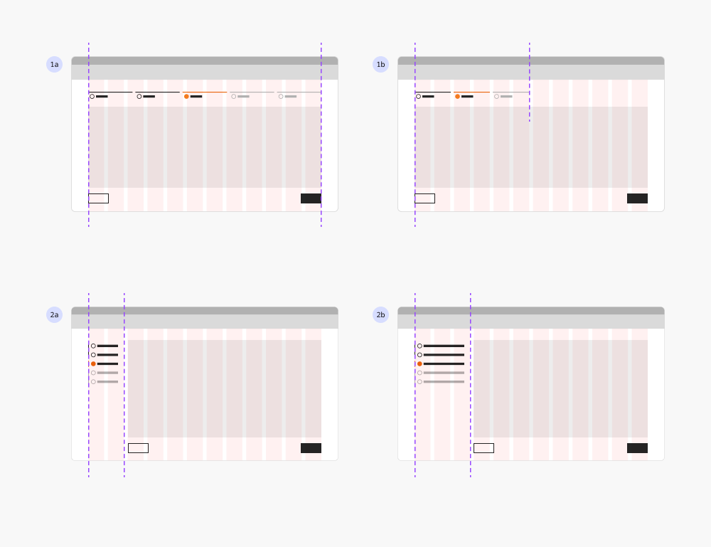

_Figure: Four wireframes with the column grid overlaid and purple guides marking the stepper's extent. 1a is a Horizontal Stepper with five steps spanning the full content width, 1b is a Horizontal Stepper with three steps spanning only about half the columns, 2a is a Vertical Stepper in a narrow left column of about one grid column with the content beside it, and 2b is a Vertical Stepper with longer labels spanning about two columns before the content starts._

#### Placement of Step Controls (Button Group)

The step controls are always placed below the content, with the **Next button on the right** and the **Back button on the left**.

This serves as the recommended guideline but may be adjusted as needed to suit specific layouts.

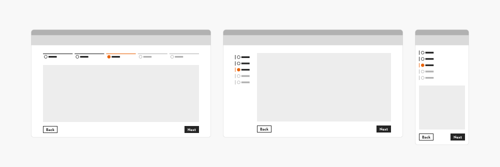

_Figure: Three wireframes (horizontal stepper on desktop, vertical stepper beside content on tablet, vertical stepper above content on mobile), each with the step controls below the content area. The "Back" outline button sits at the left edge and the filled "Next" button at the right edge._

### Alignment

#### Aligned Left

When placed above, the content should always be aliged left with the content

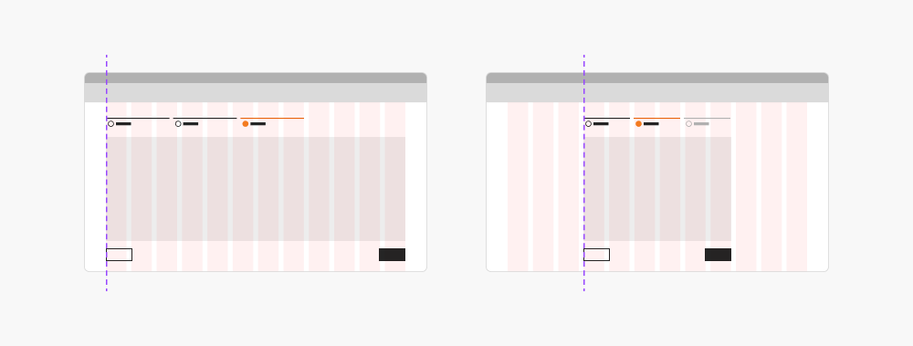

_Figure: Two wireframes with the grid overlaid, each with a three-step Horizontal Stepper above the content placeholder and Back and Next buttons below. In both, the left edge of the stepper is aligned with the left edge of the content and the Back button, marked by a purple guide, whether the content spans the full grid or only part of it._

## Behavior & Usage

### Buttons

Steps in the Stepper are implemented as buttons (using variants of the action item). They are intended to transition between steps without leaving the current context and should **not**:

- Link to a different page
- Trigger a change in the URL

The Stepper is designed to guide users through a process within the same interface, keeping the user experience focused, seamless, and consistent.

_Figure: A single step in the current state (orange numbered circle "1", bold "Label" and the hint "Hint opt." below) shown for the horizontal orientation with an orange line on top, and for the vertical orientation with an orange bar on the left._

### Process

#### Linear Flow

The Stepper supports a linear process, guiding users through steps in a defined order.

1. **Following steps** are locked until the current step is completed, ensuring users progress forward as intended.
1. The **Next button** allows users to proceed to the next step once all requirements of the current step are fulfilled.
1. **Previous steps** remain accessible, allowing users to navigate back and make changes if necessary — including skipping to an earlier step if needed.
1. The **Back button** enables users to return one step at a time.

This approach ensures a controlled forward progression while maintaining the flexibility to return to earlier steps for review or correction.

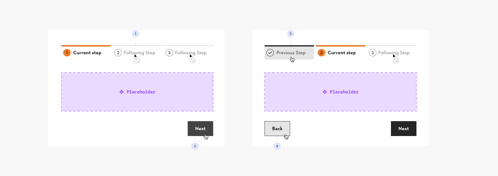

_Figure: Two horizontal steppers with a content placeholder and step controls. On the left, step 1 "Current step" is active with a hovered filled Next button, and callout 1 points at the "Following Step" items 2 and 3, which show a not-allowed cursor because they are locked, while callout 2 points at the Next button that proceeds once requirements are met. On the right, step 2 "Current step" is active, callout 3 points at the "Previous Step" 1 (completed check mark, hovered with a pointer cursor and still reachable), and callout 4 points at the hovered outline Back button that returns one step._

#### Initial State

When the Stepper is first displayed, the first step should be set to **“current”** by default.

This clearly indicates the starting point and provides a consistent entry for user navigation.

_Figure: Horizontal stepper with three steps when first displayed: step 1 "Current step" is set as current (orange circle, orange line, bold text, focus outline in purple), while steps 2 and 3 "Following Step" are grey._

**Validation**

#### Current Step Validation

Validation occurs when the user selects the Next button to move to the following step. If errors are detected in the current step — such as missing or invalid input — the step cannot be marked as complete. All validation and error handling take place within the corresponding fieldset or form.

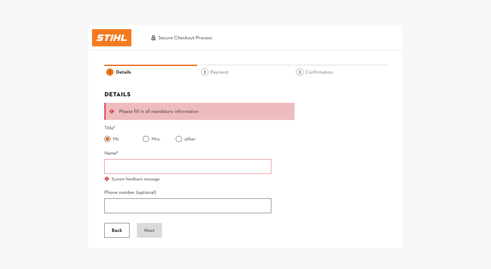

_Figure: Checkout page "Secure Checkout-Process" with a three-step stepper (1 "Details" current, 2 "Payment", 3 "Confirmation") above a Details form with an error notification "Please fill in all mandatory information". The form shows Title\* radios ("Mr." selected, "Mrs.", "other"), an invalid empty Name\* input with the "System feedback message" error, an optional Phone number input, an enabled outline "Back" button and a disabled "Next" button, so step 1 cannot be completed while errors remain._

### Responsive behavior

#### Stepper above content

The horizontal Stepper adapts to available screen space and adjusts its layout based on breakpoints:

1. **Breakpoints XL & L (Desktop):** The Stepper is displayed horizontally and positioned above the content area.
1. **Breakpoint M (Tablet):** The Stepper remains horizontal and is positioned above the content. If all steps do not fit within the available width, overflow buttons appear to allow horizontal scrolling.
1. **Breakpoint S (Mobile):** The Stepper switches to a stacked layout and remains above the content. It may appear as a **standard vertical Stepper (a)** or be placed **inside a sticky accordion (b)** (see below for details).

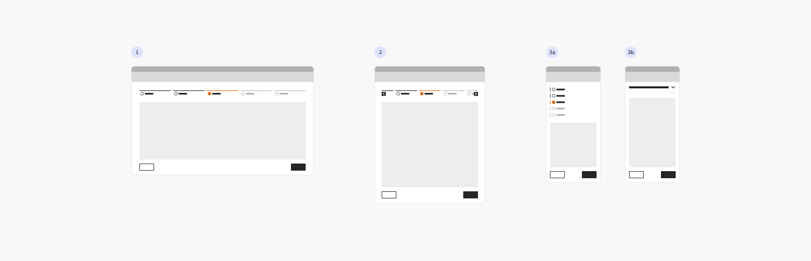

_Figure: Wireframes of the horizontal Stepper placed above the content at four breakpoints. Callout 1 shows desktop with all five steps in one row above the content area and a back and next button below. Callout 2 shows tablet with overflow arrow buttons at both ends of the Stepper, callout 3a shows mobile with a stacked vertical Stepper above the content, and callout 3b shows mobile with the Stepper collapsed into a single dropdown-style row._

#### Stepper beside content

The vertical Stepper maintains a consistent orientation but adjusts its placement based on screen size:

1. **Breakpoints XL & L (Desktop):** The Stepper is displayed vertically and placed beside the content area — either to the left or right, depending on the layout.
1. **Breakpoint M (Tablet):** The Stepper remains vertical but is repositioned above the content to conserve horizontal space.
1. **Breakpoint S (Mobile):** The Stepper stays vertical and is placed above the content, ensuring all steps remain visible and accessible. As with the horizontal layout, it can appear as a **standard vertical Stepper (a)** or be nested **within a sticky accordion (b)** (see below).

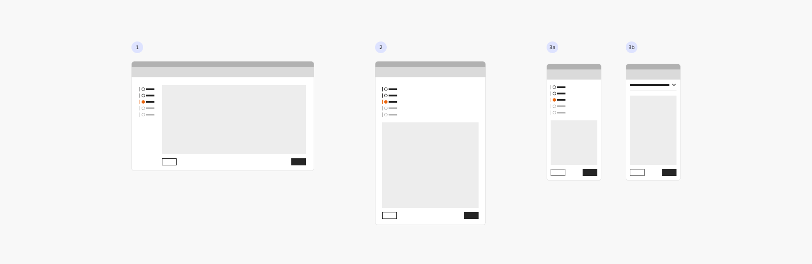

_Figure: Wireframes of the vertical Stepper at four breakpoints. Callout 1 shows desktop with the Stepper beside the content area on the left, callout 2 shows tablet with the vertical Stepper above the content, and callouts 3a and 3b show mobile with either the vertical Stepper listed above the content or collapsed into a single dropdown-style row._

#### Stepper in an Accordion

On smaller breakpoints, where the vertical Stepper is placed above the content, embedding the Stepper inside a sticky Accordion component can help conserve space while keeping the steps easily accessible.

**This pattern is useful when:**

- The page is long, and users would otherwise need to scroll back up to access the Stepper.
- The steps should remain visible as users progress (sticky behavior).

**In this configuration:**

- The Accordion can be expanded by the user to view and navigate between steps.
- The Accordion summary should display the current step label.
- The Accordion hint should communicate progress, such as: “Step 2 of 5”.

This approach ensures that the Stepper remains accessible without taking up excessive screen space.

> **Note:** This is not a standalone Stepper variant. It is a composite pattern and is not provided as a coded component.

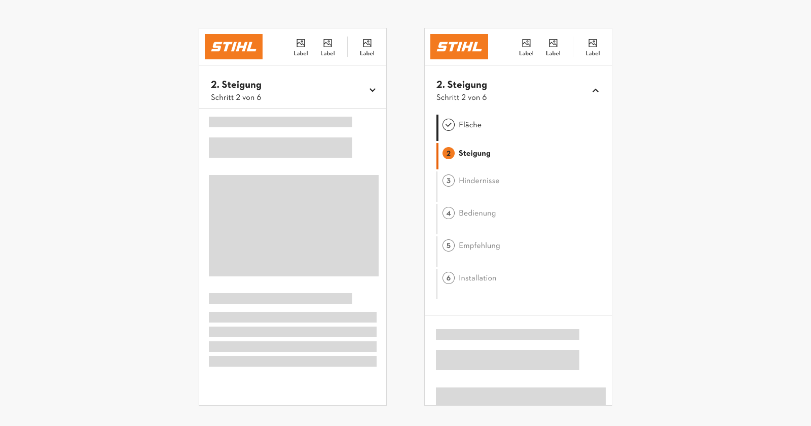

_Figure: Two mobile page layouts with the STIHL top bar showing a Stepper embedded in an Accordion. Left: the collapsed Accordion summary reads "2. Steigung" with "Schritt 2 von 6" and a downward chevron, above gray placeholder content. Right: the expanded Accordion (upward chevron) lists the vertical steps Fläche (completed, check icon), 2 Steigung (current, orange), 3 Hindernisse, 4 Bedienung, 5 Empfehlung and 6 Installation (upcoming, grey) above the placeholder content._

## Accessiblity

### Focus order

When the Stepper is opened via keyboard interaction, focus is automatically placed on the **first focusable element.**

Focus then moves in a logical sequence:

- **Left to right** for horizontal orientation **(1-4)**
- **Top to bottom** for vertical orientation **(1-4)**

This ensures a predictable and accessible navigation experience for keyboard users.

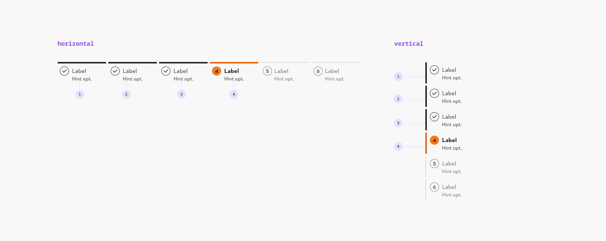

_Figure: Focus order of the Stepper with six steps, each showing a "Label" and "Hint opt.", in the "horizontal" and "vertical" orientation. Steps 1 to 3 are completed and step 4 is the current one (orange); steps 5 and 6 are upcoming. Numbered callouts 1 to 4 point at the first four steps in order, left to right for horizontal and top to bottom for vertical._

### Keyboard Navigation

#### Keyboard Navigation

Users can interact with the Stepper using the following keyboard actions:

- **Open** the Step by pressing **“Space”** or **“Enter”**.
- **Navigate forward** to the next focusable element with **“Tab”**.
- **Navigate backward** to the previous focusable element with “**Shift + Tab”**

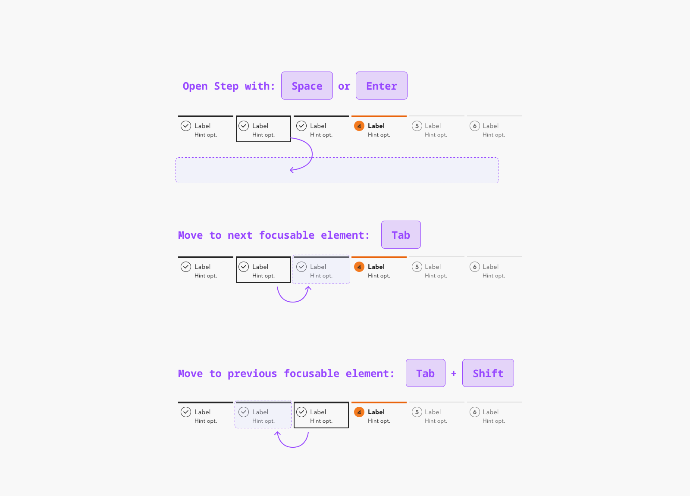

_Figure: Keyboard interaction for a horizontal Stepper with six steps (steps 1 to 3 completed, step 4 current, steps 5 and 6 upcoming). "Open Step with:" the "Space" or "Enter" key, which moves from the focused second step to a dashed content area below. "Move to next focusable element:" "Tab", which moves focus from the second to the third step. "Move to previous focusable element:" "Tab" + "Shift", which moves focus from the third back to the second step._

### Step Controls (Button Group)

**The Stepper should not be the only way to navigate through a multi-step process.** To ensure accessibility and usability.

Provide **additional Step Controls** within the content area, **such as a Button Group.**

This ensures that all users, including those relying on screen readers or keyboard navigation, can move through the process without relying solely on the stepper.

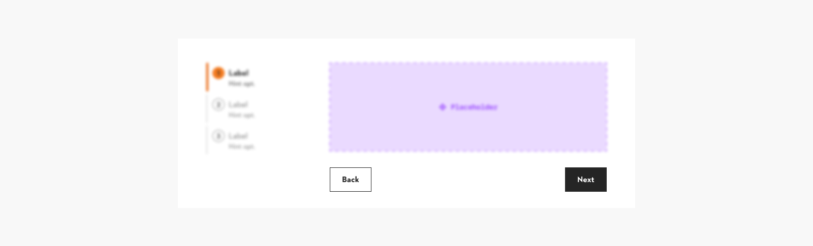

_Figure: A vertical Stepper with three steps (step 1 current, steps 2 and 3 upcoming, each with "Label" and "Hint opt.", shown blurred) beside a purple dashed "Placeholder" content area. Below the content is a Button Group with an outlined "Back" button on the left and a filled "Next" button on the right as additional step controls._

## Examples

### Checkout Process

Example of the new version of the stepper guides users through the checkout flow, making each stage— such as shipping, payment, and confirmation — clear and trackable.

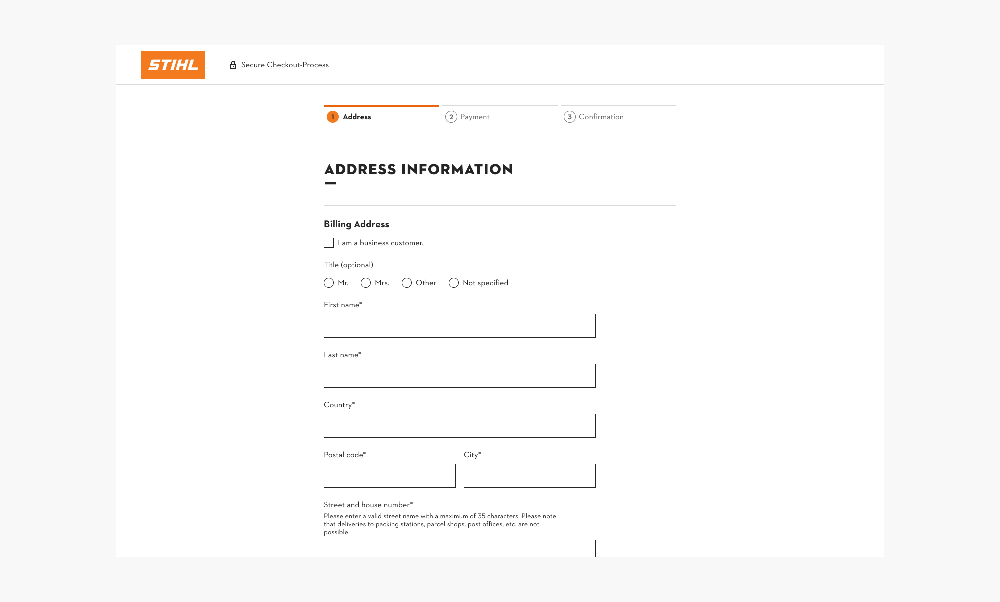

_Figure: Checkout page at desktop size with a header showing the STIHL logo and a lock icon with "Secure Checkout-Process". A horizontal Stepper below has three steps: 1 Address (current, orange), 2 Payment and 3 Confirmation. Under it is the "Address information" form with the "Billing Address" section: a "I am a business customer." checkbox, "Title (optional)" radio buttons (Mr., Mrs., Other, Not specified), and input fields for first name, last name, country, postal code, city and street and house number with a helper text._

### Product Advisors

Example how the stepper could be adapted in product advisor tools, helping users progress through a guided sequence of questions and recommendations while showing how many steps remain.

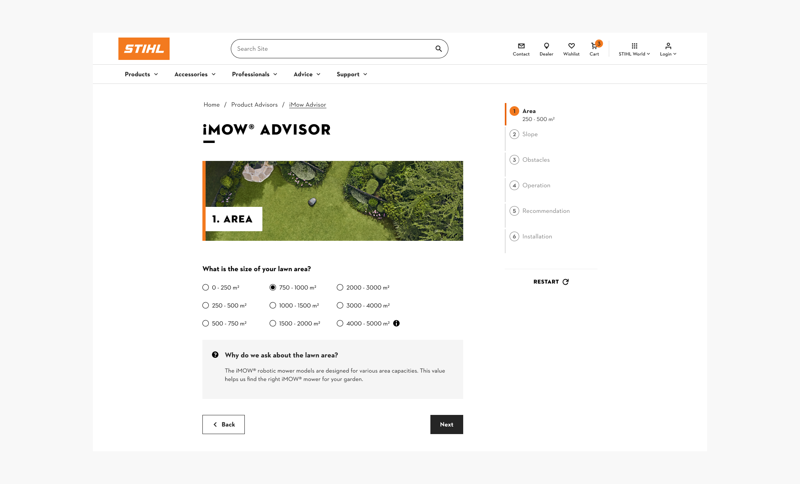

_Figure: iMOW Advisor product advisor page at desktop size with the STIHL header and navigation, breadcrumb "Home / Product Advisors / iMow Advisor", a hero image with the heading "1. Area", and a lawn-area question with radio options (750 - 1000 m² selected) plus a hint box and Back and Next buttons. A vertical Stepper sits at the right with six steps: 1 Area (current, hint "250 - 500 m²"), 2 Slope, 3 Obstacles, 4 Operation, 5 Recommendation and 6 Installation, with a "Restart" button below it._

## Content and Assets

### Number of steps

A Stepper should contain

- **a minimum of 3 steps** Fewer than three steps do not require a Stepper, as the process is too short.
- **a maximum of 6 steps** More than six steps can overwhelm users and should be divided into smaller processes or grouped into sections.

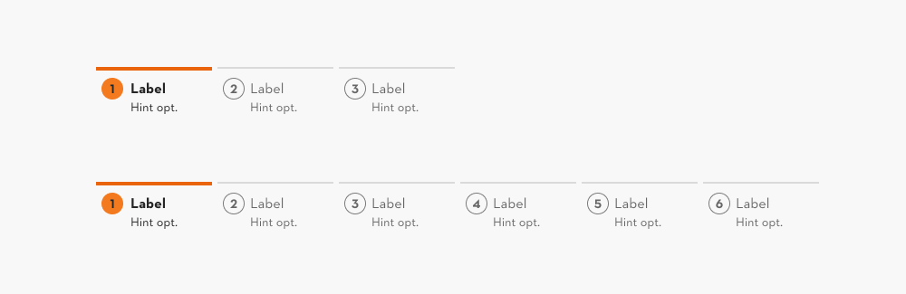

_Figure: Two horizontal Steppers. The upper one has the minimum of three steps (1 current in orange, 2 and 3 upcoming), and the lower one has the maximum of six steps (1 current, 2 to 6 upcoming), each with "Label" and "Hint opt."._

### Label Wording

Keep step labels short, clear, and action-oriented — **ideally one to two words.**

Labels should describe the step’s purpose at a glance (e.g., Details, Payment, Confirmation).

Avoid long phrases, punctuation, or unnecessary verbs to maintain readability and visual balance.

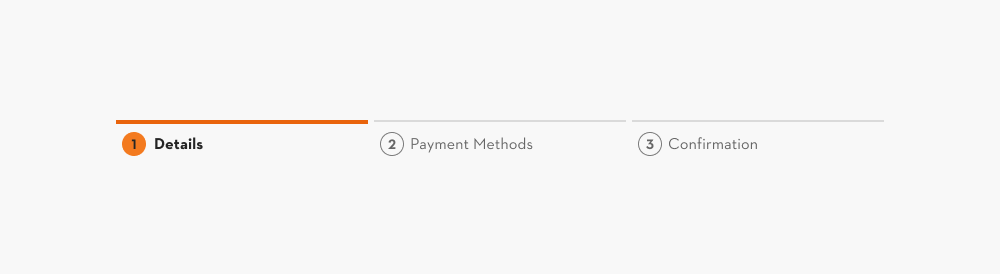

_Figure: A horizontal Stepper with three steps showing short labels: 1 "Details" (current, orange), 2 "Payment Methods" and 3 "Confirmation", illustrating labels of one to two words without hints._

### Maximum Character Count

1. **Step labels** should not exceed 25 characters and should fit within two lines maximum.
1. **Hints** should not exceed 48 characters (or equivalent short text) and should also be limited to two lines.

> Keeping text concise helps maintain alignment and prevents layout inconsistencies across breakpoints.

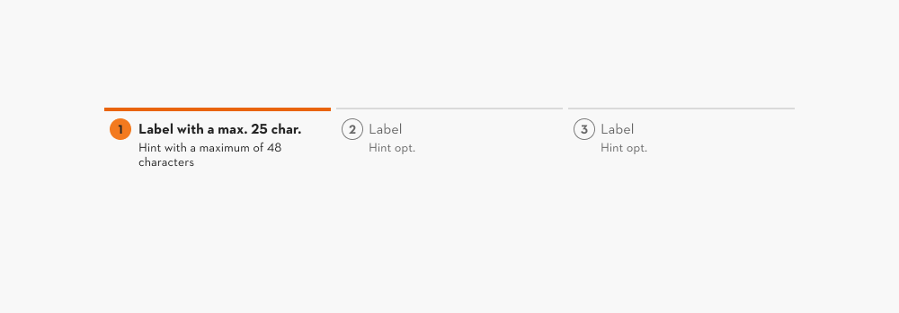

_Figure: Horizontal stepper with three steps; the active step 1 has an orange progress bar, a filled orange number badge, the bold label "Label with a max. 25 char." and the hint "Hint with a maximum of 48 characters" wrapping onto a second line. Steps 2 and 3 show the label "Label" and the hint "Hint opt." in grey._

### Overflow Behavior

When the number of steps exceeds the available horizontal space, the Scroller component is used to navigate between steps.

There is no overflow behavior in the vertical orientation.

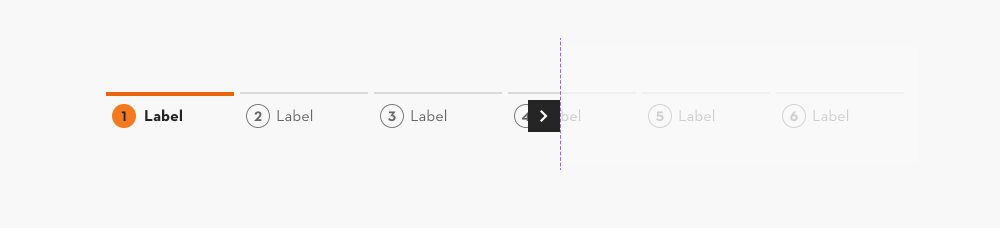

_Figure: Horizontal stepper with six steps (1 to 6, each labelled "Label") that does not fit the available width: step 1 is active, steps 4 to 6 fade out on the right, and a dark button with a right chevron at step 4 (the Scroller) lets users scroll to the hidden steps. A dashed purple vertical line marks the edge of the visible area._

### Don’t truncate labels

Labels — especially in critical user flows such as transactions, deliveries, payments, or returns — should never be truncated.

Truncated text reduces clarity and can hinder understanding of the current step.

Whenever possible, allow labels to wrap to a second line rather than cutting off important information.

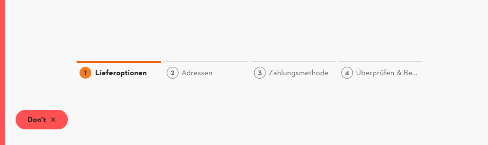

_Figure: Don't example: horizontal stepper with four steps, "Lieferoptionen", "Adressen", "Zahlungsmethode" and "Überprüfen & Bezahlen", where the last label is cut off with an ellipsis as "Überprüfen & Be..." instead of wrapping to a second line._

### Don’t use substeps

Do not nest or layer sub-steps within a Stepper.

Each step should represent a single, clear stage in the overall process.

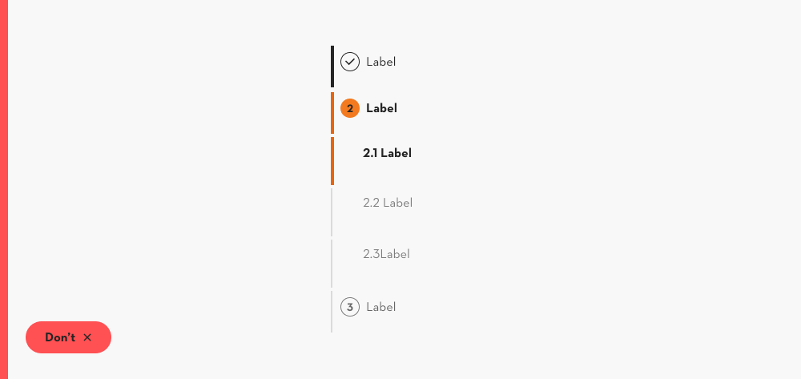

_Figure: Don't example: vertical stepper where step 1 is completed (check mark), step 2 "Label" is current, and below it the sub-steps "2.1 Label" (current, orange bar), "2.2 Label" and "2.3Label" are nested as indented items without number badges, followed by step 3. Sub-steps must not be nested in a stepper._

### Don’t mix variants (with and without hint)

All steps within a Stepper should follow a consistent pattern — either all include hints, or none do.

If only one step requires additional explanation, place that information directly within the step’s content area instead of the Stepper itself.

> Edgecase: In certain flows (i.e. [product advisors](https://www.figma.com/design/qXldpLO6gxHJNLdcXIPxYt?node-id=38478-4243)), hints may be used progressively to display a summary of user selections once a step is completed.

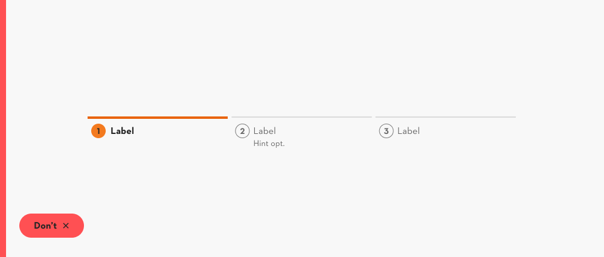

_Figure: Don't example: horizontal stepper with three steps where only step 2 shows the hint "Hint opt." while steps 1 and 3 have only the label "Label", so hints are mixed inconsistently across steps._

### Don’t use redundant labels

Do not use redundant labels such as “Step 1”, “Step 2”, etc.

The Stepper’s visual structure already communicates order — labels should instead focus on **descriptive** names that clarify the purpose of each step (e.g Details, Payment Method and Condirmation

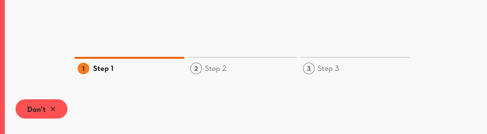

_Figure: Don't example: horizontal stepper with three steps labelled "Step 1", "Step 2" and "Step 3", which repeats the order already shown by the number badges instead of using descriptive names._

## Stepper: Pattern

- Patterns are provided for the Stepper component, designed to support a variety of use cases. These ready-to-use frames includes three key elements:
   - Stepper
   - Content Placeholder
   - Button Group (coming soon)
- These pattern promote consistency across implementations while allowing for easy customization and flexibility to suit specific needs.

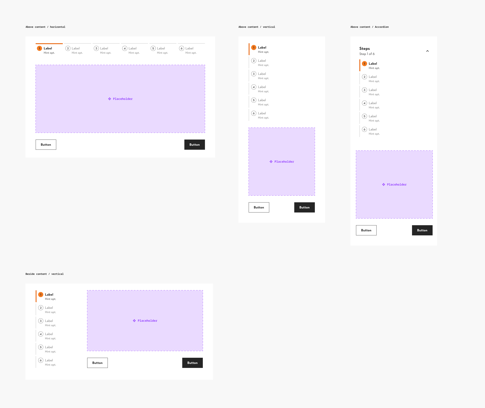

_Figure: Four stepper pattern layouts, each with a stepper of six steps ("Label" with "Hint opt."), a purple dashed "Placeholder" content area and an outline Button on the left plus a filled Button on the right: "Above content / horizontal", "Above content / vertical", "Above content / Accordion" (a collapsible accordion titled "Steps" with "Step 1 of 6" containing the vertical stepper) and "Beside content / vertical" (vertical stepper to the left of the content area)._
