# Switch

## Switch

Overview:

- The component has binary states: on or off.
- A switch is a button, not an input element. Use a single checkbox in forms.
- Switches are recommended for mobile use-cases, especially for settings.
- In web use-cases, consider that a state change instantly activates, if data-heavy tasks are connected, the user cannot interact with the page while loading.

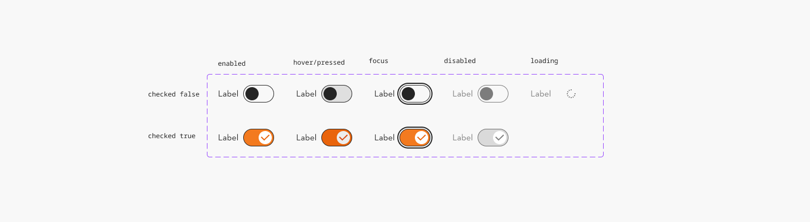

_Figure: Overview of the Switch with the label "Label" on its left, in a dashed purple frame. Columns are the states "enabled", "hover/pressed", "focus", "disabled" and "loading"; rows are "checked false" and "checked true". Unchecked: white track with a dark thumb on the left. Checked: orange track with a white thumb carrying a checkmark on the right. Hover/pressed has a darker fill (grey unchecked, darker orange checked). Focus adds a double dark outline around the track. Disabled is greyed out (grey label; grey thumb when unchecked, grey track with a white thumb and grey checkmark when checked). Loading is shown only for unchecked: the greyed label with a dotted spinner instead of the switch._

### Further guidelines

[Storybook documentation](https://main--63440bbb95889041542a5ba3.chromatic.com/?path=/docs/components-notification--documentation&globals=backgrounds.name:!undefined;backgrounds.value:!undefined)

Decision tree

### Related elements

[Button](https://www.figma.com/design/qXldpLO6gxHJNLdcXIPxYt?node-id=162-126)

[Checkbox](https://www.figma.com/design/qXldpLO6gxHJNLdcXIPxYt?node-id=1017-2316)

[Radio Group](https://www.figma.com/design/qXldpLO6gxHJNLdcXIPxYt?node-id=860-2728)

### Contribute

Contribute to improving this component by sharing your feedback, asking questions, or suggesting features [here](https://www.figma.com/design/lLmw7PfIdKjFG4uT3B2Hyj/Onboarding-%F0%9F%93%96?node-id=446-868&t=zKmRu4kAkxMeRDmK-4).

## Formatting and Construction

### Structure

1. **Switch** A clickable element indicating the appropriate state.
1. **Label** Copy that describes the current status.
1. **Thumb** Changes to opposite side, when toggled on/off

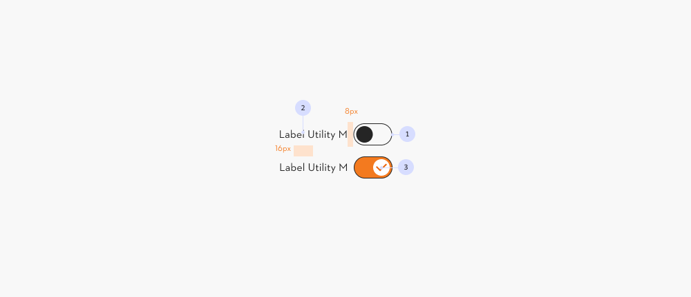

_Figure: Anatomy of the Switch with three numbered callouts, shown twice with the label "Label Utility M" on the left: unchecked (white track, dark thumb on the left) above checked (orange track, white thumb with checkmark on the right). Callout 1 points at the switch track, callout 2 at the label text, callout 3 at the thumb of the checked switch. An orange measurement "8px" marks the horizontal gap between the label and the switch, and "16px" marks the vertical gap between the two stacked switches._

### Alignment

#### Label placement

The default is label on the left, due the reading direction.

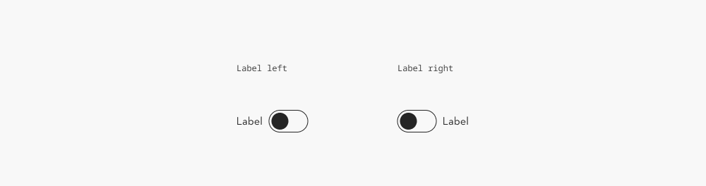

_Figure: Two unchecked, enabled switches side by side. "Label left" (the default, following reading direction) places the text "Label" to the left of the switch. "Label right" places the text "Label" to the right of the switch._

#### Use one label at a time

Do not use a label on both sides of the switch.

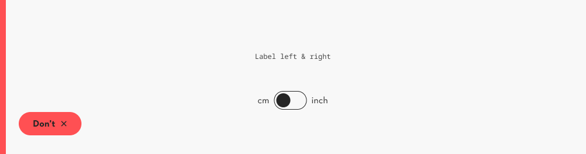

_Figure: Don't example, marked with a red "Don't" badge: "Label left & right". A single unchecked switch has a label on both sides, "cm" on the left and "inch" on the right. This is wrong because a switch must not have a label on both sides; use one label at a time._

#### Stretched

Use a stretched alignment **(1)** instead of a default alignment **(2)** in use-cases like settings on small viewports and/or narrow columns.

[Grid styles→](https://www.figma.com/design/JyyYtoCYbtJrzqHs38OXSQ/Grid-%26-Spacing-%F0%9F%A7%AE?node-id=1-132)

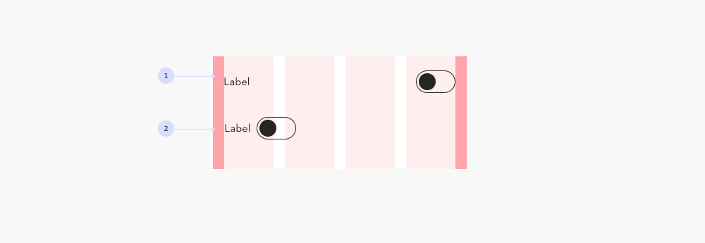

_Figure: Two switch alignments on a four-column grid with red margin bars and pink columns. Callout 1 is the stretched alignment: the label "Label" sits at the left edge and the unchecked switch at the far right edge of the grid. Callout 2 is the default alignment: the label "Label" followed directly by the unchecked switch on the left. Stretched is used for settings on small viewports and/or narrow columns._

#### Provide a section title for a group

Offer clear sections, when grouping multiple switches.

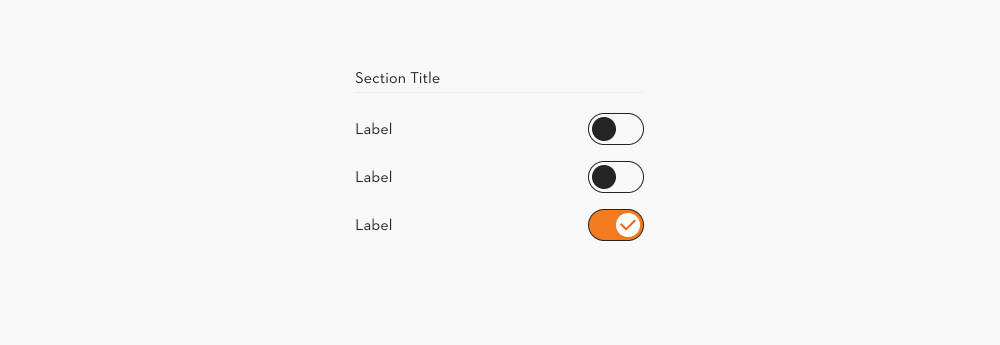

_Figure: Group of three switches under the section title "Section Title", which has a thin divider line below it. Each row has the label "Label" on the left and its switch right-aligned: the first two are unchecked (white track, dark thumb) and the third is checked (orange track, white thumb with checkmark). Grouped switches are given a clear section title._

## Content and Assets

### Label

Keep it to a minimum, around 2-4 words.

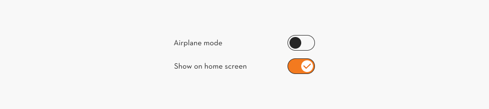

_Figure: Two switch rows with short labels of about 2 to 4 words, text on the left and switch right-aligned: "Airplane mode" with an unchecked switch (white track, dark thumb) and "Show on home screen" with a checked switch (orange track, white thumb with checkmark)._

### Naming a group

Naming a list is important for the user to scan and evaluate the relevance quickly.

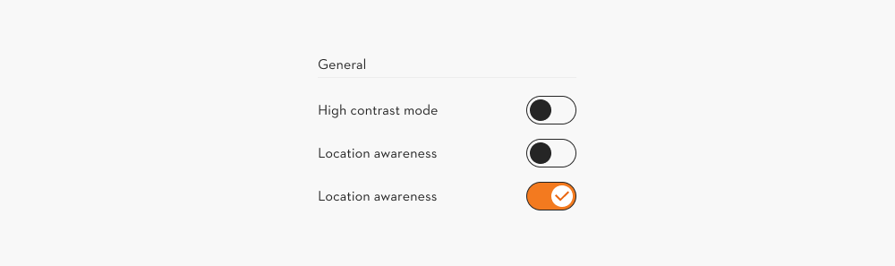

_Figure: Named group of switches under the heading "General", with a divider line below it. Three rows list the label on the left and the switch on the right: "High contrast mode" unchecked, "Location awareness" unchecked, and "Location awareness" checked (orange track, white thumb with checkmark). The group name lets users scan and judge relevance quickly._

### Define a clear aria label

The visible label of a switch can be ambiguous, as the switch influences the status. Make sure to clarify the function through the aria label.

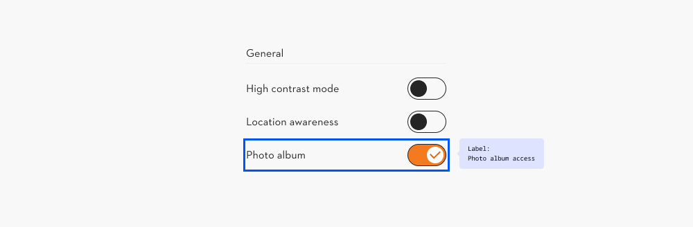

_Figure: Group "General" with three switches: "High contrast mode" unchecked, "Location awareness" unchecked, and "Photo album" checked (orange track, white thumb with checkmark). The "Photo album" row is highlighted with a blue outline, and a light blue note to its right reads "Label: Photo album access", showing the aria label that clarifies the function of the switch beyond its ambiguous visible label._

## Behavior

### Initial focus

The focus is set on the switch element, excluding the label.

The selected state (true of false) changes by pressing space bar.

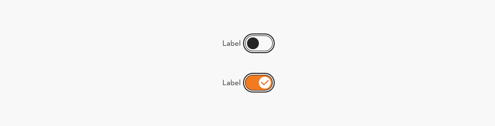

_Figure: Two switches in the focus state, stacked vertically, each with the label "Label" on the left. The upper switch is unchecked (white track, dark knob on the left), the lower one is checked (orange track, white knob with a check icon on the right). In both, a double outline ring around the switch element only, not around the label, marks the keyboard focus._

### Loading state

If the system cannot process a setting instantly, the loading state is shown. The user can’t interact with the switch meanwhile.

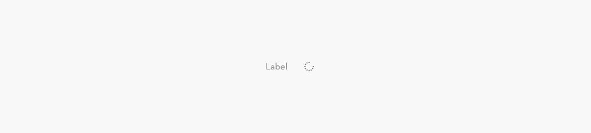

_Figure: Switch in the loading state: the label "Label" in grey text, followed by a small circular dotted spinner in place of the switch track and knob. The switch is not interactive while loading._

### Error handling

Do not combine error messages with the switch.

**In case a switch’s function does not execute, keep it at the former state.**

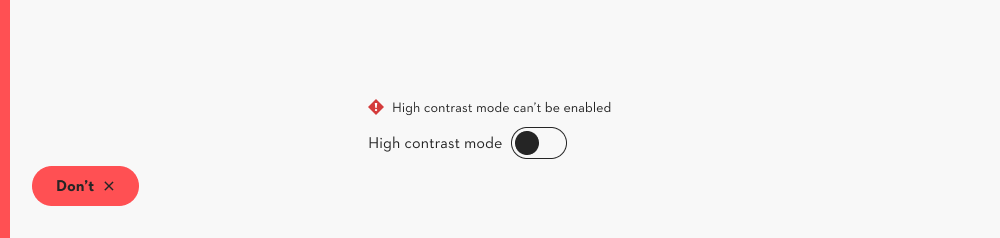

_Figure: Don't example: an unchecked switch labelled "High contrast mode" (dark knob on the left) with a red warning icon and the error message "High contrast mode can’t be enabled" above it. This is wrong because error messages must not be combined with the switch; if the function does not execute, the switch simply stays in its former state._

### Toast notification

It is possible to communicate system feedback to the user through a toast notification.

[Toast notification →](https://www.figma.com/design/qXldpLO6gxHJNLdcXIPxYt?node-id=8844-4923)

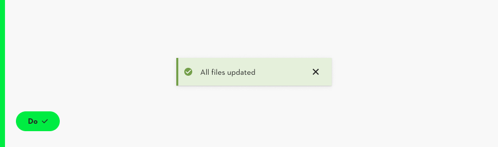

_Figure: Do example: a green success toast notification with a green check icon, the text "All files updated" and a close button (X) on the right. System feedback after a switch action can be communicated to the user through such a toast notification._

## Examples/Variations

### When to use another component

#### Form design: checkbox instead of switch

Use a single checkbox, if designing a form. A switch is not an input element.

[Checkbox →](https://www.figma.com/design/qXldpLO6gxHJNLdcXIPxYt?node-id=1017-2316)

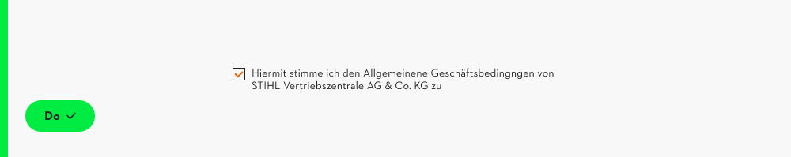

_Figure: Do example: a single checked checkbox with an orange check mark and the two-line label "Hiermit stimme ich den Allgemeinene Geschäftsbedingngen von STIHL Vertriebszentrale AG & Co. KG zu". In a form, a single checkbox is used instead of a switch, because a switch is not an input element._

#### Add a dialog for bigger changes

Consider asking for confirmation by the user, for bigger tasks that might be hard to undo (e.g. delete all files).

[Dialog](https://www.figma.com/design/qXldpLO6gxHJNLdcXIPxYt?node-id=14115-4051)

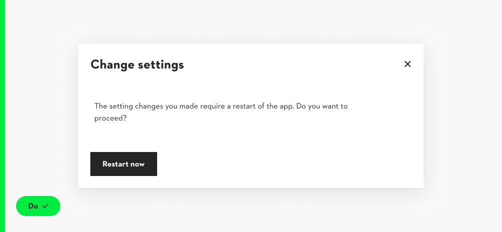

_Figure: Do example: a desktop dialog with the title "Change settings", a close button (X) at the top right, the text "The setting changes you made require a restart of the app. Do you want to proceed?" and a dark primary button "Restart now" at the bottom left. For bigger changes that are hard to undo, ask the user for confirmation in a dialog._

### Other common use cases

> The following examples are not part of the code component

#### Switch meant for mobile use

The switch component is initially meant for mobile use cases.

It is allowed to use a switch in a desktop solution, though consider if another component might be a better fit.

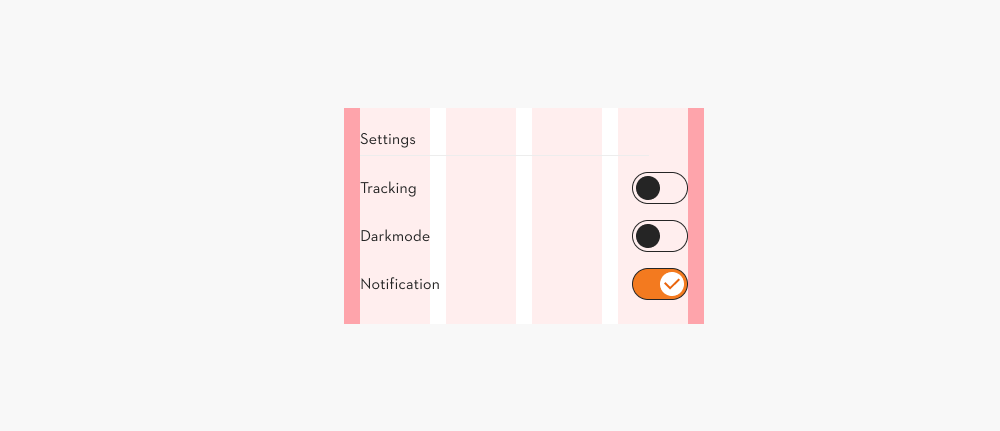

_Figure: Mobile settings list on a four-column grid (pink column overlay with outer margins) headed "Settings". Three rows have the label on the left and the switch right-aligned in the last column: "Tracking" (off), "Darkmode" (off) and "Notification" (on, orange track with a check icon)._

#### Use of other icons

Consider carefully if a custom icon is needed.

The check-icon is a standard icon for the switch component and will in all situations.

[Iconography →](https://www.figma.com/design/U218NNP4OsipaHOtv5flns/Iconography-%E2%9E%A1%EF%B8%8F?m=auto)

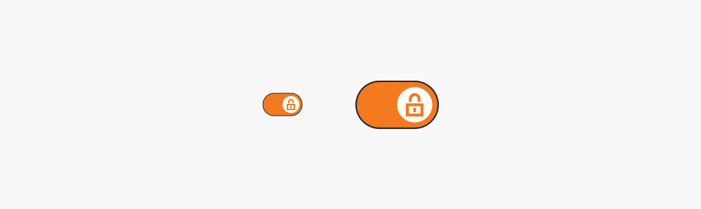

_Figure: Two checked switches with an orange track and the knob on the right, shown at normal size on the left and enlarged on the right. Instead of the standard check icon, the knob carries a custom open padlock icon in orange on white, illustrating the use of another icon._
