# Switch

## Switch

Overview:

- The component has binary states: on or off.
- A switch is a button, not an input element. Use a single checkbox in forms.
- Switches are recommended for mobile use-cases, especially for settings.
- In web use-cases, consider that a state change instantly activates, if data-heavy tasks are connected, the user cannot interact with the page while loading.

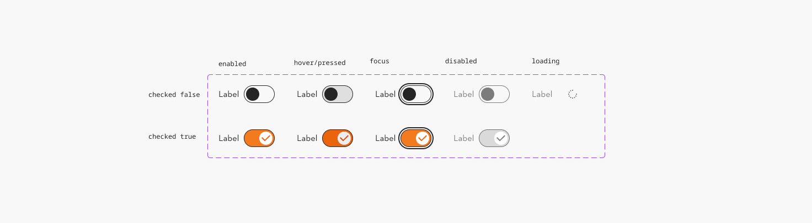

### Further guidelines

[Storybook documentation](https://main--63440bbb95889041542a5ba3.chromatic.com/?path=/docs/components-notification--documentation&globals=backgrounds.name:!undefined;backgrounds.value:!undefined)

Decision tree

### Related elements

[Button](https://www.figma.com/design/qXldpLO6gxHJNLdcXIPxYt?node-id=162-126)

[Checkbox](https://www.figma.com/design/qXldpLO6gxHJNLdcXIPxYt?node-id=1017-2316)

[Radio Group](https://www.figma.com/design/qXldpLO6gxHJNLdcXIPxYt?node-id=860-2728)

### Contribute

Contribute to improving this component by sharing your feedback, asking questions, or suggesting features [here](https://www.figma.com/design/lLmw7PfIdKjFG4uT3B2Hyj/Onboarding-%F0%9F%93%96?node-id=446-868&t=zKmRu4kAkxMeRDmK-4).

## Formatting and Construction

### Structure

1. **Switch** A clickable element indicating the appropriate state.
1. **Label** Copy that describes the current status.
1. **Thumb** Changes to opposite side, when toggled on/off

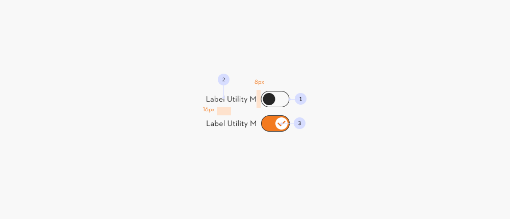

### Alignment

#### Label placement

The default is label on the left, due the reading direction.

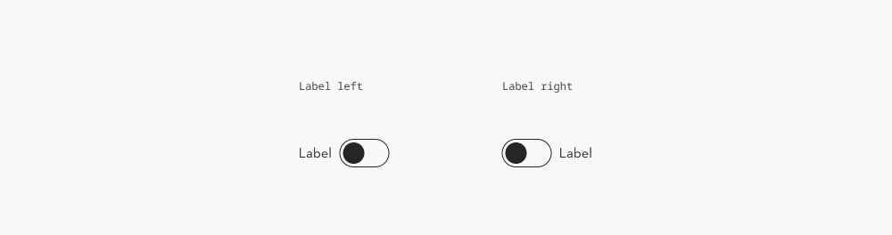

#### Use one label at a time

Do not use a label on both sides of the switch.

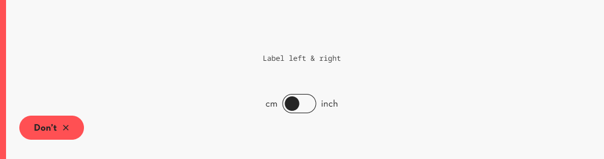

#### Stretched

Use a stretched alignment **(1)** instead of a default alignment **(2)** in use-cases like settings on small viewports and/or narrow columns.

[Grid styles→](https://www.figma.com/design/JyyYtoCYbtJrzqHs38OXSQ/Grid-%26-Spacing-%F0%9F%A7%AE?node-id=1-132)

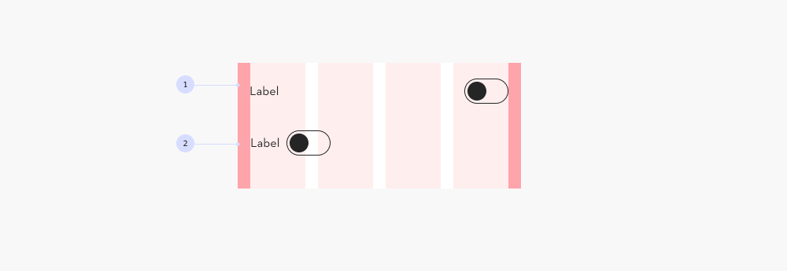

#### Provide a section title for a group

Offer clear sections, when grouping multiple switches.

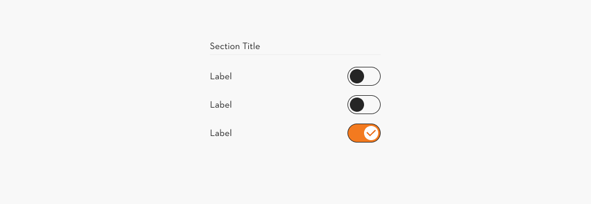

## Content and Assets

### Label

Keep it to a minimum, around 2-4 words.

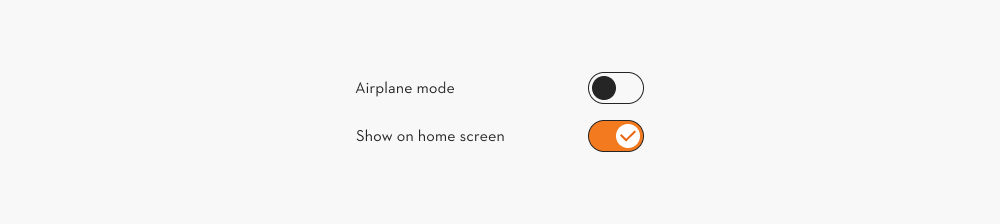

### Naming a group

Naming a list is important for the user to scan and evaluate the relevance quickly.

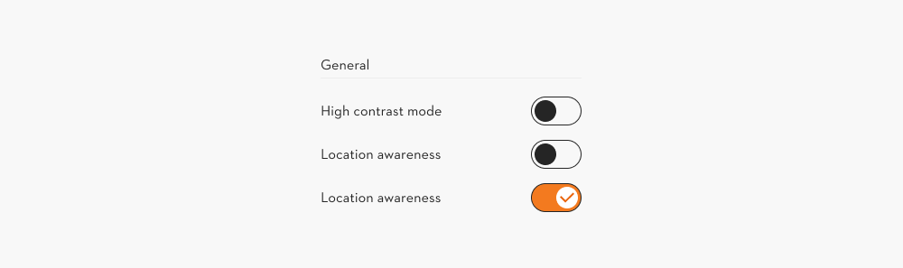

### Define a clear aria label

The visible label of a switch can be ambiguous, as the switch influences the status. Make sure to clarify the function through the aria label.

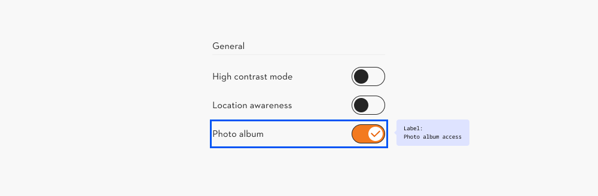

## Behavior

### Initial focus

The focus is set on the switch element, excluding the label.

The selected state (true of false) changes by pressing space bar.

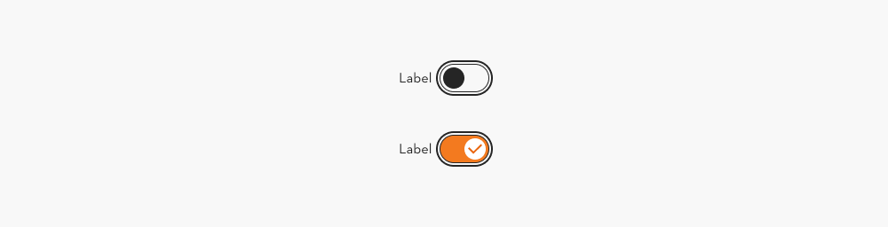

### Loading state

If the system cannot process a setting instantly, the loading state is shown. The user can’t interact with the switch meanwhile.

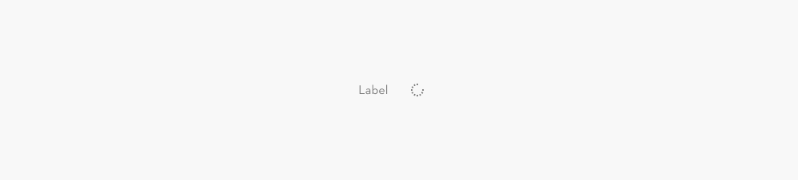

### Error handling

Do not combine error messages with the switch.

**In case a switch’s function does not execute, keep it at the former state.**

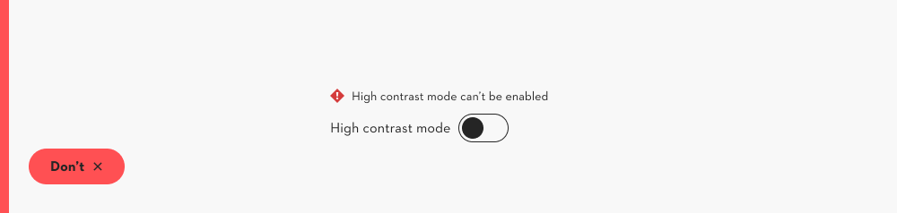

### Toast notification

It is possible to communicate system feedback to the user through a toast notification.

[Toast notification →](https://www.figma.com/design/qXldpLO6gxHJNLdcXIPxYt?node-id=8844-4923)

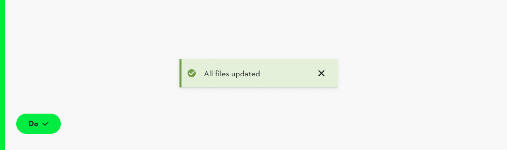

## Examples/Variations

### When to use another component

#### Form design: checkbox instead of switch

Use a single checkbox, if designing a form. A switch is not an input element.

[Checkbox →](https://www.figma.com/design/qXldpLO6gxHJNLdcXIPxYt?node-id=1017-2316)

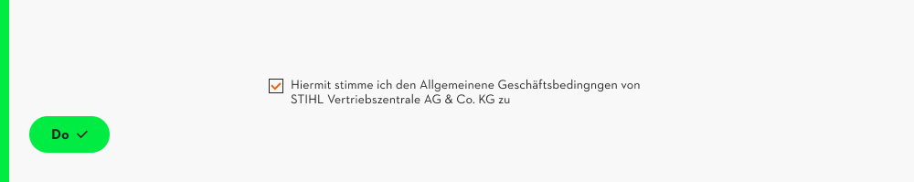

#### Add a dialog for bigger changes

Consider asking for confirmation by the user, for bigger tasks that might be hard to undo (e.g. delete all files).

[Dialog](https://www.figma.com/design/qXldpLO6gxHJNLdcXIPxYt?node-id=14115-4051)

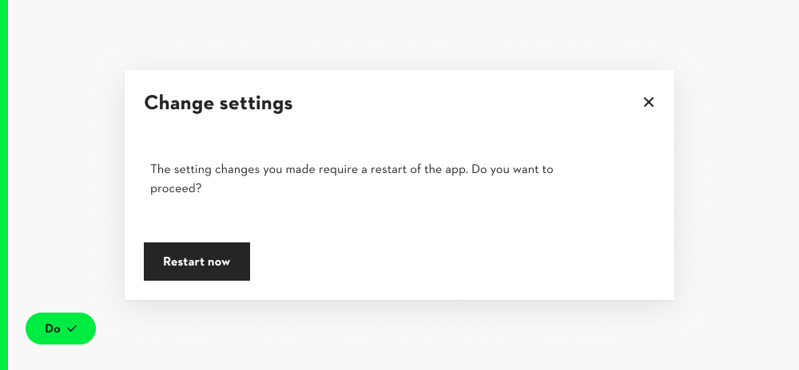

### Other common use cases

> The following examples are not part of the code component

#### Switch meant for mobile use

The switch component is initially meant for mobile use cases.

It is allowed to use a switch in a desktop solution, though consider if another component might be a better fit.

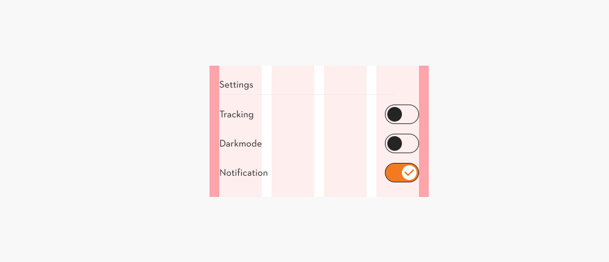

#### Use of other icons

Consider carefully if a custom icon is needed.

The check-icon is a standard icon for the switch component and will in all situations.

[Iconography →](https://www.figma.com/design/U218NNP4OsipaHOtv5flns/Iconography-%E2%9E%A1%EF%B8%8F?m=auto)

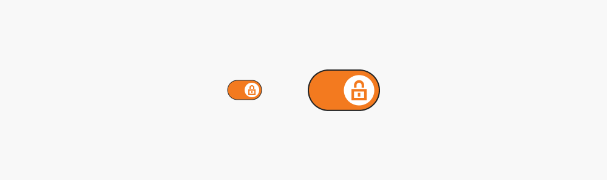
