# Tabs

## Tabs in-page

Overview:

- The components main function is to switch the visible pane on the same page.
   - In case the resting tabs contain a link, use the tabs navigation component (see below)
- The tabs in-page must be positioned within the grid, the tab list can be left- or center- aligned.
- A clear headline gives guidance and context to the tab list.
- Avoid long lists in tabs, tabs that are initially hidden are less discoverable and therefore compromises usability.

> Tabs in-page and tabs navigation are stored together as a single component in Figma.

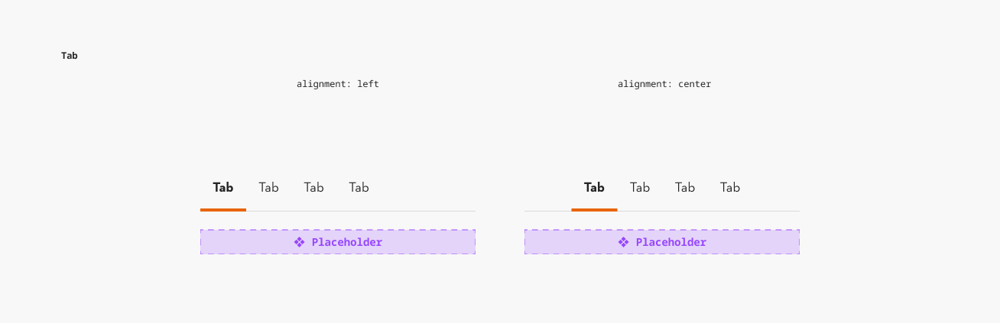

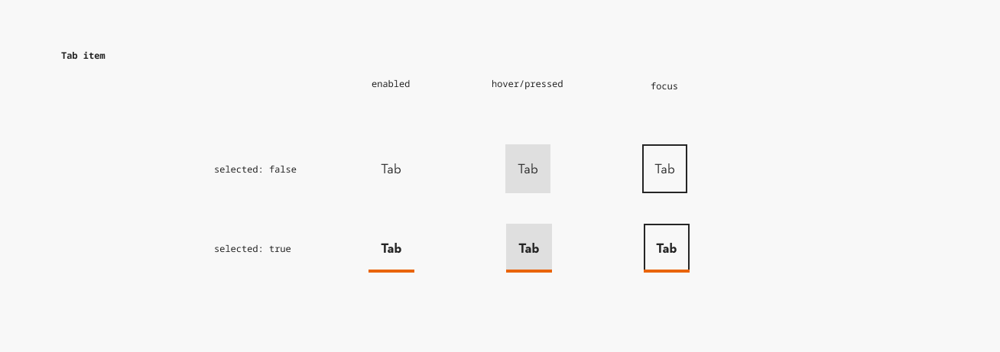

### Further guidelines

[Storybook documentation](https://main--63440bbb95889041542a5ba3.chromatic.com/?path=/docs/components-tabs--documentation&globals=backgrounds.name:!undefined;backgrounds.value:!undefined)

Decision tree

### Related elements

[Tabs Navigation](https://www.figma.com/design/qXldpLO6gxHJNLdcXIPxYt?node-id=24564-335)

[Accordion](https://www.figma.com/design/qXldpLO6gxHJNLdcXIPxYt/Pattern-Library-%F0%9F%96%A5-Web-1.0?node-id=17260-166)

[Iconography](https://www.figma.com/design/U218NNP4OsipaHOtv5flns/Iconography-%E2%9E%A1%EF%B8%8F?m=auto)

### Contribute

Contribute to improving this component by sharing your feedback, asking questions, or suggesting features [here](https://www.figma.com/design/lLmw7PfIdKjFG4uT3B2Hyj/Onboarding-%F0%9F%93%96?node-id=446-868&t=zKmRu4kAkxMeRDmK-4).

## Formatting and Construction

### Anatomy

1. **Selected tab item**
1. **Unselected tab item(s)**
1. **Icon (optional)**
1. **Label**
1. **Number indicator (optional)**
1. **Overflow button (optional)**
1. **Content pane**

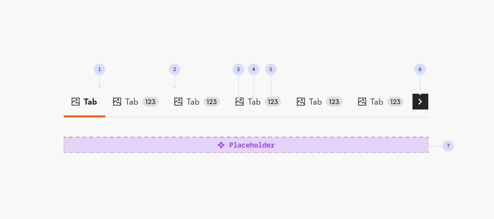

### Overflow

#### A tab overflow must be indicated with a button

The width of tab items adjusts dynamically to their content. If the total number of tabs exceeds the available width, an overflow occurs.

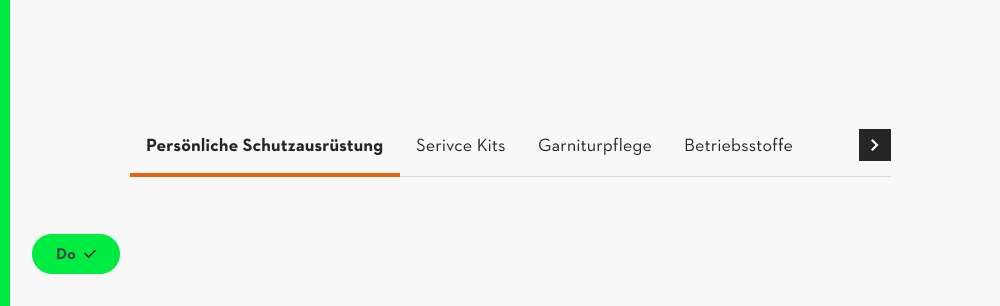

#### A tab list cannot wrap

The tab list cannot span two rows, as it disrupts the overview and hierarchy.

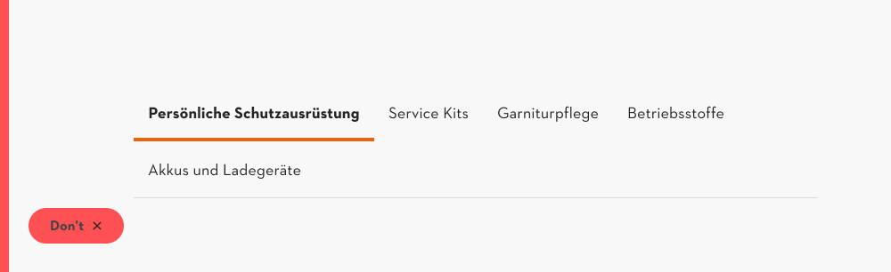

#### The tab item label cannot wrap

The label of the tab item cannot span two lines, as it disturbs the legibility.

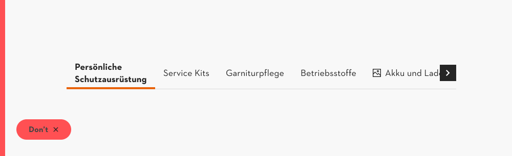

### Spacings

#### Dynamic spacings

The dynamic spacings adjust based on the breakpoint, providing a more compact layout on smaller devices and a more spacious one on larger screens.

> The Figma components default is ‘Breakpoint s’ and must be manually changed when used for larger breakpoints.

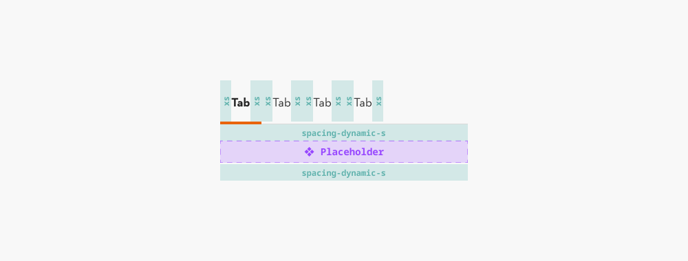

### Placement

#### Within the grid

The tab in-page must be positioned within the grid and can span either the full width of the main content area **(1)** or the narrow content area **(2)**.

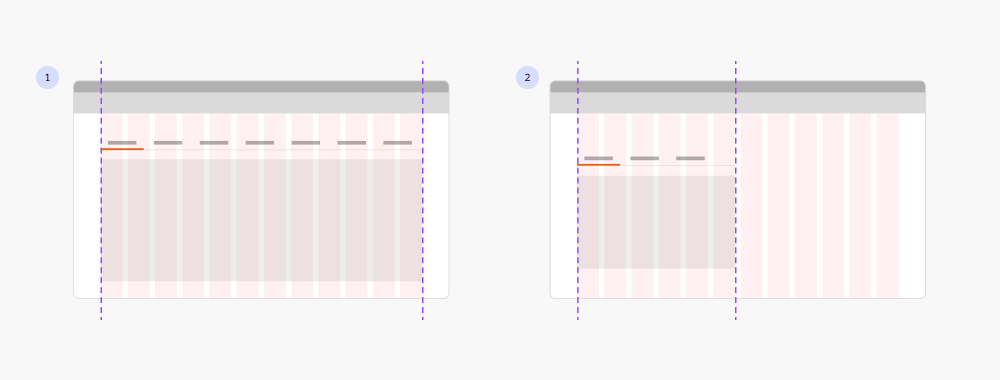

#### Warning: nesting tabs in tabs

Nested tabs are hard to find and may compromise discoverability and usability.

If a use case requires nested tabs, make sure to test it with real users.

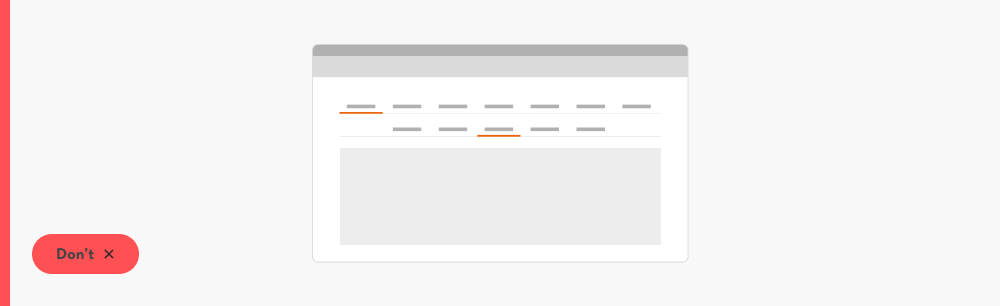

### Alignment

#### Align the tab list to the left or to the center

The tab list can be aligned to either the left **(1)** or the center **(2)**.

The choice depends on the overall layout, as each option provides enhanced visibility and is better suited to accommodate various types of content.

In most cases, left alignment preferred, as it aligns with typical user reading behavior, also known as the ‘F-pattern’.

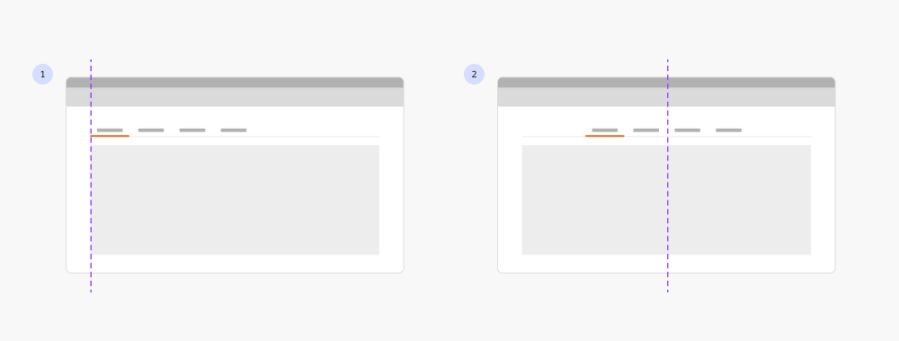

#### Align the tab list with the tab pane

The tabs in-page, run as wide as the content pane.

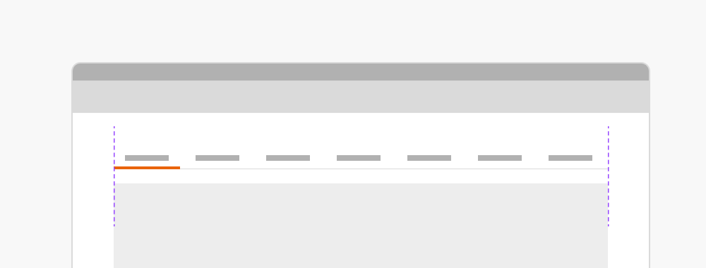

#### On smaller screens align the tabs to the left

To make more labels visible, left-align the tab list on smaller screens.

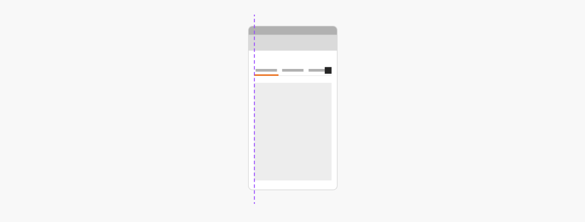

### Motion

#### Selected tab indicator: horizontal movement of active border

**Animation type:** move to next tab (either left or right) **Duration:** 250ms **Easing:** motion-functional-ease-out

[Motion guidelines →](https://www.figma.com/design/UYHZEckQObDvLuuRoMP8ps/Styles-%F0%9F%AA%AD?node-id=1-148)

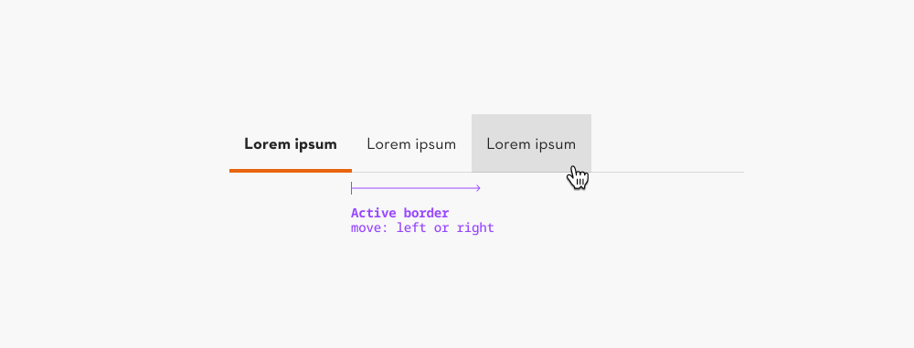

## Content and Assets

### Consistent and plain language

- Long labels take up a lot of space.
- A tab label ideally is around 1-2 words.
- Favor nouns over verbs

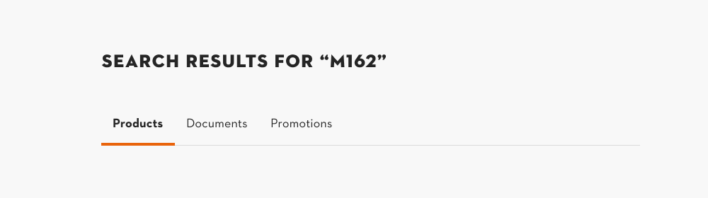

### Context on the page

This tabs component is **in-page** and therefore always below the page title or another headline

A clear headline gives guidance and context to the tab list.

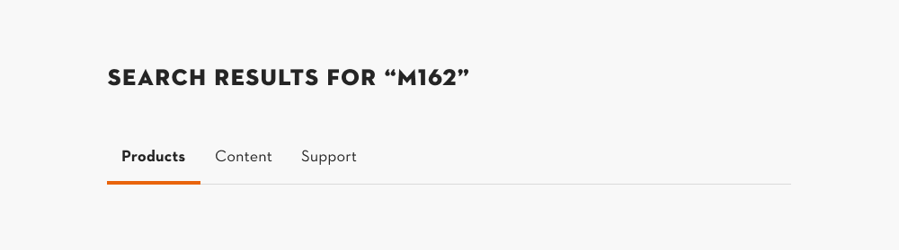

### 3 or more words in a tab label

Long labels are hard to recognize as a clickable area, especially mobile.

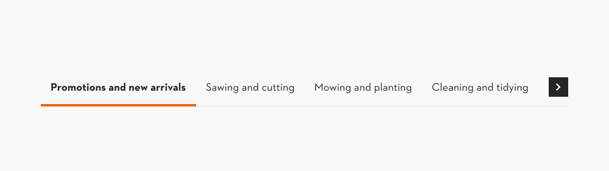

### Be aware of duplicate words

In some cases, the title appears directly above the tab list. To enhance clarity, avoid duplicating words in the title and short tab lists. For longer tab lists, duplication may be necessary to ensure context.

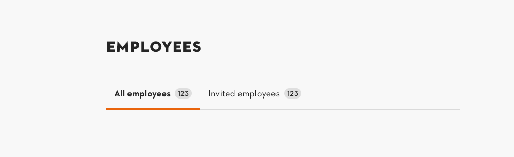

### Don’t: truncate a tab label

Copy inside a tab label does not truncate, because it harms accessibility.

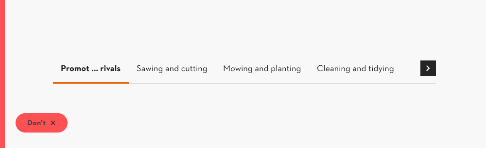

### Icon usage

- Use icons to guide users, not for decoration, to prevent unnecessary clutter in the interface.
- On smaller screens, icons can occupy more space and limit the number of visible tabs.
- If icons are used, they must appear on all tab items.
   - **Exception:** If the first tab displays “all items”, while the other tabs provide filtered subsets of the same list, the icon can be omitted in the first tab.

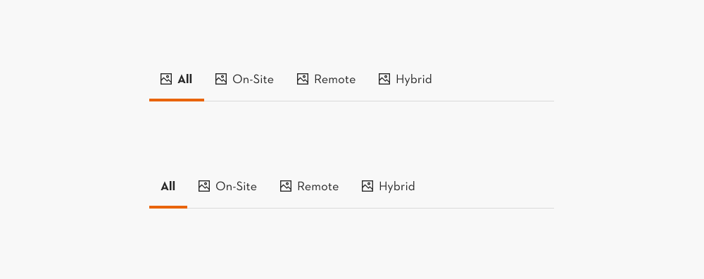

### Integrated number indicator

- On the right side of the label, an integrated number indicator can be placed.
- If number indicators are used, most likely they appear on all tabs in the list.

[Number indicator guidelines →](https://www.figma.com/design/qXldpLO6gxHJNLdcXIPxYt?node-id=24240-47126)

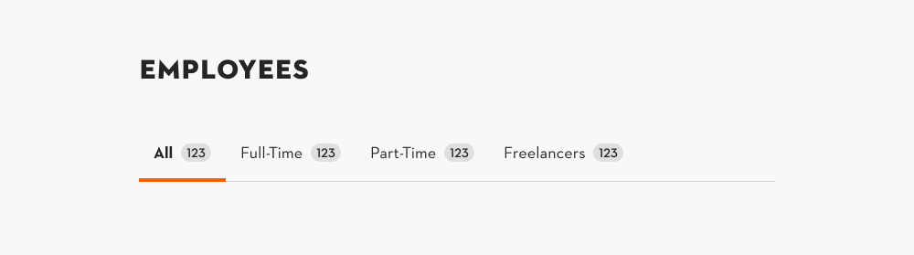

### Icon and number indicator

Be aware of visual clutter and harming the cognitive load of the user, when both icon and the number indicator are visible.

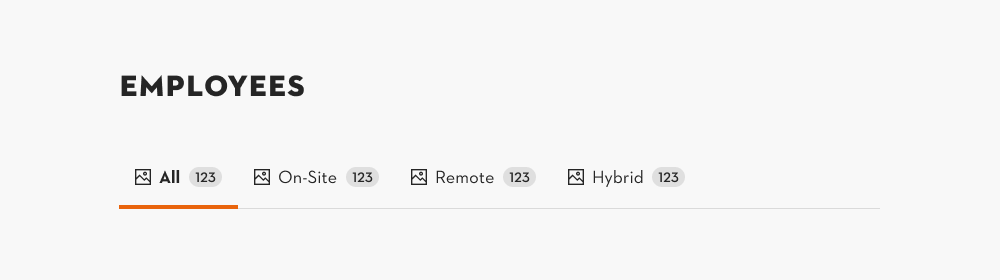

### Amount of tabs

#### Minimum is two tabs

- A tab can never be alone.
- Two tabs is the minimum amount.
- There is no maximum amount defined.

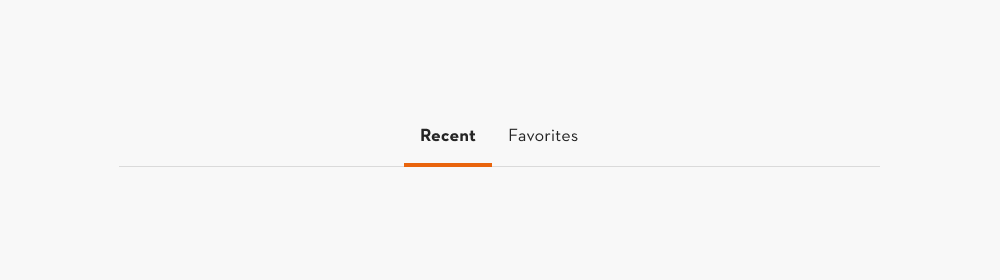

#### Discoverability problem: high amount of tabs

Tabs that are initially hidden are less discoverable, as the user must scroll/navigate the arrows in order to see them.

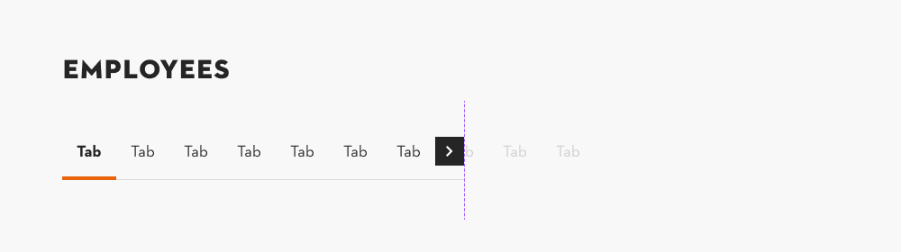

#### Order the tabs by importance and/or relevance

- Place the most relevant tabs in the beginning of the list. E.g.
   - Most relevant for business.
   - Most relevant for the user.
- Consider what data sources you have to decide what tabs are most important.

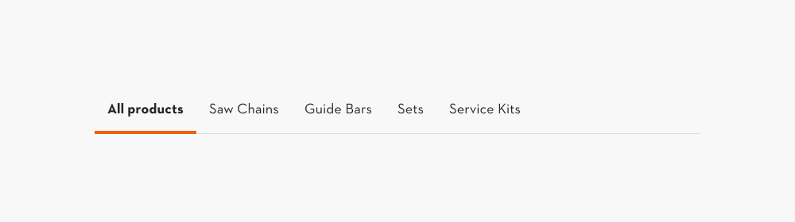

#### On smaller screens, most tabs may extend beyond the visible area

Short copy is even more essential on mobile devices to display more tabs.

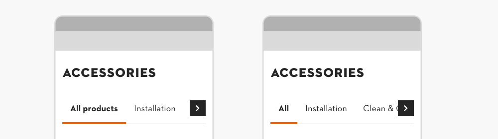

## Behavior

### Don’t: system feedback

Do not place any elements that needs system verification in a tab component. System feedback will be hidden or hard to find.

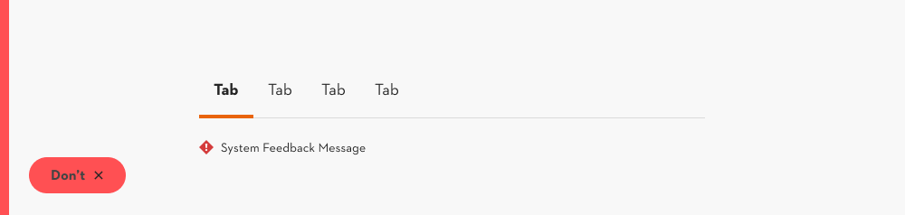

### Overflow behaviour

1. **Cursor navigation:** horizontal movement only by clicking buttons.
1. **Touch navigation**: horizontal movement by tapping button or dragging.

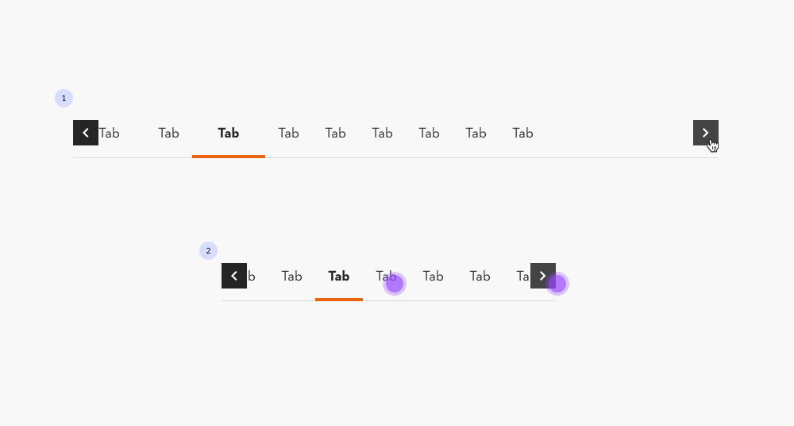

### Content pane

#### First tab label is selected by default

The first tab is the selected tab and the content pane is visible.

No trigger is needed to display the first pane.

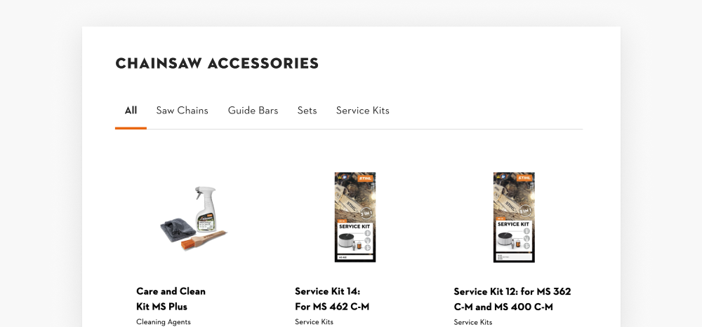

#### One content pane is visible

It is not possible to have more panes open at the same time:

- only 1 tab is selected at a time.
- only 1 content pane is visible at a time.

The user has full control over the content that is visible.

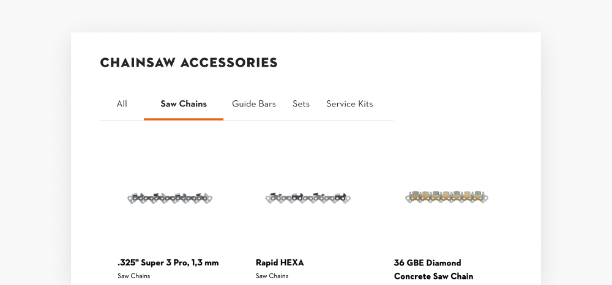

## Examples/Variants

### Common use cases

#### Tab in-page vs. tab navigation

1. **Tabs in-page:** allow to view different content panes on a page.
   - Most likely below the page title.
1. **Tabs navigation:** offer links to other pages in the same level.
   - Most likely above the page title.

[Tab navigation component →](https://www.figma.com/design/qXldpLO6gxHJNLdcXIPxYt?node-id=24564-335)

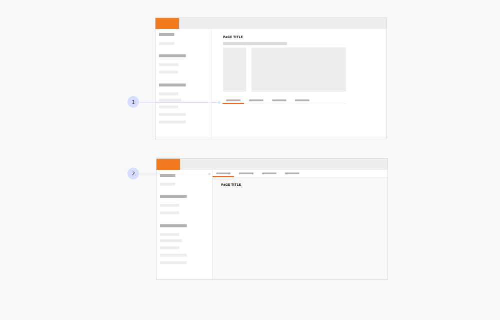

#### Tabs to hide and show content

Structure content into bitable sizes, in order to reduce the cognitive load.

Optimize for the use case that is most likely to be the most relevant.

Example: Most people that visit the website are private consumers and not an authorized STIHL dealer.

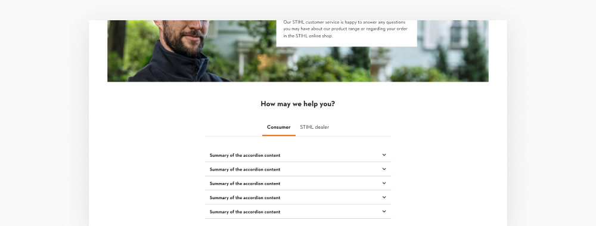

#### Tabs to filter cards

In some cases a tab list helps users to filter cards. Use up to 5-7 tab items in the tab list.

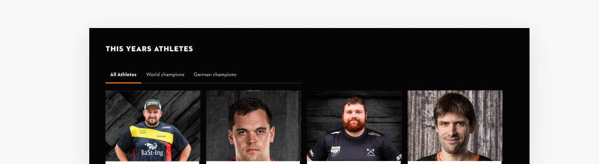

#### Filter: tabs in-page, checkbox group or chip group?

1. **Tabs:**
   1. A content component to switch the visible pane.
   1. Tabs organize content, not filter content.
   1. Use for short lists.
   1. If items in the list can overlap, tabs might be confusing.
1. **Checkbox group:**
   1. A selection component for characteristics.
   1. Combine with a button to set the filter.
   1. Use for long lists, as it is easy to scan.
   1. Use for complex filters with multiple grouped categories.
1. **Chip group:**
   1. A selection component for characteristics.
   1. Filter is instantly set.
   1. Use for short lists.
   1. If filters can overlap, choose the multi-select variant.

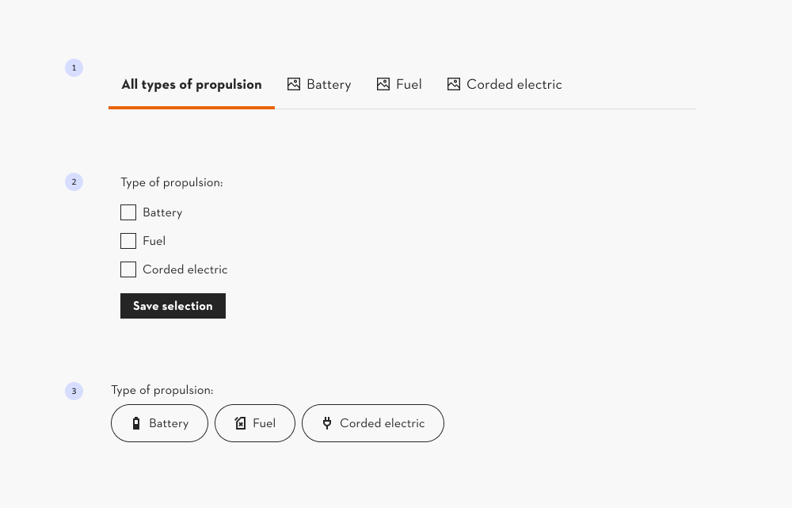

### STIHL use cases

#### STIHL dealer search

In the STIHL dealer search web app the tabs are placed on top of a map. The tabs are combined with a search and filter functionality.

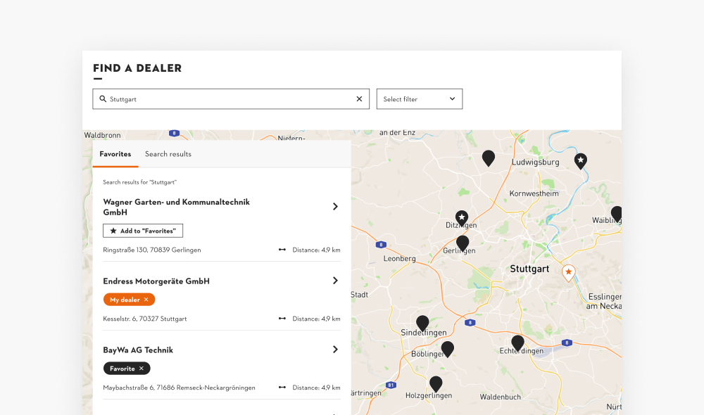

## Tabs navigation

Overview:

- The components main function is to navigate to another page url.
   - In case the other tabs activate a content pane to switch, use the tabs in-page (see above)
- Tabs navigation can be extended beyond the grid to span the full width of the full content area.
- Left alignment is default and preferred option, as it aligns with typical user reading behavior, also known as the ‘F-pattern’.
- The tabs navigation component is a link list and often used as secondary navigation.

> Tabs in-page and tabs navigation are stored together as a single component in Figma.

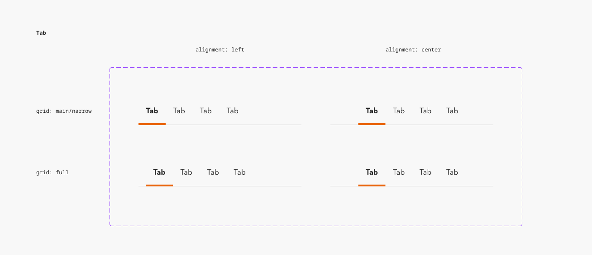

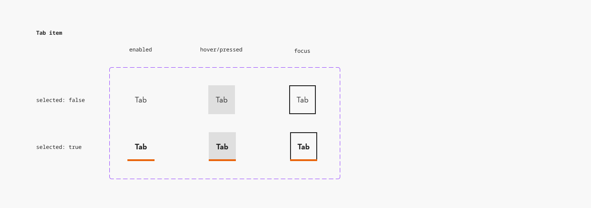

### Further guidelines

[Storybook documentation](https://main--63440bbb95889041542a5ba3.chromatic.com/?path=/docs/components-navigation-tabs--documentation&globals=backgrounds.name:!undefined;backgrounds.value:!undefined)

Decision tree

### Related elements

[Chip group](https://www.figma.com/design/qXldpLO6gxHJNLdcXIPxYt/Pattern-Library-%F0%9F%96%A5-Web-1.0?node-id=18691-978)

[Skip Link](https://www.figma.com/design/qXldpLO6gxHJNLdcXIPxYt/Pattern-Library-%F0%9F%96%A5-Web-1.0?node-id=16333-2371)

[Checkbox](https://www.figma.com/design/qXldpLO6gxHJNLdcXIPxYt/Pattern-Library-%F0%9F%96%A5-Web-1.0?node-id=1017-2316)

[Iconography](https://www.figma.com/design/U218NNP4OsipaHOtv5flns/Iconography-%E2%9E%A1%EF%B8%8F?m=auto)

### Contribute

Contribute to improving this component by sharing your feedback, asking questions, or suggesting features [here](https://www.figma.com/design/lLmw7PfIdKjFG4uT3B2Hyj/Onboarding-%F0%9F%93%96?node-id=446-868&t=zKmRu4kAkxMeRDmK-4).

## Formatting and Construction

> Most of the “Formatting and Construction” guidelines from the Tabs in-page component apply, see above.

### Anatomy

1. **Selected tab**
1. **Unselected tab(s)**
1. **Icon (optional)**
1. **Label**
1. **Number indicator (optional)**
1. **Overflow button (optional)**

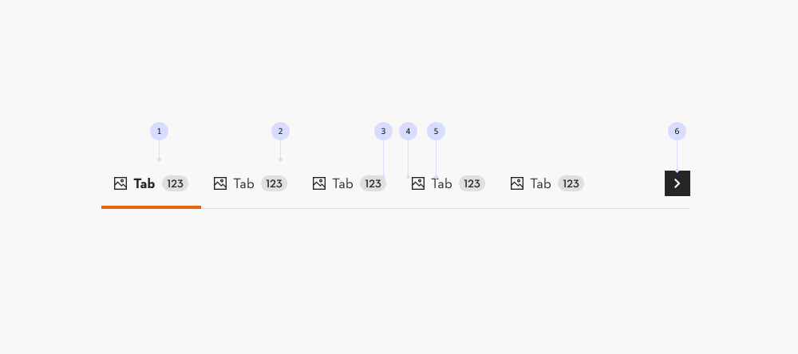

### Placement

#### Horizontal placement: grid

The tab navigation can either be placed within the grid, spanning the main content area’s full width **(1)**, or extend beyond the grid to span the full content area **(2)**.

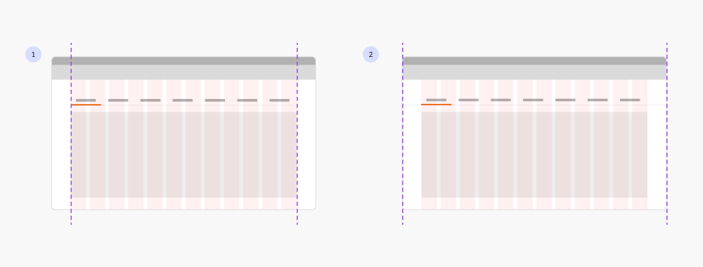

#### Horizontal placement: grid sidebar

For use cases with 1 or 2 sidebars the tab navigation must extend beyond the grid to span the full content area.

[Full content area guideline →](https://www.figma.com/design/JyyYtoCYbtJrzqHs38OXSQ/Grid-%26-Spacing-%F0%9F%A7%AE?node-id=1-132)

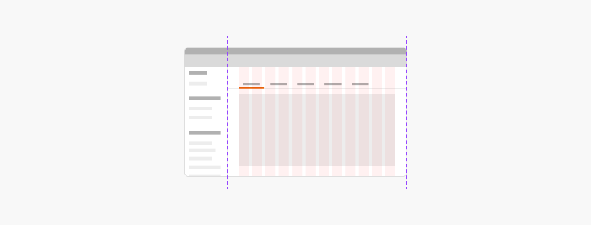

#### Vertical placement

Tabs navigation that extends beyond the grid can be placed below **(1)** or above **(2)** the page title.

can help to distinguish the page areas.

background-color-secondary

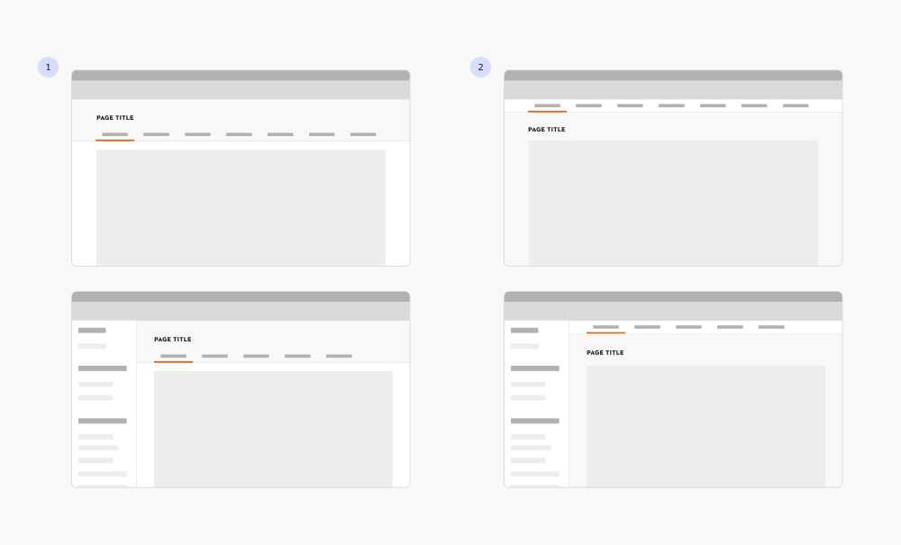

### Alignment

#### Align the tab list to the left or to the center

The tab list can be aligned to the left **(1)** or to the center **(2)**.

Left alignment is default and preferred option, as it aligns with typical user reading behavior, also known as the ‘F-pattern’.

Center alignment can be used in for some use cases, if it enhances the discoverability of the tab list.

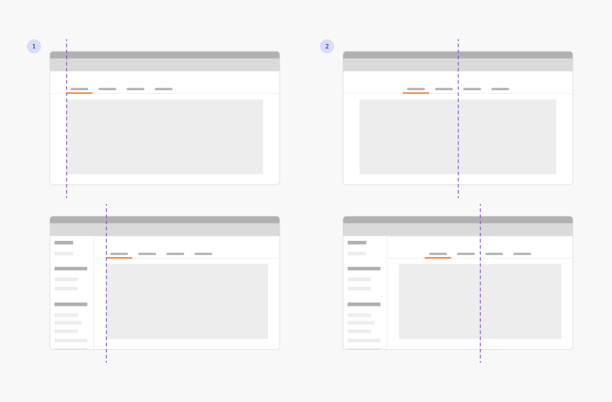

#### Align the tab items with the content

Even if the tab component extends beyond the grid, the tab items themselves must always align with content below and cannot run wider.

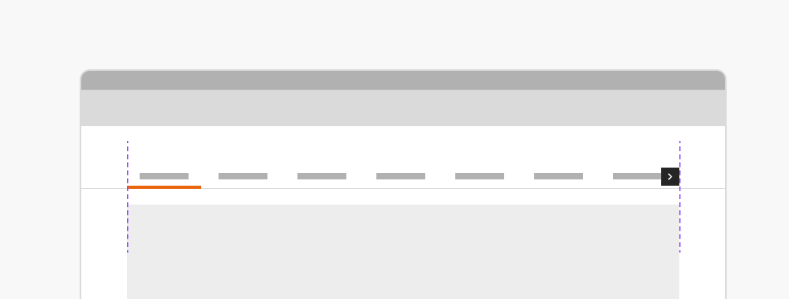

## Behavior

> Most of the “Behaviour” guidelines from the Tabs in-page component apply, see above.

### Tab contains a link

- Every tab contains a link target with an url.
- On click, a reload is triggered.
- For a content pane switch, use the Tabs in-page component (see above).

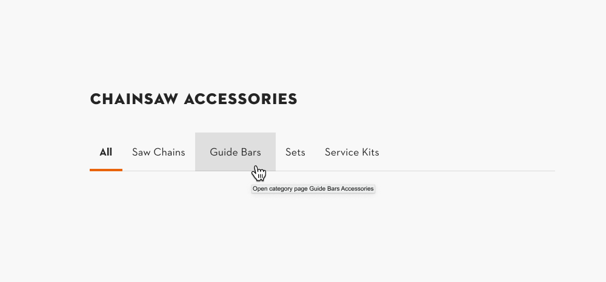

## Examples/Variants

> Most of the “Examples/Variants” guidelines from the Tabs in-page component apply, see above.

### Common use cases

#### Tab in-page vs. tab navigation

1. **Tabs navigation:** offer links to other pages in the same level.
   - Most likely above the page title.
1. **Tabs in-page:** allow to view different content panels in a page.
   - Most likely below the page title.

[Tab in-page component →](https://www.figma.com/design/qXldpLO6gxHJNLdcXIPxYt?node-id=24564-313)

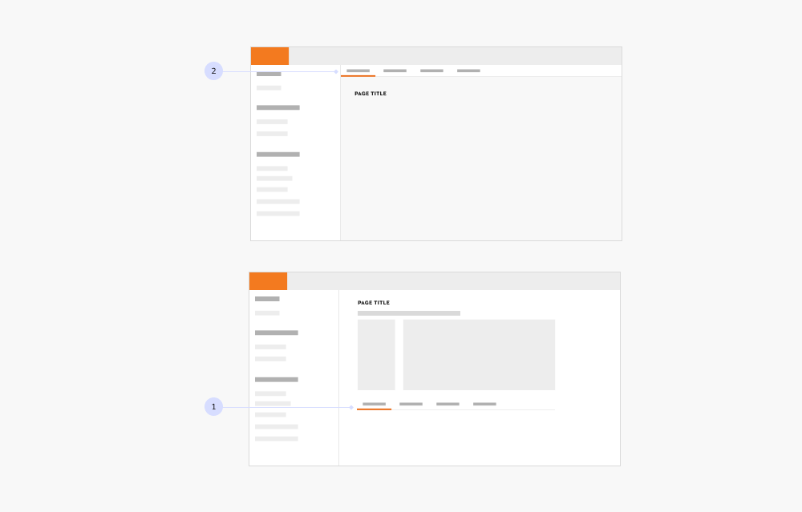

#### Navigation as a main purpose

The tabs navigation component is a link list and often used a secondary navigation (used for secondary tasks).

It can be combined with a main navigation, e.g. a

1. **Sidebar**
1. **Top bar**

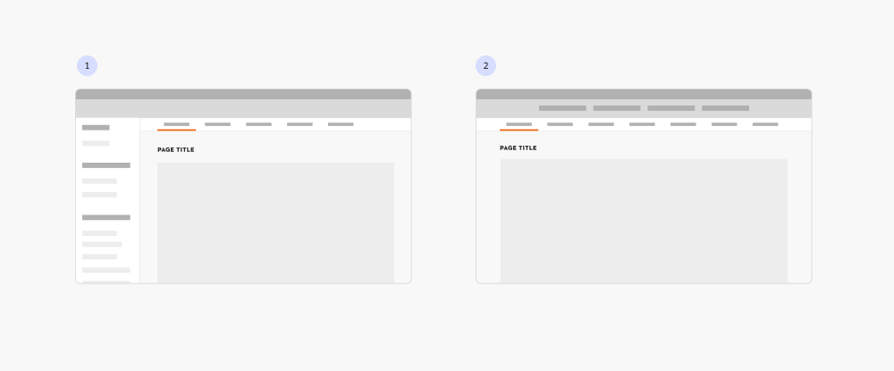

### STIHL use cases

#### Category pages in the stihl webshop

Some product category overview pages in the web shop contain a tab list to categorize specific product categories.

The tabs are combined with a more complex filter.

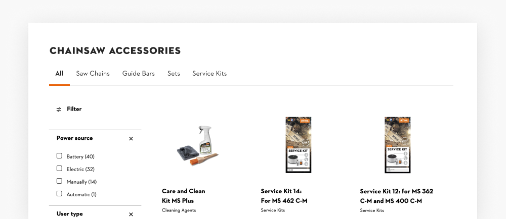

#### STIHL Service Center (SSC)

The portal offers a search function of which search results are categorized into: ‘Product variants’, ‘Parts’, ‘Documents’ and ‘Support news’ results.

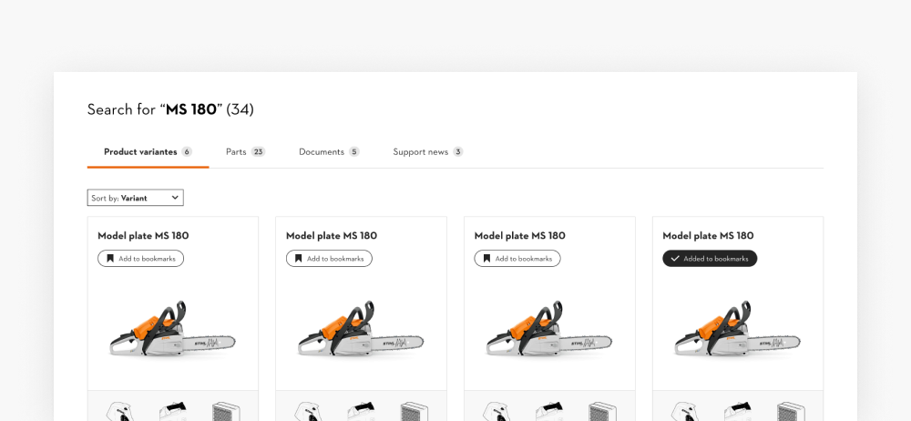
