# Tabs

## Tabs in-page

Overview:

- The components main function is to switch the visible pane on the same page.
   - In case the resting tabs contain a link, use the tabs navigation component (see below)
- The tabs in-page must be positioned within the grid, the tab list can be left- or center- aligned.
- A clear headline gives guidance and context to the tab list.
- Avoid long lists in tabs, tabs that are initially hidden are less discoverable and therefore compromises usability.

> Tabs in-page and tabs navigation are stored together as a single component in Figma.

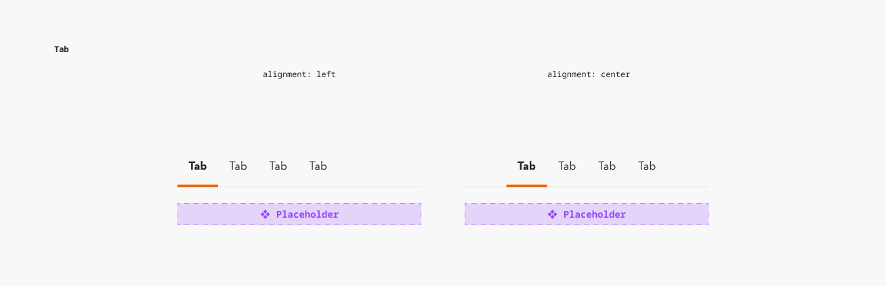

_Figure: Two in-page tabs examples labelled "Tab", each with four tab items (first selected in bold with an orange underline) above a purple dashed "Placeholder" tab pane: "alignment: left" with the tab list aligned to the left edge, and "alignment: center" with the tab list centered._

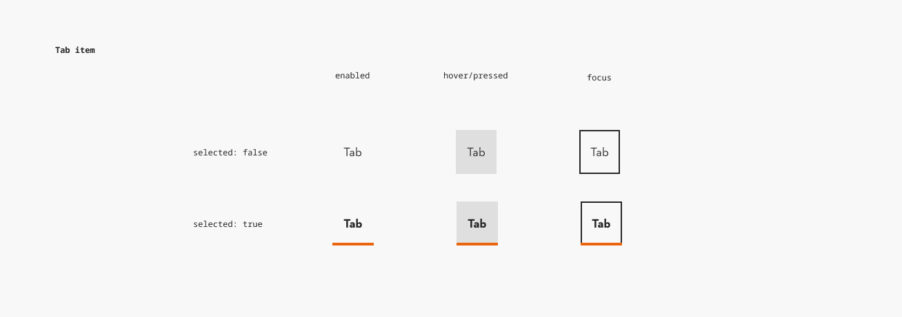

_Figure: Tab item states in a matrix: columns "enabled", "hover/pressed" and "focus", rows "selected: false" and "selected: true". Unselected "Tab" is regular text, gets a grey background on hover/pressed and a dark outline on focus; selected "Tab" is bold with an orange underline in all states, also with grey background on hover/pressed and a dark outline on focus._

### Further guidelines

[Storybook documentation](https://main--63440bbb95889041542a5ba3.chromatic.com/?path=/docs/components-tabs--documentation&globals=backgrounds.name:!undefined;backgrounds.value:!undefined)

Decision tree

### Related elements

[Tabs Navigation](https://www.figma.com/design/qXldpLO6gxHJNLdcXIPxYt?node-id=24564-335)

[Accordion](https://www.figma.com/design/qXldpLO6gxHJNLdcXIPxYt/Pattern-Library-%F0%9F%96%A5-Web-1.0?node-id=17260-166)

[Iconography](https://www.figma.com/design/U218NNP4OsipaHOtv5flns/Iconography-%E2%9E%A1%EF%B8%8F?m=auto)

### Contribute

Contribute to improving this component by sharing your feedback, asking questions, or suggesting features [here](https://www.figma.com/design/lLmw7PfIdKjFG4uT3B2Hyj/Onboarding-%F0%9F%93%96?node-id=446-868&t=zKmRu4kAkxMeRDmK-4).

## Formatting and Construction

### Anatomy

1. **Selected tab item**
1. **Unselected tab item(s)**
1. **Icon (optional)**
1. **Label**
1. **Number indicator (optional)**
1. **Overflow button (optional)**
1. **Content pane**

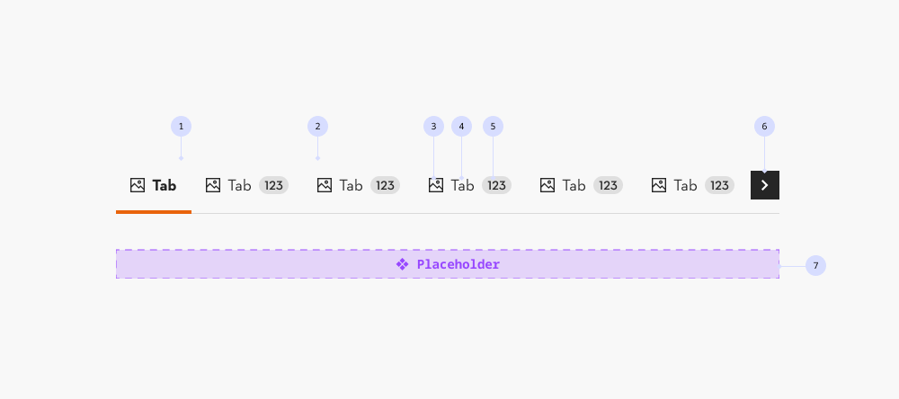

_Figure: Anatomy of tabs with six tab items, each with an image icon, the label "Tab" and a "123" number badge, a dark right-chevron overflow button at the end and a purple dashed "Placeholder" content pane below. Callouts: 1 selected tab item (bold, orange underline), 2 unselected tab item(s), 3 icon (optional), 4 label, 5 number indicator (optional), 6 overflow button (optional), 7 content pane._

### Overflow

#### A tab overflow must be indicated with a button

The width of tab items adjusts dynamically to their content. If the total number of tabs exceeds the available width, an overflow occurs.

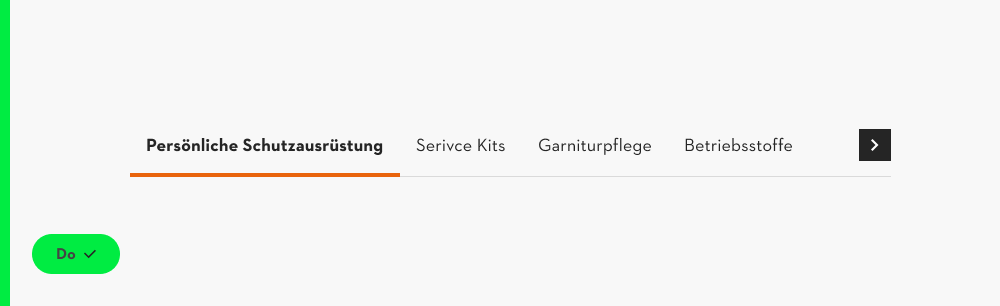

_Figure: Do example: a single-row tab list with the labels "Persönliche Schutzausrüstung" (selected, bold, with an orange underline), "Serivce Kits", "Garniturpflege" and "Betriebsstoffe", followed by a dark square button with a right chevron at the right end that indicates further tabs overflow the available width._

#### A tab list cannot wrap

The tab list cannot span two rows, as it disrupts the overview and hierarchy.

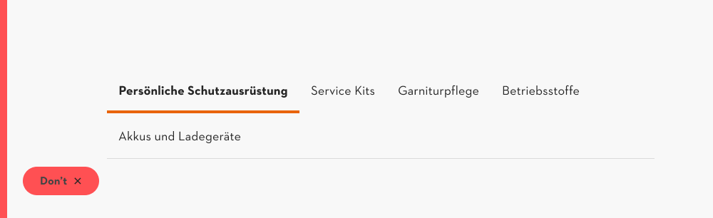

_Figure: Don't example: the tab list wraps onto two rows, with "Persönliche Schutzausrüstung" (selected, orange underline), "Service Kits", "Garniturpflege" and "Betriebsstoffe" in the first row and "Akkus und Ladegeräte" on a second row, which disrupts the overview and hierarchy._

#### The tab item label cannot wrap

The label of the tab item cannot span two lines, as it disturbs the legibility.

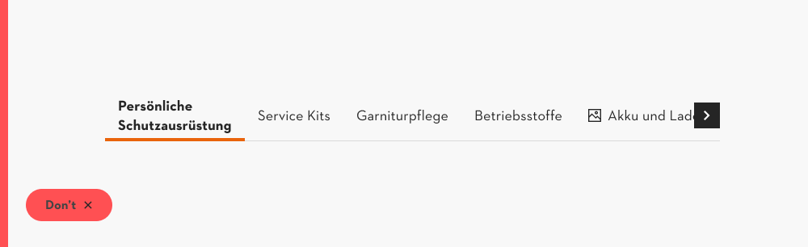

_Figure: Don't example: in a tab list with an overflow button on the right, the selected tab label "Persönliche Schutzausrüstung" wraps onto two lines, which hurts legibility; the other tabs "Service Kits", "Garniturpflege", "Betriebsstoffe" and an icon tab "Akku und Lade…" are cut off by the dark right chevron button._

### Spacings

#### Dynamic spacings

The dynamic spacings adjust based on the breakpoint, providing a more compact layout on smaller devices and a more spacious one on larger screens.

> The Figma components default is ‘Breakpoint s’ and must be manually changed when used for larger breakpoints.

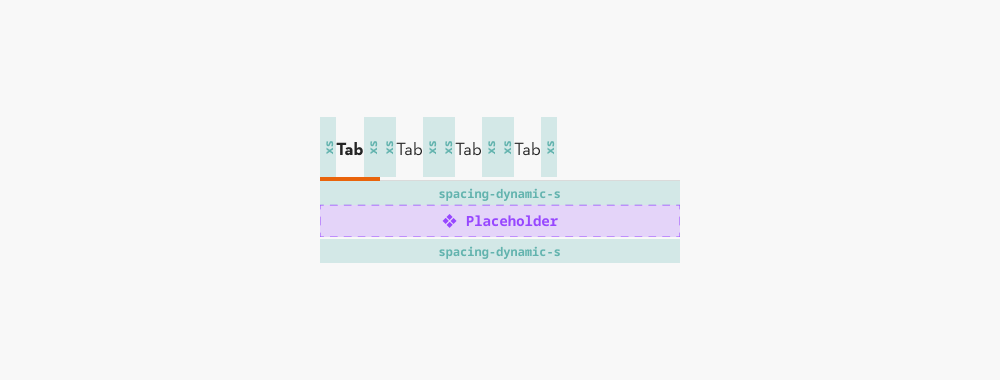

_Figure: Spacing specification for tabs: each tab label "Tab" has horizontal spacers marked "xs" on both sides, and the selected first tab has an orange underline. Below the tab list, a purple dashed "Placeholder" tab pane is separated from the tabs and from the content below by vertical spacers labeled "spacing-dynamic-s"._

### Placement

#### Within the grid

The tab in-page must be positioned within the grid and can span either the full width of the main content area **(1)** or the narrow content area **(2)**.

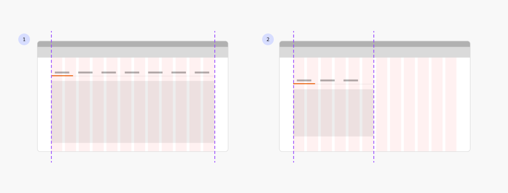

_Figure: Two browser mockups with a column grid and purple dashed guides. Callout 1: the tab list and its tab pane span the full width of the main content area (seven tabs). Callout 2: the tab list and tab pane span only the narrow content area, about the left half of the grid (three tabs)._

#### Warning: nesting tabs in tabs

Nested tabs are hard to find and may compromise discoverability and usability.

If a use case requires nested tabs, make sure to test it with real users.

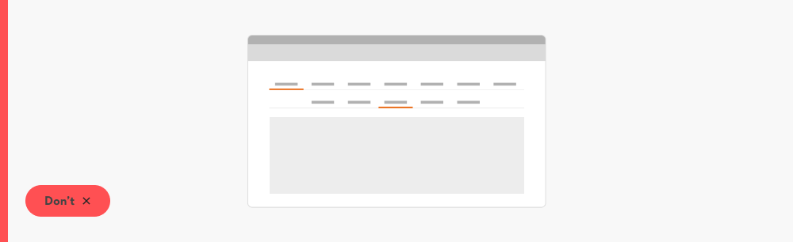

_Figure: Don't example: a browser mockup in which a second tab list is nested below the first tab list, each with its own selected tab and orange underline, above a single content area, which makes nested tabs hard to find._

### Alignment

#### Align the tab list to the left or to the center

The tab list can be aligned to either the left **(1)** or the center **(2)**.

The choice depends on the overall layout, as each option provides enhanced visibility and is better suited to accommodate various types of content.

In most cases, left alignment preferred, as it aligns with typical user reading behavior, also known as the ‘F-pattern’.

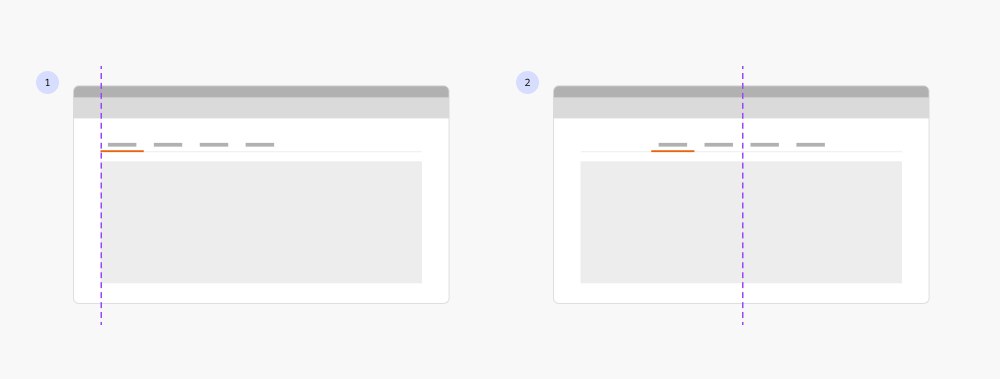

_Figure: Two browser mockups with four tabs each above a content pane and a purple dashed guide. Callout 1: the tab list is left-aligned with the left edge of the content pane. Callout 2: the tab list is centered within the content pane._

#### Align the tab list with the tab pane

The tabs in-page, run as wide as the content pane.

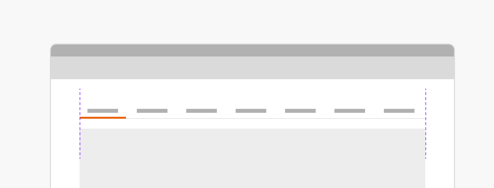

_Figure: Browser mockup with seven tabs, the first selected with an orange underline, spread across the full width of the content pane below; purple dashed guides at the left and right edges show that the tab list is as wide as the tab pane._

#### On smaller screens align the tabs to the left

To make more labels visible, left-align the tab list on smaller screens.

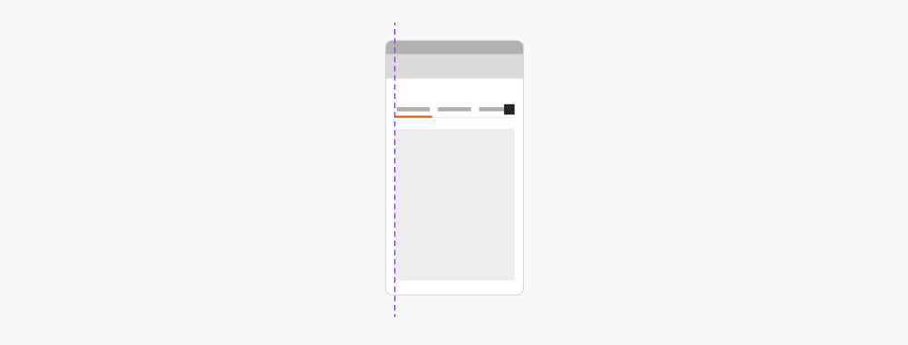

_Figure: Narrow, small-screen browser mockup in which the tab list is left-aligned with the content pane (purple dashed guide at the left edge); the third tab is cut off by a dark overflow button at the right end, and the selected first tab has an orange underline._

### Motion

#### Selected tab indicator: horizontal movement of active border

**Animation type:** move to next tab (either left or right) **Duration:** 250ms **Easing:** motion-functional-ease-out

[Motion guidelines →](https://www.figma.com/design/UYHZEckQObDvLuuRoMP8ps/Styles-%F0%9F%AA%AD?node-id=1-148)

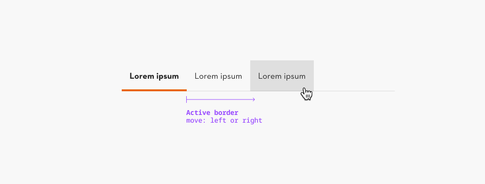

_Figure: Tab list with three "Lorem ipsum" tabs: the first is selected (bold, orange active border) and the third is hovered by a mouse cursor with a grey background. A purple arrow from the first to the second tab is labeled "Active border move: left or right", showing that the orange selected-tab indicator moves horizontally to the next tab._

## Content and Assets

### Consistent and plain language

- Long labels take up a lot of space.
- A tab label ideally is around 1-2 words.
- Favor nouns over verbs

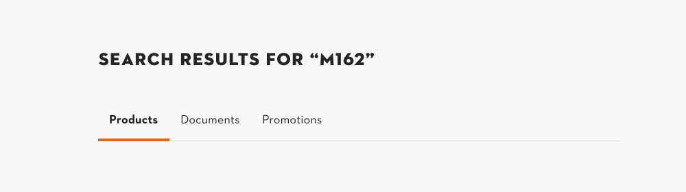

_Figure: Under the page title "Search results for “m162”", a left-aligned tab list with three short one-word labels: "Products" (selected, bold with an orange underline), "Documents" and "Promotions"._

### Context on the page

This tabs component is **in-page** and therefore always below the page title or another headline

A clear headline gives guidance and context to the tab list.

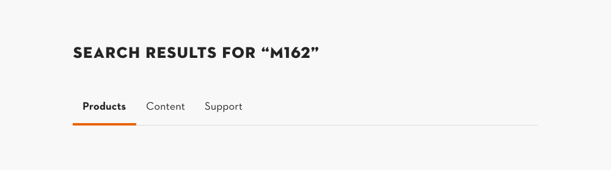

_Figure: In-page tabs placed directly below the headline "Search results for “m162”", which gives the tab list context. The left-aligned tabs are "Products" (selected, bold with an orange underline), "Content" and "Support"._

### 3 or more words in a tab label

Long labels are hard to recognize as a clickable area, especially mobile.

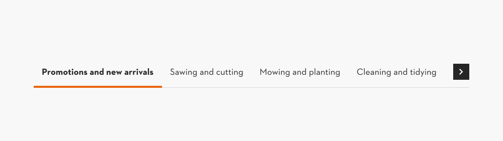

_Figure: A tab list with long labels: "Promotions and new arrivals" (selected, bold with an orange underline), "Sawing and cutting", "Mowing and planting" and "Cleaning and tidying", followed by a dark right-arrow scroll button. The labels of three or more words take up much space and are hard to recognize as clickable areas._

### Be aware of duplicate words

In some cases, the title appears directly above the tab list. To enhance clarity, avoid duplicating words in the title and short tab lists. For longer tab lists, duplication may be necessary to ensure context.

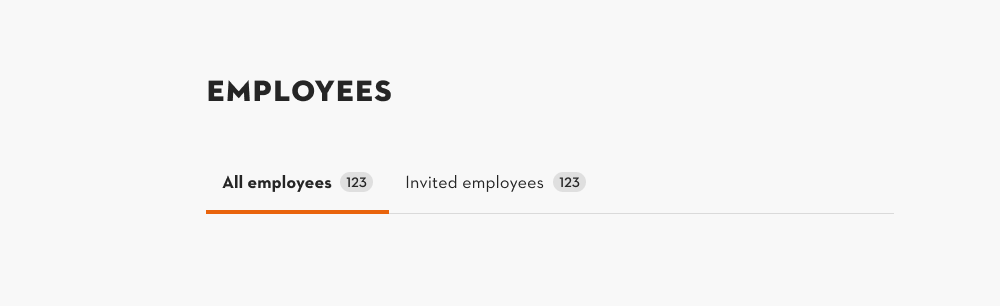

_Figure: Page title "Employees" above a short tab list with the tabs "All employees" (selected, bold with an orange underline) and "Invited employees", each followed by a grey number indicator "123". The words "employees" repeat in the title and in the tab labels._

### Don’t: truncate a tab label

Copy inside a tab label does not truncate, because it harms accessibility.

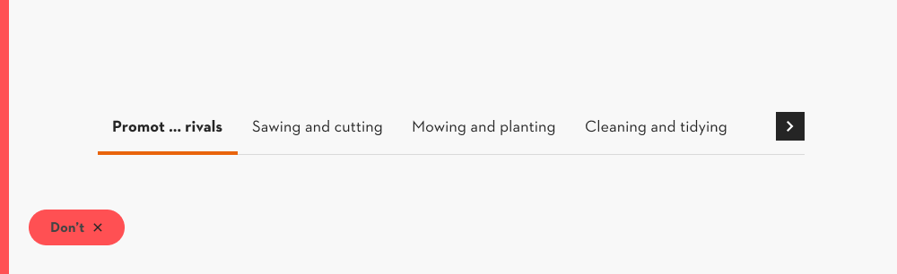

_Figure: Don't example marked with a red "Don't" badge: the first tab label is truncated to "Promot ... rivals" with an ellipsis, next to "Sawing and cutting", "Mowing and planting", "Cleaning and tidying" and a dark right-arrow button. Truncating a tab label harms accessibility._

### Icon usage

- Use icons to guide users, not for decoration, to prevent unnecessary clutter in the interface.
- On smaller screens, icons can occupy more space and limit the number of visible tabs.
- If icons are used, they must appear on all tab items.
   - **Exception:** If the first tab displays “all items”, while the other tabs provide filtered subsets of the same list, the icon can be omitted in the first tab.

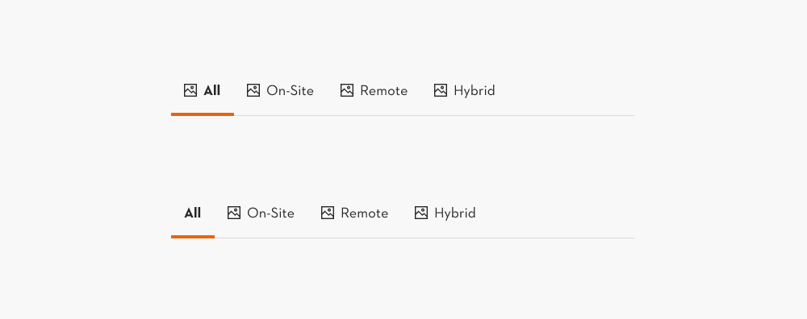

_Figure: Two tab lists with the labels "All", "On-Site", "Remote" and "Hybrid", "All" selected. In the top list every tab has an icon; in the bottom list "All" has no icon while the other three tabs have one, the allowed exception for a first tab that shows all items._

### Integrated number indicator

- On the right side of the label, an integrated number indicator can be placed.
- If number indicators are used, most likely they appear on all tabs in the list.

[Number indicator guidelines →](https://www.figma.com/design/qXldpLO6gxHJNLdcXIPxYt?node-id=24240-47126)

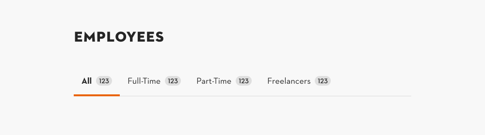

_Figure: Page title "Employees" above four tabs, "All" (selected, bold with an orange underline), "Full-Time", "Part-Time" and "Freelancers", each with an integrated grey number indicator "123" on the right side of the label._

### Icon and number indicator

Be aware of visual clutter and harming the cognitive load of the user, when both icon and the number indicator are visible.

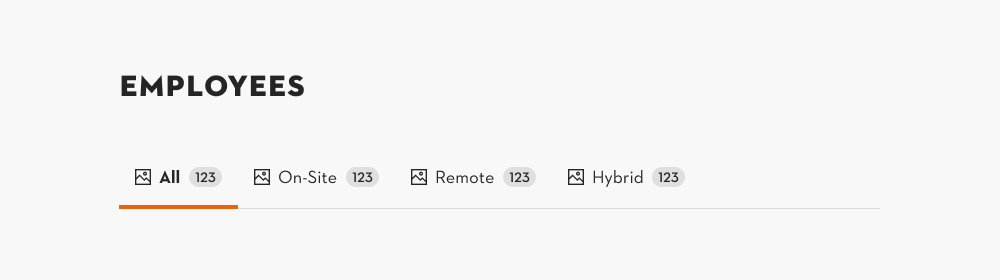

_Figure: Page title "Employees" above four tabs, "All" (selected, bold with an orange underline), "On-Site", "Remote" and "Hybrid", each showing both a leading icon and a grey number indicator "123", which creates visual clutter and raises cognitive load._

### Amount of tabs

#### Minimum is two tabs

- A tab can never be alone.
- Two tabs is the minimum amount.
- There is no maximum amount defined.

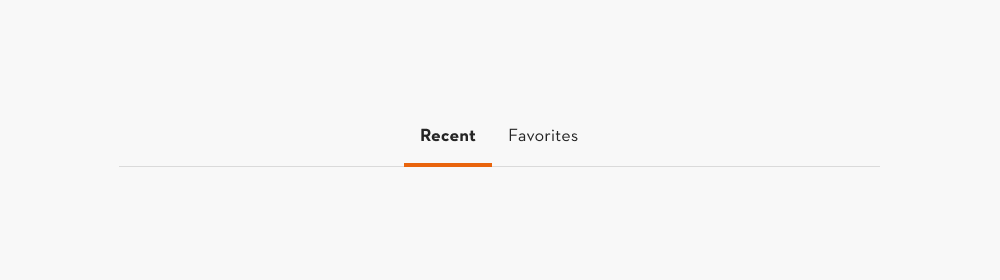

_Figure: A center-aligned tab list with the minimum of two tabs, "Recent" (selected, bold with an orange underline) and "Favorites", above a thin grey baseline._

#### Discoverability problem: high amount of tabs

Tabs that are initially hidden are less discoverable, as the user must scroll/navigate the arrows in order to see them.

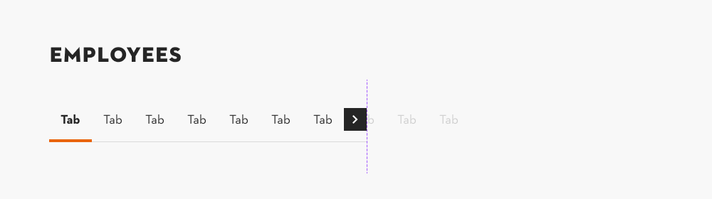

_Figure: Under the title "Employees", a row of ten tabs all labelled "Tab", the first selected. Seven tabs are visible up to a dark right-arrow button and a dashed vertical line marking the visible edge; the last three are faded and hidden behind it, so the user must scroll or use the arrow to find them._

#### Order the tabs by importance and/or relevance

- Place the most relevant tabs in the beginning of the list. E.g.
   - Most relevant for business.
   - Most relevant for the user.
- Consider what data sources you have to decide what tabs are most important.

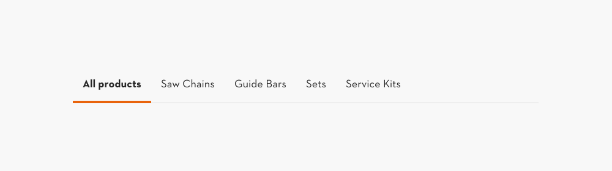

_Figure: Horizontal tab list ordered by relevance with "All products" first and selected (bold label, orange underline), followed by "Saw Chains", "Guide Bars", "Sets" and "Service Kits" above a thin divider line._

#### On smaller screens, most tabs may extend beyond the visible area

Short copy is even more essential on mobile devices to display more tabs.

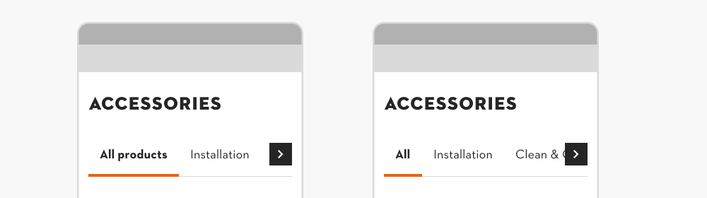

_Figure: Two mobile screens titled "ACCESSORIES", each with a tab list that runs past the visible area and ends in a dark right-arrow button; the left screen shows "All products" (selected) and "Installation" with shorter labels, the right shows "All" (selected), "Installation" and a cut-off "Clean & Care"._

## Behavior

### Don’t: system feedback

Do not place any elements that needs system verification in a tab component. System feedback will be hidden or hard to find.

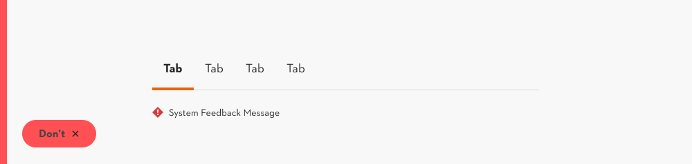

_Figure: Don't example: a tab list of four tabs labelled "Tab" (first selected) with a red error icon and the "System Feedback Message" placed directly below it, which is wrong because elements needing system verification must not sit in a tab component, where feedback is hidden or hard to find._

### Overflow behaviour

1. **Cursor navigation:** horizontal movement only by clicking buttons.
1. **Touch navigation**: horizontal movement by tapping button or dragging.

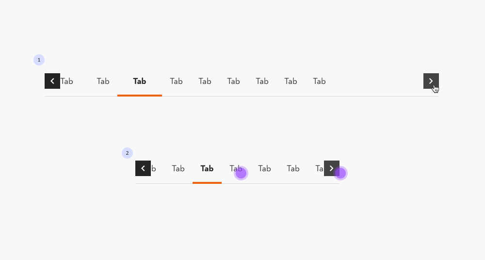

_Figure: Two overflowing tab lists of "Tab" items with a selected third tab and left/right arrow buttons. Callout 1 marks the cursor variant, where the tabs move horizontally only by clicking the arrow buttons (a hand cursor is on the right button); callout 2 marks the touch variant, where tapping the buttons or dragging moves the tabs (touch points shown as purple circles on a tab and on the right button)._

### Content pane

#### First tab label is selected by default

The first tab is the selected tab and the content pane is visible.

No trigger is needed to display the first pane.

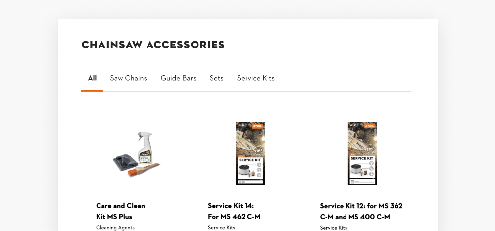

_Figure: Page section titled "CHAINSAW ACCESSORIES" with the tab list "All", "Saw Chains", "Guide Bars", "Sets", "Service Kits" where the first tab "All" is selected by default (bold, orange underline) and its content pane below shows product cards for a Care and Clean Kit MS Plus and two service kits._

#### One content pane is visible

It is not possible to have more panes open at the same time:

- only 1 tab is selected at a time.
- only 1 content pane is visible at a time.

The user has full control over the content that is visible.

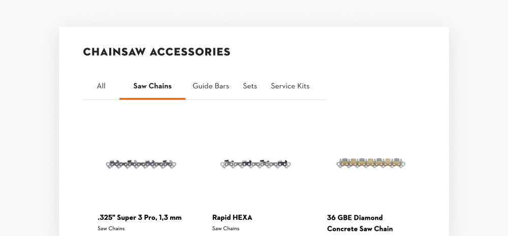

_Figure: Page section titled "CHAINSAW ACCESSORIES" with the tab list "All", "Saw Chains", "Guide Bars", "Sets", "Service Kits" where "Saw Chains" is the only selected tab and the only visible content pane shows saw chain products (.325" Super 3 Pro, 1,3 mm; Rapid HEXA; 36 GBE Diamond Concrete Saw Chain)._

## Examples/Variants

### Common use cases

#### Tab in-page vs. tab navigation

1. **Tabs in-page:** allow to view different content panes on a page.
   - Most likely below the page title.
1. **Tabs navigation:** offer links to other pages in the same level.
   - Most likely above the page title.

[Tab navigation component →](https://www.figma.com/design/qXldpLO6gxHJNLdcXIPxYt?node-id=24564-335)

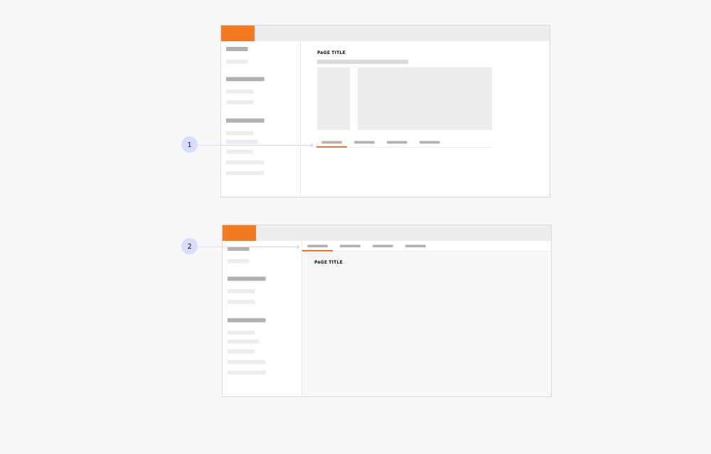

_Figure: Two wireframe pages with a side navigation and "PAGE TITLE". Callout 1 points at tabs in-page, placed below the page title and image area, to switch content panes on the page; callout 2 points at tab navigation, placed above the page title at the top of the content area, linking to other pages on the same level._

#### Tabs to hide and show content

Structure content into bitable sizes, in order to reduce the cognitive load.

Optimize for the use case that is most likely to be the most relevant.

Example: Most people that visit the website are private consumers and not an authorized STIHL dealer.

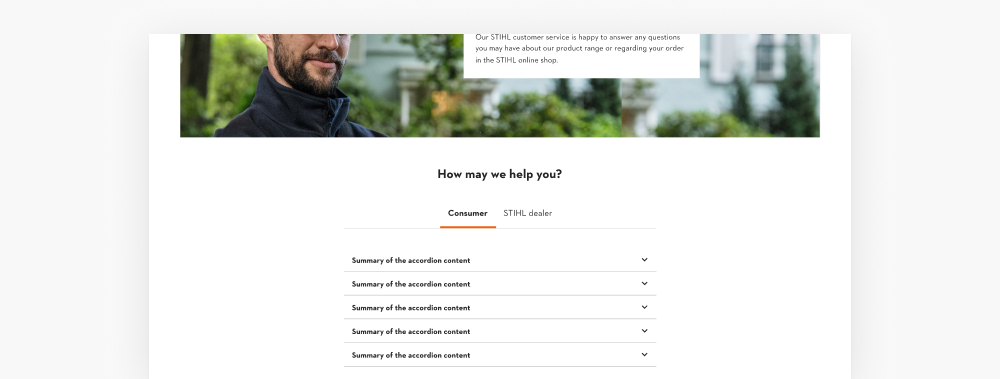

_Figure: Customer service page excerpt with the heading "How may we help you?" and centered tabs "Consumer" (selected) and "STIHL dealer", with a content pane below made of five accordion rows titled "Summary of the accordion content"; above it a hero image of a man with the text "Our STIHL customer service is happy to answer any questions you may have about..." and below the accordions the buttons "Zum Kontaktformular" and "Zu weiteren Kontaktmöglichkeiten"._

#### Tabs to filter cards

In some cases a tab list helps users to filter cards. Use up to 5-7 tab items in the tab list.

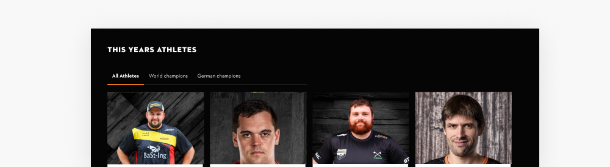

_Figure: Dark page section titled "THIS YEARS ATHLETES" with a tab list "All Athletes" (selected), "World champions" and "German champions" used to filter the row of athlete portrait cards below it._

#### Filter: tabs in-page, checkbox group or chip group?

1. **Tabs:**
   1. A content component to switch the visible pane.
   1. Tabs organize content, not filter content.
   1. Use for short lists.
   1. If items in the list can overlap, tabs might be confusing.
1. **Checkbox group:**
   1. A selection component for characteristics.
   1. Combine with a button to set the filter.
   1. Use for long lists, as it is easy to scan.
   1. Use for complex filters with multiple grouped categories.
1. **Chip group:**
   1. A selection component for characteristics.
   1. Filter is instantly set.
   1. Use for short lists.
   1. If filters can overlap, choose the multi-select variant.

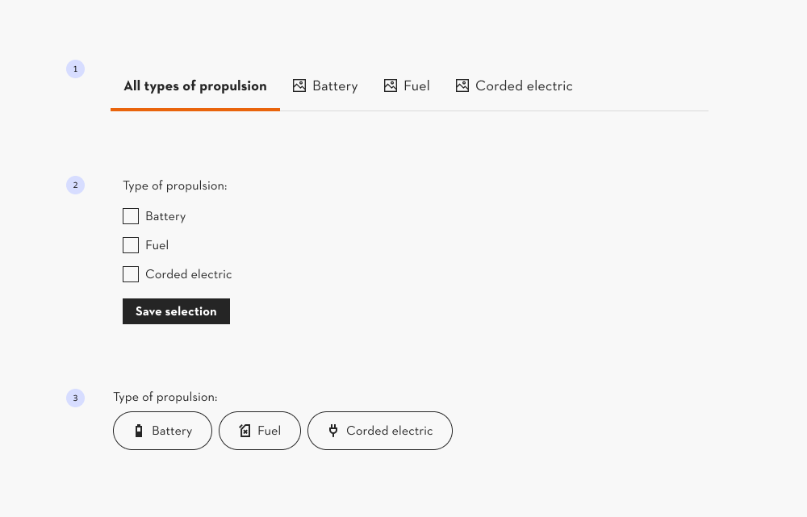

_Figure: Three ways to filter by type of propulsion. Callout 1: tabs "All types of propulsion" (selected), "Battery", "Fuel" and "Corded electric". Callout 2: a checkbox group with legend "Type of propulsion:" and unchecked checkboxes "Battery", "Fuel", "Corded electric" plus a "Save selection" button. Callout 3: a chip group with legend "Type of propulsion:" and selectable chips "Battery", "Fuel" and "Corded electric", each with an icon._

### STIHL use cases

#### STIHL dealer search

In the STIHL dealer search web app the tabs are placed on top of a map. The tabs are combined with a search and filter functionality.

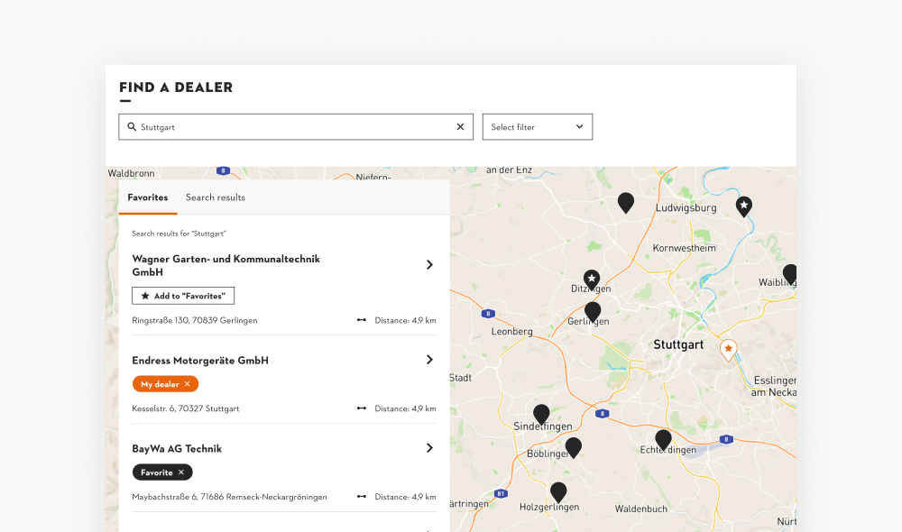

_Figure: STIHL dealer search web app titled "FIND A DEALER" with a search field containing "Stuttgart" and a "Select filter" dropdown above a map of the Stuttgart area. Over the left of the map a tabs component (grid=main / narrow, alignment=left) shows the tabs "Favorites" (selected, with an orange underline) and "Search results", above a list of dealer results with their addresses and distances._

## Tabs navigation

Overview:

- The components main function is to navigate to another page url.
   - In case the other tabs activate a content pane to switch, use the tabs in-page (see above)
- Tabs navigation can be extended beyond the grid to span the full width of the full content area.
- Left alignment is default and preferred option, as it aligns with typical user reading behavior, also known as the ‘F-pattern’.
- The tabs navigation component is a link list and often used as secondary navigation.

> Tabs in-page and tabs navigation are stored together as a single component in Figma.

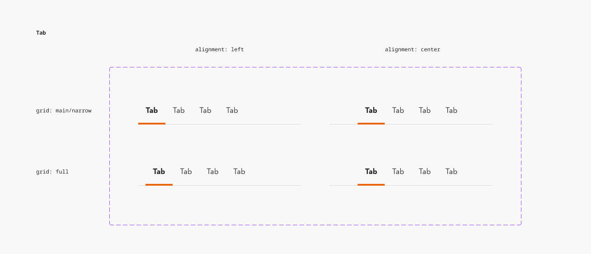

_Figure: Tabs navigation variants in a matrix of "alignment: left" and "alignment: center" columns against "grid: main/narrow" and "grid: full" rows. Each cell shows four tabs labelled "Tab", the first one selected (bold with an orange underline) and the others unselected, above a thin divider line; in the full grid the left-aligned tab list starts slightly further inset._

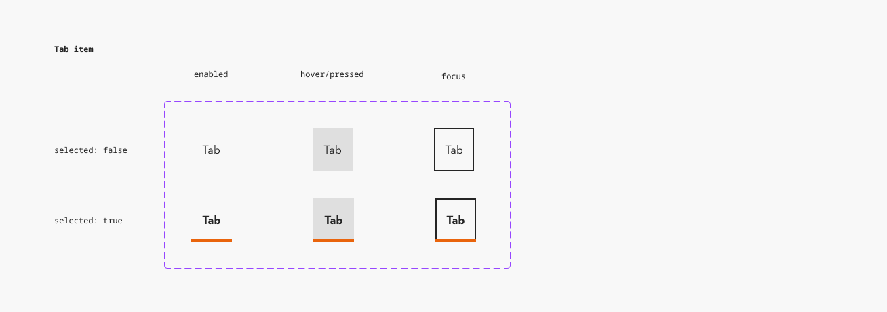

_Figure: Tab item states in a matrix of "enabled", "hover/pressed" and "focus" columns against "selected: false" and "selected: true" rows. Unselected tabs show a regular "Tab" label; selected tabs show a bold label with an orange underline. Hover/pressed adds a light grey background and focus adds a dark outline around the tab._

### Further guidelines

[Storybook documentation](https://main--63440bbb95889041542a5ba3.chromatic.com/?path=/docs/components-navigation-tabs--documentation&globals=backgrounds.name:!undefined;backgrounds.value:!undefined)

Decision tree

### Related elements

[Chip group](https://www.figma.com/design/qXldpLO6gxHJNLdcXIPxYt/Pattern-Library-%F0%9F%96%A5-Web-1.0?node-id=18691-978)

[Skip Link](https://www.figma.com/design/qXldpLO6gxHJNLdcXIPxYt/Pattern-Library-%F0%9F%96%A5-Web-1.0?node-id=16333-2371)

[Checkbox](https://www.figma.com/design/qXldpLO6gxHJNLdcXIPxYt/Pattern-Library-%F0%9F%96%A5-Web-1.0?node-id=1017-2316)

[Iconography](https://www.figma.com/design/U218NNP4OsipaHOtv5flns/Iconography-%E2%9E%A1%EF%B8%8F?m=auto)

### Contribute

Contribute to improving this component by sharing your feedback, asking questions, or suggesting features [here](https://www.figma.com/design/lLmw7PfIdKjFG4uT3B2Hyj/Onboarding-%F0%9F%93%96?node-id=446-868&t=zKmRu4kAkxMeRDmK-4).

## Formatting and Construction

> Most of the “Formatting and Construction” guidelines from the Tabs in-page component apply, see above.

### Anatomy

1. **Selected tab**
1. **Unselected tab(s)**
1. **Icon (optional)**
1. **Label**
1. **Number indicator (optional)**
1. **Overflow button (optional)**

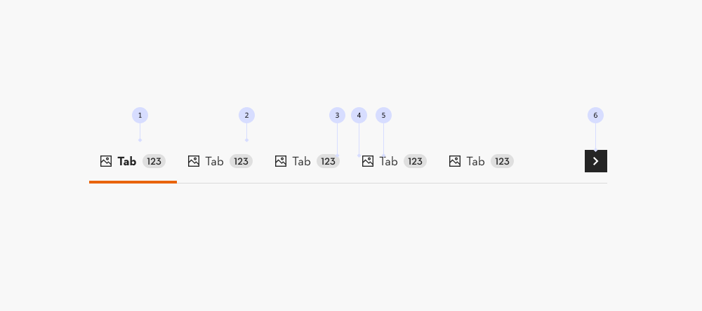

_Figure: Anatomy of tabs (grid=main / narrow, alignment=left): a row of tabs each with an image icon, the label "Tab" and a number badge "123", ending with a dark chevron button on the right. Callout 1 points at the selected tab (bold, orange underline), 2 at an unselected tab, 3 at the icon, 4 at the label, 5 at the number indicator, and 6 at the overflow button._

### Placement

#### Horizontal placement: grid

The tab navigation can either be placed within the grid, spanning the main content area’s full width **(1)**, or extend beyond the grid to span the full content area **(2)**.

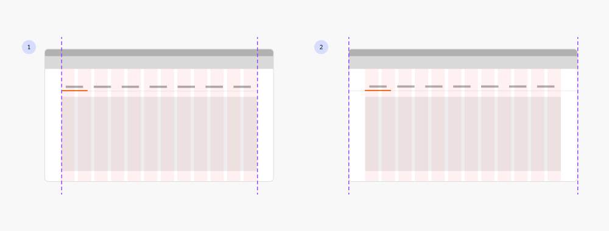

_Figure: Two page wireframes with a column grid and purple dashed lines marking the grid edges. Callout 1: the tab navigation sits within the grid, spanning the main content area's full width, with a divider line limited to the grid. Callout 2: the tab navigation extends beyond the grid across the full content area, with its divider line running the full page width while the tab items still align with the content grid._

#### Horizontal placement: grid sidebar

For use cases with 1 or 2 sidebars the tab navigation must extend beyond the grid to span the full content area.

[Full content area guideline →](https://www.figma.com/design/JyyYtoCYbtJrzqHs38OXSQ/Grid-%26-Spacing-%F0%9F%A7%AE?node-id=1-132)

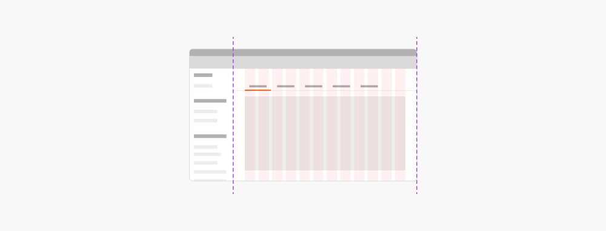

_Figure: Page wireframe with a sidebar on the left and a column grid for the content area, with purple dashed lines at the edges of the full content area. The tab navigation spans the full content area beside the sidebar, its divider line running across the whole area, while the tab items align with the content grid below._

#### Vertical placement

Tabs navigation that extends beyond the grid can be placed below **(1)** or above **(2)** the page title.

can help to distinguish the page areas.

background-color-secondary

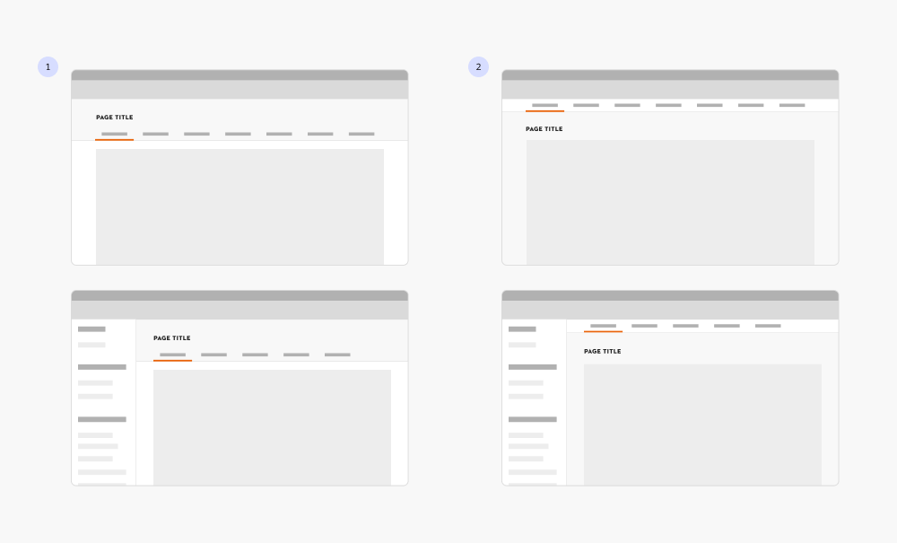

_Figure: Four page wireframes, the top two without and the bottom two with a sidebar. Callout 1 (left column): the tab navigation is placed below the "PAGE TITLE" heading, inside a tinted header area. Callout 2 (right column): the tab navigation is placed above the "PAGE TITLE" heading, directly under the main header, with the page title and content below it._

### Alignment

#### Align the tab list to the left or to the center

The tab list can be aligned to the left **(1)** or to the center **(2)**.

Left alignment is default and preferred option, as it aligns with typical user reading behavior, also known as the ‘F-pattern’.

Center alignment can be used in for some use cases, if it enhances the discoverability of the tab list.

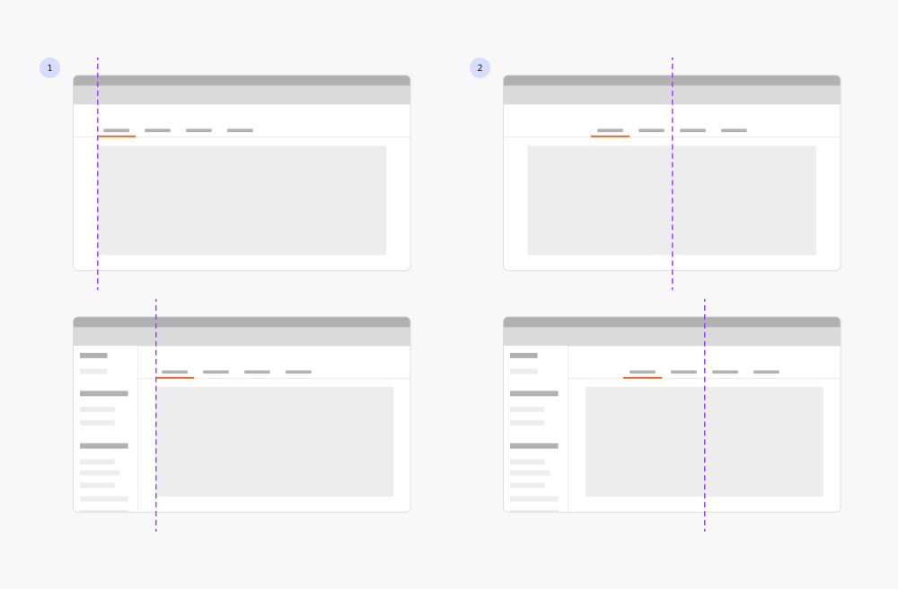

_Figure: Four page wireframes, the top two without and the bottom two with a sidebar, each with a purple dashed alignment line. Callout 1: the tab list is left-aligned, with the first tab starting at the left edge of the content below. Callout 2: the tab list is centered, positioned around the central dashed line._

#### Align the tab items with the content

Even if the tab component extends beyond the grid, the tab items themselves must always align with content below and cannot run wider.

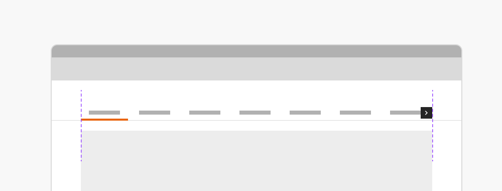

_Figure: Page wireframe where the tab navigation's divider line extends beyond the content grid across the full width, but the tab items, including the last one and the dark overflow chevron button, stay between two purple dashed lines that mark the left and right edges of the content below._

## Behavior

> Most of the “Behaviour” guidelines from the Tabs in-page component apply, see above.

### Tab contains a link

- Every tab contains a link target with an url.
- On click, a reload is triggered.
- For a content pane switch, use the Tabs in-page component (see above).

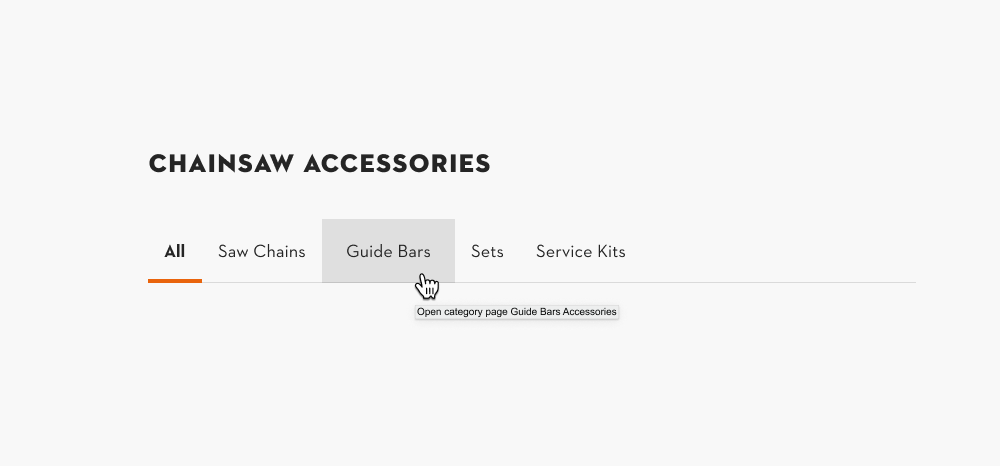

_Figure: Tabs navigation under the heading "CHAINSAW ACCESSORIES" with the tabs "All" (selected, bold with orange underline), "Saw Chains", "Guide Bars", "Sets" and "Service Kits". The mouse cursor hovers the "Guide Bars" tab, which has a grey background, and a tooltip reads "Open category page Guide Bars Accessories", showing that each tab is a link to a URL._

## Examples/Variants

> Most of the “Examples/Variants” guidelines from the Tabs in-page component apply, see above.

### Common use cases

#### Tab in-page vs. tab navigation

1. **Tabs navigation:** offer links to other pages in the same level.
   - Most likely above the page title.
1. **Tabs in-page:** allow to view different content panels in a page.
   - Most likely below the page title.

[Tab in-page component →](https://www.figma.com/design/qXldpLO6gxHJNLdcXIPxYt?node-id=24564-313)

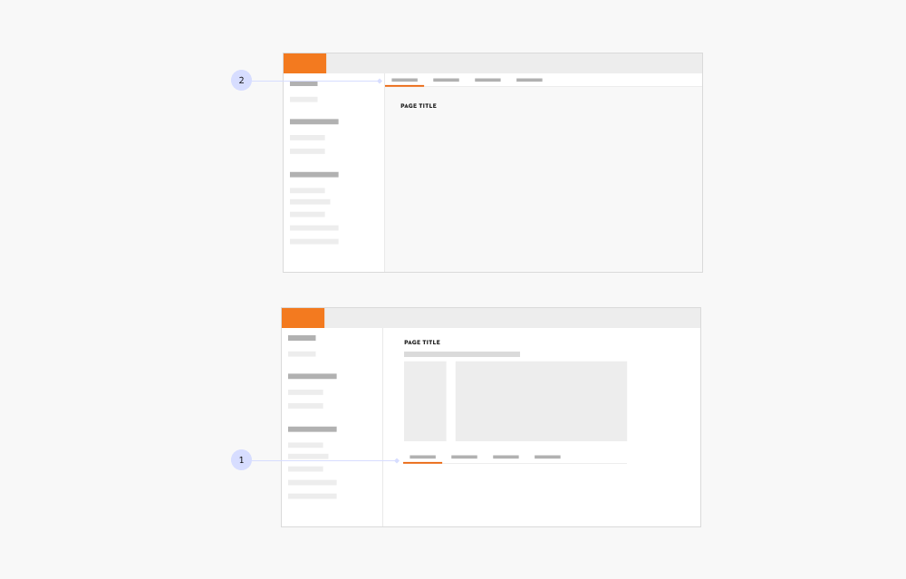

_Figure: Two wireframes of an app page with a sidebar, an orange logo area and a "Page title". Callout 2 (top wireframe) points at the tabs navigation, a row of four tabs with the first one active, placed above the page title; callout 1 (bottom wireframe) points at the in-page tabs, a row of four tabs with the first one active, placed below the page title and content blocks._

#### Navigation as a main purpose

The tabs navigation component is a link list and often used a secondary navigation (used for secondary tasks).

It can be combined with a main navigation, e.g. a

1. **Sidebar**
1. **Top bar**

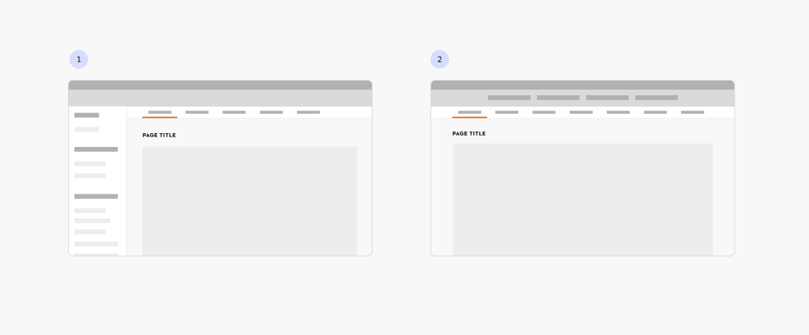

_Figure: Two wireframes of tabs navigation (tab item 3, grid main/narrow, left aligned, first tab active) used as secondary navigation above the "Page title" together with a main navigation. Callout 1 shows it combined with a sidebar on the left; callout 2 shows it combined with a top bar navigation along the top._

### STIHL use cases

#### Category pages in the stihl webshop

Some product category overview pages in the web shop contain a tab list to categorize specific product categories.

The tabs are combined with a more complex filter.

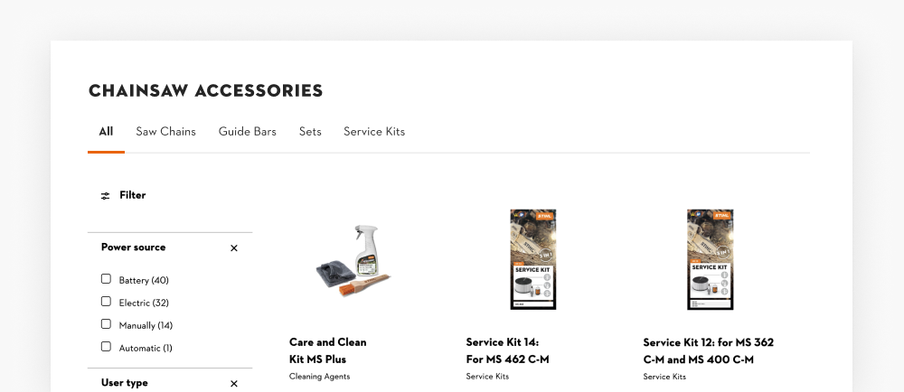

_Figure: STIHL webshop category page titled "Chainsaw Accessories" with left-aligned tabs "All" (active, orange underline), "Saw Chains", "Guide Bars", "Sets" and "Service Kits" below the title. Beneath the tabs are a Filter with checkbox options (Power source: Battery, Electric, Manually, Automatic) and product cards such as Care and Clean Kit MS Plus and Service Kit 14 and 12._

#### STIHL Service Center (SSC)

The portal offers a search function of which search results are categorized into: ‘Product variants’, ‘Parts’, ‘Documents’ and ‘Support news’ results.

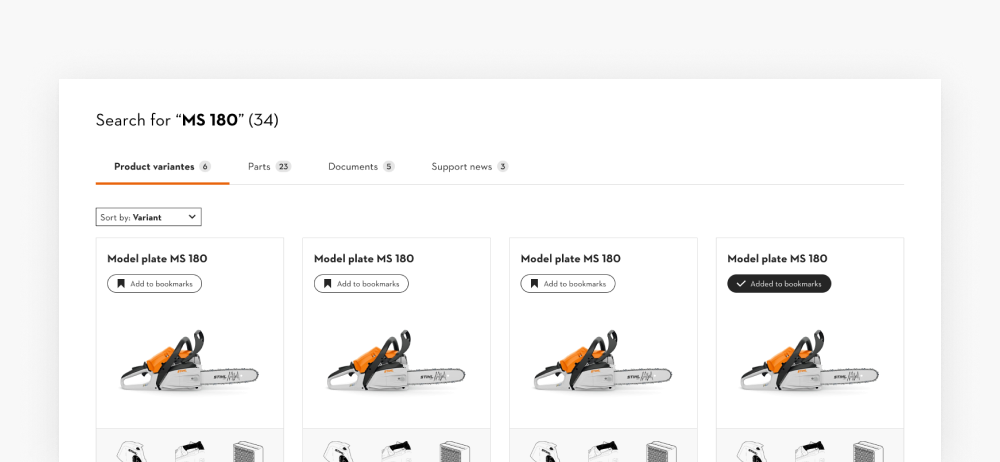

_Figure: STIHL Service Center search results page for "MS 180" (34) with tabs "Product variantes" (active, 6), "Parts" (23), "Documents" (5) and "Support news" (3), each with a count badge. Below the tabs are a "Sort by: Variant" dropdown and cards titled "Model plate MS 180" showing a chainsaw and an "Add to bookmarks" button, the last one showing "Added to bookmarks"._
