# Textarea

## Textarea

Overview:

- Use for multi-line text input, suitable for longer responses, comments, or descriptions.

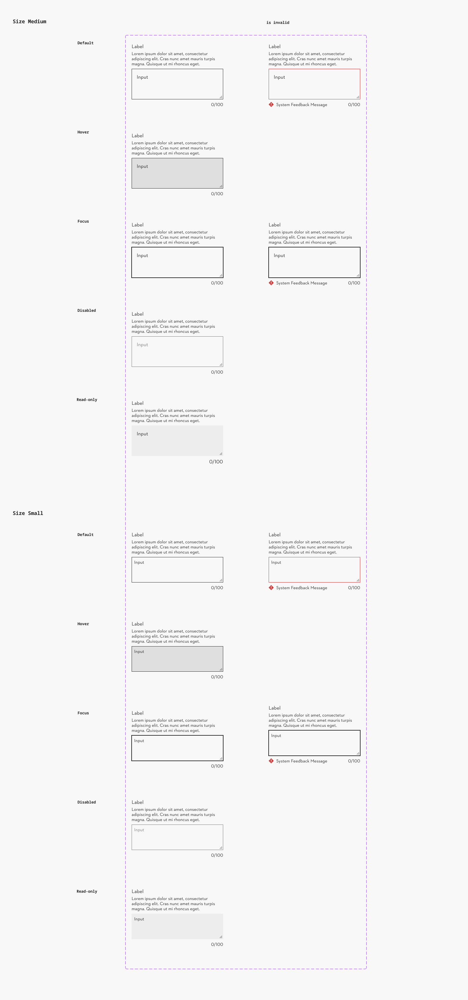

### Further guidelines

[Storybook documentation](https://main--63440bbb95889041542a5ba3.chromatic.com/?path=/docs/components-textarea--documentation&globals=backgrounds.name:!undefined;backgrounds.value:!undefined)

### Related elements

[Input Text](https://www.figma.com/design/qXldpLO6gxHJNLdcXIPxYt?node-id=1591-2)

### Contribute

Contribute to improving this component by sharing your feedback, asking questions, or suggesting features [here](https://www.figma.com/design/lLmw7PfIdKjFG4uT3B2Hyj/Onboarding-%F0%9F%93%96?node-id=446-868&t=zKmRu4kAkxMeRDmK-4).

## Formatting and Construction

### Anatomy

1. **Label** Communicate to the user, what input is needed.
1. **Text area** The area where the user enters the input.
1. **User input text** Data, entered by the user
1. **Character count/limit (optional)** Counter that shows current character count an the character limit for the text area
1. **Hint (optional)** Short copy that provides guidance and context.
1. **Info Button (optional)** Can be used to trigger a popover with additional information
1. **System feedback** Error message to help the user understand

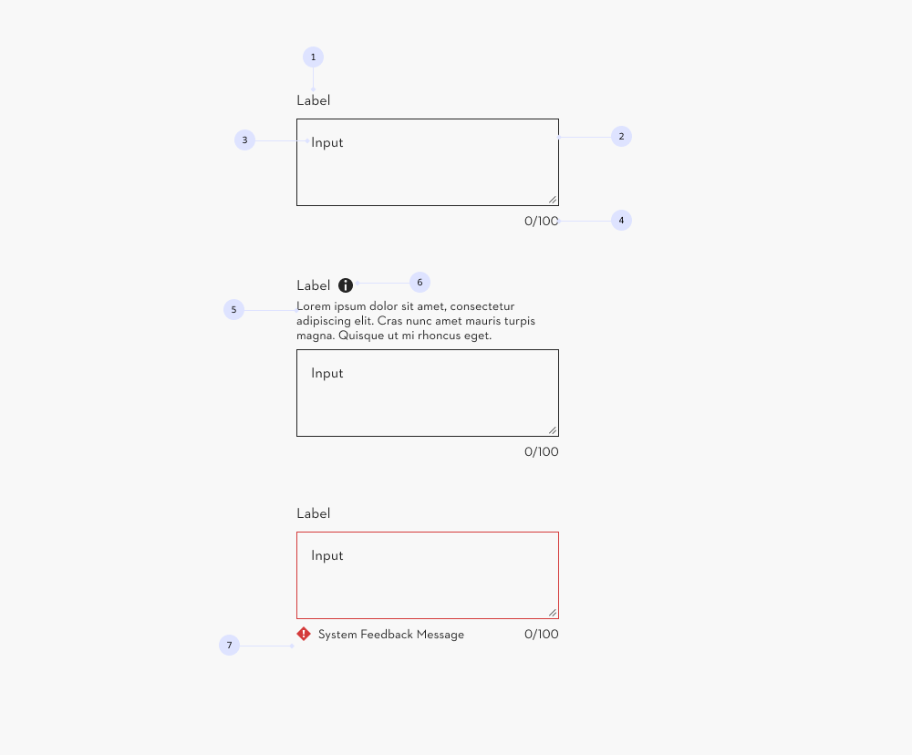

### Sizing

#### Minimum height and width

- Minimum height: 96px
- Minimum width: 288px

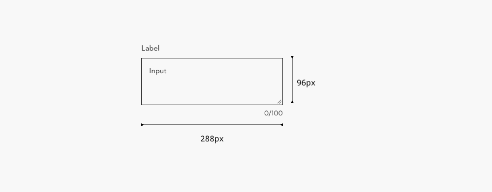

#### Maximum width

The width of a text area field is determined by the container it is placed in. This should ideally be the “[content area narrow](https://www.figma.com/design/HHM9B6UjMStGLxMf6loNLn/DS-945-Grid-Optimisations-%7C-Design?node-id=1-857&t=FFOFP94g90gl91Ko-4)” defined within the grid layout.

While the text area can adjust to fit its container, we recommend not exceeding a maximum width of 544px (matching the [maximum text width](https://www.figma.com/design/pQUiJaNuWrGzPaeMrEHf6N/DS-1117-Design-%7C-34em?node-id=2645-515)) for better scanability and readability. This width should be set on a [fieldset](https://www.figma.com/design/Ie2r0R9QwjEc7O3nrFbXhV/Web-Pattern-Library?node-id=8-154) or container itself.

In the Figma component, the maximum width is set to the recommended 544px. ([Link to calculation](https://www.figma.com/design/pQUiJaNuWrGzPaeMrEHf6N/DS-1117-Design-%7C-34em?node-id=2645-515))

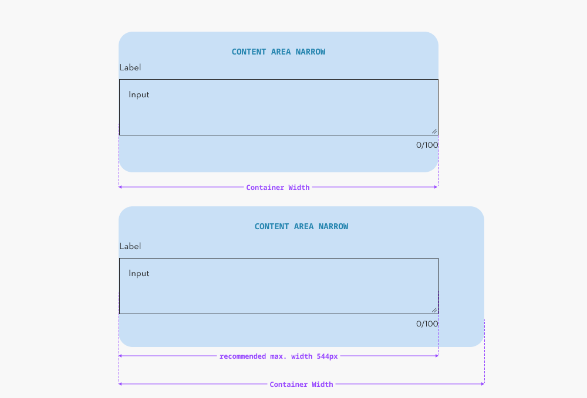

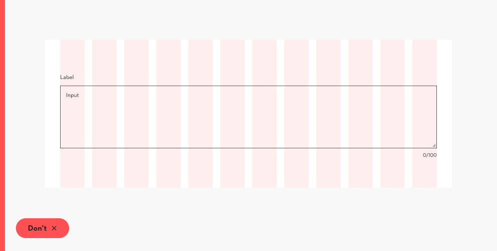

## Content and Assets

### Required and optional indicators

In order to communicate which fields are required to the user an asterisk **(1)** is shown next to the label. When using the code component the asterisk will be shown automatically when input is set to required.

Optional areas are marked with the word “(optional)”, after the label **(2)**. In most cases, this has to be added manually in the Content Management System.

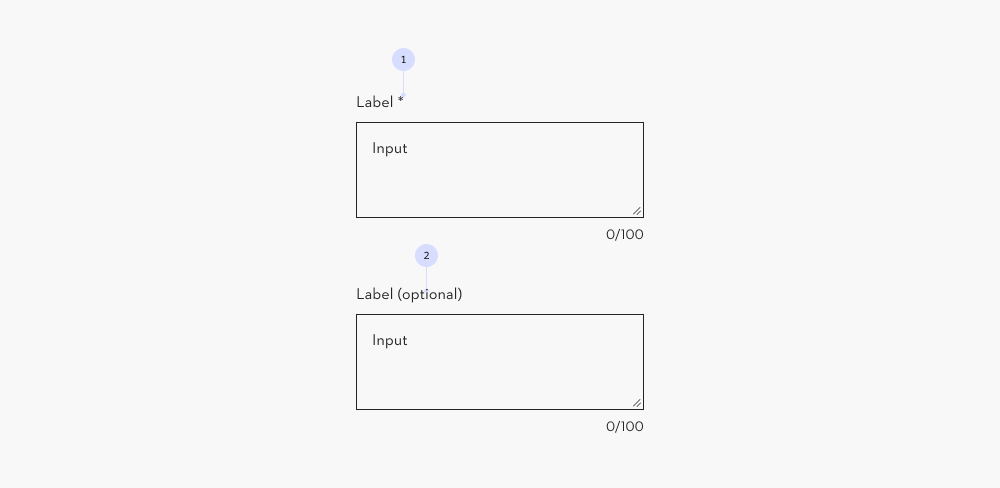

### Info Button

A button to trigger a popover can be placed next to input or select labels to provide **additional contextual information.**

Popover content should be **limited to supplementary, non-critical information** — for example, brief explanations, examples, or guidance that supports user understanding without being essential for task completion.

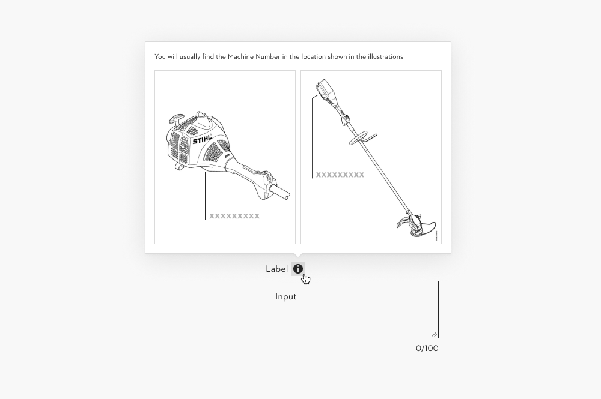

**Don’t use the popover for critical or required information**, use the hint instead as critical information should net be hidden

For mor Guidance on this topic see the [Popover documentation](https://www.figma.com/design/qXldpLO6gxHJNLdcXIPxYt?node-id=35223-10505)

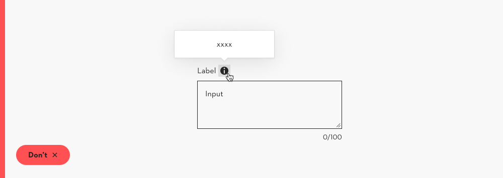

## Behavior

### Character count

Some text areas need a character limit. These indicators are displayed at the bottom right. When typing, the indicator counts the amount of character that are being used. **(1)** When reaching the maximum amount of usable characters you won’t be able to introduce any further characters. **(2)** When the user is above the limit the text area switches to the error mode **(3)**

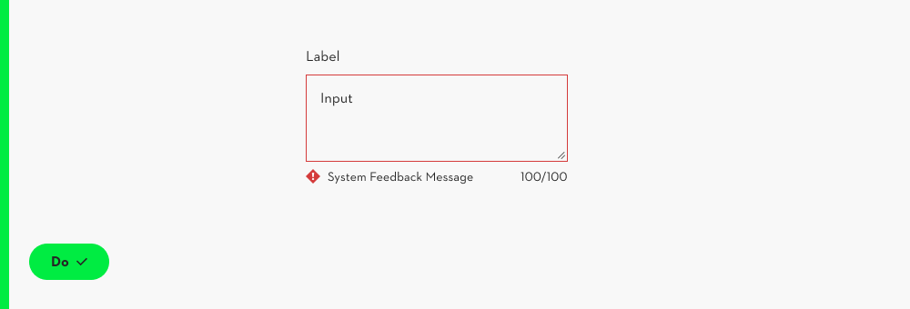

### Scaling the area

The text area can have a fixed hight or can be used dynamically and scale with the content or user input.

1. automatic
1. manual

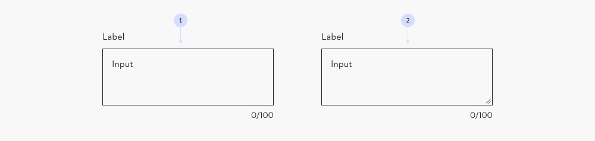

**Automatic**

The text area grows automatically in height when entering the input. If the area grows the initial state should be at least the minimum height. The text area should stop growing when reaching the maximum size.

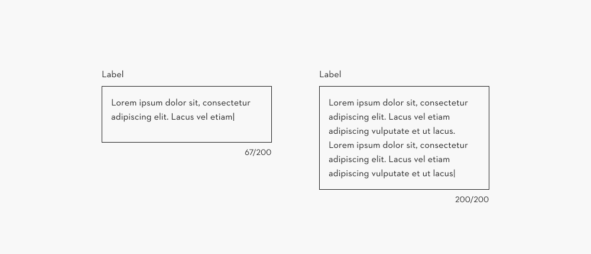

### Overflow

More characters than max height requires a (native) scroll bar to be shown in the text area

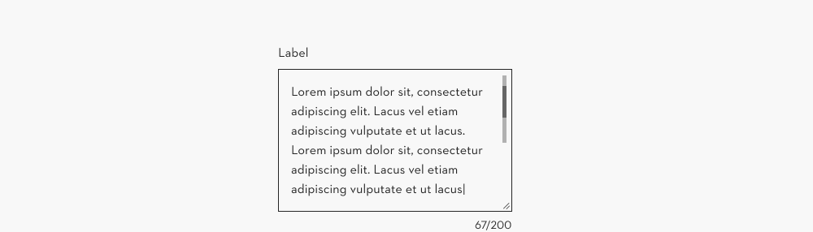
