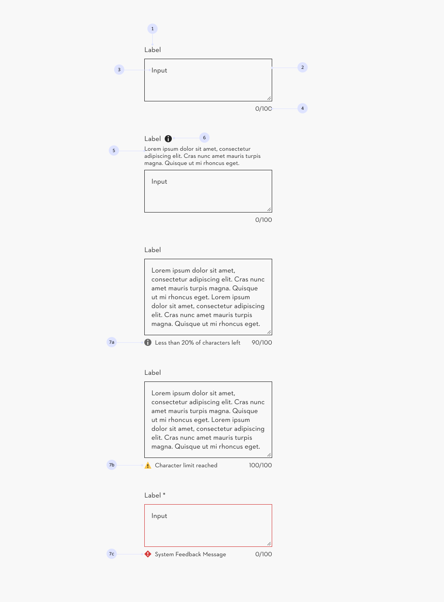
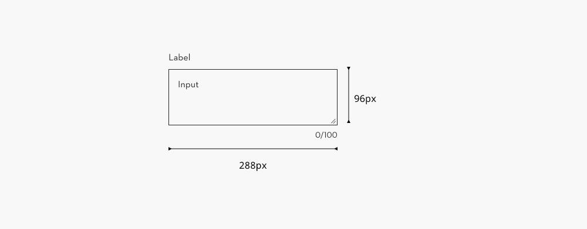
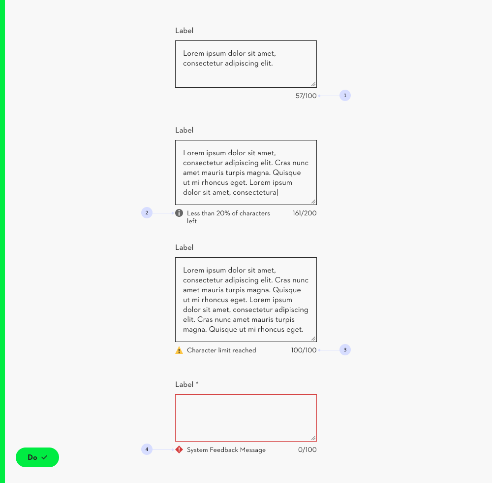
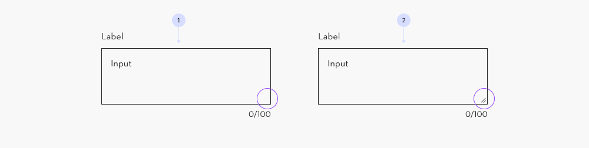

# Textarea

## Textarea

Overview:

- Use for multi-line text input, suitable for longer responses, comments, or descriptions.

_Figure: Overview of the textarea in sizes "Size Medium" and "Size Small", each in the states Default, Hover (grey fill), Focus (thick black border), Near limit, Limit reached, Disabled (greyed text) and Read-only (grey fill, no border). Each has a Label, lorem ipsum hint text, an input area with resize handle and a counter. Near limit shows the info message "Less than 20% of characters left" with "90/100", Limit reached the warning "Character limit reached" with "100/100". Default and Focus also have an "is invalid" variant with the label "Label \*" and the error "System Feedback Message"; the invalid Default field has a red border._

### Further guidelines

[Storybook documentation](https://main--63440bbb95889041542a5ba3.chromatic.com/?path=/docs/components-textarea--documentation&globals=backgrounds.name:!undefined;backgrounds.value:!undefined)

### Related elements

[Input Text](https://www.figma.com/design/qXldpLO6gxHJNLdcXIPxYt?node-id=1591-2)

### Contribute

Contribute to improving this component by sharing your feedback, asking questions, or suggesting features [here](https://www.figma.com/design/lLmw7PfIdKjFG4uT3B2Hyj/Onboarding-%F0%9F%93%96?node-id=446-868&t=zKmRu4kAkxMeRDmK-4).

## Formatting and Construction

### Anatomy

1. **Label** Communicate to the user, what input is needed.
1. **Text area** The area where the user enters the input.
1. **User input text** Data, entered by the user
1. **Character count/limit (optional)** Counter that shows current character count and the character limit for the text area
1. **Hint (optional)** Short copy that provides guidance and context.
1. **Info Button (optional)** Can be used to trigger a popover with additional information
1. **System feedback** Messages that communicate the current input state. Info and warning messages apply only when a character limit is set. **a) Info (optional):** may appear when less than 20% of the character limit remains, before the limit is reached. **b)** **Warning:** always appears when the character limit is reached. **c)** **Error:** appears on submission if a required field is empty, with or without a character limit.

_Figure: Anatomy of the textarea in five examples. In the first, callout 1 points at the Label, 2 at the text area, 3 at the user input text "Input" and 4 at the character count "0/100". The second adds 5, the hint text below the label, and 6, the info button next to the label. The last three show the system feedback: 7a the info message "Less than 20% of characters left" at "90/100", 7b the warning "Character limit reached" at "100/100", and 7c the error "System Feedback Message" under a required field ("Label \*") with a red border._

### Sizing

#### Minimum height and width

- Minimum height: 96px
- Minimum width: 288px

_Figure: Medium textarea with Label, "Input" text and "0/100" counter, with measurements showing the minimum height of 96px (vertical, at the right of the field) and the minimum width of 288px (horizontal, below the field)._

#### Maximum width

The width of a text area field is determined by the container it is placed in. This should ideally be the “[content area narrow](https://www.figma.com/design/HHM9B6UjMStGLxMf6loNLn/DS-945-Grid-Optimisations-%7C-Design?node-id=1-857&t=FFOFP94g90gl91Ko-4)” defined within the grid layout.

While the text area can adjust to fit its container, we recommend not exceeding a maximum width of 544px (matching the [maximum text width](https://www.figma.com/design/pQUiJaNuWrGzPaeMrEHf6N/DS-1117-Design-%7C-34em?node-id=2645-515)) for better scanability and readability. This width should be set on a [fieldset](https://www.figma.com/design/Ie2r0R9QwjEc7O3nrFbXhV/Web-Pattern-Library?node-id=8-154) or container itself.

In the Figma component, the maximum width is set to the recommended 544px. ([Link to calculation](https://www.figma.com/design/pQUiJaNuWrGzPaeMrEHf6N/DS-1117-Design-%7C-34em?node-id=2645-515))

_Figure: Two textareas (Label, "Input", "0/100") inside a "Content area Narrow" container. In the first the field fills the container width; in the second the container is wider than the field, and the field stays at the "recommended max. width 544px" while "Container Width" extends beyond it._

_Figure: Don't example: a medium textarea (Label, "Input", resize handle, counter "0/100") stretched across the full width of the 12-column main grid. The textarea should not span the whole main grid area; it belongs in the content area narrow and should not exceed the recommended maximum width of 544px, for better scanability and readability._

## Content and Assets

### Required and optional indicators

In order to communicate which fields are required to the user an asterisk **(1)** is shown next to the label. When using the code component the asterisk will be shown automatically when input is set to required.

Optional areas are marked with the word “(optional)”, after the label **(2)**. In most cases, this has to be added manually in the Content Management System.

_Figure: Two medium textareas with "Input" and "0/100": the first with the label "Label \*", where callout 1 points at the asterisk marking a required field; the second with the label "Label (optional)", where callout 2 points at the word "(optional)" marking an optional field._

### Info Button

A button to trigger a popover can be placed next to input or select labels to provide **additional contextual information.**

Popover content should be **limited to supplementary, non-critical information** — for example, brief explanations, examples, or guidance that supports user understanding without being essential for task completion.

_Figure: Medium textarea with the label "Label", an info button next to it (hovered with a pointer cursor), the placeholder "Input", a resize handle and the counter "0/100". Above the info button an open white popover with the text "You will usually find the Machine Number in the location shown in the illustrations" shows two line drawings of a STIHL engine unit and a trimmer, each with a leader line to a placeholder machine number "xxxxxxxxx"._

**Don’t use the popover for critical or required information**, use the hint instead as critical information should net be hidden

For mor Guidance on this topic see the [Popover documentation](https://www.figma.com/design/qXldpLO6gxHJNLdcXIPxYt?node-id=35223-10505)

_Figure: Don't example: a medium textarea with the label "Label", an info button (hovered), the placeholder "Input", a resize handle and the counter "0/100", with a small white popover above the info button containing only the placeholder text "xxxx". This is wrong because the popover must not hold critical or required information; use the hint instead._

## Behavior

### Character count

Some text areas need a character limit. These indicators are displayed at the bottom right. When typing, the indicator counts the number of characters being used. **(1)**

When less than 20% of the character limit remains, an optional info message can be displayed. **(2)**

When reaching the maximum number of usable characters, a warning message about the character limit is shown, and it is not possible to enter any more characters. **(3)** If the text area is required and the user tries to submit the form without entering any text, the field becomes invalid and an error feedback message is displayed. **(4)**

_Figure: Do example with four textareas, each with a resize handle. Callout 1 points at the counter "57/100" of a field with two lines of text; callout 2 at the info message "Less than 20% of characters left" of a field at "161/200"; callout 3 at the counter "100/100" of a full field with the warning "Character limit reached"; callout 4 at the error "System Feedback Message" of an empty required field ("Label \*") with a red border and the counter "0/100"._

### Scaling the area

The text area can have a fixed hight or can be used dynamically and scale with the content or user input.

1. **automatic**
1. **manual**

_Figure: Two medium textareas, each with the label "Label", the text "Input" and the counter "0/100", with a circle highlighting the bottom right corner of each field. Callout 1 points at the left textarea, which has no resize handle (automatic scaling); callout 2 points at the right textarea, which has a resize handle in that corner (manual scaling)._

**Automatic**

The text area grows automatically in height when entering the input. **(1)** If the area grows the initial state should be at least the minimum height. The text area should stop growing when reaching the maximum size. **(2)**

_Figure: Two medium textareas with the label "Label" that grow automatically, without a resize handle. Callout 1 points at the field at its initial minimum height with two lines of text ("Lorem ipsum dolor sit, consectetur adipiscing elit. Lacus vel etiam|") and the counter "67/200"; callout 2 points at the field grown in height to six lines of text, near its maximum size, with the counter "198/200"._

### Overflow

More characters than max height requires a (native) scroll bar to be shown in the text area

_Figure: Medium textarea with the label "Label" and a resize handle, filled with six lines of Lorem ipsum text and the counter "67/200". The text is taller than the maximum height, so a native vertical scroll bar appears on the right inside the textarea._
