# Textarea

## Textarea

Overview:

- Use for multi-line text input, suitable for longer responses, comments, or descriptions.

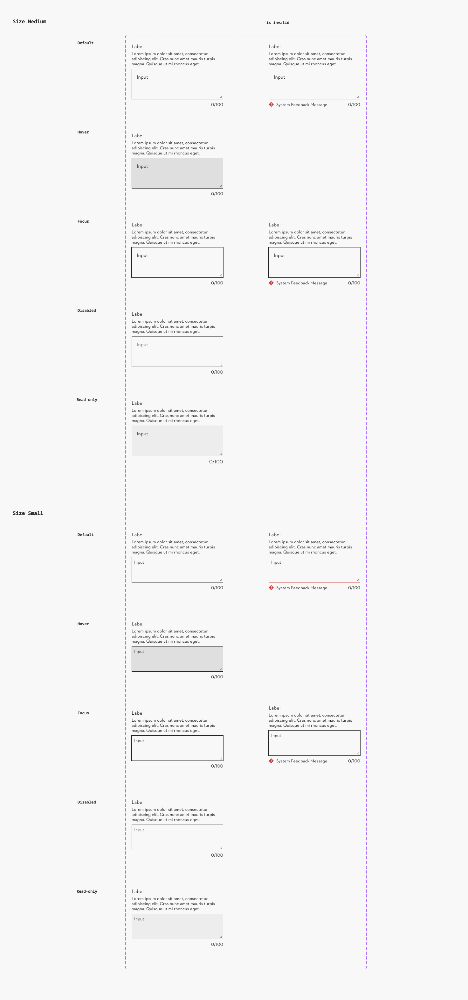

_Figure: Overview of the textarea in sizes "Size Medium" and "Size Small", each in the states Default, Hover (grey fill), Focus (thick black border), Disabled (greyed text) and Read-only (grey fill, no border). Each has a Label, hint text, an "Input" area with resize handle and a "0/100" counter; Default and Focus also have an "is invalid" variant with red border and the "System Feedback Message" with an error icon._

### Further guidelines

[Storybook documentation](https://main--63440bbb95889041542a5ba3.chromatic.com/?path=/docs/components-textarea--documentation&globals=backgrounds.name:!undefined;backgrounds.value:!undefined)

### Related elements

[Input Text](https://www.figma.com/design/qXldpLO6gxHJNLdcXIPxYt?node-id=1591-2)

### Contribute

Contribute to improving this component by sharing your feedback, asking questions, or suggesting features [here](https://www.figma.com/design/lLmw7PfIdKjFG4uT3B2Hyj/Onboarding-%F0%9F%93%96?node-id=446-868&t=zKmRu4kAkxMeRDmK-4).

## Formatting and Construction

### Anatomy

1. **Label** Communicate to the user, what input is needed.
1. **Text area** The area where the user enters the input.
1. **User input text** Data, entered by the user
1. **Character count/limit (optional)** Counter that shows current character count an the character limit for the text area
1. **Hint (optional)** Short copy that provides guidance and context.
1. **Info Button (optional)** Can be used to trigger a popover with additional information
1. **System feedback** Error message to help the user understand

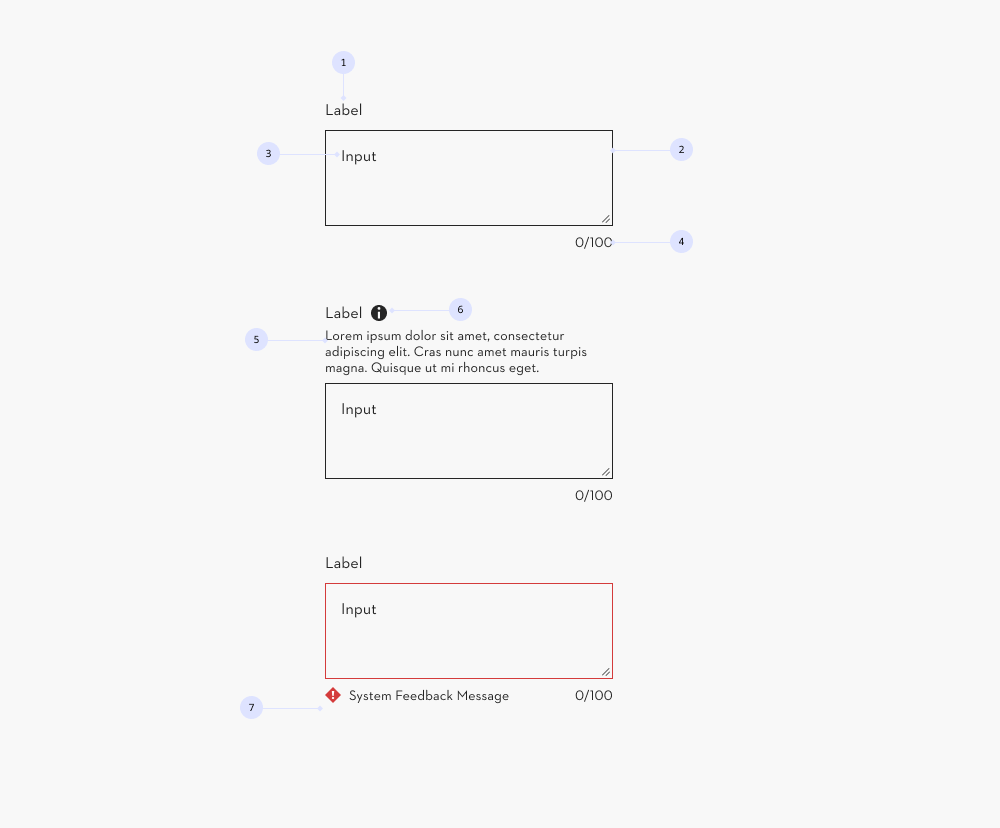

_Figure: Anatomy of the textarea in three variants: callout 1 points at the Label, 2 at the text area, 3 at the user input text "Input", 4 at the character count "0/100". The second example adds 5 the hint text below the label and 6 the info button next to the label; the third example has a red border and 7 points at the "System Feedback Message" with error icon._

### Sizing

#### Minimum height and width

- Minimum height: 96px
- Minimum width: 288px

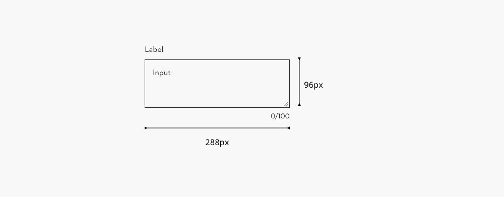

_Figure: Medium textarea with Label, "Input" text and "0/100" counter, with measurements showing the minimum height of 96px (vertical, at the right of the field) and the minimum width of 288px (horizontal, below the field)._

#### Maximum width

The width of a text area field is determined by the container it is placed in. This should ideally be the “[content area narrow](https://www.figma.com/design/HHM9B6UjMStGLxMf6loNLn/DS-945-Grid-Optimisations-%7C-Design?node-id=1-857&t=FFOFP94g90gl91Ko-4)” defined within the grid layout.

While the text area can adjust to fit its container, we recommend not exceeding a maximum width of 544px (matching the [maximum text width](https://www.figma.com/design/pQUiJaNuWrGzPaeMrEHf6N/DS-1117-Design-%7C-34em?node-id=2645-515)) for better scanability and readability. This width should be set on a [fieldset](https://www.figma.com/design/Ie2r0R9QwjEc7O3nrFbXhV/Web-Pattern-Library?node-id=8-154) or container itself.

In the Figma component, the maximum width is set to the recommended 544px. ([Link to calculation](https://www.figma.com/design/pQUiJaNuWrGzPaeMrEHf6N/DS-1117-Design-%7C-34em?node-id=2645-515))

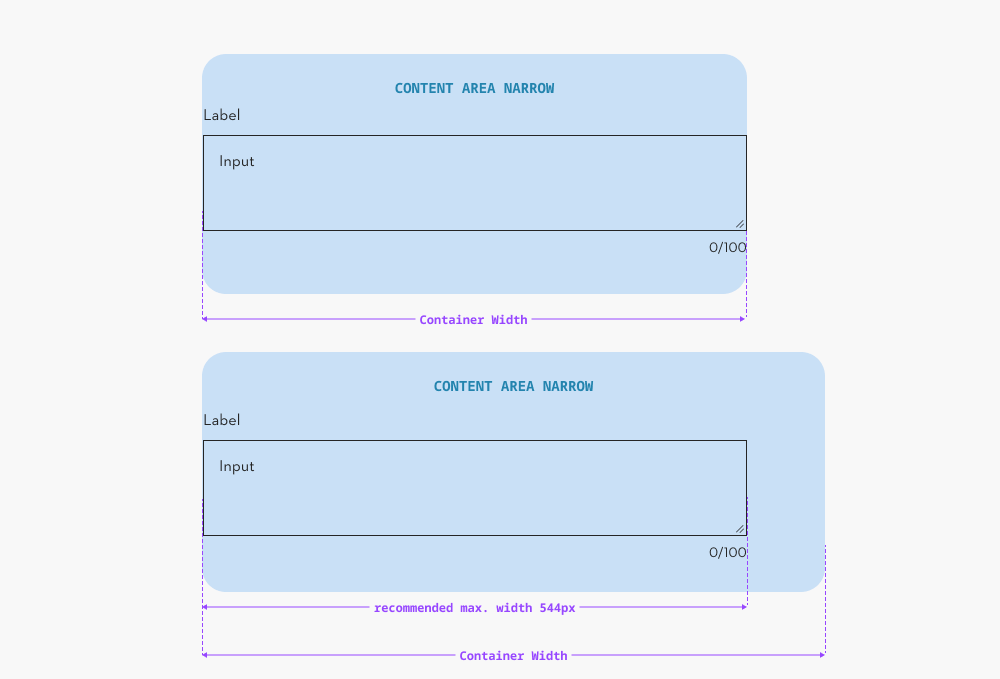

_Figure: Two textareas (Label, "Input", "0/100") inside a "Content area Narrow" container. In the first the field fills the container width; in the second the container is wider than the field, and the field stays at the "recommended max. width 544px" while "Container Width" extends beyond it._

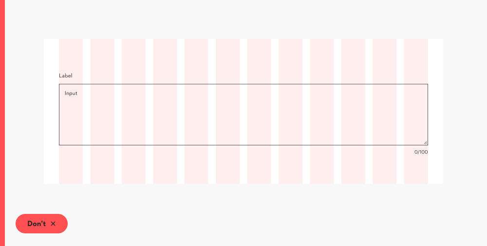

_Figure: Don't example: a textarea (Label, "Input", "0/100") stretched across the full 12-column grid width, far beyond the recommended maximum width of 544px, which hurts scanability and readability._

## Content and Assets

### Required and optional indicators

In order to communicate which fields are required to the user an asterisk **(1)** is shown next to the label. When using the code component the asterisk will be shown automatically when input is set to required.

Optional areas are marked with the word “(optional)”, after the label **(2)**. In most cases, this has to be added manually in the Content Management System.

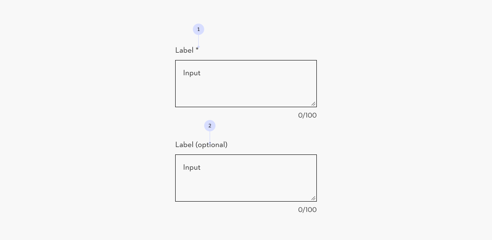

_Figure: Two medium textareas with "Input" and "0/100": the first with the label "Label \*", where callout 1 points at the asterisk marking a required field; the second with the label "Label (optional)", where callout 2 points at the word "(optional)" marking an optional field._

### Info Button

A button to trigger a popover can be placed next to input or select labels to provide **additional contextual information.**

Popover content should be **limited to supplementary, non-critical information** — for example, brief explanations, examples, or guidance that supports user understanding without being essential for task completion.

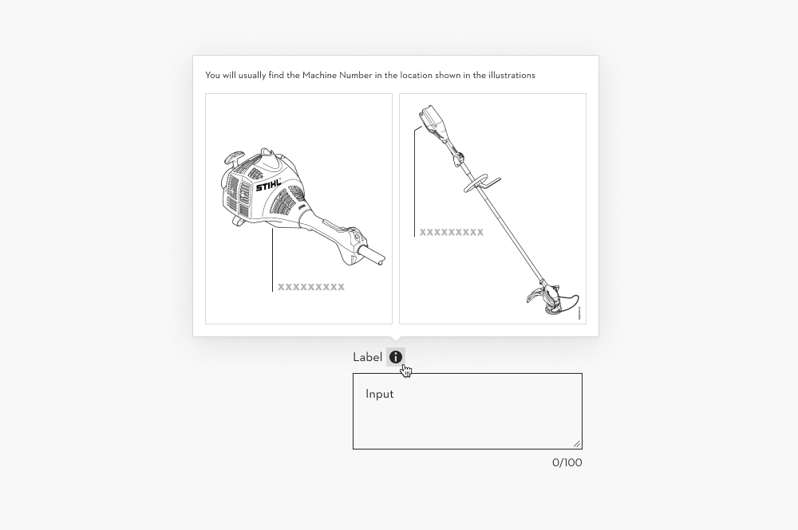

_Figure: Medium textarea with the label "Label", an info button next to it (hovered with a pointer cursor), the placeholder "Input", a resize handle and the counter "0/100". Above the info button an open white popover with the text "You will usually find the Machine Number in the location shown in the illustrations" shows two line drawings of a STIHL engine unit and a trimmer, each with a leader line to a placeholder machine number "xxxxxxxxx"._

**Don’t use the popover for critical or required information**, use the hint instead as critical information should net be hidden

For mor Guidance on this topic see the [Popover documentation](https://www.figma.com/design/qXldpLO6gxHJNLdcXIPxYt?node-id=35223-10505)

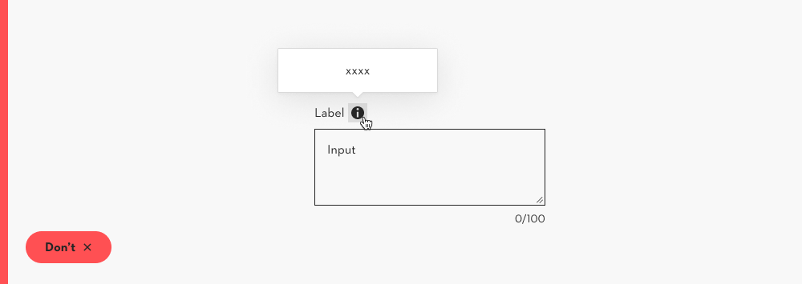

_Figure: Don't example: a medium textarea with the label "Label", an info button (hovered), the placeholder "Input", a resize handle and the counter "0/100", with a small white popover above the info button containing only the placeholder text "xxxx". This is wrong because the popover must not hold critical or required information; use the hint instead._

## Behavior

### Character count

Some text areas need a character limit. These indicators are displayed at the bottom right. When typing, the indicator counts the amount of character that are being used. **(1)** When reaching the maximum amount of usable characters you won’t be able to introduce any further characters. **(2)** When the user is above the limit the text area switches to the error mode **(3)**

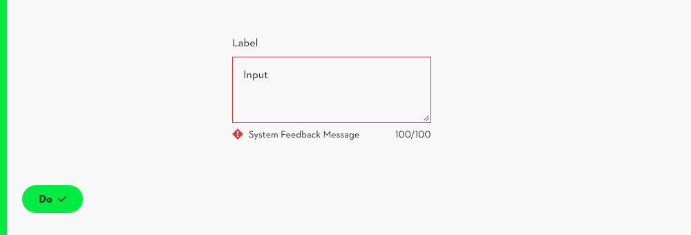

_Figure: Do example: a medium textarea with the label "Label" and the placeholder "Input" in the invalid state, with a red border, an error icon with the "System Feedback Message" below it and the counter "100/100" at the bottom right. It shows the error mode that is correct when the character limit is reached or exceeded._

### Scaling the area

The text area can have a fixed hight or can be used dynamically and scale with the content or user input.

1. automatic
1. manual

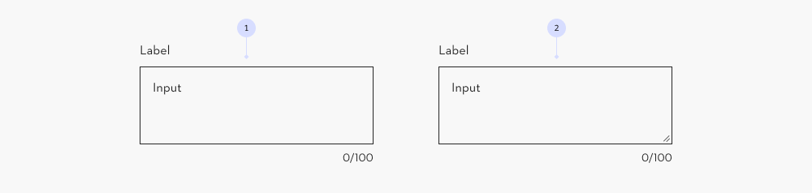

_Figure: Two medium textareas, each with the label "Label", the placeholder "Input" and the counter "0/100". Callout 1 points at the left textarea without a resize handle (automatic scaling); callout 2 points at the right textarea with a resize handle in its bottom right corner (manual scaling)._

**Automatic**

The text area grows automatically in height when entering the input. If the area grows the initial state should be at least the minimum height. The text area should stop growing when reaching the maximum size.

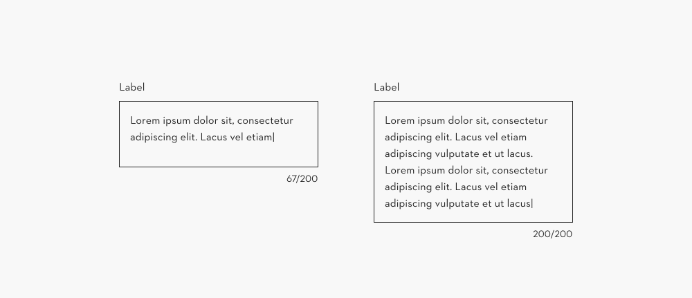

_Figure: Two medium textareas with the label "Label" showing automatic growth. The left one is at minimum height with two lines of "Lorem ipsum dolor sit, consectetur adipiscing elit. Lacus vel etiam|" and the counter "67/200"; the right one has grown taller to fit six lines of text and shows the counter "200/200". Neither has a resize handle._

### Overflow

More characters than max height requires a (native) scroll bar to be shown in the text area

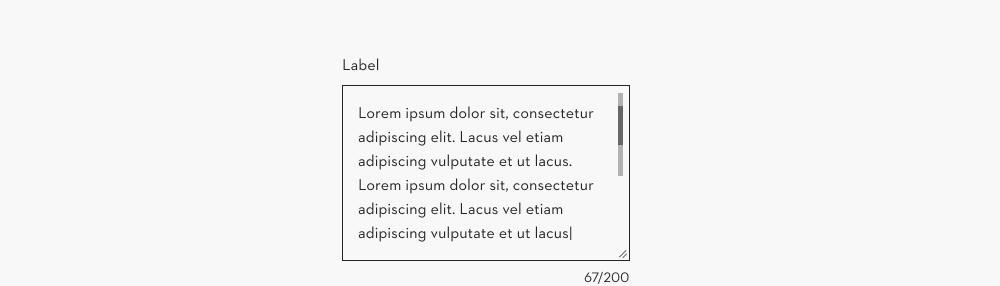

_Figure: Medium textarea with the label "Label" and a resize handle, filled with six lines of Lorem ipsum text and the counter "67/200". The text is taller than the maximum height, so a native vertical scroll bar appears on the right inside the textarea._
